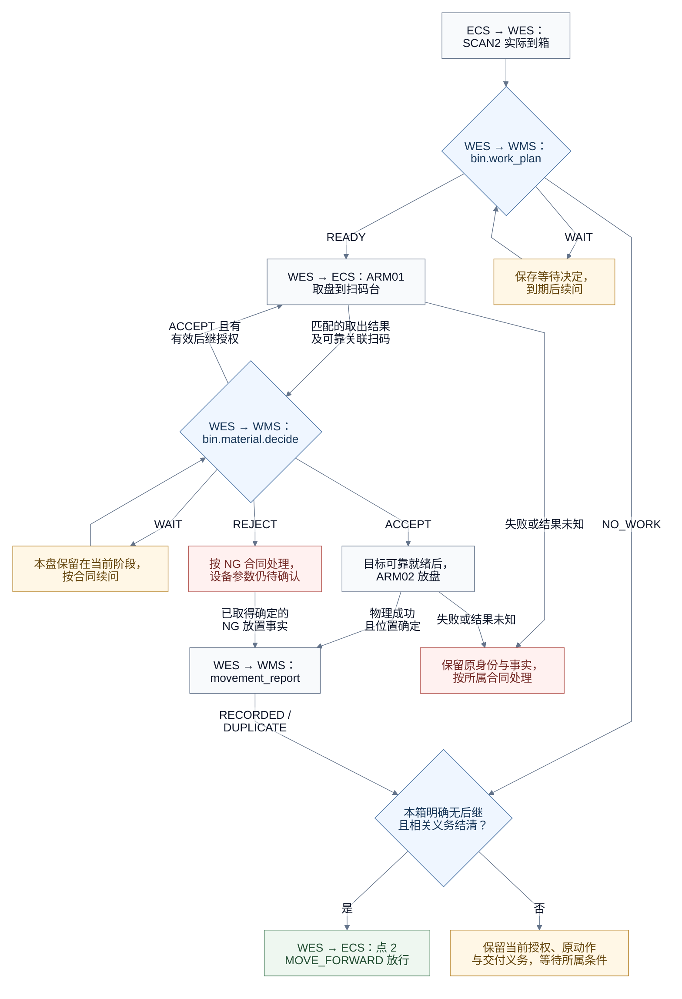
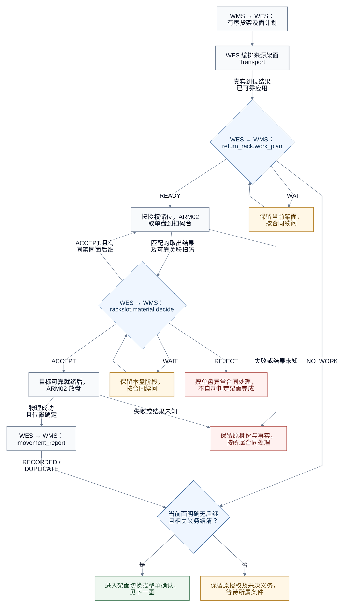
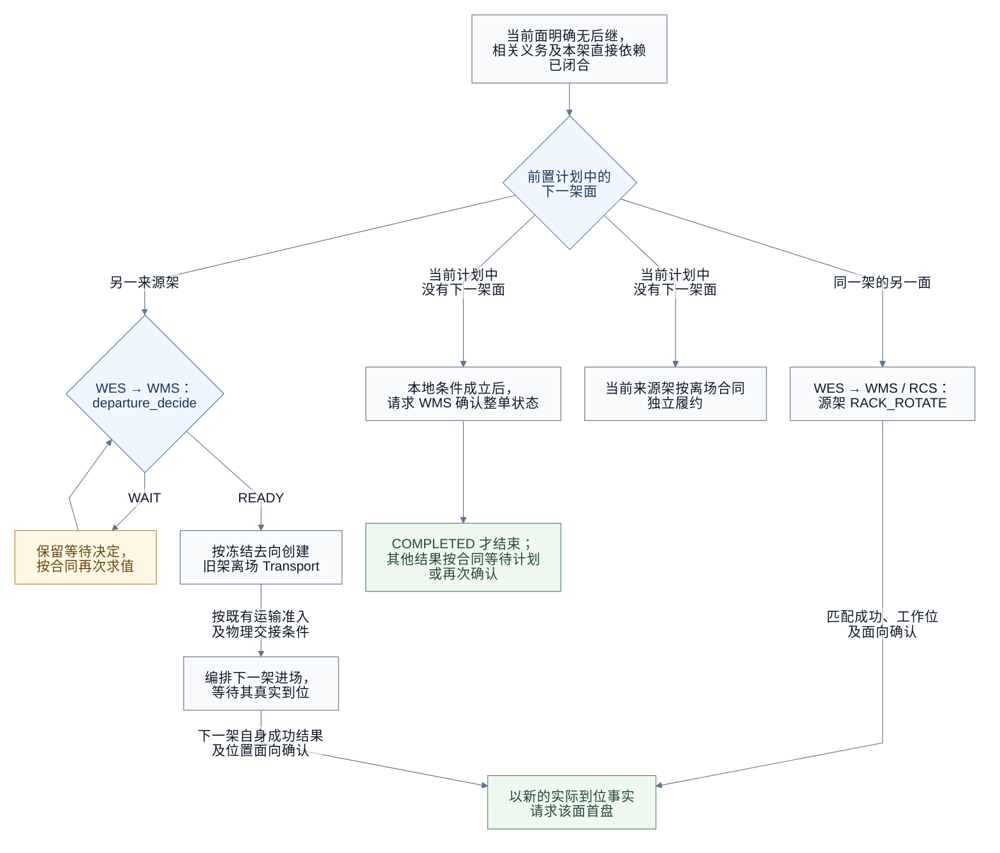

# 自动线 WES 与 WMS API 对接文档

状态：**本系统的自动线对接草案，未注册、未实施。** 本仓库尚无自动线业务包及对应业务 DTO，当前正式清单已登记粗分扫码、WMS 验证及首个 MOVE_FORWARD / Result 阶段，自动线未登记。本文 WMS payload、共用离场调整及盘次关联约束须经 WMS/WES 确认后，才能交付正式合同和实现。旧系统流程来源可查 [wes_backend 合同基线（c45e3ca7）](https://github.com/kaizhoumasha/wes_backend/blob/c45e3ca7be52ad6afc30b22e0b09406eefcb5714/docs/contracts/wms-outbound-picking-task-integration-requirements.md)，该历史基线不表示本文调整已经实施或获得对端确认；本系统公共约定见[交互索引](workline-business-api.md)。

各 API 直接携带本次业务对象、动作所需参数或观察事实。精简以去掉无关字段和无意义嵌套为准，不通过引用前序请求来补全 payload；`operation_id` 用于本次请求的幂等处理。

## 目录

- [完整交互顺序](#完整交互顺序)
- [1. 流程图](#1-流程图)
- [2. WMS API 与复用交互](#2-wms-api-与复用交互)
- [3. ECS 指令与回调](#3-ecs-指令与回调)
- [4. 公共规则](#4-公共规则)
- [5. 集中待确认项](#5-集中待确认项)
- [6. MOCK 与内部验收场景](#6-mock-与内部验收场景)

## 完整交互顺序

下表按路径列出交互和推进条件；接口名称、指令和回调均可点击跳转。表中的步骤号用于阅读导航，不作为请求字段。

| 路径 | 步骤 | 方向 | Operation / Event / Command | 交互 | 推进条件 |
| --- | --- | --- | --- | --- | --- |
| BIN | B1 | ECS → WES | [SCAN2 到箱事实](#21-确认到箱并向-wms-取得作业授权) | 保存实际箱码与本次到位事实 | 当前有效批次准入成立；本稿未展开到箱事件 payload |
| BIN | B2 | WES → WMS | [outbound.bin.work_plan@v1](#21-确认到箱并向-wms-取得作业授权) | 取得首个 Cell 授权 | READY 才取盘；WAIT 等待；NO_WORK 进入放行条件判断 |
| BIN | B3 | WES → ECS | [ARM01 / PICK_AND_PUT](#32-bin-来源取盘与扫码) | 从工作位料箱取盘到扫码台 | 本次来源授权有效，参数齐全 |
| BIN | B4 | ECS → WES | [原 ARM01 命令结果](#321-取盘成功回调) | 保存可靠取出结果 | 匹配 command_code 的确定结果，ACK 不代表完成 |
| BIN | B5 | ECS → WES | [SCAN_COMPLETED](#322-扫码回传) | 保存本盘完整条码 | 扫码必须与原取盘可靠关联 |
| BIN | B6 | WES → WMS | [outbound.bin.material.decide@v1](#22-bin-物料决定) | 决定本盘去向和可选下一 Cell/盘 | ACCEPT 按目标执行；有效后继按取盘条件返回 B3，不统一等待本盘报告 ACK |
| BIN | B7 | WES → ECS | [ARM02 / PICK_AND_PUT](#33-目标放盘与结果) | 将本盘放到授权目标 | 需要时先完成目标换面或换架，并取得可靠就绪事实 |
| BIN | B8 | ECS → WES | [原 ARM02 命令结果](#331-目标放盘成功回调) | 保存实际放盘结果 | 物理成功且位置确定后才能报告完成 |
| BIN | B9 | WES → WMS | [outbound.material.movement_report@v1](#23-物料位置上报) | 上报本盘实际移动事实 | RECORDED / DUPLICATE 仅闭合本次交付；后继取料条件见 B6 |
| BIN | B10 | WES → ECS | [点 2 / MOVE_FORWARD](#35-整箱放行) | 整箱正常放行 | 明确 NO_WORK，或无后继、无待消费授权且本箱义务结清 |
| RackSlot | R1 | WMS → WES | [outbound.picking_task.plan_delta@v1](#24-退料货架前置计划) | 安排有序来源货架及面 | 计划连续应用；不提前安排全部 SLOT |
| RackSlot | R2 | WES → WMS → RCS | [来源架 Transport](#272-按前置计划推进来源) | 编排当前计划架面进场 | 按既有 Transport 合同执行，提交接纳不代表到位 |
| RackSlot | R3 | WMS → WES | [原 Transport 结果](#272-按前置计划推进来源) | 保存来源架真实到位事实 | 原成功结果、实际工作位及面向匹配并已可靠应用 |
| RackSlot | R4 | WES → WMS | [outbound.return_rack.work_plan@v1](#25-退料货架到位后的作业请求) | 取得当前面首个储位授权 | READY 才取盘；NO_WORK 进入面级收口；WAIT 等待 |
| RackSlot | R5 | WES → ECS | [ARM02 来源取盘 / PICK_AND_PUT](#34-rackslot-来源取盘) | 从授权储位取单盘到扫码台 | 授权有效且完整设备参数已确认 |
| RackSlot | R6 | ECS → WES | [原取盘结果与扫码](#34-rackslot-来源取盘) | 保存取出结果和本盘条码 | 两份事实可靠关联；设备字段仍有待确认项 |
| RackSlot | R7 | WES → WMS | [outbound.rackslot.material.decide@v1](#26-rackslot-物料决定) | 决定本盘去向及同面下一储位 | next_source_action 只允许当前架、当前面；有效后继按设备条件返回 R5 |
| RackSlot | R8 | WES → ECS | [ARM02 目标放盘 / PICK_AND_PUT](#341-rackslot-后续目标放置) | 按本盘授权目标放置 | 目标可靠就绪，使用本盘参数 |
| RackSlot | R9 | ECS → WES | [原目标放盘结果](#331-目标放盘成功回调) | 保存本盘实际位置 | 匹配的确定成功结果及位置事实齐备 |
| RackSlot | R10 | WES → WMS | [outbound.material.movement_report@v1](#23-物料位置上报) | 完整上报 RackSlot 来源与实际去向 | RECORDED / DUPLICATE 闭合本次交付；后继取料条件见 R7 |
| RackSlot | R11 | WES | [当前面结束条件](#27-退料架面结束与换面换架) | 收口本面授权及逐盘义务 | 确定无后继且相关义务闭合；WAIT、未知及 REJECT 字段缺省不能代替 |
| 换面 | R12a | WES → WMS → RCS | [源架 RACK_ROTATE](#272-按前置计划推进来源) | 切换到下一计划面 | 该面真实到位后回到 R4，重新请求首盘 |
| 换架 | R12b | WES → WMS | [rack.departure_decide@v1](#272-按前置计划推进来源) | 按拟议共用合同决定旧架去向并编排原离场 Transport | READY 冻结去向；WAIT 等待；下一架自己的真实到位触发 R4 |
| 无下一架面 | R12c | WES → WMS | [outbound.picking_task.completion_confirm@v1](#273-没有下一架面与整单完成) | 确认整单状态 | 本地条件成立后请求；COMPLETED 才结束，不能仅凭当前计划耗尽 |
| NG / 空取 | 分支 | 按各自合同 | [异常范围与待确认项](#5-集中待确认项) | 保留已确认事实、原授权及未决义务 | 不把 NG、空取、扫码失败或未知结果混为同一种完成 |

命令结果和扫码事件是不同事实，可以乱序到达，须可靠关联并齐备后才能推进；表中列序仅用于阅读导航。任何提交 ACK 都不代表物理完成；表中的后继循环表示授权推进，实际运动仍由对应设备合同及 ECS/PLC 互锁裁决。

## 1. 流程图

### 1.1 BIN 逐盘处理



有效后继授权可在当前盘 PUT 或位置上报尚未闭合时被消费，仍须满足前一栈顶可靠取出、设备交接及[盘次唯一性约束](#plate-correlation)；同码歧义盘不得获得第二份最终去向授权。图中的循环不要求所有后继统一等待当前盘报告 ACK。

### 1.2 RackSlot 逐盘处理



`ACCEPT` 省略 `next_source_action` 才表达该正常分支的明确无后继。退料来源取盘和目标放盘均使用 ARM02；授权循环不表示同一机械臂可以同时执行两个物理动作。

### 1.3 源架面切换与整单确认



源架换面、换架不使用目标侧 `target_preparation`。新架面真实到位后重新请求首盘，不沿用上一面的授权；当前计划耗尽不直接等于整单完成。

## 2. WMS API 与复用交互

| Operation / 交互 | 方向与端点 | 业务含义 |
| --- | --- | --- |
| [outbound.bin.work_plan@v1](#21-确认到箱并向-wms-取得作业授权) | WES → WMS，`POST /api/v1/wes/decisions` | 工作位料箱的首个 Cell 授权 |
| [outbound.bin.material.decide@v1](#22-bin-物料决定) | WES → WMS，`POST /api/v1/wes/decisions` | BIN 当前盘去向及可选后继 |
| [outbound.material.movement_report@v1](#23-物料位置上报) | WES → WMS，`POST /api/v1/wes/facts` | 本盘实际移动事实 |
| [outbound.picking_task.plan_delta@v1](#24-退料货架前置计划) | WMS → WES，`POST /api/v1/wms/events` | 有序退料来源货架及面计划 |
| [outbound.return_rack.work_plan@v1](#25-退料货架到位后的作业请求) | WES → WMS，`POST /api/v1/wes/decisions` | 当前到位架面的首个储位授权 |
| [outbound.rackslot.material.decide@v1](#26-rackslot-物料决定) | WES → WMS，`POST /api/v1/wes/decisions` | RackSlot 当前盘去向及同面后继 |
| [源架 Transport 与离场决定](#272-按前置计划推进来源) | 沿现有 Transport 及 WMS 离场合同 | 编排源架换面、旧架离场与新架进场 |
| [outbound.picking_task.completion_confirm@v1](#273-没有下一架面与整单完成) | WES → WMS，沿既有任务状态确认合同 | 当前计划耗尽后的权威整单状态确认 |

各接口保留完整请求、响应分支和字段规范。公共信封、错误与重复请求规则见[公共规则](#4-公共规则)。

### 2.1 确认到箱并向 WMS 取得作业授权

料箱到达工作位并完成 SCAN2 后，WES 保存实际箱码和到位记录，向 WMS 请求本次作业授权。WMS 返回 `READY`、`NO_WORK` 或 `WAIT`，分别表示授权处理指定料格、当前料箱无须取料或暂时等待。

#### 2.1.1 接口

| 项目 | 值 |
| --- | --- |
| 调用方向 | WES → WMS |
| Method | `POST` |
| URL | `{{WMS_BASE_URL}}/api/v1/wes/decisions` |
| Content-Type | `application/json`，UTF-8 |
| operation | `outbound.bin.work_plan@v1` |
| Body 上限 | `256 KiB` |

#### 2.1.2 请求

```json
{
  "operation_id": "019f3407-8cf2-750a-af59-43366bc44e20",
  "operation": "outbound.bin.work_plan@v1",
  "timestamp": 1786064800000,
  "data": {
    "task_id": "PICK-20260811-001",
    "bin_code": "BIN-001",
    "scanned_at": 1786064799900
  }
}
```

| 字段 | JSON 类型 | 必填 | 说明与约束 |
| --- | --- | --- | --- |
| `operation_id` | string | 是 | 本次请求身份，小写 RFC 9562 UUIDv7；响应原样返回 |
| `operation` | string | 是 | 固定为 `outbound.bin.work_plan@v1` |
| `timestamp` | integer | 是 | 请求时间，UTC Unix 毫秒，范围 `0..9223372036854775807` |
| `data` | object | 是 | 请求业务数据 |
| `data.task_id` | string | 是 | WMS 下发的拣料任务编号，原值传递 |
| `data.bin_code` | string | 是 | SCAN2 实际扫描到的料箱编号 |
| `data.scanned_at` | integer | 是 | 本次 SCAN2 有效读码发生时间，UTC Unix 毫秒，范围同 `timestamp`；不是 HTTP 发送时间 |

`task_id`、`bin_code` 必须匹配正则 `[A-Za-z0-9][A-Za-z0-9._:/-]{0,99}`。

#### 2.1.3 成功响应

HTTP 状态固定为 `200`，`code` 固定为 `DECIDED`。公共字段见[公共响应说明](#41-wms-公共响应字段)，`data` 按以下三种结果分支返回。

##### READY

```json
{
  "operation_id": "019f3407-8cf2-750a-af59-43366bc44e20",
  "code": "DECIDED",
  "timestamp": 1786064800100,
  "data": {
    "result": "READY",
    "cell_id": "BIN-0013",
    "cell_index": 3,
    "bin_type": 3,
    "reel_layer": 1,
    "reel_thickness": 20,
    "reel_diameter": 15
  }
}
```

| 字段 | JSON 类型 | 必填 | 说明与约束 |
| --- | --- | --- | --- |
| `data.result` | string | 是 | 固定为 `READY`，授权处理返回的单个料格 |
| `data.cell_id` | string | 是 | WMS 料格业务编码，按 `BIN_ID + INDEX` 编码；匹配正则 `[A-Za-z0-9][A-Za-z0-9._:/-]{0,99}` |
| `data.cell_index` | integer | 是 | 料格在料箱内的定位号，枚举 `1..7`；独立于 `cell_id` 提供 |
| `data.bin_type` | integer | 是 | 料箱类型，枚举 `2`、`3`、`6` |
| `data.reel_layer` | integer | 是 | 料盘层数 |
| `data.reel_thickness` | number | 是 | 单盘厚度，单位毫米；有限数值 |
| `data.reel_diameter` | number | 是 | 料盘直径，单位寸；有限数值 |

`READY` 不发送 `retry_after_ms`；返回单个 `cell_id`，不发送 `cell_ids` 数组。

##### NO_WORK

```json
{
  "operation_id": "019f3407-8cf2-750a-af59-43366bc44e20",
  "code": "DECIDED",
  "timestamp": 1786064800100,
  "data": {
    "result": "NO_WORK"
  }
}
```

| 字段 | JSON 类型 | 必填 | 说明与约束 |
| --- | --- | --- | --- |
| `data.result` | string | 是 | 固定为 `NO_WORK`，当前料箱无须取料 |

`NO_WORK` 仅发送 `result`，不发送 `READY` 分支字段或 `retry_after_ms`。

##### WAIT

```json
{
  "operation_id": "019f3407-8cf2-750a-af59-43366bc44e20",
  "code": "DECIDED",
  "timestamp": 1786064800100,
  "data": {
    "result": "WAIT",
    "retry_after_ms": 1000
  }
}
```

| 字段 | JSON 类型 | 必填 | 说明与约束 |
| --- | --- | --- | --- |
| `data.result` | string | 是 | 固定为 `WAIT`，当前暂不能给出作业授权 |
| `data.retry_after_ms` | integer | 是 | 再次请求前的等待毫秒数，范围 `1..60000` |

`WAIT` 不发送 `READY` 分支字段。

#### 2.1.4 错误响应

见[公共错误响应](#42-wms-公共错误响应)。

#### 2.1.5 报文与重复请求约束

公共约束见[公共报文与重复请求规则](#43-wms-公共报文与重复请求规则)。

- 收到确定的 `WAIT` 后，再次请求使用新的 `operation_id` 和请求 `timestamp`，`data.task_id + data.bin_code + data.scanned_at` 沿用本次 SCAN2 原值。
- 同一料箱实际再次到达 SCAN2 时，以新的 `operation_id` 和该次实际 `scanned_at` 发起请求。

### 2.2 BIN 物料决定

WMS 返回 `READY` 后，来源机械臂按授权取出栈顶料盘并扫码。取得与本次取盘可靠关联的完整条码后，WES 调用物料决定 API，由 WMS 返回本盘去向，并在有后继时给出下一盘或下一 Cell 的取料授权。

#### 2.2.1 接口

| 项目 | 值 |
| --- | --- |
| 调用方向 | WES → WMS |
| Method | `POST` |
| URL | `{{WMS_BASE_URL}}/api/v1/wes/decisions` |
| Content-Type | `application/json`，UTF-8 |
| operation | `outbound.bin.material.decide@v1` |
| Body 上限 | `256 KiB` |

#### 2.2.2 请求

以下为料箱到达工作位后，从 `BIN_CELL` 取盘的请求。

```json
{
  "operation_id": "019f3410-af77-71fd-9bde-0df75fcdeea1",
  "operation": "outbound.bin.material.decide@v1",
  "timestamp": 1786064900000,
  "data": {
    "task_id": "PICK-20260811-001",
    "bin_code": "BIN-001",
    "cell_id": "BIN-0013",
    "barcode": "P032-0561-000HF,Q3000,M0805S106K160CT,D260505,L100R028291,S72052872716100149602",
    "scanned_at": 1786064899900
  }
}
```

| 字段 | JSON 类型 | 必填 | 说明与约束 |
| --- | --- | --- | --- |
| `operation_id` | string | 是 | 本次请求身份，小写 RFC 9562 UUIDv7；响应原样返回 |
| `operation` | string | 是 | 固定为 `outbound.bin.material.decide@v1` |
| `timestamp` | integer | 是 | 请求时间，UTC Unix 毫秒，范围 `0..9223372036854775807` |
| `data` | object | 是 | 请求业务数据 |
| `data.task_id` | string | 是 | 当前拣料任务编号 |
| `data.bin_code` | string | 是 | 本次工作料箱编号 |
| `data.cell_id` | string | 是 | 本次取盘所属的 WMS 料格业务编码 |
| `data.barcode` | string | 是 | 完整扫码原文，非空，最多 `1000` 个 Unicode code point；不拆分、截断或转换 |
| `data.scanned_at` | integer | 是 | 本盘完整条码形成时间，UTC Unix 毫秒，范围同 `timestamp` |

`task_id`、`bin_code`、`cell_id` 必须匹配正则 `[A-Za-z0-9][A-Za-z0-9._:/-]{0,99}`。
operation 已明确料箱取料业务，请求不再套 `source_locator` 或发送来源类型字段。请求不发送原来源 `rack_id`、`rack_face`、`plan_revision` 或设备定位字段 `cell_index`。
WMS 必须将请求唯一关联到本任务当前未闭合的料箱作业并核对授权 Cell；无法唯一关联时返回 `409 / CONFLICT`、`reason_code=REFERENCE_CONFLICT`，不按条码或最近历史猜测。本接口不接受货架储位来源或返回货架储位后继。

#### 2.2.3 成功响应

HTTP 状态固定为 `200`，`code` 固定为 `DECIDED`。公共字段见[公共响应说明](#41-wms-公共响应字段)，`data` 按以下三种结果分支返回。

##### ACCEPT

```json
{
  "operation_id": "019f3410-af77-71fd-9bde-0df75fcdeea1",
  "code": "DECIDED",
  "timestamp": 1786064900100,
  "data": {
    "result": "ACCEPT",
    "target_locator": {
      "type": "RACK_SLOT",
      "rack_id": "TRANSFER-RACK-01",
      "rack_face": "A",
      "slot_id": "A-05",
      "rack_layer": 1,
      "rack_column": 1
    },
    "next_source_action": {
      "cell_id": "BIN-0013",
      "cell_index": 3,
      "bin_type": 3,
      "reel_layer": 1,
      "reel_thickness": 20,
      "reel_diameter": 15
    }
  }
}
```

| 字段 | JSON 类型 | 必填 | 说明与约束 |
| --- | --- | --- | --- |
| `data.result` | string | 是 | 固定为 `ACCEPT`，本盘已获精确目标授权 |
| `data.target_locator` | object | 是 | WMS 已预留的唯一目标储位 |
| `data.target_locator.type` | string | 是 | 固定为 `RACK_SLOT` |
| `data.target_locator.rack_id` | string | 是 | 目标货架编号 |
| `data.target_locator.rack_face` | string | 是 | 目标货架面，长度 `1..10` 个 Unicode code point，不含 NUL；原样传递 |
| `data.target_locator.slot_id` | string | 是 | WMS 目标储位编码 |
| `data.target_locator.rack_layer` | integer | 是 | 目标货架层号 |
| `data.target_locator.rack_column` | integer | 是 | 目标货架列号 |
| `data.next_source_action` | object | 条件 | 有下一盘或下一 Cell 时提供；无后继时省略 |
| `data.next_source_action.cell_id` | string | 条件 | 后继料格业务编码 |
| `data.next_source_action.cell_index` | integer | 条件 | 后继料格定位号，枚举 `1..7` |
| `data.next_source_action.bin_type` | integer | 条件 | 料箱类型，枚举 `2`、`3`、`6` |
| `data.next_source_action.reel_layer` | integer | 条件 | 后继取料的料盘层数 |
| `data.next_source_action.reel_thickness` | number | 条件 | 后继取料的单盘厚度，单位毫米；有限数值 |
| `data.next_source_action.reel_diameter` | number | 条件 | 后继取料的料盘直径，单位寸；有限数值 |
| `data.target_preparation` | string | 条件 | 枚举 `ROTATE`、`REPLACE`；目标需要换面或换架时提供，无需准备时省略 |

`rack_id`、`slot_id`、`cell_id` 使用与请求业务编码相同的正则约束。
`next_source_action` 出现时，其六个子字段全部必填，可以授权同 Cell 下一盘或另一 Cell；省略表示本次授权范围内无后续来源，不发送 `null`。

`target_preparation` 直接使用枚举值，不再套单字段 `mode` 对象。两种字段片段如下，目标货架及面均取自同一响应的 `target_locator`：

```json
{
  "target_preparation": "ROTATE"
}
```

```json
{
  "target_preparation": "REPLACE"
}
```

`ROTATE` 表示同一目标货架换面，`REPLACE` 表示换成 `target_locator` 指定的新货架。当前货架离场去向由独立的 `rack.departure_decide@v1` 决定，本响应不携带旧架离场目的地。该接口为本系统拟议共用合同，名称及字段约束尚待确认；请求仅含必填的 `workline_code + rack_id + current_location + current_face`，工作线编码沿用原业务上下文并与货架/工作位一致，位置为已确认的 `RACK_POSITION`，面向不适用或无法确认时显式为 `null`，不发送 `task_id`。状态与完整示例见[共用离场合同](workline-business-api.md#货架离场决定的拟议共用合同)。
`ACCEPT` 不发送 `REJECT` 或 `WAIT` 分支字段。

##### REJECT

```json
{
  "operation_id": "019f3410-af77-71fd-9bde-0df75fcdeea1",
  "code": "DECIDED",
  "timestamp": 1786064900100,
  "data": {
    "result": "REJECT",
    "business_exception_code": "MATERIAL_REJECTED",
    "ng_locator": {
      "type": "NG_ZONE",
      "zone_code": "MATERIAL_NG_01"
    },
    "source_disposition": "CONTINUE"
  }
}
```

| 字段 | JSON 类型 | 必填 | 说明与约束 |
| --- | --- | --- | --- |
| `data.result` | string | 是 | 固定为 `REJECT`，WMS 已形成确定的异常处理决定 |
| `data.business_exception_code` | string | 是 | 枚举 `MATERIAL_REJECTED`、`SOURCE_CELL_MISMATCH` |
| `data.ng_locator` | object | 是 | WMS 批准的 NG 位置 |
| `data.ng_locator.type` | string | 是 | 固定为 `NG_ZONE` |
| `data.ng_locator.zone_code` | string | 是 | NG 区域编码，使用与请求业务编码相同的正则约束 |
| `data.source_disposition` | string | 是 | `CONTINUE` 表示本盘确认进入 NG 区后允许当前 Cell 继续取料；`CLOSE` 表示本盘确认进入 NG 区后关闭当前来源 |

| `business_exception_code` | 含义 | 允许的 `source_disposition` |
| --- | --- | --- |
| `MATERIAL_REJECTED` | 本盘物料被拒绝 | `CONTINUE`、`CLOSE` |
| `SOURCE_CELL_MISMATCH` | 来源料格不匹配 | 仅 `CLOSE` |

`CONTINUE` 后再次取料所需的完整参数来源仍需双方明确，不以旧层数或旧授权推算下一盘参数。

`REJECT` 不发送 `target_locator`、`target_preparation`、`next_source_action` 或 `retry_after_ms`。

##### WAIT

```json
{
  "operation_id": "019f3410-af77-71fd-9bde-0df75fcdeea1",
  "code": "DECIDED",
  "timestamp": 1786064900100,
  "data": {
    "result": "WAIT",
    "retry_after_ms": 1000
  }
}
```

| 字段 | JSON 类型 | 必填 | 说明与约束 |
| --- | --- | --- | --- |
| `data.result` | string | 是 | 固定为 `WAIT`，当前暂不能形成最终资格或精确目标 |
| `data.retry_after_ms` | integer | 是 | 再次请求前的等待毫秒数，范围 `1..60000` |

`WAIT` 仅发送 `result` 和 `retry_after_ms`，不发送 `ACCEPT` 或 `REJECT` 分支字段。

#### 2.2.4 错误响应

公共字段见[公共响应说明](#41-wms-公共响应字段)；HTTP 状态、错误码及 `data` 字段约束与 [公共错误响应](#42-wms-公共错误响应)一致。

业务结果 `200 / DECIDED`、`data.result=REJECT` 与请求校验失败 `422 / REJECTED` 分别使用上述各自的报文结构。

#### 2.2.5 报文与重复请求约束

- 字段大小写、JSON 类型、空值、冗余字段和幂等冲突规则与 [公共报文与重复请求规则](#43-wms-公共报文与重复请求规则)一致。
- 响应未知或收到 `503 / UNAVAILABLE` 时，沿用原 `operation_id`、原 `timestamp` 和原请求内容；重复请求返回第一次的完整业务响应。
- 确定 `WAIT` 后，等待 `retry_after_ms` 再以新 `operation_id` 和请求 `timestamp` 重问，保持本盘 `task_id + bin_code + cell_id + barcode + scanned_at` 不变；相关已确认事实变化时可提前重问。
- 同一盘只能形成一个最终 `ACCEPT` 或 `REJECT`；确定结果后不以新的请求身份再次申请该盘的物料决定。
- 已扫描的后续同码盘若与前盘形成相同的未闭合业务键，保留本盘事实并按[盘次关联约束](#plate-correlation)等待，不复用前盘决定或重复取放。已确定的 `WAIT` 后仍按原事实、新请求身份续问。

### 2.3 物料位置上报

WMS 返回 `ACCEPT` 后，WES 按授权准备目标位置，并由目标机械臂放盘。取得与本次命令匹配的成功结果和确定的实际位置后，WES 调用本 API 上报实际放置结果。WMS 保存上报并更新位置、库存及相关占用后，返回 `RECORDED`；相同请求重复上报返回 `DUPLICATE`。前序 `REJECT` 指定的单盘 NG 放置完成后，也使用本 API 上报。

#### 2.3.1 接口

| 项目 | 值 |
| --- | --- |
| 调用方向 | WES → WMS |
| Method | `POST` |
| URL | `{{WMS_BASE_URL}}/api/v1/wes/facts` |
| Content-Type | `application/json`，UTF-8 |
| operation | `outbound.material.movement_report@v1` |
| Body 上限 | `256 KiB` |

#### 2.3.2 请求

本次上报直接说明哪个任务的哪一盘，从哪个料箱及料格取出、实际放到了哪里、何时完成。以下为正常放入目标货架的请求。

```json
{
  "operation_id": "019f3422-f4a8-7247-98f0-8118dfb7f45e",
  "operation": "outbound.material.movement_report@v1",
  "timestamp": 1786065500000,
  "data": {
    "task_id": "PICK-20260811-001",
    "source_locator": {
      "type": "BIN_CELL",
      "bin_code": "BIN-001",
      "cell_id": "BIN-0013"
    },
    "barcode": "P032-0561-000HF,Q3000,M0805S106K160CT,D260505,L100R028291,S72052872716100149602",
    "to_locator": {
      "type": "RACK_SLOT",
      "rack_id": "TRANSFER-RACK-01",
      "rack_face": "A",
      "slot_id": "A-05"
    },
    "occurred_at": 1786065499900
  }
}
```

| 字段 | JSON 类型 | 必填 | 说明与约束 |
| --- | --- | --- | --- |
| `operation_id` | string | 是 | 本次位置上报的新请求身份，小写 RFC 9562 UUIDv7；不复用物料决定请求的 `operation_id` |
| `operation` | string | 是 | 固定为 `outbound.material.movement_report@v1` |
| `timestamp` | integer | 是 | 请求时间，UTC Unix 毫秒，范围 `0..9223372036854775807` |
| `data` | object | 是 | 位置上报数据，拒绝额外字段 |
| `data.task_id` | string | 是 | 本次放置所属的拣料任务编号 |
| `data.source_locator` | object | 是 | 本盘实际取出的来源，支持下述两种完整位置结构 |
| `data.source_locator.type` | string | 是 | `BIN_CELL` 或 `RACK_SLOT`；本例为 `BIN_CELL` |
| `data.source_locator.bin_code` | string | 条件 | `BIN_CELL` 必填，本盘来源料箱编号 |
| `data.source_locator.cell_id` | string | 条件 | `BIN_CELL` 必填，本盘来源料格业务编码 |
| `data.barcode` | string | 是 | 本盘完整扫码原文，非空，最多 `1000` 个 Unicode code point；不拆分、截断或转换 |
| `data.to_locator` | object | 是 | 已实际放置的位置，按以下两种结构之一提供 |
| `data.occurred_at` | integer | 是 | 实际放置完成时间，UTC Unix 毫秒，范围同 `timestamp`；不是扫码时间或 HTTP 发送时间 |

上报自身提供完整业务数据。WMS 按任务、来源、条码及实际去向校验当前有效业务记录，不通过前序请求 ID 读取另一份报文来补齐字段；条码不单独作为全局唯一身份。

##### RackSlot 来源

退料货架单盘放置上报保持相同的 `task_id + source_locator + barcode + to_locator + occurred_at` 结构，`source_locator` 改为以下完整字段片段：

```json
{
  "source_locator": {
    "type": "RACK_SLOT",
    "rack_id": "RETURN-RACK-01",
    "rack_face": "A",
    "slot_id": "A-03"
  }
}
```

| 字段 | JSON 类型 | 必填 | 说明与约束 |
| --- | --- | --- | --- |
| `data.source_locator.type` | string | 是 | 固定为 `RACK_SLOT` |
| `data.source_locator.rack_id` | string | 是 | 本盘实际来源货架编号 |
| `data.source_locator.rack_face` | string | 是 | 本盘实际来源面，长度 `1..10` 个 Unicode code point，不含 NUL，原样传递 |
| `data.source_locator.slot_id` | string | 是 | 本盘实际来源储位编码 |

来源为 `RACK_SLOT` 时不发送 `bin_code` 或 `cell_id`。这里上报单盘移动事实，来源字段自包含；取料资格和后继选择仍由第 2、5 节各自的物料决定 API 负责。

##### 正常放置 RACK_SLOT

| 字段 | JSON 类型 | 必填 | 说明与约束 |
| --- | --- | --- | --- |
| `data.to_locator.type` | string | 是 | 固定为 `RACK_SLOT` |
| `data.to_locator.rack_id` | string | 是 | 本盘实际放入的目标货架编号 |
| `data.to_locator.rack_face` | string | 是 | 实际目标货架面，长度 `1..10` 个 Unicode code point，不含 NUL，原样传递 |
| `data.to_locator.slot_id` | string | 是 | 本盘实际放入的目标储位编码 |

`to_locator` 发送上述四个字段，不携带物料决定响应中的设备定位参数 `rack_layer`、`rack_column`。

##### NG 放置 NG_ZONE

本盘已按授权完成 NG 放置时，`to_locator` 直接提供实际 NG 区域，字段片段如下：

```json
{
  "to_locator": {
    "type": "NG_ZONE",
    "zone_code": "MATERIAL_NG_01"
  }
}
```

| 字段 | JSON 类型 | 必填 | 说明与约束 |
| --- | --- | --- | --- |
| `data.to_locator.type` | string | 是 | 固定为 `NG_ZONE` |
| `data.to_locator.zone_code` | string | 是 | 本盘实际放入的 NG 区域编码 |

`task_id` 及位置业务编码匹配正则 `[A-Za-z0-9][A-Za-z0-9._:/-]{0,99}`。`data` 只发送 `task_id + source_locator + barcode + to_locator + occurred_at`；`BIN_CELL` 来源不携带原来源货架及面，两种来源均不发送 `plan_revision`、业务异常分类或 ECS `command_code`。

#### 2.3.3 成功响应

公共字段见[公共响应说明](#41-wms-公共响应字段)。HTTP 状态固定为 `200`，本 API 不返回 `DECIDED` 或 `data.result`。

##### RECORDED

```json
{
  "operation_id": "019f3422-f4a8-7247-98f0-8118dfb7f45e",
  "code": "RECORDED",
  "timestamp": 1786065500100,
  "data": {}
}
```

WMS 在同一事务中保存结果上报，并更新物料位置、库存、来源占用和目标储位占用后，返回 `RECORDED`。`data` 固定为 `{}`。

##### DUPLICATE

```json
{
  "operation_id": "019f3422-f4a8-7247-98f0-8118dfb7f45e",
  "code": "DUPLICATE",
  "timestamp": 1786065500100,
  "data": {}
}
```

同一身份、相同请求内容重复到达时，返回 `DUPLICATE`，复用首次成功响应的 `timestamp` 和 `data`，不重复更新业务数据。

#### 2.3.4 错误响应

公共字段见[公共响应说明](#41-wms-公共响应字段)；HTTP 状态、错误码及 `data` 字段约束与 [公共错误响应](#42-wms-公共错误响应)一致。

#### 2.3.5 报文与重复请求约束

- 字段名和枚举大小写敏感，按规定的 JSON 类型发送，不发送 `null`。本 API 的请求 `data` 拒绝额外字段。
- 正常放置须对应本盘最终 `ACCEPT` 及其精确目标；NG 放置须对应本盘最终 `REJECT` 及其 NG 去向。实际放置成功且位置确定后才发送上报。
- 幂等身份为 `(operation, operation_id)`。响应未知或收到 `503 / UNAVAILABLE` 时，沿用原 `operation_id`、原 `timestamp` 和原请求内容重试，不创建第二份上报身份。
- 同一身份、相同内容重复上报返回 `200 / DUPLICATE`；同一身份内容变化返回 `409 / CONFLICT`，`reason_code=IDEMPOTENCY_CONFLICT`。
- 收到 `RECORDED` 或 `DUPLICATE` 即完成本次上报确认，不等待额外结果回调。

<a id="plate-correlation"></a>

##### 盘次关联约束（草案，待双方确认）

本稿保持上报 payload 自包含，不新增执行 ID，也不通过前序请求补齐字段。为使完成报告唯一对应已授权物料，拟采用以下约束；确认前不得注册或执行依赖该约束的正式业务：

- 未闭合单盘的业务键为 `task_id + 完整 source_locator + barcode`。BIN 来源包含 `type + bin_code + cell_id`；RackSlot 来源包含 `type + rack_id + rack_face + slot_id`。按字段值精确比较，不按条码单独匹配，也不按最近记录或时间接近猜测。
- WMS 在形成最终 `ACCEPT / REJECT` 的事务内，保证同一业务键至多存在一个尚未收妥完成报告的最终授权，并保留该盘原扫码事实及决定。后续同码盘可以先保存取盘/扫码事实，但前盘报告未收妥时返回 `WAIT`，不再形成第二份最终授权。WES 也须等原报告的 `RECORDED / DUPLICATE` 被可靠应用后，才应用该键后续盘的最终授权；违反唯一性约束的决定留存核对，不创建放盘意图。不同业务键仍可按设备条件流水处理。
- 收到报告时，先按 `(operation, operation_id)` 处理已保存的收据：已知原报告重放返回原确认，不重新匹配后续盘。同身份正文漂移仍按 `IDEMPOTENCY_CONFLICT` 拒绝。
- 新报告必须唯一匹配该业务键的未闭合最终授权，并核对实际去向与该盘的 `ACCEPT.target_locator / REJECT.ng_locator`。匹配为零、多份或去向矛盾时返回 `409 / CONFLICT`、`reason_code=REFERENCE_CONFLICT`，不扣账、不闭合其他盘，也不通过新报告身份绕过。`occurred_at` 只表示完成事实，不能用于近似归属。
- 报告收据、位置/库存更新及授权闭合在 WMS 同一事务内持久化；WES 在自己的推进事务内消费原确认。报告延迟或响应未知时保留原物理完成和报告身份，仅恢复原报告，不重做取放。

这是一项待确认的唯一性方案，不是已执行的 WMS 验证结果。若对端需要同一业务键同时存在多份未闭合授权，须先另行冻结可唯一辨别盘次的自包含业务合同；不能直接放宽本约束而继续按上述字段猜测。

### 2.4 退料货架前置计划

WMS 前置计划只安排来源货架及面的业务顺序。WES 按计划编排进场，取得当前架面的真实到位事实后请求首个储位授权；每盘扫码后再通过[RackSlot 物料决定](#26-rackslot-物料决定)取得本盘去向及可选的下一储位。当前面无后继且相关义务结清后，按[架面结束与换面换架](#27-退料架面结束与换面换架)推进换面、换架或结束。

| 项目 | 值 |
| --- | --- |
| 调用方向 | WMS → WES |
| Method 与 URL | `POST {{WES_BASE_URL}}/api/v1/wms/events` |
| Content-Type | `application/json`，UTF-8 |
| operation | `outbound.picking_task.plan_delta@v1` |
| Body 上限 | `256 KiB` |

```json
{
  "operation_id": "019f3401-4a10-7b1a-aab5-f2df785324d1",
  "operation": "outbound.picking_task.plan_delta@v1",
  "timestamp": 1786060815000,
  "data": {
    "task_id": "PICK-20260811-001",
    "plan_revision": 1,
    "target_rack": {
      "rack_id": "TRANSFER-RACK-01",
      "rack_face": "A"
    },
    "added_return_racks": [
      {
        "rack_id": "RETURN-RACK-01",
        "rack_faces": ["A", "B"]
      },
      {
        "rack_id": "RETURN-RACK-02",
        "rack_faces": ["A"]
      }
    ]
  }
}
```

| 字段 | JSON 类型 | 必填 | 说明与约束 |
| --- | --- | --- | --- |
| `operation_id` | string | 是 | 本次计划消息身份，小写 RFC 9562 UUIDv7 |
| `operation` | string | 是 | 固定为 `outbound.picking_task.plan_delta@v1` |
| `timestamp` | integer | 是 | 发送时间，UTC Unix 毫秒，范围 `0..9223372036854775807` |
| `data` | object | 是 | 本次新增计划 |
| `data.task_id` | string | 是 | 当前拣料任务编号 |
| `data.plan_revision` | integer | 是 | 从 `1` 连续递增，范围 `1..9223372036854775807`；表示计划增量顺序，不是取盘指令身份 |
| `data.target_rack` | object | 条件 | AUTO 首版计划必填，后续版本省略；只指定初始接料货架及面，不指定单盘目标储位 |
| `data.target_rack.rack_id` | string | 条件 | 初始接料货架编号 |
| `data.target_rack.rack_face` | string | 条件 | 初始接料面 |
| `data.added_return_racks` | array | 条件 | 本次新增的退料来源货架，出现时非空，顺序具有业务含义 |
| `data.added_return_racks[].rack_id` | string | 条件 | 需要安排到位的退料货架编号 |
| `data.added_return_racks[].rack_faces` | array of string | 条件 | 非空、有序且不重复的待处理面；仅列本任务需要安排取料的面 |

货架及任务编码匹配正则 `[A-Za-z0-9][A-Za-z0-9._:/-]{0,99}`。各面值为长度 `1..10` 个 Unicode code point 的非空原文，不含 NUL，不做 A/B 或角度转换。

退料来源使用 `added_return_racks`，不再通过 `added_direct_picks` 提前列出全部 SLOT，也不发送条码或取盘尺寸。按货架数组顺序、再按每项 `rack_faces` 顺序展开；上例顺序为 `RETURN-RACK-01/A → RETURN-RACK-01/B → RETURN-RACK-02/A`，WES 不按编码另行排序。
同一任务中的同一货架面只安排一次。后续增量仅追加尚未安排的架面，并接到原顺序尾部，不重排已接收计划、不重开已结束面；首版 `target_rack` 不因后续增量改写。新增需求不能使在途动作换身份或改变已冻结请求。
本次没有新增退料架面时省略 `added_return_racks`，不发送空数组。后续版本仍须有有效的来源新增，不能发送空计划；其他来源类型沿其所属合同处理。

WES 将计划与接收事实可靠保存后，返回 HTTP `202`：

```json
{
  "operation_id": "019f3401-4a10-7b1a-aab5-f2df785324d1",
  "code": "RECEIVED",
  "timestamp": 1786060815100,
  "data": {}
}
```

相同身份、相同内容重复投递返回 `200 / DUPLICATE`，沿用首次接收时间和空 `data`；内容漂移返回 `409 / CONFLICT + IDEMPOTENCY_CONFLICT`。版本缺失时等待缺失版本，未连续应用的后续版本不授权执行；具体计划接收及错误语义沿用现行计划增量合同。

### 2.5 退料货架到位后的作业请求

#### 2.5.1 接口与请求

| 项目 | 值 |
| --- | --- |
| 调用方向 | WES → WMS |
| Method 与 URL | `POST {{WMS_BASE_URL}}/api/v1/wes/decisions` |
| Content-Type | `application/json`，UTF-8 |
| operation | `outbound.return_rack.work_plan@v1` |
| Body 上限 | `256 KiB` |

```json
{
  "operation_id": "019f3404-a100-7b01-8b01-000000000001",
  "operation": "outbound.return_rack.work_plan@v1",
  "timestamp": 1786064400000,
  "data": {
    "task_id": "PICK-20260811-001",
    "rack_id": "RETURN-RACK-01",
    "rack_face": "A",
    "arrived_at": 1786064399900
  }
}
```

| 字段 | JSON 类型 | 必填 | 说明与约束 |
| --- | --- | --- | --- |
| `operation_id` | string | 是 | 本次作业请求身份，小写 RFC 9562 UUIDv7 |
| `operation` | string | 是 | 固定为 `outbound.return_rack.work_plan@v1` |
| `timestamp` | integer | 是 | 请求时间，UTC Unix 毫秒，范围 `0..9223372036854775807` |
| `data` | object | 是 | 当前架面及本轮到位确认事实 |
| `data.task_id` | string | 是 | 当前拣料任务编号 |
| `data.rack_id` | string | 是 | 当前实际到位的退料货架编号 |
| `data.rack_face` | string | 是 | 当前实际到位面，须为本轮计划安排的面；面值约束同 [退料前置计划](#24-退料货架前置计划) |
| `data.arrived_at` | integer | 是 | WES 首次可靠确认本轮架面到位的时间，UTC Unix 毫秒，范围同 `timestamp`；保存一次，不随重试或 WAIT 续问刷新 |

任务绑定固定退料工作位，WES 在本地核对当前货架、实际位置及面向后才请求。请求不携带 `transport_task_id`、`outcome_revision` 或前序请求 ID；原 Transport 身份和证据继续由 WES 保存，不能因 wire 精简而丢失。
本作业请求同时表达本轮到位及取得取料授权，不再并列创建独立的退料货架到位报告。`arrived_at` 是 WES 对到位事实的首次可靠确认时间，不用 Transport 回调发送时间推定物理动作的精确完成时刻。

#### 2.5.2 作业响应

HTTP `200 / DECIDED`，公共字段见[公共响应说明](#41-wms-公共响应字段)。只返回首个储位，不返回整面储位数组。

##### READY

```json
{
  "operation_id": "019f3404-a100-7b01-8b01-000000000001",
  "code": "DECIDED",
  "timestamp": 1786064400100,
  "data": {
    "result": "READY",
    "rack_id": "RETURN-RACK-01",
    "rack_face": "A",
    "slot_id": "A-03"
  }
}
```

| 字段 | JSON 类型 | 必填 | 说明与约束 |
| --- | --- | --- | --- |
| `data.result` | string | 是 | 固定为 `READY` |
| `data.rack_id` | string | 是 | 本次单盘来源货架，须与当前请求一致 |
| `data.rack_face` | string | 是 | 本次单盘来源面，须与当前请求一致 |
| `data.slot_id` | string | 是 | 当前面首个获准取料的精确储位；匹配业务编码正则 |

以上为单盘来源的逻辑授权字段。设备取盘必需的定位及物理参数来源仍按 [RackSlot 来源取盘](#34-rackslot-来源取盘)的确认边界处理，参数未齐备时不下发 ECS 指令。

##### NO_WORK

```json
{
  "operation_id": "019f3404-a100-7b01-8b01-000000000001",
  "code": "DECIDED",
  "timestamp": 1786064400100,
  "data": {
    "result": "NO_WORK"
  }
}
```

`NO_WORK` 仅发送 `result`，确定当前面本轮没有取料工作，不代表其他面、其他货架或整张任务已完成。

##### WAIT

```json
{
  "operation_id": "019f3404-a100-7b01-8b01-000000000001",
  "code": "DECIDED",
  "timestamp": 1786064400100,
  "data": {
    "result": "WAIT",
    "retry_after_ms": 1000
  }
}
```

`WAIT` 仅发送 `result + retry_after_ms`，等待时间为整数 `1..60000` 毫秒；本面尚未形成最终作业决定，不取盘、不结束架面、不据此换面或离场。

#### 2.5.3 错误响应

作业请求的公共错误结构与 [公共错误响应](#42-wms-公共错误响应)一致。当前任务未安排该架面、无法唯一关联当前到位作业时，返回 `409 / CONFLICT`、`reason_code=REFERENCE_CONFLICT`，不根据最近历史或相近时间猜测。

#### 2.5.4 授权与重复请求约束

- 当前架面有有效计划依据，匹配原进场或换面动作的确定成功事实已可靠保存并应用，且当前实际工作位及面向符合授权后，才创建本轮作业请求。计划、搬运 ACK 或未知位置都不能代替真实到位。
- 响应未知或 `503 / UNAVAILABLE` 时沿用原 `operation_id`、原 `timestamp` 和完整请求重提；确定 `WAIT` 后，以新请求身份和发送时间续问，保持 `task_id + rack_id + rack_face + arrived_at` 不变。
- 同一身份、同一有效内容重放首次完整业务响应，不返回 `DUPLICATE`；内容变化返回 `409 / CONFLICT + IDEMPOTENCY_CONFLICT`。
- 一次到位只消费一个首盘授权；确定 `READY` 后不再调用本接口领取下一盘，后续只消费[RackSlot 物料决定](#26-rackslot-物料决定)的有效 `next_source_action`。同一授权的重放或重启不创建第二条取盘命令。
- 确定 `NO_WORK` 后不反复重问或重新开放本面。换到另一计划面并取得其真实到位事实后，才用新身份请求该面的首盘授权；不能通过新身份跳过原未决请求、未消费授权或在途动作。

### 2.6 RackSlot 物料决定

退料货架单盘已按有效授权取到扫码台，取得匹配原取盘的成功结果和可靠关联的完整条码后，WES 请求 WMS 决定本盘去向。有后继时，WMS 同时明确当前架面下一次取料的精确储位；不一次返回整面的储位清单。

#### 2.6.1 接口

| 项目 | 值 |
| --- | --- |
| 调用方向 | WES → WMS |
| Method | `POST` |
| URL | `{{WMS_BASE_URL}}/api/v1/wes/decisions` |
| Content-Type | `application/json`，UTF-8 |
| operation | `outbound.rackslot.material.decide@v1` |
| Body 上限 | `256 KiB` |

#### 2.6.2 请求

```json
{
  "operation_id": "019f3410-af77-71fd-9bde-0df75fcdeea2",
  "operation": "outbound.rackslot.material.decide@v1",
  "timestamp": 1786064900000,
  "data": {
    "task_id": "PICK-20260811-001",
    "rack_id": "RETURN-RACK-01",
    "rack_face": "A",
    "slot_id": "A-03",
    "barcode": "P032-0561-000HF,Q3000,M0805S106K160CT,D260505,L100R028291,S72052872716100149602",
    "scanned_at": 1786064899900
  }
}
```

| 字段 | JSON 类型 | 必填 | 说明与约束 |
| --- | --- | --- | --- |
| `operation_id` | string | 是 | 本次请求身份，小写 RFC 9562 UUIDv7 |
| `operation` | string | 是 | 固定为 `outbound.rackslot.material.decide@v1` |
| `timestamp` | integer | 是 | 请求时间，UTC Unix 毫秒，范围 `0..9223372036854775807` |
| `data` | object | 是 | 本次货架储位单盘取料事实 |
| `data.task_id` | string | 是 | 当前拣料任务编号 |
| `data.rack_id` | string | 是 | 本盘实际来源货架编号 |
| `data.rack_face` | string | 是 | 实际来源面，长度 `1..10` 个 Unicode code point，不含 NUL，原样传递 |
| `data.slot_id` | string | 是 | 本盘实际来源储位编码 |
| `data.barcode` | string | 是 | 完整扫码原文，非空，最多 `1000` 个 Unicode code point |
| `data.scanned_at` | integer | 是 | 本盘完整扫码时间，UTC Unix 毫秒，范围同 `timestamp` |

任务、货架和储位编码匹配正则 `[A-Za-z0-9][A-Za-z0-9._:/-]{0,99}`。operation 已明确货架储位业务，不再发送 `source_locator.type`，不接受 `bin_code`、`cell_id` 或料箱取料后继。
前置计划的同任务同架面只安排一次，`plan_revision` 用于接收计划增量，不作为本盘请求的必填引用。WMS 必须用本请求的任务、实际来源和当前有效单盘授权唯一核对本次作业；无法唯一关联时返回 `409 / CONFLICT`、`reason_code=REFERENCE_CONFLICT`，不按最近历史或条码单独猜测。

#### 2.6.3 成功响应

HTTP `200 / DECIDED`，公共字段见[公共响应说明](#41-wms-公共响应字段)。

##### ACCEPT

```json
{
  "operation_id": "019f3410-af77-71fd-9bde-0df75fcdeea2",
  "code": "DECIDED",
  "timestamp": 1786064900100,
  "data": {
    "result": "ACCEPT",
    "target_locator": {
      "type": "RACK_SLOT",
      "rack_id": "TRANSFER-RACK-01",
      "rack_face": "A",
      "slot_id": "A-05",
      "rack_layer": 1,
      "rack_column": 1
    },
    "next_source_action": {
      "rack_id": "RETURN-RACK-01",
      "rack_face": "A",
      "slot_id": "A-04"
    }
  }
}
```

| 字段 | JSON 类型 | 必填 | 说明与约束 |
| --- | --- | --- | --- |
| `data.result` | string | 是 | 固定为 `ACCEPT` |
| `data.target_locator` | object | 是 | 本盘唯一目标储位，包含以下六个子字段 |
| `data.target_locator.type` | string | 是 | 固定为 `RACK_SLOT` |
| `data.target_locator.rack_id` | string | 是 | 目标货架编号 |
| `data.target_locator.rack_face` | string | 是 | 目标面，长度 `1..10` 个 Unicode code point，不含 NUL |
| `data.target_locator.slot_id` | string | 是 | 目标储位业务编码 |
| `data.target_locator.rack_layer` | integer | 是 | 设备定位所需目标层号 |
| `data.target_locator.rack_column` | integer | 是 | 设备定位所需目标列号 |
| `data.target_preparation` | string | 条件 | `ROTATE` 或 `REPLACE`，无需目标准备时省略；目标来自 `target_locator` |
| `data.next_source_action` | object | 条件 | 当前面有下一储位取料授权时提供，无后继时省略 |
| `data.next_source_action.rack_id` | string | 条件 | 后继实际来源货架编号，须为当前作业货架 |
| `data.next_source_action.rack_face` | string | 条件 | 后继实际来源面，须为当前已到位作业面 |
| `data.next_source_action.slot_id` | string | 条件 | 下一次单盘取料的精确储位 |

`next_source_action` 出现时，三个来源字段全部提供，不引用前一次请求补齐来源。此处只列已明确的逻辑储位字段；ECS 取盘确需的其他物理参数及其权威来源仍按 [RackSlot 来源取盘](#34-rackslot-来源取盘)的设备确认边界处理，未齐备前不形成可下发指令。后继授权仅消费一次，不能把料箱后继参数用于本接口。
后继只能是当前货架、当前已到位面上的下一储位，不允许跨面或跨架。`ACCEPT` 明确省略该字段表示当前面本轮确定无后继，不表示下一来源尚未算出；完成本盘及当前面的相关义务后，按[架面结束与换面换架](#27-退料架面结束与换面换架)推进。不得重新授权已有未决取盘动作或本轮已完成的储位。

以下为独立的末盘 `ACCEPT` 响应示例，省略 `next_source_action`，不发送 `null` 或空对象：

```json
{
  "operation_id": "019f3410-af77-71fd-9bde-0df75fcdeea3",
  "code": "DECIDED",
  "timestamp": 1786065600100,
  "data": {
    "result": "ACCEPT",
    "target_locator": {
      "type": "RACK_SLOT",
      "rack_id": "TRANSFER-RACK-01",
      "rack_face": "A",
      "slot_id": "A-06",
      "rack_layer": 1,
      "rack_column": 2
    }
  }
}
```

##### REJECT 与 WAIT

| `data.result` | 必填字段 | 约束 |
| --- | --- | --- |
| `REJECT` | `business_exception_code + ng_locator + source_disposition` | `business_exception_code=MATERIAL_REJECTED`；`ng_locator.type=NG_ZONE`，`ng_locator.zone_code` 为 WMS 授权区域编码；`source_disposition=CLOSE`，关闭本盘来源，不推定整个架面完成 |
| `WAIT` | `retry_after_ms` | 整数 `1..60000`；尚未形成最终目标，不发送目标、NG 或后继字段 |

REJECT 不返回 `SOURCE_CELL_MISMATCH` 或 `CONTINUE`，不套用 Cell 的异常范围。异常后其他储位的后继授权规则待单独冻结，不通过关闭当前 SLOT 自动推导。

#### 2.6.4 错误响应与重复请求约束

错误结构与 [公共错误响应](#42-wms-公共错误响应)一致。响应未知或 `503 / UNAVAILABLE` 时沿用原 `operation_id`、原 `timestamp` 和完整请求重提，重复请求重放首次完整业务响应。
确定 `WAIT` 后使用新的 `operation_id` 和请求 `timestamp` 重问，保持本盘 `task_id + rack_id + rack_face + slot_id + barcode + scanned_at` 不变。不得以新身份绕过本盘已经形成的最终 `ACCEPT` 或 `REJECT`。

### 2.7 退料架面结束与换面换架

正常链按以下顺序推进：前置计划安排有序架面 → 当前架面真实到位 → `return_rack.work_plan` 返回首个储位 → 单盘取料扫码 → `rackslot.material.decide` 决定去向及同面下一储位 → 实际放置并上报。取得后继授权后回到单盘取料；确定无后继后进入面级收口。

#### 2.7.1 当前面结束条件

仅以下两种正常决定表示当前面确定无后继：

| WMS 决定 | 含义 | 面级收口条件 |
| --- | --- | --- |
| `return_rack.work_plan.NO_WORK` | 当前面本轮没有首盘取料工作 | 原作业请求已可靠应用，当前面没有已授权未消费或未闭合的单盘义务 |
| `rackslot.material.decide.ACCEPT` 省略 `next_source_action` | 当前盘有确定去向，且当前面本轮不再授权后续取盘 | 当前盘及本面其他已创建单盘均已物理闭合，必需位置上报已获 `RECORDED / DUPLICATE`，无待消费后继授权 |

`WAIT`、请求结果未知、未消费授权、取放结果未知以及尚未确认的位置上报均不构成当前面完成。`REJECT` 中未出现后继字段只表达本盘异常决定，不能套用 ACCEPT 的无后继语义；空取和异常分支按各自明确的处理合同闭合。
面级收口前不换面、不离场；同时仍须满足本架当前轮次的在途动作、已冻结回架分配及其他直接依赖的闭合条件。单纯父任务状态变化、查询不到候选或 ACK 不代替这些事实。

#### 2.7.2 按前置计划推进来源

| 下一计划架面 | WES 动作 | 继续取料的依据 |
| --- | --- | --- |
| 同一货架的另一面 | 按该面的原值创建源架换面 Transport，沿既有 `RACK_ROTATE` 合同执行 | 换面已取得匹配的权威成功结果，实际货架返回绑定工作位且面向为下一计划面，再以新身份请求该面的 `return_rack.work_plan` |
| 另一来源货架 | 请求拟议共用 `rack.departure_decide@v1` 决定旧架去向；`READY` 后创建原离场 Transport，按既有运输准入及物理交接条件编排下一架进场 | 下一架自身的匹配成功结果、实际工作位及计划面已确认，再请求其首盘作业；旧架独立未结搬运继续沿原身份履约 |
| 当前已应用计划中没有下一架面 | 当前来源作业暂时耗尽，按离场合同处理旧架，并在本地完成条件成立后请求任务状态确认 | 不再创建来源取盘命令；整单是否结束由 [整单确认规则](#273-没有下一架面与整单完成)中的 WMS 结果决定 |

换面或换架后不沿用上一面的 `READY` 或 `next_source_action`。新作业请求完整携带新的实际 `rack_id + rack_face + arrived_at`，不引用上一面请求 ID。
源架换面和搬运通过 WMS/Transport 执行，不作为 ARM02 的 ECS 指令。`target_preparation` 只用于当前盘的目标货架准备，不能用它指挥来源架换面或换架。
离场决定为 `WAIT` 时按该决定等待；搬运仅接纳或结果未知时，保留原身份、正文和直接依赖，不以 ACK 推断工作位已清空，也不换身份重建等价搬运。下一架的作业仍必须以其自己的真实到位事实为依据。

#### 2.7.3 没有下一架面与整单完成

“当前面无后继”“当前计划架面已耗尽”“PickingTask 已完成”分别判断。当前计划架面耗尽后，WES 在本地业务义务结清、计划增量连续应用、所需位置事实及交付均已确认时，调用既有 `outbound.picking_task.completion_confirm@v1`，携带 `task_id + last_applied_plan_revision`。

| WMS 结果 | 处理 |
| --- | --- |
| `COMPLETED` | 与当前计划及本地完成条件一致时结束任务 |
| `PLAN_REVISION_STALE` | 等待并连续应用缺失计划，再按新计划尾部的架面顺序继续；不重开已结束面 |
| `BUSINESS_IN_PROGRESS` | 保存本次等待决定，按合同条件再次确认，不把当前计划耗尽视为整单完成 |

货架离场及其可靠义务独立履约，不把无直接依赖的物理清场完成作为整单确认的统一前提；也不能用任务完成取消或伪造未决物理结果。

例如计划顺序为 `RETURN-RACK-01/A → RETURN-RACK-01/B → RETURN-RACK-02/A`：第一面明确无后继并结清后换到同架 B 面，B 面真实到位后重新请求首盘；B 面结清后按离场决定交接来源架，再由第二架 A 面自己的真实到位触发首盘请求；最后一面结清后请求 WMS 确认整单状态。

## 3. ECS 指令与回调

### 3.1 共用接口与回传格式

| 交互 | 调用方向 | Method 与 URL |
| --- | --- | --- |
| 下发设备指令 | WES → ECS | `POST {{ECS_BASE_URL}}/api/v1/device/command` |
| 回传指令结果 | ECS → WES | `POST {{WES_BASE_URL}}/api/v1/callback/result` |
| 上报扫码事件 | ECS → WES | `POST {{WES_BASE_URL}}/api/v1/callback/event` |

以上接口均使用 UTF-8 `application/json`。设备及位置编码取工作线实际绑定；下文 `ARM01`、`ARM02`、`STATION_WORK1`、`STATION_SCAN`、`STATION_A` 为对应正常链的示例值。`timeout=30000` 为示例毫秒值，实际值取指令创建时冻结的工作线配置。

#### 3.1.1 指令公共字段

| 字段 | JSON 类型 | 必填 | 说明与约束 |
| --- | --- | --- | --- |
| `device_code` | string | 是 | 执行设备编码 |
| `command_code` | string | 是 | WES 生成的本次设备命令身份；与 WMS `operation_id` 分别标识各自请求 |
| `task_type` | string | 是 | 设备动作类型，按下文对应步骤提供 |
| `priority` | integer | 是 | 固定为 `1` |
| `timeout` | integer | 是 | 期望完成时间，毫秒；超时不代表物理失败 |
| `timestamp` | integer | 是 | 指令创建时间，UTC Unix 毫秒 |
| `params` | object | 是 | 设备业务参数；机械臂的 `source`、`target` 放在此对象内 |

指令顶层只发送上述七个字段，不把 `source`、`target` 平铺到顶层。相同 `command_code` 重提时保持完整指令不变，ECS 不得再次驱动设备；结果未知不能通过更换命令身份再次执行。

#### 3.1.2 接纳响应

HTTP `200`，响应体为：

```json
{
  "code": 200,
  "message": "ACK"
}
```

`trace_id` 可选，出现时为非 `null` 的字符串。该 ACK 仅表示 ECS 已接纳，物理完成由匹配原 `command_code` 的结果回调确认，不套用 WMS 的 `DECIDED` 或 `RECORDED` 响应格式。

#### 3.1.3 结果回调公共字段

| 字段 | JSON 类型 | 必填 | 说明与约束 |
| --- | --- | --- | --- |
| `command_code` | string | 是 | 原设备命令身份 |
| `device_code` | string | 是 | 执行该命令的设备编码 |
| `result` | string | 是 | `SUCCESS` 或 `FAILED` |
| `finish_time` | integer | 是 | 实际完成时间，UTC Unix 毫秒 |
| `data` | object | 机械臂结果必填 | `actual_qty`：实际数量，成功为整数 `1`；`pick_and_put_result`：见下表 |
| `error_detail` | object 或 null | 条件 | `FAILED` 时必填对象，仅包含 `code`、`msg`；`SUCCESS` 时省略或为 `null` |

| `result` | `data.pick_and_put_result` | 含义 |
| --- | --- | --- |
| `SUCCESS` | `PUT_FINISHED` | 本次取放已完成 |
| `FAILED` | `PICK_FAILED` | 取料失败，不等于设备已确认空取 |
| `FAILED` | `PUT_FAILED` | 放料失败，不得发送已成功放置的 WMS 位置上报 |

失败错误码及供应商原厂码对应仍待设备方确认；不以占位错误码作为可执行约定。本系统的 ECS 错误响应及回调接收确认见[ECS 命令与结果合同](ecs-command.md)。设备字段来源可查 [wes_backend 自动机械臂附录基线（c45e3ca7）](https://github.com/kaizhoumasha/wes_backend/blob/c45e3ca7be52ad6afc30b22e0b09406eefcb5714/docs/integration/device-annex-automatic-picking-arms.md)；其中待确认字段仍须形成已确认设备附录，不能据历史示例推断本系统已有正式业务注册。

### 3.2 BIN 来源取盘与扫码
`work_plan` 返回 `READY` 后，WES 向来源机械臂 ARM01 下发 `PICK_AND_PUT`，从当前工作位料箱的授权 Cell 取出栈顶料盘并放到扫码台：

```json
{
  "device_code": "ARM01",
  "command_code": "019f3408-1a12-71ab-8cde-123456789001",
  "task_type": "PICK_AND_PUT",
  "priority": 1,
  "timeout": 30000,
  "timestamp": 1786064890000,
  "params": {
    "source": {
      "location_id": "STATION_WORK1",
      "location_type": "BIN",
      "bin_type": "3",
      "bin_cell_location": "3",
      "reel_layer": "1",
      "reel_thickness": "20",
      "reel_totalthickness": "20",
      "reel_diameter": "15"
    },
    "target": {
      "location_id": "STATION_SCAN",
      "location_type": "SCAN_PLATFORM"
    }
  }
}
```

| ECS 参数 | 来源及映射 |
| --- | --- |
| `source.location_id`、`target.location_id` | 工作线当前工作位、扫码台位置绑定 |
| `source.bin_type` | WMS `READY.bin_type` 的字符串形式，`2`、`3`、`6` 原编号直接转换 |
| `source.bin_cell_location` | WMS `READY.cell_index` 的字符串形式，范围 `"1".."7"`；不拆解 `cell_id` |
| `source.reel_layer` | WMS `READY.reel_layer` 的字符串形式 |
| `source.reel_thickness`、`source.reel_diameter` | WMS 对应参数的十进制字符串，厚度毫米、直径寸 |
| `source.reel_totalthickness` | 厚度乘层数的十进制字符串；本例为 `20 × 1 = "20"`，不引入浮点尾差或额外取整 |

#### 3.2.1 取盘成功回调

```json
{
  "command_code": "019f3408-1a12-71ab-8cde-123456789001",
  "device_code": "ARM01",
  "result": "SUCCESS",
  "finish_time": 1786064899000,
  "data": {
    "actual_qty": 1,
    "pick_and_put_result": "PUT_FINISHED"
  },
  "error_detail": null
}
```

#### 3.2.2 扫码回传

ARM01 取盘到扫码台后触发 `SCAN_COMPLETED`，不另行增加一条 `SCAN` 指令。扫码回传使用事件接口，已定义字段如下：

| 字段 | JSON 类型 | 值或说明 |
| --- | --- | --- |
| `device_code` | string | 触发本次扫码的来源机械臂，本正常链为 `ARM01` |
| `event_type` | string | 固定为 `SCAN_COMPLETED` |
| `timestamp` | integer | 本盘完整扫码时间，本例为 `1786064899900` |
| `data.location` | string | 当前扫码台绑定，本例为 `STATION_SCAN` |
| `data.barcode` | string | 完整条码原文，原样传给 `bin.material.decide.data.barcode` |

扫码与原取盘的可靠唯一关联方式仍待设备确认；以上字段表不构成完整可执行扫码合同，不擅自增加事件 `command_code`，也不按当前命令、时间接近或平台单盘容量推断归属。取盘成功事实和可靠关联的完整扫码事实齐备后，才进入 [BIN 物料决定](#22-bin-物料决定)。

`work_plan` 返回 `WAIT` 时不创建取盘指令；`NO_WORK` 时跳过取盘，按 [整箱放行](#35-整箱放行)处理。

### 3.3 目标放盘与结果
`outbound.bin.material.decide@v1` 返回 `ACCEPT`，且目标货架及面已按授权可靠就绪后，WES 向目标机械臂 ARM02 下发 `PICK_AND_PUT`：

```json
{
  "device_code": "ARM02",
  "command_code": "019f3408-1a12-71ab-8cde-123456789002",
  "task_type": "PICK_AND_PUT",
  "priority": 1,
  "timeout": 30000,
  "timestamp": 1786065490000,
  "params": {
    "source": {
      "location_id": "STATION_SCAN",
      "location_type": "SCAN_PLATFORM"
    },
    "target": {
      "location_id": "STATION_A",
      "location_type": "FIVE_LAYER_RACK",
      "rack_id": "TRANSFER-RACK-01",
      "rack_face": "A",
      "rack_layer": "1",
      "rack_column": "1",
      "reel_thickness": "20",
      "reel_diameter": "15"
    }
  }
}
```

| ECS 参数 | 来源及映射 |
| --- | --- |
| `source.location_id`、`target.location_id` | 扫码台及本次目标货架工作位的实际绑定；不把 `slot_id` 当成 `location_id` |
| `target.location_type` | 正常目标货架固定为 `FIVE_LAYER_RACK` |
| `target.rack_id`、`target.rack_face` | 本盘最终 `ACCEPT.target_locator` 的原值；面向不做 A/B 转换 |
| `target.rack_layer`、`target.rack_column` | 本盘最终 `ACCEPT.target_locator` 的整数转字符串；设备货架层为 `"1".."5"`，不猜列数上限 |
| `target.reel_thickness`、`target.reel_diameter` | 本盘原取盘指令已冻结的尺寸参数；不使用下一盘 `next_source_action` 的尺寸 |

#### 3.3.1 目标放盘成功回调

```json
{
  "command_code": "019f3408-1a12-71ab-8cde-123456789002",
  "device_code": "ARM02",
  "result": "SUCCESS",
  "finish_time": 1786065499900,
  "data": {
    "actual_qty": 1,
    "pick_and_put_result": "PUT_FINISHED"
  },
  "error_detail": null
}
```

该结果匹配本盘原放盘命令且实际位置确定后，才发送 [物料位置上报 `movement_report`](#23-物料位置上报)；`occurred_at` 使用本次实际放盘完成时间，不使用 HTTP ACK 时间。

| WMS 决定分支 | 对应设备处理 |
| --- | --- |
| `ACCEPT`，无需目标准备 | 目标可靠就绪后，执行上述 ARM02 放盘指令 |
| `ACCEPT + ROTATE / REPLACE` | 先按 WMS 决定完成所需货架 Transport，取得匹配到位事实后再放盘；不向 ECS 机械臂下发货架旋转或搬架指令 |
| `ACCEPT + next_source_action` | 沿 [BIN 来源取盘](#32-bin-来源取盘与扫码) 的 ARM01 指令结构，用后继授权的完整参数和新的 `command_code` 创建下一盘指令；前一栈顶可靠取出及授权有效是前提，实际交接由 ECS/PLC 裁决；遵守[盘次唯一性约束](#plate-correlation)，不要求所有不同业务键统一等待当前盘上报 ACK |
| `WAIT` | 本盘等待，不创建目标放盘指令，也不把 WAIT 当成 NG |
| `REJECT` | WMS `ng_locator` 已确定业务去向，但 NG 区域到 ECS 位置、执行设备及完整参数尚需冻结；本节不提供猜测的 NG 执行报文，也不直接把 `NG_ZONE` 用作 ECS `location_type` |

### 3.4 RackSlot 来源取盘
WMS `READY` 或后续 `next_source_action` 授权了精确储位，当前架面仍可靠就绪且授权未消费时，WES 准备一次 ARM02 单盘取料。

| 指令字段或输入 | 值或来源 |
| --- | --- |
| `device_code` | 退料单盘取料使用 ARM02 的实际绑定 |
| `command_code` | 本次单盘取料的新命令身份，按 [ECS 公共字段](#311-指令公共字段)处理 |
| `task_type` | `PICK_AND_PUT` |
| `params.source` | 本次授权完整提供的 `rack_id + rack_face + slot_id`；设备侧 `location_type` 及完整定位字段映射待确认 |
| `params.target.location_id` | 本工作线扫码台绑定，如 `STATION_SCAN` |
| `params.target.location_type` | `SCAN_PLATFORM` |

货架进场、换面及离场沿 WMS/Transport 路径执行，不向机械臂 ECS 发送搬架或旋转指令。单盘取料的设备来源定位及必要物理参数尚未冻结，本节不提供占位执行报文，不套用料箱参数；设备确认完整字段后才能形成可下发请求。
ARM02 将单盘放到扫码台后触发扫码，取得匹配原取盘的成功结果和可靠关联的完整条码后，调用[RackSlot 物料决定 API](#26-rackslot-物料决定)。

#### 3.4.1 RackSlot 后续目标放置
来源取盘使用 ARM02，设备参数边界见 [RackSlot 来源取盘](#34-rackslot-来源取盘)。本盘目标放置沿 [目标放盘](#33-目标放盘与结果)的目标指令字段组装，但使用本盘 RackSlot 决定的精确目标和本盘已确认的物理参数，不借用 BIN 来源或下一盘参数。
本盘成功放置及位置事实齐备后才能上报实际结果。

### 3.5 整箱放行
单盘位置上报收到 `RECORDED` 或 `DUPLICATE` 本身不创建新的 ECS 放行指令。仅当本次 `work_plan` 已返回 `NO_WORK`，或已明确没有后继来源、没有待消费授权且本箱全部逐盘义务已闭合时，WES 才创建点 2 的料箱放行指令。

指令使用 [ECS 公共字段](#311-指令公共字段)，本步骤取值如下：

| 字段 | 值或来源 |
| --- | --- |
| `device_code` | 当前工作线 `SCAN2` 绑定的放行设备编码 |
| `command_code` | 本箱本次点 2 放行的新命令身份；同一次放行的重复处理沿用该身份 |
| `task_type` | `MOVE_FORWARD` |
| `priority` | `1` |
| `timeout`、`timestamp` | 本次放行创建时的冻结超时配置及创建时间 |
| `params` | `{}` |

放行接纳 ACK 不证明箱已离开工作位。后续实际 SCAN3、SCAN4 到位和回架 Transport 分别按各自事实推进，不能用本次指令创建或 ACK 替代。

## 4. 公共规则

### 4.1 WMS 公共响应字段
以下字段适用于本文 WMS API 中所有带 JSON 响应体的响应；`400`、`413` 返回空响应体。ECS 的指令及回传格式见 [ECS 指令与回调](#3-ecs-指令与回调)。

| 公共字段 | JSON 类型 | 必填 | 说明与约束 |
| --- | --- | --- | --- |
| `operation_id` | string | 是 | 与对应请求的 `operation_id` 完全一致，原样返回 |
| `code` | string | 是 | 与 HTTP 状态配套：`202 / RECEIVED`、`200 / DECIDED`、`200 / RECORDED`、`200 / DUPLICATE`、`422 / REJECTED`、`409 / CONFLICT`、`503 / UNAVAILABLE`；各 API 使用其中规定的值 |
| `timestamp` | integer | 是 | 响应时间，UTC Unix 毫秒，范围 `0..9223372036854775807` |
| `data` | object | 是 | `DECIDED` 按各 API 的 `result` 分支定义；`RECEIVED`、`RECORDED`、`DUPLICATE` 固定为 `{}`；错误响应按错误码定义，`UNAVAILABLE` 固定为 `{}` |

### 4.2 WMS 公共错误响应
| HTTP 状态 | `code` | `data` |
| --- | --- | --- |
| `400` | 无 | 空响应体；非法 JSON 或无法提取合法 `operation_id` |
| `413` | 无 | 空响应体；原始 Body 超过 `256 KiB` |
| `422` | `REJECTED` | 必填 `reason_code`，枚举 `INVALID_ENVELOPE`、`UNSUPPORTED_OPERATION`、`INVALID_DATA`；仅 `INVALID_DATA` 可选填 `field_path` |
| `409` | `CONFLICT` | 必填 `reason_code`，枚举 `IDEMPOTENCY_CONFLICT`、`REVISION_CONFLICT`、`STATE_CONFLICT`、`REFERENCE_CONFLICT` |
| `503` | `UNAVAILABLE` | 固定为 `{}` |

`422`、`409`、`503` 的公共字段见[公共响应说明](#41-wms-公共响应字段)，`data` 按上表取值。
`field_path` 为 RFC 6901 JSON Pointer，长度 `1..256`，无值时省略，不发送 `null`。

#### 422 REJECTED

```json
{
  "operation_id": "019f3407-8cf2-750a-af59-43366bc44e20",
  "code": "REJECTED",
  "timestamp": 1786064800100,
  "data": {
    "reason_code": "INVALID_DATA",
    "field_path": "/data/bin_code"
  }
}
```

#### 409 CONFLICT

```json
{
  "operation_id": "019f3407-8cf2-750a-af59-43366bc44e20",
  "code": "CONFLICT",
  "timestamp": 1786064800100,
  "data": {
    "reason_code": "IDEMPOTENCY_CONFLICT"
  }
}
```

#### 503 UNAVAILABLE

```json
{
  "operation_id": "019f3407-8cf2-750a-af59-43366bc44e20",
  "code": "UNAVAILABLE",
  "timestamp": 1786064800100,
  "data": {}
}
```

### 4.3 WMS 公共报文与重复请求规则

以下保留同步业务决定请求的公共约束；计划接收及事实报告的 `DUPLICATE` 响应按各接口规定处理。

- 字段名和枚举大小写敏感；数字使用 JSON 数字，不发送数字字符串或布尔值；字段不发送 `null`。
- 发送方按对应分支字段表构造报文；接收方读取已定义字段并忽略冗余字段。已定义字段缺失、重复 JSON key、类型或枚举错误返回 `422 / REJECTED`。
- 幂等身份为 `(operation, operation_id)`。响应未知或收到 `503 / UNAVAILABLE` 时，沿用原 `operation_id`、原 `timestamp` 和原请求内容。
- 相同身份、相同有效内容重放第一次的完整业务响应，包括原响应时间，不返回 `DUPLICATE`；同一身份的已定义字段内容变化返回 `409 / CONFLICT`，`reason_code=IDEMPOTENCY_CONFLICT`。

## 5. 集中待确认项

本表汇总正文已标明的未冻结事项，提供责任方与回到原定义的入口，不增加新的接口字段或推进条件。

| 编号 | 责任方 | 待确认事项与影响 | 原定义 |
| --- | --- | --- | --- |
| P01 | WMS / WES | 简化 operation、前置计划和到位授权 wire 尚需对端确认，并同步现行合同与 DTO；本稿不代表已实施 | [WMS API](#2-wms-api-与复用交互) |
| P02 | ECS | 取盘结果与完整扫码的可靠唯一关联及承载方式，含延迟、重复、重启补报；不能凭当前命令或平台容量推断 | [取盘与扫码](#322-扫码回传) |
| P03 | ECS / WMS | RackSlot 来源 `location_type`、完整定位字段和必要物理参数及其权威来源；未齐备前不下发 | [RackSlot 取盘](#34-rackslot-来源取盘) |
| P04 | ECS / WMS | NG 区域到 ECS 位置、执行设备和完整参数的映射 | [目标与异常处理](#33-目标放盘与结果) |
| P05 | ECS | 失败错误码与供应商原厂码的对应；不以占位码作为执行约定 | [结果回调](#31-共用接口与回传格式) |
| P06 | WMS / WES | BIN 的 REJECT.CONTINUE 后继参数、RackSlot 异常后的其他储位授权，以及空取和异常续行合同 | [BIN 决定](#22-bin-物料决定)、[RackSlot 决定](#26-rackslot-物料决定)、[面级结束](#27-退料架面结束与换面换架) |
| P07 | WMS / WES | 确认未闭合单盘业务键唯一性、同码后续盘 WAIT、报告先去重再匹配、无唯一授权或去向冲突的拒绝，以及双方事务闭合边界；需要放宽并发时先确认新的自包含盘次合同 | [盘次关联约束](#plate-correlation) |
| P08 | WMS / WES | 确认拟议共用 `rack.departure_decide@v1` 的名称、workline_code / rack_id / current_location / current_face 四个必填请求字段及 READY/WAIT、幂等和错误规则；确认前不注册 | [共用离场合同](workline-business-api.md#货架离场决定的拟议共用合同) |

## 6. MOCK 与内部验收场景

以下是本稿约束的验收设计，**不是已执行结果**；本仓库尚无自动线业务实现。确认合同后，应使用 MOCK 和隔离存储验证，不能以构造报文或通用信封校验代替业务用例通过。

| 场景 | 预期行为 |
| --- | --- |
| A 盘报告未收妥，同一任务/来源出现同码 B 盘 | 保留 B 的原扫码事实，WMS 返回 WAIT，不形成第二份最终授权、不重复取放；A 的原确认被可靠应用后，B 才按自己的事实续问 |
| 不同业务键的后继盘，前盘报告仍在恢复 | 满足设备交接条件时仍可流水推进，不能将同码唯一性门槛扩大为全工作线串行 |
| A 原报告已收妥，后续盘已获授权，A 的延迟副本再到达 | 按 A 的报告身份返回原 DUPLICATE；不匹配或闭合后续盘，不重复更新库存 |
| 新报告无匹配授权、多份匹配授权或目标冲突 | REFERENCE_CONFLICT，不扣账、不闭合其他盘；保留原事实核对，不按条码/最近记录/时间接近猜测 |
| WMS 报告事务回滚，或已提交但响应丢失；WES 消费确认时崩溃 | 原身份恢复，收据、库存及授权状态保持各自事务原子性；重复处理不重复记账或产生第二条取放命令 |
| 人工、粗分、自动线请求货架离场 | 使用同一拟议 operation 和三个请求字段；未知面向显式 null；READY 冻结去向，WAIT 新身份求值，未知响应保持原身份 |

真实 WMS/ECS/RCS 交互和物理动作仍需独立现场验收，本轮文档修复不启用真实业务。
