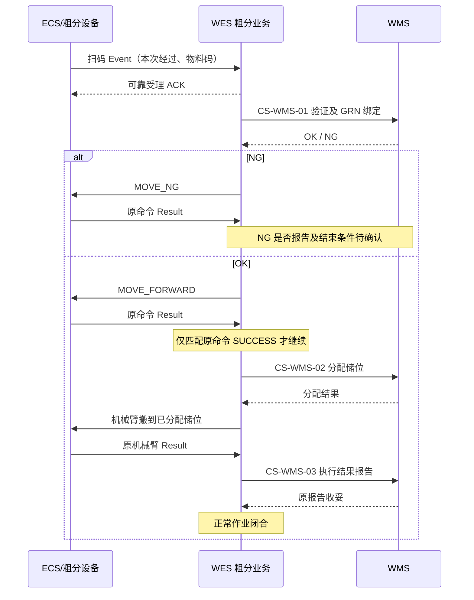

# 粗分机业务与 API 交互草案

状态：**流程依据用户描述；operation 名、payload、角色及设备命令附录均未确认，未注册、未实施。** 本文给出便于 WMS/ECS 对接讨论的最小合同建议。共用信封、身份、事务见[交互索引](workline-business-api.md)。

## 1. 一次作业是什么

一次作业是“一个物料在一条粗分线的一次明确经过”，不是一个物料码永久只能作业一次。扫描设备事实触发受理，WES 请求 WMS 验证及 GRN 绑定，根据决定分流；正常通过后分配储位并指挥机械臂搬运，最后报告结果。

业务经过身份与收据身份分开：相同 Event 重试复用原经过；同码再次真实进入是新经过。**物料码、设备码、WES 接收时间都不能单独证明新经过**。需与 ECS 确认可稳定关联本次到位的 occurrence/visit 标识或等价机制，以及传递方式和重放规则。现有 Event 公共信封没有 event_id，不擅自给它增加必填字段。

候选业务 code 为 `coarse_sorting`。候选角色 `SORT_CONVEYOR` 表示负责扫码及分流的逻辑设备，`SORT_ARM` 表示搬运机械臂；若实际扫码和分流属于不同设备，应按实际合同拆角色，不能为了少配字段合并身份。`Sort_SCAN1` 若是设备码，属于工作线实际绑定，不是写死的业务角色。

储位来自 WMS。若机械臂需要本地 INLET 等固定交接位，则在业务声明中增加经确认的位置槽；不能把动态目标储位都预先登记为工作线固定槽。

## 2. 正常与 NG 路径

图中的每根消息跨越提交和等待，不是一条跨系统数据库事务。Event ACK、WMS 业务 OK、滚筒 SUCCESS、机械臂 SUCCESS、WMS 报告收妥是五个不同节点。

## 3. WMS Operation 建议清单

下列 `CS-WMS-*` 是文档定位号，**不是线上 operation 字符串**。候选 operation 名只供确认，不能直接放入注册表。也不从人工业务借用已有 operation 来“先跑通”。

| 文档号 / 候选 operation（DRAFT） | 方向 / 端点 | 建议请求 data | 建议正常响应 |
| --- | --- | --- | --- |
| CS-WMS-01：`inbound.coarse_sorting.validate_bind@v1` | WES → WMS / decisions | `visit_id,workline_code,material_code,scanned_at`；GRN 是输入还是由 WMS 推导待确认 | `200/DECIDED`，data 的判别字段 `result=OK\|NG`；OK 返回本次业务绑定引用（如 binding_id/grn_id），NG 返回已确认枚举 reason_code |
| CS-WMS-02：`inbound.coarse_sorting.storage_allocate@v1` | WES → WMS / decisions | `visit_id,material_code` 及原绑定引用；是否需 workline_code 由 WMS 确认 | `200/DECIDED`，建议 `result=ALLOCATED`，返回 allocation_id 及可执行 target；库存预留/有效期语义待确认 |
| CS-WMS-03：`inbound.coarse_sorting.execution_report@v1` | WES → WMS / facts | `visit_id,material_code,allocation_id`、原搬运结果及已确认目标、completed_at；失败/NG 是否适用待确认 | `200/RECORDED\|DUPLICATE`，原报告收妥；与库存落账完成的关系待确认 |

这是**三项业务接口建议**，不是已确认 WMS API。以下字段语义也属于建议，确认前不生成空模型或宽松 dict 合同：

| 字段 | 需要锁定的语义 |
| --- | --- |
| visit_id | WES 本次执行的稳定身份；如何从原设备经过建立唯一关联需先确认。与 operation_id 各司其职 |
| material_code | 原扫码与归一化规则、允许字符/长度、多件同码问题；不默认沿用人工箱码的 -B/-C 规则 |
| binding_id / grn_id | 是一个还是两个标识、由谁生成、原请求重放是否返回同一绑定；不能由 WES 猜 GRN |
| allocation_id / target | 分配还是预留、是否过期、目标类型/层位/坐标、机器人可识别编码，以及原响应重放稳定性 |
| result / reason_code | 业务 NG 与协议拒绝分开；NG 是可执行分流决定，不是把请求当作未接纳 |
| completed_at / 执行证据 | 形成事实的时间源；报告哪些原命令/设备标识、物理成功/失败及可信位置，不额外上传内部日志 |

若有“暂时不能绑定/暂时无储位”的场景，再确认 WAIT 联合、重求值条件、retry_after_ms 和最大等待策略；当前用户只明确验证 OK/NG，**不能假定已有 WAIT**。协议 UNAVAILABLE、内容冲突、确定拒绝和技术恢复继续沿公共信封规则，业务分支/HTTP/code 联合仍需逐项确认。

## 4. ECS Event / Command / Result 建议清单

| 消息 | 名称与状态 | data / params / 结果要求 |
| --- | --- | --- |
| 扫码 Event | 候选 `SCAN_COMPLETED`，角色 SORT_CONVEYOR 或实际独立扫码角色，待确认 | 建议 data 包含 material_code 与双方确认的本次经过关联字段；是否一条事件对应一件物料须明确 |
| 正常放行 Command | `MOVE_FORWARD` 为用户给定业务动作，正式 task_type/附录待确认 | 参数要能定位原经过/物料；若设备仅允许无参数，必须确认物理占位、顺序和结果关联足以消除歧义 |
| NG 分流 Command | `MOVE_NG` 为用户给定动作，附录待确认 | NG 目标/交接点、失败和人工处置方式需确认；不能默认它等于人工线 MOVE_LEFT |
| 机械臂 Command | **task_type 待 ECS 确认** | 原物料/经过、可执行 target、必要抓取参数，不能预设叫 PICK_AND_PUT 或用 Transport 的 RACK_BIN_SLOT 代替机器人合同 |
| 三类命令 Result | 共用 `/api/v1/callback/result`，不另造 Event 名 | 通用 result=SUCCESS/FAILED，按原 command_code/device_code/附录校验；data 明确任务完成范围和必要终位，error 使用约定 code/msg |

粗分单机的机械臂指令按本次用户流程通过 ECS。只有确认为跨设备的 Transport 业务时才另行讨论 Transport 接入；不因为“都是搬运”自动转给 RCS。

## 5. 建议业务状态和执行许可

这些是本业务的可读状态建议，不是平台通用流程枚举：

| 阶段 | 进入依据 | 允许的下一动作 |
| --- | --- | --- |
| 已受理扫码 | 原 Event 和本次经过唯一绑定、工作线可执行 | 登记唯一验证绑定请求 |
| 等待验证绑定 | 保存原 WMS 请求身份 | 原响应 OK 才允许正常放行；NG 只允许 NG 分流 |
| 等待滚筒结果 | 原方向命令已登记 | 仅原 MOVE_FORWARD SUCCESS 允许申请储位；NG SUCCESS 不分配储位 |
| 等待储位 | 保存原分配请求和绑定关系 | 已确认有效的分配目标才允许创建机械臂命令 |
| 等待机械臂结果 | 原分配与原命令关联 | 确定结果后按合同登记事实报告；不因 ACK 完成物料作业 |
| 等待报告收妥 | 原报告已登记；保留物理结果 | 只恢复原报告；按最终确认的报告合同闭合 |
| 正常完成 | 物理成功且报告义务闭合 | 同码的新真实经过可建新作业；原消息重放仍返回原执行 |
| NG 完成 / 需核对 | 具体闭合/人工处理合同待确认 | 不默认替 NG 分配储位、解 GRN 或重做原动作 |

这里“报告义务闭合才标正常完成”是**建议**；用户描述尚未明确报告 ACK 是否业务完成门槛。实施前要确认库存落账、失败报告、NG 反馈是否需要其他回调，不悄悄增加新的完成通知。

## 6. 不能用自动重试掩盖的异常

- Event 重放不创建新作业；同码新经过需确切证据。并行物料与设备物理容量的关系需明确，不能靠软件“每线只能一件”替代合同。
- 验证/绑定响应未知：保存原请求和占位，恢复原请求；不能换 operation_id 造成重复 GRN 绑定。
- 原 MOVE_FORWARD FAILED：不能申请储位；UNKNOWN/HELD：保留原身份核对，不创建替代放行命令。
- 分配响应未知：不创建机械臂命令，不重新申请可能不同的储位。有效 WAIT 若将来确认，才按其合同重新求值。
- 机械臂 UNKNOWN：不宣布成功，不自行释放/更换预留储位；机械臂确定失败时也先按业务合同决定报告与人工处理，不能臆造补偿 API。
- 机械臂成功但报告失败：物理结果保留，只恢复原报告，不再搬一次。报告 ACK 若丢失，重放原报告必须可得到原结果。
- Result 先于命令 ACK、重复 Result、重启丢通知：使用现有 ECS 持久结果和原身份读取；业务待办恢复不需要第二套 sender。

当前没有确认“解除 GRN”“释放/续期储位”“撤销搬运”的 API，因此不引入 Saga 自动补偿。若以后确有业务补偿，先确认它是一个有授权、可幂等的新业务动作，再单独设计。

## 7. 实施前必须回答的合同问题

| 优先级 | 问题 / 责任方 | 对设计的影响 |
| --- | --- | --- |
| 阻断 | ECS：如何唯一识别一次经过？扫码与分流是否同一设备、容量和先后顺序是什么？ | 唯一受理、动作定位及同码重入；否则无法证明命令针对哪个物料 |
| 阻断 | WMS：验证与 GRN 绑定能否作为同一个幂等决定？NG 是否产生绑定？ | 请求拆分、已完成副作用与失败恢复边界 |
| 阻断 | WMS：分配接口的目标、预留与失效规则？ECS：机器人使用什么目标与命令合同？ | 分配到下命令期间的有效性，是否需要新能力；不能先用字符串填平差异 |
| 阻断 | WMS/ECS：NG/确定失败/位置未知由谁处置，是否报告以及何时闭合？ | 不正常完成、待核对、资源保留和人工恢复策略 |
| 阻断 | WMS：报告收妥是否意味着本次业务可结束？字段、错误及 HTTP/code 联合是什么？ | 最终完成门槛及报告幂等 |
| 接入前 | 双方：正式 operation、Event、全部字段/枚举/限额/错误/超时与鉴权 | 决定 DTO、CommandBinding/DeviceAnnex 和注册清单 |

## 8. 后续隔离测试范围

纯业务测试覆盖 OK→原放行成功→分配→原机械臂成功→报告，以及 NG、每一阶段的确定失败/未知、有效 WAIT（若确认）。接缝测试覆盖同 Event 重放、同码新经过、两线同名 Event 使用各自角色、配置变更后无新执行许可、原动作结果消费与下一 Outbox 原子、进程在读取后失败及恢复整组重读。

PostgreSQL 用于真实隔离/并发测试；ECS/WMS 使用 fake/loopback。正式 payload、完整错误表和 JSON 样例在以上阻断项确认后补齐，不能把本草案当作供应商已接受的接口说明。
