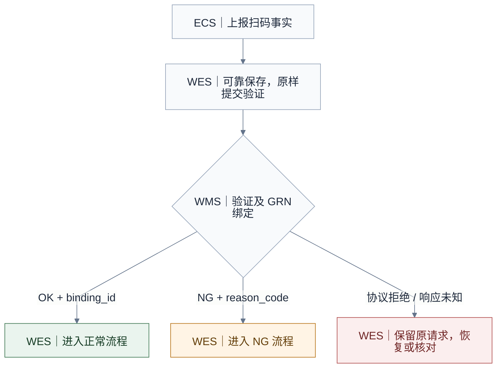
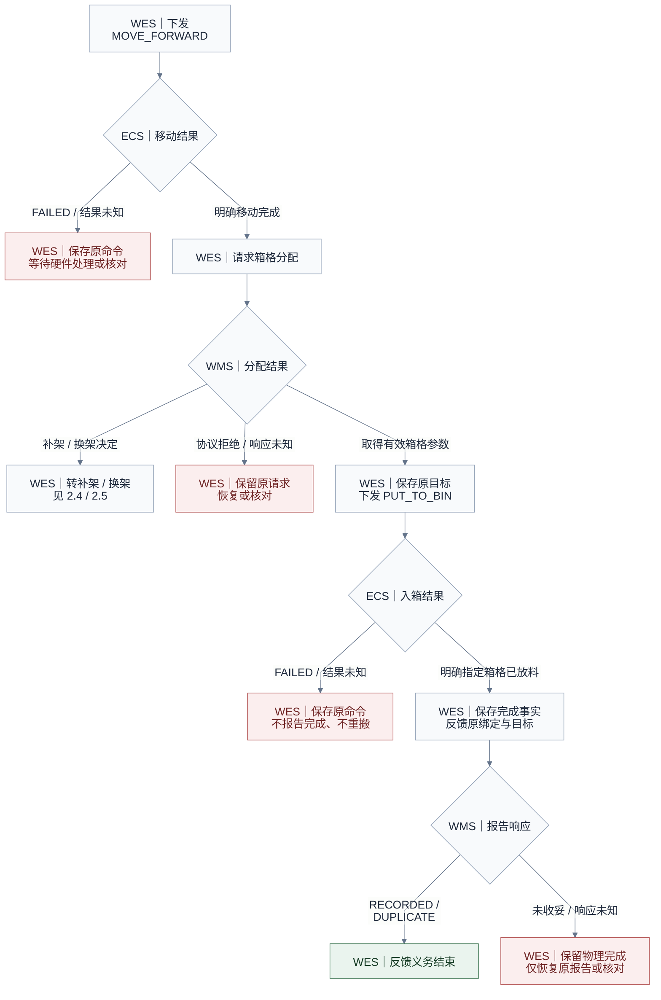
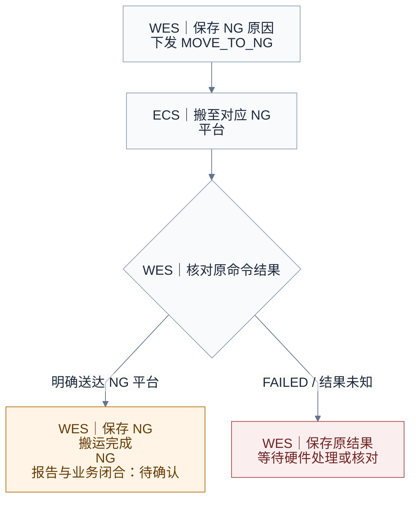
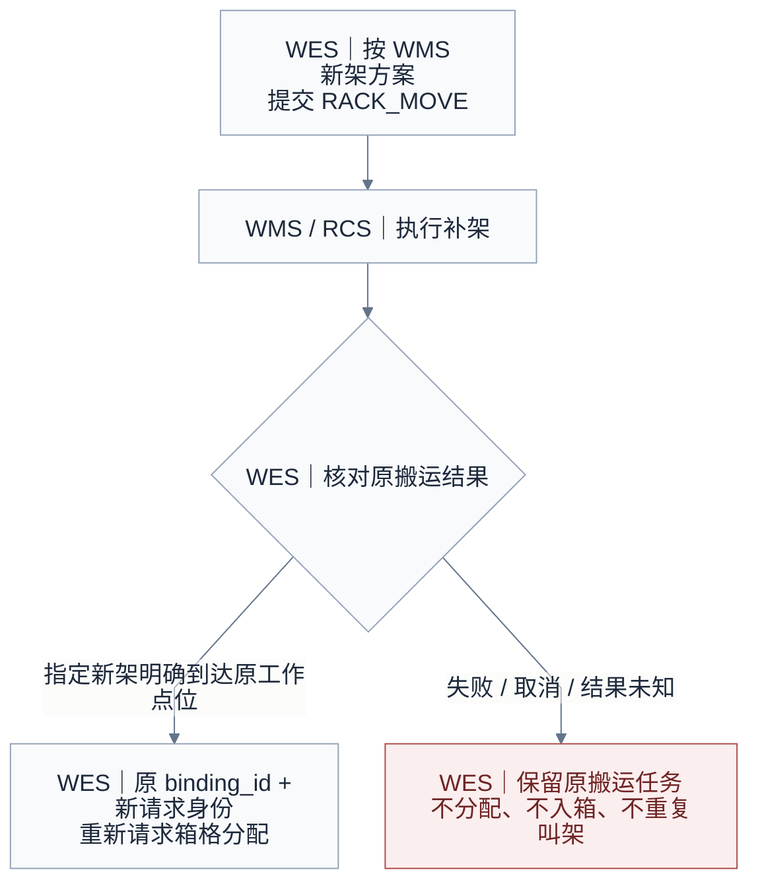
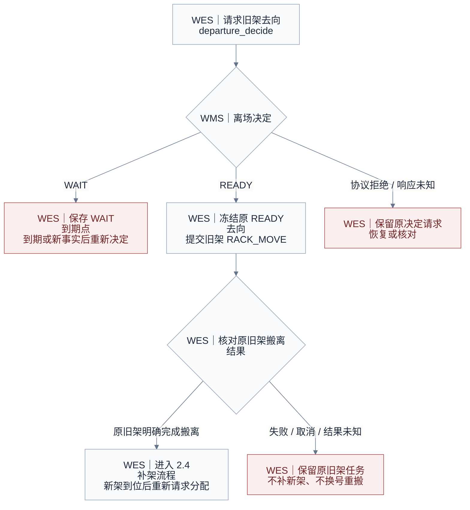

# 粗分机业务与 API 交互草案

状态：**完整业务仍为对接草案；扫码、WMS 验证及首个 MOVE_FORWARD / Result 阶段已登记实施，其余阶段未实施。** 职责边界、接口字段和交互流程见正文；三个粗分专用 operation、拟议共用货架离场合同、扩展字段约束和设备附录待对端确认，集中见第 7 节。

2026-10-29 首阶段决定（历史范围）：按本文冻结 `SCAN_COMPLETED` 可靠受理的内部实现合同，后续差异通过合同变更优化；本阶段不再以对端确认作为隔离实现的前置条件。冻结细则见 §4.1，仅覆盖扫码受理，不表示完整粗分业务已注册、实施或通过对端/现场验收。

当前增量：[首个输送动作设计](../superpowers/specs/2026-10-29-coarse-sorting-move-forward-design.md)及[操作步骤](ecs-event-debugging.md#验证与首个输送动作)。本轮采用内部验证合同，不替代第 7 节供应商/现场确认。

## 简介：完整交互顺序

| 路径        | 步骤 | 方向              | Operation / Event / Command（点击跳转）                                         | 交互                                                                 | 推进条件                                              |
| ----------- | ---- | ----------------- | ------------------------------------------------------------------------------- | -------------------------------------------------------------------- | ----------------------------------------------------- |
| 共用        | 1    | ECS → WES        | Event：[SCAN_COMPLETED](#ecs-scan-completed)                                     | 上报原始条码和检测信息                                               | WES 可靠保存扫码事实                                  |
| 共用        | 2    | WES → WMS        | Operation：[inbound.coarse_sorting.validate_bind@v1](#wms-validate-bind)         | 验证及 GRN 绑定                                                      | WMS 返回 `OK + binding_id`，或 `NG + reason_code` |
| 正常        | 3    | WES → ECS        | Command：[MOVE_FORWARD](#ecs-move-forward)                                       | 下发移动命令                                                         | WMS 验证通过                                          |
| 正常        | 4    | ECS → WES        | Result：[原 MOVE_FORWARD 命令](#ecs-move-forward-result)                         | 回传原移动命令的执行结果                                             | 明确移动完成后才申请箱格                              |
| 正常        | 5    | WES → WMS        | Operation：[inbound.coarse_sorting.storage_allocate@v1](#wms-storage-allocate)   | 沿原 `binding_id` 请求箱格分配，WMS 检查工作点位的在位架及可用箱格 | 返回直接分配、补架或换架决定                          |
| 补架        | 5.1  | WES → WMS → RCS | Operation：[transport.task.submit@v1](#transport-rack-in)                        | 按 WMS 方案将新架送入指定工作点位                                    | 提交接纳后继续等待原搬运结果                          |
| 补架        | 5.2  | WMS → WES        | Operation：[transport.task.resulted@v1](#transport-rack-in-result)               | 回传原新架补入任务结果                                               | 原任务已应用成功，且架号、目标工作点位匹配            |
| 换架        | 5.1  | WES → WMS        | Operation：[rack.departure_decide@v1](#wms-rack-departure)                       | 请求旧架离场去向                                                     | READY 冻结原去向；WAIT 保留等待条件                   |
| 换架        | 5.2  | WES → WMS → RCS | Operation：[transport.task.submit@v1](#transport-rack-out)                       | 按原 READY 去向搬离旧架                                              | 提交接纳后继续等待原搬运结果                          |
| 换架        | 5.3  | WMS → WES        | Operation：[transport.task.resulted@v1](#transport-rack-out-result)              | 回传原旧架搬离任务结果                                               | 明确完成原旧架搬离，才进入补架 5.1～5.2               |
| 补架 / 换架 | 5.4  | WES → WMS        | Operation：[inbound.coarse_sorting.storage_allocate@v1](#wms-storage-reallocate) | 货架明确到位后，使用原 `binding_id`、新 `operation_id` 重新分配  | 取得当前在位新架上的有效箱格，才进入正常步骤 6        |
| 正常        | 6    | WES → ECS        | Command：[PUT_TO_BIN](#ecs-put-to-bin)                                           | 下发入箱命令                                                         | 已取得有效的放料目标                                  |
| 正常        | 7    | ECS → WES        | Result：[原 PUT_TO_BIN 命令](#ecs-put-to-bin-result)                             | 回传原入箱命令的执行结果                                             | 明确物理放料完成                                      |
| 正常        | 8    | WES → WMS        | Operation：[inbound.coarse_sorting.execution_report@v1](#wms-execution-report)   | 反馈原绑定及目标箱格的物理完成事实                                   | WMS 返回 `RECORDED / DUPLICATE`                     |
| NG          | 3    | WES → ECS        | Command：[MOVE_TO_NG](#ecs-move-to-ng)                                           | 下发搬至对应区域 NG 平台的命令                                       | WMS 验证返回 `NG + reason_code`                     |
| NG          | 4    | ECS → WES        | Result：[原 MOVE_TO_NG 命令](#ecs-move-to-ng-result)                             | 回传原 NG 搬运命令的执行结果                                         | 明确结果后保存；NG 成功不触发正常入箱反馈             |

表中三个粗分 operation 名及扩展字段为候选；旧架去向复用拟议共用 `rack.departure_decide@v1`，搬架复用现有 Transport 合同，见 §3.5。ECS Result 共用 `POST /api/v1/callback/result`，按原 `command_code + device_code` 关联；Transport 结果走 `POST /api/v1/wms/events`，按原 `transport_task_id` 关联，两者不混用。

步骤 1 保存原扫码事实，步骤 2 提交验证，随后按 WMS 决定进入正常步骤 3～8 或 NG 步骤 3～4。正常步骤 5 按需进入补架或换架子流程；货架明确到位后重新请求分配，不直接跳到入箱。NG 路径不执行正常放行、箱格分配及入箱；NG 报告与业务闭合仍待确认。任何提交 ACK 均不代表物理完成。

设备参考：《SMT粗分机ECS接口调用说明书》v3.3（2026-09-27，源文件位于 `wes_backend/docs/hardware/SMT粗分机接口调用说明书.pdf`）。设备说明书提供命令和设备参考，接口以本文定义及双方确认的合同为准；待确认项集中见第 7 节。公共信封、结果读取及事务分别见[交互索引](workline-business-api.md)、[出站结果](outbound-results.md)和[事务配方](business-transaction-recipes.md)。

## 1. 职责边界与关联方式

| 参与方         | 职责                                                                                                                                                                                                           |
| -------------- | -------------------------------------------------------------------------------------------------------------------------------------------------------------------------------------------------------------- |
| 粗分设备 / ECS | 自主取料、检测和扫码，上报原始扫码事实；负责入口/出口缓存、运动互锁、设备执行及硬件异常处理；关联命令与实物并回传明确结果                                                                                      |
| WES            | 可靠接收扫码事实，原样转交扫码内容；请求 WMS 决定，按顺序下发 ECS 命令；按补/换架决定提交 Transport、消费原搬运结果并在明确到位后重新分配；保存原身份和目标，仅凭明确物理完成向 WMS 反馈                       |
| WMS            | 解析条码、验证业务条件及绑定 GRN；掌握工作点位的货架在位信息，决定直接分配、补架或换架，选择新架并提供补入方案；通过通用 rack.departure_decide@v1 决定旧架去向；对接 RCS、回传搬运结果并负责内部落库和库存处理 |

- ECS 上报原始条码，WES 原样转交，条码业务内容由 WMS 解析。WES 负责请求结构、字段类型及约定限额的校验。
- 信息链为 **原始 `barcode` → `binding_id` → 原放料目标 → 物理完成反馈**。
- `binding_id` 由 WMS 在验证及 GRN 绑定成功后返回，供箱格分配和物理完成反馈使用。装载记录、内部记录 ID 及库存处理由 WMS 管理。
- 验证、分配、重新分配、完成反馈及旧架离场决定请求均在 `data` 中显式携带必填、非空字符串 `workline_code`。工作线标识具体粗分执行单元，多台粗分机及其 A/B 独立执行单元须通过可信绑定明确区分；`COARSE-A` 仅为示例，不是全场共用默认值。WES 从原扫码受理时的可信设备绑定取得并保存该编码，后续业务请求沿用原工作线上下文，不根据条码、当前设备配置或最近一次作业重新猜测。Transport 提交沿用既有合同，不增加工作线字段，工作线关联保留在 WES 内部。
- 货架工作点位由 WES 根据原 `workline_code`，从数据库中的 `WorkLine.position_bindings["OUTPUT_RACK"]` 取得；联调配置为 RS01→CLN01、RS02→CLN02，不配置输送线出入口或面向。WMS 分配响应使用工作线编码，不另返位置编码。后续架位使用阶段须保存首次使用时的配置版本及具体位置编码，同一作业后续搬运、重试和结果核对沿用原值；位置绑定缺失时停止推进。配置只表示预期架位，不证明货架已在位或已到位。
- 粗分机架位不涉及换面，不要求货架面向；共用离场请求的必填 `current_face` 显式为 `null`，Transport 提交省略可选的 `target_face`，到位判断不依赖 `arrival_face`。是否到位仍以原任务已应用成功、货架及具体工作位匹配为准。
- ECS 以数值字段 `size_inch`、`thickness_mm` 上报本盘直径和厚度，单位分别为英寸、毫米。WES 向 WMS 显式映射为 `reel_diameter`、`reel_thickness`，原值传递，不转字符串或换算单位；示例为 `7`、`15.3`。该字段及单位约定已按 2026-10-29 实际报文和用户决定确认，测量精度等剩余事项见第 7 节。
- 本系统目标草案将 `reel_totalthickness` 定义为数值类型，表示**料格内当前已存储物料的总高度，不包含本次待放入物料**。空料格为 `0`；相对设备 v3.3 的类型调整、数值语义、单位和精度均待 ECS 确认，本文示例按 mm 表示，见第 5 节差异说明。
- WMS 已掌握工作点位的货架在位信息：无架则补架，有架但无可用箱格则换架，有架且可分配才返回有效箱格。WES 不根据条码缺失、超时或本地状态猜测无架；箱格分配不依赖扫码时的旧料箱清单。
- WES 负责补/换架的业务顺序和 Transport 请求关联；RCS/MCS 与 ECS 负责 AGV 执行、门禁及现场互锁。WES 不管理入口/出口缓存数量、不实现 AGV 路径调度、硬件恢复或自动补偿。
- 本系统拟由 ECS 根据设备及动作管理固定取放位置，包括输送线入口/出口、机械臂取料位、出料位置和对应区域 NG 平台。目标合同中 WES 不配置或传递这些固定位置，只传递业务关联及 WMS 返回的动态箱格参数；这是相对设备 v3.3 的协议调整，尚待 ECS 确认，见第 5 节。
- 同一条码可能再次真实进料，`barcode` 不作为作业或命令唯一键。WES 内部保存原扫码事实及其执行关联；同一 Event 重放复用原执行。

## 2. 正常与 NG 交互

流程按共用入口、正常处理、NG、补架和换架分图。节点标明责任方，失败或未知结果在对应步骤旁分支。绿色表示明确到位/收妥，橙色表示 NG 待确认，红色表示保留原执行并恢复或核对。

### 2.1 共用入口与业务分流



WMS 返回 OK 后进入第 2.2 节，返回业务 NG 后进入第 2.3 节；协议拒绝或响应未知不触发 NG 搬运。

### 2.2 正常处理与异常出口



只有原移动命令明确完成后才申请箱格。WMS 返回补架/换架时转相应子流程，货架明确到位后以新请求重新分配；只有 ALLOCATED 允许入箱。只有原入箱命令明确证明指定箱格已放料后才报告物理完成。报告未收妥时保留物理完成事实，只恢复原报告或核对，不再搬运。

### 2.3 NG 处理与异常出口



NG 搬运成功只保存送达 NG 平台的事实，不触发正常入箱反馈；NG 报告与业务闭合仍为待确认。硬件异常处理由 ECS/硬件方负责，WES 保留原命令和结果。

### 2.4 无在位架：补架



Transport 接纳不是货架到位；只有原任务的已应用成功结果匹配新架和目标工作点位后，才发起新的分配决定。新决定仍由 WMS 检查当前在位架，不能把补架方案直接当作可用箱格。

### 2.5 有架但无可用箱格：换架



旧架目的地只能来自原 `rack.departure_decide@v1` 的 READY，不在箱格分配响应中夹带，不固定写死。正常换架顺序为旧架明确搬离 → 补入新架明确到位 → 原绑定重新分配；不以旧架离场 ACK 或资源闭合代替搬离成功。

**ACK 仅代表受理，不代表物理完成。** 图中省略逐条 ACK；硬件处理或设备恢复不自动解锁后续动作，须依原命令的明确结果和已确认恢复合同处理。通信恢复继续保存的原身份；有效 WAIT 后重新求值、货架明确到位后重新分配使用新 operation_id，不重做原物理动作。

跨系统消息不构成一条数据库事务。WMS 收妥后结束反馈义务，不将其解释成整箱入库或库存可用。无在位架时补架，在位架无可用箱格时换架；无新架可补等暂不可执行情况见第 7 节 P05。

扫码事实提交 WMS，由 WMS 决定业务 OK/NG。WMS 业务 NG 保存原 reason_code 和响应，停在 AWAITING_NG_STAGE；后续 MOVE_TO_NG 仍由 WES 负责，属于下一阶段。

## 3. 三个粗分 WMS 接口与复用交互

`CS-WMS-*` 为本文定位号；三个粗分专用 operation 名为候选名。旧架去向使用通用 `rack.departure_decide@v1`，搬架使用[Transport](wms-transport.md)。

| 文档号 / operation                                        | 方向 / 端点                                                | 返回的业务含义                                      |
| --------------------------------------------------------- | ---------------------------------------------------------- | --------------------------------------------------- |
| CS-WMS-01：`inbound.coarse_sorting.validate_bind@v1`    | WES → WMS，`POST /api/v1/wes/decisions`                 | 验证及 GRN 绑定完成，或明确业务 NG                  |
| CS-WMS-02：`inbound.coarse_sorting.storage_allocate@v1` | WES → WMS，`POST /api/v1/wes/decisions`                 | 检查 WMS 掌握的在位架，返回直接分配、补架或换架决定 |
| CS-WMS-03：`inbound.coarse_sorting.execution_report@v1` | WES → WMS，`POST /api/v1/wes/facts`                     | 收妥原入箱物理完成事实                              |
| 复用：`rack.departure_decide@v1`                        | WES → WMS，`POST /api/v1/wes/decisions`                 | 为本次旧架离场返回 READY 去向或 WAIT                |
| 复用：`transport.task.submit@v1`                        | WES → WMS → RCS，`POST /api/v1/wes/transport-requests` | 接纳指定旧架搬离或新架补入任务，物理结果另行回调    |
| 复用：`transport.task.resulted@v1`                      | WMS → WES，`POST /api/v1/wms/events`                    | 原 RACK_MOVE 的搬运结果及版本                       |

公共规则：每个新的业务请求使用独立、小写标准连字符 UUIDv7 `operation_id`；响应回显原 ID，不增加 `operation` 字段。`timestamp` 为 UTC Unix 毫秒整数。通信重试必须复用原 ID、原时间戳及完整冻结正文；货架到位后的重新分配属于新业务求值，使用新 ID。顶层 `code` 为协议结果；有效 DECIDED 响应的 `data.result` 为业务决定，完成报告的 RECORDED/DUPLICATE 则使用空对象 `data`。仅 HTTP 200 不足以推进。

三个粗分专用接口及共用离场决定请求的 `data.workline_code` 均为必填非空字符串。WMS 按请求类型核对工作线与原 `binding_id`、货架或工作点位的业务关联；不匹配时拒绝，不将请求转到另一台粗分机或工作线。通信恢复保留原编码；货架到位后以新 `operation_id` 重新分配，仍沿用原工作线。响应按原请求身份及各接口约定关联；Transport 提交与回调按原任务身份关联，不增加工作线字段。

以下所有编号、条码、设备绑定及时间均为示例，不构成现场配置。

<a id="wms-validate-bind"></a>

### 3.1 验证及 GRN 绑定

WES 原样转交料盘条码；WMS 解析条码、验证收货条件并完成 GRN 绑定，全部成功才返回 `OK`。

| 请求字段           | 含义                                                                                                          |
| ------------------ | ------------------------------------------------------------------------------------------------------------- |
| `workline_code`  | 必填非空字符串，原扫码设备可信绑定的作业工作线；示例 `COARSE-A` 标识本例 A 区执行单元，多机现场使用各自编码 |
| `barcode`        | ECS 上报的原始料盘条码                                                                                        |
| `reel_diameter`  | ECS `size_inch` 的原数值，单位为英寸；`7` 原值传递，不换算为毫米 |
| `reel_thickness` | ECS `thickness_mm` 的原数值，单位为毫米；示例为 `15.3` |

请求：

```json
{
  "operation_id": "01a18363-1841-7463-91b2-9cb89ae43901",
  "operation": "inbound.coarse_sorting.validate_bind@v1",
  "timestamp": 1793206800000,
  "data": {
    "workline_code": "COARSE-A",
    "barcode": "P032-0561-000HF,MCL21X106KOQNNNE,Q2000,D2551,LPLCHP5J,SUPRE001251200032D",
    "reel_diameter": 7,
    "reel_thickness": 15.3
  }
}
```

成功响应（HTTP 200）：

```json
{
  "operation_id": "01a18363-1841-7463-91b2-9cb89ae43901",
  "code": "DECIDED",
  "timestamp": 1793206800100,
  "data": {
    "result": "OK",
    "binding_id": "BIND-0001"
  }
}
```

`binding_id` 关联原条码、解析后的物料身份、检测信息及 GRN，必要时关联 GRN 行。WES 保存该引用，不自行解析或猜测物料身份、GRN。相同请求重放返回原决定和原绑定。

业务 NG 响应（HTTP 200；与上述成功响应为互斥示例）：

```json
{
  "operation_id": "01a18363-1841-7463-91b2-9cb89ae43901",
  "code": "DECIDED",
  "timestamp": 1793206800100,
  "data": {
    "result": "NG",
    "reason_code": "BARCODE_INVALID"
  }
}
```

`BARCODE_INVALID` 为待确认原因码示例。NG 不返回可供正常分配的绑定；通信失败、系统不可用和格式错误不包装成业务 NG。本示例暂按 WMS 可由条码和工作线确定 GRN；所需收货上下文及 NG 绑定副作用见第 7 节。

<a id="wms-storage-allocate"></a>

### 3.2 箱格分配

仅在原 `MOVE_FORWARD` 明确完成后调用。通过 `binding_id` 引用原业务信息，不重复提交料盘条码或拆分字段。

WMS 已掌握工作点位的货架在位信息，通过请求的 `workline_code` 和原 `binding_id` 核对工作线及对应工作点位，依据当前在位架及其箱格业务信息决定后续。请求 data 包含必填的 `workline_code` 和 `binding_id`，两者必须属于同一工作线上下文。货架更换后，WMS 仍在原工作线按当前在位架及其箱格信息重新分配。

请求：

```json
{
  "operation_id": "01a18363-1841-7463-91b2-9cb89ae43902",
  "operation": "inbound.coarse_sorting.storage_allocate@v1",
  "timestamp": 1793206805000,
  "data": {
    "workline_code": "COARSE-A",
    "binding_id": "BIND-0001"
  }
}
```

三个业务分支均使用 HTTP 200 / DECIDED，`data.result` 为候选判别字段：

| 当前工作点位                 | data.result            | 返回内容 / WES 动作                                                        |
| ---------------------------- | ---------------------- | -------------------------------------------------------------------------- |
| 有在位架，且能分配可用箱格   | `ALLOCATED`          | 工作线及当前架、精确箱格及放料参数；保存后允许 PUT_TO_BIN                  |
| 无在位架                     | `REPLENISH_REQUIRED` | 工作线与新架补入方案；完成 Transport 到位后重新请求分配                    |
| 有在位架，但不能分配可用箱格 | `REPLACE_REQUIRED`   | 当前旧架、工作线及新架补入方案；先独立决定旧架去向并搬离，再补架、重新分配 |

以下三种响应互斥，表示同一请求在不同现场业务条件下的示例。补/换架响应不携带可供提前执行的箱格和原高度；没有可用箱格也不等同料盘 NG，不能据此调用 MOVE_TO_NG。

#### 3.2.1 直接分配：ALLOCATED

成功响应（HTTP 200）：

```json
{
  "operation_id": "01a18363-1841-7463-91b2-9cb89ae43902",
  "code": "DECIDED",
  "timestamp": 1793206805100,
  "data": {
    "result": "ALLOCATED",
    "workline_code": "COARSE-A",
    "rack_id": "RACK-OLD-01",
    "bin_code": "BIN-A002",
    "bin_location": "2",
    "cell_id": "BIN-A002-1",
    "bin_type": "3",
    "reel_totalthickness": 120
  }
}
```

| 响应字段                | 含义                                                                                                                         |
| ----------------------- | ---------------------------------------------------------------------------------------------------------------------------- |
| `result=ALLOCATED`    | 本次放料目标和参数已确定，不承诺已生成 WMS 内部装载记录                                                                      |
| `workline_code`       | 回显本次请求的工作线编码；具体货架工作点位取 WES 保存的该线位置绑定，不下发为 ECS 固定位置参数                               |
| `rack_id`             | WMS 确认的当前在位架，供 WES 保存本次目标上下文                                                                              |
| `bin_code`            | 真实目标料箱条码，不等同于设备箱位                                                                                           |
| `bin_location`        | 目标料箱所在设备箱位，取值为 `"1"`～`"4"`                                                                                |
| `cell_id`             | WMS 返回的完整料格编码；保存原值用于完成反馈。其最后一个字符为设备格位，例如 `BIN-A002-1` 映射为 `bin_cell_location="1"` |
| `bin_type`            | `"3"` 为三格箱，`"6"` 为六格箱                                                                                           |
| `reel_totalthickness` | 数值类型；料格内当前已存储物料的总高度，不包含本次待放入物料                                                                 |

例如料格内当前已存储物料的总高度为 120、本盘厚度为 20，响应仍为数值 `120`，不返回 `140`。WES 不自行累加或推导当前物理高度。

格位转换固定为 `bin_cell_location = cell_id[-1]`，结果保持字符串；只取末位，不解析箱号或最后一段。本业务使用单字符数字格位：三格箱为 `"1"`～`"3"`，六格箱为 `"1"`～`"6"`。`cell_id` 为空、末位不是上述数字或超出对应箱型范围时，不创建入箱命令。完整 `cell_id` 不改写，完成反馈仍使用原值。

WES 保存原目标及参数，用于唯一的入箱命令及后续反馈。同一原请求重放须返回原决定，不重新挑选箱格、货架或搬运方案。WMS 负责容量、并发及目标有效性，ECS 负责设备互锁。

#### 3.2.2 无在位架：REPLENISH_REQUIRED

响应（HTTP 200）：

```json
{
  "operation_id": "01a18363-1841-7463-91b2-9cb89ae43902",
  "code": "DECIDED",
  "timestamp": 1793206805100,
  "data": {
    "result": "REPLENISH_REQUIRED",
    "workline_code": "COARSE-A",
    "incoming_rack": {
      "rack_id": "RACK-NEW-01"
    }
  }
}
```

WMS 负责选择新架，`incoming_rack` 返回架号；补入目标取 WES 为原 `workline_code` 保存的出料架位位置绑定。WES 按 `incoming_rack.rack_id` 发起 Transport，起点使用 `source.kind=RACK`、`source.location_code=rack_id`，由 WMS/RCS 定位货架；目标使用 `target.kind=RACK_POSITION` 及该位置编码。模板与现场配置的确认事项见第 7 节 P14。

WES 保存决定和补入方案，登记唯一新架补入任务；明确到位后执行第 3.2.4 节，不提前创建 PUT_TO_BIN。

#### 3.2.3 有架但无法分配：REPLACE_REQUIRED

响应（HTTP 200）：

```json
{
  "operation_id": "01a18363-1841-7463-91b2-9cb89ae43902",
  "code": "DECIDED",
  "timestamp": 1793206805100,
  "data": {
    "result": "REPLACE_REQUIRED",
    "workline_code": "COARSE-A",
    "current_rack": {
      "rack_id": "RACK-OLD-01"
    },
    "incoming_rack": {
      "rack_id": "RACK-NEW-01"
    }
  }
}
```

`current_rack` 仅包含 WMS 确认的当前在位旧架号；粗分机架位不要求面向。无可用箱格不限定为满架，也可能由箱型、尺寸或装载规则导致。

此响应只给出换架需求、当前架和新架补入方案，**不返回旧架目的地**。WES 必须先按第 3.4 节获取旧架去向，再按第 3.5 节依次完成旧架搬离和新架补入。

<a id="wms-storage-reallocate"></a>

#### 3.2.4 货架明确到位后重新分配

补架或换架后的新架补入成功，且原 Transport 的已应用结果与新架和工作点位匹配后，继续使用原 `workline_code` 和 `binding_id`，生成**新的**分配请求身份。此前补/换架决定已是原请求的确定结果，重放原请求只能取回原决定，不能用于重新分配。

请求：

```json
{
  "operation_id": "01a18363-1841-7463-91b2-9cb89ae43915",
  "operation": "inbound.coarse_sorting.storage_allocate@v1",
  "timestamp": 1793206861000,
  "data": {
    "workline_code": "COARSE-A",
    "binding_id": "BIND-0001"
  }
}
```

新分配成功响应（HTTP 200）：

```json
{
  "operation_id": "01a18363-1841-7463-91b2-9cb89ae43915",
  "code": "DECIDED",
  "timestamp": 1793206861100,
  "data": {
    "result": "ALLOCATED",
    "workline_code": "COARSE-A",
    "rack_id": "RACK-NEW-01",
    "bin_code": "BIN-N002",
    "bin_location": "2",
    "cell_id": "BIN-N002-1",
    "bin_type": "3",
    "reel_totalthickness": 0
  }
}
```

这次目标是新架上的 `BIN-N002`，不复用旧架上的 `BIN-A002` 或旧原总高度。WES 保存新目标后才下发入箱命令，完成反馈也关联这一新目标；第 3.3、5.2 节保留的是直接分配路径示例，补/换架后的同类消息使用此处的新目标参数。

重新分配沿用原绑定及 MOVE_FORWARD 完成事实。新分配请求自身的通信重试复用其 ID 和冻结正文。若已确认新架到位，而 WMS 新决定仍指向旧架或与原工作点位矛盾，应保留证据核对，不立即再叫一架。

同一工作点位已有在途补/换架作业时，多个等待分配的料盘关联同一作业及原 Transport，不能逐盘重复发起搬架。恢复后各料盘沿各自原 `binding_id` 重新分配；WMS 应保证并发决定的搬运方案和箱格有效性，WES 不以通信失败触发新的补/换架。

<a id="wms-execution-report"></a>

### 3.3 物理完成反馈

仅在原 `PUT_TO_BIN` 的可信成功结果证明指定箱格放料完成后发送。本接口描述正常入箱完成；NG 搬运成功不作为正常入箱反馈。

请求：

```json
{
  "operation_id": "01a18363-1841-7463-91b2-9cb89ae43903",
  "operation": "inbound.coarse_sorting.execution_report@v1",
  "timestamp": 1793206815000,
  "data": {
    "workline_code": "COARSE-A",
    "binding_id": "BIND-0001",
    "bin_code": "BIN-A002",
    "bin_location": "2",
    "cell_id": "BIN-A002-1",
    "completed_at": 1793206814000
  }
}
```

| 请求字段                              | 含义                                                                                            |
| ------------------------------------- | ----------------------------------------------------------------------------------------------- |
| `workline_code`                     | 必填非空字符串，沿用原受理及已完成命令关联的工作线编码，与原绑定和目标一致                      |
| `binding_id`                        | 原验证成功的绑定引用                                                                            |
| `bin_code / bin_location / cell_id` | 原已完成命令关联的真实目标料箱、设备箱位及完整料格编码；cell_id 使用 WMS 原值，不替换为末位格位 |
| `completed_at`                      | 原 ECS Result 的 `finish_time`，不使用报告发送时间                                            |

目标字段从原命令冻结关联取得，不重新请求箱格或读取当前配置覆盖历史。若 ECS 返回与原目标冲突的实际信息，先核对，不报告原目标已完成。失败、未知、超时均不提交本完成接口，也不推导装箱后总高度。

`command_code / device_code` 及原成功 Result 关联仅由 WES 内部保存，不加入本报告。目标合同以 `workline_code + binding_id` 标识该盘的一次正常入箱完成：同一键的相同目标和完成事实重复报告不重复装载或记账；目标或完成事实冲突时拒绝，不能覆盖原报告。协议 `operation_id` 仍标识具体请求，技术重试复用原身份及冻结正文；业务去重规则待 WMS 按 P10 确认。

首次收妥响应（HTTP 200）：

```json
{
  "operation_id": "01a18363-1841-7463-91b2-9cb89ae43903",
  "code": "RECORDED",
  "timestamp": 1793206815100,
  "data": {}
}
```

原报告重放响应（HTTP 200）：

```json
{
  "operation_id": "01a18363-1841-7463-91b2-9cb89ae43903",
  "code": "DUPLICATE",
  "timestamp": 1793206816100,
  "data": {}
}
```

WMS 根据原绑定、目标及完成事实处理内部落库，不要求返回内部记录 ID；重复报告不得重复增加装载数量或重复记账。`RECORDED / DUPLICATE` 表示原完成事实可靠收妥，WES 结束反馈义务。库存落账、库存可用与整箱入库的具体业务效果由 WMS 定义，不从公共收妥响应推断。

<a id="wms-rack-departure"></a>

### 3.4 换架前复用旧架离场去向决定

通过 `POST /api/v1/wes/decisions` 调用本系统拟议的共用货架离场决定 `rack.departure_decide@v1`，供人工、粗分和自动线草案共同采用。本方名称、字段、公共错误/重放、WAIT 续问及唯一搬离关联已按 [共用离场合同](workline-business-api.md#rack-departure-confirmed-wire)固定；BIN_Roller 严格组件声明与本地实现已完成，正式消费业务尚未注册，仍需对端签认及现场验证。请求 data 包含 `workline_code`、`rack_id`、`current_location`、`current_face`；WMS 核对货架和当前位置属于该工作线上下文后决定离场去向。响应为 READY 及目的地，或 WAIT 及等待间隔。

上述四个请求字段均须存在；`workline_code` 为原业务保存的工作线编码，`current_location` 必须是已确认的 `RACK_POSITION`；粗分机架位不要求面向，`current_face` 显式为 `null`，不省略该共用字段或补造面向值。

请求：

```json
{
  "operation_id": "01a18363-1841-7463-91b2-9cb89ae43910",
  "operation": "rack.departure_decide@v1",
  "timestamp": 1793206806000,
  "data": {
    "workline_code": "COARSE-A",
    "rack_id": "RACK-OLD-01",
    "current_location": {
      "type": "RACK_POSITION",
      "location_code": "COARSE-A-OUT"
    },
    "current_face": null
  }
}
```

架号取本次 WMS 在位决定；当前工作点位采用原作业保存的工作线位置绑定，并与匹配的原业务事实核对。该决定只允许在旧架可交出时发起；与旧架直接关联的已创建入箱动作/搬运尚在途或结果未知时，先收口原动作，不因新的换架决定绕过已知依赖。已物理完成的反馈义务也须保留，不能因架已移走丢失。

READY 响应（HTTP 200）：

```json
{
  "operation_id": "01a18363-1841-7463-91b2-9cb89ae43910",
  "code": "DECIDED",
  "timestamp": 1793206806100,
  "data": {
    "result": "READY",
    "rack_destination": {
      "type": "RACK_POSITION",
      "location_code": "RACK-RETURN-01"
    }
  }
}
```

WES 冻结原 READY 的身份和 `rack_destination`，据此创建唯一旧架搬离任务。目的地类型为 `ZONE | RACK_POSITION`；示例使用精确工作位。不得固定回库区、从补架方案猜旧架去向，或按货架取“最新一条”决定代替原决定。

WAIT 响应（HTTP 200，与 READY 为互斥示例）：

```json
{
  "operation_id": "01a18363-1841-7463-91b2-9cb89ae43910",
  "code": "DECIDED",
  "timestamp": 1793206806100,
  "data": {
    "result": "WAIT",
    "retry_after_ms": 1000
  }
}
```

WAIT 的 `retry_after_ms` 为 1～60000 的整数。保存有效 WAIT 及其固定到期点；到期或有新业务事实时以新 ID 重新请求旧架去向。协议不可用或响应未知仅恢复原请求。READY 是业务离场许可，不是搬离完成；现场门禁与互锁由 RCS/MCS、ECS 负责。

### 3.5 补/换架的 Transport 交互

整架搬运通过 `transport.task.submit@v1` 提交，`kind=RACK_MOVE`。WES → WMS → RCS 的提交入口为 `POST /api/v1/wes/transport-requests`；WMS → WES 的结果入口为 `POST /api/v1/wms/events`。协议及原任务结果读取分别见[Transport 合同](wms-transport.md)和[出站结果](outbound-results.md)。

Transport 提交及回调沿用既有合同，不增加 `workline_code`。WES 通过内部 `TransportCaller.workline_id` 保存工作线关联，该关联不进入 wire；请求使用 `rack_id` 和具体 `source / target` 表达搬运对象及位置，回调按原 `transport_task_id` 关联，并核对原任务的货架和终位。

Transport 的 `source / target` 表达架级业务来源和目的地；ECS 固定取放位置由 ECS 管理。示例使用 `rcs_template_id=F01`；模板按货架类型和现场配置选定，对接确认事项见第 7 节 P14。

旧架搬离、新架补入各有独立的 `transport_task_id` 和提交 `operation_id`，WES 内部保存稳定的 `client_request_id` 及其与本次补/换架的关系；内部调用身份不加入 wire。Transport 提交和回调的 ID 与单盘 `binding_id` 各司其职。

<a id="transport-rack-out"></a>

#### 3.5.1 旧架搬离

仅换架路径需要。起点使用原作业保存且经原在位事实核对的工作线架位，终点使用第 3.4 节原 READY 去向：

```json
{
  "operation_id": "01a18363-1841-7463-91b2-9cb89ae43911",
  "operation": "transport.task.submit@v1",
  "timestamp": 1793206807000,
  "data": {
    "transport_task_id": "transport-coarse-a-out-0001",
    "kind": "RACK_MOVE",
    "rack_id": "RACK-OLD-01",
    "rcs_template_id": "F01",
    "source": {
      "kind": "RACK_POSITION",
      "location_code": "COARSE-A-OUT"
    },
    "target": {
      "kind": "RACK_POSITION",
      "location_code": "RACK-RETURN-01"
    }
  }
}
```

接纳响应（HTTP 202）：

```json
{
  "operation_id": "01a18363-1841-7463-91b2-9cb89ae43911",
  "code": "RECEIVED",
  "timestamp": 1793206807100,
  "data": {
    "transport_task_id": "transport-coarse-a-out-0001"
  }
}
```

<a id="transport-rack-out-result"></a>

旧架搬离成功回调（WMS → WES）：

```json
{
  "operation_id": "01a18363-1841-7463-91b2-9cb89ae43912",
  "operation": "transport.task.resulted@v1",
  "timestamp": 1793206830000,
  "data": {
    "transport_task_id": "transport-coarse-a-out-0001",
    "kind": "RACK_MOVE",
    "outcome_revision": 1,
    "rack_id": "RACK-OLD-01",
    "status": "SUCCEEDED",
    "final_position": {
      "kind": "RACK_POSITION",
      "location_code": "RACK-RETURN-01"
    }
  }
}
```

WES 收据受理响应（HTTP 202）：

```json
{
  "operation_id": "01a18363-1841-7463-91b2-9cb89ae43912",
  "code": "RECEIVED",
  "timestamp": 1793206830100,
  "data": {
    "transport_task_id": "transport-coarse-a-out-0001"
  }
}
```

WES 业务必须通过原任务结果确认 SUCCEEDED 已有效应用、旧架身份和终位与冻结目标一致，且该终位不再是原工作点位，才提交新架补入。不能仅凭回调 HTTP 202、提交消息结束或任务资源闭合认定旧架搬离。目标为 ZONE 时按现有合同信任 WMS/RCS 解析出的终位，同时不能忽略终位仍在原工作点位等业务矛盾。

<a id="transport-rack-in"></a>

#### 3.5.2 新架补入

无架补架直接执行此步；换架在原旧架明确搬离后执行。架号取原 WMS 补入方案，目标工作点位取原作业保存的工作线位置绑定。按架号构造 `source={kind: RACK, location_code: rack_id}`，由 WMS/RCS 定位货架；`target.location_code` 使用保存的位置编码，不传 `target_face`：

```json
{
  "operation_id": "01a18363-1841-7463-91b2-9cb89ae43913",
  "operation": "transport.task.submit@v1",
  "timestamp": 1793206831000,
  "data": {
    "transport_task_id": "transport-coarse-a-in-0001",
    "kind": "RACK_MOVE",
    "rack_id": "RACK-NEW-01",
    "rcs_template_id": "F01",
    "source": {
      "kind": "RACK",
      "location_code": "RACK-NEW-01"
    },
    "target": {
      "kind": "RACK_POSITION",
      "location_code": "COARSE-A-OUT"
    }
  }
}
```

接纳响应（HTTP 202）：

```json
{
  "operation_id": "01a18363-1841-7463-91b2-9cb89ae43913",
  "code": "RECEIVED",
  "timestamp": 1793206831100,
  "data": {
    "transport_task_id": "transport-coarse-a-in-0001"
  }
}
```

<a id="transport-rack-in-result"></a>

新架到位成功回调（WMS → WES）：

```json
{
  "operation_id": "01a18363-1841-7463-91b2-9cb89ae43914",
  "operation": "transport.task.resulted@v1",
  "timestamp": 1793206860000,
  "data": {
    "transport_task_id": "transport-coarse-a-in-0001",
    "kind": "RACK_MOVE",
    "outcome_revision": 1,
    "rack_id": "RACK-NEW-01",
    "status": "SUCCEEDED",
    "final_position": {
      "kind": "RACK_POSITION",
      "location_code": "COARSE-A-OUT"
    }
  }
}
```

WES 收据受理响应（HTTP 202）：

```json
{
  "operation_id": "01a18363-1841-7463-91b2-9cb89ae43914",
  "code": "RECEIVED",
  "timestamp": 1793206860100,
  "data": {
    "transport_task_id": "transport-coarse-a-in-0001"
  }
}
```

确认原任务已应用成功、`rack_id=RACK-NEW-01`、终位为原目标 `COARSE-A-OUT` 后，才登记第 3.2.4 节新的箱格分配请求。这里只回到分配，不直接下发 PUT_TO_BIN。

整架结果使用 `transport.task.resulted@v1`；不伪造整架的 `transport.task.member_position_changed@v1`，后者用于料箱成员里程碑。回调自己的 `operation_id` 由 WMS 生成，与 submit ID 不同，重报保持原身份；版本与冻结任务的校验沿用现有 Transport。

#### 3.5.3 失败、取消与结果未知

位置未知的回调示例（与上述新架成功结果为互斥场景，不覆盖已应用的成功结果）：

```json
{
  "operation_id": "01a18363-1841-7463-91b2-9cb89ae43916",
  "operation": "transport.task.resulted@v1",
  "timestamp": 1793206860000,
  "data": {
    "transport_task_id": "transport-coarse-a-in-0001",
    "kind": "RACK_MOVE",
    "outcome_revision": 1,
    "rack_id": "RACK-NEW-01",
    "status": "FAILED",
    "position_unknown": true,
    "failure_code": "POSITION_UNKNOWN"
  }
}
```

当前 wire 没有 `status=UNKNOWN` 分支，位置未知按现有 FAILED + POSITION_UNKNOWN 表达；业务不能把它当作从未移动或确定不在目标。合法结果的收据响应仍为上文 RECEIVED，但是否已应用、是否满足后续条件必须另按原任务读取。

- 旧架搬离失败、取消或结果未知：不补新架，不因任务 CLOSED 推断架位空出。
- 新架补入失败、取消或结果未知：不重新分配有效箱格、不入箱、不换号再叫一架。
- 确定拒绝/取消后的新业务尝试与通信恢复分开；若需再次决定或创建新搬运任务，须先按有效业务条件和已确认恢复规则处理，不能以超时自动替代原任务。
- 请求与回调同身份的技术重报保持原字节；submit DUPLICATE 使用既有 HTTP 200 / DUPLICATE 合同，回调重复也沿用原版本/收据规则。任何接纳响应都不替代物理结果。

## 4. ECS 设备、位置和扫码事件

以下是说明书中的设备及 ECS 固定位置参考，用于理解设备交互和结果。固定位置由 ECS 管理，不作为 WES 工作线位置配置或命令参数。候选业务 code 为 `coarse_sorting`；逻辑角色分别对应入料机械臂、输送线和出料机械臂，由运行时绑定取得设备。

| 交互 / 位置                                       | A 区                          | B 区                          |
| ------------------------------------------------- | ----------------------------- | ----------------------------- |
| `SCAN_COMPLETED` 上报 / `MOVE_TO_NG` 执行设备 | `RS-INPUT-ARM-01`           | `RS-INPUT-ARM-02`           |
| `MOVE_FORWARD` 执行设备                         | `RS-CONVEYOR-01`            | `RS-CONVEYOR-02`            |
| `PUT_TO_BIN` 执行设备                           | `RS-OUTPUT-ARM-01`          | `RS-OUTPUT-ARM-02`          |
| 输送线入口                                        | `STATION_PIPELINE1_INPUT1`  | `STATION_PIPELINE2_INPUT1`  |
| 输送线出口                                        | `STATION_PIPELINE1_OUTPUT1` | `STATION_PIPELINE2_OUTPUT1` |
| 出料位置                                          | `STATION_OUTPUT1`           | `STATION_OUTPUT2`           |
| NG 平台                                           | `STATION_NG_PLATFORM1`      | `STATION_NG_PLATFORM2`      |

<a id="ecs-scan-completed"></a>

### 4.1 扫码事件：ECS → WES

`POST /api/v1/callback/event`。设备自主完成取料、尺寸/厚度检测和扫码，WES 不另发扫码、测量或进料命令。

```json
{
  "device_code": "RS-INPUT-ARM-01",
  "event_type": "SCAN_COMPLETED",
  "timestamp": 1793313931285,
  "data": {
    "location": "RS-INPUT-ARM-01",
    "barcode": "P032-0561-000HF,Q2000,MCL21X106KOQNNNE,D2610,LPM37P9L,SSUPRE0012603000AUJ",
    "scan_time": 1793313931285,
    "size_inch": 7,
    "thickness_mm": 15.3,
    "result": "OK"
  }
}
```

`timestamp` 为原扫码事件时间。`data.barcode` 为原始料盘条码。WES 从受信任的设备绑定确定 `workline_code`，将原条码及检测数值用于第 3.1 节：`size_inch → reel_diameter`、`thickness_mm → reel_thickness`，单位及数值保持原样。箱格分配以 WMS 掌握的当前在位架及其箱格信息为准，ECS 扫码事件不提供箱码清单。

WES 可靠保存原收据、业务受理及持久待办后响应（HTTP 200）：

```json
{
  "code": 200,
  "message": "ACK"
}
```

ACK 不夹带设备命令，也不等于验证通过。重复事件不重复创建验证请求。如何区分同一事件重传和同码真实重入，属于第 7 节待确认合同，不能只按条码字符串判断。

#### 当前扫码测量合同（2026-10-29 实际报文增量）

用户已确认按实际上报字段同步实施，WMS 直径也使用英寸。该增量替代此前 ECS 入站测量字段约定；首阶段及双机部署的原设计、实施和验收记录保持原范围，见[本轮设计](../superpowers/specs/2026-10-29-coarse-sorting-scan-measurements-design.md)与[原双机计划](../superpowers/plans/2026-10-29-coarse-sorting-site-configuration.md)。该增量在内部开发验收时仅完成 MOCK、内部验证，未更新服务器制品；后续环境生效状态以对应制品的部署记录为准。

| 字段                    | 本阶段类型与必填性                    | 受理规则                                                                   |
| ----------------------- | ------------------------------------- | -------------------------------------------------------------------------- |
| `device_code`         | 必填，非空 string                     | 沿用公共信封；通过受信任绑定确定设备、角色和工作线，不硬编码示例设备码     |
| `event_type`          | 必填，string，固定 `SCAN_COMPLETED` | 沿用按角色分发的公共接收器                                                 |
| `timestamp`           | 必填，integer，`0..2**63-1`         | 原事件 UTC Unix 毫秒；沿用公共信封严格校验，不接受 bool 或字符串转换       |
| `data.barcode`        | 必填，string                          | 原样保存；不解析、修剪、拆分或增加文档未规定的业务格式/长度约束            |
| `data.size_inch`      | 必填，有限 JSON number                | 直径，英寸；接受整数或小数，拒绝 bool、字符串和非有限数；原值映射至 WMS `reel_diameter`，不换算或新增范围/精度约束 |
| `data.thickness_mm`   | 必填，有限 JSON number                | 厚度，毫米；同样严格校验，原值映射至 WMS `reel_thickness` |
| `data.location`、`data.scan_time`、`data.result` | 实际报文附加字段，非业务必填 | 沿用额外字段忽略策略；不参与角色选择、业务判定或 WMS data，事件时间使用外层 `timestamp` |

入站 Payload 沿用 `CallbackPayload` 的严格类型及 `extra="ignore"`：额外字段不进入业务 Payload；公共事件摘要仍按原完整 `data` 计算，不能用忽略额外字段后的模型重新计算身份。请求体大小沿用公共接收器的 256 KiB 上限。受理时将三个业务事实归一为既有持久字段 `barcode`、`reel_diameter`、`reel_thickness`，既有待办及 WMS 请求格式保持不变；公共输入不提供旧字段别名或两套入口，不改写历史记录或重放旧事件。

本阶段业务 code 固定为 `coarse_sorting`，入料角色 key 固定为 `INPUT_ARM`；A/B 区使用各自工作线的可信设备绑定，样例设备码不构成配置。当前增量同时声明输送线角色 CONVEYOR 和唯一必需位置槽 OUTPUT_RACK（出料单层货架位）；其余角色及完整业务随后续阶段交付。

重复身份沿用公共接收器对 `device_code + event_type + timestamp + data` 的规范化摘要。原样重报复用原扫码受理；同条码而事件事实不同视为独立上报，不用条码或 WES 接收时间去重。同毫秒、同设备、同内容的真实重入无法与重报区分，本基线按重复处理，不保证辨识这类实物重入。后续若调整身份合同，须保留原收据、业务去重依据和已冻结身份，不能重算历史记录或自动重放旧事件。

扫码接收事务只原子保存原收据、扫码记录和持久待办，不在该事务发送网络请求。由后续独立任务登记原验证及命令。扫码记录与持久去重依据不随公共收据清理删除，本阶段不增加业务清理作业。完整流程、真实设备上报及现场验收不在本轮内部开发验收范围内。

2026-10-29 当前实施范围（含双机配置与按业务唤醒增量）：唯一正式 SCAN_COMPLETED 入口保存事实；扫码事实、原 WMS 决策和新 ECS Result 提交后唤醒 coarse_sorting，统一 `business.advance_pending("coarse_sorting")` 任务调用声明的 `scan_pending()`，Beat 每 5 秒调用同一任务兜底。沿原 workline_code、barcode、尺寸及厚度登记唯一 validate_bind；合法 OK + binding_id 才向原 CONVEYOR 登记唯一 MOVE_FORWARD（timeout=30000ms，新调用使用内部附录 coarse_sorting.move_forward/2）。按原 command_code + device_code 关联的已应用 SUCCESS 须含严格整数 actual_qty=1 且无待核对项，才进入 AWAITING_ALLOCATION_STAGE；MOVE_FORWARD 的 Result.data 仅包含 actual_qty，执行位置由 ECS 根据设备及动作管理。FAILED、缺数量或未知结果保留原证据等待核对。WMS NG 停在 AWAITING_NG_STAGE。API/worker 共用 catalog，各自注入会话工厂；启动不创建测试绑定。操作见 [ECS Event 调试](ecs-event-debugging.md)，[扫码受理历史记录](../superpowers/plans/2026-10-29-coarse-sorting-scan-acceptance.md)保留首阶段验收范围；原附录 /1 的历史设计及验收结论保持原时间范围。

## 5. ECS 命令与结果示例

三类命令共用 `POST /api/v1/device/command`，三类 Result 共用 WES 的 `POST /api/v1/callback/result`。

三类命令统一使用顶层 `result=SUCCESS / FAILED` 表达原命令的最终执行结果。`SUCCESS` 须表示该原命令的整个物理动作已完成，具体范围如下；受理 ACK、动作开始或中间位置均不满足此条件。WES 通过 `command_code + device_code` 关联原命令及其冻结目标后解释结果。

| 原命令           | result=SUCCESS 的完成范围                          |
| ---------------- | -------------------------------------------------- |
| `MOVE_FORWARD` | 本盘已完成从输送线入口到出口的移动                 |
| `PUT_TO_BIN`   | 本盘已放入原命令指定的箱位和格位，整个放料动作完成 |
| `MOVE_TO_NG`   | 本盘已送达对应区域 NG 平台，整个 NG 搬运动作完成   |

`params.barcode` 为原始 `barcode` 的透传关联值，供 ECS 关联当前实物。命令唯一性和结果关联由 `command_code + device_code` 承担；WMS 的绑定关系保存在 WES 内部。

命令示例按本系统目标草案列出核心业务字段，并非可直接发送的完整合同。完整信封须补齐 `priority / timeout / timestamp`，遵循[ECS 合同](ecs-command.md)；WES 保存冻结投递期限。仅补齐这些字段仍不满足所引 v3.3 的设备参数合同；启用前还须确认下述调整及第 7 节 P08 的严格参数/结果附录。

### 与 v3.3 的差异及启用门槛

以下对照依据上述说明书 §2.2、§3.3 及版本历史。本稿保留简化方案，**不与 v3.3 原参数合同兼容，也不表示设备已支持这些调整**。

| 项目                                  | 设备 v3.3 参考合同                                                                             | 本系统目标草案及待确认内容                                                                                                                                   |
| ------------------------------------- | ---------------------------------------------------------------------------------------------- | ------------------------------------------------------------------------------------------------------------------------------------------------------------ |
| 三类命令的固定起止位置                | `params.source_location / target_location` 为必填字符串；MOVE_TO_NG 示例另带 `ng_location` | WES 不传这些固定位置字段；须由 ECS 明确按 `device_code + task_type` 及 A/B 执行单元确定固定起止位置和 NG 平台，并确认映射缺失/冲突时不执行的失败语义       |
| PUT_TO_BIN 的 `reel_totalthickness` | 字段类型为 string，示例为 `"300"`                                                            | WMS 响应与 ECS 命令均保持 JSON number；表示当前已存储总高度、不含本盘，空料格为 `0`。须确认类型调整、数值语义、单位和精度，不由 WES 转字符串或累加本盘高度 |

ECS 责任方确认目标设备版本及上述能力后，才能形成正式严格附录并启用真实设备调用。内部 MOCK 可先按目标草案验证；其通过不表示 v3.3 或供应商设备已经支持。此处仅对照历史合同，不增加旧参数的公开用法、兼容分支或自动补字段路径。

<a id="ecs-move-forward"></a>

### 5.1 正常移动：MOVE_FORWARD

WMS 验证返回 `OK` 后，WES → ECS：

```json
{
  "command_code": "CMD-COARSE-A-MOVE-0001",
  "device_code": "RS-CONVEYOR-01",
  "task_type": "MOVE_FORWARD",
  "params": {
    "barcode": "P032-0561-000HF,MCL21X106KOQNNNE,Q2000,D2551,LPLCHP5J,SUPRE001251200032D"
  }
}
```

ECS 命令接纳响应（HTTP 200；三类命令共用）：

```json
{
  "code": 200,
  "message": "ACK"
}
```

<a id="ecs-move-forward-result"></a>

ACK 仅表示已接纳，WES 继续等待原命令 Result。移动完成后，ECS → WES：

```json
{
  "command_code": "CMD-COARSE-A-MOVE-0001",
  "device_code": "RS-CONVEYOR-01",
  "result": "SUCCESS",
  "finish_time": 1793206804000,
  "data": {
    "actual_qty": 1
  }
}
```

ECS 根据输送线设备及动作执行入口到出口的移动。WES 按原 command_code + device_code 核对动作完成结果；`actual_qty=1` 表示搬运一盘，不是条码内的物料数量。MOVE_FORWARD 的 Result.data 仅包含 actual_qty，不携带固定位置。当前实现消费后等待箱格分配阶段，尚不调用分配接口。

<a id="ecs-put-to-bin"></a>

### 5.2 入箱：PUT_TO_BIN

取得第 3.2 节目标后，WES 保存原目标和参数并创建唯一入箱命令：

```json
{
  "command_code": "CMD-COARSE-A-PUT-0001",
  "device_code": "RS-OUTPUT-ARM-01",
  "task_type": "PUT_TO_BIN",
  "params": {
    "barcode": "P032-0561-000HF,MCL21X106KOQNNNE,Q2000,D2551,LPLCHP5J,SUPRE001251200032D",
    "bin_location": "2",
    "bin_cell_location": "1",
    "bin_type": "3",
    "reel_totalthickness": 120
  }
}
```

固定取料位和出料位置由 ECS 管理；箱位、箱型和料格内当前已存储物料的总高度取原 WMS 响应并原样使用，`bin_cell_location` 仅按第 3.2.1 节规则取原 `cell_id` 的末位字符。`bin_code` 和完整 `cell_id` 保存在 WES 原目标记录中用于完成反馈。`reel_totalthickness` 保持数值类型，WES 不计算装箱后高度。

<a id="ecs-put-to-bin-result"></a>

ECS 接纳响应见第 5.1 节。明确放料完成后，ECS → WES：

```json
{
  "command_code": "CMD-COARSE-A-PUT-0001",
  "device_code": "RS-OUTPUT-ARM-01",
  "result": "SUCCESS",
  "finish_time": 1793206814000,
  "data": {
    "actual_qty": 1,
    "location": "STATION_OUTPUT1"
  }
}
```

入箱完成要求：**料盘已放入原命令指定的箱位和格位，整个放料动作完成**。`location=STATION_OUTPUT1` 本身不证明具体箱格，必须结合原命令和已确认的动作结果语义；仅机械臂到达出料区域不满足完成门槛。WES 据此登记第 3.3 节反馈，不以 ACK、设备空闲或时间流逝代替。设备结果的合同确认事项见第 7 节 P08。

<a id="ecs-move-to-ng"></a>

### 5.3 NG 搬运：MOVE_TO_NG

WMS 验证返回业务 NG 后，WES → ECS（原因码为示例）：

```json
{
  "command_code": "CMD-COARSE-A-NG-0001",
  "device_code": "RS-INPUT-ARM-01",
  "task_type": "MOVE_TO_NG",
  "params": {
    "barcode": "P032-0561-000HF,MCL21X106KOQNNNE,Q2000,D2551,LPLCHP5J,SUPRE001251200032D",
    "reason_code": "BARCODE_INVALID"
  }
}
```

正式动作名为 `MOVE_TO_NG`，由 ECS 根据入料机械臂确定固定取料位及对应区域 NG 平台；WES 只传递原条码关联和 NG 原因。

<a id="ecs-move-to-ng-result"></a>

ECS 接纳响应见第 5.1 节。NG 搬运成功结果示例：

```json
{
  "command_code": "CMD-COARSE-A-NG-0001",
  "device_code": "RS-INPUT-ARM-01",
  "result": "SUCCESS",
  "finish_time": 1793206804000,
  "data": {
    "actual_qty": 1,
    "location": "STATION_NG_PLATFORM1"
  }
}
```

该结果仅表示 NG 搬运完成，不申请正常箱格、不报告正常入箱完成。NG 是否另行报告及何时结束其业务义务，见第 7 节。

### 5.4 失败结果及 WES 受理响应

任一命令确定失败时，ECS 使用原命令身份回传；下例与第 5.2 节成功结果互斥，不能用它覆盖已应用的成功结果：

```json
{
  "command_code": "CMD-COARSE-A-PUT-0001",
  "device_code": "RS-OUTPUT-ARM-01",
  "result": "FAILED",
  "finish_time": 1793206814000,
  "error_detail": {
    "code": "PUT_TO_BIN_TIMEOUT",
    "msg": "放料超时"
  }
}
```

`error_detail.code / msg` 按最终附录约定；硬件错误由硬件方处理，WES 保存结果，不将失败或超时转换为物理完成，也不自动更换命令号重做。

WES 成功保存、校验及应用原 Result 后响应（HTTP 200；成功、失败及合法重复结果共用）：

```json
{
  "code": 200,
  "message": "ACK"
}
```

该 ACK 表示 WES 已受理 ECS 回传的原命令结果。设备/命令不匹配或矛盾结果按接收器规则拒绝。

## 6. 身份、等待与恢复边界

| 场景                           | WES 的处理边界                                                                             |
| ------------------------------ | ------------------------------------------------------------------------------------------ |
| 同一扫码事件重传               | 复用原受理及验证请求；不凭新接收时间创建新作业                                             |
| 同码真实重入                   | 依据双方确认的 ECS 事实区分；barcode 仅关联条码内容，WES 保存各次执行关联                  |
| WMS 验证/分配响应未知          | 保留原请求身份及正文，按现有机制恢复或核对；不换 ID 重求绑定或挑选新目标                   |
| 分配返回补架/换架              | 保存当前工作点位及原决定；同一工作点位复用已有在途准备作业，未取得有效箱格前不下发入箱命令 |
| departure 返回 WAIT / 响应未知 | 有效 WAIT 固定等待到期点，再按合同新 ID 重求值；未知响应保持原决定身份，不搬离旧架         |
| 旧架搬离在途、失败、取消或未知 | 保留原任务及结果，不以 ACK、CLOSED 或窗口释放推断架位已空，不补入替代新架                  |
| 新架补入在途、失败、取消或未知 | 保留原任务，不把方案或提交接纳当到位，不重新分配或重复叫架                                 |
| 原新架明确到位                 | 保存原任务及已应用结果版本，沿原 binding_id 以新分配请求身份继续，不重做验证或输送线移动   |
| MOVE_FORWARD 失败/未知         | 不申请箱格；保存原命令结果或未决状态，硬件方处理异常                                       |
| PUT_TO_BIN 失败/未知           | 不反馈入箱完成、不换号重搬、不自行释放或更换目标                                           |
| 已放料但 WMS 报告未收妥        | 保留物理完成及原目标，仅恢复原报告；收到 RECORDED/DUPLICATE 后结束反馈义务                 |
| Result 早于命令 ACK 或重复到达 | 按原 command_code/device_code 及冻结合同处理，不按“设备最近一条命令”猜测                 |
| 设备恢复在线/空闲              | 不据此将未决动作改成成功，也不自动重放原动作                                               |

硬件方负责故障排除及现场恢复，ECS 负责提供明确结果。FAILED/未知后发现实际完成时，按第 7 节 P09 确认的结果核对/纠正规则处理，不用相反 Result 覆盖原结果。

WES 在受理事务内可靠保存原收据、业务受理和持久待办；业务推进事务内原子保存结果消费、推进状态和下一出站意图。事务与结果读取约束见文首公共文档。

## 7. 集中待确认项

业务分工见第 1 节，其中拟议的设备协议调整见第 5 节。下列剩余事项属于供应商/现场合同确认义务；已批准的内部基线涵盖 SCAN_COMPLETED 接收、WMS 校验及 MOVE_FORWARD/Result 正式装配和 MOCK/内部验证，这些事项不阻塞该开发范围。上述开发与验证不代表对端/现场验收，也不授权宣称粗分完整实现。入口/出口缓存数量与硬件恢复步骤由设备方管理，不要求 WES 建模。

| 编号 | 责任方          | 待确认合同及影响                                                                                                                                                                                                                                                                                                                                                                                                                                    |
| ---- | --------------- | --------------------------------------------------------------------------------------------------------------------------------------------------------------------------------------------------------------------------------------------------------------------------------------------------------------------------------------------------------------------------------------------------------------------------------------------------- |
| P01  | WMS             | 三个粗分专用 operation 名、扩展字段必填性/类型/限额、原因码、HTTP/code 联合、鉴权和时间约束；按本稿目标统一携带必填非空字符串 workline_code，并校验与原绑定/目标一致。三个粗分名字、BARCODE_INVALID 等为候选                                                                                                                                                                                                                                        |
| P02  | WMS             | 原始 barcode 与工作线能否唯一确定 GRN/GRN 行；若不能，需什么收货上下文。验证/绑定的原请求重放规则及 NG 是否留下绑定副作用，不能要求 WES 猜测 GRN                                                                                                                                                                                                                                                                                                    |
| P03  | ECS / WMS       | 当前在位架内的真实箱码与设备箱位/格位如何保持一致，箱型与空位如何表达                                                                                                                                                                                                                                                                                                                                                                               |
| P04  | ECS / WMS       | 业务 NG 的 reason_code 与 MOVE_TO_NG 原因参数是否可直接透传。NG 搬运是否另报 WMS、何时闭合                                                                                                                                                                                                                                                                                                     |
| P05  | WMS / ECS       | 无可补入新架或暂时不能绑定等不可执行情况如何响应；补/换架期间如何稳定方案、协调同工作点位的并发决定，以及目标和原高度的有效性                                                                                                                                                                                                                                                                                                                       |
| P06  | ECS             | 三类命令 params.barcode 原样透传及其长度/字符约束，以及命令与当前实物的对应保证                                                                                                                                                                                                                                                                                                                                                                     |
| P07  | ECS             | 事件重传与同码真实重入如何区分，原 timestamp/正文重报是否稳定                                                                                                                                                                                                                                                                                                                                                                             |
| P08  | ECS             | 确认第 5 节相对 v3.3 的协议调整：三类命令统一使用 params.barcode 透传原始料盘条码；省略固定位置字段后由 ECS 按设备/动作/A/B 单元确定位置及映射失败语义；reel_totalthickness 从 string 改为 JSON number、当前高度不含本盘的语义及单位/精度。冻结三类命令的严格参数/结果附录、cell_id 末位到设备格位的映射及箱型/格位范围及 SUCCESS 完成范围，尤其 PUT_TO_BIN 的 SUCCESS 是否保证原指定箱格已放料；同时确认扫码测量精度与误差范围；扫码直径按英寸、厚度按毫米及其 WMS 映射已在第 4.1 节明确 |
| P09  | ECS             | 命令持久接纳、同号同载荷去重、同号异载荷拒绝、去重与结果保留窗口、原结果重报、跨重启保证及失败/未知后的核对/纠正规则；期限及状态冲突保护须满足 ECS 合同                                                                                                                                                                                                                                                                                             |
| P10  | WMS             | 确认按 workline_code + binding_id 对一次正常入箱完成去重、相同目标/完成事实幂等收妥、冲突拒绝的规则；原命令及设备关联仅保存在 WES 内部；RECORDED 的确切内部业务效果                                                                                                                                                                                                                                                                                 |
| P11  | ECS / WES       | 正式设备角色、工作线与 A/B 执行单元绑定、来源认证，以及设备 → ECS → WES → WMS 上报链路的端点和转发配置                                                                                                                                                                                                                                                                                                                                           |
| P12  | WMS / WES       | 补/换架判别字段、workline_code、current_rack、incoming_rack 及 ALLOCATED 架信息的正式约束；工作线与 WES 数据库位置绑定、WMS 在位架信息的对应须一致，结合原 binding_id 核对执行单元，跨线不匹配时拒绝                                                                                                                                                                                                                                                |
| P13  | WMS / WES       | 旧架可交出条件与既有入箱/完成报告义务如何衔接，以及何时允许离场                                                                                                                                                                                                                                                                                                                                                                                     |
| P14  | WMS / RCS / ECS | 本业务架型对应的 Transport 模板、实际工作点位、门禁互锁、已应用结果与 WMS 在位信息更新的衔接；到位后新分配不得继续使用旧架信息。示例 F01 不是现场验收结论                                                                                                                                                                                                                                                                                           |
| P15  | WMS / WES       | 旧架/新架确定失败或取消后的业务恢复与重新决定条件、当前物理位置依据、同一工作点位的并发补换架去重；结果未知时保留原身份，不自动创建替代动作                                                                                                                                                                                                                                                                                                         |
| P16 | WMS / WES | 共用 rack.departure_decide 的名称、四字段/READY/WAIT、公共错误/幂等、WAIT 续问及唯一搬离关联已按本方共用合同固定；BIN_Roller 严格组件声明与本地实现已完成，正式消费业务尚未注册，仍需对端签认及现场验证；人工/粗分/自动线共用同一目标合同 |

## 8. 对接验收范围

合同确认后的隔离验证应覆盖：原始条码不被解析/改写；正常直接分配和 NG 路径；无架补架、有架无箱格换架；换架先复用 departure，READY 原目的地只用于原旧架任务，WAIT/未知不搬架；旧架明确搬离后才补入新架；新架明确到位后沿原 binding_id 用新 operation_id 重新分配；分配期间不重复验证或 MOVE_FORWARD；多盘同工作点位不重复叫架；原决定/任务重放稳定；旧扫码箱清单不污染新架目标或原高度；Transport ACK、仅收据或 CLOSED 不等于到位；失败/取消/位置未知及冲突结果不能推进；物理成功后仅恢复原完成报告；重复/早到 Result；事务内消费及下一意图原子。本稿目标合同中，WES 不向 ECS 传固定取放位置，Transport 保留架级 source/target。

针对工作线上下文及第 5 节协议调整，内部 MOCK 还须覆盖下列场景。以下为待实施的验收要求，**不是本轮已执行结果**：

| 场景                                               | 预期行为                                                                                                                                                                |
| -------------------------------------------------- | ----------------------------------------------------------------------------------------------------------------------------------------------------------------------- |
| 多台粗分机及 A/B 执行单元并行                      | 验证、分配/重新分配、离场及完成反馈携带各自原 workline_code；Transport 不发送该字段，WES 内部将原任务关联到正确工作线，按原货架及起终位核对；不跨线串用绑定、目标或命令 |
| workline_code 缺失、为空或与原绑定/工作点位冲突    | 目标请求校验失败或由 WMS 拒绝，不猜测工作线、不转投另一设备，也不推进后续动作                                                                                           |
| 工作线架位解析、缺失及配置变更                     | 从数据库位置绑定按出料架位角色取值并保存版本及位置编码；绑定缺失不创建搬运任务；同一作业重试及结果核对沿用保存值，不被后续配置修改覆盖；配置不代替在位/到位事实         |
| 料格编码到设备格位的映射                           | BIN-A002-1 的末位映射为字符串格位 "1"；三格箱末位 1～3、六格箱末位 1～6；空编码、非法末位或超出箱型范围时不创建入箱命令；完成报告保留完整原 cell_id                     |
| 粗分架位无需面向                                   | 离场 current_face 显式为 null，Transport 省略 target_face；无 arrival_face 的原任务匹配成功结果可确认到位，不因缺少面向阻塞，也不创建换面任务                           |
| 同一绑定的完成报告重复与冲突                       | workline_code + binding_id 相同且目标/完成事实相同则幂等收妥；目标或完成事实不同则拒绝；不外发 command_code / device_code，WES 仍保留原成功命令关联                     |
| 技术重试、到位后重新分配及运行中设备绑定变更       | 技术重试保持原编码及完整冻结正文；新分配使用新 operation_id、原 workline_code 和 binding_id；历史完成反馈仍使用原作业工作线，不读当前配置覆盖                           |
| 组装三类目标命令                                   | 不传 `source_location / target_location / ng_location`，也不由 WES 隐式补入旧参数；除通用信封外，还按目标严格附录验证必填字段和类型，参数不合法不形成可发送请求       |
| PUT_TO_BIN 的当前高度为 `120` 或空料格高度 `0` | WMS 响应至 ECS 参数均保持数值，不转为字符串或加上本盘厚度；字符串、布尔值等不符合目标类型的输入校验失败，不下发命令                                                     |
| A/B 单元及不同设备/动作的固定位置推导              | MOCK ECS 按目标合同推导各自起止位置和 NG 平台；映射缺失、冲突不执行，不由 WES 猜测旧位置。该模拟结果不证明供应商已实现位置推导                                          |

模拟及隔离测试用于验证本方软件，真实 WMS/ECS/设备交互及物理动作需现场验收。
