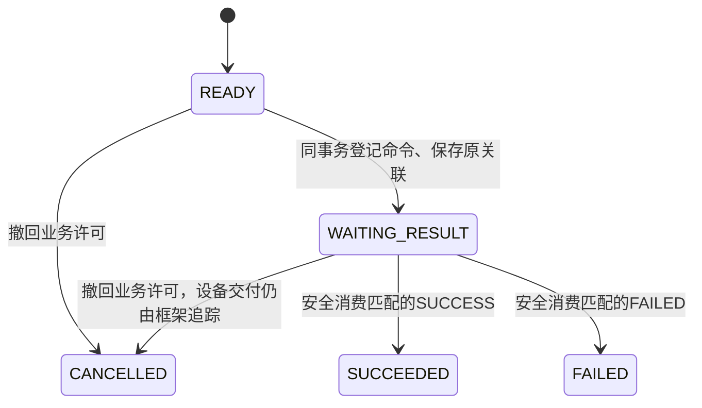

# ECS 最小业务接入教程：一次设备动作申请

本文面向会写 service 和数据库事务的开发者。先运行本项目已有的隔离参考示例，再顺着代码理解如何配置、登记命令和消费结果。无需外部业务项目或真实设备；本教程不启用主应用的真实发送。

单表业务示例及请求URL版Swagger已实现，通用协议合同与逻辑发送通道在主lifespan自动装配；无需逐动作登记。状态GENERIC_PROTOCOL_VERIFIED / WINDOW_DECISION_APPROVED / SUPPLIER_CONFORMANCE_PENDING，Task 17设计已关闭，Task 18–19已在隔离环境验收。逐地址清单、联网开关和启动默认地址不恢复。业务单表及安全消费复用[Reference](../../tests/integrations/ecs_command/conftest.py)与[回环测试](../../tests/integrations/ecs_command/test_flow.py)，新验证证据与历史记录见[实施计划](../superpowers/plans/2026-10-25-ecs-minimal-business-tutorial-plan.md)。Task 10真实供应商验收独立未完成。

## 1. 先认识三个状态

示例将一个“动作申请”绑定到测试设备 D1，要求执行测试动作 MOVE，参数为 `{"qty": 1}`。

```text
业务事务：单条动作申请（含原调用关联）+ ECS命令 + outbox → 提交
    → 唯一 Sender → 回环模拟 ECS → ACK（已接纳）
    → Result HTTP（SUCCESS/FAILED）→ 持久结果
    → 业务消费事务：同条动作申请的受保护终态更新（含消费标记）→ 提交
```

| 所属 | 示例状态/字段 | 读法 |
|---|---|---|
| 动作申请 | `READY` → `WAITING_RESULT` → `SUCCEEDED` / `FAILED`，或撤回业务许可为`CANCELLED` | 状态转换见§4；不是设备Status |
| ECS命令 | `QUEUED`、`WAITING_RESULT`、`RECONCILING`等 | 查询DTO的`status`，与业务状态分开 |
| 消息投递 | `PENDING`、`DONE`、`HELD`等 | 查询DTO的`delivery_status`；DONE或ACK不能证明执行成功 |

ACK先到、结果后到时，应观察到ack_received=True、投递DONE、命令WAITING_RESULT、result=None；业务动作仍WAITING_RESULT且不可消费。安全消费合法结果后业务才转为SUCCEEDED或FAILED。回环用例覆盖合法Result先于ACK和ACK先于Result两种顺序。

设备Status中的`state.is_online`/`state.status`与上表命令DTO.status不同，当前尚未实现设备Status查询；online/IDLE只是诊断快照，不是本方已取得执行许可。

## 2. 谁负责准备什么

本节至§5说明正式业务/已有Reference的严格接入：维护者准备合同、路由和运行装配，业务代码在自己的事务内登记意图并安全消费。Swagger通用联调按§11自动装配，不要求普通开发者复制这些业务模型。

| 输入 | 本示例的绑定 | 实际接入时由谁提供 |
|---|---|---|
| 设备/动作 | D1 / MOVE；DEVICE_CODE全系统唯一，wire字段仍为device_code | 设备管理负责全局唯一及动作许可，当前尚无正式设备表 |
| 可信owner | `CommandOwner("test")` | 服务端业务装配；不得让外部请求随意选择 |
| 调用身份 | 稳定动作ID在owner内映射为`action:<id>` | 业务持久化意图身份；技术重试用原键 |
| 参数/结果附录 | `(test, 1)`，严格`Payload(qty: int)`；错误为`ErrorDetail` | 供应商确认的版本化params/data/error合同 |
| 执行timeout | 允许1–60000ms，正常30000ms | 供应商确认；不是HTTP请求超时 |
| 单次HTTP timeout | `TargetConfig.timeout_ms`，示例沿用默认10000ms（10秒） | 接入维护者设置HTTP资源预算；与设备执行timeout、发送窗口分别配置 |
| 发送窗口 | 五分钟 | 供应商去重/保留期支持的窗口；示例值不是供应商保证 |
| 逻辑通道 | 框架自动加入`ecs-command`协议的SNAPSHOT通道，无静态base_url | 不在RELIABLE_TARGETS登记ECS；HTTP预算沿用现有默认配置 |
| 路由/授权 | 现有pytest使用A/B参考配置；Swagger按§11使用v3通用合同自动装配及专用权限 | 正式接入从设备模型ecs_origin取得地址，不单建ECS配置表；通用层仍只依赖路由端口 |

等待Result没有自动失败或重发期限。HTTP超时、发送窗口结束与设备执行结果分别处理；不能把等待时长当成失败结果，或据此重新创建设备命令。

示例的模型定义与现有源码一致：

```python
from pydantic import BaseModel, ConfigDict


class Payload(BaseModel):
    model_config = ConfigDict(strict=True, extra="forbid")
    qty: int
```

`http://ecs.test`、`http://a.test`等字面值仅用于不发网络请求的测试。真正执行HTTP的用例会改为测试容器内127.0.0.1上的随机端口，不能把这些字面值换成现场地址来运行本教程。

设备编号的全局唯一针对设备记录，同一设备可有多条命令，不对命令表device_code加唯一约束。设备地址可以随DEVICE记录直接配置，多台设备允许相同ecs_origin。测试A/B路由表只是验收夹具，不是新增生产ECS配置表。通用模块不知道设备表结构：正式适配器读设备管理，调试适配器读取经过校验及授权的请求ecs_url，返回RouteSnapshot；已登记命令仍使用原快照，内部重试不重新读最新地址改投。

## 3. 一次性装配：示例如何接起来

本节是正式业务严格接入片段，不是Swagger联调的前置步骤。

应用维护者只提供路由和附录，调用一次统一装配。以下是启动装配片段：app是尚未启动lifespan、尚未装配其他ECS服务的应用，routes为设备管理适配器，annexes为已确认的DeviceAnnex映射；不是可独立运行的程序。local Swagger已由框架装配，不要重复调用。

```python
from app.integrations.ecs_command import configure_ecs

service = configure_ecs(app, routes=routes, annexes=annexes)
```

annexes按(annex_id, annex_version)映射到DeviceAnnex(params_model, result_model, error_model, timeout_min_ms, timeout_max_ms)。上面的Payload及(test,1)只用于隔离测试，真实发送必须提供已确认的非演示附录。已有pytest fixture仍可注入底层Outbox/TargetConfig用于框架行为测试，普通开发者不用复制这些夹具装配。

目录有两个不同职责，不能合并成“每次发送都查最新地址”：

- `resolve(session, device_code, task_type)`：选择唯一有效且获准的配置，返回`RouteSnapshot`，包含origin、route_id/version、附录版本、允许动作和发送窗口。
- `authorize_frozen(session, route)`：在发送门禁事务中锁原授权，返回ALLOW、REVOKED或UNKNOWN。缺失或不确定不允许发送。改址生效不自动撤销旧授权；旧命令不改投新地址。

下面是测试目录的两个方法摘录，`self.routes`为路由授权测试数据，版本1是该测试合同支持的唯一版本；不是完整生产配置历史模型。原授权判断刻意不检查effective，因此仅改址不会误撤销旧授权。

```python
from sqlalchemy import select
from app.integrations.ecs_command import PROTOCOL_RETRY_WINDOW
from app.integrations.ecs_command.routing import RouteAuthorization, RouteSnapshot


async def resolve(self, session, device_code, task_type):
    result = await session.execute(
        select(self.routes)
        .where(
            self.routes.c.device == device_code,
            self.routes.c.effective.is_(True),
            self.routes.c.revoked.is_(False),
        )
        .with_for_update()
    )
    rows = result.mappings().all()
    if len(rows) != 1 or task_type != "MOVE":
        raise ValueError("one authorized effective route required")
    row = rows[0]
    return RouteSnapshot(
        device_code,
        row["origin"],
        row["id"],
        "1",
        "test",
        "1",
        ("MOVE",),
        PROTOCOL_RETRY_WINDOW,
    )


async def authorize_frozen(self, session, route):
    result = await session.execute(
        select(self.routes).where(self.routes.c.id == route["route_id"]).with_for_update()
    )
    row = result.mappings().one_or_none()
    if row is None or route["version"] != "1":
        return RouteAuthorization.UNKNOWN
    return RouteAuthorization.REVOKED if row["revoked"] else RouteAuthorization.ALLOW
```

回环测试创建最小Result应用，将`receiver.state.callback_session_factory`设为同一测试会话工厂，将`receiver.state.ecs_commands`设为上述service，并挂载现有Result router。它通过`MessageStore(..., lifecycles=...)`、`Sender(..., provider=DynamicClients())`执行有界投递，最终调用`sender.aclose()`。模拟ECS通过真实HTTP回报`/api/v1/callback/result`，不是直接修改命令表。

configure_ecs负责合并协议适配器、生命周期、动态客户端及app.state.ecs_commands；主应用lifespan自动将ECS逻辑通道合并到现有Sender/outbox。RELIABLE_TARGETS可以为空，也可仅保留现有WMS目标；不用随新增设备或ECS地址修改。HTTP资源预算沿用RELIABLE_*及RELIABLE_TARGETS.defaults，ECS与WMS共享发送预算，不创建第二Sender。不接受手工ECS条目或默默覆盖同名其他协议目标。

业务须在lifespan启动完成后调用create，未就绪仍503；生产路由/附录仍须确认，不会因为自动通道而获得发送许可。当前命令没有@ecs_command自动注册，不属于ECS Event/WMS操作注册清单。

## 4. 单表状态机：一次动作就是一条记录

[`Reference`](../../tests/integrations/ecs_command/conftest.py)是测试侧最小业务例，不是生产SDK；源码包含register/consume/change的完整事务与守卫。以下合同对应同一实现，不另外维护示例程序。

### 适用范围与字段

一条动作记录只关联一条ECS命令、一个固定业务消费者，消费只更新同库业务数据。已有业务表满足这个模型就复用；否则只在测试中建立一张动作表，不新增生产模型或迁移。独立意图使用独立记录，终态记录不清空重用。

| 单条动作记录保存什么 | 职责 |
|---|---|
| `id`、可信`owner_domain`、`business_key` | id标识一次独立动作，business_key关联当前权威业务事实；在owner内以`action:<id>`映射现有call_key，登记后关联不可改写 |
| `device_code`、`version` | 从权威业务事实取得的当前绑定及业务许可版本；由业务变更维护，不从客户端、设备Status、路由版本或动作行计数推算 |
| `task_type`、`timeout_ms`、`params` | 本次意图的原始输入；登记后不可改写，重入须核对原输入 |
| `command_code` | 唯一、可空的框架命令关联；登记时写入，此后不可替换或清空 |
| `intent_device_code`、`intent_version` | 登记时冻结的原绑定/版本；与当前值分开保存，不能随换绑更新 |
| `state` | READY、WAITING_RESULT、SUCCEEDED、FAILED、CANCELLED；SUCCEEDED/FAILED同时承担本消费者已消费标记 |

`id`须在请求重入前稳定取得并持久关联业务；不能每次重试新建动作行。业务动作ID与Swagger的client_request_id是两种入口的调用身份来源，不要求调用者同时提交；Swagger仍直接映射call_key，不建这张业务表。

单表不是把当前值和历史原值强行塞进同一字段。原绑定/版本不可丢，否则换绑后无法证明结果仍属于当前许可。绑定之外若有影响许可的业务变更，也必须推进version或在同一事务内检查对应权威记录。

### 当前许可和版本从哪里来

`business_key`标识业务事实的作用域，`id`标识该作用域内一次动作；多个独立动作可关联同一business_key，但各自最多一条命令。新id只改变调用身份，不产生业务许可。business_key由受信任业务入口绑定，不允许重入时换成另一个业务来绕过限制。

业务方提供只读的`current_business(session, *, business_key)`，返回当前`can_register`、`device_code`和`version`；缺失或不确定必须拒绝。can_register表示本示例MOVE新动作的当前业务许可，不是在线/IDLE，也不是ECS接纳承诺。version来自该权威业务记录，任何影响绑定或许可的变化都须推进业务版本；它不是ECS路由版本，更不是每新建一条动作就重置为1。

真实业务接入读取已有权威业务记录，不新增许可表或ECS配置表；其状态、绑定和版本由原业务service维护。在判定后到命令登记提交前，须以该记录的行锁或等价版本条件防止许可被并发撤回。涉及业务事实与动作行时，登记、消费和业务变更采用一致的“权威业务记录→动作行”锁顺序；框架内部锁序不改变。若业务动作行本身就是权威记录则只锁这一行，不为形式再建表。

模板尚无具体业务聚合，因此隔离Reference显式注入测试侧事实替身，按business_key提供已提交的许可、绑定和版本；替身不默认允许未知business_key，不读取请求提供的can_register/version，不在数据库事务内做无法回滚的内存写。回归在已提交的业务变化之后显式设置对应事实，记录这是受信任业务输入的模拟，不能把它宣称为生产聚合锁或完整业务模型已验收。单表业务变化/消费的竞争仍在PostgreSQL动作行上真实验证。

登记先按可信owner和稳定动作id定位既有命令；首次登记锁定权威事实及动作行后须重查关联，处理并发登记，不能先锁动作再反向索取权威锁。已登记且原business_key/原输入一致时返回原命令，不重新索取新许可。没有命令关联时，即使动作行预置READY，也必须在登记事务中重新读取current_business；核对允许且请求设备匹配，才将当前device_code/version写入动作、冻结intent_device_code/intent_version并登记命令。新动作行按需创建，不存在时拒绝应零新增；已有READY行拒绝则保持原状。动作关联、命令和outbox共同提交或回滚，不能先无条件建READY行再把它当许可来源。

消费和业务变更仍核对当前权威事实及动作行。跨多动作的业务变化由业务方按business_key维护权威事实及受影响动作的当前绑定/版本；不能仅更新某一新行就让其他动作绕过同业务的撤销。事实来源的真实并发保护不在测试替身中伪造，实际接入须落实上述同事务锁/版本约束。

### 两条当前许可回归如何等价迁移

| 保留的现有行为用例 | 单表迁移步骤及断言 |
|---|---|
| `test_new_reference_intent_requires_current_permission_but_replay_keeps_identity`，cancel/rebind/SUCCESS/FAILED | 在同一business_key=B1登记动作A1；提交取消、换绑或结果消费，并使事实替身反映当前不允许该原业务动作（换绑时原请求D1与当前D2不符）。原A1同输入仍返回原命令/原冻结版本；同B1的新A2不得登记，未预建时不留A2行，命令/outbox仍各一条。不能把A2改成独立许可来源或预置READY而删掉拒绝断言。 |
| `test_new_authorized_reference_intent_uses_current_version` | 同B1先登记A1，原冻结版本1；提交业务版本变化，并使事实替身返回允许、D1、版本2。按该当前事实登记独立A2，取得不同命令号及冻结版本2；A1原命令/原输入/冻结版本1不变，重入仍返回原命令。版本2必须来自业务事实，不能由新行默认值或计数巧合得到。 |

原fixture表计数迁移为动作行与命令/outbox的关联及副作用断言，不保留旧表和旧接口。新意图拒绝或获准的事实源调用须可观察，证明没有从READY自行推导许可。另保留不同business_key的真正独立有效意图不被同设备的历史失败永久封锁；同一未知动作换id不得伪装成新许可。

### 合法状态转换



- READY只表示业务允许登记，不表示设备在线或空闲。READY→WAITING_RESULT与ECS命令/outbox同事务提交；失败共同回滚，保留READY/空命令关联。
- 已登记的同身份同输入重入返回原命令，不再检查“当前仍READY”，不新增命令或覆盖原绑定；异输入冲突。CANCELLED且未登记的记录不能再登记，必须重新确认独立意图。
- 取消可以发生在登记前或登记后，但CANCELLED只是业务许可撤回，不发送设备取消、不判定设备未执行。已登记命令的ACK、Result、UNKNOWN/HELD仍由框架保存和处理；旧结果不得推进取消后的业务。
- 换绑/版本变更遵循上文权威业务记录→动作行的锁顺序。它们保留命令及原绑定/版本，推进权威业务版本并同步动作当前绑定/version；WAITING_RESULT可以因原版本失效而不能消费，不退回READY、不自动创建替代命令。
- SUCCEEDED/FAILED/CANCELLED均不被普通登记、消费或变更覆盖；新独立意图另建记录并核对当前许可，不能以新记录绕过同一动作的UNKNOWN/HELD。业务状态不合并框架命令、投递或DEVICE Status状态。

### 登记事务和重试身份

登记按上文事实来源和统一锁顺序核对可信owner/business_key。已有command_code时按原意图输入重入；首次登记重新核对权威许可、设备及业务版本和READY，再调用现有EcsCommands.create，在同一事务写command_code、原绑定/版本和WAITING_RESULT。框架savepoint不代替调用方提交；动作更新失败不得留下命令/outbox。

Swagger仍只用client_request_id这一调用键，由服务端owner限定并映射现有call_key；请求URL版另必填ecs_url作为地址，不是第二个幂等键，两者均不进入ECS wire。响应丢失重提同ID、同输入、同规范化URL找回原命令；换址409，含并发竞争，不能把URL拼进调用键。内部重试由唯一Sender处理原记录，沿用command_code、时间、字节和origin，不再次create或生成请求ID。新独立意图必须有独立且稳定的身份，不能借换键重发未知命令。

以下位于pytest的reference fixture上下文，业务事实已显式注入；不是导入tests供应用运行的方式。实际业务把同样的事务放在自己的service中：

```python
async with reference.ecs.factory.begin() as session:
    command = await reference.register(
        session,
        action_id=1,
        business_key="B1",
        device_code="D1",
        task_type="MOVE",
        timeout_ms=30000,
        params={"qty": 1},
    )
# Sender与Result链路处理后，再由业务显式触发消费。
async with reference.ecs.factory.begin() as session:
    advanced = await reference.consume(session, action_id=1)
```

## 5. 安全消费：一次受保护的终态转换

按“权威业务记录→同一动作行”的统一顺序保护当前许可；事实源由动作行承载时只锁该行，再通过可信owner调用现有get_command/get_by_call。读取公开DTO，不操作ECS ORM，也不直接改outbox。必须同时满足：

1. 动作处于WAITING_RESULT，原command_code匹配；当前device_code/version与intent_device_code/intent_version一致，业务许可仍有效。
2. DTO结果存在，无hold_reason/needs_reconciliation；ACK、DONE、在线/IDLE、等待时长及日志恢复都不能替代合法结果。
3. 将WAITING_RESULT原子转为SUCCEEDED或FAILED，并与本次同库业务写共同提交。若采用条件更新替代行锁，必须验证受影响行数为1，并证明等价并发保护；只做一次无锁状态查询不够。

同一消费者再次调用时终态不再转换、不再产生副作用，因此不另建消费表。业务写失败时终态更新一起回滚，仍可消费原结果；不重新登记命令。

取消/换绑/版本变化先提交，消费不推进、不留成功消费标记；消费先提交，后续变化不能覆盖终态。已有迟到冲突规则保持：查询前已知冲突阻止消费；查询后到达的矛盾保留证据并核对，不自动撤销已提交业务。状态机不承诺跨业务表与所有迟到结果严格串行化。

UNKNOWN/租约中断保持框架HELD；业务仍可等待或撤回业务许可，不能由业务状态更新、设备后来空闲或新调用键解封。合法匹配Result只按现有P1规则解决未知。真正提前的Result仍409/封锁，合法在途Result仍可先于ACK。

### 什么时候需要超出单表

一条业务记录有多条命令、多个消费者各自确认，或要消费到外部系统时，本例不提供通用解法：分别确认关联、消费唯一性或外部outbox需求后再设计。不能拿单条终态保证多消费者或跨系统副作用只发生一次。框架的ecs_command、reliable_message、ecs_send_evidence和ecs_result_evidence保持不变，不把多次发送/结果证据压成一个业务状态。

Reference及调用测试统一使用单表，独立业务调用映射/消费表及冗余helper已移除，无兼容入口；路由A/B授权数据仍按需要保留。两个P2/P3、回滚、竞争及未知交付行为断言继续执行，只调整承载方式并补缺口，不复制Sender或协议。消费由业务service显式触发，既不是Result自动消费，也不新增轮询器。

## 6. 准备隔离源码副本

本节至§9复用现有单表与框架边界测试，§11使用已实现的v3通用合同。Task 14–16历史数字保留，Task 18–19的新实现/验证证据见实施计划。以下命令用于macOS/Linux的Bash，需Git、Python3.13+和uv；完整路径另需Docker。依次在**同一个Bash会话**中执行代码块。若日常使用zsh，先运行`bash`。命令只读原工作区，临时目录保留日志。不要设置任何现场地址。

```bash
set -euo pipefail
export ECS_REPO="$(git rev-parse --show-toplevel)"
export ECS_LAB="$(mktemp -d "${TMPDIR:-/tmp}/ecs-tutorial.XXXXXX")"
export ECS_ID="$(python3 -c 'import uuid; print(uuid.uuid4().hex[:12])')"
export ECS_PYTHON="$(uv python find 3.13)"
export ECS_UV_CACHE="$(uv cache dir)"
python3 - <<'PY'
import os, pathlib, shutil, subprocess
root = pathlib.Path(os.environ["ECS_REPO"])
dest = pathlib.Path(os.environ["ECS_LAB"]) / "src"
paths = subprocess.check_output(
    ["git", "ls-files", "--cached", "--others", "--exclude-standard", "-z"],
    cwd=root,
).decode().split("\0")
for name in set(filter(None, paths)):
    p = pathlib.Path(name)
    if p.parts[0] not in {"app", "tests", "scripts", "migrations", "docs",
                          "pyproject.toml", "uv.lock", "alembic.ini", "README.md"}:
        continue
    if any(v in {".env", ".git", ".venv", "__pycache__"} for v in p.parts):
        continue
    source = root / p
    if source.is_symlink():
        raise SystemExit(f"refuse symlink: {name}")
    if source.is_file():
        target = dest / p
        target.parent.mkdir(parents=True, exist_ok=True)
        shutil.copy2(source, target)
assert not (dest / ".env").exists()
print("isolated source:", dest)
PY
```

副本包含当前允许的工作区内容，不使用`git archive HEAD`漏掉尚未提交的已审阅变更；不会复制本机.env、虚拟环境或Git元数据。

## 7. SQLite快速理解路径

此路径不需要Docker，不连接PostgreSQL或Redis；通过清空继承环境阻止沿用现场目标/代理。uv首次同步锁定依赖可能联网下载软件包，这发生在示例运行之前。运行中的HTTP只到测试自身的回环服务。

```bash
mkdir -p "$ECS_LAB/home"
env -i PATH="$PATH" HOME="$ECS_LAB/home" \
  UV_PYTHON="$ECS_PYTHON" UV_CACHE_DIR="$ECS_UV_CACHE" PYTHONDONTWRITEBYTECODE=1 \
  DATABASE_URL='sqlite+aiosqlite://' REDIS_URL='redis://127.0.0.1:1/0' \
  JWT_SECRET_KEY='tutorial-only-not-production-secret-32' \
  ENVIRONMENT=local RELIABLE_TARGETS='{}' \
  uv --no-config run --directory "$ECS_LAB/src" --frozen python -m pytest \
    "$ECS_LAB/src/tests/integrations/ecs_command/test_flow.py::test_loopback_command_result_and_reference_consumption" \
    -k sqlite -q -rs -p no:cacheprovider | tee "$ECS_LAB/sqlite.log"
```

预期SUCCESS/FAILED×before_ack/after_ack四个SQLite参数通过，PostgreSQL参数被排除，不证明行锁竞争。通过摘要对应§1、§4、§5的公开查询断言；失败时pytest显示具体断言，不需连接设备查看状态。

## 8. 完整隔离路径：一次性PostgreSQL/Redis与回环HTTP

继续使用§6变量。PostgreSQL fixture会对TEST_DATABASE_URL执行迁移并清理测试记录，因此这里仅允许新建的专属容器。Redis预检只确认本次资源可连接；ECS专项本身不依赖Redis，不能把它描述为真实Celery/broker验收。

准备阶段允许拉取镜像和安装锁定依赖。uv版本沿用本仓库Dockerfile；构建完成后的测试容器只加入内部网络，没有现场网络、宿主socket或发布端口。

```bash
export ECS_NET="ecs-tutorial-$ECS_ID"
export ECS_PG="$ECS_NET-pg"
export ECS_REDIS="$ECS_NET-redis"
export ECS_RUNNER="$ECS_NET-runner"
export ECS_API="$ECS_NET-api"
export ECS_WEB="$ECS_NET-web"
export ECS_IMAGE="$ECS_NET-tests:local"
cleanup_ecs_tutorial() {
  for item in "$ECS_API" "$ECS_RUNNER" "$ECS_PG" "$ECS_REDIS"; do
    if [ "$(docker inspect -f '{{index .Config.Labels "ecs.tutorial.run"}}' "$item" 2>/dev/null)" = "$ECS_ID" ]; then
      if [ "$item" = "$ECS_API" ]; then
        docker logs "$item" > "$ECS_LAB/swagger-api.log" 2>&1 || true
      fi
      docker rm -f -v "$item"
    fi
  done
  for network in "$ECS_WEB" "$ECS_NET"; do
    if [ "$(docker network inspect -f '{{index .Labels "ecs.tutorial.run"}}' "$network" 2>/dev/null)" = "$ECS_ID" ]; then
      docker network rm "$network"
    fi
  done
  if [ "$(docker image inspect -f '{{index .Config.Labels "ecs.tutorial.run"}}' "$ECS_IMAGE" 2>/dev/null)" = "$ECS_ID" ]; then
    docker image rm "$ECS_IMAGE"
  fi
}
trap cleanup_ecs_tutorial EXIT
trap 'exit 130' INT
trap 'exit 143' TERM
printf 'home/\nsrc/.venv/\n**/__pycache__/\n*.log\n' > "$ECS_LAB/.dockerignore"
cat > "$ECS_LAB/Dockerfile" <<'DOCKERFILE'
FROM python:3.13-slim
RUN pip install --no-cache-dir uv==0.12.13
ENV UV_PROJECT_ENVIRONMENT=/opt/venv UV_LINK_MODE=copy
WORKDIR /code
COPY src/pyproject.toml src/uv.lock ./
RUN uv sync --frozen --no-install-project
ENV UV_NO_SYNC=1 UV_OFFLINE=1 UV_CACHE_DIR=/tmp/uv-cache PYTHONDONTWRITEBYTECODE=1
CMD ["sleep", "infinity"]
DOCKERFILE
docker build --label "ecs.tutorial.run=$ECS_ID" -t "$ECS_IMAGE" \
  -f "$ECS_LAB/Dockerfile" "$ECS_LAB" > "$ECS_LAB/build.log" 2>&1
docker network create --internal --label "ecs.tutorial.run=$ECS_ID" "$ECS_NET"
docker run -d --name "$ECS_PG" --label "ecs.tutorial.run=$ECS_ID" \
  --network "$ECS_NET" --network-alias pg \
  -e POSTGRES_USER=test -e POSTGRES_PASSWORD=test -e POSTGRES_DB=ecs_tutorial \
  postgres:17-alpine
docker run -d --name "$ECS_REDIS" --label "ecs.tutorial.run=$ECS_ID" \
  --network "$ECS_NET" --network-alias redis redis:8-alpine
docker run -d --name "$ECS_RUNNER" --label "ecs.tutorial.run=$ECS_ID" \
  --network "$ECS_NET" --read-only --tmpfs /tmp \
  -v "$ECS_LAB/src:/code:ro" \
  -e DATABASE_URL='sqlite+aiosqlite://' -e REDIS_URL='redis://redis:6379/0' \
  -e TEST_DATABASE_URL='postgresql+asyncpg://test:test@pg:5432/ecs_tutorial' \
  -e TEST_REDIS_URL='redis://redis:6379/15' \
  -e JWT_SECRET_KEY='tutorial-only-not-production-secret-32' \
  -e ENVIRONMENT=local -e RELIABLE_TARGETS='{}' \
  -e PYTEST_ADDOPTS='-p no:cacheprovider' "$ECS_IMAGE"
ready=0
for attempt in {1..30}; do
  if docker exec "$ECS_PG" pg_isready -U test -d ecs_tutorial >/dev/null 2>&1 \
     && [ "$(docker exec "$ECS_REDIS" redis-cli ping 2>/dev/null)" = PONG ]; then
    ready=1; break
  fi
  sleep 1
done
[ "$ready" = 1 ] || { echo 'disposable stores not ready'; exit 1; }
[ "$(docker network inspect -f '{{.Internal}}' "$ECS_NET")" = true ]
echo 'internal network verified'
docker inspect -f '{{.Name}} ports={{json .HostConfig.PortBindings}} label={{index .Config.Labels "ecs.tutorial.run"}}' \
  "$ECS_PG" "$ECS_REDIS" "$ECS_RUNNER"
docker exec -i "$ECS_RUNNER" uv run python - <<'PY'
import os, asyncio
from sqlalchemy.ext.asyncio import create_async_engine
from sqlalchemy import text
from redis.asyncio import Redis
assert os.environ["TEST_DATABASE_URL"] == "postgresql+asyncpg://test:test@pg:5432/ecs_tutorial"
assert os.environ["TEST_REDIS_URL"] == "redis://redis:6379/15"
async def check():
    engine = create_async_engine(os.environ["TEST_DATABASE_URL"])
    async with engine.connect() as connection:
        assert await connection.scalar(text("SELECT current_database()")) == "ecs_tutorial"
    await engine.dispose()
    async with Redis.from_url(os.environ["TEST_REDIS_URL"]) as client:
        assert await client.ping()
asyncio.run(check())
print("disposable database/Redis connections verified")
PY
```

预检须看到internal=true、三容器无发布端口且label一致，并实际通过连接检查。任何一步失败都应停下；不要删掉TEST_DATABASE_URL来把失败变成skip。此处的test/test仅为一次性内部网络的示例凭据。

先用闭环入口理解过程，再跑完整专项统一验证两个P2、P3、授权和未知等边界。无需另外重复运行整组service/query或concurrency/flow，各行为用例定位见§9：

```bash
docker exec "$ECS_RUNNER" uv run python -m pytest \
  tests/integrations/ecs_command/test_flow.py::test_loopback_command_result_and_reference_consumption \
  -q -rs | tee "$ECS_LAB/loopback.log"
docker exec "$ECS_RUNNER" uv run python -m pytest tests/integrations/ecs_command/ \
  -q -rs | tee "$ECS_LAB/ecs.log"
docker exec "$ECS_RUNNER" uv run ruff check --no-cache .
docker exec "$ECS_RUNNER" uv run ruff format --check --no-cache .
echo "logs retained: $ECS_LAB; continue with section 11 before cleanup"
```

本节保留runner及EXIT清理trap供§11复用；若不继续，执行§11末尾清理代码块，或退出本次Bash会话触发清理。不要把skip视作PostgreSQL验证。完整运行时SQLite不适用的行锁参数会skip，对应PostgreSQL参数必须实际通过；测试失败应排障并保留日志，不得通过放宽断言、忽略退出码或连接业务库绕过。

若中途失败，EXIT/INT/TERM trap只清理带本次标签的资源。若终端被强制关闭，重新设置保存下来的ECS_ID及资源名，重新定义并调用同一cleanup函数；先核对标签，不使用全局prune。临时目录和日志不自动删除，确认不再需要后再仅删除该目录。

## 9. 结果与异常要如何读

| 要理解的行为 | 现有入口/参数 | 预期 |
|---|---|---|
| 正常闭环 | `test_loopback_command_result_and_reference_consumption`，SUCCESS/FAILED×before_ack/after_ack | 冻结字节被发送；重复Result一致；证据和消费各一次 |
| 登记/消费回滚 | `test_reference_registration_and_outbox_rollback_together`；`test_consumer_write_failure_rolls_back_marker_and_can_retry` | 无半条义务；业务写失败不留消费标记，可消费重试 |
| 路由P2与改址P3 | `test_pending_route_keeps_active_route_and_revocation_only_fences_old_call`，revoked=False/True | 新意图冻结B；旧意图保持A，只有原授权撤销才围栏旧发送 |
| 消费P2 | `test_consumption_and_business_change_follow_lock_order`，cancel/rebind/version×change/consume | 先提交者决定推进，后来的变更不覆盖终态 |
| 授权竞争 | `test_persistent_route_revocation_serializes_with_send_gate`，revoke/gate | 撤销与发送门禁按原授权锁顺序串行化 |
| 未知交付 | `test_unknown_delivery_is_held_and_restart_does_not_retry`、`test_interrupted_snapshot_lease_holds_until_matching_result` | 持久HELD，不自动重放；只按既有规则处理合法匹配Result |
| 结果异常 | `test_missing_original_annex_returns_retryable_503_without_result_evidence`、`test_http_commit_failure_rolls_back_result_receipt_and_settlement`、`test_result_survives_receipt_and_delivery_cleanup` | 缺原附录503且零副作用；共同回滚；长期证据仍可重报 |

UNKNOWN不等于“没发出”，不能换命令号或普通resume重发；HELD不因TTL或清理消失。已知冲突不推进，迟到冲突进入核对而不自动回滚业务。不要在本教程中尝试人工解封、裸settle或真实取消。

## 10. 从示例走向实际业务

框架负责冻结、投递、响应分类、允许的重试/暂停、结果持久化和owner查询。业务负责当前许可、原意图映射、创建事务、消费触发时机、幂等标记与业务状态转换。模板没有生产设备目录或生产HTTP发命令接口；local-only调试入口不承担生产业务授权。

实际接入前仍须确认供应商合同C1/C2/C3、目录授权C5、Result来源限制、发布备份/迁移回退、容量和物理/业务验收；测试通过不能关闭这些门槛。参阅[ECS接入参考](ecs-command.md)、[隔离参考验收设计](../superpowers/specs/2026-10-25-ecs-first-consumer-isolation-design.md)及[教程设计](../superpowers/specs/2026-10-25-ecs-minimal-business-tutorial-design.md)。


权限、通用协议合同及隔离出口专项复用`test_dev.py`：`test_main_lifespan_assembles_ecs_once_with_restricted_factory`覆盖实际主启动、两个模拟端、不同动作/JSON结构及非本轮回环地址；`test_isolated_sender_rejects_unowned_origin_before_tcp`直接观测非本轮回环及保留IP地址的TCP入口零调用。`test_startup_merges_history_annexes_for_original_results`验证可信历史合并与缺原模型的新启动。Sender停启矩阵位于`test_restart.py`，覆盖首次未发送、NOT_SENT、合法503/429的原调度、历史正式60/600秒期限、超期零发送及UNKNOWN/HELD不解封。复用§8命令，无需另起测试程序。

## 11. 无设备表的ECS联调入口：自动装配通用协议合同

统一最低合同已由Task 17批准：W=300秒，D=确定终态后至少24小时，活动/未决去重依据不按TTL清理，详见[设计§10.4](../superpowers/specs/2026-10-25-ecs-minimal-business-tutorial-design.md)。Task 18–19已完成本方实现及隔离实跑；普通app.main:app在local自动装配通用合同。项目批准与模拟测试不证明供应商符合性；Task 10独立且未执行。

### 开发者只填写请求

```json
{
  "client_request_id": "demo-1",
  "ecs_url": "http://127.0.0.1:9000",
  "device_code": "D1",
  "task_type": "MOVE",
  "timeout_ms": 30000,
  "params": {"qty": 1}
}
```

核心输入是ecs_url、device_code、task_type和params。client_request_id仍必填并在同一意图重入时保持稳定，timeout_ms仍按非负int64执行毫秒值填写，不提供新的默认值；均不是动作登记。框架自动装配统一协议合同、逻辑通道和原Sender，不要求编写Payload模型或维护actions/附录清单。新增DEVICE/动作/合法地址无需改启动配置或重启，不新建ECS配置表、地址清单、联网开关或请求窗口字段。

params及Result.data须为合法JSON对象，可以包含不同动作的不同字段；完整保留这些字段，不套用测试qty模型，也不丢弃未知业务字段。task_type只校验统一文本协议，不做动作白名单；具体动作/参数语义由对端ECS校验，合法但不支持的动作按原协议拒绝并持久记录，不报本方“未装配动作”。统一信封、ACK/错误、ErrorDetail(code,msg)、SUCCESS/FAILED条件及身份/体积校验不放宽。

内置`POST /api/v1/device/command` mock仍是严格演示对端：仅接受回环调用、D1/MOVE、1–60000ms的执行timeout及严格`params={"qty": int}`（不接受额外参数），只返回ACK，不产生Result或业务消费。它与上述通用登记服务的接收范围不同；协议合法的其他设备/动作/JSON由实际对端判定语义。§11的通用验证使用`tests.ecs_swagger`持有的两个独立模拟端，不能改用内置演示mock来验证LIFT等通用动作。超出演示合同的请求若得到不符合ECS响应合同的错误信封，原分类会保守进入UNKNOWN→HELD，不自动重放；登记成功不保证该mock接纳。

仅local挂载，登录及dev:ecs:send_real仍必需。ecs_url继续要求规范化HTTP(S) IP origin与固定命令路径，拒绝凭据/query/fragment/DNS/重定向/环境代理及非法地址。普通登录不等于具备权限，权限不等于现场许可；请求不能自报owner、附录/策略、mock类别或权限来绕过检查。

### 时间与安全边界

- 已批准W=300秒，由可信协议级策略自动装配，在contracts.py定义共享PROTOCOL_RETRY_WINDOW=timedelta(seconds=300)，由调试和正式路由共同引用、EcsCommands.create统一校验所有新命令，从本方首次创建起算并冻结；不从首次发送、最近重试或重启重算，不新增请求/启动/.env窗口参数。该值是本项目时效性与短时恢复的规范选择，执行/HTTP timeout、Retry-After上限或Transport TTL都不是推导依据。截止后停止新发送，已发出请求和合法迟到结果按原规则收敛；不是设备执行或等待Result的截止。
- 已批准D=对端ECS持久确认确定终态后至少24小时（86400秒）；活动/未决去重依据持续保留，不按TTL删除，不把运行超过24小时当成完成。terminal_at来自对端持久终态事实，不使用请求finish_time或本方回调到达时间，重启/时间异常不能缩短保留期。原命令身份、原载荷指纹、原接纳事实、执行/终态及协议所需结果须可恢复；本方长期证据/90天可靠层配置不因此改成24小时。该保证不是永久去重，D到期不授权重发旧命令或换号重做UNKNOWN/HELD；原Result重报义务不缩短，回报未确认时不得因D到期清理原结果/去重依据。
- 跨重启合同覆盖正常/异常进程退出、容器/主机重启及断电恢复：持久接纳先于ACK与物理派发，同号同载荷先找原事实、不产生第二份执行义务，同号异载荷409；原已接纳请求不因busy或恢复而变成503/429。执行事实不确定先核对，不盲目重做或伪造SUCCESS/FAILED；存储丢失/回滚旧备份/恢复出厂不能空状态直接恢复受影响接纳。真正未接纳的503/429仍允许原身份后续接纳，不能缓存成永久拒绝；可能已接纳不能谎报为未接纳。Task 10须验证真实对端是否满足，隔离模拟不能替代。
- 统一策略缺失/非法的新登记503、零义务/网络防御仍保留，明确提示策略原因，不冒充数据库故障或单次直发绕过；不阻断WMS/Result启动和旧owner重入，不因当前策略变化重写/暂停既有v3窗口。
- 同owner/client_request_id同输入同规范化地址只读返回原命令，包括旧策略、终态及HELD；异输入/换址409。URL/策略版本不拼入调用键或wire。并发唯一赢家后、提交前复核持久origin，输家零发送，命令/outbox/快照共同提交或回滚。
- 新命令冻结dev.ecs.network/v3及ecs.dev.protocol/1；v1/v2、旧grant/未知策略保守围栏，不转换、补授权、改址或自动重放。正式路由版本不变。原Result按原附录与发送证据处理，尚无持久结果证据且缺原附录时503，已有持久重复结果优先返回原响应；不能用通用合同宽松解释旧数据或让未发送/已围栏命令取得结果应用资格。
- 新登记权限撤回不暂停已登记v3命令；停后续发送仍须停止全部相关Sender并防止自动拉起。当前ECS/WMS共用主应用lifespan，停宿主影响出站与该实例HTTP/Result；停止有生效窗口，在途可能交付，有界关闭、租约中断与shutdown unconfirmed不证明设备取消。
- 恢复保留首次未发送、NOT_SENT及合法503/有效429判定NOT_RECEIVED后的原PENDING、退避、Retry-After、next_attempt_at、deadline、计数与证据；计划时间前不发，到期且原期限有效才以原身份/地址/字节重试。超期走原TTL，无效/超限Retry-After及UNKNOWN/HELD不因重启、改址/换键或Status恢复解封，不重算等待或延长期限。
- 通用Result的SUCCESS仅是ECS报告。正式业务消费必须按§4–5核对原关联、当前许可/绑定/版本并与副作用同事务；保留两条许可、两个P2、P3和消费竞争，ACK不等于设备或业务完成。

### 正式与调试共用W，不改写旧期限

PROTOCOL_RETRY_WINDOW=timedelta(seconds=300)定义在app/integrations/ecs_command/contracts.py并从ECS包导出，正式DeviceRouteProvider与调试路由均引用它。共享EcsCommands.create负责所有新命令的统一检查，不能只在configure_local_ecs设置默认；§3的正式严格附录/原授权保留，不要求正式业务使用调试权限。

同owner/原call_key记录查找和输入比较仍最先进行：旧同参调用只读返回原身份且原冻结期限不变，不新增响应字段、不重新resolve或检查当前路由窗口，异参仍冲突。只有新调用在解析路由后、生成/写入命令与outbox前检查retry_window为timedelta且精确300秒；60、600、299.999或300.001秒均按既有503配置错误机制拒绝，提示引用共享常量，零新增/零HTTP。不静默取整、截短或放大，也不当作400业务输入错误或数据库断连；错误信封/映射及对端协议不变。 路由快照构造也将缺失、错误类型及非正窗口识别为配置503，避免在共享创建检查前误报400/500；发送时遇到损坏快照仍保守围栏，不套用当前300秒改写旧期限。

正式创建入口回归已验证：300秒时route/命令/消息期限一致；不一致时拒绝。历史60/600秒的合法夹具在当前路由不一致或抛错时，同参只读返回原命令且不触发resolve，异参冲突；对仍获原授权且可安全重试的正式存量消息，停启沿用原窗口/字节/next_attempt_at，不用当前常量重算。旧dev策略仍围栏，UNKNOWN/HELD不解封。§3源码摘录和正式参考提供方已统一引用共享常量。

### 可信启动依赖：普通开发者无需填写

接口configure_local_ecs(app, *, environment, history_annexes=None, client_factory=AsyncHttpClient)保留普通environment调用；额外依赖仅供可信启动/隔离测试，不能从Swagger/.env传入。底层configure_ecs仅接受同名可选工厂依赖，并保持现有重复装配冲突检查。

测试入口先启动并持有两个本轮模拟端，再绑定受限client_factory并沿用生产W=300秒策略；此时app.state.ecs_commands/reliable_client_provider均未创建。真正进入主lifespan后，由它调用原生产装配函数一次：检查冲突→复制校验并合并历史/内置合同→构造生产service/lifecycle与受限DynamicClients→发布状态→关联唯一outbox→启动Sender。测试启动包装可以绑定原函数的可信关键字依赖，必须委托原函数，不能提前手工造服务或provider让自动路径跳过/冲突，也不修改通用模型。退出时先关闭Sender/客户端，再关闭模拟端并恢复测试注入。

确有旧命令的维护者可从可信启动模块提供history_annexes，按原(annex_id, annex_version)保留版本化DeviceAnnex；默认空。原装配在创建服务前复制、校验并与ecs.dev.protocol/1一次合并，原结果和新命令共用同一个服务，不第二次装配、不启动后补字典。无效键/模型或覆盖内置保留键必须在发布前报错，输入映射及原服务不变；新v3仍只选择内置合同，历史键不参与动作选择，不放行v1/v2/grant发送。旧actions/annexes参数不保留别名。

必须用实际启动上下文验证合并：预置隔离合法v2 ACK/UNKNOWN夹具及原模型，有历史输入时首次合法Result可应用，违反原严格data的结果仍400；新启动缺原模型时未持久化Result 503且零副作用，已有持久重复结果沿用原响应。不得让v3发送旧策略来造历史证据，不能只靠测试中手工更新service.annexes证明升级可用；这些模拟证据不是现场结果。

### 隔离运行步骤

Task 17设计决策已关闭，Task 18–19已在无.env副本、一次性PG/Redis实跑。复用§6/§8的资源与标签清理，先运行自动化测试，再做手工登记。测试专用入口为tests.ecs_swagger:create_app，仅建立本轮两个模拟端并绑定受限客户端工厂，直接使用生产W=300秒；原通用协议路径自动装配，不用另一套发送器或假ACK。TEST ONLY只标模拟端、数据及隔离环境。测试通过不能证明真实ECS满足D或跨重启合同，Task 10须另行验收，不新增供应商ECS实现。

受限工厂须按上述顺序作为依赖交给唯一生产装配，在主lifespan创建provider时生效、先于Sender；不把provider实例提前写入app.state。只允许本轮自行启动并持有的模拟origin，不能先启动不受限的普通应用再补限制。以下命令已在本轮等价隔离环境执行；日志、通过数和清理证据见实施计划。

```bash
docker exec -e DATABASE_URL='postgresql+asyncpg://test:test@pg:5432/ecs_tutorial' \
  "$ECS_RUNNER" uv run alembic upgrade head
docker exec -e DATABASE_URL='postgresql+asyncpg://test:test@pg:5432/ecs_tutorial' \
  -e ADMIN_PASSWORD='ecs-demo-only-password' "$ECS_RUNNER" \
  uv run python -m scripts.seed_admin ecs_demo ecs_demo@example.test
docker network create --label "ecs.tutorial.run=$ECS_ID" \
  --opt com.docker.network.bridge.enable_ip_masquerade=false "$ECS_WEB"
start_ecs_swagger() {
  docker create --name "$ECS_API" --label "ecs.tutorial.run=$ECS_ID" \
    --network "$ECS_WEB" --read-only --tmpfs /tmp -p 127.0.0.1::8000 \
    -v "$ECS_LAB/src:/code:ro" \
    -e DATABASE_URL='postgresql+asyncpg://test:test@pg:5432/ecs_tutorial' \
    -e REDIS_URL='redis://redis:6379/0' \
    -e JWT_SECRET_KEY='tutorial-only-not-production-secret-32' \
    -e ENVIRONMENT=local -e RELIABLE_TARGETS='{}' \
    "$ECS_IMAGE" uv run uvicorn "$@" --host 0.0.0.0 --port 8000
  docker network connect "$ECS_NET" "$ECS_API"
  docker start "$ECS_API"
  docker exec -i "$ECS_API" uv run python - <<'PYREADY'
import time, urllib.error, urllib.request
for attempt in range(60):
    try:
        with urllib.request.urlopen("http://127.0.0.1:8000/openapi.json", timeout=1) as response:
            if response.status == 200:
                break
    except (urllib.error.URLError, TimeoutError):
        pass
    time.sleep(0.25)
else:
    raise SystemExit("isolated Swagger API did not become ready")
PYREADY
  ECS_SWAGGER_ADDR="$(docker port "$ECS_API" 8000/tcp)"
  echo "Swagger: http://$ECS_SWAGGER_ADDR/docs"
}
start_ecs_swagger tests.ecs_swagger:create_app --factory
```


日志ECS isolated simulator origins给出本轮两个随机回环origin；以ecs_demo登录Swagger并把其中一个填入ecs_url。普通开发者无需编写动作注册代码；测试入口只用于隔离副本，不接受额外目标或把现场地址加入测试集合。

1. 先验证冷启动：进入主lifespan前没有ECS服务/provider，主lifespan自动调用生产装配恰好一次；启动后仅一个Sender、同一outbox、受限provider，重复装配仍报冲突且原服务不变。不能用预装服务或清空本次启动状态代替。确认OpenAPI中ecs_url必填、client_request_id及timeout_ms保留，没有actions/合同/窗口等请求选项。权限不足403、非法地址/JSON/类型400均零新义务/HTTP；统一策略未就绪503的独立回归与正常自动装配正向分开。
2. 同一启动对两个本轮模拟端，用不同DEVICE、至少两种task_type及不同params结构登记，无逐动作配置或重启；各端经原Sender收到冻结原字节并返回合同合法ACK。查询持久ecs_url，观察WAITING_RESULT、ack_received=true、result=null。
3. 分别模拟SUCCESS/FAILED及不同JSON对象data，保持统一error_detail条件；重复Result一致。业务消费另按§4–5，不手工伪造真实完成。测试通用合同接收不同结构，不能只靠固定qty案例证明。
4. 同键等价地址重入200、换址/异输入409、PG并发唯一赢家及输家零发送；v2旧owner只读重入、旧附录Result、未知策略围栏分别回归，不改原快照/业务许可。历史升级与缺历史映射分开新启动：从可信输入装入原模型后首个合法旧Result可应用/非法旧data仍400；缺原模型的另一条新Result 503零副作用，已持久重复结果仍返回原响应；保留键冲突/无效映射拒绝且不改输入或原服务。
5. 新键登记非本轮有效origin如http://127.0.0.1:1可返回200，但出口须TCP前拒绝，保持PENDING且无ACK/发送证据；底层TCP入口零调用由定向回归直接观测，不靠PENDING或零命中推断。非回环仅用计数替身，不实际探测；internal网络或关闭NAT不替代证明，不恢复生产地址清单。
6. 运行共享W的正式创建300秒/不一致拒绝、历史60/600秒重入与存量原期限回归，再运行§9停启/UNKNOWN/HELD、两条许可、两个P2/P3及原事务/消费竞争回归；记录新版本的命令、退出码、skip、真实HTTP命中/零TCP和成功/失败清理证据。不得用v2数字认证v3，不执行Task 10。

```bash
cleanup_ecs_tutorial
trap - EXIT INT TERM
echo "logs retained: $ECS_LAB"
```
