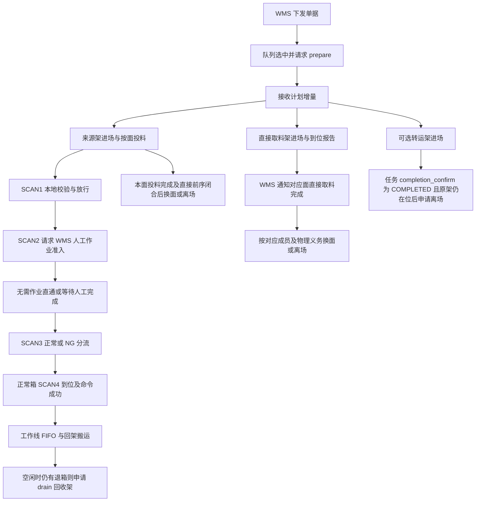

# 人工分拣业务与 API 交互参考

状态：**旧系统合同与代码的核对结果，本系统尚未接入。** 先读[共用规则](workline-business-api.md)。这里的“人工”指 WMS/PDA 完成人工作业，WES 编排货架、料箱和滚筒命令，不给人工线机械臂下发 PICK_AND_PUT。

## 1. 输入、资源和业务边界

初始触发是 WMS 的 `outbound.picking_task.issued@v1`。`task_type=MANUAL` 表示执行模式，必填的 `business_type=inbound|outbound` 表示业务方向；两者不是同一概念。入库同样沿用该 operation 和队列/计划/人工处理/退箱生命周期，不另造一条 inbound 插件链。

| 声明资源 | 实际用途 | WORKLINE 配置 |
| --- | --- | --- |
| SCAN1 | 入口扫码、本地因果及条码校验 | 绑定入口设备 |
| SCAN2 | 人工工作位扫码，向 WMS 请求准入 | 绑定工作位设备 |
| SCAN3 | 正常/NG 分流 | 绑定退箱检验设备 |
| SCAN4 | 实际到位形成退箱 FIFO | 绑定出料设备 |
| FIVE_RACK | 五层来源架工作位 | 实际 RACK_POSITION |
| RETURN_RACK | 人工直接取料架工作位 | 实际 RACK_POSITION；不是滚筒退箱的回收架 |
| TRANSFER_RACK | 可选的转运架工作位 | 可选资源；未采用时不创造该分支 |
| INLET / OUTLET | 料箱进出交接位 | 实际 HANDOFF_POSITION |

当前 `PositionSlot` 仅有 key/display_name/required，旧 definition 的架型、position_type/location_type 等约束**不会自动继承**。采用这些语义需在本业务的配置/执行校验中明确实现，或另经评审扩展声明；不能声称当前管理表单已校验架型。

建议拆分三个业务状态：任务队列与计划、每架每面作业循环、料箱本次经过及退箱。共享任务/资源关联，分别拥有自己的结束条件；父任务完成不删除尚未履约的清理义务。

## 2. 流程及并行关系



图中的分支是并行义务，不是一条必须串行到底的长事务：

1. 来源架、直接取料架、可选转运架分别根据自己的原 Transport 和精确到位事实推进。SCAN1 不等待转运架到位，人工是否可作业由 SCAN2 的 WMS 准入判断。
2. 一个 `task_id + plan_revision + rack_id + rack_face` 的 inbound_batch 是**完整、最终、有序清单**。即使超过 4 箱也不是第二次申请“下一页”，而是拆为最多 4 箱的多个 Transport 段。后续段遵守前段权威成功/发布和入口清空规则。
3. `feed_complete` 需要该面所有段/成员成功且目标交接位匹配，不等待整条线扫码、人工处理或所有退箱。货架换面/离场还要核对自己的直接物理义务。
4. 正常退箱属于工作线跨任务 RETURN_BUFFER。可回到当前实际到位架面，不要求原来源架；不得回到专供直接取料的 RETURN_RACK。
5. 有合格退箱时，在当前面投料结束后的机会请求一次 return_batch；NO_BATCH 结束本次机会，不无条件阻止换面。回架 Transport 的直接未闭合义务仍可阻止相关架动作。
6. 没有可原子接续准备的下一任务且 FIFO 非空，才按合同申请 drain 架；受控停止也要保留这类义务。新任务可承接工作线 FIFO，不能一结束父任务就清队列。
7. 新架有自己的权威到位依据后，可独立作业；旧架无关离场 UNKNOWN 不能成为全工作线永久门禁。真正相关的前序仍必须保留。
8. completion_confirm 确认的是 WMS 业务任务完成。转运架以该决定及原进场成功、当前在位为离场门槛，不等待独立来源架离场终态。`return_rack.task_completed` 是直接取料架的截止版本完成通知，不能用作转运架完成通知。搬运、报告、退箱等未闭合义务各自继续，不将整单 COMPLETED 当作所有物理动作成功。

首批计划未指定 target_rack 时，转运架由人工在 WMS 呼入、旋转、移出；WES 不创建这些动作，也不以转运架绑定/到位/离场限制来源、扫码及任务完成。首批指定后则必须有有效 TRANSFER_RACK 绑定，后续 revision 不能补充或更换这一选择。

## 3. WMS → WES：7 个业务 Operation

入口均为 `POST /api/v1/wms/events`。下表列 `data`；公共信封、幂等见索引。`可省略` 不等于允许显式 null，具体以对应 wire 验证为准。

| Operation | data 与关键约束 | 受理后的职责 |
| --- | --- | --- |
| `outbound.picking_task.issued@v1` | `task_id, task_type=MANUAL, business_type=inbound\|outbound, workline_code, queue_revision=1, dispatch_sequence`；可选 `not_before` | 持久单据/初始队列；检查工作线业务匹配，不立即假定可执行 |
| `outbound.picking_task.queue_changed@v1` | `task_id, queue_revision>=2`；`dispatch_sequence/not_before` 至少提供一项；提供项禁止 null，无变化省略 | 应用单调队列版本，不能修改已冻结执行身份 |
| `outbound.picking_task.plan_delta@v1` | `task_id, plan_revision`；可选 `target_rack, added_bin_source_racks, added_direct_picks` | revision 1 至少有目标或来源；之后禁止 target_rack 且必须新增来源；这三个可选字段显式 null 非法 |
| `outbound.picking_task.cancel@v1` | TASK：`task_id,cancel_scope=TASK`；PLAN_MEMBERS：另带按版本定位的 `bin_source_racks/direct_pick_sources` | 取消逻辑需求；不伪造已停设备、不清除在途和历史义务 |
| `outbound.manual_bin.work_completed@v1` | `task_id,bin_code,result=NORMAL\|NG,completed_at` | 对应唯一的本次 SCAN2 等待，应用后创建稳定释放命令；不是收到通知便直接放行 |
| `outbound.manual_rack.direct_pick_completed@v1` | `task_id,plan_revision,rack_id,rack_face,completed_at` | 完成该版本该面直接取料成员；不是整架跨版本全完成，也没有逐 slot 结果字段 |
| `outbound.return_rack.task_completed@v1` | `task_id,through_plan_revision,rack_id,completed_at` | 覆盖同任务同架至指定版本的成员；较新 revision 的成员仍独立处理 |

`dispatch_sequence` 为正整数；not_before 为非负毫秒；plan_revision/through_plan_revision 为正整数。人工完成类的 completed_at 要满足对应 wire 的正数/不晚于通知 timestamp 约束。

计划嵌套字段容易混淆，使用以下结构：

```json
{
  "task_id": "PICK-001",
  "plan_revision": 1,
  "target_rack": {"rack_id": "TRANSFER-01", "rack_face": "A"},
  "added_bin_source_racks": [{"rack_id": "SOURCE-01", "rack_face": ["90", "270"]}],
  "added_direct_picks": [{
    "source_locator": {"type": "RACK_SLOT", "rack_id": "DIRECT-01", "rack_face": "A", "slot_id": "01"}
  }]
}
```

`target_rack.rack_face` 是单面；来源架的 rack_face 是非空面数组；direct_pick 的 source_locator 则是精确 RACK_SLOT。PLAN_MEMBERS 取消按原 `plan_revision+rack_id+rack_face` 定位，direct_pick 可进一步给 `slot_ids`；不得把所有版本同架成员一并取消。

参考通知一般为首次 `202/RECEIVED`、同原信封重放 `200/DUPLICATE`、同身份不同内容 `409/CONFLICT`。人工完成通知先可靠保存，再独立匹配业务；无法唯一关联或结果冲突应保留待核对，ACK 不能承诺已释放。其他确定拒绝按各 operation 合同处理，不能一概吞成 202。

## 4. WES → WMS：8 个业务 Operation

除 arrival_report 使用 facts，其余使用 decisions。下表区分顶层 `code` 与 `data.result`；只有严格验证原身份、字段及关联后的响应才能驱动业务。

| Operation | 请求 data | 正常响应及业务解释 |
| --- | --- | --- |
| `outbound.picking_task.prepare@v1` | `task_id,workline_code` | `202/PREPARE_ACCEPTED`，data `{}`；等待 WMS 后续 plan_delta |
| `outbound.bin.inbound_batch@v1` | `task_id,plan_revision,rack_id,rack_face`（单面） | `200/DECIDED`：READY + `bins[{bin_code,source_locator}]`，或 RACK_FACE_DONE；清单完整最终，不按 Transport 限额截断再求新清单 |
| `outbound.bin.return_batch@v1` | `workline_code,rack_id,rack_face,return_candidates` | `200/DECIDED`：READY + `moves`，或 NO_BATCH；READY 只取冻结候选的连续 FIFO 前缀 |
| `workline.return_buffer.drain_rack_decide@v1` | `workline_code,required_slot_count`（正数） | `200/DECIDED`：READY + `racks[{rack_id,rack_face:[面]}]`；或 WAIT + `reason_code=NO_DRAIN_RACK_AVAILABLE,retry_after_ms` |
| `outbound.rack.departure_decide@v1` | `task_id`（字段存在，可按合同为 null）、`rack_id,current_location:{type:RACK_POSITION,location_code},current_face`（可为 null） | `200/DECIDED`：READY + `rack_destination:{type:ZONE\|RACK_POSITION,location_code}`；或 WAIT + retry_after_ms；READY 目的地要冻结 |
| `outbound.picking_task.completion_confirm@v1` | `task_id,last_applied_plan_revision`（可为 0） | `200/DECIDED`：COMPLETED；或 PLAN_REVISION_STALE + current_plan_revision；或 BUSINESS_IN_PROGRESS + retry_after_ms |
| `outbound.return_rack.arrival_report@v1` | `task_id,transport_task_id,outcome_revision,rack_id,final_position:{type:RACK_POSITION,location_code},arrival_face` | facts：`200/RECORDED\|DUPLICATE`，data `{}`；报告原已知到位事实，不以报告 ACK 制造到位 |
| `outbound.manual_bin.work_admission_decide@v1` | `task_id,bin_code`（归一化）、`scanned_at`（原 SCAN2 时间） | `200/DECIDED`：WORK_REQUIRED + **原 task_id**；或 NO_WORK；或 WAIT + retry_after_ms |

有 WAIT 的上述响应中 retry_after_ms 为 1～60000。响应必须匹配原 operation_id；arrival_report 的 outcome_revision 为正数。scanned_at 为正毫秒且不晚于请求 timestamp。WORK_REQUIRED 的 task_id 不一致必须核对，不改绑其他任务。

inbound READY 的 source_locator 为 `{type:RACK_BIN_SLOT,rack_id,rack_face,slot_id}`。return_candidates 为 1～4 项的 `{sequence_no,bin_code,source:{type:HANDOFF_POSITION,location_code}}`，从 1 连续编号，不重复箱码。READY moves 为 1～4 项 `{sequence_no,bin_code,target:{type:RACK_BIN_SLOT,rack_id,rack_face,slot_id}}`：

- 返回 sequence_no/bin_code 必须匹配原候选的连续前缀，不能跳过队首；目标架/面匹配原请求，目标 slot 不重复。
- 不给 return_batch 增加 task_id 来切分 FIFO；它按工作线退箱。
- drain READY 的架不重复，面顺序有意义；不增加 task_id 或私有原因字段。

人工准入的三个分支：

| data.result | SCAN2 行为 | 后续 |
| --- | --- | --- |
| WORK_REQUIRED | 保存原准入关联，保持料箱停留 | 等待唯一匹配的 work_completed；超时不自动放行或改 NG |
| NO_WORK | 保存正常直通决定，创建唯一 MOVE_FORWARD | 不等待 work_completed，不解释为 NG |
| WAIT | 保持当前箱及工位占用 | 按有效 WAIT 的等待条件重新求值；未知响应继续原请求恢复 |

work_completed 的 WMS 通知不用携带 admission_operation_id。WES 本地保存原准入与本次 Passage 的关系；按当前工作线 task_id + bin_code 唯一定位当前等待。早到完成可以先留存，但**未有匹配 WORK_REQUIRED 时不能释放**；扫描前到达、绑定不唯一或冲突需核对。

## 5. ECS Event、Command、Result

四个角色使用参考 Event `SCAN_COMPLETED`，data 读取 `bin_code`。SCAN1/3/4 的正常朝向后缀为 `-B`，SCAN2 为 `-C`；传给 WMS 的是归一化箱码。条码或当前经过校验失败的业务分支不应被简单的“所有 data 均合法才 ACK”替代；正式 DTO 要保留合同要求的可识别异常输入处理。

| 角色 / 场景 | 正常动作 | 异常/等待动作 | 后续判断依据 |
| --- | --- | --- | --- |
| SCAN1 原任务/本次冻结投料成员匹配 | MOVE_FORWARD | 条码/朝向错误或不属于当前执行批次等走 MOVE_RIGHT；归属缺失/不唯一留证核对 | 本地原任务、轮次、冻结清单与真实到位；**这里不请求 WMS 人工准入** |
| SCAN2 当前经过合法 | 先请求 work_admission_decide，再按其分支处理 | 无法匹配的箱记录异常，按旧业务分支释放到后续分流；不能授予正常人工权限 | WMS 原准入/完成；WAIT/WORK_REQUIRED 停留不是 ECS task_type |
| SCAN2 完成或 NO_WORK | MOVE_FORWARD | 人工结果 NG 也通过唯一释放到 SCAN3 | 已应用的本次业务决定及原释放命令 Result |
| SCAN3 本次正常授权或允许独立重新投入 | MOVE_FORWARD | 无有效正常处置或条码异常：MOVE_LEFT | 本次 SCAN3 的身份/条码/处置，不能把已闭合历史 NG 永久带到新经过 |
| SCAN4 当前正常 Return 且 SCAN3 已放行 | MOVE_FORWARD | 条件不足则 HOLD（本地不发命令） | 首次有效到位冻结物理 FIFO；原 MOVE_FORWARD Result SUCCESS 后才具备退箱批次资格 |

这里的 REQUEST_WMS/HOLD 是本地业务分支，不注册成 ECS 命令。`MOVE_FORWORD` 是拼写误差，实际使用 `MOVE_FORWARD`。

旧代码方向命令使用空 params；迁入本系统时，要为每个角色/命令/版本确认 DeviceAnnex，包括 result data、error 和超时范围。不得因为方向名称相同就复用未确认附录。SCAN_COMPLETED 也不是命令完成通知；Result 必须关联原 command_code 和 device_code，通过冻结附录验真后读取。

## 6. Transport 调用与迁移差异

| 业务意图 | 本系统共用能力 | 完成依据 |
| --- | --- | --- |
| 来源/直接/转运/回收架进场 | `TransportService.move_rack` | 原 Transport 结果、精确到位/面向，以及该业务所需位置事实 |
| 当前架换面 | `rotate_rack` | 原换面结果及精确面向；不以创建成功判断已换面 |
| 来源架槽投到 INLET | `move_bins`，每笔 1～4 箱 | 原各成员与冻结交接目标，适用的 SCAN1 证据规则另见下方 |
| OUTLET 回到当前架槽 | `move_bins`，每笔 1～4 箱 | 按 return_batch 冻结目标核对原 Transport；本地 Return 交接与物理回架分开 |
| 架离场/退库 | `move_rack` | departure READY 目的地冻结后，核对原 Transport 终位；不是 READY 就完成 |

这些方法都使用 `transport.task.submit@v1`，不是五个新 operation。回调复用 `transport.task.member_position_changed@v1` 和 `transport.task.resulted@v1`。CTU01/CTU02/CTU03/F01 是 RCS 模板而非 ECS 命令；CK04 是本系统已记载但上游 0.4 合同未同步的现场扩展，具体架型/动作模板需双方确认，不能仅按方法名猜。

**字段映射必须显式完成**：WMS 业务 locator 用 `type`、箱码用 `bin_code`；本系统 Transport wire 用 `kind`、moves 成员用 `container_id`。业务可以调用现有 BinMove 等 DTO，不要把 WMS data 原字典直接转发。

接入前有三项不能由业务绕过平台完成：

| 差异 | wes_backend 规则 | 本系统边界 / 接入门槛 |
| --- | --- | --- |
| SCAN1 确认投料到位 | 唯一冻结入站成员、原目标与事件时间匹配时，可由真实扫码应用成员成功；所有成员齐备才结束整笔，仅递增本地版本，不伪造 WMS outcome_revision | 目前公开结果 API 是只读，没有等价扫码证据应用口。必须单独设计/批准可信证据应用接缝及冲突测试；不能直接更新 TransportTask，也不能悄悄退化为一直等待原 WMS 成功而声称完全等价迁移 |
| 本地 Return 提前交接 | 原回架 Transport 明确 ACCEPTED 后，可关闭冻结 OUTLET 来源的本地 Return；不宣称物理取走 | ACCEPTED 不是通用 Transport CLOSED。若要复现，需明确哪种可信接纳证据和公开投影可授权本地交接；位置未知/原报告冲突仍留义务，不直接释放架动作 |
| 资源语义/角色合同 | 旧 definition 带架型/位置限制，旧 runtime 有设备协议细节 | 当前纯声明不携带所有旧字段；补充业务校验和正式附录后才可注册 |

货架作业循环可以在**本业务包内**独立设计，接收已批准计划、实际到位与退箱候选，输出既有 WMS 请求/Transport 意图和本循环里程碑；它不负责 WMS/PDA 人工规则，不拥有通用 sender，也不越过当前工作线/设备许可。先作为人工包内模块验证，不立即抽成跨业务框架。

## 7. 隔离验收最低场景

- MANUAL 入库/出库共用入口，错误业务线/取消来源/旧 plan_revision 不获得新执行许可；计划增量与取消并发不扩大原义务。
- WORK_REQUIRED/NO_WORK/WAIT/NORMAL/NG、完成早到与冲突、SCAN3 重新投入、SCAN4 到位但命令未知，分别有确定行为；重放不产生第二条释放命令。
- 来源/直接/转运架并行，feed_complete 与退箱分开；RETURN_RACK 不接滚筒退箱；同架直接依赖阻挡换面、无关旧离场不永久挡新架。
- 完整清单拆段、FIFO 前缀、跨任务退箱、drain WAIT/READY、后续版本不被旧完成覆盖。
- 依索引的统一快照与消费恢复规则：更新 UNKNOWN 不被历史里程碑覆盖，消费与下一 Outbox 原子；ECS ACK 不替代 Result。
- 上述迁移门槛有明确决策后补专用用例；当前不可用的平台接缝不能用直接读写表的测试替代。

## 8. 可追溯来源

以下均固定在 wes_backend 的 `c45e3ca7`，源码核对不代表重新完成其现场验收：

- [人工业务合同](https://github.com/kaizhoumasha/wes_backend/blob/c45e3ca7be52ad6afc30b22e0b09406eefcb5714/docs/contracts/wms-manual-outbound-picking-integration-requirements.md)：业务方向、SCAN1 证据、准入/完成、直接取料与退箱。
- [基础任务合同](https://github.com/kaizhoumasha/wes_backend/blob/c45e3ca7be52ad6afc30b22e0b09406eefcb5714/docs/contracts/wms-outbound-picking-task-integration-requirements.md)：单据、队列、计划、批次、离场与完成。
- [definition.py](https://github.com/kaizhoumasha/wes_backend/blob/c45e3ca7be52ad6afc30b22e0b09406eefcb5714/workline_plugins/manual-picking/src/manual_picking/definition.py)：角色/位置；[scan_flow.py](https://github.com/kaizhoumasha/wes_backend/blob/c45e3ca7be52ad6afc30b22e0b09406eefcb5714/workline_plugins/manual-picking/src/manual_picking/application/scan_flow.py)：实际扫码和命令身份。
- [任务 DTO 目录](https://github.com/kaizhoumasha/wes_backend/tree/c45e3ca7be52ad6afc30b22e0b09406eefcb5714/src/app/wms_adapter/outbound_picking)、[drain DTO](https://github.com/kaizhoumasha/wes_backend/blob/c45e3ca7be52ad6afc30b22e0b09406eefcb5714/src/app/wms_adapter/return_buffer_drain/wire.py)：完整字段、枚举与请求/响应关联校验。本文是接入索引，未重定义其中所有错误码和字符集。
