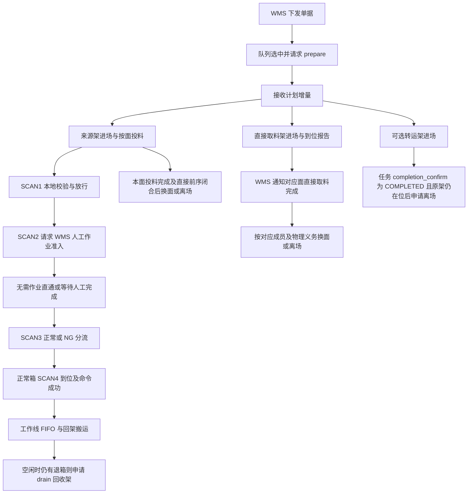

# 人工分拣业务与 API 交互参考

状态：**人工分拣接口接入参考，业务尚未接入本系统。** 先读[共用规则](workline-business-api.md)。这里的“人工”指 WMS/PDA 完成人工作业，WES 编排货架、料箱和滚筒命令，不给人工线机械臂下发 PICK_AND_PUT。

公共滚筒入站采用[BIN_Roller 设计](../superpowers/specs/2026-10-30-bin-roller-capability-design.md)：四点由组件唯一受理；SCAN2 在原受理事务内委托人工生产接缝，准入/WAIT/完工与释放许可仍由原生产业务决定，组件登记并履约原放行命令。后续 SCAN3 → SCAN4 → FIFO → Return_Batch、回架及尾箱清退统一引用[公共料箱回流能力](workline-bin-return-api.md)，不在人工业务复制第二套回流状态或发送路径。组件已有本地实现与隔离测试，人工正式生产接入仍属 B7 未完成依赖。

## 1. 输入、资源和业务边界

初始触发是 WMS 的 `outbound.picking_task.issued@v1`。`task_type=MANUAL` 表示执行模式，必填的 `business_type=inbound|outbound` 表示业务方向；两者不是同一概念。入库和出库共用该 operation 及队列、计划、人工处理和退箱生命周期。

| 声明资源 | 实际用途 | WORKLINE 配置 |
| --- | --- | --- |
| SCAN1 | 入口扫码、本地因果及条码校验 | 绑定入口设备 |
| SCAN2 | 人工工作位扫码，向 WMS 请求准入 | 绑定工作位设备 |
| SCAN3 | 正常/NG 分流 | 绑定退箱检验设备 |
| SCAN4 | 实际到位形成退箱 FIFO | 绑定出料设备 |
| FIVE_RACK | 五层来源架工作位 | 实际 RACK_POSITION |
| RETURN_RACK | 人工直接取料架工作位 | 实际 RACK_POSITION；不是滚筒退箱的回收架 |
| TRANSFER_RACK | 可选的转运架工作位 | 可选资源；未采用时不创造该分支 |
| INLET / OUTLET | 料箱进出交接位 | 实际 HANDOFF_POSITION |

WES 核对工作线、设备角色、货架类型和工作位的匹配关系。具体配置约束见第 7 节。

任务队列与计划、货架各面作业、料箱经过及退箱分别跟踪各自的完成条件。父任务完成后，尚未履约的搬运、报告和退箱义务继续保留。

## 2. 流程及并行关系



图中的分支是并行义务，不是一条必须串行到底的长事务：

1. 来源架、直接取料架、可选转运架分别根据自己的原 Transport 和精确到位事实推进。SCAN1 不等待转运架到位，人工是否可作业由 SCAN2 的 WMS 准入判断。
2. 一个 `task_id + plan_revision + rack_id + rack_face` 的 inbound_batch 是**完整、最终、有序清单**。即使超过 4 箱也不是第二次申请“下一页”，而是拆为最多 4 箱的多个 Transport 段。后续段遵守前段权威成功/发布和入口清空规则。
3. `feed_complete` 需要该面所有段/成员成功且目标交接位匹配，不等待整条线扫码、人工处理或所有退箱。货架换面/离场还要核对自己的直接物理义务。
4. 正常退箱属于工作线跨任务 RETURN_BUFFER。可回到当前实际到位架面，不要求原来源架；不得回到专供直接取料的 RETURN_RACK。
5. 有合格退箱时，在当前面投料结束后的机会请求一次 return_batch；NO_BATCH 结束本次机会，不无条件阻止换面。回架 Transport 的直接未闭合义务仍可阻止相关架动作。
6. 没有可原子接续准备的下一任务且 FIFO 非空，才按合同申请 drain 架；受控停止也要保留这类义务。新任务可承接工作线 FIFO，不能一结束父任务就清队列。
7. 新架有自己的权威到位依据后，可独立作业；旧架无关离场 UNKNOWN 不能成为全工作线永久门禁。真正相关的前序仍必须保留。
8. completion_confirm 确认的是 WMS 业务任务完成。转运架以该决定及原进场成功、当前在位为离场门槛，不等待独立来源架离场终态。`return_rack.task_completed` 是直接取料架的截止版本完成通知，不能用作转运架完成通知。搬运、报告、退箱等未闭合义务各自继续，不将整单 COMPLETED 当作所有物理动作成功。

首批计划未指定 target_rack 时，转运架由人工在 WMS 呼入、旋转、移出；WES 不创建这些动作，也不以转运架绑定/到位/离场限制来源、扫码及任务完成。首批指定后则必须有有效 TRANSFER_RACK 绑定，后续 revision 不能补充或更换这一选择。

## 3. WMS → WES：7 个业务 Operation

入口均为 `POST /api/v1/wms/events`。下表列 `data`；公共信封、幂等见索引。`可省略` 不等于允许显式 null，具体以对应 wire 验证为准。

| Operation | data 与关键约束 | 受理后的职责 |
| --- | --- | --- |
| `outbound.picking_task.issued@v1` | `task_id, task_type=MANUAL, business_type=inbound\|outbound, workline_code, queue_revision=1, dispatch_sequence`；可选 `not_before` | 持久单据/初始队列；检查工作线业务匹配，不立即假定可执行 |
| `outbound.picking_task.queue_changed@v1` | `task_id, queue_revision>=2`；`dispatch_sequence/not_before` 至少提供一项；提供项禁止 null，无变化省略 | 应用单调队列版本，不能修改已冻结执行身份 |
| `outbound.picking_task.plan_delta@v1` | `task_id, plan_revision`；可选 `target_rack, added_bin_source_racks, added_direct_picks` | revision 1 至少有目标或来源；之后禁止 target_rack 且必须新增来源；这三个可选字段显式 null 非法 |
| `outbound.picking_task.cancel@v1` | TASK：`task_id,cancel_scope=TASK`；PLAN_MEMBERS：另带按版本定位的 `bin_source_racks/direct_pick_sources` | 取消逻辑需求；不伪造已停设备、不清除在途和历史义务 |
| `outbound.manual_bin.work_completed@v1` | `task_id,bin_code,result=NORMAL\|NG,completed_at` | 对应唯一的本次 SCAN2 等待，应用后创建稳定释放命令；不是收到通知便直接放行 |
| `outbound.manual_rack.direct_pick_completed@v1` | `task_id,plan_revision,rack_id,rack_face,completed_at` | 完成该版本该面直接取料成员；不是整架跨版本全完成，也没有逐 slot 结果字段 |
| `outbound.return_rack.task_completed@v1` | `task_id,through_plan_revision,rack_id,completed_at` | 覆盖同任务同架至指定版本的成员；较新 revision 的成员仍独立处理 |

`dispatch_sequence` 为正整数；not_before 为非负毫秒；plan_revision/through_plan_revision 为正整数。人工完成类的 completed_at 要满足对应 wire 的正数/不晚于通知 timestamp 约束。

计划嵌套字段容易混淆，使用以下结构：

```json
{
  "task_id": "PICK-001",
  "plan_revision": 1,
  "target_rack": {"rack_id": "TRANSFER-01", "rack_face": "A"},
  "added_bin_source_racks": [{"rack_id": "SOURCE-01", "rack_face": ["90", "270"]}],
  "added_direct_picks": [{
    "source_locator": {"type": "RACK_SLOT", "rack_id": "DIRECT-01", "rack_face": "A", "slot_id": "01"}
  }]
}
```

`target_rack.rack_face` 是单面；来源架的 rack_face 是非空面数组；direct_pick 的 source_locator 则是精确 RACK_SLOT。PLAN_MEMBERS 取消按原 `plan_revision+rack_id+rack_face` 定位，direct_pick 可进一步给 `slot_ids`；不得把所有版本同架成员一并取消。

参考通知一般为首次 `202/RECEIVED`、同原信封重放 `200/DUPLICATE`、同身份不同内容 `409/CONFLICT`。人工完成通知先可靠保存，再独立匹配业务；无法唯一关联或结果冲突应保留待核对，ACK 不能承诺已释放。其他确定拒绝按各 operation 合同处理，不能一概吞成 202。

## 4. WES → WMS：8 个业务及共用 Operation

除 arrival_report 使用 facts，其余使用 decisions。下表区分顶层 `code` 与 `data.result`；只有严格验证原身份、字段及关联后的响应才能驱动业务。

| Operation | 请求 data | 正常响应及业务解释 |
| --- | --- | --- |
| `outbound.picking_task.prepare@v1` | `task_id,workline_code` | `202/PREPARE_ACCEPTED`，data `{}`；等待 WMS 后续 plan_delta |
| `outbound.bin.inbound_batch@v1` | `task_id,plan_revision,rack_id,rack_face`（单面） | `200/DECIDED`：READY + `bins[{bin_code,source_locator}]`，或 RACK_FACE_DONE；清单完整最终，不按 Transport 限额截断再求新清单 |
| `outbound.bin.return_batch@v1` | `workline_code,rack_id,rack_face,return_candidates` | `200/DECIDED`：READY + `moves`，或 NO_BATCH；READY 只取冻结候选的连续 FIFO 前缀 |
| `workline.return_buffer.drain_rack_decide@v1` | `workline_code,required_slot_count`（正数） | `200/DECIDED`：READY + `racks[{rack_id,rack_face:[面]}]`；或 WAIT + `reason_code=NO_DRAIN_RACK_AVAILABLE,retry_after_ms` |
| `rack.departure_decide@v1` | `workline_code,rack_id,current_location:{type:RACK_POSITION,location_code},current_face`（可为 null） | `200/DECIDED`：READY + `rack_destination:{type:ZONE\|RACK_POSITION,location_code}`；或 WAIT + retry_after_ms；READY 目的地要冻结 |
| `outbound.picking_task.completion_confirm@v1` | `task_id,last_applied_plan_revision`（可为 0） | `200/DECIDED`：COMPLETED；或 PLAN_REVISION_STALE + current_plan_revision；或 BUSINESS_IN_PROGRESS + retry_after_ms |
| `outbound.return_rack.arrival_report@v1` | `task_id,transport_task_id,outcome_revision,rack_id,final_position:{type:RACK_POSITION,location_code},arrival_face` | facts：`200/RECORDED\|DUPLICATE`，data `{}`；报告原已知到位事实，不以报告 ACK 制造到位 |
| `outbound.manual_bin.work_admission_decide@v1` | `task_id,bin_code`（归一化）、`scanned_at`（原 SCAN2 时间） | `200/DECIDED`：WORK_REQUIRED + **原 task_id**；或 NO_WORK；或 WAIT + retry_after_ms |

`rack.departure_decide@v1` 是本系统人工、粗分和自动线草案拟议共用的货架离场决定，名称及字段约束尚待 WMS/WES 确认，状态见[共用合同说明](workline-business-api.md#货架离场决定的拟议共用合同)。通过 `POST /api/v1/wes/decisions` 调用，请求 `data` 仅含 `workline_code`、`rack_id`、`current_location`、`current_face`，四个字段均须存在；工作线编码沿用原业务上下文并与货架及工作位一致；面向不适用或无法确认时 `current_face` 显式为 `null`，位置和面向不使用计划值代替。由 WMS 核对工作线上下文后根据货架和当前位置决定离场去向，人工任务及版本关系由 WES 内部保存。WES 申请离场前核对该货架对应的业务条件及相关物理义务。通用请求与 READY/WAIT 响应示例见[货架离场决定](coarse-sorting-api-draft.md#wms-rack-departure)，示例位置及面向需替换为本业务的已确认事实；粗分示例的 null 表示面向不适用，不改变人工线自身的面向要求。

READY 只表示允许按返回去向离场；WES 冻结原决定及目的地后创建唯一 Transport，并以原任务明确结果判断是否搬离。有效 WAIT 保存固定到期点，到期或有新业务事实时使用新 operation_id 重新求值；通信重试或响应未知继续原请求身份和冻结正文。

有 WAIT 的上述响应中 retry_after_ms 为 1～60000。响应必须匹配原 operation_id；arrival_report 的 outcome_revision 为正数。scanned_at 为正毫秒且不晚于请求 timestamp。WORK_REQUIRED 的 task_id 不一致必须核对，不改绑其他任务。

inbound READY 的 source_locator 为 `{type:RACK_BIN_SLOT,rack_id,rack_face,slot_id}`。return_candidates 为 1～4 项的 `{sequence_no,bin_code,source:{type:HANDOFF_POSITION,location_code}}`，从 1 连续编号，不重复箱码。READY moves 为 1～4 项 `{sequence_no,bin_code,target:{type:RACK_BIN_SLOT,rack_id,rack_face,slot_id}}`：

- 返回 sequence_no/bin_code 必须匹配原候选的连续前缀，不能跳过队首；目标架/面匹配原请求，目标 slot 不重复。
- return_batch 按工作线退箱，FIFO 跨任务维护。
- drain READY 的架不重复，面顺序有意义。

人工准入的三个分支：

| data.result | SCAN2 行为 | 后续 |
| --- | --- | --- |
| WORK_REQUIRED | 保存原准入关联，保持料箱停留 | 等待唯一匹配的 work_completed；超时不自动放行或改 NG |
| NO_WORK | 保存正常直通决定，创建唯一 MOVE_FORWARD | 不等待 work_completed，不解释为 NG |
| WAIT | 保持当前箱及工位占用 | 按有效 WAIT 的等待条件重新求值；未知响应继续原请求恢复 |

WES 本地保存原准入与本次 Passage 的关系；work_completed 通知按当前工作线 task_id + bin_code 唯一定位当前等待。早到完成可以先留存，但**未有匹配 WORK_REQUIRED 时不能释放**；扫描前到达、绑定不唯一或冲突需核对。

## 5. ECS Event、Command、Result

四个角色使用 Event `SCAN_COMPLETED`，data 读取 `bin_code`。SCAN1/3/4 的正常朝向后缀为 `-B`，SCAN2 为 `-C`；传给 WMS 的是归一化箱码。协议结构合法而条码或当前经过校验失败时，按对应异常业务分支处理。

| 角色 / 场景 | 正常动作 | 异常/等待动作 | 后续判断依据 |
| --- | --- | --- | --- |
| SCAN1 原任务/本次冻结投料成员匹配 | MOVE_FORWARD | 条码/朝向错误或不属于当前执行批次等走 MOVE_RIGHT；归属缺失/不唯一留证核对 | 本地原任务、轮次、冻结清单与真实到位；**这里不请求 WMS 人工准入** |
| SCAN2 当前经过合法 | 先请求 work_admission_decide，再按其分支处理 | 无法匹配的箱记录异常并释放到后续分流；不能授予正常人工权限 | WMS 原准入/完成；WAIT/WORK_REQUIRED 停留不是 ECS task_type |
| SCAN2 完成或 NO_WORK | MOVE_FORWARD | 人工结果 NG 也通过唯一释放到 SCAN3 | 已应用的本次业务决定及原释放命令 Result |
| SCAN3 本次正常授权或允许独立重新投入 | MOVE_FORWARD | 无有效正常处置或条码异常：MOVE_LEFT | 本次 SCAN3 的身份/条码/处置，不能把已闭合历史 NG 永久带到新经过 |
| SCAN4 当前正常 Return 且 SCAN3 已放行 | MOVE_FORWARD | 条件不足则 HOLD（本地不发命令） | 首次有效到位冻结物理 FIFO；原 MOVE_FORWARD Result SUCCESS 后才具备退箱批次资格 |

这里的 REQUEST_WMS/HOLD 是本地业务分支，不注册成 ECS 命令。

各角色命令的参数、结果、错误码及超时范围按第 7 节确认的设备合同执行。SCAN_COMPLETED 表示扫码事实；Result 关联原 command_code 和 device_code，通过冻结合同验证后作为执行结果读取。

## 6. Transport 交互与完成条件

| 业务意图 | Transport kind | 完成依据 |
| --- | --- | --- |
| 来源/直接/转运/回收架进场 | `RACK_MOVE` | 原 Transport 结果、精确到位/面向，以及该业务所需位置事实 |
| 当前架换面 | `RACK_ROTATE` | 原换面结果及精确面向；不以创建成功判断已换面 |
| 来源架槽投到 INLET | `BIN_MOVE`，每笔 1～4 箱 | 原各成员与冻结交接目标；SCAN1 作为到位依据的条件见第 7 节 |
| OUTLET 回到当前架槽 | `BIN_MOVE`，每笔 1～4 箱 | 按 return_batch 冻结目标核对原 Transport；本地 Return 交接与物理回架分开 |
| 架离场/退库 | `RACK_MOVE` | departure READY 目的地冻结后，核对原 Transport 终位；不是 READY 就完成 |

上述搬运通过 `transport.task.submit@v1` 提交。整架搬运/换面结果使用 `transport.task.resulted@v1`；`transport.task.member_position_changed@v1` 仅用于料箱成员位置里程碑，不能当作整架到位通知。回调收据 ACK、提交接纳或任务 CLOSED 均不代表物理搬运成功，推进前核对原任务的已应用结果。具体架型、动作与 RCS 模板的对应关系见第 7 节。

WMS 业务 locator 使用 `type`，箱码使用 `bin_code`；Transport wire 使用 `kind`，moves 成员使用 `container_id`。WES 根据原决定完成对应字段映射，并保存原任务及目标关联。

## 7. 集中待确认项

以下事项须在业务接入前确认。流程与执行条件见第 2～6 节，涉及合同调整的部分以双方确认结果为准。

| 编号 | 责任方 | 待确认事项及执行边界 |
| --- | --- | --- |
| P01 | WES / WMS | SCAN1 作为投料到位依据的可信事实受理、应用及冲突处理方式；须匹配唯一冻结入站成员、原目标和事件时间，所有成员齐备才确认整笔完成；扫码事实不生成 WMS outcome_revision |
| P02 | WES / WMS | OUTLET 本地 Return 交接所需的可信接纳证据及公开结果依据；本地交接与物理取走分别判断，位置未知或结果冲突时保留原义务，相关架动作继续受直接前序约束 |
| P03 | WES / ECS | 工作线设备角色、货架类型、工作位类型及位置绑定的配置校验规则；各角色/命令/版本的参数、结果 data、错误码及超时范围 |
| P04 | WMS / RCS | 各架型进场、换面、离场所用模板及现场支持范围，包括 CTU01、CTU02、CTU03、F01、CK04；目标点位和面向须与原任务及可信结果一致 |
| P05 | WMS / WES | 确认拟议共用 `rack.departure_decide@v1` 的名称、workline_code / rack_id / current_location / current_face 四个必填请求字段及 READY/WAIT、幂等和错误规则；旧系统 DTO 不代表本系统已支持此调整，确认前不注册 |

## 8. 对接验收范围

- MANUAL 入库/出库共用入口，错误业务线/取消来源/旧 plan_revision 不获得新执行许可；计划增量与取消并发不扩大原义务。
- WORK_REQUIRED/NO_WORK/WAIT/NORMAL/NG、完成早到与冲突、SCAN3 重新投入、SCAN4 到位但命令未知，分别有确定行为；重放不产生第二条释放命令。
- 来源/直接/转运架并行，feed_complete 与退箱分开；RETURN_RACK 不接滚筒退箱；同架直接依赖阻挡换面、无关旧离场不永久挡新架。
- 完整清单拆段、FIFO 前缀、跨任务退箱、drain WAIT/READY、后续版本不被旧完成覆盖。
- 通用 rack.departure_decide@v1 传原工作线编码、货架、已确认位置及当前面向，工作线与货架/工作位上下文一致；离场前满足对应业务条件及物理义务门槛；READY 冻结去向后执行 Transport，WAIT 后新身份求值，未知响应保持原身份。
- 依索引的统一快照与消费恢复规则：更新 UNKNOWN 不被历史里程碑覆盖，消费与下一 Outbox 原子；ECS ACK 不替代 Result。
- 第 7 节事项确认后，覆盖可信扫码应用、交接证据、配置约束和设备合同的专用验收场景。

模拟及隔离测试用于验证本方软件，真实 WMS/ECS/RCS 交互及物理动作需现场验收。
