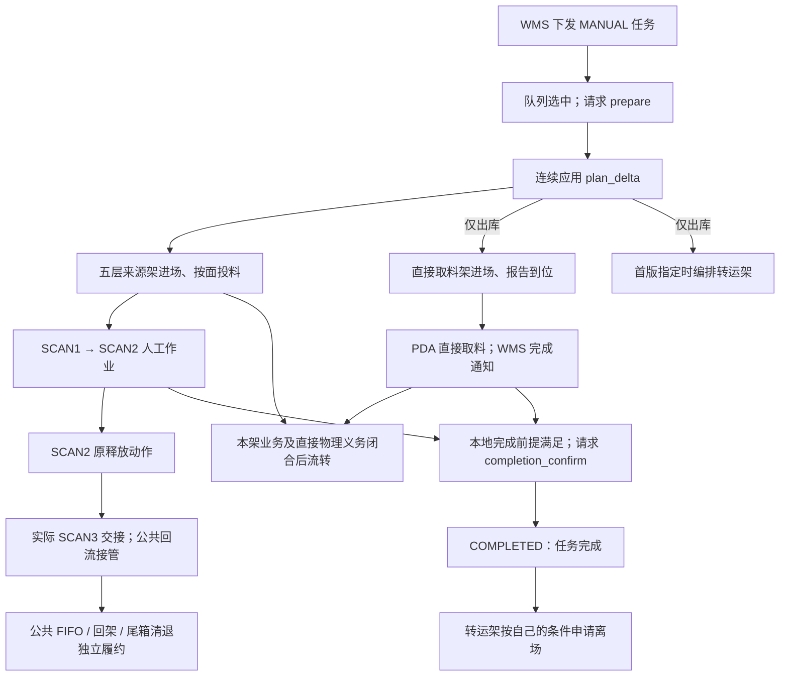
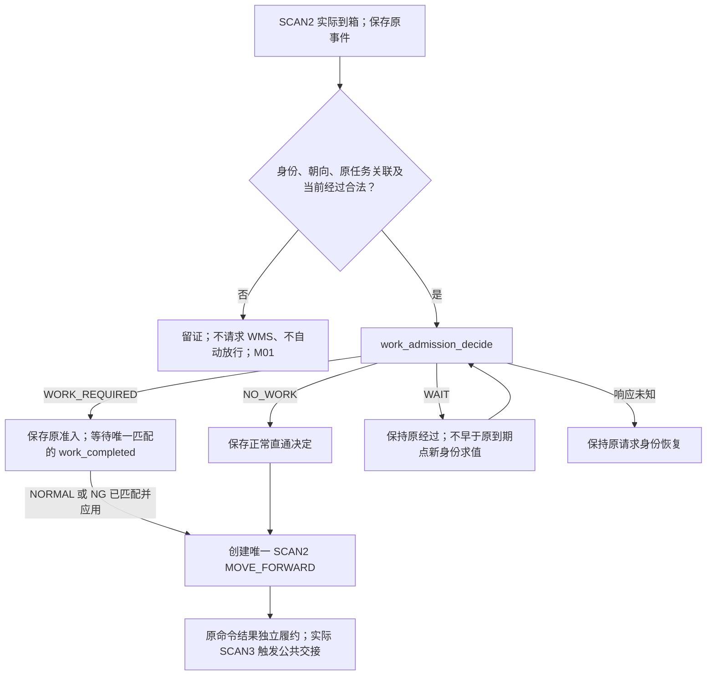

# SMT 手工分拣、入库 WES 与 WMS API 对接文档

状态核对：2026-11-01。**SMT手工宿主仍为对接设计，生产业务未注册、未实施；共享sorting_task ST1/ST2已随[PR #44](https://github.com/kaizhoumasha/maintenance-admin/pull/44)合入develop（380aeba）。** 本文与 [SMT 手工子包设计](../superpowers/specs/2026-10-31-smt-manual-business-design.md)一致：一个 smt_manual 业务承接 MANUAL 入库/出库，通过不可变的 `business_type=inbound/outbound` 区分方向。AUTO 两方向统一归 [smt_auto](../superpowers/specs/2026-10-31-smt-auto-business-design.md)；两宿主复用同源 sorting_task 合同组件，并各自装配一份 BIN_Roller，生产合同与完成条件分别维护。BIN_Roller 组件已合并并有隔离验证，正式生产消费方、组件状态表迁移和 B7 整体验收尚未交付；文档不代表对端签认、部署或现场验收。

本文统一采用[统一自动线文档](smt-auto-api.md)的组织方式。公共信封和平台边界见[工作线交互索引](workline-business-api.md)；**SCAN3 → SCAN4 → FIFO → Return_Batch、回架和尾箱清退由[公共料箱回流能力](workline-bin-return-api.md)统一描述**，不再由人工线维护第二套规则。

本文新任务报文统一采用 `sorting.task.*@v1`，公共规则引用[自动 API 3 节](smt-auto-api.md#tasks)，人工资源联合及完成条件在本文细化。人工箱级准入/完工统一为 `manual_bin.work_admission_decide@v1`、`manual_bin.work_completed@v1`，同时用于入库/出库；出库直接取料架等专属 operation 保留其 outbound 名称，公共供箱/回流名称也不批量替换。历史冻结的 outbound.picking_task.*、outbound.manual_bin.* 请求仍沿原合同、身份和正文履约，不因本文改写、换号或增加兼容入口。所有报文均为对接示例；共享声明已实现，仍不表示真实宿主已正式接入或现场通过。

实现归属约定：sorting_task 只提供六类任务合同、单份注册和可信分派，任务表/状态/队列/推进归 smt_manual。BIN_Roller 唯一受理四点扫码并执行公共箱流、五层架流；本文“WES 创建/登记 SCAN2 MOVE_FORWARD”表示生产业务按原本次到位决定释放，再调用组件登记并履约唯一原命令，不另注册 SCAN2 事件或发送路径。一个业务只有一个 scan_pending，公平推进生产与组件原待办。

实施安排见 [SMT 手工实施计划](../superpowers/plans/2026-10-31-smt-manual-implementation.md)和 [sorting_task 共享计划](../superpowers/plans/2026-10-31-sorting-task-implementation.md)：先共享任务合同/分派，再人工业务，最后正式装配/迁移及分层验收。共享ST1/ST2已随PR #44合入develop，专项24 passed、修复后全仓4654 passed/52 skipped及最新复审/CI证据见[共享交付§11](../superpowers/plans/2026-10-31-sorting-task-implementation.md#sorting-task-merged)；人工宿主及正式接入仍待实施。

共享任务的[原消息重验保护](../superpowers/plans/2026-10-31-sorting-task-implementation.md#sorting-task-recheck)保证并发重报只应用一次，成功收妥不被迟到失败覆盖，原身份及创建信息保留；不新增wire字段。首个正式接入前完整交付四分支，发布后按[冻结兼容规则](../superpowers/plans/2026-10-31-sorting-task-implementation.md#sorting-task-v1-freeze)恢复旧成功/确定拒绝/待定计划，不能以新模型改变原有效内容。ST1隔离扩展、ST2真实登记与宿主验收的分工见[共享交付归属](../superpowers/plans/2026-10-31-sorting-task-implementation.md#sorting-task-ownership)，不将文档要求当作已通过证据。

## 目录

- [完整交互顺序](#manual-sequence)
- [1. 流程图](#manual-flow)
- [2. WMS API 与复用交互](#manual-wms)
- [3. ECS 指令与回调](#manual-ecs)
- [4. 公共规则与工作线配置](#manual-rules)
- [5. 规则状态与交付依赖](#manual-pending)
- [6. MOCK 与内部验收场景](#manual-acceptance)

<a id="manual-sequence"></a>
## 完整交互顺序

| 路径 | 步骤 | 方向 | Operation / Event / Command | 交互与推进条件 |
| --- | --- | --- | --- | --- |
| 任务 | T1 | WMS → WES | [sorting.task.issued](#manual-issued) / [queue_changed](#manual-queue) | 保存任务、业务方向和连续队列版本；未准备任务才能更新排序 |
| 任务 | T2 | WES → WMS | [sorting.task.prepare](#manual-prepare) | 队列选中后请求准备；PREPARE_ACCEPTED 不代表计划已到 |
| 任务 | T3 | WMS → WES | [sorting.task.plan_delta](#manual-plan) | 连续应用增量；来源架、直接取料架和可选转运架按各自义务并行 |
| 投料 | F1 | WES → WMS / RCS | [来源架进场 / 换面](#manual-transport) | 核对原 Transport 的实际到位、工作位和面向 |
| 投料 | F2 | WES → WMS | [bin.inbound_batch](#manual-inbound) | 冻结完整、最终、有序清单或 RACK_FACE_DONE；同面未闭合分配保持原身份 |
| 投料 | F3 | WES → WMS / RCS | [BIN_MOVE](#manual-transport) | 按清单拆为每笔 1～4 箱，目标为本线 INLET |
| 投料 | F4 | ECS → WES → ECS | [SCAN1 / 方向命令](#manual-ecs) | 本点实扫即到位；仅 -B 且当前任务有效时前进，否则旁路 SCAN3；不匹配原投箱成员 |
| 人工 | M1 | ECS → WES | [SCAN2 到箱](#manual-ecs) | 组件先保存事实，SMT 核对实际箱码、本次经过和原执行上下文；不匹配原投箱成员，不按其他箱的等待推定本箱权限 |
| 人工 | M2 | WES → WMS | [manual_bin.work_admission_decide](#manual-admission) | WORK_REQUIRED 等人工完成；NO_WORK 正常直通；WAIT 保持等待 |
| 人工 | M3 | WMS → WES | [manual_bin.work_completed](#manual-completed) | 先可靠保存，再唯一匹配原 WORK_REQUIRED；NORMAL/NG 均创建原 SCAN2 释放意图 |
| 交接 | M4 | WES → ECS | [SCAN2 / MOVE_FORWARD](#manual-ecs) | 原释放命令及结果独立履约；命令创建或 ACK 不代表下游已接到箱 |
| 公共回流 | C1 | ECS → WES | [SCAN3 → SCAN4](workline-bin-return-api.md#return-ecs) | 按实际 SCAN3 事实接管；正常进入回流，NG 分流；SCAN4 到位与批次资格分开 |
| 公共回流 | C2 | WES → WMS / RCS | [FIFO / return_batch / drain](workline-bin-return-api.md#return-sequence) | 跨任务回架；不把父任务完成当作清空 FIFO 的理由 |
| 直接取料 | D1 | WES → WMS / RCS | [直接取料架进场](#manual-transport) | 仅 outbound；精确到位后形成原到位事实 |
| 直接取料 | D2 | WES → WMS | [return_rack.arrival_report](#manual-arrival) | facts 报告，不以报告 ACK 制造到位 |
| 直接取料 | D3 | WMS → WES | [direct_pick_completed](#manual-direct) / [return_rack.task_completed](#manual-rack-completed) | 分别按成员版本、整架截止版本结清直接取料；不接收滚筒退箱 |
| 架流转 | R1 | WES → WMS | [rack.departure_decide](#manual-departure) | 先核对本架业务条件、公共回架机会及直接物理义务；READY 冻结去向后建 Transport |
| 完成 | T4 | WES → WMS | [sorting.task.completion_confirm](#manual-confirm) | WMS 返回 COMPLETED 才结束业务任务；回流及原物理义务继续 |
| 取消 | 分支 | WMS → WES | [sorting.task.cancel](#manual-cancel) | 只取消明确范围的逻辑需求；不抹去已入线、在途、报告或回流义务 |

表中步骤号只用于导航，不进入 wire。各路径并行，不能串成跨扫码、人工和搬运的长事务；事件、结果及报告响应可以乱序到达。

<a id="manual-flow"></a>
## 1. 流程图

### 1.1 任务与并行资源

手工入库由人工在 SCAN2 将料盘放入料箱；手工出库由人工从料箱或计划直接取料架拣料。逐盘扫码、数量、箱格、库存及作业明细由 WMS/PDA 管理，WES 不增加逐盘 work_plan/material.decide/movement_report 或机械臂 PICK_AND_PUT。

| 计划资源 | MANUAL/inbound | MANUAL/outbound |
| --- | --- | --- |
| 五层供箱架 added_bin_source_racks | 支持，提供接料箱；WES 不新增空箱校验 | 支持，提供待拣料箱 |
| 直接取料 added_direct_picks | 不允许 | 支持，精确到架/面/SLOT |
| 转运架 target_rack | 不允许 | 首版可选，后续不补充或更换 |
| 单层料盘来源架、自动整面来源、机械臂/逐盘参数 | 不允许 | 不允许 |



出库未指定 `target_rack` 时，转运架由人工在 WMS 呼入、旋转、移出；WES 不创建这些动作，不以该架绑定或状态限制来源、扫码及任务完成。出库首版指定后，必须有 TRANSFER_RACK 绑定，后续 revision 不补充或更换此选择；直接取料计划要求 RETURN_RACK 绑定。这两个槽位仅在计划实际使用时要求，入库不以它们作为准入前提。

### 1.2 SCAN2 人工作业



两种方向采用同一人工准入/完工流程。无有效上下文、非法扫码或关联不成立时留证、不请求 WMS、不自动放行；历史入口核对见 M01。人工等待超时不自动变成 NG、释放或新命令。原尾箱已登记释放后，任务完成确认可以先于该释放 Result 到达，二者独立履约。

<a id="manual-wms"></a>
## 2. WMS API 与复用交互

### 2.0 通用报文与读法

WMS → WES 均为 `POST {{WES_BASE_URL}}/api/v1/wms/events`；WES → WMS 的决定与准备请求使用 `POST {{WMS_BASE_URL}}/api/v1/wes/decisions`，事实报告使用 `POST {{WMS_BASE_URL}}/api/v1/wes/facts`。Content-Type 为 UTF-8 `application/json`，原始 Body 上限 `256 KiB`。

以下每个请求给出完整信封；响应分支表的 `data` 为完整对象，放入同一响应信封，不通过前序请求 ID 补业务字段：

```json
{
  "operation_id": "019f3401-4a10-7b1a-aab5-f2df785324d1",
  "code": "RECEIVED",
  "timestamp": 1793376000100,
  "data": {}
}
```

`operation_id` 回显对应请求，为小写、带连字符的 UUIDv7；`timestamp` 为 UTC Unix 毫秒整数。业务编码 Identifier 匹配 `[A-Za-z0-9][A-Za-z0-9._:/-]{0,99}`；面向为非空原文，1～10 个 Unicode code point、不含 NUL，不作 A/B 和角度转换。除单独声明外，时间为 `0..9223372036854775807`，版本/序号为同范围正整数，布尔值不作为数字接收；`retry_after_ms` 为整数 `1..60000`。

通知的通用响应如下，各接口的受理前提仍须满足：

| 情形 | HTTP / code | data 与含义 |
| --- | --- | --- |
| 首次可靠保存 | 202 / RECEIVED | `{}`；只证明对应受理事实和待办已保存 |
| 原身份、相同有效内容重放 | 200 / DUPLICATE | `{}`；沿用首次接收时间 |
| 原身份、已定义内容变化 | 409 / CONFLICT | `{"reason_code":"IDEMPOTENCY_CONFLICT"}` |
| 无法可靠持久接收 | 503 / UNAVAILABLE | `{}`；发送方沿原身份重试 |

准备请求的 PREPARE_ACCEPTED、同步决定的 DECIDED、事实报告的 RECORDED 不套用上表的首次通知 code。错误及各接口额外字段策略见[公共规则](#manual-rules)。

<a id="manual-issued"></a>
### 2.1 任务发布

| 项目 | 值 |
| --- | --- |
| 方向 / 端点 | WMS → WES，`POST /api/v1/wms/events` |
| operation | `sorting.task.issued@v1` |
| 触发 / 响应 | 发布新任务；可靠受理后 `202 / RECEIVED` |

```json
{
  "operation_id": "019f3401-4a10-7b1a-aab5-f2df785324d1",
  "operation": "sorting.task.issued@v1",
  "timestamp": 1793376000000,
  "data": {
    "task_id": "PICK-001",
    "task_type": "MANUAL",
    "business_type": "outbound",
    "workline_code": "KT16",
    "queue_revision": 1,
    "dispatch_sequence": 100
  }
}
```

| 字段 | 类型 / 必填 | 约束 |
| --- | --- | --- |
| task_id | Identifier / 是 | WMS 任务身份，发布后不可变 |
| task_type | string / 是 | 固定 MANUAL，表示执行模式 |
| business_type | enum / 是 | `inbound / outbound`，表示业务方向；不得通过重发改向 |
| workline_code | Identifier / 是 | 任务指派工作线；校验业务匹配，发布后不可变 |
| queue_revision | integer / 是 | 固定 1 |
| dispatch_sequence | integer / 是 | 非唯一正整数，值越小优先级越高；同值按原 issued.timestamp 较早者优先，目标排序规则见统一任务合同 |
| not_before | integer / 可省略 | 非负毫秒；省略表示立即具备时间条件，显式 null 非法 |

发布不携带货架、箱、储位、机械臂参数或 Transport。上例展示出库；入库使用新的 task_id/operation_id 且 business_type=inbound，其他发布字段相同，不允许把原任务重发改向。持久受理不代表可执行，不直接触发设备动作；本线入库/出库共用 PREPARING/EXECUTING 一个在办执行位，不同工作线独立。

<a id="manual-queue"></a>
### 2.2 队列更新

| 项目 | 值 |
| --- | --- |
| 方向 / 端点 | WMS → WES，`POST /api/v1/wms/events` |
| operation | `sorting.task.queue_changed@v1` |
| 触发 / 响应 | 任务进入 PREPARING 前调整队列；成功 `202 / RECEIVED` |

```json
{
  "operation_id": "019f3401-4a10-7b1a-aab5-f2df785324d2",
  "operation": "sorting.task.queue_changed@v1",
  "timestamp": 1793376001000,
  "data": {"task_id": "PICK-001", "queue_revision": 2, "dispatch_sequence": 90}
}
```

`task_id` 必填；`queue_revision` 从 2 起按当前版本 +1 连续递增。`dispatch_sequence`、`not_before` 至少提供一项，类型沿发布定义，提供项禁止 null，省略项保持原值。恢复立即可执行应发送不晚于当前时间的明确 not_before，不能清空字段。不能修改工作线、执行模式、业务方向或已冻结执行身份；缺失版本不授权按后续版本执行。

队列字段、领取时冻结、版本及重放见[queue_changed](smt-auto-api.md#task-queue)。优先级不要求唯一，至少一项实际变化；原成功/确定拒绝按原结果重放，领取进入 PREPARING 后不再接受新的队列修改。同序号按原 issued.timestamp、再按 task_id 稳定排序，队列更新/重试不刷新原下发时间；历史冻结 wire 和旧数据库约束不因本文自动迁移。

<a id="manual-prepare"></a>
### 2.3 准备请求

| 项目 | 值 |
| --- | --- |
| 方向 / 端点 | WES → WMS，`POST /api/v1/wes/decisions` |
| operation | `sorting.task.prepare@v1` |
| 触发 | 队列原子选中且满足时间和工作线准入 |

```json
{
  "operation_id": "019f3401-4a10-7b1a-aab5-f2df785324d3",
  "operation": "sorting.task.prepare@v1",
  "timestamp": 1793376002000,
  "data": {"task_id": "PICK-001", "workline_code": "KT16"}
}
```

两个 data 字段都是必填 Identifier，必须与原任务一致，不重复带 task_type、business_type 或货架信息。成功响应为 `202 / PREPARE_ACCEPTED`、`data={}`；WMS 通过后续 plan_delta 发布计划。计划可早于准备响应到达；未知响应沿原请求恢复，不重复领取任务。尚无首批计划时不凭猜测超时关闭任务，等待及版本 0 确认策略见 M09。

统一任务目标合同的[准备与计划早到边界](smt-auto-api.md#plan-early)已本方确认沿既有规则：同任务只成功准备一次，原身份重放完整 PREPARE_ACCEPTED；首版在准备结果未定时仅留证并返回 503，不应用计划。原准备响应可靠保存后，WMS 以原计划消息重试，应用提交后才返回 202；不通过计划反推准备成功，不自动应用尚未重试的早到消息。

<a id="manual-plan"></a>
### 2.4 计划增量

| 项目 | 值 |
| --- | --- |
| 方向 / 端点 | WMS → WES，`POST /api/v1/wms/events` |
| operation | `sorting.task.plan_delta@v1` |
| 触发 / 响应 | WMS 追加资源；可靠受理后 `202 / RECEIVED` |

下例是出库计划，可同时包含三类人工资源；入库仅允许 added_bin_source_racks。方向从原任务读取，不在计划新增 task_type/business_type 字段。

```json
{
  "operation_id": "019f3401-4a10-7b1a-aab5-f2df785324d4",
  "operation": "sorting.task.plan_delta@v1",
  "timestamp": 1793376003000,
  "data": {
    "task_id": "PICK-001",
    "plan_revision": 1,
    "target_rack": {"rack_id": "TRANSFER-01", "rack_face": "A"},
    "added_bin_source_racks": [{"rack_id": "SOURCE-01", "rack_face": ["90", "270"]}],
    "added_direct_picks": [{
      "source_locator": {"type": "RACK_SLOT", "rack_id": "DIRECT-01", "rack_face": "A", "slot_id": "01"}
    }]
  }
}
```

| 字段 | 类型 / 必填 | 约束 |
| --- | --- | --- |
| task_id | Identifier / 是 | 原准备任务 |
| plan_revision | integer / 是 | 从 1 连续递增；同版不覆盖、重排或部分应用 |
| target_rack | object / 条件 | 仅 outbound 首版允许且可省略；指定时 rack_id、单面 rack_face 均必填；inbound 禁止 |
| added_bin_source_racks | array / 条件 | 非空；每项 rack_id 和非空、不重复的 rack_face 面数组 |
| added_direct_picks | array / 条件 | 仅 outbound，非空；每项 source_locator 固定 RACK_SLOT，完整 rack_id、单面 rack_face、slot_id；inbound 禁止 |

入库每版至少追加一组非空供箱架面；出库首版至少包含有效 target_rack 或一种非空来源新增，直接取料来源也算有效来源，后续版本禁止 target_rack 且必须至少新增一种来源。两种方向均拒绝 added_source_racks、added_return_racks 和自动逐盘参数。无变化字段省略，不发送 null 或空数组。同一供箱 `task_id + plan_revision + rack_id + rack_face` 的成员不得重复；较新版本不能改写原清单和动作。人工直接取料精确到 SLOT，不改用自动线整面结构。

未连续应用的版本不能授权执行；重放按原版本及消息身份处理。成员取消、同架跨版本及旧完成通知的范围分别保存。首版省略转运架的行为见第 1.1 节。

以下是另一笔手工入库任务的首版示例，仅提供接料箱来源；后续版本仍只追加供箱架面：

```json
{
  "operation_id": "019f3401-4a10-7b1a-aab5-f2df785324dd",
  "operation": "sorting.task.plan_delta@v1",
  "timestamp": 1793376003000,
  "data": {
    "task_id": "SMT-IN-001",
    "plan_revision": 1,
    "added_bin_source_racks": [{"rack_id": "BIN-SOURCE-01", "rack_face": ["90", "270"]}]
  }
}
```

任务/计划归 smt_manual；连续应用成员与原供箱变化通过同一受理事务保存，交给 BIN_Roller 执行五层供箱，不新增第二套供箱调度。

统一任务目标合同的[计划版本及重发](smt-auto-api.md#plan-revision)已本方确认：原成功消息重放 DUPLICATE；新身份仅对当前最高已应用版本做完整 data 判重，同内容 DUPLICATE、异内容 REVISION_CONFLICT，旧版新身份拒绝。同身份内容漂移为 IDEMPOTENCY_CONFLICT。缺版先返回 REVISION_CONFLICT，WMS 补齐后以原消息重验；不自动应用缺版消息，不套用 queue_changed 的确定拒绝稳定重放规则。

<a id="manual-cancel"></a>
### 2.5 任务取消与计划成员撤销

| 项目 | 值 |
| --- | --- |
| 方向 / 端点 | WMS → WES，`POST /api/v1/wms/events` |
| operation | `sorting.task.cancel@v1` |
| 响应 | 通过对应范围校验并可靠受理后 `202 / RECEIVED` |

```json
{
  "operation_id": "019f3401-4a10-7b1a-aab5-f2df785324d5",
  "operation": "sorting.task.cancel@v1",
  "timestamp": 1793376004000,
  "data": {
    "task_id": "PICK-001",
    "cancel_scope": "PLAN_MEMBERS",
    "bin_source_racks": [{"plan_revision": 1, "rack_id": "SOURCE-01", "rack_face": ["270"]}],
    "direct_pick_sources": [{"plan_revision": 1, "rack_id": "DIRECT-01", "rack_face": "A", "slot_ids": ["01"]}]
  }
}
```

| cancel_scope | data 必填与条件字段 | 边界 |
| --- | --- | --- |
| TASK | 仅 task_id、cancel_scope | 仅 QUEUED / PREPARING 且尚未应用首版计划；不是执行中的紧急停止命令 |
| PLAN_MEMBERS | task_id、cancel_scope，另有至少一个非空来源选择器数组 | 可跨多个明确版本选择成员，不受父任务完成状态替代 |

`bin_source_racks[]` 用于两个方向，必填 plan_revision、rack_id、非空面数组 rack_face；`direct_pick_sources[]` 仅 outbound 允许，必填 plan_revision、rack_id、单面 rack_face，可省略 slot_ids 表示本版本本面的全部直接取料成员，提供时为非空、不重复 Identifier 数组。入库不能通过撤销选择器引用直接取料，两个方向均不接受自动上架 source_racks。禁止 null、重复选择器或扩大到其他版本/任务。

取消只停止尚未开始的新需求，不证明设备停止；仍在执行的 WES 段按实际到位及原上下文继续请求 WMS，不撤销原可靠义务或把已入线箱改挂新任务。已入线箱的 SCAN2 准入例外见 M07；任务结束后的公共回流继续。

取消公共范围和重放沿[任务取消合同](smt-auto-api.md#task-cancel)，资源选择器采用上面的 MANUAL 方向联合，不套用自动模式的来源结构。合法选择器无匹配/已取消/不可取消者跳过，全部跳过仍成功；原授权及物理义务继续。父任务终态不阻止仍保留成员的精确撤销，明细已清理仅剩终态摘要时拒绝重建。

<a id="manual-inbound"></a>
### 2.6 来源架投箱分配

| 项目 | 值 |
| --- | --- |
| 方向 / 端点 | WES → WMS，`POST /api/v1/wes/decisions` |
| operation | `outbound.bin.inbound_batch@v1` |
| 触发 | 实际来源架面到位、仍有有效需求，且满足原批次及直接运输准入 |

```json
{
  "operation_id": "019f3401-4a10-7b1a-aab5-f2df785324d6",
  "operation": "outbound.bin.inbound_batch@v1",
  "timestamp": 1793376005000,
  "data": {"task_id": "PICK-001", "rack_id": "SOURCE-01", "rack_face": "90"}
}
```

请求 data **仅含 task_id、rack_id、rack_face，不携带 plan_revision**。这是对原摘要的明确修正：来源合同第 9.2.1 节与 `outbound_picking/inbound_batch_wire.py` 均如此定义。WES 本地仍保存创建请求时的来源版本和原成员关联；同面增量不替换未闭合分配。

成功响应固定 `200 / DECIDED`，完整信封示例：

```json
{
  "operation_id": "019f3401-4a10-7b1a-aab5-f2df785324d6",
  "code": "DECIDED",
  "timestamp": 1793376005100,
  "data": {
    "result": "READY",
    "bins": [{
      "bin_code": "A000000001",
      "source_locator": {"type": "RACK_BIN_SLOT", "rack_id": "SOURCE-01", "rack_face": "90", "slot_id": "01"}
    }]
  }
}
```

| data.result | 完整 data 结构 | 处理 |
| --- | --- | --- |
| READY | `{"result":"READY","bins":[...]}` | 非空、完整、最终、有序清单；bin_code 和来源槽各自唯一，来源架面匹配请求 |
| RACK_FACE_DONE | `{"result":"RACK_FACE_DONE"}` | 本次最终空清单，不改用 NO_BATCH 轮询 |

READY 可超过 4 箱，在 Body 上限内保存完整清单，再按原顺序拆为多笔最多 4 箱 BIN_MOVE，目标映射到本线 INLET。不截断后再申请“下一页”，不改选来源。同面未闭合请求/批次复用原身份；相同请求重放原完整决定，不返回 DUPLICATE。

`feed_complete` 要求该面所有段/成员的已应用权威成功及冻结交接终位匹配，不等待人工工作或公共退箱。SCAN1 本点扫码独立证明到位并直接分流，不等该段 Transport 结果；原搬运履约独立继续，不据扫码生成 Transport 成功。物理/RCS 互斥及本线本点事件流判断经过已确认，见 M02 和 BIN_Roller U01/U02；字段/配置实施仍分别验收。

宿主按原计划成员及 `get_supply_progress` 判断本任务供箱责任：有效需求须有 feed_complete=true 且 pending=false；未开始即撤销可返回 feed_complete=false、pending=false，只有匹配本业务原撤销事实才结清需求，不补造投箱成功。已开始后撤销或 pending=true 仍保留原请求/清单/搬运；缺预期进度或原关联不视为完成。该进度不表示全线 FIFO/架流结束，具体人工完成映射见 [SMT 设计 §7.1](../superpowers/specs/2026-10-31-smt-manual-business-design.md#smt-supply-completion)。

按[已确认 C03](workline-bin-return-api.md#return-no-batch)，每段投料成功后可穿插一次 return_batch/回箱，原回箱收口后续投，无候选或确定 NO_BATCH 则续投。NO_BATCH 的 data 仅 result、不带 retry_after_ms，结束本次机会，不因重复唤醒或仅新增候选重开；后续另一投料段成功形成新机会。整面 feed_complete 仍用于面末收口，完成后才按计划换面/离场；人工段成功判据的 M02 不据此自动关闭。

<a id="manual-admission"></a>
### 2.7 SCAN2 人工作业准入

| 项目 | 值 |
| --- | --- |
| 方向 / 端点 | WES → WMS，`POST /api/v1/wes/decisions` |
| operation | `manual_bin.work_admission_decide@v1` |
| 适用范围 | MANUAL/inbound 与 MANUAL/outbound 的 SCAN2 箱级准入 |
| 触发 | 有效 SCAN2 实际箱码与本次到位事实已保存、原任务关联确定 |

```json
{
  "operation_id": "019f3401-4a10-7b1a-aab5-f2df785324d7",
  "operation": "manual_bin.work_admission_decide@v1",
  "timestamp": 1793376006000,
  "data": {"task_id": "PICK-001", "bin_code": "A000000001", "scanned_at": 1793376005900}
}
```

三个 data 字段必填。task_id、归一化后的 bin_code 为 Identifier；scanned_at 是原 SCAN2 设备事件发生时间，为正毫秒且不晚于请求 timestamp，不使用 HTTP 发送时间代替。业务方向读取原任务，不重复带 business_type；入库不发送箱格/装料明细，出库不发送拣料明细。

| HTTP / code | 完整 data 示例 | WES 行为 |
| --- | --- | --- |
| 200 / DECIDED | `{"result":"WORK_REQUIRED","task_id":"PICK-001"}` | 核对 task_id 等于原请求，保存原准入与经过关联，保持箱和工位，等待人工最终完成 |
| 200 / DECIDED | `{"result":"NO_WORK"}` | 保存正常直通决定，创建唯一原 SCAN2 MOVE_FORWARD |
| 200 / DECIDED | `{"result":"WAIT","retry_after_ms":1000}` | 保持等待；不早于原到期点用新 operation_id 求值，原 task_id/bin_code/scanned_at 保持，不重复扫码重置计时 |

NO_WORK 不表示 NG。WORK_REQUIRED.task_id 不匹配、响应字段非法或响应未知时不释放、不改绑任务；未知继续原请求身份恢复。同箱本次未闭合准入不因重复扫码创建第二份请求。源入口允许没有 SCAN1 passage 的合法直达 SCAN2，由人工业务核对本次合法上下文；原扫码由组件先存，业务关联不变成组件的投箱结果等待门槛。这里不使用自动线 bin.work_plan，也不返回 Cell 或取盘参数。

<a id="manual-completed"></a>
### 2.8 人工料箱完成通知

| 项目 | 值 |
| --- | --- |
| 方向 / 端点 | WMS → WES，`POST /api/v1/wms/events` |
| operation | `manual_bin.work_completed@v1` |
| 适用范围 | 两种 MANUAL 方向中已取得 WORK_REQUIRED 的原箱级作业 |
| 首次响应 | `202 / RECEIVED`，只证明完成通知可靠保存，随后独立应用 |

```json
{
  "operation_id": "019f3401-4a10-7b1a-aab5-f2df785324d8",
  "operation": "manual_bin.work_completed@v1",
  "timestamp": 1793376010000,
  "data": {"task_id": "PICK-001", "bin_code": "A000000001", "result": "NORMAL", "completed_at": 1793376009900}
}
```

| 字段 | 类型 / 必填 | 约束 |
| --- | --- | --- |
| task_id、bin_code | Identifier / 是 | 原任务与实际完成料箱，不按当前其他箱补填 |
| result | enum / 是 | NORMAL / NG，均是本次最终业务处置 |
| completed_at | integer / 是 | 正毫秒，不晚于通知 timestamp；是完成时间，不作为经过选择器 |

NORMAL/NG 在入库、出库均表示本次箱级人工作业的最终处置，不表示逐盘数量、目标箱格、箱已装满或已物理回架。入库装料明细由 WMS/PDA 管理，WES 不增加逐盘报告；NO_WORK 已结清的本次作业不再用新完工通知覆盖决定或重复释放。

WES 保存消息后，在任务所属工作线中唯一匹配已取得 WORK_REQUIRED 且仍等待完成的本次经过。原准入 operation_id 和释放命令关系保存在 WES 本地；通知不新增外部关联字段。匹配并应用后，NORMAL/NG 均创建本次唯一 SCAN2 MOVE_FORWARD；该人工结果留在本工作段，不作为公共 SCAN3 分流条件。SCAN3 按本点到位事实独立判断，见[已确认 C02](workline-bin-return-api.md#return-scan3)。

沿已实现 manual-picking：完工首次应用时无匹配 WORK_REQUIRED、绑定不唯一或结果冲突，保存待核对，不直接释放；后来准入成功也不自动补绑早到通知。原消息重报及同一原经过的同结果重复不覆盖首次完工依据、不再发命令；先保留原消费身份，再匹配本线本箱唯一有效原经过并校验 task_id，不以“最新等待”或 completed_at 猜测。不增加 completion_apply_report、外部 visit_id 或早到完工自动恢复入口；M03 转为该基线的本系统适配。

<a id="manual-direct"></a>
### 2.9 出库直接取料架面完成通知

| 项目 | 值 |
| --- | --- |
| 方向 / 端点 | WMS → WES，`POST /api/v1/wms/events` |
| operation | `outbound.manual_rack.direct_pick_completed@v1` |
| 首次响应 | `202 / RECEIVED`，可靠保存后按版本应用 |

```json
{
  "operation_id": "019f3401-4a10-7b1a-aab5-f2df785324d9",
  "operation": "outbound.manual_rack.direct_pick_completed@v1",
  "timestamp": 1793376020000,
  "data": {"task_id": "PICK-001", "plan_revision": 1, "rack_id": "DIRECT-01", "rack_face": "A", "completed_at": 1793376019900}
}
```

全部 data 字段必填：task_id/rack_id 为 Identifier，rack_face 为原计划面，plan_revision 为对应来源成员正版本，completed_at 为正毫秒且不晚于通知 timestamp；本 operation 的信封 timestamp 也为正。data 严格拒绝未知字段。

只闭合同任务、该版本、该架面对应直接取料成员，不以当前最高版本替代，不携带逐 slot 结果。PDA 缺料、损耗等内部处理不由 WES 编造。业务完成不表示货架已换面或离场；流转仍核对本架本轮直接物理义务。

<a id="manual-rack-completed"></a>
### 2.10 出库直接取料整架截止版本完成通知

| 项目 | 值 |
| --- | --- |
| 方向 / 端点 | WMS → WES，`POST /api/v1/wms/events` |
| operation | `outbound.return_rack.task_completed@v1` |
| 首次响应 | 满足任务受理前提后 `202 / RECEIVED` |

```json
{
  "operation_id": "019f3401-4a10-7b1a-aab5-f2df785324da",
  "operation": "outbound.return_rack.task_completed@v1",
  "timestamp": 1793376030000,
  "data": {"task_id": "PICK-001", "through_plan_revision": 2, "rack_id": "DIRECT-01", "completed_at": 1793376029900}
}
```

task_id、rack_id 必填 Identifier；through_plan_revision 必填正整数；completed_at 必填正毫秒且不晚于 timestamp。只覆盖同任务同架 `plan_revision <= through_plan_revision` 的直接取料成员。须等计划连续应用到截止版本；不等待逐面通知，不补造逐面完成。完成范围只增不退，新 revision 成员不被旧通知覆盖。

参考合同要求任务尚未可靠保存时返回 `503 / UNAVAILABLE`，保留发送方原身份重试，不成功 ACK 后遗留无归属记录。整架完成、整单完成与物理离场分别判断；不得用本通知授权转运架离场。

<a id="manual-arrival"></a>
### 2.11 出库直接取料架到位报告

| 项目 | 值 |
| --- | --- |
| 方向 / 端点 | WES → WMS，`POST /api/v1/wes/facts` |
| operation | `outbound.return_rack.arrival_report@v1` |
| 触发 | 原进场 Transport 已应用成功，货架、工作位和面向匹配冻结目标 |

```json
{
  "operation_id": "019f3401-4a10-7b1a-aab5-f2df785324db",
  "operation": "outbound.return_rack.arrival_report@v1",
  "timestamp": 1793376004500,
  "data": {
    "task_id": "PICK-001",
    "transport_task_id": "transport-001",
    "outcome_revision": 1,
    "rack_id": "DIRECT-01",
    "final_position": {"type": "RACK_POSITION", "location_code": "OUT55"},
    "arrival_face": "A"
  }
}
```

全部 data 字段必填。task_id、rack_id 为原任务/计划编码；transport_task_id 为原搬运身份、长度 1～80；outcome_revision 为已应用原 WMS 结果的正版本；final_position 固定 RACK_POSITION，位置匹配原冻结 RETURN_RACK 工作位；arrival_face 为按原 Transport 合同确认的实际有效面向，不凭当前计划猜测。

成功 `200 / RECORDED` 或原报告重放 `200 / DUPLICATE`，data 均 `{}`，DUPLICATE 沿用首次响应时间。未知响应沿原报告身份恢复，不重复搬运。报告未收妥保留义务，并参与任务必报条件；已有对应版本完成/取消事实后的本架换面或离场，不以报告 ACK 作为统一门禁，直接物理依赖仍须满足。

<a id="manual-confirm"></a>
### 2.12 业务任务完成确认

| 项目 | 值 |
| --- | --- |
| 方向 / 端点 | WES → WMS，`POST /api/v1/wes/decisions` |
| operation | `sorting.task.completion_confirm@v1` |
| 触发 | 本地有效来源、人工作业、必报事实等完成前提成立，等待 WMS 权威业务确认 |

```json
{
  "operation_id": "019f3401-4a10-7b1a-aab5-f2df785324dc",
  "operation": "sorting.task.completion_confirm@v1",
  "timestamp": 1793376040000,
  "data": {"task_id": "PICK-001", "last_applied_plan_revision": 2}
}
```

task_id 为必填 Identifier；last_applied_plan_revision 为必填非负整数，0 表示尚无连续应用计划。

| HTTP / code | 完整 data 示例 | 处理 |
| --- | --- | --- |
| 200 / DECIDED | `{"result":"COMPLETED"}` | 核对原确认与当前计划一致后结束业务任务 |
| 200 / DECIDED | `{"result":"PLAN_REVISION_STALE","current_plan_revision":3}` | WMS 补发缺失增量，WES 等待连续应用；不盲目轮询 |
| 200 / DECIDED | `{"result":"BUSINESS_IN_PROGRESS","retry_after_ms":1000}` | 等新事实或到期后以新身份重新确认 |

PLAN_REVISION_STALE 的 current_plan_revision 必须大于请求版本；版本均为 0 时不能返回该分支。未知响应保持原身份。旧版本 0 或旧版本 COMPLETED 不能关闭已经收到新计划的任务。

统一任务目标的[完成确认合同](smt-auto-api.md#task-completion)已本方确认沿既有三个互斥分支及版本 0 规则：prepare 已受理且显式配置的首批等待期限到达、无计划或其他本段待处理义务时才可发起版本 0；未配置则继续等待，不设猜测默认值。WMS COMPLETED 同事务封口，WES 消费前重验版本/待处理计划/义务；旧终局不应用于新工作，不通过换号绕过，矛盾由 WMS 处理。首批等待实际时长仍由双方配置。

人工基线以原生产结果、供箱/来源和必报等本任务条件发起完成确认，不把 SCAN2 原释放 Result 作为统一前置；保存完工与原释放意图仍须同事务，原释放独立恢复。也不以 FIFO 清空、所有箱物理回架或所有货架离场作为整单完成的统一前提；完成后相关可靠义务仍独立履约。转运架需匹配本任务 COMPLETED、原进场成功及当前在位事实，再按离场合同申请，不等待独立来源架离场终态。

两方向的完整本地条件见 [SMT 设计 §7.1](../superpowers/specs/2026-10-31-smt-manual-business-design.md#smt-supply-completion)：按原成员及撤销事实核对供箱、已受理 SCAN2 作业和原释放意图；出库再核对直接取料及必报事实。出库未声明供箱来源但指定 target_rack 时，原转运架进场成功及本线工作位/面向可靠到位是确认前置，未知/失败不补认；未指定不增门槛，也不扩大为等待该架离场。

最后一箱已完成且唯一原放行已登记后，COMPLETED 先于该放行 Result 到达不构成任务矛盾。另有真实新 SCAN2 到箱时则保存原 arrival/任务关联，原完成确认未决期间暂缓新箱首次准入，原 WAIT、人工作业、完工、释放和公共义务继续；有效 STALE/BUSINESS_IN_PROGRESS 消费并满足原条件后才启动暂存箱准入。旧 COMPLETED 与新增计划/暂存作业矛盾时留证待 WMS 核对，不结束任务、不直接放箱或换号绕过终局。

<a id="manual-departure"></a>
### 2.13 复用：货架离场与公共回流

| 交互 | 方向与端点 | 权威描述 |
| --- | --- | --- |
| `rack.departure_decide@v1` | WES → WMS，`POST /api/v1/wes/decisions` | [拟议共用离场合同](workline-business-api.md#货架离场决定的拟议共用合同)及[完整请求/响应示例](coarse-sorting-api-draft.md#wms-rack-departure) |
| `outbound.bin.return_batch@v1` | WES → WMS，`POST /api/v1/wes/decisions` | [公共回架分配](workline-bin-return-api.md#return-batch) |
| `workline.return_buffer.drain_rack_decide@v1` | WES → WMS，`POST /api/v1/wes/decisions` | [公共尾箱清退](workline-bin-return-api.md#return-drain) |
| SCAN3 / SCAN4 | ECS → WES Event、原命令与 Result | [公共设备交互](workline-bin-return-api.md#return-ecs) |

共用离场的完整请求、正常/冲突响应及唯一 RACK_MOVE 关联已按[本方 P11-01](workline-business-api.md#rack-departure-confirmed-wire)固定，未注册/实施及对端签认状态分别记录。离场请求四个字段 `workline_code/rack_id/current_location/current_face` 必须存在；位置使用已确认 RACK_POSITION，面向不适用或无法确认时显式 null，不使用计划面代替。READY 只授予冻结目的地的离场许可；五层 CTU03 原请求明确接纳即释放 WES 周期，不等最终位置/Result，目的地运输由 WMS/RCS 管理；WAIT 保存固定到期点，到期/新事实可新身份求值，响应未知保持原身份。

人工线保存自身经过、原任务、人工作业结果及原释放动作，公共 SCAN3 只按本点实际到位、条码和朝向处理，不回查或等待这些上游关系；不传递“ACK 等于已到下游”的假事实。可承接回箱的架每段投料成功后可回箱一次，收口后续投；专供直接取料的 RETURN_RACK 排除，不能创建 return_batch。确定 NO_BATCH 结束本次机会、不定时重试；后段成功可形成新机会。有待投段时继续投料，换面/离场仍需面末及自身条件，同架已冻结回架及未知位置保留直接依赖。

[C07 已按合并实现对齐](workline-bin-return-api.md#return-rescan)：已有轮次的 SCAN4 明确 FAILED 且满足真实重扫条件时可产生同轮新尝试，超时/未知不重发，保留首次 FIFO 顺序；符合本点分隔规则的真正新 SCAN3 独立建轮，不等旧轮闭合或人工移出。旧命令、分配和 Transport 沿原身份继续，新轮须取得自己的 SCAN4 SUCCESS，SCAN3 不切分 SCAN4 本点经过。旧事件/结果不改挂最新轮次。设备附录及重报供应商确认见 [TODO](../../TODOS.md#公共回流设备附录与事件重报约定)。

[已确认 R01](workline-bin-return-api.md#return-drain-empty)：drain 供架未全部使用但通道已真实排空时，已到位架无其他直接义务即可正常申请离场，不为空回架逐一换面；未到位架沿原动作收口，不自动撤销。

<a id="manual-ecs"></a>
## 3. ECS 指令与回调

### 3.1 Event 与当前工作段

本方已统一两宿主四条方向流程的 SCAN1：[BIN_Roller 设计](../superpowers/specs/2026-10-30-bin-roller-capability-design.md)取代旧人工规则中的投箱成员匹配门槛。SCAN1 实扫先保存本点到位，不等 member_position_changed/resulted；已确认同次经过的迟到 INLET 结果只补原搬运，不回退当前位置。SCAN2 准入仍按本人工合同；BIN_Roller 唯一受理本点并同事务委托人工业务，业务保存生产待办/释放决定，原放行只经组件执行，不另注册 SCAN2 输入。实际扫码事实先保存，准入不通过或关联不明不能被解释为没有到位，也不等待 SCAN1 Result 才保存本点事实。

入口 `POST /api/v1/callback/event`；四个扫码角色均使用 SCAN_COMPLETED、data.bin_code 为设备扫码原文。SCAN1/3/4 的正常后缀为 `-B`，SCAN2 为 `-C`；原文保留，按已确认规则去后缀后将实际箱码传给 WMS，不用预期箱码补不可读码。

```json
{
  "device_code": "STATION_SCAN10",
  "event_type": "SCAN_COMPLETED",
  "timestamp": 1793376005900,
  "data": {"bin_code": "A000000001-C"}
}
```

| 角色 / 情形 | 行为 | 判断边界 |
| --- | --- | --- |
| SCAN1 末尾 -B 且本线当前执行任务有效 | MOVE_FORWARD | 不匹配投箱清单/来源面/箱架绑定，不等投箱回调；排队任务不替代当前任务 |
| SCAN1 非 -B、无当前有效本地执行任务或本地任务已结束/完成 | MOVE_RIGHT 旁路 SCAN3 | 保留原扫码/方向；成员取消不等于父任务无效；不可读不补预期箱码；旁路原因不污染 SCAN3 |
| SCAN2 合法实际箱码、原执行上下文及本次经过 | 调用 work_admission_decide | 不匹配原供箱成员，不以来源架当前是否已换面或 SCAN1/投箱结果代替本次业务关联 |
| SCAN2 不可读、朝向错误或无法匹配 | 留证，不请求 WMS、不自动放行 | 修正旧摘要的“自动释放”；历史冲突见 M01 |
| SCAN2 NO_WORK 或已应用 work_completed | 业务以原 arrival 决定释放，BIN_Roller 登记唯一 MOVE_FORWARD | NG 同样释放，原结果保留；公共 SCAN3 不回查该结果，只按本点扫码分流 |
| SCAN3 / SCAN4 | 公共回流接管 | 见[公共设备规则](workline-bin-return-api.md#return-ecs)，不在人工业务重复定义 |

### 3.2 Command / Result

公共结构见[交互索引](workline-business-api.md#ecs-消息信封)。Command 通过设备原冻结地址的 `POST /api/v1/device/command` 发送，Result 回到 `POST /api/v1/callback/result`。命令保存原 owner/call_key/command_code/device_code、参数、附录、timeout 和时间戳；重放取得原动作，不能换身份重做未知运动。

公共方向动作 task_type 为 MOVE_FORWARD / MOVE_RIGHT / MOVE_LEFT，MOVE_LEFT 仅用于 SCAN3；priority 当前固定 1。HOLD、REQUEST_WMS、WORK_REQUIRED 只是本地分支，不注册成 ECS 命令。用户已确认 wes_backend manual-picking 的对应代码已在联调服务器验证：方向 params={}、原绑定冻结合同与 Result 信封/关联作为基线，见 [U04 源码映射](../superpowers/specs/2026-10-30-bin-roller-capability-design.md#94-u04沿已验证-manual-picking-提取合同不重新设计)。BIN_Roller 已提取单份声明并合并，SMT 直接消费，不重新注册，也不新增未消费的扫码 Result 必填字段；正式业务绑定仍需独立验收。

Result 必须匹配原 command_code、device_code 并通过原冻结合同验证。ACK 不表示物理完成；UNKNOWN/HELD、失败和超时不能合成为成功，也不复制原命令重发。业务读取公开结果，不按设备“最新命令”猜测关联。

<a id="manual-transport"></a>
### 3.3 Transport 交互与完成条件

| 意图 | kind | 位置和完成依据 |
| --- | --- | --- |
| 来源 / 直接取料 / 转运架进场 | RACK_MOVE | 本线相应 RACK_POSITION；原结果、精确终位及所需面向 |
| 当前架换面 | RACK_ROTATE | 原换面结果及精确面向 |
| 来源槽投料到 INLET | BIN_MOVE，每笔 1～4 箱 | 冻结 RACK_BIN_SLOT → 本线 HANDOFF_POSITION；SCAN1 可信应用机制见 M02 |
| 公共 OUTLET 回架 | BIN_MOVE，每笔 1～4 箱 | [公共回流](workline-bin-return-api.md#return-transport)按原 WMS 分配和结果推进 |
| 五层架离场 | RACK_MOVE / CTU03 | departure READY 冻结去向；原 submit 明确接纳即 WES 释放，不需最终位置 |

统一使用 transport.task.submit@v1；整架结果使用 transport.task.resulted@v1，member_position_changed 只用于箱成员位置里程碑。WMS locator 使用 type/bin_code，Transport wire 使用 kind/container_id，WES 保存映射及原关联。CTU01/02 及料箱回架的接纳、CLOSED 或旧 TARGET_PLACED 不代替其当前实际结果；CTU03 的 WES 释放另按明确接纳，不等待最终位置/Result。与本架无关的旧离场 UNKNOWN 不成为全线永久门禁，当前直接依赖仍保留。

<a id="manual-rules"></a>
## 4. 公共规则与工作线配置

### 4.1 幂等、错误与事务

技术重试复用 `operation + operation_id`、原 timestamp 和冻结正文；未知响应或 503 不是新建业务求值的理由。确定 WAIT、BUSINESS_IN_PROGRESS 等结果保存后，满足其条件才以新身份求值。同步决定重放首次完整业务响应，不能改成 DUPLICATE；通知和事实报告按各自 DUPLICATE 规则处理。

| HTTP / code | data | 使用边界 |
| --- | --- | --- |
| 400 / 无 | 空响应体 | 非法 JSON 或无法提取合法 operation_id |
| 413 / 无 | 空响应体 | Body 超过 256 KiB |
| 422 / REJECTED | reason_code 为 INVALID_ENVELOPE / UNSUPPORTED_OPERATION / INVALID_DATA；INVALID_DATA 可带 field_path | 不合法报文，不能降级成业务 NO_WORK/NG |
| 409 / CONFLICT | reason_code 为 IDEMPOTENCY_CONFLICT / REVISION_CONFLICT / STATE_CONFLICT / REFERENCE_CONFLICT | 原义务留证核对，不换身份绕过 |
| 503 / UNAVAILABLE | `{}` | 无法可靠处理，原身份重试 |

field_path 为 RFC 6901 JSON Pointer，长度 1～256，无值省略。错误信封仍回显原 operation_id；不自行引入 BUSY/429。可选字段无值省略，**除字段表明确允许外禁止 null**，包括显式允许的共用离场 current_face=null 例外。

额外字段策略不得一概合并：direct_pick_completed 的 data、来源 inbound_batch 的请求 data 按对应严格合同拒绝额外字段；drain 的严格层级见公共文档；其他既有 operation 按对应 wire 读取已定义字段并忽略冗余字段，最终逐接口冻结见 M10。幂等有效字段与原始收据的保存规则分别遵守原协议，不重算历史身份。

统一 sorting.task.* 目标的[任务族冗余字段](smt-auto-api.md#task-field-policy)已本方确认：cancel.data 严格，其他层级按各接口忽略真正未知字段；明确禁用或跨模式/分支/选择器的业务字段拒绝，不扩大范围，不重算历史有效内容。此处不改变上段非任务族接口的严格层级，也不表示旧 operation 已切换。

统一任务目标的[工作线准入](smt-auto-api.md#workline-admission)已本方确认：首次不存在/停用/业务不匹配分别按引用或状态冲突拒绝；在制停用限制新增计划和执行，取消/合法原结果及历史确认继续，不重绑任务或自动解除 HELD/UNKNOWN。此处沿原任务范围收口，不表示历史 wire 或旧实现已迁移。

受理使用接收器原事务保存收据、业务事实和持久待办，不在事务内访问 WMS/ECS。独立推进使用公开结果读口与调用方 Repeatable Read 事务，消费身份/版本、进度及下一 Outbox 意图原子提交。唤醒、Beat 和序列化重试沿[平台规则](workline-business-api.md#5-结果读取和事务规则)，不另建 Sender、Celery 任务或轮询器。

<a id="manual-config"></a>
### 4.2 KT16 / KT18 现场配置参考

下表来自用户于 **2026-10-30** 提供的现场配置。它是对接参考，**不是本系统已保存的绑定、Status 观察或物理到位证据**；远端数据库只读核对结果见表后说明。

| 项目 / 逻辑资源 | KT16（手工线） | KT18（手工线） | 用途 |
| --- | --- | --- | --- |
| workline_code | KT16 | KT18 | 任务、回流及位置归属 |
| SCAN1 | STATION_SCAN9 | STATION_SCAN13 | 人工业务入口 |
| SCAN2 | STATION_SCAN10 | STATION_SCAN14 | 人工作业位 |
| SCAN3 | STATION_SCAN11 | STATION_SCAN15 | 公共回流分流 |
| SCAN4 | STATION_SCAN12 | STATION_SCAN16 | 公共回流到位 |
| INLET（HANDOFF_POSITION） | CNV0301 | CNV0401 | 投料口 |
| OUTLET（HANDOFF_POSITION） | CNV0302 | CNV0402 | 回程通道面向 CTU 的统一交接入口 |
| FIVE_RACK（RACK_POSITION） | KT16 | KT18 | 五层货架工作位 |
| TRANSFER_RACK（RACK_POSITION） | OUT65 | OUT66 | 转运货架工作位；是否由 WES 编排取决于首版计划 |
| RETURN_RACK（RACK_POSITION） | OUT55 | OUT56 | PDA 直接取料架工作位，禁止作为滚筒退箱架位 |

两线 ECS Status 参考地址均为 [http://10.24.209.26:8080/api/v1/device/status](http://10.24.209.26:8080/api/v1/device/status)。**这是 Status 地址，不是命令 URL，也不能据此声明命令附录或在线即准入。** 本轮未调用该地址，未发送设备命令。

RETURN_BUFFER 是每条工作线的回程队列/通道语义，不另造一个现场位置码。[已确认 C04](workline-bin-return-api.md#return-handoff)：SCAN4 MOVE_FORWARD SUCCESS 表示进入下游缓存，不保证已到最终取箱点；CNV0302/CNV0402 是统一交接入口，CTU 与滚筒按冻结 FIFO 自动连续取箱，WES 不逐箱放行。return_candidates.source 可使用该入口，不声明候选已同时停在最终取箱点；实际缓存总容量未确认，不根据旧库数值推断。

配置保存不授予执行权限；同一逻辑角色跨线必须隔离设备、事实、FIFO 和工作位。同一工作线编码恰好与五层架位编码相同，不代表两者可互换为相同类型。各架型与 CTU01/02/03、F01、CK04 模板映射须现场确认。

<a id="manual-config-evidence"></a>
### 4.3 配置核对边界

用户给出的配置是本轮文档的指定值。远端 WES 数据库核对仅用于比较其现存配置，不据数据库记录推定设备在线、货架实际到位、库存占用或业务验收；若存在差异，保留两者来源并列入待确认，不修改数据库或本系统配置。

2026-10-30 经 SSH 只读核对 `CANTAISYS@100.94.216.118` 上 `wes_postgres_int` 容器的 `wes_integration` 数据库，查询位于显式 READ ONLY 事务，结束 ROLLBACK。仅读取配置字段，未修改数据、调用 Status 或发送命令：

- `wes_biz.work_lines.config` 的 device_bindings、position_bindings 与第 4.2 节两线全部角色/位置映射一致；两线 plugin_key 均为 `manual-picking`。
- `wes_biz.devices` 的八个扫码设备均归属相应工作线，endpoint_base_url 均为 `http://10.24.209.26:8080`；is_active=true、is_deleted=false 只是旧库配置标记，不是在线或执行许可。
- `wes_biz.workline_positions` 的十个位置编码及货架用途一致，位置 enabled=true；架型分别为 FIVE_LAYER、TRANSFER、RETURN，角色分别为 SMT_RACK_EXCHANGE_AREA、SMT_TRANSFER_RACK_POSITION、SMT_RETURN_RACK_POSITION。旧库角色名与本文逻辑资源名通过 work_lines 的绑定对应，不按名称字符串互换。

| 位置 | 旧库 position_type | 旧库 capacity | 本稿映射与限制 |
| --- | --- | --- | --- |
| CNV0301 / CNV0302 / CNV0401 / CNV0402 | STATION | 1 | Transport 使用 HANDOFF_POSITION；这是协议映射，不将旧库 STATION 改写为已存在的同名类型 |
| KT16 / KT18 | RACK_POSITION | 3 | 对应 FIVE_RACK；不由 capacity=3 推导三面、三箱或同时允许三架 |
| OUT65 / OUT66 | RACK_POSITION | 1 | 对应 TRANSFER_RACK |
| OUT55 / OUT56 | RACK_POSITION | 1 | 对应 RETURN_RACK，PDA 直接取料，禁止滚筒回箱 |

尚未从这些配置证明：SCAN4 到取箱点的实时占用、回程通道总容量及实时互锁状态。C04 已按用户确认统一入口和 CTU/滚筒自动交接方式；旧库 capacity 的实际业务单位及新系统映射仍属 M05。C05 已确认 drain 只申请可用架，数量供 WMS 选架参考，不承诺一次满足总容量、不建立预留核销账；本批供架全部服务结束仍有待回箱时继续申请，不直接将旧库值转成回流调度参数。

<a id="manual-pending"></a>
## 5. 规则状态与交付依赖

以下区分已查明参考基线、本系统适配和真正待确认的业务差异。M01/M03 沿已实现入口/原完工逻辑适配，不再笼统列为新未决；用户已确认首版沿该基线且不做早到完工自动补绑；这些不再保留待选分支，也不宣称本系统已经实现。

| 编号 | 责任方 | 已定规则与交付依赖 | 适配与实施边界 |
| --- | --- | --- | --- |
| M01 | WES / WMS / ECS | 已核对源 _apply_scan2 实际入口：无执行上下文/非法码/本次业务关联不成立时不请求、不自动放行；纯 handler 分支不能脱离入口解释 | 作为人工生产适配基线；组件照存到位事实，不新增公共状态机。改变该异常现场动作才需新业务决定 |
| M02 | WES / WMS / RCS / ECS | SCAN1 到位及两条件分流、物理/RCS 互斥、本线本点连续事件及取消后在制段继续请求 WMS 均已确认，见 BIN_Roller U01/U02/U03；剩余字段/现场落实见 M04/M05 | 不再等待投箱回调或匹配投箱成员；原投箱独立履约，扫码不伪造 WMS outcome_revision/成功；迟到上游不回退已确认下游位置 |
| M03 | WES / WMS | 已实现基线为原消息/消费判重、唯一有效经过再校验 task_id/WORK_REQUIRED；早到完工待核对，不因后到准入自动应用 | 本系统适配原准入/arrival/首次完工和唯一释放，不按时间或最新等待补绑；首版明确不做早到完工自动补绑，无相关启用分支 |
| M04 | WES / ECS | 用户已确认 wes_backend manual-picking 基线已联调验证；BIN_Roller 的 params={}、原 Result 及四点合同已合并并隔离验证 | 基线见 BIN_Roller U04；正式 SMT 资源绑定、生产装配和供应商/现场验收仍待交付，不导入旧锁/容量窗口或旧业务准入门槛 |
| M05 | WMS / RCS / 现场 | 架型、模板、面向、位置容量及人工干预事实；数据库配置与现场实物的一致性 | 用户配置用于文档定位，不代表已配置或实际到位；差异独立记录 |
| M06 | WMS / WES | 共用 rack.departure_decide 的四字段/READY/WAIT/公共错误/重放和单份声明已随组件交付 | SMT 自有生产架消费、对端签认及正式装配仍待交付，不改写旧 outbound 前缀及 task_id 的历史 DTO |
| M07 | WES / WMS | 取消后本地在制段到位继续按原上下文请求 WMS 已确认；合法直达 SCAN2、非法码及原完工处理沿 M01/M03 源基线适配 | 不因上游取消或缺原投箱回调否认到位，不把取消扩大为在制段停机；实际业务准入由 WMS 原决定处理，未决请求原身份恢复 |
| M08 | WMS / WES | 本文已采用 sorting.task.*、两方向人工资源联合及统一队列/版本/取消规则；sorting_task共享合同和可信原任务分派已随PR #44合入develop（380aeba），尚未接入正式宿主 | 复用已交付的单份声明，M1/S1只补真实宿主，不在方向重复注册；历史冻结身份保持，不新增兼容入口 |
| M09 | WMS / WES | 版本 0、人工不等待 SCAN2 放行 Result、确认未决时新到箱暂缓首次准入均已确定；首批等待实际时长待双方配置 | 未配置保持 PREPARING，不猜超时；原尾箱 Result 迟到不等同新增作业，旧终局不覆盖新计划/暂存箱；原义务独立履约 |
| M10 | WMS / WES | 各 operation 的额外字段、幂等有效内容、受理前置及错误组合逐项冻结 | 不套用单一宽松/严格模型；准备、同步决定、通知及 facts 的重放语义分别保留 |

公共回流规则与合并后的 C07 一致，见[公共确认状态](workline-bin-return-api.md#return-pending)；组件本地实现和隔离验证已交付，正式 SMT 消费方、状态表迁移及 B7 整体验收仍待完成，不在本文件另设轮次、恢复或通知机制。

组合和目录归属见 [SMT 设计](../superpowers/specs/2026-10-31-smt-manual-business-design.md)：人工业务组合 sorting_task（任务合同/分派）与 BIN_Roller（四点/供箱/回流/统一架流），注入自己的任务/供箱/接续及 SCAN2 生产适配；任务状态和推进、命令/请求/Transport 的原 owner 均归 smt_manual，由唯一 scan_pending 推进。组件无独立 owner/progression，不新增锁/占位。Transport 提交接纳落库与实际结果应用均经原 after_commit 唤醒原业务，5 秒 Beat 兜底；接纳不等于物理完成。

已直接修正：inbound_batch wire 不含 plan_revision；补全取消选择器及范围；首版仅直接取料来源也是有效计划；不再将旧版本/来源取消一概等同无新执行资格；公共 null 规则显式保留字段例外。来源为本地 wes_backend 的 `wms-outbound-picking-task-integration-requirements.md`、`wms-manual-outbound-picking-integration-requirements.md` 及相应 wire；这些参考不代表本系统已实现。

<a id="manual-acceptance"></a>
## 6. MOCK 与内部验收场景

以下是待实现的验收要求，**本轮只修改文档，未执行这些业务场景**。公共回流专属场景只在[公共验收表](workline-bin-return-api.md#return-acceptance)维护。

| 场景 / 输入 | 预期 |
| --- | --- |
| MANUAL inbound/outbound 发布；错误业务线；同任务改类型 | 正确任务受理，模式/方向及工作线不可被重发修改 |
| queue_changed 缺版本、显式 null、任务已准备 | 不越过队列版本或改写冻结执行 |
| 入库计划含 target_rack/直接取料/自动来源字段 | 拒绝跨方向资源；合法入库仅供箱，人工装料明细不进入 WES |
| 出库首版仅直接取料；无转运架；后续增量重放 | 合法来源可独立工作，不制造转运分支；原计划不重开 |
| 无供箱来源但指定转运架，原进场未知/失败 | 不补认到位或发起整单确认；可靠到位后再核对其他本地条件 |
| 超过 4 箱 READY；原分配响应未知 | 保存完整清单，按已确认分段门槛执行；不创建第二份等价分配 |
| SCAN1 箱不在清单、投箱回调未到；当前任务有效且 -B | 保存本点到位并前进，不等待原成员/Transport；迟到结果只补原履约 |
| SCAN1 非 -B、无当前任务或任务已失效；重复原扫码 | 旁路 SCAN3；重报沿原方向，不因新任务重判、不污染公共回流判断 |
| SCAN2 WORK_REQUIRED / NO_WORK / WAIT / 响应未知 | 分别等待完成、正常直通、等待重求值、保持原请求恢复 |
| SCAN2 不可读或无法匹配 | 按 M01 留证且不自动放行；不向 WMS 发送预期码 |
| 完成早到、重复、NORMAL/NG 冲突、同箱新轮次收到旧完成 | ACK 与应用分开；唯一关联才释放，不重复命令，不猜测新轮次 |
| plan_revision=3 新直接取料成员收到 through_plan_revision=2 重放 | 只闭合旧覆盖范围，新成员不被完成 |
| 到位报告 ACK 未知，架面已有合法完成事实 | 原报告继续恢复；任务必报与本架物理门槛分别判断 |
| COMPLETED 与新计划并发；旧版本 0 结果迟到 | 不关闭更高版本新需求，公共回流及原搬运义务继续 |
| 最后一个箱已登记原释放，COMPLETED 先于放行 Result 到达 | 本地条件仍匹配则完成任务；原释放/公共回流独立履约，不猜物理成功 |
| 完成确认未决时另有新 SCAN2 到箱 | 原 arrival/任务关联持久保存，暂缓新箱首次准入；有效非终局后按条件推进，原作业继续 |
| KT16 / KT18 同箱码或交错事件 | 按工作线及本次身份隔离，不串 FIFO、设备或位置 |
| 丢唤醒、重复唤醒、重启和序列化失败 | 原 pending 可恢复；消费与下一 Outbox 原子，不重做未知动作 |

MOCK、隔离数据库及 worker 检查只能证明本方软件行为；真实 WMS/ECS/RCS 交互、设备附录及现场物理动作需另行验收。
