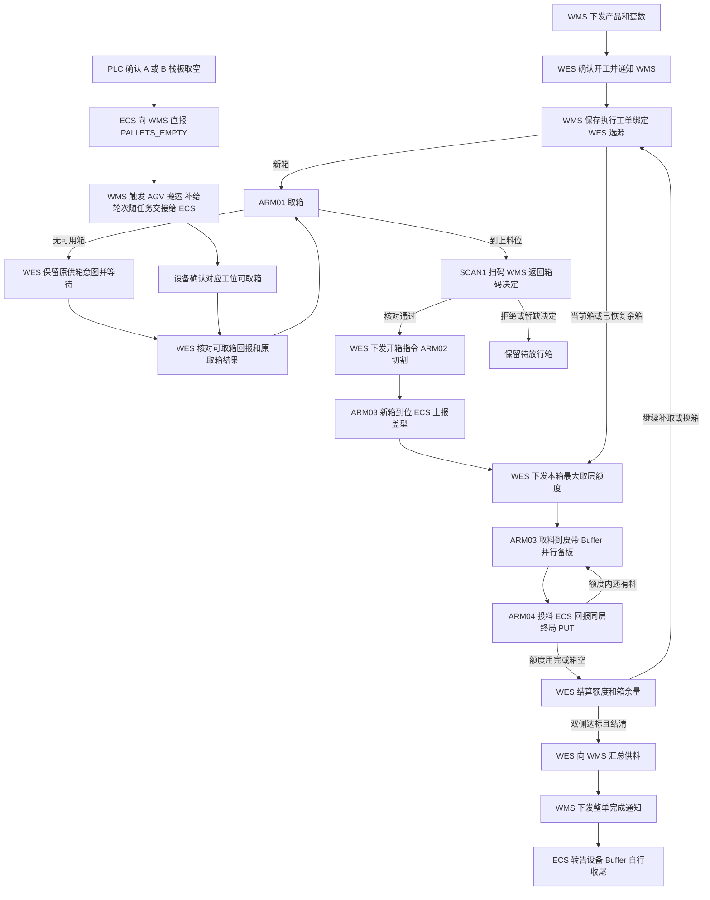

# 开箱机上下盖供料 API 对接文档

设计基线为 WES 开发评审稿 0.21，涵盖开工绑定确认和补给交接规则。日期为 2026-11-05。开发范围为 WES 内部的工单、选源、设备指令、数量结算、恢复和本地验证。WMS、ECS、PLC、Buffer 和 AGV 提供外部决定或执行事实。 [概要设计](opening-machine-overview-design.md) · [配对算法与 Python 伪代码](opening-machine-pairing-algorithm-design.md)

本文沿用现有 WES 通用接口。开箱机专属 operation、命令名、事件扩展字段和示例均为接口评审稿，正式报文按第 10 节对齐。供应商已有字段与待补齐的字段分别标注。当前 WES 通用接口可承载该流程，开箱机业务注册待开发。

## 目录

- [1. 业务范围、主体与方向](#business-scope)
- [2. 完整业务流程](#flows)
- [3. 统一任务接口](#tasks)
- [4. 逐箱、逐层业务接口](#material-operations)
- [5. 共同授权、等待、关联与收口](#production-rules)
- [6. 来源资源、补给与余箱](#source-flows)
- [7. ECS 公共协议与动作参数](#ecs)
- [8. WES 公共接缝与设备内部边界](#wes-seams)
- [9. 公共协议、字段、幂等与保存](#protocol)
- [10. 开发依赖与本地验证](#delivery)

<a id="business-scope"></a>
## 1 业务范围、主体与方向

WMS 下发产品和需求套数。WES 安排上、下盖纸箱穿插供料，ARM03 按整层取料，ARM04 将物料投到 Buffer 载板。成功供料按已投放的实物片数计算。Buffer 管理 Magazine 装载、出料和尾料补空板。

| 主体 | 责任 |
| --- | --- |
| WMS | 下发工单，按 WES 开工通知建立当前执行绑定，解析箱体外码，安排栈板补给，接收供料汇总并下发整单完成通知 |
| WES | 接收工单及决策，确认开工并通知 WMS，选源及授权设备动作，结算成功量和 NG，恢复原指令及转发整单通知 |
| ECS/PLC | 执行取箱、开箱、取料、投料和缓存移动，提供实际到位、释放、逐层事件和原指令 Result |
| Buffer | 与开箱机握手，提供载板、处理整层投料 NG、管理 Magazine，接收整单完成通知后处理尾料 |
| AGV/MCS | 按 WMS 的补给任务完成栈板搬运，并与设备办理工位交接 |

### 1.1 工位与设备编码

| 设备或位置 | 业务作用 | 对接方式 |
| --- | --- | --- |
| `STATION_A` / `STATION_B` | A 仅放上盖栈板，B 仅放下盖栈板 | ARM01 取箱来源。WMS 按工单产品补对应盖型的栈板 |
| `ARM01` / `STATION_INPUT01` | 从 A/B 取纸箱到上料位 | `PICK_AND_PUT` 及原 Result |
| `STATION_SCAN1` / `ARM02` | 箱码扫描与切割开箱 | SCAN1 发 `SCAN_COMPLETED`。WES 校验通过后单独发开箱指令 |
| `STATION_CCD` / `STATION_REMAININGBUFFER1` | 取料区域与唯一余箱缓存 | 缓存、恢复按 `MOVE_BACKWARD`、`MOVE_FORWARD`。位置及实际占用按原移动结果确认 |
| `ARM03` | 新箱到位，逐层取料到皮带，移走空箱 | 到箱时回报盖型，取出每层时发 `GET_COMPLETED` |
| `STATION_SCAN2` / `STATION_SCAN3` | 物料条码追溯 | `SCAN_COMPLETED`，仅用于追溯 |
| `ARM04` / `STATION_OUTPUT01` | ARM04 将物料投到匹配载板 | ECS 以 `STATION_OUTPUT01` 上报 `PUT_COMPLETED` |

`workline_code` 和设备角色按 WES 配置绑定。设备编码、工位地址和箱型参数分开使用。548、558 是本稿业务示例中的产品及对应箱型配置，实际料号和设备映射由对接方确认。

### 1.2 数量与来源约束

每套对应上下盖各 1 片，每层为 2 片。当前上盖满箱 22 片，下盖满箱 16 片，单箱实际可用量以 WMS 解析的外码为准。取料位与已开箱余料缓存位各容纳一箱。

Buffer 上下盖各最多有 4 个待分配的空板 Magazine，装料后的载板收入另一个成品 Magazine。WES 选侧使用两侧累计成功供料量及箱体占位。Buffer 内部空板资源和成品周转由设备处理。

<a id="flows"></a>
## 2 完整业务流程

| 步骤 | 方向 | Operation / Event / Command | 推进条件 |
| --- | --- | --- | --- |
| T1 工单 | WMS → WES | [开箱任务下发](#task-issued) | 保存任务、产品和原需求，奇数向上取偶。换产品时等待人工清线确认 |
| T1a 开工 | WES → WMS | [工单开工通知](#task-started) | WES 取得本线执行资格并确认清线或留箱条件，通知 WMS 建立当前执行工单绑定 |
| S1 选箱 | WES → ECS | [ARM01 取箱](#fetch-carton) | 当前动作结清，优先处理可复用余箱。取新箱时选择成功量较少的一侧 |
| S2a 缺箱 | ECS → WES | [ARM01 缺箱 Result](#carton-unavailable) | 保留原供箱意图并等待补给 |
| S2b 补栈板 | ECS → WMS → AGV/MCS → ECS | [PALLETS_EMPTY 与栈板补给](#pallet-replenishment)、[补给轮次交接](#replenishment-handoff) | WMS 按当前执行工单确定产品，按缺料工位确定盖型。登记补给轮次、触发 AGV 搬运，轮次随原搬运任务交接给 ECS |
| S2c 恢复供箱 | ECS → WES | [工位可取箱回报](#source-available) | 回报匹配原取箱、工单和补给轮次。原取箱已明确未搬箱且工位可取箱后恢复 |
| S3 箱码 | ECS → WES → WMS | [SCAN1 与箱码决策](#carton-validate) | 按原取箱和扫码关联核对产品、盖型、数量 |
| S4 开箱 | WES → ECS | [开箱放行指令](#open-carton) | 当前箱校验通过。ARM02 执行该箱的开箱指令 |
| M1 到箱与额度 | ECS → WES → ECS | [新箱到位](#carton-ready)、[取料额度](#pick-quota) | ARM03 到位盖型与原箱匹配，或余箱恢复已确认。原额度已结清 |
| M2 逐层 | ECS → WES | [同层 GET/PUT](#layer-events) | ARM03 取料与 Buffer 备板并行，物料和匹配载板到位后投料 |
| M3 结算 | ECS → WES | [额度 Result](#quota-result) | 按原额度更新箱余量和成功量。每个已结清失败层补取一层 |
| S5 换箱 | WES → ECS | [清箱及余箱移动](#carton-cache) | 空箱由 ARM03 移走。余箱让位时需确认缓存空闲，恢复时需确认取料位可用 |
| T2 汇总 | WES → WMS | [供料汇总](#supply-report) | 双侧达标，所有额度及在途层结清 |
| T3 收尾 | WMS → WES → ECS | [整单完成通知](#task-completed) | WES 转告设备，设备自行补空板及出料 |



后文示例使用工单 `OPEN-001`、产品 `548`、原需求 `5` 套，执行目标为上、下盖各 `6` 片。先取上盖箱 `U001`，外码数量 `10` 片。本箱首轮取 `3` 层，其中 `2` 层成功、`1` 层 NG。再取 `1` 层成功后，上盖达标，箱内余 `2` 片入缓存。下盖箱 `L001` 的 `6` 片全部成功后，提交双侧供料汇总。

<a id="tasks"></a>
## 3 统一任务接口

下列 `opening_machine.*@v1` 名称用于报文评审，属于拟议业务 operation。公共信封、重试及响应分工见 [§9](#protocol)。同一 `task_id` 的重复下发只对应一份执行记录，工单产品和原需求沿原受理记录保存。

<a id="task-issued"></a>
### 3.1 opening_machine.task.issued@v1

方向为 WMS → WES，`POST {{WES_BASE_URL}}/api/v1/wms/events`。

```json
{
  "operation_id": "01a1ac65-aef7-7b60-8c7b-87df787d9b01",
  "operation": "opening_machine.task.issued@v1",
  "timestamp": 1793836800000,
  "data": {
    "task_id": "OPEN-001",
    "workline_code": "OPEN-LINE-01",
    "product_code": "548",
    "requested_sets": 5,
    "task_version": 1
  }
}
```

| `data` 字段 | 类型 / 约束 |
| --- | --- |
| `task_id` | string，WMS 原任务号 |
| `workline_code` | string，匹配 WES 已配置的开箱机工作线 |
| `product_code` | string，WMS 指定的产品 |
| `requested_sets` | integer，原需求套数，按完整层规则计算执行目标 |
| `task_version` | integer，拟保留的工单版本。具体版本合同待确认 |

首次持久受理返回 HTTP `202 / RECEIVED`。

```json
{
  "operation_id": "01a1ac65-aef7-7b60-8c7b-87df787d9b01",
  "code": "RECEIVED",
  "timestamp": 1793836800100,
  "data": {}
}
```

同身份同内容重发返回 `200 / DUPLICATE`。受理后按清线、留箱和当前工位条件选源。报文受理和设备动作分别推进。

<a id="task-started"></a>
### 3.2 opening_machine.task.started@v1

方向为 WES → WMS，拟沿 `POST {{WMS_BASE_URL}}/api/v1/wes/facts` 发送。WES 确认该工单取得本线执行资格，并核对同产品留箱或换产品清线条件后，在登记开工状态的同一事务内保存通知意图。每次工单开工对应一个原通知身份，发送重试沿用原报文。

```json
{
  "operation_id": "01a1ac65-aef7-7b60-8c7b-87df787d9b05",
  "operation": "opening_machine.task.started@v1",
  "timestamp": 1793836800200,
  "data": {
    "task_id": "OPEN-001",
    "workline_code": "OPEN-LINE-01",
    "product_code": "548",
    "task_version": 1,
    "started_at": 1793836800200
  }
}
```

| 字段 | 关联规则 |
| --- | --- |
| `operation_id` | 本次开工通知的原身份，WMS 补给记录可引用为 `start_operation_id` |
| `task_id` / `task_version` | 关联原 WMS 工单及其生效版本 |
| `workline_code` / `product_code` | WMS 建立当前执行绑定的工作线和产品 |
| `started_at` | WES 确认开工的原时间，使用 UTC 毫秒，重发保持不变 |

WMS 核对原工单后持久化本线执行绑定，并返回 HTTP `200 / RECORDED`。同身份同内容已应用时可返回 `200 / DUPLICATE`，沿用原处理结果。已切换工单的历史通知仍归原绑定。

```json
{
  "operation_id": "01a1ac65-aef7-7b60-8c7b-87df787d9b05",
  "code": "RECORDED",
  "timestamp": 1793836800400,
  "data": {}
}
```

WES 收到当前工单的原开工通知确认，确认 WMS 已保存绑定后，才开始本单供箱或余箱取料，避免取空通知早于产品归属。确认暂缺时，WES 保留原开工通知并按原身份恢复。收到迟到响应时，只为当前仍有效的工单推进。正式 operation、字段和确认响应的报文约定待 C01 对齐。

<a id="supply-report"></a>
### 3.3 opening_machine.task.supply_report@v1

方向为 WES → WMS，`POST {{WMS_BASE_URL}}/api/v1/wes/facts`。双侧达标且额度及在途层结清后发送。示例中箱耗用和余量均按片计。

```json
{
  "operation_id": "01a1ac65-aef7-7b60-8c7b-87df787d9b03",
  "operation": "opening_machine.task.supply_report@v1",
  "timestamp": 1793836920000,
  "data": {
    "task_id": "OPEN-001",
    "product_code": "548",
    "requested_sets": 5,
    "execution_target_sets": 6,
    "upper": { "drawn_pcs": 8, "success_pcs": 6, "ng_pcs": 2 },
    "lower": { "drawn_pcs": 6, "success_pcs": 6, "ng_pcs": 0 },
    "cartons": [
      { "carton_id": "U001", "cover_type": "UPPER", "drawn_pcs": 8, "success_pcs": 6, "ng_pcs": 2, "remaining_pcs": 2 },
      { "carton_id": "L001", "cover_type": "LOWER", "drawn_pcs": 6, "success_pcs": 6, "ng_pcs": 0, "remaining_pcs": 0 }
    ],
    "retained_cartons": [
      { "carton_id": "U001", "location": "STATION_REMAININGBUFFER1", "remaining_pcs": 2 }
    ]
  }
}
```

`execution_target_sets` 为向上取偶后的套数，亦即每侧目标片数。每箱取出量等于成功量加 NG 量。续单复用时，箱耗用按本任务的实际取出量上报，保留箱以报告时的占位为准。WMS 按 `200 / RECORDED` 或 `200 / DUPLICATE` 确认事实收妥，`data` 均为 `{}`。整单完成由 WMS 另行通知。

<a id="task-completed"></a>
### 3.4 opening_machine.task.completed@v1

方向为 WMS → WES，`POST {{WES_BASE_URL}}/api/v1/wms/events`。

```json
{
  "operation_id": "01a1ac65-aef7-7b60-8c7b-87df787d9b04",
  "operation": "opening_machine.task.completed@v1",
  "timestamp": 1793836921000,
  "data": {
    "task_id": "OPEN-001",
    "product_code": "548"
  }
}
```

WES 核对原任务、产品及双侧结清状态，登记与原通知关联的设备转发意图。通知早于结算时保留待核对状态。重复通知沿同一转发身份处理。末个 Magazine 的补空板和出料由设备自行推进。 [设备通知](#device-task-completed)

<a id="material-operations"></a>
## 4 逐箱、逐层业务接口

<a id="carton-validate"></a>
### 4.1 SCAN1 与 opening_machine.carton.validate@v1

SCAN1 读取外箱码后，ECS → WES 调用 `POST {{WES_BASE_URL}}/api/v1/callback/event`。`source_command_code` 为拟议关联字段，指向本次 ARM01 供箱。

```json
{
  "device_code": "STATION_SCAN1",
  "event_type": "SCAN_COMPLETED",
  "timestamp": 1793836805000,
  "data": {
    "location": "STATION_SCAN1",
    "barcode": "EXAMPLE-U001-RAW",
    "source_command_code": "CMD-20261105-0001"
  }
}
```

WES → WMS 调用 `POST {{WMS_BASE_URL}}/api/v1/wes/decisions`。开发样例采用同步 `DECIDED`，WMS 若采用异步决策，按同一原校验请求关联，另行确认报文。

```json
{
  "operation_id": "01a1ac65-aef7-7b60-8c7b-87df787d9b02",
  "operation": "opening_machine.carton.validate@v1",
  "timestamp": 1793836805100,
  "data": {
    "task_id": "OPEN-001",
    "product_code": "548",
    "expected_cover_type": "UPPER",
    "source_station": "STATION_A",
    "source_command_code": "CMD-20261105-0001",
    "scan_ref": "SCAN-U001-001",
    "barcode": "EXAMPLE-U001-RAW"
  }
}
```

HTTP `200 / DECIDED` 的允许示例。

```json
{
  "operation_id": "01a1ac65-aef7-7b60-8c7b-87df787d9b02",
  "code": "DECIDED",
  "timestamp": 1793836805300,
  "data": {
    "decision": "ALLOW",
    "carton_id": "U001",
    "product_code": "548",
    "cover_type": "UPPER",
    "material_code": "UPPER-548-EXAMPLE",
    "available_pcs": 10
  }
}
```

| 字段 | 说明 |
| --- | --- |
| `barcode` | ECS 回报的完整外码原文。WMS 解析其中的实际数量 |
| `scan_ref` | WES 保存的本次原扫码引用，用于关联后续开箱指令 |
| `decision` | 拟用 `ALLOW` 或 `REJECT`。拒绝时返回待对齐的 `reason_code` |
| `carton_id` / `material_code` | WMS 确认的纸箱与物料标识 |
| `available_pcs` | 本箱有效外码中的实际可用片数。允许开箱的物料数量为正偶数 |

同一请求若被业务拒绝，返回 HTTP `200 / DECIDED` 的拒绝分支。下例与允许分支二选一，`COVER_MISMATCH` 是待确认的原因码。

```json
{
  "operation_id": "01a1ac65-aef7-7b60-8c7b-87df787d9b02",
  "code": "DECIDED",
  "timestamp": 1793836805300,
  "data": { "decision": "REJECT", "reason_code": "COVER_MISMATCH" }
}
```

WES 按原请求核对产品、盖型、箱身份和数量。外码解析拒绝、超时或数量异常时，纸箱保持待放行。回库重出外码的纸箱按有效新码取量，设备内余箱按已结算余量恢复。

<a id="carton-ready"></a>
### 4.2 新箱到位与物料追溯

新箱实际到 ARM03 取料位时由 ECS 回报盖型。下面的 `CARTON_AT_PICK_STATION` 为拟议事件名，回报须能唯一关联此前已放行的纸箱。

```json
{
  "device_code": "ARM03",
  "event_type": "CARTON_AT_PICK_STATION",
  "timestamp": 1793836810000,
  "data": {
    "location": "STATION_CCD",
    "carton_id": "U001",
    "cover_type": "UPPER",
    "source_command_code": "CMD-20261105-0001"
  }
}
```

SCAN2/3 可沿已有 `SCAN_COMPLETED` 回报 `location` 和 `barcode`，拟通过 `quota_command_code`、`layer_seq` 关联物料层。条码用于追溯，WES 按 GET/PUT 及额度结果推进。缺码的记录方式由对接方确认。

```json
{
  "device_code": "STATION_SCAN2",
  "event_type": "SCAN_COMPLETED",
  "timestamp": 1793836813000,
  "data": {
    "location": "STATION_SCAN2",
    "barcode": "EXAMPLE-PIECE-U001-02A",
    "quota_command_code": "CMD-20261105-0003",
    "layer_seq": 2
  }
}
```

<a id="layer-events"></a>
### 4.3 GET_COMPLETED 与 PUT_COMPLETED

方向为 ECS → WES，`POST {{WES_BASE_URL}}/api/v1/callback/event`。ECS 每实际取出一整层生成一条 GET，终局投料时生成对应的一条 PUT。两个事件均携带原额度指令号和额度内层序号，字段名为本稿示例。

```json
{
  "device_code": "ARM03",
  "event_type": "GET_COMPLETED",
  "timestamp": 1793836812000,
  "data": {
    "location": "STATION_CCD",
    "quota_command_code": "CMD-20261105-0003",
    "layer_seq": 2,
    "quantity_pcs": 2
  }
}
```

```json
{
  "device_code": "STATION_OUTPUT01",
  "event_type": "PUT_COMPLETED",
  "timestamp": 1793836814500,
  "data": {
    "location": "STATION_OUTPUT01",
    "quota_command_code": "CMD-20261105-0003",
    "layer_seq": 2,
    "quantity_pcs": 2,
    "pick_and_put_result": "PUT_FAILED"
  }
}
```

| `data` 字段 | 说明 |
| --- | --- |
| `quota_command_code` | 原取料额度指令号，两条事件一致 |
| `layer_seq` | 正整数，同一额度内唯一，同一层的 GET 与 PUT 共用 |
| `quantity_pcs` | 该层数量，固定 2，失败时也为 2 |
| `pick_and_put_result` | PUT 终局结果。`PUT_FAILED` 表示 Buffer 已处理整层 NG。成功拟沿用 `PUT_FINISHED` |

等板或同层恢复期间保留原层身份，等待终局 PUT。ECS 重发任一事件时保留原事件内容。WES 可先保存乱序到达的事实，再用原额度指令号和层序号配对。相同业务层出现互斥终局时暂停推进并核对。

<a id="quota-result"></a>
### 4.4 原取料额度 Result

方向为 ECS → WES，`POST {{WES_BASE_URL}}/api/v1/callback/result`。以下为待 C07 确认的汇总入账方案。示例额度完成时共取出 `3` 层，`2` 层成功、`1` 层已结清 NG。

```json
{
  "command_code": "CMD-20261105-0003",
  "device_code": "ARM03",
  "result": "SUCCESS",
  "finish_time": 1793836819000,
  "data": {
    "carton_id": "U001",
    "drawn_layers": 3,
    "success_layers": 2,
    "ng_layers": 1,
    "unsettled_layers": 0,
    "remaining_pcs": 4,
    "stop_reason": "QUOTA_REACHED"
  },
  "error_detail": null
}
```

`SUCCESS` 示例表示额度已执行并结清，层成功数以 `success_layers` 为准。拟定字段满足 `drawn_layers = success_layers + ng_layers + unsettled_layers`，且 `drawn_layers` 不超过本次授权。`remaining_pcs` 等于本轮前箱余量减去 `drawn_layers × 2`。箱空、额度用完、异常停止的具体枚举和 `result` 分支待对齐。原指令 `FAILED` 仍需如实提供已发生的取料和投料事实。

WES 关联冻结的原额度及箱号。已结清的原 Result 只入账一次，逐层事件用来核对与追溯。若尚有未结清层或事实冲突，WES 保留原额度待核对。上述例子中上盖目标为 `3` 层，成功 `2` 层，下一额度只授权取 `1` 层。

<a id="production-rules"></a>
## 5 共同授权、等待、关联与收口

| 状态 | WES 推进条件 |
| --- | --- |
| 可取箱 | 来源路径和取料占位允许，原动作已结清。取新箱时按较少成功量选侧，平局先上盖 |
| 可开箱 | 原 ARM01 已到上料位，本次 SCAN1 决策已应用且匹配当前待开箱 |
| 可取层 | 已放行的箱实际到取料位，或余箱恢复已确认，且上一额度结清 |
| 可补取 | 原层终局 `PUT_FAILED` 已结清，当前侧仍有成功量缺口 |
| 可换箱 | 空箱已离位，或余箱移入唯一缓存且实际占位已确认 |
| 双侧供料完成 | 两侧成功量达到各自目标，已发额度与在途层均结清 |

每轮最大取层数为 `min(箱内剩余层数, 本侧目标层数 - 已结算成功层数)`。设备每实际取出一层占用一层额度。发生已结清 NG 时，来源箱仍扣 2 片，成功量保持原值。WES 结算后重新计算下一额度。

同一工作线按单条来源流程和一个未结清额度推进。设备自行处理物料和载板先后到达。WES 保留原动作，等待对应事件或 Result。迟到的旧扫码、旧到位、旧 Result 按原任务和动作关联保存，当前动作资格按当前有效事实判断。

<a id="source-flows"></a>
## 6 来源资源、补给与余箱

### 6.1 A/B 取空与栈板补给

补给链有两个独立回报。ARM01 的原取箱 Result 告诉 WES 当前供箱能否继续。A/B 栈板取空由 ECS 直报 WMS，触发库区补栈板。WMS 对同一轮取空通知的重发只创建一张补给任务。本节使用独立的缺箱分支示例。

<a id="carton-unavailable"></a>
#### 6.1.1 ARM01 回报无可用纸箱

ARM01 原 Result 应区分明确未搬箱且无可用纸箱、部分动作或占位仍不明、以及纸箱已到上料位。普通失败或 `actual_qty=0` 只能说明该回报没有确认完整搬箱，缺箱需要明确原因。下例 `NO_AVAILABLE_CARTON` 为拟议分类，原厂错误码映射待确认。

```json
{
  "command_code": "CMD-20261105-0101",
  "device_code": "ARM01",
  "result": "FAILED",
  "finish_time": 1793836803000,
  "data": {
    "source_station": "STATION_A",
    "actual_qty": 0
  },
  "error_detail": { "code": "NO_AVAILABLE_CARTON", "msg": "所选工位无可用纸箱，未搬箱" }
}
```

WES 保存原任务、产品、盖型、来源工位和取箱意图，进入等待补给。若原 Result 只表示普通故障，则按原动作恢复流程核对实际状态。

<a id="pallet-replenishment"></a>
#### 6.1.2 ECS 通知 WMS 补栈板

按供应商 PDF §7，PLC 检测到栈板取空时置请求位，ECS 向 **WMS** 调用 `POST {{WMS_BASE_URL}}/api/v1/callback/event`。这是设备补给的外部链路。下面沿用 PDF 的报文结构。

```json
{
  "device_code": "STATION_A",
  "event_type": "PALLETS_EMPTY",
  "timestamp": 1793836803500,
  "data": { "location": "STATION_A" }
}
```

| 缺料工位 | WMS 补给需求 | AGV 目标 |
| --- | --- | --- |
| `STATION_A` | 当前任务产品的上盖栈板 | `STATION_A` |
| `STATION_B` | 当前任务产品的下盖栈板 | `STATION_B` |

**产品取自当前执行工单，盖型取自工位。** WMS 通过已配置的 ECS 来源和工位识别工作线，再查该线已确认生效的执行绑定 `workline_code + task_id + product_code`。例如 `OPEN-LINE-01` 正在执行 `OPEN-001 / 548`，收到 A 工位的 `PALLETS_EMPTY` 就补 548 上盖栈板。已下发但尚未执行的 558 工单仍处于后续队列，直到该工单的执行绑定生效。

WES 确认开工后发送 [工单开工通知](#task-started)，WMS 根据该通知登记生效绑定。工单下发或接收 ACK 仅表示交付进度，排队工单在执行绑定生效后才用于补给。WMS 用原开工通知身份区分执行绑定，换单时原补给轮次仍归原绑定。切换生效点和旧任务取空事件的区分方式按 C01 对齐。

WMS 先识别原事件重发，再核对取空事实是否属于当前有效执行绑定。缺少绑定、绑定有歧义或无法确定事件归属时，先核对来源及工单，再发起搬运。记录原事件发生时间及来源用于核对，接收时点仅用于记录到达。

**每轮缺料登记一个补给轮次，并触发一张 AGV 搬运任务。** WMS 收到有效取空事件后，为该执行工单和工位登记 `replenishment_ref`，冻结产品、盖型、库区来源栈板和目标工位，再通过既有搬运链路提交 AGV 任务。同一取空事件重发，或同一工位在该轮补给尚未完成时重复请求，沿用原补给轮次和原搬运意图。AGV 提交失败时继续按原轮次处理。下例是 WMS 保存的逻辑关联记录，AGV 的实际字段沿既有搬运合同对齐。

```json
{
  "replenishment_ref": "REFILL-A-001",
  "workline_code": "OPEN-LINE-01",
  "task_id": "OPEN-001",
  "start_operation_id": "01a1ac65-aef7-7b60-8c7b-87df787d9b05",
  "product_code": "548",
  "cover_type": "UPPER",
  "target_station": "STATION_A",
  "empty_event_timestamp": 1793836803500,
  "source_pallet_id": "PALLET-548-UPPER-001",
  "source_location": "WH-STOCK-01",
  "transport_task_ref": "AGV-REFILL-A-001"
}
```

WMS 的 HTTP `2xx` 用于取空请求握手。搬运任务提交、栈板放到工位、工位可取箱分别按各自的事实推进。C/D 空栈板满、E/F 废料架满及门禁交接沿设备外围流程处理。

若 ARM01 回报无可用纸箱，但设备没有产生 `PALLETS_EMPTY`，例如有栈板但纸箱卡住，补给触发及原栈板处置须另行确认。WES 继续保留等待或异常状态，直到获得可推进的外部回报。

<a id="replenishment-handoff"></a>
#### 6.1.3 AGV 补给轮次交接给 ECS

WMS 提交补栈板的 AGV 任务时，把 `replenishment_ref` 与原搬运任务绑定。AGV 到达目标 A/B 工位办理放板交接时，AGV/MCS 将该任务的补给关联交给 ECS。ECS 按原搬运任务及目标工位保存关联，并在确认放板完成、门禁交接结束且工位可取箱后，用该关联生成可取箱回报。

以下为随 AGV 任务交接的关联数据示例，实际承载位置和报文字段由 WMS、AGV/MCS、ECS 对齐。

```json
{
  "transport_task_ref": "AGV-REFILL-A-001",
  "replenishment_ref": "REFILL-A-001",
  "workline_code": "OPEN-LINE-01",
  "task_id": "OPEN-001",
  "start_operation_id": "01a1ac65-aef7-7b60-8c7b-87df787d9b05",
  "product_code": "548",
  "cover_type": "UPPER",
  "source_pallet_id": "PALLET-548-UPPER-001",
  "target_station": "STATION_A"
}
```

| 关联字段 | 用途 |
| --- | --- |
| `transport_task_ref` / `replenishment_ref` | 定位原 AGV 任务及唯一补给轮次，交接重试沿用原身份 |
| `workline_code` / `task_id` / `start_operation_id` | 回查本次补给的原执行绑定 |
| `product_code` / `cover_type` / `source_pallet_id` | 确认需送入的产品、盖型及来源栈板 |
| `target_station` | 校验实际放板工位，A 上盖、B 下盖 |

PDF §6 的 `/door/accessReq` 和 `/door/accessFinish` 共用原 `callId`、`device_code`、`direction`，用于门禁交接。该次 `callId` 与原搬运任务、补给轮次的绑定由外部交接链路确认。上述关联数据是待对齐的交接示例，PDF 门禁字段沿现有合同使用。

<a id="source-available"></a>
#### 6.1.4 栈板到位后恢复供箱

AGV 放置对应栈板并完成工位交接后，ECS 确认该工位可取箱，再向 WES 上报。若此次补给对应 WES 等待中的取箱请求，ECS 同时回传该次缺箱的原 `source_command_code`。下面为拟议事件及字段，示例关联 6.1.1 的原取箱、6.1.2 的补给轮次和 6.1.3 的交接记录。

```json
{
  "device_code": "STATION_A",
  "event_type": "SOURCE_CARTON_AVAILABLE",
  "timestamp": 1793836860000,
  "data": {
    "location": "STATION_A",
    "workline_code": "OPEN-LINE-01",
    "task_id": "OPEN-001",
    "product_code": "548",
    "cover_type": "UPPER",
    "replenishment_ref": "REFILL-A-001",
    "source_command_code": "CMD-20261105-0101"
  }
}
```

WES 按原取箱指令匹配待补给记录，并核对工作线、工单、产品、盖型和目标工位。原 Result 已明确未搬箱、ECS 确认可取箱且该轮补给尚未消费时，WES 保存 `replenishment_ref` 的消费事实，同时登记一条新的取箱指令。重复可取箱回报沿用该次处理结果。旧工单、旧轮次或其他工位的回报按原事实保存，当前待补给状态继续等待。

可取箱回报先于原取箱 Result 到达时，WES 先保存对应事实，等原结果结清后再核对。主动补给且当前没有缺箱取箱指令时，可取箱回报只记录工位事实，下一次取箱仍由 WES 正常选源。缺箱回报与补给轮次的绑定、报文字段及重发约定待 C01 对齐。

<a id="carton-cache"></a>
### 6.2 清空箱、缓存移动与续单

ARM03 移走空纸箱后，设备自动放行下一箱。WES 根据 ECS 提供的取料位释放事实更新占位。释放事实拟由适用的额度或移动 Result 承载，独立回报形式待确认。

本侧已达标但余箱需要让位时，缓存为空才允许 `MOVE_BACKWARD`。缓存内有未完成侧所需余箱时，取料位可用后优先 `MOVE_FORWARD`。移动结果确认后更新箱的位置，沿用已结算余量。

同产品续单可按原箱号、盖型、位置和已结算余量接续。两处均有箱且下一单可能在取料位箱尚有余量时完成该侧，应先核对是否需要人工腾位。产品变更以人工清线完成为新任务开工条件，确认的入口和责任人待 C10 对齐。

<a id="ecs"></a>
## 7 ECS 公共协议与动作参数

### 7.1 Command / ACK / Result 共用字段

| 交互 | 方向 | Method 与 URL |
| --- | --- | --- |
| 下发指令 | WES → ECS | `POST {{ECS_BASE_URL}}/api/v1/device/command` |
| 回传 Result | ECS → WES | `POST {{WES_BASE_URL}}/api/v1/callback/result` |
| 上报事件 | ECS → WES | `POST {{WES_BASE_URL}}/api/v1/callback/event` |

| 指令字段 | JSON 类型 | 含义 |
| --- | --- | --- |
| `device_code` | string | 原执行设备编码 |
| `command_code` | string | WES 生成的原命令身份 |
| `task_type` | string | 动作类型，使用已对齐的设备合同 |
| `priority` | integer | 示例为 1 |
| `timeout` | integer | 期望完成时间，单位毫秒，按配置冻结 |
| `timestamp` | integer | UTC Unix 毫秒，按 WES 公共协议发送 |
| `params` | object | 原业务参数 |

ECS 接纳指令及 WES 接收设备回报均使用各自公共接口的 HTTP `200 / ACK`。

```json
{ "code": 200, "message": "ACK" }
```

ECS 指令接纳只关闭交付环节。设备动作结果按原 `command_code`、`device_code` 及已应用 Result 推进。Result 使用 `result=SUCCESS/FAILED`、`finish_time`、对应动作的 `data`，失败附 `error_detail.code` 和 `error_detail.msg`。设备 PDF 部分命令示例使用字符串 `timestamp`，本稿按 WES 公共命令示例使用整数，接入前对齐实际接收格式。 [ECS 公共命令与结果合同](ecs-command.md)

<a id="fetch-carton"></a>
### 7.2 ARM01 / PICK_AND_PUT

下例沿用 PDF §2.1 的对象形式。箱体尚未扫码时，示例只传来源、箱型和盖型，箱身份在扫码后确认。

```json
{
  "device_code": "ARM01",
  "command_code": "CMD-20261105-0001",
  "task_type": "PICK_AND_PUT",
  "priority": 1,
  "timeout": 30000,
  "timestamp": 1793836801000,
  "params": {
    "source": { "location_id": "STATION_A", "location_type": "BIN", "bin_type": "548", "material_type": "上盖" },
    "target": { "location_id": "STATION_INPUT01", "location_type": "BIN" }
  }
}
```

下盖来源切换为 `STATION_B`，盖型为 `下盖`，箱型按工单映射。纸箱到达上料位后的原 Result 示例。

```json
{
  "command_code": "CMD-20261105-0001",
  "device_code": "ARM01",
  "result": "SUCCESS",
  "finish_time": 1793836804000,
  "data": { "actual_qty": 1, "pick_and_put_result": "PUT_FINISHED" },
  "error_detail": null
}
```

此处 `actual_qty` 的单位为纸箱。实际箱内片数在 SCAN1 的 WMS 决策中取得。

<a id="open-carton"></a>
### 7.3 ARM02 开箱放行

`OPEN_CARTON` 和 `params` 为待确认草案。WES 只为已校验且仍在等待切割的本箱登记开箱意图。

```json
{
  "device_code": "ARM02",
  "command_code": "CMD-20261105-0002",
  "task_type": "OPEN_CARTON",
  "priority": 1,
  "timeout": 30000,
  "timestamp": 1793836805400,
  "params": {
    "task_id": "OPEN-001",
    "carton_id": "U001",
    "product_code": "548",
    "cover_type": "UPPER",
    "scan_ref": "SCAN-U001-001"
  }
}
```

开箱指令的结果报文待确认。后续取料额度以 ARM03 的实际到箱事实为条件。清空箱后的设备内部送箱继续按当前箱的开箱授权执行。

<a id="pick-quota"></a>
### 7.4 ARM03 有限取料额度

`PICK_LAYER_QUOTA` 为待确认的命令名，执行设备及参数随合同对齐。`max_get_layers` 限制实际取层次数，每次取 `2` 片。

```json
{
  "device_code": "ARM03",
  "command_code": "CMD-20261105-0003",
  "task_type": "PICK_LAYER_QUOTA",
  "priority": 1,
  "timeout": 30000,
  "timestamp": 1793836810100,
  "params": {
    "task_id": "OPEN-001",
    "carton_id": "U001",
    "product_code": "548",
    "cover_type": "UPPER",
    "max_get_layers": 3
  }
}
```

本额度的三个层序号均关联 `CMD-20261105-0003`。已确认的 NG 补取在原额度结算后创建新额度，其层序号按新原指令计算。 [逐层事件](#layer-events) · [额度 Result](#quota-result)

### 7.5 CCD 缓存与恢复

PDF §2.3 定义 `MOVE_BACKWARD` 为 CCD → 缓存，`MOVE_FORWARD` 为缓存 → CCD。指令顶层设备为 `STATION_CCD`，`params` 只带 `source`，移动命令省略 `target`。余箱入缓存示例。

```json
{
  "device_code": "STATION_CCD",
  "command_code": "CMD-20261105-0005",
  "task_type": "MOVE_BACKWARD",
  "priority": 1,
  "timeout": 30000,
  "timestamp": 1793836830000,
  "params": {
    "source": { "location_id": "STATION_CCD", "location_type": "CCD_PLATFORM" }
  }
}
```

| 动作 | 发出前 | Result 用于确认 |
| --- | --- | --- |
| `MOVE_BACKWARD` | 当前层及额度已结清、原余箱需让位、缓存空闲 | 原箱到缓存位、取料位释放 |
| `MOVE_FORWARD` | 当前取料位空闲、原缓存箱可继续供料 | 原箱恢复到取料位、缓存释放 |

恢复命令的 `source` 具体枚举及两种 Result 的箱号、余量和占位字段待设备方确认。WES 用原移动指令关联已有纸箱记录，余量沿原结算保留。

<a id="device-task-completed"></a>
### 7.6 整单完成通知转发

`TASK_COMPLETED` 为 WES → ECS 的拟议转发命令。若采用 §7.1 的设备命令入口，报文可按下例组织，设备编码用实际通知接收角色绑定。接纳和原指令结清的技术合同待 C09 对齐。

```json
{
  "device_code": "{{ECS_COMPLETION_DEVICE_CODE}}",
  "command_code": "CMD-20261105-0009",
  "task_type": "TASK_COMPLETED",
  "priority": 1,
  "timeout": 30000,
  "timestamp": 1793836921100,
  "params": {
    "task_id": "OPEN-001",
    "product_code": "548",
    "notice_operation_id": "01a1ac65-aef7-7b60-8c7b-87df787d9b04"
  }
}
```

设备按原通知身份接管尾料及出料。WES 记录通知转发状态。若接入方式要求技术 Result，其范围限于通知接收或处理，尾料及出料由设备内部收尾。供料数量以双侧实际结算为准。

<a id="wes-seams"></a>
## 8 WES 公共接缝与设备内部边界

| WES 接缝 | 接入责任 |
| --- | --- |
| WMS 回调 | 通过现有业务回调机制受理工单和整单通知，按原任务身份保存状态 |
| WMS 请求 | 通过现有 decisions/facts 发送箱码决策请求、开工通知及供料汇总，读取原响应 |
| ECS 指令 | 通过现有命令机制登记冻结意图，消费原指令已应用的 Result |
| ECS 事件 | 按工作线与设备角色绑定解析 SCAN、到箱及逐层事实 |
| 本地验证 | 用 WES 本地模拟报文验证前述入口、调度和结算 |

设备内部负责载板准备、皮带输送、同层等待、投料互锁、Buffer NG 处置及 Magazine 周转。WES 消费对应动作事实。AGV 补给由 WMS 按原缺料安排，门禁由 MCS 与 ECS 处理。

补给相关的 WES 开发交付为登记及发送开工通知、保存原缺箱等待、接收可取箱回报并恢复取箱。WMS 的执行绑定及搬运任务、AGV/MCS 向 ECS 的轮次交接属于外部约定，在 WES 开发环境以模拟响应及事件提供。

现有通用注册、公共发送和结果读取按仓库规范接入。业务状态与下一条外发意图一起持久化，提交后由现有发送机制交付。 [业务包](business-packages.md) · [接口注册](registration.md) · [出站结果](outbound-results.md)

<a id="protocol"></a>
## 9 公共协议、字段、幂等与保存

### 9.1 WMS 信封与响应

WMS 通知及请求的信封为 `operation_id`、`operation`、`timestamp`、`data`。`operation_id` 为小写 UUIDv7。响应回显同一个 `operation_id`，使用 `code`、`timestamp`、`data`。

| HTTP / code | 适用条件 |
| --- | --- |
| `202 / RECEIVED` | WMS 下行已由 WES 持久受理 |
| `200 / DECIDED` | WMS 返回本次箱码业务决定，`data` 承载允许或拒绝分支 |
| `200 / RECORDED` | WMS 保存开工绑定或收到供料汇总，`data={}` |
| `200 / DUPLICATE` | 通知或事实按原身份已处理 |
| `400` / `413` | 公共入口分别处理非法 JSON 或身份，以及报文超限 |
| `409 / CONFLICT` | 同身份内容冲突，或已确认的引用及状态冲突，按原事实核对 |
| `422 / REJECTED` | 未支持 operation、信封或业务数据无效 |
| `503 / UNAVAILABLE` | 暂不可用，沿既有规则恢复原身份 |

身份、时间、有效业务内容和原路由在发送前冻结。WMS 的箱码拒绝为 `DECIDED` 下的业务分支，协议拒绝按公共合同处理。时间使用 JSON 整数 UTC 毫秒，数量和层序号使用 JSON 整数。盖型示例为 `UPPER`、`LOWER`，ARM01 `material_type` 使用设备已约定的上盖/下盖字段。

### 9.2 ECS 事件、结果及原动作恢复

| 对象 | 原身份与约束 |
| --- | --- |
| Event | 通用接收器以 `device_code`、`event_type`、`timestamp` 和 `data` 识别重复事件。ECS 重发保留原事件内容 |
| 层 | 原 `quota_command_code` 加 `layer_seq`。GET/PUT 分别记录，同一层只应用一次终局投料结果 |
| Command | 原 `command_code`、设备、参数、路由及期限。交付按公共命令协议判定，交付未知时保持原动作待核对 |
| Result | 匹配原命令和设备，按冻结附录校验。已应用原结果重复到达沿用原处理状态 |

ECS 断线恢复或重启后，按原 `command_code` 通过现有 Result 回调重发已保存的最终结果。本期以回调重发恢复。结果未确认时 WES 保留待结清状态，设备核对实际动作及占位后再结清。合法 Result 可按公共规则先于命令 ACK 应用。

事件接收 ACK 表示接收持久化，业务推进仍依赖已注册的处理及原关联。原动作和业务去重身份按 WES 业务保存，保留期限待对齐。鉴权和来源限制沿公共入口及开发环境配置核对。 [ECS 事件接入](ecs-event-debugging.md) · [ECS 命令协议](ecs-command.md)

<a id="delivery"></a>
## 10 开发依赖与本地验证

### 10.1 对接依赖

| 议题 | 已确认的规则 | 开发前需要对齐的报文或事实 |
| --- | --- | --- |
| C01/C02 工单和来源 | WES 确认开工后通知 WMS，等 WMS 确认保存绑定才开始供箱或取料。A 上盖 B 下盖，栈板取空触发 AGV 搬运，补给轮次随 AGV 任务交接给 ECS。箱量按有效外码 | 开工 operation 及字段、执行绑定切换、取空去重、轮次在既有交接链路的承载及可取箱报文、无取空事件时的处置及箱码字段 |
| C03/C04 放行及到箱 | 明确指令后切割，ARM03 清空箱，设备自动送箱，到箱上报盖型 | 开箱命令、原扫码关联、取料位释放和新箱到位字段 |
| C05/C06/C07 额度及结果 | 实际取层硬上限、整层 NG 后补取、GET/PUT 共享层标识 | 额度命令、成功枚举、汇总 Result 与入账依据、冲突处理 |
| C08/C11 设备与扫码 | 备板与取料并行，SCAN2/3 只供追溯 | 逐层事实及条码关联、缺码记录方式 |
| C09/C10 完成及交接 | WMS 整单完成通知，设备自行收尾，同产品复用，换产品人工清线 | 通知及转发字段、任务关联、清线确认来源 |
| C12 协议恢复 | 沿用现有路径，ECS 重发原 Result | 设备角色映射、接口认证、时间格式、超时及重试约定 |

### 10.2 WES 本地验证矩阵

以下场景通过 WES 本地模拟 WMS 决策、ECS 事件和 Result 验证。

| 场景 | 模拟输入 | WES 预期 |
| --- | --- | --- |
| 开工通知 | 工单已受理，模拟取得执行资格及清线或留箱条件。WMS 返回原通知 `RECORDED`，或响应暂缺后按原身份返回 `DUPLICATE` | 生成唯一开工通知，保留原身份与报文。只有收到当前工单的绑定保存确认后才开始供箱或余箱取料 |
| 工单、缺箱和补给 | 548 正在执行且 558 等待启动。模拟 ARM01 缺箱、原 548 补给的可取箱回报、旧轮次或 558 回报，以及重复或乱序回报 | 保留原 548 供箱需求。只有本工单及原取箱指令匹配、对应栈板可取、原结果明确未搬箱时才恢复。同一补给轮次只登记一次新取箱 |
| 开箱授权 | 箱码正确、拒绝、超时及旧箱决定晚到 | 只对当前匹配的待开箱发出指令 |
| 单箱额度与整层 NG | 5 套任务，U001 有 10 片，3 层中 1 层 NG | 执行目标各 6 片，首次上盖取 3 层，结算后补取 1 层 |
| 逐层乱序与重复 | 原 GET/PUT 反序到达，同一 `PUT_FAILED` 和额度 Result 重发 | 按原身份配对，同一层只结算一次 |
| 等待与断线恢复 | GET 后暂缺 PUT 或原指令 Result，随后回放原结果 | 保留原动作，匹配结果后继续，数量入账一次 |
| 余箱与换产品 | 双位有余箱的短单、同产品续单、不同产品续单 | 小单按单缓存保护，原箱按余量复用，换产品等待清线确认 |
| SCAN2/3 与整单通知 | 追溯条码缺失，双侧结清后收到 WMS 完成通知及重发 | 继续按投料事实结算。通知按原身份转发，重复通知对应同一意图 |

算法样例和历史随机轨迹可用于核对数量与选源。0.5% 异常率样本为 2500 套，共 489 次供箱、2514 次取层、14 层投料 NG。 [评审附件](attachments/opening-machine/README.md)
