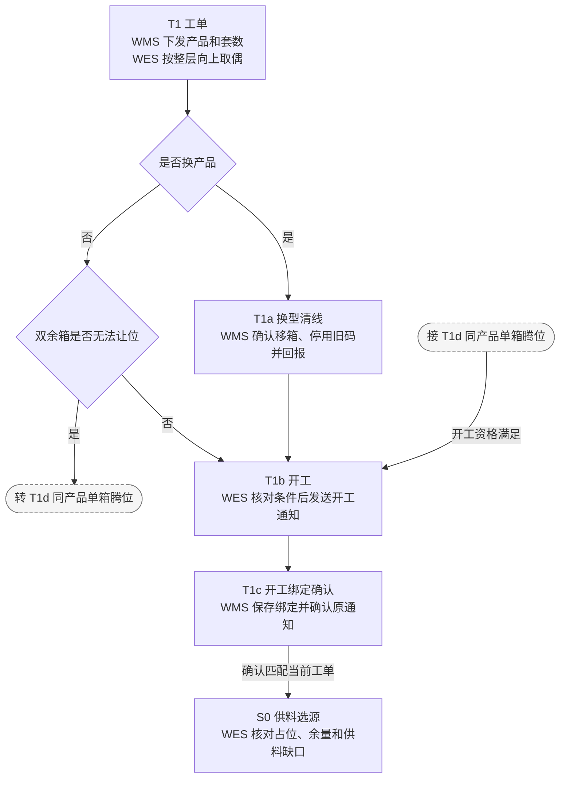
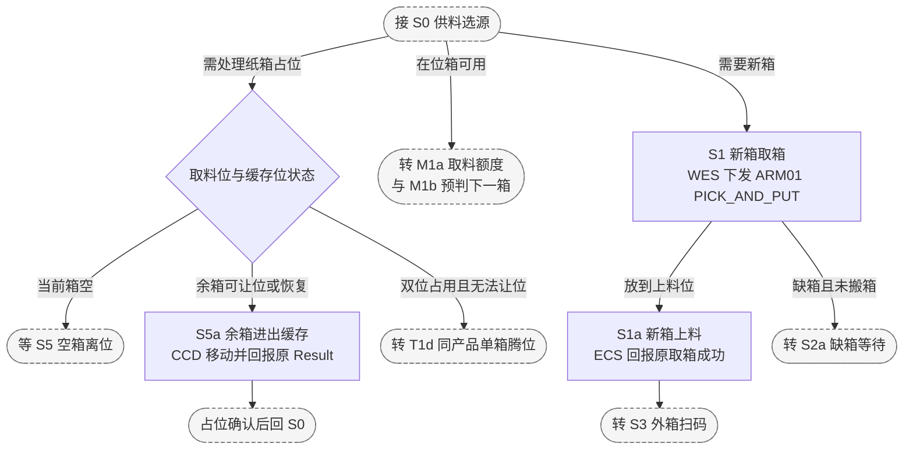
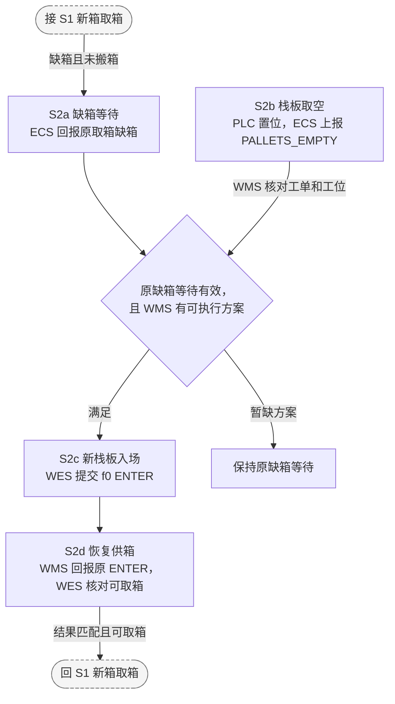
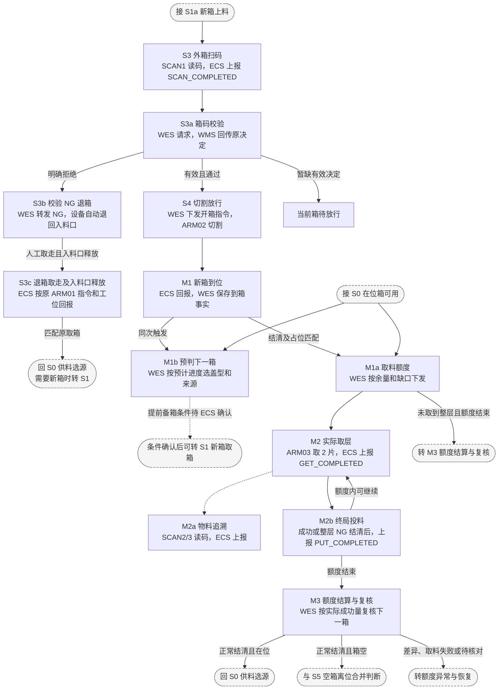
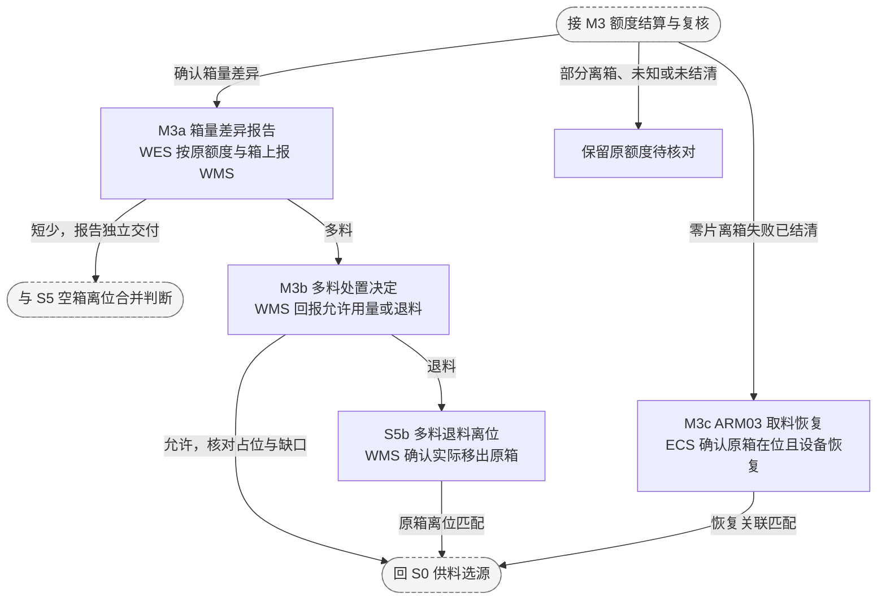
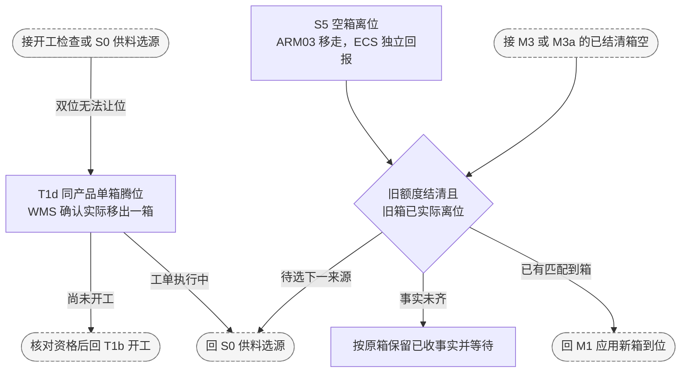
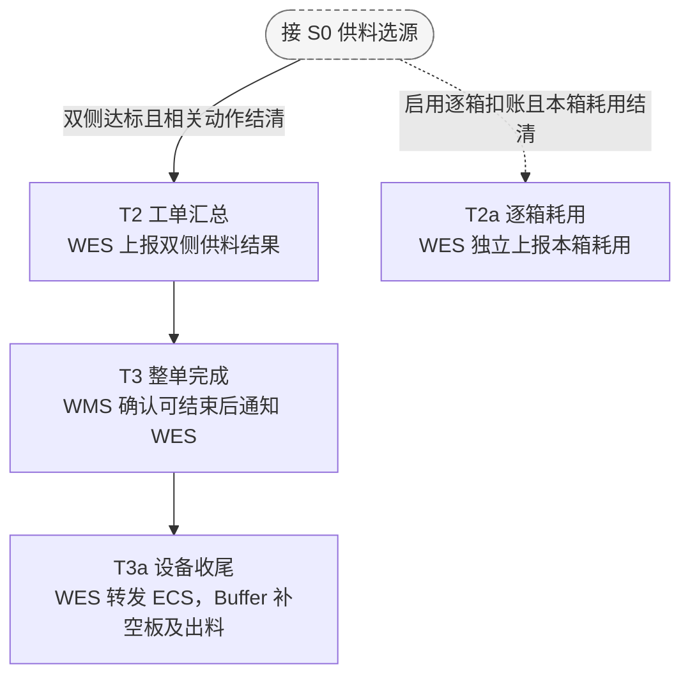

# 开箱机上下盖供料 API 对接文档

设计基线为 WES 开发评审稿 0.21，涵盖开工绑定确认和补给交接规则。日期为 2026-11-05。开发范围为 WES 内部的工单、选源、设备指令、数量结算、恢复和本地验证。WMS、ECS、PLC、Buffer 和 AGV 提供外部决定或执行事实。 [概要设计](opening-machine-overview-design.md) · [配对算法与 Python 伪代码](opening-machine-pairing-algorithm-design.md)

本文沿用现有 WES 通用接口。开箱机专属 operation、命令名、事件扩展字段和示例均为接口评审稿，正式报文按第 10 节对齐。供应商已有字段与待补齐的字段分别标注。当前 WES 通用接口可承载该流程，开箱机业务注册待开发。

## 目录

- [1. 业务范围、主体与方向](#business-scope)
- [2. 完整业务流程](#flows)
- [3. 统一任务接口](#tasks)
- [4. 逐箱、逐层业务接口](#material-operations)
- [5. 共同授权、等待、关联与收口](#production-rules)
- [6. 来源资源、补给与余箱](#source-flows)
- [7. ECS 公共协议与动作参数](#ecs)
- [8. WES 公共接缝与设备内部边界](#wes-seams)
- [9. 公共协议、字段、幂等与保存](#protocol)
- [10. 开发依赖与本地验证](#delivery)

<a id="business-scope"></a>
## 1 业务范围、主体与方向

WMS 下发产品和需求套数。WES 安排上、下盖纸箱穿插供料，ARM03 按整层取料，ARM04 将物料投到 Buffer 载板。成功供料按已投放的实物片数计算。Buffer 管理 Magazine 装载、出料和尾料补空板。

| 主体 | 责任 |
| --- | --- |
| WMS | 下发工单，按 WES 开工通知建立当前执行绑定，解析箱体外码，提供新栈板补给方案并执行原 Transport，接收供料汇总并下发整单完成通知。提供人工清线操作和独立退料。逐箱扣账按 WMS 库存规则确认后启用 |
| WES | 接收工单及决策，确认开工并通知 WMS，选源及授权设备动作，复用公共 RackDispatch 提交栈板搬运，结算成功量和 NG，恢复原指令及转发整单通知 |
| ECS/PLC | 执行取箱、开箱、取料、投料和缓存移动，提供实际到位、释放、逐层事件和原指令 Result |
| Buffer | 与开箱机握手，提供载板、处理整层投料 NG、管理 Magazine，接收整单完成通知后处理尾料 |
| AGV/MCS | 按 WMS 转交的原 Transport 任务完成栈板搬运，与 ECS 办理工位及门禁交接 |

### 1.1 工位与设备编码

| 设备或位置 | 业务作用 | 对接方式 |
| --- | --- | --- |
| `STATION_A` / `STATION_B` | A 仅放上盖栈板，B 仅放下盖栈板 | ARM01 取箱来源。WMS 按工单产品补对应盖型的栈板 |
| `ARM01` / `STATION_INPUT01` | 从 A/B 取纸箱到上料位 | `PICK_AND_PUT` 及原 Result |
| `STATION_SCAN1` / `ARM02` | 箱码扫描与切割开箱 | SCAN1 发 `SCAN_COMPLETED`。WES 校验通过后单独发开箱指令 |
| `STATION_CCD` / `STATION_REMAININGBUFFER1` | 取料区域与唯一余箱缓存 | 缓存、恢复按 `MOVE_BACKWARD`、`MOVE_FORWARD`。位置及实际占用按原移动结果确认 |
| `ARM03` | 新箱到位，逐层取料到皮带，移走空箱 | 到箱时回报盖型，取出每层时发 `GET_COMPLETED` |
| `STATION_SCAN2` / `STATION_SCAN3` | 物料条码追溯 | `SCAN_COMPLETED`，仅用于追溯 |
| `ARM04` / `STATION_OUTPUT01` | ARM04 将物料投到匹配载板 | ECS 以 `STATION_OUTPUT01` 上报 `PUT_COMPLETED` |

`workline_code` 和设备角色按 WES 配置绑定。设备编码、工位地址和箱型参数分开使用。548、558 是本稿业务示例中的产品及对应箱型配置，实际料号和设备映射由对接方确认。

### 1.2 数量与来源约束

每套对应上下盖各 1 片，每层为 2 片。当前上盖满箱 22 片，下盖满箱 16 片，单箱实际可用量以 WMS 解析的外码为准。取料位与已开箱余料缓存位各容纳一箱。

Buffer 上下盖各最多有 4 个待分配的空板 Magazine，装料后的载板收入另一个成品 Magazine。WES 选侧使用两侧累计成功供料量及箱体占位。Buffer 内部空板资源和成品周转由设备处理。

<a id="flows"></a>
## 2 完整业务流程

### 2.1 九步主流程

| 步骤 | 现场动作和推进条件 | 对应明细与图中节点 |
| --- | --- | --- |
| 1. WMS 下发任务 | WMS 指定工作线、产品和需求套数，WES 受理原工单。 | T1 |
| 2. WES 准备任务 | 按整层向上取偶。换产品先等人工清线；同产品续单出现双余箱且无法让位时，先等 WMS 确认实际移出一箱。WMS 保存并确认开工绑定后开始供料。 | T1a、T1d、T1b、T1c |
| 3. 优先使用可用余箱 | WES 核对 ARM03 取料位和唯一缓存位。在位箱仍有需求时可继续取料；缓存箱须恢复到位。执行中发现双位无法让位时，等匹配的腾位确认后重新选源。 | S0、T1d、S5a、M1a |
| 4. 计划并搬运新箱 | 需要新箱时，WES 选定盖型；上料路径允许后，下发 ARM01 从 A 位取上盖箱或从 B 位取下盖箱。缺箱时走原栈板补给流程。 | S0、S1、S1a、S2a–S2d |
| 5. 扫码校验并放行开箱 | SCAN1 经 ECS → WES → WMS 上报箱码。校验 OK 后，WES 授权 ARM02 切割；明确 NG 时，WES 转发给 ECS，设备自动将未切割纸箱退回入料口。人工取走且入料口释放后，ECS 按原 ARM01 指令及工位回报，WES 再按选源结果下发新箱。暂缺有效决定时原箱待放行。 | S3、S3a、S3b、S3c、S4、S0、S1 |
| 6. ARM03 到箱并预判下一箱 | ECS 回报当前纸箱实际到达取料位。WES 核对占位后，同一次到位处理触发第 7 步的当前箱额度，并预判下一箱的盖型和来源。 | M1 → M1a、M1b |
| 7. 下发当前箱取料额度 | WES 按本箱可用层数与本侧剩余成功层数的较小值下发额度，每层 2 片。 | M1a |
| 8. 整层执行、结算与复核 | ECS 上报实际取层及投料终局，WES 按原额度和原箱结算并复核下一箱。已核实的箱量差异独立上报；多料等 WMS 处置，取料失败后等 ECS 恢复确认。 | M2、M2a、M2b、M3、M3a–M3c |
| 9. 处理在位纸箱并决定下一轮 | 空箱由 ARM03 移走，多料退料等 WMS 确认移出。有余料可留位续取，确需让位且缓存空闲才移入缓存。离位与额度 Result 分别保存，换箱取料还须核对新箱到位。两侧达标且动作结清后进入汇总和收尾。 | S5、S5a、S5b、S0、T2、T2a、T3、T3a |

<a id="next-carton-planning"></a>
到箱预判时，WES 将当前额度预计成功量加到对应侧的已结算成功量上，据此比较两侧缺口并检查可用余箱。预计量只供选箱。结算时以实际成功量和箱体占位复核，更新尚未下发的计划。若已有原 ARM01 指令在执行或结果待确认，沿原指令核对纸箱去向，再决定后续动作。

**ARM01 提前备箱待 ECS 联调确认。** 需确认上游独立等待位置、可用条件的回报依据、设备如何扣留待用箱，以及提前备箱是否会妨碍当前箱离位或缓存箱恢复。还须确认复核后该箱暂不可用时的留置或退出路径。联调确认前，WES 在到箱时生成计划，待原额度结清并复核、相关占位和上料路径允许后再下发 ARM01。

### 2.2 步骤与事件明细

下表区分消息发出时机和接收方的推进条件。流程图沿用表中的步骤编号和名称。消息可能乱序到达，WES 按原工单、原指令或原搬运任务核对。提交接纳只确认消息已受理，实际动作按对应 Result 或设备事实推进。

设备侧交互是否已有供应商定义，见 [ECS 供应商 PDF 对照](#ecs-pdf-coverage)。整层取放、到箱、空箱离位和设备收尾按相应待联调项确认后接入。

| 步骤 | 方向 | 消息或动作 | 触发方与时机 | 接收方如何推进 |
| --- | --- | --- | --- | --- |
| T1 工单 | WMS → WES | [工单下发](#task-issued) | WMS 确定本次供料的工作线、产品及需求套数 | WES 保存原工单，按完整层向上取偶。换产品时先等人工清线 |
| T1a 换型清线 | WMS → WES | [人工清线确认](#line-clearance-confirmed) | 旧单结清后，操作员在 WMS 确认实际移箱，WMS 停用旧码并回报 | WES 核对前后工单、原工位及条码均匹配后关闭原占位 |
| T1d 同产品单箱腾位 | WMS → WES | [单箱移出确认（拟议）](#single-carton-removal) | WES 发现双余箱无法让位，WMS 组织人工移出其中一箱。操作员确认实际移出后，WMS 回报 | 按当前交接、工作线、原工位及原外箱码释放匹配占位一次。待开工则重新核对开工资格，执行中则回 S0 |
| T1b 开工 | WES → WMS | [工单开工通知](#task-started) | WES 确认本线执行资格及留箱或清线条件，保存原通知后发送 | WMS 核对原工单并保存本线当前执行绑定 |
| T1c 开工绑定确认 | WMS → WES | [原开工通知响应](#task-started) | WMS 保存绑定后返回 `RECORDED`。同一通知已处理时可返回 `DUPLICATE` | WES 按原 `operation_id` 确认当前工单的绑定已保存，首次进入选源 |
| S0 供料选源 | WES 内部 | [取箱、取层及换箱条件](#production-rules) | 首次确认开工绑定，或额度复核、箱体离位或移动、腾位、多料处置、取料恢复事实应用后需要决定下一步 | 根据箱体占位、可用余箱和两侧实际成功量决定继续取料、移箱、取新箱或进入汇总。取料位与缓存位同时占用且缺少让位路径时，等待腾位确认 |
| S1 新箱取箱 | WES → ECS | [ARM01 `PICK_AND_PUT`](#fetch-carton) | WES 选定需要新箱的一侧，原动作结清且上料路径可用。拟提前备箱时须满足 [ECS 联调条件](#next-carton-planning) | ARM01 从 A/B 对应工位取一个箱，放至 `STATION_INPUT01` |
| S1a 新箱上料 | ECS → WES | [ARM01 成功 Result](#fetch-carton) | ARM01 实际将纸箱放到上料位后，ECS 按原指令回报 | WES 确认原取箱完成，将该箱纳入扫码和开箱校验 |
| S2a 缺箱等待 | ECS → WES | [ARM01 缺箱 Result](#carton-unavailable) | ARM01 确认原工位无可用箱且本次未搬箱时，ECS 按原指令回报 | WES 记录原工位及工单等待补给。动作或占位未知时先核对 |
| S2b 栈板取空 | ECS → WMS | [`PALLETS_EMPTY`](#pallet-replenishment) | PLC 检测到 A/B 栈板取空并置请求位，ECS 在上升沿上报对应工站 | WMS 按已确认开工绑定及工位判断产品和盖型，提供新栈板方案 |
| S2c 新栈板入场 | WES → WMS → RCS/MCS | [Transport ENTER](#replenishment-handoff) | WES 取得可执行补给方案后，按缺箱工位复用或登记原入场作业 | WMS 通过现有 Transport 提交链路派发 `f0` 搬运。同一工位的等待关联原作业 |
| S2d 恢复供箱 | WMS → WES | [原 ENTER Result](#source-available) | WMS 获得原入场任务的执行结果后，按原 `transport_task_id` 回报 | 原取箱明确未搬箱、新栈板和 A/B 实际点位匹配且工位可取箱后，WES 只恢复一次取箱 |
| S3 外箱扫码 | ECS → WES | [SCAN1 `SCAN_COMPLETED`](#carton-validate) | 纸箱到上料位后，`STATION_SCAN1` 成功读取外箱条码，ECS 以该工站上报 | WES 按原 ARM01 `source_command_code` 匹配当前待开箱纸箱 |
| S3a 箱码校验 | WES → WMS；WMS → WES | [箱码校验请求和决定](#carton-validate) | WES 匹配当前有效扫码后请求校验。WMS 完成解析和业务核对后回显原 `operation_id` | WES 核对原请求及当前箱。有效 OK 转 S4，明确 NG 转 S3b，暂缺有效决定时待放行 |
| S3b 校验 NG 退箱 | WES → ECS | [转发箱码 NG](#carton-reject-return) | WES 应用与当前待开箱纸箱及有效扫码匹配的 WMS 明确拒绝后，向 ECS 转发 NG | 开箱机 ECS/PLC 自动将未切割纸箱退回入料口，等待人工取走。NG 传递方式待联调 |
| S3c 退箱取走及入料口释放 | ECS → WES | [退箱离位回报（拟议）](#rejected-carton-removed) | 人工实际拿走退回纸箱，入料口工站确认该箱离位且工位已释放后，ECS 上报 | WES 按原 ARM01 取箱指令号及实际工位匹配，只关闭一次原占位。回 S0 选源，需要新箱且路径可用时用新指令号下发 ARM01 |
| S4 切割放行 | WES → ECS | [ARM02 开箱指令](#open-carton) | WES 确认原 ARM01 已上料、当前箱待切割且箱码校验通过后下发 | ARM02 收到与当前箱匹配的明确授权后切割 |
| M1 新箱到位 | ECS → WES | [`CARTON_AT_PICK_STATION`（拟议）](#carton-ready) | 已放行的新箱实际到达 `STATION_CCD` 取料位，ECS 以 ARM03 上报 | WES 保存到箱事实。有前箱时核对前一额度结清及旧箱离位，确认新箱与原供箱匹配后应用占位并同次触发 M1a 和 M1b |
| M1a 取料额度 | WES → ECS | [ARM03 取料额度（拟议）](#pick-quota) | 当前箱到位确认，或 S0 选中已在位的可用余箱，上一额度结清且本侧还有缺口 | 按箱余层数和成功量缺口限制本轮取料。每层 2 片 |
| M1b 预判下一箱 | WES 内部 | [下一箱计划](#next-carton-planning) | 与 M1a 同次触发，使用当前额度作为本轮预计成功量 | 预判盖型和来源，优先核对对应侧可用余箱；预计双侧已达标时无需新箱计划。ARM01 提前备箱待 ECS 联调确认 |
| M2 实际取层 | ECS → WES | [`GET_COMPLETED`](#layer-events) | ARM03 实际取出一整层后，ECS 以 ARM03 上报 | 保存本层取出事实，按原额度指令号及层序号与 PUT 配对。Buffer 并行备板 |
| M2a 物料追溯 | ECS → WES | [SCAN2/3 `SCAN_COMPLETED`](#carton-ready) | `STATION_SCAN2` 或 `STATION_SCAN3` 成功读取物料条码后，ECS 以对应工站上报 | WES 保存条码追溯，ARM04 投料沿设备内部条件推进 |
| M2b 终局投料 | ECS → WES | [`PUT_COMPLETED`](#layer-events) | ARM04 完成该层投料并确认成功，或 Buffer 已处理整层 NG 后，ECS 以 `STATION_OUTPUT01` 上报 | WES 将终局关联到同层 GET。等板或同层恢复期间保留原层，等终局回报 |
| M3 额度结算与复核 | ECS → WES | [ARM03 原额度 Result](#quota-result) | 本额度执行到达结束条件时，ECS 按原指令回报。数量差异见 [提前箱空](#carton-early-empty) 和 [额度用完仍有余料](#carton-excess) | 按额度关联的原箱结算并以实际成功量复核计划。未结清或数量不明时保留待核对；已核实差异或零片离箱失败走对应恢复分支 |
| M3a 箱量差异报告 | WES → WMS | [箱量差异报告](#carton-quantity-discrepancy-report) | WES 结清原额度并核实实物余量与推算余量有差异 | 原额度与原箱只登记一次差异。短少的恢复取决于结清和离位；多料留箱待 WMS 决定 |
| M3b 多料处置决定 | WMS → WES | [多料处置回报（拟议）](#excess-disposition) | WMS 核实原差异后，明确批准可用量或决定退料 | 按原差异报告关联原任务、原箱和额度。允许时按可用量和缺口重新选源；退料等 S5b |
| M3c ARM03 取料恢复 | ECS → WES | [取料恢复确认（拟议）](#arm03-pick-recovered) | ARM03 已从取料故障恢复，确认原箱仍在取料位且可继续取料 | 按失败额度、原箱和工位解除等待。原额度结清且仍有缺口时，才可发新额度 |
| S5 空箱离位 | ECS → WES | [空箱离位回报（拟议）](#empty-carton-departure) | ARM03 实际移走空纸箱且 CCD 取料位已释放后，ECS 回报 | 只释放匹配的旧占位。保留旧箱记录供原额度结算，结清及离位事实均具备后推进 |
| S5a 余箱进出缓存 | WES → ECS；ECS → WES | [CCD 移动指令及原 Result](#ccd-move) | 余箱需让位且唯一缓存空闲时，WES 下发 `MOVE_BACKWARD`。取料位空闲且需恢复余箱时，下发 `MOVE_FORWARD`。ECS 在移动结束后回报 | WES 按原成功 Result 更新占位，沿用已结算余量 |
| S5b 多料退料离位 | WMS → WES | [单箱移出确认（拟议）](#single-carton-removal) | WMS 已决定退料，操作员确认原箱已实际移出后，WMS 回报 | 按原退料决定及工位外码核对，释放匹配占位后再选源。退料实点及换码由 WMS 独立办理 |
| T2 工单汇总 | WES → WMS | [工单供料汇总](#supply-report) | 上下盖成功量均达标且额度、在途层及相关来源动作均结清后，WES 发送 | WMS 核对工单级供料结果 |
| T2a 逐箱耗用 | WES → WMS | [逐箱耗用](#carton-consumption-report) | 启用逐箱扣账时，WES 在本单对该箱的耗用最终结清后独立发送 | WMS 按原工单及来源箱处理库存耗用 |
| T3 整单完成 | WMS → WES | [整单完成通知](#task-completed) | WMS 收到供料汇总并确认工单可结束后下发 | WES 匹配原工单，双侧供料已结清后登记一次转发 |
| T3a 设备收尾 | WES → ECS | [完成通知转发](#device-task-completed) | WES 核对原 WMS 通知及结清状态后转发，接收设备与技术结果按 C09 对齐 | Buffer 按设备内部流程补空板及出料 |

C/D 空栈板堆满时，ECS 以 `PALLETS_FULL` 直报 WMS 走独立流程。门禁交互由 AGV/MCS 与 ECS 处理。A/B 恢复供箱按原 ENTER 结果和可取箱条件推进。 [独立空栈板处理](#replenishment-handoff)

以下分图共用上表的步骤编号和名称。灰色虚线框指向其他分图中的步骤，流程虚线表示独立支路。

### 开工与绑定



### 选源与取箱



### 缺箱与补栈板



### 箱码、开箱与逐层供料



### 额度异常与恢复



### 实物离位与单箱腾位



### 工单汇总与收尾



后文示例使用工单 `OPEN-001`、产品 `548`、原需求 `5` 套，执行目标为上、下盖各 `6` 片。上盖箱 `U001`（外码 `10` 片）到达 ARM03 时，WES 下发 `3` 层额度并预判下一箱为下盖。首轮实际 `2` 层成功、`1` 层 NG，结算后复核计划，先用 `U001` 补取 `1` 层。上盖达标后，箱内余 `2` 片入缓存，再取下盖箱 `L001`。下盖 `6` 片全部成功后，提交双侧供料汇总。

<a id="tasks"></a>
## 3 统一任务接口

下列 `opening_machine.*@v1` 名称用于报文评审，属于拟议业务 operation。公共信封字段、响应及其触发时机见 [§9.1](#wms-envelope)。同一 `task_id` 的重复下发只对应一份执行记录，工单产品和原需求沿原受理记录保存。

<a id="task-issued"></a>
### 3.1 opening_machine.task.issued@v1

方向为 WMS → WES，`POST {{WES_BASE_URL}}/api/v1/wms/events`。

**用途** 将工单、产品和原需求套数交给 WES，建立待执行任务。

**发出方与触发时机** WMS 确定本次供料的工作线、产品和需求套数后下发。WES 受理后排队，取得本线执行资格后进入开工流程。

```json
{
  "operation_id": "01a1ac65-aef7-7b60-8c7b-87df787d9b01",
  "operation": "opening_machine.task.issued@v1",
  "timestamp": 1793836800000,
  "data": {
    "task_id": "OPEN-001",
    "workline_code": "OPEN-LINE-01",
    "product_code": "548",
    "requested_sets": 5,
    "task_version": 1
  }
}
```

| `data` 字段 | JSON 类型 | 说明与约束 |
| --- | --- | --- |
| `task_id` | string | WMS 原任务号 |
| `workline_code` | string | 匹配 WES 已配置的开箱机工作线 |
| `product_code` | string | WMS 指定的产品 |
| `requested_sets` | integer | 原需求套数，按完整层规则计算执行目标 |
| `task_version` | integer | 拟保留的工单版本 |

**WES 受理响应** 用于确认工单已持久受理。WES 首次持久受理后返回 HTTP `202 / RECEIVED`，公共响应字段见 [§9.1](#wms-envelope)。

```json
{
  "operation_id": "01a1ac65-aef7-7b60-8c7b-87df787d9b01",
  "code": "RECEIVED",
  "timestamp": 1793836800100,
  "data": {}
}
```

同身份同内容重发返回 `200 / DUPLICATE`。受理后按清线、留箱和当前工位条件选源。报文受理和设备动作分别推进。

**待联调（C01）** 工单 operation、字段和 `task_version` 的取值及版本约定。

<a id="task-started"></a>
### 3.2 opening_machine.task.started@v1

方向为 WES → WMS，拟沿 `POST {{WMS_BASE_URL}}/api/v1/wes/facts` 发送。

**用途** 让 WMS 保存本线当前执行的工单和产品绑定，供缺箱时确定补给产品。

**发出方与触发时机** WES 确认工单取得本线执行资格，并核对同产品留箱或换产品清线条件后，在登记开工状态的同一事务内保存通知意图，提交后发送。同产品双余箱无法让位时，先应用 [单箱移出确认](#single-carton-removal)。每次开工对应一个原通知身份，发送重试沿用原报文。

```json
{
  "operation_id": "01a1ac65-aef7-7b60-8c7b-87df787d9b05",
  "operation": "opening_machine.task.started@v1",
  "timestamp": 1793836800200,
  "data": {
    "task_id": "OPEN-001",
    "workline_code": "OPEN-LINE-01",
    "product_code": "548",
    "task_version": 1,
    "started_at": 1793836800200
  }
}
```

外层 `operation_id` 是本次开工通知的原身份，WMS 补给记录可引用为 `start_operation_id`。

| `data` 字段 | JSON 类型 | 说明与约束 |
| --- | --- | --- |
| `task_id` | string | 原 WMS 工单号 |
| `task_version` | integer | 本次开工引用的工单版本 |
| `workline_code` / `product_code` | string | WMS 建立当前执行绑定的工作线和产品 |
| `started_at` | integer | WES 确认开工的原时间，UTC Unix 毫秒，重发保持不变 |

**WMS 开工绑定响应** 用于确认当前工单绑定已保存。WMS 核对原工单并持久化本线执行绑定后，返回 HTTP `200 / RECORDED`。同身份同内容已应用时可返回 `200 / DUPLICATE`，沿用原处理结果。已切换工单的历史通知仍归原绑定。公共响应字段见 [§9.1](#wms-envelope)。

```json
{
  "operation_id": "01a1ac65-aef7-7b60-8c7b-87df787d9b05",
  "code": "RECORDED",
  "timestamp": 1793836800400,
  "data": {}
}
```

WES 收到当前工单的原开工通知确认，确认 WMS 已保存绑定后，才开始本单供箱或余箱取料，避免取空通知早于产品归属。确认暂缺时，WES 保留原开工通知并按原身份恢复。收到迟到响应时，只为当前仍有效的工单推进。

**待联调（C01）** 开工 operation、字段、执行绑定的切换时点，以及 `RECORDED` 和 `DUPLICATE` 如何证明原绑定已保存。

<a id="supply-report"></a>
### 3.3 opening_machine.task.supply_report@v1

方向为 WES → WMS，`POST {{WMS_BASE_URL}}/api/v1/wes/facts`。

**用途** 向 WMS 报告本工单上下盖的实际供料、投料 NG 和实际取出总量，供 WMS 核对执行结果。

**发出方与触发时机** WES 确认上下盖成功量均达到执行目标，且取料额度、在途层及相关来源动作均已结清后向 WMS 发送。

WMS 按 `task_id` 查原需求套数。汇总报告 WES 实际采用的执行目标和结算结果。

```json
{
  "operation_id": "01a1ac65-aef7-7b60-8c7b-87df787d9b03",
  "operation": "opening_machine.task.supply_report@v1",
  "timestamp": 1793836920000,
  "data": {
    "task_id": "OPEN-001",
    "product_code": "548",
    "execution_target_sets": 6,
    "upper": { "drawn_pcs": 8, "success_pcs": 6, "ng_pcs": 2 },
    "lower": { "drawn_pcs": 6, "success_pcs": 6, "ng_pcs": 0 }
  }
}
```

公共请求和响应字段见 [§9.1](#wms-envelope)。下表说明请求 `data` 中的业务字段。

| 字段 | JSON 类型 | 说明与约束 |
| --- | --- | --- |
| `task_id` | string | 原 WMS 工单号 |
| `product_code` | string | 原工单指定的产品编码，如 `548` |
| `execution_target_sets` | integer | 原需求向上取偶后的套数。每套对应上、下盖各 1 片，因此也等于每侧目标片数 |
| `upper` / `lower` | object | 本工单上盖、下盖各自的累计结算 |
| `upper.drawn_pcs` / `lower.drawn_pcs` | integer | 对应盖型实际取出的片数，等于成功片数加投料 NG 片数 |
| `upper.success_pcs` / `lower.success_pcs` | integer | 对应盖型投料成功的片数，收口时等于该侧目标 |
| `upper.ng_pcs` / `lower.ng_pcs` | integer | 对应盖型已结清的投料 NG 片数，计入取出量 |

各片数按整层统计，每层 2 片。WES 按盖型核对逐箱台账与汇总的取出量、成功量及 NG 量一致，冻结工单汇总并沿原身份重发。逐箱台账及设备内余箱位置和余量由 WES 保存。

**WMS 汇总受理响应** WMS 收妥汇总后返回 `200 / RECORDED`，确认同身份已处理时返回 `200 / DUPLICATE`。响应 `data` 为 `{}`。整单完成由 WMS 另行通知。

**待联调（C09）** 汇总 operation、字段，以及 WMS 核对汇总并下发整单通知的业务条件。

<a id="task-completed"></a>
### 3.4 opening_machine.task.completed@v1

方向为 WMS → WES，`POST {{WES_BASE_URL}}/api/v1/wms/events`。

**用途** 通知 WES 本工单全部完成，由 WES 转告 ECS 开始设备收尾。

**发出方与触发时机** WMS 收到供料汇总并确认本工单可以结束后向 WES 下发。WES 收到时若双侧尚未结清，先保留原通知，待结清后再转发。

```json
{
  "operation_id": "01a1ac65-aef7-7b60-8c7b-87df787d9b04",
  "operation": "opening_machine.task.completed@v1",
  "timestamp": 1793836921000,
  "data": {
    "task_id": "OPEN-001",
    "product_code": "548"
  }
}
```

| `data` 字段 | JSON 类型 | 说明与约束 |
| --- | --- | --- |
| `task_id` | string | WMS 确认可以结束的原工单号 |
| `product_code` | string | 原工单产品编码，须与 WES 已保存的工单匹配 |

**WES 受理响应** 持久受理后按 [§9.1](#wms-envelope) 返回。WES 核对原任务、产品及双侧结清状态，登记与原通知关联的设备转发意图。通知早于结算时保留待核对状态。重复通知沿同一转发身份处理。末个 Magazine 的补空板和出料由设备自行推进。 [设备通知](#device-task-completed)

**待联调（C09）** 完成通知 operation、字段、任务关联及重复通知约定。

<a id="carton-consumption-report"></a>
### 3.5 opening_machine.carton.consumption_report@v1

方向为 WES → WMS，拟沿 `POST {{WMS_BASE_URL}}/api/v1/wes/facts` 发送。WMS 确认需要按箱扣账后启用。

**用途** WES 报告本工单从指定纸箱实际取出的数量，WMS 据此扣账。扣账量为实际取出片数，包含已结清的投料 NG。

**发出方与触发时机** WES 在该箱于本工单内已无后续取料且相关额度和在途层全部结清后发送。取空箱可在该箱结清后报告，仍可能续取的余箱在工单供料结清后报告。缓存移动不结清该箱耗用。

```json
{
  "operation_id": "01a1ac65-aef7-7b60-8c7b-87df787d9b06",
  "operation": "opening_machine.carton.consumption_report@v1",
  "timestamp": 1793836920000,
  "data": {
    "task_id": "OPEN-001",
    "product_code": "548",
    "carton_id": "U001",
    "cover_type": "UPPER",
    "drawn_pcs": 8,
    "success_pcs": 6,
    "ng_pcs": 2
  }
}
```

| `data` 字段 | JSON 类型 | 说明与约束 |
| --- | --- | --- |
| `task_id` | string | 原 WMS 工单号 |
| `product_code` | string | 原工单产品编码 |
| `carton_id` | string | WMS 校验确认的来源纸箱标识，须可用于库存关联 |
| `cover_type` | string | 来源纸箱盖型，`UPPER` 或 `LOWER` |
| `drawn_pcs` | integer | 本工单从该箱实际取出的片数，也是拟扣账量，等于 `success_pcs + ng_pcs` |
| `success_pcs` | integer | 本工单从该箱取出且投料成功的片数 |
| `ng_pcs` | integer | 本工单从该箱取出且已结清为投料 NG 的片数 |

按工单与来源箱归集，同一箱同一工单的多轮取料合成一份耗用事实。续单只报新工单实际取出量。登记意图时冻结 `operation_id` 和报文，重发沿用原身份，WMS 对同一事实只扣账一次。

**WMS 耗用受理响应** WMS 收妥耗用事实或确认同身份已处理时，按 [§9.1](#wms-envelope) 返回。收妥确认与库存入账结果的关系待 WMS 对齐。

逐箱耗用与工单汇总独立登记、发送和恢复。若 WMS 将扣账成功作为结单条件，由 WMS 等待入账后下发 `task.completed`。若允许后补，未结清的耗用报告继续按原身份恢复。

**待联调（C09）** 是否启用逐箱扣账、operation 和字段、库存关联键、收妥和入账确认语义，以及扣账是否为结单前置。

<a id="line-clearance-confirmed"></a>
### 3.6 opening_machine.line.clearance_confirmed@v1

方向为 WMS → WES。WES 向 WMS 提供清线完成回报接口，拟沿现有 `POST {{WES_BASE_URL}}/api/v1/wms/events` 接入。操作员用 PDA 扫描外箱条码，在 WMS 的 PC 或 PDA 页面确认实际移箱。WMS 停用旧外箱码，WES 接收、校验并保存 WMS 回报。

**用途** 将已完成的换型清线及余箱移出事实交给 WES，释放原占位并允许新工单进入开工流程。

**发出方与触发时机** 旧单已结清，人工确认工作线已按约定范围清线，且移出的余箱外箱码已停用后，由 WMS 上报。同产品且原位留箱时，沿用原箱和 WES 已结算余量。

以下是独立的 548 换 558 示例，分别清出余料缓存位和取料位的纸箱。

```json
{
  "operation_id": "01a1ac65-aef7-7b60-8c7b-87df787d9b07",
  "operation": "opening_machine.line.clearance_confirmed@v1",
  "timestamp": 1793836981000,
  "data": {
    "workline_code": "OPEN-LINE-01",
    "previous_task_id": "OPEN-CLEAR-548",
    "next_task_id": "OPEN-CLEAR-558",
    "cleared_at": 1793836980000,
    "confirmed_by": "OPERATOR-01",
    "cartons": [
      {
        "source_location": "STATION_REMAININGBUFFER1",
        "carton_code": "EXAMPLE-U001-ORIGINAL"
      },
      {
        "source_location": "STATION_CCD",
        "carton_code": "EXAMPLE-L001-ORIGINAL"
      }
    ]
  }
}
```

| `data` 字段 | JSON 类型 | 说明与约束 |
| --- | --- | --- |
| `workline_code` | string | 已确认清线的工作线 |
| `previous_task_id` / `next_task_id` | string | 原工单及本次清线对应的待开工工单 |
| `cleared_at` / `confirmed_by` | integer / string | 实际清线确认时间，使用 UTC Unix 毫秒，以及人工确认身份 |
| `cartons` | array | 实际清出的余箱。覆盖 WES 在取料位和缓存位登记的待清余箱。没有余箱时可为空 |
| `cartons[].source_location` | string | 清线前的实际位置 |
| `cartons[].carton_code` | string | PDA 扫描的外箱条码原文，须与 SCAN1 上线时采集的同一外箱码一致 |

WES 先核对工作线和前后工单，再在该线当前待清占位中按 `source_location` 和 `carton_code` 匹配。WES 从匹配的纸箱记录取得内部箱标识和已结算余量。少报、重复报箱、条码无法唯一匹配或工位不符时，保留原占位并继续等待清线确认。同一回报按原 `operation_id` 去重，历史回报只归原交接。完整确认后，WES 同事务关闭原余箱占位并保存清出记录，随后推进新工单开工。新工单仍需等 WMS 确认保存开工绑定，才开始供箱或取料。

**WES 受理响应** 持久受理后按 [§9.1](#wms-envelope) 返回，业务放行以完整清线确认应用为准。

数量实点由 WMS 在独立退料流程中完成。WMS 按核实后的实物余量生成含数量的新码，并保留新旧码关联。清线确认和新工单开工可在退料完成前推进。后续 SCAN1 校验拒绝已停用旧码，退料后重新上线按有效新码解析数量。WES 历史耗用保留原箱关联。

**待联调（C10）** 清线 operation、报文字段、清线覆盖范围、PDA 与 SCAN1 读取的外码口径、旧码停用和条码匹配异常处置。

<a id="carton-quantity-discrepancy-report"></a>
### 3.7 opening_machine.carton.quantity_discrepancy_report@v1

方向为 WES → WMS，拟沿 `POST {{WMS_BASE_URL}}/api/v1/wes/facts` 发送。

**用途** 报告已确认的原箱数量差异，供 WMS 按来源箱核对及调整库存。

**发出方与触发时机** WES 核对并结清原额度，确认推算余量与实物余量有差异时，在同一事务登记差异和发送意图，提交后独立发送。下例对应 [条码 22 片、实际 20 片](#carton-early-empty) 的提前箱空分支。[实际 24 片的分支](#carton-excess) 沿用同一报告。

```json
{
  "operation_id": "01a1ac65-aef7-7b60-8c7b-87df787d9b08",
  "operation": "opening_machine.carton.quantity_discrepancy_report@v1",
  "timestamp": 1793837010000,
  "data": {
    "task_id": "OPEN-SHORT-001",
    "carton_id": "U-SHORT-001",
    "quota_command_code": "CMD-20261105-0203",
    "expected_remaining_pcs": 2,
    "observed_remaining_pcs": 0
  }
}
```

额度用完后核实多出 2 片的报告示例。

```json
{
  "operation_id": "01a1ac65-aef7-7b60-8c7b-87df787d9b09",
  "operation": "opening_machine.carton.quantity_discrepancy_report@v1",
  "timestamp": 1793837110000,
  "data": {
    "task_id": "OPEN-EXCESS-001",
    "carton_id": "U-EXCESS-001",
    "quota_command_code": "CMD-20261105-0303",
    "expected_remaining_pcs": 0,
    "observed_remaining_pcs": 2
  }
}
```

| `data` 字段 | JSON 类型 | 说明与约束 |
| --- | --- | --- |
| `task_id` | string | 原 WMS 工单号 |
| `carton_id` | string | WMS 箱码校验确认的来源箱标识 |
| `quota_command_code` | string | 发现差异的原取料额度指令号 |
| `expected_remaining_pcs` | integer | 本次执行前的已确认箱量减本轮实际取出量，单位为片 |
| `observed_remaining_pcs` | integer | 本轮结束后有实物依据的箱余量，单位为片。提前箱空为 0，额度用完后实点有余料则填核实数量 |

WMS 按原工单、来源箱和额度指令关联差异，按原 `operation_id` 识别重发。核实后按「实物余量 − 推算余量」处理库存差异。短少示例的差额为 −2 片，实际 24 片示例的差额为 +2 片。实际取出量按原耗用流程结算，启用逐箱扣账时见 [§3.5](#carton-consumption-report)。两类事实可能先后到达，WMS 分别核对各自的入账依据，避免重复调整。

**待联调（C02）** 差异报告 operation、字段、库存关联键及 WMS 收妥、库存调整与余料处置的确认方式。提前箱空按原额度结清及空箱离位恢复供箱。额度用完后有多料时，WES 按 WMS 对该余料的处置决定推进。

<a id="single-carton-removal"></a>
### 3.8 单箱移出确认（拟议）

方向为 WMS → WES，拟通过 `POST {{WES_BASE_URL}}/api/v1/wms/events` 上报 `opening_machine.carton.removal_confirmed@v1`。

**用途** 确认同产品腾位或多料退料中的一箱已实际移出，释放原占位。换产品走 [完整清线确认](#line-clearance-confirmed)。

**发出方与触发时机** WES 在开工准备或执行中发现双余箱无法让位时进入待腾位，WMS 组织人工移出其中一箱。多料退料时，WMS 先发出退料决定。两种场景均由操作员在 WMS 侧扫描纸箱外码并确认实际移出后，由 WMS 上报。WMS 获取待腾位工单、工作线及可操作位置的入口待联调。

同产品两单各 6 套的示例。首单结束时取料位下盖余 10 片，缓存上盖余 16 片。次单开工前，操作员实际移出取料位下盖箱并回报。

```json
{
  "operation_id": "01a1ac65-aef7-7b60-8c7b-87df787d9b0a",
  "operation": "opening_machine.carton.removal_confirmed@v1",
  "timestamp": 1793837300000,
  "data": {
    "task_id": "OPEN-6-SECOND",
    "workline_code": "OPEN-LINE-01",
    "source_location": "STATION_CCD",
    "carton_code": "EXAMPLE-L001-ORIGINAL"
  }
}
```

多料退料的移出回报示例，引用 [§3.9](#excess-disposition) 的退料决定。

```json
{
  "operation_id": "01a1ac65-aef7-7b60-8c7b-87df787d9b0d",
  "operation": "opening_machine.carton.removal_confirmed@v1",
  "timestamp": 1793837150000,
  "data": {
    "disposition_operation_id": "01a1ac65-aef7-7b60-8c7b-87df787d9b0c",
    "workline_code": "OPEN-LINE-01",
    "source_location": "STATION_CCD",
    "carton_code": "EXAMPLE-U-EXCESS-001-ORIGINAL"
  }
}
```

| `data` 字段 | JSON 类型 | 适用场景与说明 |
| --- | --- | --- |
| `task_id` | string | 仅同产品腾位。当前待开工或执行中的工单，WES 据此查当前待腾位交接与原占位 |
| `disposition_operation_id` | string | 仅多料退料。原 WMS `RETURN` 决定的 `operation_id`，据此查原工单、差异和纸箱。与 `task_id` 二选一 |
| `workline_code` | string | 实际移箱所在工作线 |
| `source_location` | string | 移出前实际工位，按现场映射使用 `STATION_CCD` 或 `STATION_REMAININGBUFFER1` |
| `carton_code` | string | PDA 扫描的原外箱码，按上线时保存的 SCAN1 外码原文核对 |

WES 先核对当前交接或原退料决定，再在该等待关联的原入线记录中按工作线、工位及外箱码唯一匹配。只关闭该次匹配的占位，历史耗用和另一箱占位继续保留。错工单、错工位、错码或旧交接回报无法释放当前占位。同一事实重复上报只应用一次，发送重试沿用原 `operation_id`、时间和内容。待开工工单重新判断开工资格，仍等本单 WMS 绑定确认；执行中或多料退料则回 S0。退料实点及换码按独立流程办理。

**WES 受理响应** 持久受理后按 [§9.1](#wms-envelope) 返回。恢复动作以移出事实匹配并应用为准。

**待联调（C02/C10）** 单箱回报名称、字段、WMS 获取待腾位信息的方式、PDA 外码和工位映射、移箱与库存交接的确认时点。两个分支是否复用同一 operation 按联调确认。

<a id="excess-disposition"></a>
### 3.9 多料处置决定（拟议）

方向为 WMS → WES，拟通过 `POST {{WES_BASE_URL}}/api/v1/wms/events` 上报 `opening_machine.carton.excess_disposition@v1`。

**用途** 回传 WMS 对原多料箱的继续取用或退料决定，解除待处置或转入待实物移出。库存差异报告的 `RECORDED` 确认收妥，处置决定独立回报。

**发出方与触发时机** WMS 收到差异报告，核实原箱的实际余量和库存处置后，上报明确决定。以下两份报文为同一 22/24 多料报告的替代分支。

```json
{
  "operation_id": "01a1ac65-aef7-7b60-8c7b-87df787d9b0b",
  "operation": "opening_machine.carton.excess_disposition@v1",
  "timestamp": 1793837120000,
  "data": {
    "discrepancy_operation_id": "01a1ac65-aef7-7b60-8c7b-87df787d9b09",
    "decision": "ALLOW_USE",
    "allowed_pcs": 2
  }
}
```

```json
{
  "operation_id": "01a1ac65-aef7-7b60-8c7b-87df787d9b0c",
  "operation": "opening_machine.carton.excess_disposition@v1",
  "timestamp": 1793837120000,
  "data": {
    "discrepancy_operation_id": "01a1ac65-aef7-7b60-8c7b-87df787d9b09",
    "decision": "RETURN"
  }
}
```

| `data` 字段 | JSON 类型 | 适用分支与说明 |
| --- | --- | --- |
| `discrepancy_operation_id` | string | 原多料差异报告的 `operation_id`。WES 由该引用取得原工单、入线箱记录、工作线及额度 |
| `decision` | string | `ALLOW_USE` 为允许使用核实后的箱内余料，`RETURN` 为退料，均为拟议取值 |
| `allowed_pcs` | integer | 仅 `ALLOW_USE`。本次决定授权的可用片数，正偶数，至多为已核实的实物余量 |

WES 核对该报告仍对应待处置的同一次入线纸箱和有效占位。批准后按剩余批准量、实物余量和本侧成功缺口的较小值重新计算额度。批准用量已耗完但仍有余料时，保留待处置。退料决定生效后等待 [单箱移出确认](#single-carton-removal) 再释放占位。已结束的工单保留原决定和数量记录；若仍有实物占位待退，实际移出可以结清该占位。重复决定只应用一次，同一差异的互斥决定保留核对。

**WES 受理响应** 持久受理后按 [§9.1](#wms-envelope) 返回。业务授权以决定匹配并应用为准。

**待联调（C02）** 处置回报 operation、字段、批准用量口径及重复或互斥决定的处理，退料时实际移出证据按 §3.8 对齐。

<a id="material-operations"></a>
## 4 逐箱、逐层业务接口

本章报文中的公共字段如下。各接口的 `data` 业务字段在对应报文旁说明。

| 报文 | 公共字段 | JSON 类型 | 说明 |
| --- | --- | --- | --- |
| ECS Event | `device_code` | string | 上报事件的逻辑设备或工站编码 |
| ECS Event | `event_type` | string | 事件类型。同名扫码事件按发出工站区分 |
| ECS Event | `timestamp` | integer | 首次生成事件的 UTC Unix 毫秒时间，重发保持原值 |
| WMS 校验请求 | `operation_id` / `operation` | string / string | 原请求的小写 UUIDv7 及业务操作名 |
| WMS 校验响应 | `operation_id` / `code` | string / string | 回显原请求标识，业务决定使用 `DECIDED` |
| WMS 校验请求和响应 | `timestamp` | integer | 对应报文生成时的 UTC Unix 毫秒时间 |
| ECS Result | `command_code` / `device_code` | string / string | 原指令号及该指令的设备编码 |
| ECS Result | `result` | string | 原指令结果，`SUCCESS` 或 `FAILED` |
| ECS Result | `finish_time` | integer | 原指令结束时间，UTC Unix 毫秒 |
| ECS Result | `error_detail` | object 或 null | 成功示例为 `null`。失败时提供字符串 `code` 和 `msg` |
| 全部 | `data` | object | 对应接口的业务字段 |

<a id="carton-validate"></a>
### 4.1 SCAN1 与 opening_machine.carton.validate@v1

**`SCAN_COMPLETED`（SCAN1）**

- **PDF 已定义，需扩展** §3.1 已定义工站、`location` 和 `barcode`。本稿新增的 `source_command_code` 及其原 ARM01 关联规则待对齐。
- **用途** 采集纸箱外码并关联本次 ARM01 供箱，供 WES 请求箱码校验。
- **发出工站与触发时机** ARM01 将纸箱送到上料位后，`STATION_SCAN1` 成功读取外箱码。ECS 以该工站通过 `POST {{WES_BASE_URL}}/api/v1/callback/event` 上报。

```json
{
  "device_code": "STATION_SCAN1",
  "event_type": "SCAN_COMPLETED",
  "timestamp": 1793836805000,
  "data": {
    "location": "STATION_SCAN1",
    "barcode": "EXAMPLE-U001-RAW",
    "source_command_code": "CMD-20261105-0001"
  }
}
```

| `data` 字段 | JSON 类型 | 说明与约束 |
| --- | --- | --- |
| `location` | string | 箱码扫描工站，本例为 `STATION_SCAN1` |
| `barcode` | string | 扫描到的外箱条码原文，供 WMS 解析并供 WES 后续清线匹配 |
| `source_command_code` | string | 本次 ARM01 供箱的原指令号，拟议关联字段 |

**`opening_machine.carton.validate@v1` 请求**

- **用途** 请 WMS 解析外箱码并核对本箱的产品、盖型、身份和实际片数。
- **发出方与触发时机** WES 将 SCAN1 原扫码匹配到当前待开箱纸箱后，通过 `POST {{WMS_BASE_URL}}/api/v1/wes/decisions` 发起校验。

WES 在内部保存本次 `scan_ref` 与原校验 `operation_id` 的关联。WMS 按 `task_id` 查原工单的期望产品，按 `barcode` 解析实际产品、盖型和数量，并核对请求中的 `expected_cover_type`。无法唯一定位原工单及产品时，纸箱保持待放行。来源工位由 WES 按原 ARM01 指令核对。WMS 响应回显原 `operation_id`。

```json
{
  "operation_id": "01a1ac65-aef7-7b60-8c7b-87df787d9b02",
  "operation": "opening_machine.carton.validate@v1",
  "timestamp": 1793836805100,
  "data": {
    "task_id": "OPEN-001",
    "expected_cover_type": "UPPER",
    "source_command_code": "CMD-20261105-0001",
    "barcode": "EXAMPLE-U001-RAW"
  }
}
```

| `data` 字段 | JSON 类型 | 说明与约束 |
| --- | --- | --- |
| `task_id` | string | 当前 WMS 工单号 |
| `expected_cover_type` | string | 本次取箱期望的盖型，`UPPER` 或 `LOWER` |
| `source_command_code` | string | 本次 ARM01 供箱的原指令号 |
| `barcode` | string | SCAN1 回报的外箱条码原文 |

**WMS 校验响应**

- **用途** 返回允许或拒绝决定。WES 仅在匹配的允许结果通过核对后，才可向 ARM02 发出开箱指令。
- **发出方与触发时机** WMS 完成对原校验请求的解析和核对后返回决定。开发样例采用同步 HTTP `200 / DECIDED`。若采用异步决策，按原请求关联，报文另行确认。

允许分支示例。

```json
{
  "operation_id": "01a1ac65-aef7-7b60-8c7b-87df787d9b02",
  "code": "DECIDED",
  "timestamp": 1793836805300,
  "data": {
    "decision": "ALLOW",
    "carton_id": "U001",
    "product_code": "548",
    "cover_type": "UPPER",
    "material_code": "UPPER-548-EXAMPLE",
    "available_pcs": 10
  }
}
```

同一请求若被业务拒绝，返回 HTTP `200 / DECIDED` 的拒绝分支。下例与允许分支二选一，`COVER_MISMATCH` 是待确认的原因码。

```json
{
  "operation_id": "01a1ac65-aef7-7b60-8c7b-87df787d9b02",
  "code": "DECIDED",
  "timestamp": 1793836805300,
  "data": { "decision": "REJECT", "reason_code": "COVER_MISMATCH" }
}
```

| `data` 字段 | JSON 类型 | 适用分支 | 说明与约束 |
| --- | --- | --- | --- |
| `decision` | string | 共用 | 拟用 `ALLOW` 或 `REJECT` |
| `carton_id` | string | `ALLOW` | WMS 校验确认的纸箱标识 |
| `product_code` | string | `ALLOW` | WMS 确认的实际产品编码，须与工单匹配 |
| `cover_type` | string | `ALLOW` | WMS 确认的实际盖型，须与期望盖型匹配 |
| `material_code` | string | `ALLOW` | WMS 确认的物料标识 |
| `available_pcs` | integer | `ALLOW` | 有效外码所载的本箱可用片数，允许开箱时为正偶数 |
| `reason_code` | string | `REJECT` | 业务拒绝原因码，枚举待对齐 |

WES 按响应的 `operation_id` 找到原校验请求和内部扫码引用，仅应用仍匹配当前待开箱纸箱及当前有效扫码的决定。已被替代的扫码即使条码相同，迟到的决定也只归原请求。校验通过后，WES 将 SCAN1 外箱条码原文关联到本次入线的纸箱记录，供清线匹配。明确拒绝时按 [§4.1.1](#carton-reject-return) 向 ECS 转发 NG。超时或外码数量异常且暂缺有效决定时，原箱保持待放行。校验通过后才发现实物不足，按 [提前箱空](#carton-early-empty) 处理。WMS 拒绝清线停用的旧码，退料后重新上线的余箱按有效新码取量。原位留存的余箱按 WES 已结算余量恢复。 [清线确认](#line-clearance-confirmed)

**待联调（C02/C03）** SCAN1 的 `source_command_code` 承载及扫码身份、多码时的外码选择、WMS 按 `task_id` 查原工单产品、校验 operation 和字段、数量及拒绝原因码、同步或异步响应方式。字段 `source_command_code` 引用原 ARM01 供箱指令。

<a id="carton-reject-return"></a>
#### 4.1.1 箱码 NG 转发、退箱与补箱

**NG 转发（WES → ECS，承载待联调）**

- **用途** 将 WMS 对当前纸箱的明确拒绝传给开箱机，触发设备自动退箱。
- **发出方、执行设备与触发时机** WES 核对 `DECIDED / REJECT` 仍对应当前有效扫码及待开箱纸箱后，登记一次 NG 转发。ECS/PLC 接收与当前箱匹配的 NG 后，保持 ARM02 切割未放行，并自动将纸箱退回纸箱入料口，等待人工取走。校验超时、协议拒绝及已失效的旧决定继续沿各自原流程处理。

以下为逻辑载荷示例。NG 传递入口、信封及现场取值按 C03 确认。

```json
{
  "source_command_code": "CMD-20261105-0001",
  "decision": "NG"
}
```

| 逻辑字段 | JSON 类型 | 说明与约束 |
| --- | --- | --- |
| `source_command_code` | string | 本次待退纸箱对应的原 ARM01 取箱指令号，用于匹配本次供箱 |
| `decision` | string | WES 转发的明确拒绝决定，示例值 `NG`。WMS 侧决定仍按 §4.1 使用 `REJECT` |

WES 在内部保留原校验 `operation_id`、有效扫码与原取箱指令的关联。重复决定或转发重试沿同一原退箱意图，设备侧须能识别该动作的重发。

<a id="rejected-carton-removed"></a>
**退箱离位回报（ECS → WES，拟议）**

- **用途** 确认退回的原纸箱已由人工取走，入料口已释放，可以重新选源。
- **发出工站与触发时机** 纸箱自动退回后，人工实际拿走该箱。入料口工站确认该箱离位且工位已释放后，ECS 上报。退箱到达入料口时继续等待人工取走。示例拟沿 `POST {{WES_BASE_URL}}/api/v1/callback/event`，事件名及工位编码待确认。

```json
{
  "device_code": "{{ECS_INFEED_DEVICE_CODE}}",
  "event_type": "REJECTED_CARTON_REMOVED",
  "timestamp": 1793836808000,
  "data": {
    "location": "STATION_INPUT01",
    "source_command_code": "CMD-20261105-0001"
  }
}
```

| `data` 字段 | JSON 类型 | 说明与约束 |
| --- | --- | --- |
| `location` | string | 已实际释放的纸箱入料口工位，示例使用 `STATION_INPUT01` |
| `source_command_code` | string | 被退回纸箱的原 ARM01 取箱指令号。WES 据此关联原供箱及退箱等待，匹配工位和工作线 |

**WES 补箱** 实际离位确认前，WES 保留原占位及退箱等待。WES 核对原取箱指令、原 NG 等待、工作线和实际工位，确认匹配后只关闭一次原占位并回 S0。当前工单仍有缺口、需要新箱且上料路径可用时，WES 用新 `command_code` 下发 ARM01。新箱重新走 SCAN1 校验及 ARM02 放行。拒绝分支可能没有 WMS 确认的 `carton_id`，以原供箱指令关联。ECS 重发保留原事件内容，迟到或重复的旧离位回报只归原箱。

**待联调（C03）** 确认 WES 传递 NG 的入口、信封、取值和重发方式。确认入料口释放的现场判定、事件名、发出设备编码、`location`、`source_command_code` 的承载及回报重发规则。

<a id="carton-ready"></a>
### 4.2 新箱到位与物料追溯

两种事件均为 ECS → WES，通过 `POST {{WES_BASE_URL}}/api/v1/callback/event` 上报。

**`CARTON_AT_PICK_STATION`（PDF 未定义）**

- **PDF 对照** §3 和事件枚举列有通用 `BIN_ARRIVED`，未说明 ARM03/CCD 新箱到位的触发点、盖型及原供箱关联。可否复用该事件名并补字段，按 C04 确认。
- **用途** 确认已放行的纸箱实际占用 ARM03 取料位及其盖型。WES 核对后在同一次到位处理下发当前箱额度并[预判下一箱](#next-carton-planning)。
- **发出设备与触发时机** 新箱实际到达 `STATION_CCD` 取料位时，ECS 以 `ARM03` 上报，并关联此前已放行的纸箱。

```json
{
  "device_code": "ARM03",
  "event_type": "CARTON_AT_PICK_STATION",
  "timestamp": 1793836810000,
  "data": {
    "location": "STATION_CCD",
    "carton_id": "U001",
    "cover_type": "UPPER",
    "source_command_code": "CMD-20261105-0001"
  }
}
```

| `data` 字段 | JSON 类型 | 说明与约束 |
| --- | --- | --- |
| `location` | string | 纸箱实际到位的位置，本例为 `STATION_CCD` |
| `carton_id` | string | 本次到位的纸箱标识，须对应此前校验并放行的纸箱 |
| `cover_type` | string | 到位箱的盖型，`UPPER` 或 `LOWER`，须与校验结果一致 |
| `source_command_code` | string | 本次 ARM01 供箱的原指令号 |

WES 保存到箱回报。换箱时，待原额度结清、旧箱 [实际离位](#empty-carton-departure) 和本次到箱均匹配后，才应用新箱占位并授权取料。先到的到箱事实归原供箱动作，后续条件满足时重新检查。

**待联调（C04）** 到箱事件名、上报设备编码及表内字段，尤其是纸箱标识、盖型和原 ARM01 供箱指令的关联。

**`SCAN_COMPLETED`（SCAN2/3）**

- **PDF 已定义，需扩展** §3.1 已定义两工站的扫码事件。`quota_command_code` 和 `layer_seq` 是本稿拟补的追溯字段。
- **用途** 记录物料条码用于追溯。ARM04 投料按设备内部条件放行。
- **发出工站与触发时机** `STATION_SCAN2` 或 `STATION_SCAN3` 成功读到物料条码后，ECS 以对应工站上报。缺码的记录方式待确认。

```json
{
  "device_code": "STATION_SCAN2",
  "event_type": "SCAN_COMPLETED",
  "timestamp": 1793836813000,
  "data": {
    "location": "STATION_SCAN2",
    "barcode": "EXAMPLE-PIECE-U001-02A",
    "quota_command_code": "CMD-20261105-0003",
    "layer_seq": 2
  }
}
```

| `data` 字段 | JSON 类型 | 说明与约束 |
| --- | --- | --- |
| `location` | string | 物料扫码工站，`STATION_SCAN2` 或 `STATION_SCAN3` |
| `barcode` | string | 本次读取的物料条码原文 |
| `quota_command_code` | string | 该物料所属的原取料额度指令号，拟议追溯字段 |
| `layer_seq` | integer | 物料所在层在原额度内的层序号，从 1 开始，拟议追溯字段 |

**待联调（C11）** `quota_command_code`、`layer_seq` 的承载方式，及物料漏读或读码失败的记录方式。

<a id="layer-events"></a>
### 4.3 GET_COMPLETED 与 PUT_COMPLETED

方向为 ECS → WES，`POST {{WES_BASE_URL}}/api/v1/callback/event`。

**PDF 已定义，已通知 ECS 更新** §3.2.1 和 §3.3 原文均按单片描述。已通知 ECS 将 `GET_COMPLETED` 和 `PUT_COMPLETED` 改为每条对应一整层 2 片。联调核对 ECS 更新后的实际报文。`PUT_FINISHED` / `PUT_FAILED` 已见于 PDF §4 的 Result 与取放枚举，PDF 的逐片 PUT 事件示例未携带该字段。

| 事件 | 用途 | 触发方及触发点 |
| --- | --- | --- |
| `GET_COMPLETED` | 记录来源箱实际取出的一层，供 WES 与该层的投料终局配对 | ARM03 从来源箱实际取出一整层后，ECS 以 ARM03 上报 |
| `PUT_COMPLETED` | 记录同层投料成功或已结清的整层 NG，供 WES 核对额度结算 | ARM04 完成该层投料并确认成功，或 Buffer 已处理该层 NG 后，ECS 以 `STATION_OUTPUT01` 上报终局 |

两个事件均携带原额度指令号和额度内层序号。以下报文示例为 ARM03 成功取出第 2 层，随后 ARM04 投料失败，Buffer 已处理该层 NG。

```json
{
  "device_code": "ARM03",
  "event_type": "GET_COMPLETED",
  "timestamp": 1793836812000,
  "data": {
    "location": "STATION_CCD",
    "quota_command_code": "CMD-20261105-0003",
    "layer_seq": 2,
    "quantity_pcs": 2
  }
}
```

```json
{
  "device_code": "STATION_OUTPUT01",
  "event_type": "PUT_COMPLETED",
  "timestamp": 1793836814500,
  "data": {
    "location": "STATION_OUTPUT01",
    "quota_command_code": "CMD-20261105-0003",
    "layer_seq": 2,
    "quantity_pcs": 2,
    "pick_and_put_result": "PUT_FAILED"
  }
}
```

| `data` 字段 | JSON 类型 | 适用事件 | 说明与约束 |
| --- | --- | --- | --- |
| `location` | string | GET / PUT | 动作发生位置。GET 为 `STATION_CCD`，PUT 为 `STATION_OUTPUT01` |
| `quota_command_code` | string | GET / PUT | 原取料额度指令号，同一层的两条事件一致 |
| `layer_seq` | integer | GET / PUT | 从 1 开始，在同一额度内唯一，同一层的 GET 与 PUT 共用 |
| `quantity_pcs` | integer | GET / PUT | 该层片数，固定为 2，整层 NG 时也为 2 |
| `pick_and_put_result` | string | PUT | 投料终局结果。`PUT_FAILED` 表示 Buffer 已处理整层 NG。成功拟沿用 `PUT_FINISHED` |

等板或同层恢复期间保留原层身份，等待终局 PUT。ECS 重发任一事件时保留原事件内容。WES 可先保存乱序到达的事实，再用原额度指令号和层序号配对。相同业务层出现互斥终局时暂停推进并核对。

**取料失败** `GET_COMPLETED` 只记录实际取出的一整层。ARM03 确认本次未取出物料且可在设备内恢复时，可在原额度内重试。若必须停止，ECS 通过[原额度失败 Result](#quota-pick-failed)回报。失败尝试不生成该层的 GET 或 PUT 事件。PDF 中的通用 `GET_FAILED` 枚举未定义此处的逐层事件报文。

**投料失败** Buffer 结清整层 NG 后，ECS 发出 `PUT_COMPLETED`，带 `pick_and_put_result: PUT_FAILED` 和 `quantity_pcs: 2`。WES 保留原 GET，在原额度结清后计来源箱耗用 2 片、成功 0 片、投料 NG 2 片，再按本侧成功量缺口计算补取额度。

**待联调（C06/C07/C08）** 验证两类事件各按整层回报且 `quantity_pcs=2`，核对 `quota_command_code`、`layer_seq` 的承载及同层配对、`PUT_FINISHED` 成功枚举、Buffer 确认整层 NG 的回报时点，以及等板、同层恢复和终局 PUT 的区分及重发规则。

<a id="quota-result"></a>
### 4.4 原取料额度 Result

方向为 ECS → WES，`POST {{WES_BASE_URL}}/api/v1/callback/result`。

**PDF 未定义** §4 提供通用 Result 信封。按原额度回报取出、成功、NG、未结清、箱余量和停止原因的业务载荷与结算语义由本稿拟议。

**用途** 汇总原额度的取出层数、成功层数、投料 NG、未结清层数和箱余量，供 WES 结算并决定补取或换箱。

**发出设备与触发时机** ARM03 本次额度执行到达结束条件时，ECS 以原指令设备 `ARM03` 回传 Result。额度用完、箱空或异常停止的报文分支及汇总入账方案待 C07 对齐。示例共取出 `3` 层，`2` 层成功、`1` 层已结清 NG。

```json
{
  "command_code": "CMD-20261105-0003",
  "device_code": "ARM03",
  "result": "SUCCESS",
  "finish_time": 1793836819000,
  "data": {
    "carton_id": "U001",
    "drawn_layers": 3,
    "success_layers": 2,
    "ng_layers": 1,
    "unsettled_layers": 0,
    "remaining_pcs": 4,
    "stop_reason": "QUOTA_REACHED"
  },
  "error_detail": null
}
```

| `data` 字段 | JSON 类型 | 说明与约束 |
| --- | --- | --- |
| `carton_id` | string | 本次额度执行对应的纸箱标识，须与原授权匹配 |
| `drawn_layers` | integer | 本额度实际取出层数，不超过原授权层数 |
| `success_layers` | integer | 本额度已成功投放的层数 |
| `ng_layers` | integer | 本额度已结清的整层投料 NG 层数 |
| `unsettled_layers` | integer | 已取出且尚无投料终局的层数，为 0 时才可完成额度结算 |
| `remaining_pcs` | integer | 本次执行后的箱内剩余片数。常规结算等于执行前箱余量减去 `drawn_layers × 2`。实物与推算不符时，按 [提前箱空](#carton-early-empty) 或 [额度用完仍有余料](#carton-excess) 的实物证据处理 |
| `stop_reason` | string | 额度结束原因，`QUOTA_REACHED` 为额度用完，`BOX_EMPTY` 为设备确认实物箱空，`PICK_FAILED` 为取料失败导致原额度停止且该次尝试确认未取出物料，均为拟议枚举 |

层数与片数均为非负整数，满足 `drawn_layers = success_layers + ng_layers + unsettled_layers`。`SUCCESS` 示例表示额度已执行并结清，实际投料成功层数以 `success_layers` 为准。原指令 `FAILED` 仍需如实提供已发生的取料和投料事实。

WES 按原额度冻结的入线箱记录入账，即使 [旧箱离位](#empty-carton-departure) 回报先到也保留原箱关联。已结清的原 Result 只入账一次，逐层事件用来核对与追溯。若尚有未结清层或事实冲突，WES 保留原额度待核对。上述例子中上盖目标为 `3` 层，成功 `2` 层，下一额度只授权取 `1` 层。

**待联调（C07）** 表内全部汇总字段、`stop_reason` 枚举、失败或尚有未结清层时的回报分支、逐层事实与汇总冲突的处理，以及最终入账依据。

<a id="carton-early-empty"></a>
#### 4.4.1 提前箱空及数量差异

独立示例。上盖箱 `U-SHORT-001` 的外码为 22 片，本侧缺口足够，WES 下发原额度 `CMD-20261105-0203`，授权最多 11 层。ARM03 实际取出 10 层后确认实物箱空，10 层全部投料成功。

**ECS 回报** 在确认实物箱空且已取出的层全部有投料终局后，结束原额度。沿用原 `command_code` 回报 `BOX_EMPTY` 和实物余量 0。本例按原额度正常提前结束，`result` 拟用 `SUCCESS`。10 层各有一对 GET/PUT。第 11 层没有实际取出，不生成该层取出或投料事实。

```json
{
  "command_code": "CMD-20261105-0203",
  "device_code": "ARM03",
  "result": "SUCCESS",
  "finish_time": 1793837009000,
  "data": {
    "carton_id": "U-SHORT-001",
    "drawn_layers": 10,
    "success_layers": 10,
    "ng_layers": 0,
    "unsettled_layers": 0,
    "remaining_pcs": 0,
    "stop_reason": "BOX_EMPTY"
  },
  "error_detail": null
}
```

**WES 结算** 核对原额度、纸箱、上报设备及终局数量。只有 `BOX_EMPTY` 明确证明实物箱空、原取出量未超额度、在途层已结清，且已收逐层事实无冲突时，才可按此异常分支结算。按 22 − 10 × 2 推算原箱还应有 2 片，实物为 0。本例一次结清**取出 20 片、成功 20 片、投料 NG 0、来料短少 2 片**。如只有抓取失败、箱空无法确认、结果未结清或已有事实冲突，保持原动作待核对。重复原 Result 只结算并登记差异一次。

**WES 恢复供箱** 本次原额度结清和 ARM03 [空箱实际离位](#empty-carton-departure) 均确认后回 S0，按成功量缺口选源。两个事实可乱序到达。短少的 2 片留在工单缺口中，差异报告独立交付。新箱通过箱码校验并确认到位后，才下发新额度。 [库存差异报告](#carton-quantity-discrepancy-report)

**待联调（C02/C04/C07）** 确认 ECS 的实物箱空判定、`BOX_EMPTY` 及 Result 分支，以及箱空和实际离位各自的回报依据。

<a id="carton-excess"></a>
#### 4.4.2 额度用完仍有余料

独立示例。上盖箱 `U-EXCESS-001` 的外码为 22 片，实际有 24 片。本侧缺口足够，WES 下发原额度 `CMD-20261105-0303`，最多取 11 层。

**ECS 回报** ARM03 取完 11 层后按额度停取。11 层全部投料成功且实物余量核实为 2 片时，ECS 沿原 `command_code` 回报 `QUOTA_REACHED` 和 `remaining_pcs: 2`。若现场只检测到有料，数量仍待核实，ECS 按原指令回报异常供核对，WES 保留箱体占位并暂停后续授权。余量核实及异常字段按 C07 联调确认。

```json
{
  "command_code": "CMD-20261105-0303",
  "device_code": "ARM03",
  "result": "SUCCESS",
  "finish_time": 1793837109000,
  "data": {
    "carton_id": "U-EXCESS-001",
    "drawn_layers": 11,
    "success_layers": 11,
    "ng_layers": 0,
    "unsettled_layers": 0,
    "remaining_pcs": 2,
    "stop_reason": "QUOTA_REACHED"
  },
  "error_detail": null
}
```

**WES 结算** 核对原额度、纸箱、实际取出和已结清结果。确认实物余量后，原额度只结算**取出 22 片、成功 22 片、投料 NG 0**。按 22 − 11 × 2 推算原箱应余 0 片，实物余 2 片。WES 保留该箱占位，登记多料待处置，并按 [§3.7](#carton-quantity-discrepancy-report) 独立报告。该报告引用本箱和原额度指令，`expected_remaining_pcs=0`、`observed_remaining_pcs=2`，重发沿原报告身份。

**WMS 处理库存与去向** WMS 按原工单、原箱和额度核实多出的 2 片，记录一次正向库存差异 **+2 片**，并按 [§3.9](#excess-disposition) 回报继续取用或退料决定。差异报告的 `RECORDED` 仅确认收妥事实。实际耗用仍按取出事实结算。本例先结算 22 片，后续 2 片实际取出后再纳入该箱本工单最终耗用；选择退料时，由 WMS 按核实数量办理退料及换码，库存核对沿同一差异身份。

**WES 再下发额度** 原额度已结清，WMS 的处置决定匹配当前工单及纸箱，明确允许继续取用，且该箱仍在取料位、本侧仍有成功量缺口时，WES 才按已批准且核实的余量重新计算。若允许使用这 2 片且本侧仍缺至少 1 层，WES 用**新指令号授权 1 层**。本侧已达标时保留余料供交接处置；WMS 要求退料时，等 [单箱移出确认](#single-carton-removal) 后再选源。

**待联调（C02/C07）** 确认 ECS 余量核实的证据、余量未知时的回报分支，以及 WMS 继续取用或退料的处置回报和库存调整口径。

<a id="quota-pick-failed"></a>
#### 4.4.3 取料失败后结束额度

**发出设备与触发时机** ARM03 取料失败，确认该次尝试未取出物料且无法在原额度内继续时，ECS 以 `ARM03` 通过 Result 回调上报原 `command_code`，`result` 为 `FAILED`。已经取出的层继续沿原层身份回报投料终局。以下示例为纸箱原有 22 片，前 4 层全部投料成功，第 5 层未取出任何物料，额度停止时箱内仍有 14 片。

```json
{
  "command_code": "CMD-20261105-0403",
  "device_code": "ARM03",
  "result": "FAILED",
  "finish_time": 1793837209000,
  "data": {
    "carton_id": "U-PICK-FAIL-001",
    "drawn_layers": 4,
    "success_layers": 4,
    "ng_layers": 0,
    "unsettled_layers": 0,
    "remaining_pcs": 14,
    "stop_reason": "PICK_FAILED"
  },
  "error_detail": { "code": "PICK_FAILED", "msg": "取料失败，本次尝试未取出物料" }
}
```

**WES 结算与恢复** 原额度只结算取出 8 片、成功 8 片、投料 NG 0，保留原箱占位和余量 14 片。原额度结清、[取料恢复回报](#arm03-pick-recovered)匹配当前箱位且本侧还有缺口时，WES 用新指令号重新授权。若只取出 1 片、离箱数量不明，或前序层尚未结清，WES 保留原动作及箱位待核对，暂停新额度。实物确认箱空时按[提前箱空](#carton-early-empty)分支处理。

**待联调（C07）** `PICK_FAILED` 的停止原因及 `error_detail.code` 取值、取料恢复的确认依据，以及非整层或数量不明时的回报和核对方式。失败 Result 重发沿用原指令号及原最终结果。

<a id="arm03-pick-recovered"></a>
#### 4.4.4 ARM03 取料恢复确认（拟议）

方向为 ECS → WES，示例拟沿 `POST {{WES_BASE_URL}}/api/v1/callback/event` 上报 `ARM03_PICK_RECOVERED`。供应商 PDF 未定义取料失败结清后的恢复回报。

**用途** 确认原取料失败对应的设备已恢复、原箱仍在取料位且可以继续取料。

**发出设备与触发时机** 原额度因取料失败停止后，ARM03/PLC 确认故障解除并核实原箱实际可续取，ECS 以 ARM03 上报。以下示例引用 [§4.4.3](#quota-pick-failed) 的失败额度。

```json
{
  "device_code": "ARM03",
  "event_type": "ARM03_PICK_RECOVERED",
  "timestamp": 1793837218000,
  "data": {
    "location": "STATION_CCD",
    "quota_command_code": "CMD-20261105-0403",
    "carton_id": "U-PICK-FAIL-001"
  }
}
```

| `data` 字段 | JSON 类型 | 说明与约束 |
| --- | --- | --- |
| `location` | string | 已确认可续取的实际取料位，示例为 `STATION_CCD` |
| `quota_command_code` | string | 引用停止取料的原额度指令号 |
| `carton_id` | string | 恢复时确认仍在位的原箱，须与原额度及实际占位匹配 |

WES 按 ARM03 角色绑定校验工作线，保存原恢复事实。恢复回报先到时等待失败 Result 结清；若已知有未结清或部分离箱物料，继续保留原额度待核对。恢复事实匹配原失败等待、原箱仍在位且本侧有缺口时，只解除一次等待，并用新指令号授权。迟到的恢复回报沿原身份保存。ECS 重发保持同一事件内容；原失败 Result 保持原内容。

**待联调（C07）** 恢复事实的设备判定、上报设备编码、事件或既有报文承载、字段及重发规则。

<a id="production-rules"></a>
## 5 共同授权、等待、关联与收口

| 状态 | WES 推进条件 |
| --- | --- |
| 可取箱 | 来源路径和相关占位允许，原动作已结清。按两侧实际成功量复核选侧，平局先上盖。提前备箱按 [ECS 联调条件](#next-carton-planning) 确认 |
| 可开箱 | 原 ARM01 已到上料位，本次 SCAN1 决策已应用且匹配当前待开箱 |
| 可取层 | 已放行的箱实际到取料位，或余箱恢复已确认，且上一额度结清。取料失败后还须确认设备恢复。箱码外的多料须取得匹配的 WMS 继续取用决定 |
| 可补取 | 原层终局 `PUT_FAILED` 已结清，当前侧仍有成功量缺口 |
| 可换箱 | 额度已结清，且空箱实际离位、余箱移入唯一缓存或单箱实际移出中的相应占位结果已确认 |
| 双侧供料完成 | 两侧成功量达到各自目标，已发额度、在途层及相关来源动作均已结清，空箱离位已确认 |

每轮最大取层数为 `min(箱内剩余层数, 本侧目标层数 - 已结算成功层数)`。设备每实际取出一层占用一层额度。发生已结清 NG 时，来源箱仍扣 2 片，成功量保持原值。WES 结算后重新计算下一额度。

同一工作线按单条来源流程和一个未结清额度推进。ARM03 到箱可同时生成下一箱计划。实际提前备箱的并行边界按 [ECS 联调条件](#next-carton-planning) 确认。设备自行处理物料和载板先后到达。WES 保留原动作，等待对应事件或 Result。迟到的旧扫码、旧到位、旧 Result 按原任务和动作关联保存，当前动作资格按当前有效事实判断。

<a id="source-flows"></a>
## 6 来源资源、补给与余箱

### 6.1 A/B 取空与栈板补给

A/B 补栈板沿用粗分机的公共 RackDispatch 和 Transport 入场流程。ARM01 的原缺箱 Result 让 WES 等待供箱恢复，A/B 栈板取空由 ECS 直报 WMS，供 WMS 更新工位事实并提供新栈板补给方案。两种回报各自保持原身份。

<a id="carton-unavailable"></a>
#### 6.1.1 ARM01 回报无可用纸箱

**PDF 已定义通用失败 Result，需补缺箱分支** §4 的普通失败示例为目标阻塞。本稿的 `NO_AVAILABLE_CARTON` 及其“原工位缺箱且明确未搬箱”语义未在 PDF 定义。

**用途** 让 WES 确认原取箱未搬动纸箱，并为该次取箱保留补给等待。

**发出设备与触发时机** ARM01 执行原取箱指令时，设备确认所选工位无可用纸箱且本次未搬箱，ECS 以原指令设备编码向 WES 的 [Result 入口](#ecs) 回报。

ARM01 原 Result 应区分明确未搬箱且无可用纸箱、部分动作或占位仍不明、以及纸箱已到上料位。普通失败或 `actual_qty=0` 只能说明该回报没有确认完整搬箱，缺箱需要明确原因。下例 `NO_AVAILABLE_CARTON` 为拟议分类，原厂错误码映射待确认。

```json
{
  "command_code": "CMD-20261105-0101",
  "device_code": "ARM01",
  "result": "FAILED",
  "finish_time": 1793836803000,
  "data": {
    "actual_qty": 0
  },
  "error_detail": { "code": "NO_AVAILABLE_CARTON", "msg": "所选工位无可用纸箱，未搬箱" }
}
```

| 业务字段 | JSON 类型 | 说明与约束 |
| --- | --- | --- |
| `data.actual_qty` | integer | 实际搬运纸箱数，单位为箱。本分支为 0 |
| `error_detail.code` | string | 缺箱且明确未搬箱的原因码，示例为 `NO_AVAILABLE_CARTON` |
| `error_detail.msg` | string | 人工诊断说明 |

**待联调（C01）** `NO_AVAILABLE_CARTON` 的原厂错误码映射，以及如何明确区分原指定工位未搬箱、实际工位异常、部分动作或占位不明。

WES 按 Result 的 `command_code` 读取原取箱指令的 `params.source.location_id`，用该工位和原任务、产品、盖型登记补给等待。若实际工位异常，或原 Result 只表示普通故障，则按原动作恢复流程核对实际状态。

<a id="pallet-replenishment"></a>
#### 6.1.2 ECS 通知 WMS 补栈板

**PDF 已定义** §7 规定 `PALLETS_EMPTY` 由 ECS 直报 WMS。WMS 用工单绑定确定产品以及 WES 复用 Transport 补入新栈板，属于本稿的跨系统流程。

**用途** 由 `PALLETS_EMPTY` 通知 WMS 对应 A/B 工位栈板已取空，供 WMS 确认新栈板补入方案。

**发出工站与触发时机** 按供应商 PDF §7，PLC 检测到 A/B 栈板取空时置请求位。ECS 检测到请求位上升沿后，以对应工位编码向 **WMS** 调用 `POST {{WMS_BASE_URL}}/api/v1/callback/event`。

```json
{
  "device_code": "STATION_A",
  "event_type": "PALLETS_EMPTY",
  "timestamp": 1793836803500,
  "data": { "location": "STATION_A" }
}
```

| 字段 | JSON 类型 | 说明与约束 |
| --- | --- | --- |
| `device_code` | string | 发出取空事件的逻辑工站，`STATION_A` 或 `STATION_B` |
| `event_type` | string | 固定为 `PALLETS_EMPTY` |
| `timestamp` | integer | 取空事件时间，Unix 毫秒 |
| `data` | object | 取空事件业务数据 |
| `data.location` | string | 实际取空的工位，与本次 `device_code` 对应 |

| 缺料工位 | WMS 补给需求 | AGV 目标 |
| --- | --- | --- |
| `STATION_A` | 当前任务产品的上盖栈板 | `STATION_A` |
| `STATION_B` | 当前任务产品的下盖栈板 | `STATION_B` |

**产品取自当前执行工单，盖型取自工位。** WMS 通过已配置的 ECS 来源和工位识别工作线，再查该线已确认生效的执行绑定 `workline_code + task_id + product_code`。例如 `OPEN-LINE-01` 正在执行 `OPEN-001 / 548`，收到 A 工位的 `PALLETS_EMPTY` 就补 548 上盖栈板。已下发但尚未执行的 558 工单仍处于后续队列，直到该工单的执行绑定生效。

WMS 按已确认的 [开工绑定](#task-started) 保存原取空事实。重复取空沿用原事实。同一工位的缺箱等待由 WES 关联至现有活动入场作业，搬运统一由 WES 提交。

**待联调（C01）** 取空去重、换单后旧取空归属、缺箱但未收到取空事件时的异常处置，以及 WMS 如何向 WES 提供新栈板补给方案。

<a id="replenishment-handoff"></a>
#### 6.1.3 新栈板入场

**用途** 复用粗分机的入场流程，把当前产品对应盖型的新栈板补入 A/B 工位。空栈板由独立流程处理。

**发出方与触发时机** 原 ARM01 Result 明确缺箱且未搬箱后，WES 在对应 A/B 工位进入等待。WMS 按原工单、工位和实际在位情况提供方案。WES 确认现有工作点位的活动作业并复用公共 RackDispatch，同一工位的等待共用原作业。

| WMS 方案 | WES 推进 | 依据及字段 |
| --- | --- | --- |
| 补架 | 登记新栈板 ENTER，WES 经 WMS 向 RCS 提交搬运 | WMS 确认的新栈板身份、库区来源、目标点位和 `rcs_template_id="f0"`，冻结到原 Transport |
| 等待 | 保留原缺箱等待 | WMS 明确要求等待时，按既有规则重新求值。交付未知时沿原提交身份恢复 |

搬运提交沿 `transport.task.submit@v1`，使用公共 `transport_task_id`、源点、目标点、载具标识和 `rcs_template_id`。A/B 补给只登记新栈板 ENTER。开箱机的差异在 A/B 点位和入场 RCS 模板映射，搬运、重试和结果消费复用现有机制。 [粗分补架](coarse-sorting-api-draft.md) · [公共货架调度](../superpowers/specs/2026-11-02-shared-rack-dispatch-design.md) · [Transport 合同](wms-transport.md)

AGV/MCS 与 ECS 按供应商 PDF §6 办理门禁及现场互锁。WES 的搬运交互为 Transport 提交及原任务结果。C/D 空栈板堆满沿 PDF §7 的 `PALLETS_FULL` 走 ECS → WMS 独立处理。

**待联调（C01）** WMS 栈板方案接入、栈板身份、库区与 A/B Transport 点位映射，以及 `f0` 的线上模板字面值和执行结果合同。当前公共搬运模板校验尚未包含 `f0`，实施时须按确认后的合同接入。

<a id="source-available"></a>
#### 6.1.4 原入场搬运结果与恢复供箱

**用途** 确认本次补入的新栈板实际到达原目标工位，供 WES 恢复原缺箱取箱。

**发出方与触发时机** WMS 通过现有 `POST /api/v1/wms/events` 的 `transport.task.resulted@v1` 回传原 ENTER 的执行结果。业务字段沿 [Transport 合同](wms-transport.md)，WES 用原 `transport_task_id` 匹配当前工位作业，核对已应用的成功结果、原栈板身份、实际目标点位及模板要求的其他到位条件。

提交接纳只确认新栈板搬运任务已接纳。恢复 ARM01 取箱须满足原缺箱 Result 明确未搬箱、原 ENTER 已应用成功且原工位达到可取箱条件。WES 在同一事务记录原等待已恢复并登记一条新取箱，重复回调和历史搬运结果沿原身份处理。主动补架没有匹配的缺箱等待时，由后续正常选源决定是否取箱。

**待联调（C01）** 确认 `f0` 的 ENTER 成功结果是否同时证明栈板实际到位及工位可取箱。若现有回调只证明搬运终位，需确认现场如何通过既有工位就绪事实补足取箱门槛。门禁握手由现场系统内部处理。

<a id="carton-cache"></a>
### 6.2 清空箱、缓存移动与续单

**PDF 未定义空箱离位回报合同** PDF 枚举列有通用 `BIN_DEPARTED`，具体到 ARM03 移走空纸箱后何时确认 CCD 取料位释放、如何关联原箱及原动作，以及该事实由 Event 还是 Result 承载，均待 C04 对齐。

| 动作或事实 | 用途 | 发出方与触发时机 |
| --- | --- | --- |
| 空箱离位 | 更新 WES 的取料位占用，保留原箱记录供额度结算 | ARM03 实际移走空纸箱后，由 ECS 按 [§6.2.1](#empty-carton-departure) 提供释放事实 |
| 余箱入缓存 / 恢复 | 在两个位置间转移原箱占位，沿用已结算余量 | WES 按 [§7.5](#ccd-move) 下发；ECS 在原移动结束后回报，WES 核对成功结果后更新占位 |
| 同产品续单 / 换型清线 | 核对原位余箱或关闭旧占位，决定能否开工 | WES 开工前核对原位留箱。双位无法让位时等 [单箱移出确认](#single-carton-removal)；换型走 WMS 的 [人工清线确认](#line-clearance-confirmed) |

本侧已达标但余箱需要让位时，缓存为空才允许 `MOVE_BACKWARD`。缓存内有未完成侧所需余箱时，取料位可用后优先 `MOVE_FORWARD`。移动结果确认后更新箱的位置，沿用已结算余量。

同产品续单可按原箱号、盖型、位置和已确认可取量接续。两处均有箱、取料位箱按本单可取量处理后仍会占位且另一侧还需供料时，先等实际移出一箱。执行中遇到相同占位也进入待腾位。产品变更以匹配的 [人工清线确认](#line-clearance-confirmed) 为新任务开工条件。

<a id="empty-carton-departure"></a>
#### 6.2.1 ARM03 空箱离位回报（拟议）

方向为 ECS → WES，独立 Event 示例拟沿 `POST {{WES_BASE_URL}}/api/v1/callback/event` 上报 `CARTON_DEPARTED_PICK_STATION`。PDF 列有 `BIN_DEPARTED`，ARM03/CCD 是否可复用及其业务字段待 C04 对齐。

**用途** 确认指定旧箱已实际离开取料位。额度结清与纸箱实际离位各自保存和应用。

**发出设备与触发时机** ARM03 实际移走空纸箱，且 PLC 确认 `STATION_CCD` 取料位已释放时，ECS 以 ARM03 上报。若由原额度 Result 一并承载，生成该终局报文时须已确认实物离位；之后才发生的离位需有独立事实回报。

```json
{
  "device_code": "ARM03",
  "event_type": "CARTON_DEPARTED_PICK_STATION",
  "timestamp": 1793837009500,
  "data": {
    "location": "STATION_CCD",
    "quota_command_code": "CMD-20261105-0203",
    "carton_id": "U-SHORT-001"
  }
}
```

| `data` 字段 | JSON 类型 | 说明与约束 |
| --- | --- | --- |
| `location` | string | 已实际释放的取料位 |
| `quota_command_code` | string | 引用导致本箱清空的原额度指令。合并进原额度 Result 时由原 `command_code` 承载 |
| `carton_id` | string | 实际离位的原箱。WES 用原额度关联的入线记录核对箱号和占位 |

WES 按设备角色绑定核对工作线，并按原指令、旧箱和工位释放匹配占位。离位先到时保留原箱记录和待结清额度，Result 到达后按额度冻结的旧箱记录入账。Result 先到时保留原占位，直到实际离位确认。匹配的新箱到位可以先保存；旧额度已结清、旧箱已实际离位且新箱身份、盖型和原供箱匹配后，才应用新占位和取料额度。旧离位回报重发保持原事件内容，只归原箱。若已确认空箱离位却收到原箱仍有料的结果，保留事实并核对。

**待联调（C04/C07）** 确认释放判定、Event 或 Result 承载、实际设备编码和字段，以及先离位后结算、后离位和重启重发的行为。

<a id="ecs"></a>
## 7 ECS 公共协议与动作参数

<a id="ecs-pdf-coverage"></a>
### ECS 供应商 PDF 对照

依据《开箱机ECS API接口调用说明书》。以下标注仅描述 PDF 对本稿交互的覆盖范围，详细报文和验收口径见对应小节及 [第 10 章](#delivery)。

| 交互 | PDF 覆盖 | 对接需补齐 |
| --- | --- | --- |
| [ARM02 开箱放行](#open-carton)、[ARM03 取料额度](#pick-quota)、[整单完成转发](#device-task-completed) | **未定义**。§2 提供通用命令入口及任务类型枚举 | `OPEN_CARTON`、`PICK_LAYER_QUOTA`、`TASK_COMPLETED` 均为拟议名称，须确认命令或通知入口、参数、执行设备及结果 |
| [箱码 NG 转发及退箱离位](#carton-reject-return) | **具体交互未定义**。有通用扫码及离位事件 | 确认 NG 传递、原 ARM01 指令关联，以及人工取走且入料口释放后的专用回报或通用事件扩展 |
| [ARM03 新箱到位](#carton-ready)、[ARM03 空箱离位](#empty-carton-departure) | **具体交互未定义**。§3 仅列通用 `BIN_ARRIVED` / `BIN_DEPARTED` | 本工位触发时机、盖型、纸箱身份、原动作关联、实际释放依据及回报承载 |
| [ARM03 取料恢复](#arm03-pick-recovered) | **未定义** | 恢复判定、原失败额度及原箱关联、事件或既有报文承载及重发规则 |
| [原取料额度 Result](#quota-result) | **业务载荷未定义**。§4 有通用 Result 信封 | 整轮取出、成功、NG、未结清、箱余量、结束原因及入账语义，包括提前箱空和[取料失败](#quota-pick-failed) |
| [SCAN1 箱码](#carton-validate)、[SCAN2/3 物料码](#carton-ready) | **已有事件，需扩展**。§3.1 有 `SCAN_COMPLETED` | SCAN1 的原 ARM01 供箱关联，以及 SCAN2/3 的原额度和层序号 |
| [GET/PUT 逐层回报](#layer-events) | **已有事件，已通知 ECS 更新**。§3.2.1 / §3.3 原文按单片描述，已通知改为每条整层 2 片 | 联调验证实际报文按 2 片、GET/PUT 同层配对、取放结果字段及整层投料 NG 的终局 |
| [ARM01 取箱](#fetch-carton)、[ARM01 缺箱](#carton-unavailable) | **已有命令和通用 Result，需补缺箱分支**。§2.1 有 `PICK_AND_PUT`，§4 有普通失败示例 | 原工位确实缺箱且未搬箱的明确结果和错误码 |
| [CCD 移动](#ccd-move) | **已有命令，需补到位结果**。§2.3 / §3.2.2 有两个移动方向 | 正向恢复的源点位取值及两个方向的箱号、余量、离位与到位结果 |
| [事件入口及 ACK](#ecs-envelope)、[重启恢复](#ecs-recovery) | **部分覆盖**。§2–§4 有公共入口与响应示例 | ECS 发给 WES 的事件路径、ACK 形态、时间类型、设备编码，以及断线或重启后按原身份重发终局 |
| [栈板取空和外围流程](#pallet-replenishment) | **已定义**。§7 有 ECS 直报 WMS 的 `PALLETS_EMPTY` / `PALLETS_FULL` / `WASTE_FULL`，§6 有现场门禁 | `f0` 补料属于 Transport 对接。门禁由 AGV/MCS 与 ECS 处理 |

<a id="ecs-envelope"></a>
### 7.1 Command / ACK / Result 共用字段

| 交互 | 方向 | Method 与 URL | 用途与触发点 |
| --- | --- | --- | --- |
| 下发指令 | WES → ECS | `POST {{ECS_BASE_URL}}/api/v1/device/command` | WES 确认具体动作满足授权条件并登记原指令后发送，要求设备执行该动作 |
| 回传 Result | ECS → WES | `POST {{WES_BASE_URL}}/api/v1/callback/result` | ECS 获得原指令的执行终局后回传，供 WES 按原指令核对和推进 |
| 上报事件 | ECS → WES | `POST {{WES_BASE_URL}}/api/v1/callback/event` | 设备或工站检测到扫码、到位、取出、投料等业务事实后，由 ECS 上报 |

| 指令字段 | JSON 类型 | 含义 |
| --- | --- | --- |
| `device_code` | string | 原执行设备编码 |
| `command_code` | string | WES 生成的原命令身份 |
| `task_type` | string | 动作类型，使用已对齐的设备合同 |
| `priority` | integer | 示例为 1 |
| `timeout` | integer | 期望完成时间，单位毫秒，按配置冻结 |
| `timestamp` | integer | UTC Unix 毫秒，按 WES 公共协议发送 |
| `params` | object | 原业务参数 |

ECS 接纳指令及 WES 接收设备回报均使用各自公共接口的 HTTP `200 / ACK`。

```json
{ "code": 200, "message": "ACK" }
```

| ACK 字段 | JSON 类型 | 说明与约束 |
| --- | --- | --- |
| `code` | integer | 成功 ACK 示例为 200 |
| `message` | string | 成功 ACK 示例为 `ACK` |

ECS 接纳原指令后回复指令 ACK。WES 受理设备回报后回复对应回报 ACK。设备动作结果按原 `command_code`、`device_code` 和已应用的 Result 推进。Result 公共字段见第 4 章，各动作的 `params` 和 Result 业务字段在下文逐项说明。

**PDF 差异** §2 的指令接纳示例为 `code: 200`、`message: "ACK"`。§3 的事件入口为 `/api/v1/event/`，事件响应示例中 `code` 是字符串；本稿 WES 事件入口为 `/api/v1/callback/event`。§4 列有同名 Result 回调路径，成功示例为 `message: "Result received"`。ECS 对接 WES 的实际路径及 ACK 须按 C12 对齐。

**待联调（C12）** 设备 PDF 的指令 `timestamp` 使用字符串，本稿按 WES 公共合同示例使用整数，需核对接收格式。按原指令和实际角色核对 `device_code`，并对齐 ECS 指令接纳及 WES 回报受理的 ACK 格式。 [ECS 公共命令与结果合同](ecs-command.md)

<a id="fetch-carton"></a>
### 7.2 ARM01 / PICK_AND_PUT

**用途** 指示 ARM01 从对应盖型的来源工位取一个新纸箱，搬到 `STATION_INPUT01`。

**发出方、执行设备与触发时机** 当前工单的开工绑定已确认，原来源动作已结清，且选源判定需要新箱、上料路径允许时，WES 向 ECS 下发，由 ARM01 执行。提前备箱的条件见 [§2.1](#next-carton-planning)。缺箱补给后的重新取箱还须满足 §6.1.4 的匹配与恢复条件。

下例沿用 PDF §2.1 的对象形式。箱体尚未扫码时，示例只传来源、箱型和盖型，箱身份在扫码后确认。

```json
{
  "device_code": "ARM01",
  "command_code": "CMD-20261105-0001",
  "task_type": "PICK_AND_PUT",
  "priority": 1,
  "timeout": 30000,
  "timestamp": 1793836801000,
  "params": {
    "source": { "location_id": "STATION_A", "location_type": "BIN", "bin_type": "548", "material_type": "上盖" },
    "target": { "location_id": "STATION_INPUT01", "location_type": "BIN" }
  }
}
```

| `params` 字段 | JSON 类型 | 说明与约束 |
| --- | --- | --- |
| `source` / `target` | object | 取箱来源和搬放目标 |
| `source.location_id` | string | A 上盖、B 下盖，分别为 `STATION_A` 和 `STATION_B` |
| `source.location_type` | string | 来源位置类型，纸箱取放示例为 `BIN` |
| `source.bin_type` | string | 取箱所用箱型，按工单产品映射，如 `548` |
| `source.material_type` | string | 取箱盖型，示例使用 `上盖` 或 `下盖` |
| `source.bin_id` | string | PDF §2.1 的可选物理箱号。供箱前箱号未知时按本例省略 |
| `target.location_id` | string | 上料目标工位，本流程为 `STATION_INPUT01` |
| `target.location_type` | string | 目标位置类型，本例为 `BIN` |

**ARM01 Result** 用于确认原取箱是否将纸箱搬至上料位。ARM01 实际将纸箱放到上料位后，ECS 回传原成功 Result。缺箱分支见 [§6.1.1](#carton-unavailable)。

```json
{
  "command_code": "CMD-20261105-0001",
  "device_code": "ARM01",
  "result": "SUCCESS",
  "finish_time": 1793836804000,
  "data": { "actual_qty": 1, "pick_and_put_result": "PUT_FINISHED" },
  "error_detail": null
}
```

| Result `data` 字段 | JSON 类型 | 说明与约束 |
| --- | --- | --- |
| `actual_qty` | integer | 本次实际搬运的纸箱数。成功上料示例为 1 箱。箱内片数由 SCAN1 校验取得 |
| `pick_and_put_result` | string | 取放终局，本例为成功搬放的 `PUT_FINISHED` |

**待联调（C01/C12）** 产品到 `bin_type` 的现场映射、实际设备编码、成功 Result 的业务字段组合，以及缺箱失败分支的错误码，见 §6.1.1。

<a id="open-carton"></a>
### 7.3 ARM02 开箱放行

**PDF 未定义** PDF 列有 ARM02 切割设备。§2 的任务类型中没有 `OPEN_CARTON`，本稿的参数和开箱 Result 均待补齐。

**用途** 显式放行 ARM02 切割指定纸箱。`OPEN_CARTON` 和 `params` 为待确认草案。

**发出方、执行设备与触发时机** WES 确认原 ARM01 到上料位、当前箱仍待切割，且核对本次 SCAN1 的 WMS 校验通过结果后，向 ECS 下发。ARM02 收到对应指令后开始切割。

```json
{
  "device_code": "ARM02",
  "command_code": "CMD-20261105-0002",
  "task_type": "OPEN_CARTON",
  "priority": 1,
  "timeout": 30000,
  "timestamp": 1793836805400,
  "params": {
    "task_id": "OPEN-001",
    "carton_id": "U001",
    "product_code": "548",
    "cover_type": "UPPER"
  }
}
```

| `params` 字段 | JSON 类型 | 说明与约束 |
| --- | --- | --- |
| `task_id` | string | 当前执行工单号 |
| `carton_id` | string | 本次 SCAN1 校验确认的纸箱标识 |
| `product_code` / `cover_type` | string | 校验通过的产品及盖型 |

WES 在内部将本次 `scan_ref`、已应用的 WMS 校验 `operation_id` 和原开箱 `command_code` 关联。ECS 按指令中的工单、纸箱、产品和盖型识别开箱对象。

**待联调（C03）** `OPEN_CARTON`、执行设备编码、表内全部 `params`，以及 ECS 开箱 Result 的状态、字段和回报时机。后续取料额度以 ARM03 实际到箱为条件。清空箱后的设备内部送箱继续按当前箱的开箱授权执行。

<a id="pick-quota"></a>
### 7.4 ARM03 有限取料额度

**PDF 未定义** §3.2.1 有 ARM03 单片取出事件。按原指令授予最大取料层数的命令 `PICK_LAYER_QUOTA` 及其参数由本稿拟议。

**用途** 限制 ARM03 从当前纸箱可实际取出的最大层数，每次取 `2` 片。`PICK_LAYER_QUOTA`、执行设备及参数待对齐。

**发出方、执行设备与触发时机** 工单开工绑定已确认，当前箱实际在取料位且身份与盖型匹配，上一额度已结清且本侧仍有缺口时，由 WES 按箱余量和缺口向 ECS 下发，拟由 ARM03 执行。恢复的缓存箱须先确认原恢复动作完成。

```json
{
  "device_code": "ARM03",
  "command_code": "CMD-20261105-0003",
  "task_type": "PICK_LAYER_QUOTA",
  "priority": 1,
  "timeout": 30000,
  "timestamp": 1793836810100,
  "params": {
    "task_id": "OPEN-001",
    "carton_id": "U001",
    "product_code": "548",
    "cover_type": "UPPER",
    "max_get_layers": 3
  }
}
```

| `params` 字段 | JSON 类型 | 说明与约束 |
| --- | --- | --- |
| `task_id` | string | 当前执行工单号 |
| `carton_id` | string | 取料位当前纸箱标识 |
| `product_code` / `cover_type` | string | 当前箱对应产品及盖型，须与工单和到箱事实匹配 |
| `max_get_layers` | integer | 允许实际取出的最大层数，为正整数，受箱内余层数和本侧成功缺口限制 |

**待联调（C05/C07）** `PICK_LAYER_QUOTA`、执行设备编码、表内全部 `params` 和原额度 Result 汇总字段。逐层事件按原额度指令号关联。已确认的 NG 补取在原额度结算后创建新额度，层序号按新指令重新计数。 [逐层事件](#layer-events) · [额度 Result](#quota-result)

<a id="ccd-move"></a>
### 7.5 CCD 缓存与恢复

**PDF 已定义命令，需扩展结果** §2.3 / §3.2.2 已定义两种移动方向及命令形状。正向源点位取值及两种动作的专用占位 Result 字段待确认。

PDF §2.3 定义 `MOVE_BACKWARD` 为 CCD → 缓存，`MOVE_FORWARD` 为缓存 → CCD。指令顶层设备为 `STATION_CCD`，`params` 只带 `source`，移动命令省略 `target`。余箱入缓存示例。

```json
{
  "device_code": "STATION_CCD",
  "command_code": "CMD-20261105-0005",
  "task_type": "MOVE_BACKWARD",
  "priority": 1,
  "timeout": 30000,
  "timestamp": 1793836830000,
  "params": {
    "source": { "location_id": "STATION_CCD", "location_type": "CCD_PLATFORM" }
  }
}
```

| 动作 | 用途 | 发出方、执行工站与触发时机 | ECS Result |
| --- | --- | --- | --- |
| `MOVE_BACKWARD` | 将取料位余箱移入唯一缓存，为后续供料让位 | 当前层及额度已结清、原余箱需让位且缓存空闲时，WES 经 ECS 向 `STATION_CCD` 下发 | ECS 在移动结束后按原指令回报，成功确认原箱到缓存位、取料位释放 |
| `MOVE_FORWARD` | 将可续用的余箱恢复到取料位 | 当前工单开工绑定已确认、取料位空闲且原缓存箱可继续供料时，WES 经 ECS 向 `STATION_CCD` 下发 | ECS 在移动结束后按原指令回报，成功确认原箱恢复到取料位、缓存释放 |

| `params` 字段 | JSON 类型 | 说明与约束 |
| --- | --- | --- |
| `source` | object | 移动前纸箱所在的来源位置，目标由移动方向确定 |
| `source.location_id` | string | 反向入缓存示例为 `STATION_CCD`，正向恢复使用实际缓存来源编码 |
| `source.location_type` | string | 反向入缓存示例为 `CCD_PLATFORM`，正向恢复的枚举待确认 |

**待联调（C04/C12）** `MOVE_FORWARD` 的 `source.location_id`、`source.location_type`，以及两种移动 Result 的箱号、余量、离位和到位字段。WES 用原移动指令关联已有纸箱记录，余量沿原结算保留。

<a id="device-task-completed"></a>
### 7.6 整单完成通知转发

**PDF 未定义** §2 的任务类型中没有 `TASK_COMPLETED`，PDF 也未给出 WES 触发 Buffer 尾料收尾的通知及技术结清方式。

**用途** 将 WMS 的整单完成通知转交 ECS，设备据此自行处理尾料补空板和出料。`TASK_COMPLETED` 为拟议转发命令。

**发出方、接收设备与触发时机** WES 收到匹配的原 WMS 完成通知且双侧供料已经结清后登记并发送给 ECS。若采用 §7.1 的设备命令入口，设备编码按实际通知接收角色绑定。

```json
{
  "device_code": "{{ECS_COMPLETION_DEVICE_CODE}}",
  "command_code": "CMD-20261105-0009",
  "task_type": "TASK_COMPLETED",
  "priority": 1,
  "timeout": 30000,
  "timestamp": 1793836921100,
  "params": {
    "task_id": "OPEN-001",
    "product_code": "548",
    "notice_operation_id": "01a1ac65-aef7-7b60-8c7b-87df787d9b04"
  }
}
```

| `params` 字段 | JSON 类型 | 说明与约束 |
| --- | --- | --- |
| `task_id` | string | 原 WMS 完成通知对应的工单号 |
| `product_code` | string | 原工单产品编码 |
| `notice_operation_id` | string | 原 WMS 整单完成通知的 `operation_id` |

**待联调（C09）** 是否使用设备命令入口、`TASK_COMPLETED`、接收设备编码、表内全部 `params` 和原通知的技术结清方式。若约定 ECS 提供 Result，由 ECS 在通知达到约定的技术终局时回报，字段和触发点一起确认。WES 记录通知转发状态，尾料及出料由设备内部收尾。

<a id="wes-seams"></a>
## 8 WES 公共接缝与设备内部边界

| WES 接缝 | 接入责任 |
| --- | --- |
| WMS 回调 | 通过现有业务回调机制受理工单下发、人工清线回报和整单完成通知，按原任务和交接身份保存状态 |
| WMS 请求 | 通过现有 decisions/facts 发送箱码决策请求、开工通知、工单供料汇总及经确认启用的逐箱耗用，读取各自的原响应 |
| ECS 指令 | 通过现有命令机制登记冻结意图，消费原指令已应用的 Result |
| ECS 事件 | 按工作线与设备角色绑定解析 SCAN、到箱及逐层事实 |
| 本地验证 | 用 WES 本地模拟报文验证前述入口、调度和结算 |

设备内部负责载板准备、皮带输送、同层等待、投料互锁、Buffer NG 处置及 Magazine 周转。WES 消费对应动作事实。栈板搬运由 WES 按 WMS 方案提交，门禁由 MCS 与 ECS 处理。

补给相关的 WES 开发交付为登记及发送开工通知、保存原缺箱等待、复用公共 RackDispatch 和 Transport 并在原 ENTER 到位后恢复取箱。WMS 提供新栈板补给方案和 Transport 结果，AGV/MCS 与 ECS 执行现场搬运及门禁。WES 开发环境以模拟决定和回报验证。

现有通用注册、公共发送和结果读取按仓库规范接入。业务状态与下一条外发意图一起持久化，提交后由现有发送机制交付。 [业务包](business-packages.md) · [接口注册](registration.md) · [出站结果](outbound-results.md)

<a id="protocol"></a>
## 9 公共协议、字段、幂等与保存

<a id="wms-envelope"></a>
### 9.1 WMS 信封与响应

**用途** 用公共信封关联原消息、业务操作与返回结果。

**发出方与触发时机** WMS 或 WES 按对应业务章节的触发条件发送原消息，接收方在完成对应受理、校验或决定后返回响应。

| 字段 | JSON 类型 | 适用报文 | 说明与约束 |
| --- | --- | --- | --- |
| `operation_id` | string | 请求 / 响应 | 原消息的唯一标识，使用小写 UUIDv7。响应回显原值 |
| `operation` | string | 请求 | 带版本的业务操作名 |
| `timestamp` | integer | 请求 / 响应 | 对应报文生成时的 UTC Unix 毫秒时间。请求重发保持原值 |
| `data` | object | 请求 / 有 JSON 信封的响应 | 请求业务字段见各接口。响应按状态码和业务分支填充 |
| `code` | string | 有 JSON 信封的响应 | 协议处理结果，如 `RECEIVED` 或 `DECIDED` |
| `data.reason_code` | string | 拒绝分支 | 业务拒绝或协议拒绝原因，按对应分支解释 |

| HTTP / code | 发出方与触发时机 | 用途与响应数据 |
| --- | --- | --- |
| `202 / RECEIVED` | WES 持久受理 WMS 下行后 | 确认受理，`data={}` |
| `200 / DECIDED` | WMS 完成原箱码请求的解析和核对后 | 返回允许或拒绝决定，`data` 见 [§4.1](#carton-validate) |
| `200 / RECORDED` | WMS 保存开工绑定或收妥供料汇总、逐箱耗用、箱量差异事实后 | 确认本次事实，`data={}`。库存处理见 [逐箱耗用](#carton-consumption-report) 和 [箱量差异](#carton-quantity-discrepancy-report) |
| `200 / DUPLICATE` | WES 或 WMS 确认同身份消息已处理时 | 沿用原业务归属，按对应接口的响应约定处理 |
| `400` / `413` | WES 回调入口发现非法 JSON 或身份，或请求体超限时 | 拒绝请求，WES 回调在此两种情况下返回空响应体 |
| `409 / CONFLICT` | 接收方发现同身份内容冲突或已确认的引用及状态冲突时 | 保留原事实，按原身份核对冲突 |
| `422 / REJECTED` | 接收方发现未支持 operation、信封或业务数据无效时 | 拒绝请求，具体原因按入口合同 |
| `503 / UNAVAILABLE` | 接收方暂不可用时 | 沿既有规则恢复原身份 |

身份、时间、有效业务内容和原路由在发送前冻结。WMS 的箱码拒绝为 `DECIDED` 下的业务分支，协议拒绝按公共合同处理。时间使用 JSON 整数 UTC 毫秒，数量和层序号使用 JSON 整数。盖型示例为 `UPPER`、`LOWER`，ARM01 `material_type` 使用设备已约定的上盖/下盖字段。

<a id="ecs-recovery"></a>
### 9.2 ECS 事件、结果及原动作恢复

| 对象 | 用途 | 发出方与触发时机 | 原身份与约束 |
| --- | --- | --- | --- |
| Event | 上报设备业务事实 | ECS 在对应工站动作或状态发生后上报 | 通用接收器以 `device_code`、`event_type`、`timestamp` 和 `data` 识别重复事件。重发保留原事件内容 |
| 层 | 将一次实际取出与对应的终局投料配对 | ECS 分别按 [§4.3](#layer-events) 上报 GET 和 PUT | 以原 `quota_command_code` 加 `layer_seq` 关联。同一层只应用一次终局投料结果 |
| Command | 授权设备执行具体动作 | WES 在对应动作满足 [§7](#ecs) 的下发条件后发送 | 保持原 `command_code`、设备、参数、路由及期限。交付未知时保持原动作待核对 |
| Result | 回报原指令执行终局 | ECS 在原指令结束后回传，恢复时重发已保存终局 | 匹配原命令和设备，按原指令冻结的合同校验。已应用原结果重复到达时沿用原处理状态 |

ECS 断线恢复或重启后，按原 `command_code` 通过现有 Result 回调重发已保存的最终结果。本期以回调重发恢复。结果未确认时 WES 保留待结清状态，设备核对实际动作及占位后再结清。合法 Result 可按公共规则先于命令 ACK 应用。

**PDF 部分覆盖** §4 说明转发失败时重试，未定义 ECS 重启后如何保留并按原身份重发已保存的终局。该恢复约定按 C12 验证。

事件接收 ACK 表示接收持久化，业务推进仍依赖已注册的处理及原关联。公共字段见 [§4](#material-operations) 和 [§7](#ecs)。

**待联调（C12）** 双方鉴权及来源限制、超时与重发窗口、原动作和去重证据的保留期限，以及断线恢复后重发原 Result 的行为。 [ECS 事件接入](ecs-event-debugging.md) · [ECS 命令协议](ecs-command.md)

<a id="delivery"></a>
## 10 开发依赖与本地验证

### 10.1 按责任方汇总待联调事项

各表以提供业务规则或执行事实的一方为主责。跨系统项由协同方核对接口两端的解释和恢复行为。WES 的开发和模拟验证见 §10.2。

#### WMS 主责

| 议题 | WMS 需确认 | 协同方与接口 |
| --- | --- | --- |
| C01 工单与开工绑定 | 工单及开工 operation、字段、`task_version`、绑定切换时点。`RECORDED` / `DUPLICATE` 如何证明原开工绑定已保存 | WES · [工单下发](#task-issued) · [开工通知](#task-started) |
| C01 取空与栈板补给 | ECS 事件来源到工作线及 A/B 的映射，原取空去重、旧工单事件归属，以及新栈板补入和等待方案如何接入公共调度。ARM01 缺箱但没有 `PALLETS_EMPTY` 时如何判定补给资格 | ECS、AGV/MCS、WES · [取空与补给](#pallet-replenishment) |
| C02 箱码决定 | 按 `task_id` 唯一定位原工单产品、校验 operation、同步或异步、箱号及物料字段、实际数量和拒绝原因枚举。清线旧码拒绝，退料新码和原箱的关联及有效数量 | ECS、WES · [箱码校验](#carton-validate) |
| C02 箱量差异与多料处置 | 差异报告与处置回报的 operation、库存关联键及报文字段。对齐 `discrepancy_operation_id`、允许或退料枚举、批准片数、分次批准或互斥决定的处理，以及库存差异和实际耗用的入账时点 | WES · [库存差异报告](#carton-quantity-discrepancy-report) · [多料处置决定](#excess-disposition) |
| C09 供料汇总与整单通知 | 汇总和完成通知的 operation、字段、任务关联、核对条件、重复通知约定 | WES · [供料汇总](#supply-report) · [整单完成](#task-completed) |
| C09 逐箱耗用与库存 | 是否启用逐箱扣账、库存关联键、耗用 operation 和字段、收妥与入账确认语义、扣账是否为整单完成的前置条件 | WES · [逐箱耗用](#carton-consumption-report) |
| C10 清线与独立退料 | 清线回报 operation、字段及覆盖范围，PDA 与 SCAN1 的外码口径，错码、缺码及不匹配的处置。清线停用旧码，独立退料实点及换码的交接 | ECS、WES · [清线确认](#line-clearance-confirmed) |
| C02/C10 同产品腾位与多料退料离位 | WMS 获取待腾位工单和工位的入口、操作员确认实际移出的流程、两种移出是否共用回报及 operation。确认工单或原退料决定、工作线、原工位和 PDA 外码的字段，以及占位释放后的库存交接 | WES · [单箱移出确认](#single-carton-removal) |
| C12 WMS 接入与恢复 | 公共入口鉴权、来源、响应分类、超时、原消息重发和去重证据保留期限 | WES · [WMS 公共协议](#wms-envelope) |

#### ECS 主责

供应商 PDF 缺项与扩展点见 [ECS 供应商 PDF 对照](#ecs-pdf-coverage)。

| 议题 | ECS 需确认 | 协同方与接口 |
| --- | --- | --- |
| C01 ARM01 取箱与缺箱 | 实际设备编码、产品到 `bin_type` 的映射、成功 Result 字段组合、原厂缺箱码及原指定工位未搬箱与工位异常或动作不明的区分 | WMS、WES · [取箱](#fetch-carton) · [缺箱 Result](#carton-unavailable) |
| ARM01 提前备箱 | 是否有独立上游等待位、占位及可用条件的回报依据、待用箱放行条件、与空箱离位和缓存箱恢复的互锁、计划变化后的留置或退出路径 | WES · [下一箱计划](#next-carton-planning) |
| C01 栈板可取箱条件 | 与 WMS、AGV/MCS 核对 `f0` ENTER 成功结果是否覆盖实际放板及工位可取箱。必要时确认现场既有工位就绪事实 | WMS、AGV/MCS、WES · [原搬运结果与恢复](#source-available) |
| C02/C03 SCAN1 与开箱 | 多码时的外码选择、扫码事件身份及 `source_command_code` 承载。`OPEN_CARTON` 命令、执行设备、纸箱识别参数及开箱 Result 的状态、字段和时机 | WMS、WES · [箱码校验](#carton-validate) · [开箱放行](#open-carton) |
| C03 箱码 NG 转发 | WES 向 ECS 传递明确 NG 的入口、信封、现场取值、原 ARM01 指令关联和重发约定 | WES · [NG 转发](#carton-reject-return) |
| C03 退箱取走及入料口释放 | 入料口确认人工实际取走和释放的依据、发出工站与设备编码、事件名、`source_command_code` 和 `location` 的承载及重发 | WES · [退箱离位](#rejected-carton-removed) |
| C04 到箱与缓存 | 到箱事件名、设备、纸箱标识、盖型及原供箱关联。恢复命令的 `source.location_id`、`source.location_type`，两种移动 Result 的原箱、余量和占位字段 | WES · [到箱](#carton-ready) · [缓存移动](#ccd-move) |
| C04/C07 空箱离位 | ARM03/CCD 实物释放判定、发出设备、复用 `BIN_DEPARTED` 或其他承载、`location`、原额度与原箱身份。确认 Result 先于实物离位时的独立回报和断线重发 | WES · [空箱离位](#empty-carton-departure) |
| C05/C06/C07/C08 额度、逐层结果及 NG | 额度命令及执行设备、全部参数。GET/PUT 每条 2 片已通知 ECS，联调验证数量、同层标识和配对、成功枚举、整层 NG 终局时点、等板与同层恢复的区别和事件重发。确认额度汇总字段、停止原因、失败及未结清分支、事实冲突处理和最终入账依据 | Buffer、WES · [取料额度](#pick-quota) · [逐层回报](#layer-events) · [额度 Result](#quota-result) |
| C02/C04/C07 提前箱空 | 实物箱空的判定、`BOX_EMPTY` 及提前结束 Result 分支、空箱离位的回报依据 | WES · [提前箱空](#carton-early-empty) |
| C02/C07 额度用完仍有余料 | ECS 如何确认实际剩余片数，以及仅检测有料时如何回报并等待核实 | WMS、WES · [额度用完仍有余料](#carton-excess) |
| C07 取料失败与恢复 | 确认 `PICK_FAILED` 停止原因及错误码、非整层或数量不明的回报。确认 ARM03 恢复及原箱可续取的判定、设备编码、Event 或既有报文承载、原失败额度和原箱与工位字段，以及恢复先到时的核对方式 | WES · [取料失败 Result](#quota-pick-failed) · [取料恢复](#arm03-pick-recovered) |
| C11 物料追溯 | SCAN2/3 的 `quota_command_code`、`layer_seq` 承载，漏读或读码失败的记录方式 | WES · [物料追溯](#carton-ready) |
| C09 设备收尾通知 | 转发入口、`TASK_COMPLETED`、实际接收设备、全部参数和技术结清方式。若采用 Result，确认回报字段及时机 | Buffer、WES · [完成通知转发](#device-task-completed) |
| C12 ECS 接入与恢复 | 设备与工站编码映射、`timestamp` 接收类型、ACK 格式、鉴权及来源、超时与重发窗口、去重证据保留期限、断线重启后的原 Result 重发 | WES · [ECS 公共协议](#ecs) · [原动作恢复](#protocol) |

#### AGV/MCS 主责

| 议题 | AGV/MCS 需确认 | 协同方与接口 |
| --- | --- | --- |
| C01 栈板搬运模板 | 对齐已选 `f0` 模板的线上字面值、载具身份、库区和 A/B 点位映射，以及原任务成功结果的语义 | WMS、ECS、WES · [新栈板入场](#replenishment-handoff) |
| C01 现场放板与交接 | AGV/MCS 与 ECS 处理现场互锁，确认栈板实际放板及工位可取箱如何反映到原搬运结果 | ECS、WMS · [原搬运结果](#source-available) |

### 10.2 WES 本地验证矩阵

以下场景通过 WES 本地模拟 WMS 决策、ECS 事件和 Result 验证。

| 场景 | 模拟输入 | WES 预期 |
| --- | --- | --- |
| 开工通知 | 工单已受理，模拟取得执行资格及清线或留箱条件。WMS 返回原通知 `RECORDED`，或响应暂缺后按原身份返回 `DUPLICATE` | 生成唯一开工通知，保留原身份与报文。只有收到当前工单的绑定保存确认后才开始供箱或余箱取料 |
| 工单、缺箱及补架 | 548 正在执行且 558 等待启动。模拟 ARM01 缺箱、WMS 补给方案、原 Transport 接纳及 ENTER 结果，另注入 C/D 空栈板处理结果、错工位结果及重复回调 | 每工位复用原入场作业。C/D 结果不影响 A/B 补给。仅原 ENTER 已应用成功且目标、栈板及可取条件匹配时恢复一次 |
| 开箱授权 | 箱码正确、拒绝、超时、旧箱决定晚到，以及同箱同码重扫后旧决定晚到 | WES 按原 `operation_id` 关联内部扫码，只对当前有效扫码及匹配的待开箱纸箱发出指令 |
| 箱码 NG 退箱与补箱 | 当前有效 NG 及重发、设备退箱到入料口、未人工取走、错指令或错工位离位、匹配的取走与释放回报及重发 | 有效 NG 只登记一次转发，原箱保持未切割。匹配的释放事实应用前保留原占位；应用后按当前选源和路径只登记一次新箱指令。新箱重新扫码校验 |
| 到箱预判与结算复核 | 两侧目标各 100 片，上盖成功 0 片、下盖成功 20 片。上盖箱 22 片到位并重发到位事件，实际取完 11 层，其中 2 层投料 NG；两处无可用余箱 | 到位时只下发一份 11 层额度，预计上盖 22 片，先预判下盖新箱。待原额度结清后，按实际成功上盖 18 片、下盖 20 片改为上盖；确认空箱离位且路径可用后才下发 ARM01 |
| 单箱额度与整层 NG | 5 套任务，U001 有 10 片，3 层中 1 层 NG | 执行目标各 6 片，首次上盖取 3 层，结算后补取 1 层 |
| 取料失败与恢复 | 22 片箱先投放成功 4 层，第 5 层取料失败且确认未离箱。注入重复失败 Result、先到或错箱的恢复回报、匹配恢复及部分离箱 | 取出及成功各 8 片，箱余 14 片，NG 0。原失败结清且匹配恢复后才重算一次额度；部分离箱或数量不明保留原动作待核对 |
| 提前箱空与库存差异 | 外码 22 片，授权 11 层。模拟确认箱空、10 层全成功、余量 0，离位先于或晚于 Result、重复 Result，以及抓取失败且箱空未确认 | 取出及成功各 20 片，短少 2 片，NG 0。原额度结清且离位后仅恢复一次供箱，差异报告重试沿原身份。箱空未确认的抓取失败按 [§4.4.3](#quota-pick-failed) 处理 |
| 额度用完与多料 | 外码 22 片，授权 11 层。模拟取出 22 片全成功、核实余 2 片、差异报告收妥，以及 WMS 允许继续取用、要求退料、决定迟到或重发 | 首轮取出及成功各 22 片，库存差异 +2 片。收妥时保持待处置。匹配的允许决定生效且本侧仍缺 1 层时，只新增一条 1 层额度。退料时待实物移出后选源 |
| 空箱离位与 Result 乱序 | 枚举旧额度 Result、空箱离位、新箱到位的 6 种到达顺序，重发旧离位及旧 Result，另注入错箱离位 | 旧箱只结算一次，只释放匹配旧占位，错箱和旧箱重发无法清除新占位。三项事实齐备后只发一份新箱额度 |
| 逐层乱序与重复 | 原 GET/PUT 反序到达，同一 `PUT_FAILED` 和额度 Result 重发 | 按原身份配对，同一层只结算一次 |
| 等待与断线恢复 | GET 后暂缺 PUT 或原指令 Result，随后回放原结果 | 保留原动作，匹配结果后继续，数量入账一次 |
| 同产品单箱腾位 | 同产品两单各 6 套，次单开工时取料位下盖余 10 片、缓存上盖余 16 片。注入错工单、错位、正确移箱及重发 | 有效腾位只关闭一处原占位。WMS 确认本单开工绑定后才供料；换产品仍要求完整清线 |
| 清线与独立退料 | 548 两只余箱移出且旧码停用，退料暂未办理。模拟少报、错码、错位、重复条目、旧轮次、正确确认和重发 | 匹配且完整的确认只释放一次旧占位。558 等开工绑定确认后供料，退料可随后实点并换码 |
| SCAN2/3 与整单通知 | 追溯条码缺失，双侧结清后收到 WMS 完成通知及重发 | 继续按投料事实结算。通知按原身份转发，重复通知对应同一意图 |
| 逐箱耗用与工单汇总 | 同一箱在工单内多轮取料并发生整层 NG，箱级报告发送超时后重发，余箱由下一单续用 | 原工单每箱只登记一份耗用报告，扣账量包含 NG。箱级报告和工单汇总独立恢复，续单只归集本单耗用 |

算法样例和历史随机轨迹可用于核对数量与选源。0.5% 异常率样本为 2500 套，共 489 次供箱、2514 次取层、14 层投料 NG。 [评审附件](attachments/opening-machine/README.md)
