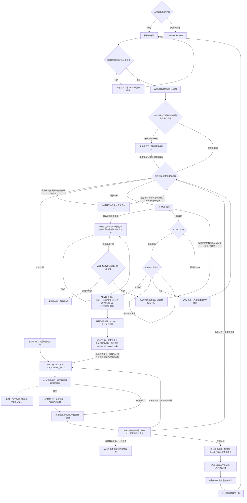

# 开箱机上下盖供料 API 对接文档

本稿按 2026-11-13 工程评审 D1–D52 更新，单一产品 MVP 按开箱机工作线现场约定的产品投用，支持该产品连续下单。WES 负责工单、选源、设备授权和结算。WMS、ECS、PLC、Buffer 和 AGV 提供决定或执行事实。 [概要设计](opening-machine-overview-design.md) · [历史配对算法推演](opening-machine-pairing-algorithm-design.md)

本文沿用现有 WES 通用接口。开箱机专属 operation、命令名、事件扩展字段和示例均为接口评审稿，正式报文按第 10 节对齐。供应商已有字段与待补齐的字段分别标注。当前 WES 通用接口可承载该流程，开箱机业务注册待开发。

## 目录

- [1. 业务范围、主体与方向](#business-scope)
- [2. 完整业务流程](#flows)
- [3. 统一任务接口](#tasks)
  - [WMS 交互与 operation 速查](#wms-interaction-index)
- [4. 逐箱、逐层业务接口](#material-operations)
- [5. 共同授权、等待、关联与收口](#production-rules)
- [6. 来源资源、补给与余箱](#source-flows)
- [7. ECS 公共协议与动作参数](#ecs)
  - [ECS 交互与命令速查](#ecs-interaction-index)
- [8. WES 公共接缝与设备内部边界](#wes-seams)
- [9. 公共协议、字段、幂等与保存](#protocol)
- [10. 开发依赖与本地验证](#delivery)

<a id="business-scope"></a>
## 1 业务范围、主体与方向

开箱机的系统交互统一走 ECS ↔ WES ↔ WMS。ECS 向 WES 回报设备事实，WES 按 WMS 业务接口请求决定、报告事实，并将相应授权或通知下发 ECS。

WMS 下发产品和需求套数。WES 安排上、下盖纸箱穿插供料，ARM03 按整层取料，ARM04 将物料投到 Buffer 载板。成功供料按已投放的实物片数计算。Buffer 管理 Magazine 装载、出料和尾料补空板。

| 主体 | 责任 |
| --- | --- |
| WMS | 管工单版本、需求和库存。核对开工版本及执行目标，解析外箱码，依据设备清位证据提供新栈板补给方案，协调 Transport 并回报结果。按工单汇总记实耗，按箱量差异报告调整库存，确认业务完工 |
| WES | 接收工单及决策，确认开工并通知 WMS，选源及授权设备动作，复用公共 RackDispatch 提交栈板搬运，结算成功量和 NG，恢复原指令及转发整单通知 |
| ECS/PLC | 执行取箱、开箱、取料、投料和缓存移动，提供实际到位、释放、逐层事件和原指令 Result |
| Buffer | 与开箱机握手，提供载板、处理整层投料 NG、管理 Magazine，接收整单完成通知后处理尾料 |
| AGV/MCS | 按 WMS 转交的原 Transport 任务完成栈板搬运，与 ECS 办理工位及门禁交接 |

### 1.1 工位与设备编码

| 设备或位置 | 业务作用 | 对接方式 |
| --- | --- | --- |
| `STATION_A` / `STATION_B` | A 仅放上盖栈板，B 仅放下盖栈板 | ARM01 取箱来源。WMS 按工单产品补对应盖型的栈板 |
| `ARM01` / `STATION_INPUT01` | 从 A/B 取纸箱到上料位 | `PICK_AND_PUT` 及原 Result |
| `STATION_SCAN1` / `ARM02` | 箱码扫描与切割开箱 | SCAN1 发 `SCAN_COMPLETED`。WES 校验通过后单独发开箱指令 |
| `STATION_CCD` / `STATION_REMAININGBUFFER1` | 取料区域与唯一余箱缓存 | 缓存、恢复按 `MOVE_BACKWARD`、`MOVE_FORWARD`。位置及实际占用按原移动结果确认 |
| `ARM03` | 新箱到位，逐层取料到皮带，移走空箱 | 新箱到位发 `BIN_ARRIVED`，取出每层时发 `GET_COMPLETED`。旧空箱离位随原额度最终 Result 回报 |
| `STATION_SCAN2` / `STATION_SCAN3` | 物料条码追溯 | `SCAN_COMPLETED`，仅用于追溯 |
| `ARM04` / `STATION_OUTPUT01` | ARM04 将物料投到匹配载板 | ECS 以 `STATION_OUTPUT01` 上报 `PUT_COMPLETED` |

`workline_code` 和设备角色按 WES 配置绑定。设备编码、工位地址和箱型参数分开使用。548 是 MVP 报文中的产品和箱型示例。实际投用的单一产品及设备映射由对接方确认。

### 1.2 数量与来源约束

每套对应上下盖各 1 片，每层为 2 片。当前上盖满箱 22 片，下盖满箱 16 片，开箱前按 WMS 解析的外码确认箱量，取料后按原额度最终 Result 更新已核实余量。取料位与已开箱余料缓存位各容纳一箱。

Buffer 上下盖各最多有 4 个待分配的空板 Magazine，装料后的载板收入另一个成品 Magazine。WES 选侧使用两侧累计成功供料量及箱体占位。Buffer 内部空板资源和成品周转由设备处理。

<a id="flows"></a>
## 2 完整业务流程

### 2.1 主流程

| 阶段 | 推进条件 |
| --- | --- |
| 排队与开工 | WES 只受理工作线约定产品的工单，并按原排位检查队首。续单需求套数达到留箱余量下限后才领取。WMS 核对原工单版本和取偶后的执行目标并保存绑定，WES 收到匹配确认后开始供料 |
| 选源与供箱 | 优先用可用余箱。需要新箱时串行下发 ARM01，明确缺箱且未搬箱才向 WMS 求补板方案 |
| 扫码与开箱 | 每次供箱认一条有效 SCAN1。同步校验通过后才切割。明确 NG 或重读仍无条码时，ECS 自主退箱，人工移走且入料口释放后回报 |
| 整层供料 | ARM03 确认到箱后只发本箱额度。ECS/PLC 按整层互锁执行。已取层全部结清且实际数量核实后回最终 Result，取空时还须确认原空箱实际移走 |
| 结算与选源 | WES 按最终 Result 入账一次，再按实际成功量、箱位和可用余箱选源。取空时随原最终 Result 一并释放匹配的原箱占位 |
| 汇总与交接 | 两侧达标且相关动作结清后发汇总。末箱取空时，原额度最终 Result 同时确认实际离位。WMS 完成通知引用原汇总，ECS 确认可接下一单后交接 |

<a id="next-carton-planning"></a>
### 2.2 选源与供料



核对阶段的报文可能乱序到达。WES 按原工单、箱、指令或搬运任务保存事实，条件齐备后推进。ARM03 自主清走空箱，ARM02 如有已开箱则在取料位释放后自动送箱。两步均为 ECS/PLC 内部联动。新箱到位与原额度最终 Result 各自关联原动作，旧箱离位随原额度最终 Result 回报。多料由 ECS 核实后随原额度最终 Result 回报。WES 保留原箱并记为可用余量，独立向 WMS 报告差异。A/B 取空、C/D 堆满和 E/F 废料架满均按 [工位事实转报](#station-event-report) 交付。

<a id="tasks"></a>
## 3 统一任务接口

下列 `opening_machine.*@v1` 名称用于报文评审，属于拟议业务 operation。公共信封字段、响应及其触发时机见 [§9.1](#wms-envelope)。同一 `task_id` 的重复下发只对应一份执行记录，工单产品和原需求沿原受理记录保存。

<a id="wms-interaction-index"></a>
### WMS 交互与 operation 速查

表格按业务流程排列。缺箱补板和箱量差异报告按需触发，工单汇总按已结清的供料结果推进。设备事件按 `event_type` 查找。

- WMS → WES 的业务下行和回调走 `POST /api/v1/wms/events`。响应回显对应报文的 `operation_id`，Transport 回调响应另回显 `transport_task_id`。
- WES → WMS 的箱码校验和补板请求走 `POST /api/v1/wes/decisions`，开工、差异、汇总和工位事实走 `POST /api/v1/wes/facts`。搬运提交默认走 `POST /api/v1/wes/transport-requests`，现场可按 [公共 Transport 合同](wms-transport.md) 配置。
- ECS 向 WES 上报工位事件，入口及 PLC 应答见 [工位事件与转报](#station-event-report)。

箱码校验放行后，开箱和取料由 ECS 与 WES 交互。见 [ARM03 新箱到位 BIN_ARRIVED](#ecs-carton-ready-example) 和 [本箱取料额度指令](#ecs-quota-example)。

供料结果只向 WMS 发送 [工单汇总](#wms-supply-request) 和 [箱量差异报告](#carton-quantity-discrepancy-report)。取料额度、最终 Result 和逐层 GET/PUT 在 ECS 与 WES 之间交互。

`opening_machine.*@v1` 的名称和业务字段待联调。

| 方向 | Operation / 事件 | 用途 | 请求 / 回调示例 | 响应示例 |
| --- | --- | --- | --- | --- |
| WMS → WES | `opening_machine.task.issued@v1` | 下发工单 | [下发请求](#wms-issued-request) · [产品不匹配请求](#wms-issued-mismatch-request) | [受理](#wms-received-example) · [产品不匹配](#wms-issued-rejected) |
| WMS → WES | `opening_machine.task.quantity_updated@v1` | 改量 | [改量请求](#wms-quantity-request) | [受理](#wms-quantity-received) |
| WMS → WES | `opening_machine.task.cancelled@v1` | 撤销未选中工单 | [撤销请求](#wms-cancel-request) | [受理](#wms-cancel-received) |
| WES → WMS | `opening_machine.task.started@v1` | WMS 核对工单版本和取偶后的执行目标后保存绑定 | [开工通知](#wms-started-request) | [绑定已保存](#wms-started-recorded) · [绑定冲突](#wms-started-conflict) |
| WES → WMS | `opening_machine.station.event_report@v1` | 转报 A/B 取空、C/D 空栈板堆满或 E/F 废料架满。后两类独立于工单 | [A 位取空](#wms-station-event-report-example) · [C/E 位示例](#wms-station-full-examples) | [报告收妥](#wms-station-event-recorded) |
| WES → WMS | `opening_machine.pallet.replenishment@v1` | 为原缺箱请求补板方案。旧板清位证据字段待联调 | [首次请求](#wms-replenishment-request) · [到期重查](#wms-replenishment-retry) | [等待](#wms-replenishment-wait) · [补板方案](#wms-replenishment-ready) |
| WES → WMS | `transport.task.submit@v1` | 提交新栈板 ENTER | [ENTER 提交](#wms-enter-request) | [提交接纳](#wms-enter-received) |
| WMS → WES | `transport.task.resulted@v1` | 回报原 ENTER 成功 | [入场成功回调](#wms-enter-callback) | [回调受理](#wms-enter-callback-received) |
| WES → WMS | `opening_machine.carton.validate@v1` | 校验原 SCAN1 箱码 | [箱码请求](#wms-validate-request) | [允许](#wms-validate-allow) · [拒绝](#wms-validate-reject) |
| WES → WMS | `opening_machine.carton.quantity_discrepancy_report@v1` | 报告原箱数量差异 | [短少](#wms-discrepancy-short) · [多料](#wms-discrepancy-excess) | [短少收妥](#wms-discrepancy-recorded) · [多料收妥](#wms-discrepancy-excess-recorded) |
| WES → WMS | `opening_machine.task.supply_report@v1` | 报告双侧供料汇总 | [工单汇总](#wms-supply-request) | [汇总收妥](#wms-supply-recorded) |
| WMS → WES | `opening_machine.task.completed@v1` | 引用原供料汇总，通知工单完成 | [完成回调](#wms-completed-callback) | [受理](#wms-completed-received) |

<a id="task-issued"></a>
### 3.1 opening_machine.task.issued@v1

方向为 WMS → WES，`POST {{WES_BASE_URL}}/api/v1/wms/events`。

**用途** 将工单、产品和原需求套数交给 WES，建立待执行任务。

**发出方与触发时机** WMS 确定本次供料的工作线、产品和需求套数后下发。WES 受理后排队，取得本线执行资格后进入开工流程。

<a id="wms-issued-request"></a>

```json
{
  "operation_id": "01a1ac65-aef7-7b60-8c7b-87df787d9b01",
  "operation": "opening_machine.task.issued@v1",
  "timestamp": 1793836800000,
  "data": {
    "task_id": "OPEN-001",
    "workline_code": "OPEN-LINE-01",
    "product_code": "548",
    "requested_sets": 5,
    "task_version": 1,
    "dispatch_sequence": 10
  }
}
```

| `data` 字段 | JSON 类型 | 说明与约束 |
| --- | --- | --- |
| `task_id` | string | WMS 原任务号 |
| `workline_code` | string | 匹配 WES 已配置的开箱机工作线 |
| `product_code` | string | 必须与工作线约定的 MVP 产品一致。该字段继续用于开工绑定、箱码校验及补板 |
| `requested_sets` | integer | 正整数需求套数。续单领取前按 [余量下限](#continuation-quantity) 校验，执行目标向上取偶 |
| `task_version` | integer | 初始工单版本 |
| `dispatch_sequence` | integer | 正 int64，允许重复。值越小越优先 |

**WES 受理响应** 仅在 `product_code` 匹配该工作线约定的 MVP 产品、且工单通过校验后入队。首次持久受理返回 `202 / RECEIVED`。产品不匹配返回 `422 / REJECTED`，原因码待联调。公共响应字段见 [§9.1](#wms-envelope)。

<a id="wms-received-example"></a>

```json
{
  "operation_id": "01a1ac65-aef7-7b60-8c7b-87df787d9b01",
  "code": "RECEIVED",
  "timestamp": 1793836800100,
  "data": {}
}
```

产品不匹配的独立示例。该请求用于验证非约定产品在入队前被拒绝。

<a id="wms-issued-mismatch-request"></a>

```json
{
  "operation_id": "01a1ac65-aef7-7b60-8c7b-87df787d9b17",
  "operation": "opening_machine.task.issued@v1",
  "timestamp": 1793836800020,
  "data": {
    "task_id": "OPEN-MISMATCH",
    "workline_code": "OPEN-LINE-01",
    "product_code": "EXAMPLE-UNSUPPORTED",
    "requested_sets": 5,
    "task_version": 1,
    "dispatch_sequence": 10
  }
}
```

拒绝响应回显本次请求的 `operation_id`，原因码为草案。

<a id="wms-issued-rejected"></a>

```json
{
  "operation_id": "01a1ac65-aef7-7b60-8c7b-87df787d9b17",
  "code": "REJECTED",
  "timestamp": 1793836800120,
  "data": {"reason_code": "PRODUCT_MISMATCH"}
}
```

同身份同内容重发返回 `200 / DUPLICATE`。同线未选中的工单按 `dispatch_sequence → 首次有效下发的 timestamp → task_id` 升序选择。按顺序核对队首的 [续单余量下限](#continuation-quantity)。数量不足时保持未选中，仍可改量或撤销。领取后锁定工单。

#### 排队改量与撤销

以下为独立示例。方向均为 WMS → WES，沿 `POST /api/v1/wms/events`。下列 operation 名为草案。

<a id="wms-quantity-request"></a>

```json
{
  "operation_id": "01a1ac65-aef7-7b60-8c7b-87df787d9b11",
  "operation": "opening_machine.task.quantity_updated@v1",
  "timestamp": 1793836800150,
  "data": {"task_id": "OPEN-001", "task_version": 3, "requested_sets": 6}
}
```

改量提交完整目标，只能应用到未选中的排队工单。更高版本可跳版，迟到的旧版本无法覆盖，同版本异内容返回冲突。首次下发时间、排位、工作线和产品沿原下发记录。下发和改量均只接受正整数，`0`、负数和非整数返回数据无效，原目标保持。

<a id="wms-cancel-request"></a>

```json
{
  "operation_id": "01a1ac65-aef7-7b60-8c7b-87df787d9b12",
  "operation": "opening_machine.task.cancelled@v1",
  "timestamp": 1793836800160,
  "data": {"task_id": "OPEN-002"}
}
```

撤销只适用于未选中的排队工单。撤销终态保留，迟到下发或改量无法复活工单。对已领取的工单提交新的改量或撤销时，返回 `409 / CONFLICT`，业务原因 `STATE_CONFLICT`。三个入口与领取按同一事务边界裁决，原消息重报沿原受理结果。

<a id="wms-quantity-received"></a>

改量持久受理响应（HTTP 202）。

```json
{"operation_id": "01a1ac65-aef7-7b60-8c7b-87df787d9b11", "code": "RECEIVED", "timestamp": 1793836800250, "data": {}}
```

<a id="wms-cancel-received"></a>

撤销持久受理响应（HTTP 202）。

```json
{"operation_id": "01a1ac65-aef7-7b60-8c7b-87df787d9b12", "code": "RECEIVED", "timestamp": 1793836800260, "data": {}}
```

**待联调（C01）** 对齐下发、改量、撤销的 operation、字段和错误原因。

<a id="task-started"></a>
### 3.2 opening_machine.task.started@v1

方向为 WES → WMS，拟沿 `POST {{WMS_BASE_URL}}/api/v1/wes/facts` 发送。

**用途** 让 WMS 核对工单版本和取偶后的执行目标，保存本线执行绑定，供补给和供料汇总核对。

**发出方与触发时机** WES 按 [续单余量下限](#continuation-quantity) 及原箱状态核对队首。领取时冻结原需求及版本，按 WMS 确认的整层规则将执行目标向上取偶，在同一事务保存待确认的开工通知，提交后发送。原需求保留在工单上。每次开工对应一个原通知身份，发送重试沿用原报文。示例需求为 5 套，执行目标为 6 套。

<a id="wms-started-request"></a>

```json
{
  "operation_id": "01a1ac65-aef7-7b60-8c7b-87df787d9b05",
  "operation": "opening_machine.task.started@v1",
  "timestamp": 1793836800200,
  "data": {
    "task_id": "OPEN-001",
    "workline_code": "OPEN-LINE-01",
    "product_code": "548",
    "task_version": 1,
    "execution_target_sets": 6,
    "started_at": 1793836800200
  }
}
```

外层 `operation_id` 是本次开工通知的原身份，WMS 补给记录可引用为 `start_operation_id`。

| `data` 字段 | JSON 类型 | 说明与约束 |
| --- | --- | --- |
| `task_id` | string | 原 WMS 工单号 |
| `task_version` | integer | 领取时生效的工单版本 |
| `execution_target_sets` | integer | 该版本的 `requested_sets` 向上取偶，每套对应上、下盖各 1 片 |
| `workline_code` / `product_code` | string | WMS 建立当前执行绑定的工作线和产品 |
| `started_at` | integer | WES 登记待确认开工的原时间，UTC Unix 毫秒，重发保持不变 |

**WMS 开工绑定响应** WMS 按原工单核对工作线、产品和有效 `task_version`，用该版本需求独立核对 `execution_target_sets`。一致且持久化绑定后返回 HTTP `200 / RECORDED`。同身份同内容已应用时可返回 `200 / DUPLICATE`，沿用原处理结果。版本或执行目标不一致时，WMS 返回冲突（拟用 `409 / CONFLICT`），WES 保留原开工待核对，暂停启动供箱或余箱取料。已切换工单的历史通知仍归原绑定。公共响应字段见 [§9.1](#wms-envelope)。

<a id="wms-started-recorded"></a>

```json
{
  "operation_id": "01a1ac65-aef7-7b60-8c7b-87df787d9b05",
  "code": "RECORDED",
  "timestamp": 1793836800400,
  "data": {}
}
```

<a id="wms-started-conflict"></a>

工单版本或执行目标不符的替代响应（拟议 HTTP 409）。

```json
{
  "operation_id": "01a1ac65-aef7-7b60-8c7b-87df787d9b05",
  "code": "CONFLICT",
  "timestamp": 1793836800400,
  "data": {"reason_code": "OPENING_BINDING_MISMATCH"}
}
```

WES 收到匹配当前原开工通知的 `RECORDED`，或能证明该绑定已保存的 `DUPLICATE` 后，才开始供箱或余箱取料。交付结果未知时沿原通知身份恢复。明确冲突时保留原通知待核对。旧工单或旧开工通知的迟到确认只归原绑定。

**待联调（C01）** 对齐取偶规则、开工字段、绑定切换时点和版本或目标不符的响应及原因码。验证 `RECORDED` 或有效 `DUPLICATE` 对应已核对并保存的原绑定。

<a id="supply-report"></a>
### 3.3 opening_machine.task.supply_report@v1

方向为 WES → WMS，`POST {{WMS_BASE_URL}}/api/v1/wes/facts`。

**用途** 向 WMS 报告本工单上下盖的实际供料、投料 NG 和实际取出总量，供 WMS 核对执行结果。

**发出方与触发时机** WES 确认上下盖成功量均达到执行目标，且额度与相关来源动作均已结清后发送。末箱取空时，收到同时确认实际离位的原额度最终 Result 后才汇总。有可用余料时留箱，核实后的多料计入可用余量。箱量差异独立报告，汇总按上述条件推进。

WMS 按 `task_id` 核对已保存的开工绑定及其工单版本。汇总的 `execution_target_sets` 须与该绑定一致。

<a id="wms-supply-request"></a>

```json
{
  "operation_id": "01a1ac65-aef7-7b60-8c7b-87df787d9b03",
  "operation": "opening_machine.task.supply_report@v1",
  "timestamp": 1793836920000,
  "data": {
    "task_id": "OPEN-001",
    "product_code": "548",
    "execution_target_sets": 6,
    "upper": { "drawn_pcs": 8, "success_pcs": 6, "ng_pcs": 2 },
    "lower": { "drawn_pcs": 6, "success_pcs": 6, "ng_pcs": 0 }
  }
}
```

公共请求和响应字段见 [§9.1](#wms-envelope)。下表说明请求 `data` 中的业务字段。

| 字段 | JSON 类型 | 说明与约束 |
| --- | --- | --- |
| `task_id` | string | 原 WMS 工单号 |
| `product_code` | string | 原工单指定的产品编码，如 `548` |
| `execution_target_sets` | integer | 领取时有效的需求向上取偶后的套数。每套对应上、下盖各 1 片，因此也等于每侧目标片数 |
| `upper` / `lower` | object | 本工单上盖、下盖各自的累计结算 |
| `upper.drawn_pcs` / `lower.drawn_pcs` | integer | 对应盖型实际取出的片数，等于成功片数加投料 NG 片数 |
| `upper.success_pcs` / `lower.success_pcs` | integer | 对应盖型投料成功的片数，收口时等于该侧目标 |
| `upper.ng_pcs` / `lower.ng_pcs` | integer | 对应盖型已结清的投料 NG 片数，计入取出量 |

各片数按整层统计，每层 2 片。WES 按盖型核对逐箱台账与汇总的取出量、成功量及 NG 量一致，冻结工单汇总并沿原身份重发。逐箱台账及设备内余箱位置和余量由 WES 保存。

**WMS 工单实耗** 按工单及盖型以 `drawn_pcs = success_pcs + ng_pcs` 记实耗，按原有效汇总身份只应用一次。成功与 NG 是同一笔实耗的组成，分别供完工和损耗核对。仍留箱的余料在实际取出时归入当时执行的工单。箱量差异按 [原差异报告](#carton-quantity-discrepancy-report) 独立调整库存。

**WMS 汇总受理响应** WMS 收妥汇总后返回 `200 / RECORDED`，确认同身份已处理时返回 `200 / DUPLICATE`。响应 `data` 为 `{}`，确认收妥的回执与实耗过账时点分别按合同处理。整单完成由 WMS 另行通知。

<a id="wms-supply-recorded"></a>

```json
{
  "operation_id": "01a1ac65-aef7-7b60-8c7b-87df787d9b03",
  "code": "RECORDED",
  "timestamp": 1793836921000,
  "data": {}
}
```

**待联调（C09）** 汇总 operation、字段、库存或工单消耗过账时点、实耗去重，以及 WMS 核对汇总并下发整单通知的条件。

<a id="task-completed"></a>
### 3.4 opening_machine.task.completed@v1

方向为 WMS → WES，`POST {{WES_BASE_URL}}/api/v1/wms/events`。

**用途** 通知 WES 本工单全部完成，由 WES 转告 ECS 开始设备收尾。

**发出方与触发时机** WMS 收到供料汇总并确认本工单可以结束后向 WES 下发。WES 收到时若双侧尚未结清，先保留原通知，待结清后再转发。

<a id="wms-completed-callback"></a>

```json
{
  "operation_id": "01a1ac65-aef7-7b60-8c7b-87df787d9b04",
  "operation": "opening_machine.task.completed@v1",
  "timestamp": 1793836921000,
  "data": {
    "task_id": "OPEN-001",
    "product_code": "548",
    "supply_report_operation_id": "01a1ac65-aef7-7b60-8c7b-87df787d9b03"
  }
}
```

| `data` 字段 | JSON 类型 | 说明与约束 |
| --- | --- | --- |
| `task_id` | string | WMS 确认可以结束的原工单号 |
| `product_code` | string | 原工单产品编码，须与 WES 已保存的工单匹配 |
| `supply_report_operation_id` | string | WMS 核对的原有效供料汇总 |

**WES 受理响应** 持久受理后按 [§9.1](#wms-envelope) 返回。WES 核对工单、产品、当前有效汇总及本地收尾。原汇总已发或可能已送达时，允许匹配的完成通知先于汇总 HTTP 回执推进，只登记一次 ECS 转发。错引用、确认未发或明确拒绝则保留待核对。收到 [ECS 可接下一单的成功 Result](#device-task-completed) 后才释放工作线执行资格。

<a id="wms-completed-received"></a>

完成通知持久受理响应（HTTP 202）。

```json
{"operation_id": "01a1ac65-aef7-7b60-8c7b-87df787d9b04", "code": "RECEIVED", "timestamp": 1793836921100, "data": {}}
```

**待联调（C09）** 完成通知 operation、报告引用字段及重复通知约定。

<a id="carton-consumption-report"></a>
### 3.5 逐箱耗用

首期数量汇总按工单上报。WES 内部保留逐箱耗用、余量与原额度关联，用于核对、选源和续单。

<a id="carton-quantity-discrepancy-report"></a>
### 3.6 opening_machine.carton.quantity_discrepancy_report@v1

方向为 WES → WMS，拟沿 `POST {{WMS_BASE_URL}}/api/v1/wes/facts` 发送。

**用途** 报告已确认的原箱数量差异，供 WMS 按来源箱核对及调整库存。

**发出方与触发时机** WES 核对并结清原额度，确认推算余量与实物余量有差异时，在同一事务登记差异和发送意图，提交后独立发送。下例对应 [条码 22 片、实际 20 片](#carton-early-empty) 的提前箱空分支。[实际 24 片的分支](#carton-excess) 沿用同一报告。

<a id="wms-discrepancy-short"></a>

```json
{
  "operation_id": "01a1ac65-aef7-7b60-8c7b-87df787d9b08",
  "operation": "opening_machine.carton.quantity_discrepancy_report@v1",
  "timestamp": 1793837010000,
  "data": {
    "task_id": "OPEN-SHORT-001",
    "carton_id": "U-SHORT-001",
    "quota_command_code": "CMD-20261105-0203",
    "expected_remaining_pcs": 2,
    "observed_remaining_pcs": 0
  }
}
```

额度用完后核实多出 2 片的报告示例。

<a id="wms-discrepancy-excess"></a>

```json
{
  "operation_id": "01a1ac65-aef7-7b60-8c7b-87df787d9b09",
  "operation": "opening_machine.carton.quantity_discrepancy_report@v1",
  "timestamp": 1793837110000,
  "data": {
    "task_id": "OPEN-EXCESS-001",
    "carton_id": "U-EXCESS-001",
    "quota_command_code": "CMD-20261105-0303",
    "expected_remaining_pcs": 0,
    "observed_remaining_pcs": 2
  }
}
```

| `data` 字段 | JSON 类型 | 说明与约束 |
| --- | --- | --- |
| `task_id` | string | 原 WMS 工单号 |
| `carton_id` | string | WMS 箱码校验确认的来源箱标识 |
| `quota_command_code` | string | 发现差异的原取料额度指令号 |
| `expected_remaining_pcs` | integer | 本次执行前的已确认箱量减本轮实际取出量，单位为片 |
| `observed_remaining_pcs` | integer | 本轮结束后有实物依据的箱余量，单位为片。提前箱空为 0，额度用完后实点有余料则填核实数量 |

WMS 按原工单、来源箱和额度指令关联差异，按原 `operation_id` 只应用一次库存调整。调整量为 `observed_remaining_pcs − expected_remaining_pcs`，短少示例为 −2 片，多料示例为 +2 片。工单实耗只取各工单汇总的 `drawn_pcs`。例如外码 22 片、实物 24 片，本单从该上盖箱取 22 片、下一单取余下 2 片，分别计入两单的上盖 `drawn_pcs`。WMS 按原差异报告对来源库存调整 +2 片一次。对账时按 WES 原额度记录核对该箱的两笔取出量，WMS 收到的汇总按整个工单和盖型统计。两类报告独立交付，乱序或重发沿各自原身份处理。

WMS 持久收妥后返回 HTTP `200 / RECORDED`。示例响应回显上面的短少报告身份。

<a id="wms-discrepancy-recorded"></a>

```json
{
  "operation_id": "01a1ac65-aef7-7b60-8c7b-87df787d9b08",
  "code": "RECORDED",
  "timestamp": 1793837011000,
  "data": {}
}
```

<a id="wms-discrepancy-excess-recorded"></a>

多料报告持久收妥响应（HTTP 200）。

```json
{"operation_id": "01a1ac65-aef7-7b60-8c7b-87df787d9b09", "code": "RECORDED", "timestamp": 1793837110100, "data": {}}
```

**待联调（C02/C09）** 对齐差异报告字段、WMS 库存关联键及过账时点，验证箱量差异和工单实耗乱序、重发及跨单余料的对账。`RECORDED` 只确认差异报告收妥。提前箱空按确认空箱实际离位的原额度最终 Result 恢复供箱，核实后的多料留箱续用。

<a id="material-operations"></a>
## 4 逐箱、逐层业务接口

本章报文中的公共字段如下。各接口的 `data` 业务字段在对应报文旁说明。

| 报文 | 公共字段 | JSON 类型 | 说明 |
| --- | --- | --- | --- |
| ECS Event | `device_code` | string | 上报事件的逻辑设备或工站编码 |
| ECS Event | `event_type` | string | 事件类型。同名扫码事件按发出工站区分 |
| ECS Event | `timestamp` | integer | 首次生成事件的 UTC Unix 毫秒时间，重发保持原值 |
| WMS 校验请求 | `operation_id` / `operation` | string / string | 原请求的小写 UUIDv7 及业务操作名 |
| WMS 校验响应 | `operation_id` / `code` | string / string | 回显原请求标识，业务决定使用 `DECIDED` |
| WMS 校验请求和响应 | `timestamp` | integer | 对应报文生成时的 UTC Unix 毫秒时间 |
| ECS Result | `command_code` / `device_code` | string / string | 原指令号及该指令的设备编码 |
| ECS Result | `result` | string | 原指令结果，`SUCCESS` 或 `FAILED` |
| ECS Result | `finish_time` | integer | 原指令结束时间，UTC Unix 毫秒 |
| ECS Result | `error_detail` | object 或 null | 成功示例为 `null`。失败时提供字符串 `code` 和 `msg` |
| 全部 | `data` | object | 对应接口的业务字段 |

<a id="carton-validate"></a>
### 4.1 SCAN1 与 opening_machine.carton.validate@v1

**`SCAN_COMPLETED`（SCAN1）**

- **PDF 已定义，需扩展** §3.1 已定义工站、`location` 和 `barcode`。本稿新增的 `source_command_code` 及其原 ARM01 关联规则待对齐。
- **用途** 采集纸箱外码并关联本次 ARM01 供箱，供 WES 请求箱码校验。
- **发出工站与触发时机** ARM01 将纸箱送到上料位后，`STATION_SCAN1` 成功读取外箱码。ECS 以该工站通过 `POST {{WES_BASE_URL}}/api/v1/callback/event` 上报。

<a id="ecs-scan1-example"></a>

```json
{
  "device_code": "STATION_SCAN1",
  "event_type": "SCAN_COMPLETED",
  "timestamp": 1793836805000,
  "data": {
    "location": "STATION_SCAN1",
    "barcode": "EXAMPLE-U001-RAW",
    "source_command_code": "CMD-20261105-0001"
  }
}
```

| `data` 字段 | JSON 类型 | 说明与约束 |
| --- | --- | --- |
| `location` | string | 箱码扫描工站，本例为 `STATION_SCAN1` |
| `barcode` | string | 扫描到的外箱条码原文，供 WMS 解析并关联原纸箱 |
| `source_command_code` | string | 本次 ARM01 供箱的原指令号，拟议关联字段 |

**`opening_machine.carton.validate@v1` 请求**

- **用途** 请 WMS 解析外箱码并核对本箱的产品、盖型、身份和实际片数。
- **发出方与触发时机** WES 将 SCAN1 原扫码匹配到当前待开箱纸箱后，通过 `POST {{WMS_BASE_URL}}/api/v1/wes/decisions` 发起校验。

WES 在内部保存本次 `scan_ref` 与原校验 `operation_id` 的关联。WMS 按 `task_id` 查原工单的期望产品，按 `barcode` 解析实际产品、盖型和数量，并核对请求中的 `expected_cover_type`。无法唯一定位原工单及产品时，纸箱保持待放行。来源工位由 WES 按原 ARM01 指令核对。WMS 响应回显原 `operation_id`。

<a id="wms-validate-request"></a>

```json
{
  "operation_id": "01a1ac65-aef7-7b60-8c7b-87df787d9b02",
  "operation": "opening_machine.carton.validate@v1",
  "timestamp": 1793836805100,
  "data": {
    "task_id": "OPEN-001",
    "expected_cover_type": "UPPER",
    "source_command_code": "CMD-20261105-0001",
    "barcode": "EXAMPLE-U001-RAW"
  }
}
```

| `data` 字段 | JSON 类型 | 说明与约束 |
| --- | --- | --- |
| `task_id` | string | 当前 WMS 工单号 |
| `expected_cover_type` | string | 原 ARM01 供箱的期望盖型，沿用业务枚举 `UPPER` 或 `LOWER` |
| `source_command_code` | string | 本次 ARM01 供箱的原指令号 |
| `barcode` | string | SCAN1 回报的外箱条码原文 |

**WMS 校验响应**

- **用途** 返回允许或拒绝决定。WES 仅在匹配的允许结果通过核对后，才可向 ARM02 发出开箱指令。
- **发出方与触发时机** WMS 完成对原校验请求的解析和核对后返回决定。首期返回同步 HTTP `200 / DECIDED`。

允许分支示例。

<a id="wms-validate-allow"></a>

```json
{
  "operation_id": "01a1ac65-aef7-7b60-8c7b-87df787d9b02",
  "code": "DECIDED",
  "timestamp": 1793836805300,
  "data": {
    "decision": "ALLOW",
    "carton_id": "U001",
    "product_code": "548",
    "cover_type": "UPPER",
    "material_code": "UPPER-548-EXAMPLE",
    "available_pcs": 10
  }
}
```

同一请求若被业务拒绝，返回 HTTP `200 / DECIDED` 的拒绝分支。下例与允许分支二选一，`COVER_MISMATCH` 是待确认的原因码。

<a id="wms-validate-reject"></a>

```json
{
  "operation_id": "01a1ac65-aef7-7b60-8c7b-87df787d9b02",
  "code": "DECIDED",
  "timestamp": 1793836805300,
  "data": { "decision": "REJECT", "reason_code": "COVER_MISMATCH" }
}
```

| `data` 字段 | JSON 类型 | 适用分支 | 说明与约束 |
| --- | --- | --- | --- |
| `decision` | string | 共用 | 拟用 `ALLOW` 或 `REJECT` |
| `carton_id` | string | `ALLOW` | WMS 校验确认的纸箱标识 |
| `product_code` | string | `ALLOW` | WMS 确认的实际产品编码，须与工单匹配 |
| `cover_type` | string | `ALLOW` | WMS 确认的实际盖型，须与期望盖型匹配 |
| `material_code` | string | `ALLOW` | WMS 确认的物料标识 |
| `available_pcs` | integer | `ALLOW` | 有效外码所载的本箱可用片数，允许开箱时为正偶数 |
| `reason_code` | string | `REJECT` | 业务拒绝原因码，枚举待对齐 |

每次 ARM01 供箱仅认一条有效 SCAN1。同码重报沿原校验请求，异码保留原箱和证据待核对。WES 按原 `operation_id` 核对当前有效扫码和待开箱纸箱。有效允许才开箱，明确拒绝按 [§4.1.1](#carton-reject-return) 转发 NG。超时沿原请求恢复，原箱保持待放行。WES 保存 SCAN1 外码原文，用于追溯原校验和入线箱记录。

**待联调（C02/C03）** 原供箱引用、外码识别、校验 operation、数量和拒绝原因。

<a id="carton-reject-return"></a>
#### 4.1.1 箱码 NG 转发、退箱与补箱

**NG 转发（WES → ECS，承载待联调）**

- **用途** 将 WMS 对当前纸箱的明确拒绝传给开箱机，触发设备自动退箱。
- **发出方、执行设备与触发时机** WES 核对 `DECIDED / REJECT` 仍对应当前有效扫码及待开箱纸箱后，登记一次 NG 转发。ECS/PLC 接收与当前箱匹配的 NG 后，保持 ARM02 切割未放行，并自动将纸箱退回纸箱入料口，等待人工取走。校验超时、协议拒绝及已失效的旧决定继续沿各自原流程处理。

以下为逻辑载荷示例。NG 传递入口、信封及现场取值按 C03 确认。

<a id="ecs-ng-example"></a>

```json
{
  "source_command_code": "CMD-20261105-0001",
  "decision": "NG"
}
```

| 逻辑字段 | JSON 类型 | 说明与约束 |
| --- | --- | --- |
| `source_command_code` | string | 本次待退纸箱对应的原 ARM01 取箱指令号，用于匹配本次供箱 |
| `decision` | string | WES 转发的明确拒绝决定，示例值 `NG`。WMS 侧决定仍按 §4.1 使用 `REJECT` |

WES 在内部保留原校验 `operation_id`、有效扫码与原取箱指令的关联。重复决定或转发重试沿同一原退箱意图，设备侧须能识别该动作的重发。

<a id="rejected-carton-removed"></a>
**退箱恢复回报（ECS → WES，拟议）**

SCAN1 读不到码时由 ECS 先重读，仍读不到则自主退箱，WES 无需向 WMS 发起箱码校验。无读码和明确 NG 共用以下恢复事件。

- **用途** 确认退回的原纸箱已由人工取走，入料口已释放，可以重新选源。
- **发出工站与触发时机** 纸箱自动退回后，人工实际拿走该箱。入料口工站确认该箱离位且工位已释放后，ECS 上报。退箱到达入料口时继续等待人工取走。示例拟沿 `POST {{WES_BASE_URL}}/api/v1/callback/event`，事件名及工位编码待确认。

<a id="ecs-rejected-removal-example"></a>

```json
{
  "device_code": "{{ECS_INFEED_DEVICE_CODE}}",
  "event_type": "REJECTED_CARTON_REMOVED",
  "timestamp": 1793836808000,
  "data": {
    "location": "STATION_INPUT01",
    "source_command_code": "CMD-20261105-0001"
  }
}
```

| `data` 字段 | JSON 类型 | 说明与约束 |
| --- | --- | --- |
| `location` | string | 已实际释放的纸箱入料口工位，示例使用 `STATION_INPUT01` |
| `source_command_code` | string | 被退回纸箱的原 ARM01 取箱指令号。WES 据此关联原供箱及退箱等待，匹配工位和工作线 |

**WES 补箱** 实际离位确认前，WES 保留原占位及退箱等待。WES 核对原取箱指令、当前待恢复的供箱、工作线和实际工位，确认匹配后只关闭一次原占位并重新选源。当前工单仍有缺口、需要新箱且上料路径可用时，WES 用新 `command_code` 下发 ARM01。新箱重新走 SCAN1 校验及 ARM02 放行。拒绝分支可能没有 WMS 确认的 `carton_id`，以原供箱指令关联。ECS 重发保留原事件内容，迟到或重复的旧离位回报只归原箱。

**待联调（C03）** 确认 WES 传递 NG 的入口、信封、取值和重发方式。确认入料口释放的现场判定、事件名、发出设备编码、`location`、`source_command_code` 的承载及回报重发规则。

<a id="carton-ready"></a>
### 4.2 新箱到位与物料追溯

两种事件均为 ECS → WES，通过 `POST {{WES_BASE_URL}}/api/v1/callback/event` 上报。

**`BIN_ARRIVED`（复用 PDF 事件，扩展 ARM03 到位场景）**

- **PDF 对照** 供应商 PDF v1.10 第 12、18 页列出通用信封及 `BIN_ARRIVED`，第 4 页的示例将其列在 `STATION_A` 的支持事件中。ARM03 场景沿用事件名和通用信封，将 `data.location` 设为必填，并扩展箱号、盖型和原供箱指令号。PDF 未定义该场景的到位触发信号。
- **用途** 确认已放行的纸箱实际占用 ARM03 取料位及其盖型。WES 核对后只发本箱额度。
- **发出设备与触发时机** 已放行的新箱实际到达 `STATION_CCD`，且设备确认该箱已在可取料位置时，ECS 以 `device_code: ARM03` 上报。重报沿用原时间和报文内容。

<a id="ecs-carton-ready-example"></a>

```json
{
  "device_code": "ARM03",
  "event_type": "BIN_ARRIVED",
  "timestamp": 1793836810000,
  "data": {
    "location": "STATION_CCD",
    "carton_id": "U001",
    "cover_type": "UPPER",
    "source_command_code": "CMD-20261105-0001"
  }
}
```

| `data` 字段 | JSON 类型 | 必填 | 说明与约束 |
| --- | --- | --- | --- |
| `location` | string | 是 | 沿用位置字段，ARM03 新箱到位固定为 `STATION_CCD` |
| `carton_id` | string | 是 | 扩展字段，使用 SCAN1 经 WMS 校验并放行的箱号 |
| `cover_type` | string | 是 | 扩展字段，`UPPER` 或 `LOWER`，须与开箱授权一致 |
| `source_command_code` | string | 是 | 扩展字段，原样回传 [ARM02 开箱指令](#ecs-open-example) 的 `params.source_command_code`，值为 [原 ARM01 取箱指令](#ecs-pick-carton-example) 的顶层 `command_code` |

ARM02 在设备侧先产生原开箱 Result，随后 ARM03 确认到箱。WES 核对设备角色、取料位、原供箱、箱号和盖型与当前开箱授权一致后，`BIN_ARRIVED` 只触发一次本箱首份额度。ARM02 Result 单独保存。已知开箱失败或身份冲突时保留待核对。换箱时，WES 核对前一额度已结清、旧占位已按对应结果释放后，才应用新箱占位并授权取料。旧箱取空时以 [原额度最终 Result](#quota-result) 确认离位。新箱到位先送达时先按原供箱保存，等前一额度最终 Result 应用后复核。恢复缓存箱按 [原 MOVE_FORWARD 成功 Result](#ccd-move) 确认。

**待联调（C04）** 确认 PLC 判定新箱实际到位且可取料的信号，以及 ECS 如何随同一纸箱从 ARM02 开箱指令保留原 ARM01 指令号，并原样带回 ARM03 `BIN_ARRIVED`。

<a id="material-scan"></a>
**`SCAN_COMPLETED`（SCAN2/3）**

- **PDF 已定义，需扩展** §3.1 已定义两工站的扫码事件。`quota_command_code` 和 `layer_seq` 是本稿拟补的追溯字段。
- **用途** 记录物料条码用于追溯。ARM04 投料按设备内部条件放行。
- **发出工站与触发时机** `STATION_SCAN2` 或 `STATION_SCAN3` 成功读到物料条码后，ECS 以对应工站上报。缺码的记录方式待确认。

<a id="ecs-scan2-example"></a>

```json
{
  "device_code": "STATION_SCAN2",
  "event_type": "SCAN_COMPLETED",
  "timestamp": 1793836813000,
  "data": {
    "location": "STATION_SCAN2",
    "barcode": "EXAMPLE-PIECE-U001-02A",
    "quota_command_code": "CMD-20261105-0003",
    "layer_seq": 2
  }
}
```

| `data` 字段 | JSON 类型 | 说明与约束 |
| --- | --- | --- |
| `location` | string | 物料扫码工站，`STATION_SCAN2` 或 `STATION_SCAN3` |
| `barcode` | string | 本次读取的物料条码原文 |
| `quota_command_code` | string | 该物料所属的原取料额度指令号，拟议追溯字段 |
| `layer_seq` | integer | 物料所在层在原额度内的层序号，从 1 开始，拟议追溯字段 |

**待联调（C11）** `quota_command_code`、`layer_seq` 的承载方式，及物料漏读或读码失败的记录方式。

<a id="layer-events"></a>
### 4.3 GET_COMPLETED 与 PUT_COMPLETED

方向为 ECS → WES，`POST {{WES_BASE_URL}}/api/v1/callback/event`。GET/PUT 明细留在 WES 供追溯。

**PDF 已定义，已通知 ECS 更新** §3.2.1 和 §3.3 原文均按单片描述。已通知 ECS 将 `GET_COMPLETED` 和 `PUT_COMPLETED` 改为每条对应一整层 2 片。联调核对 ECS 更新后的实际报文。`PUT_FINISHED` / `PUT_FAILED` 已见于 PDF §4 的 Result 与取放枚举，PDF 的逐片 PUT 事件示例未携带该字段。

| 事件 | 用途 | 触发方及触发点 |
| --- | --- | --- |
| `GET_COMPLETED` | 记录来源箱实际取出的一层，供 WES 与该层的投料终局配对 | ARM03 从来源箱实际取出一整层后，ECS 以 ARM03 上报 |
| `PUT_COMPLETED` | 记录同层投料成功或已结清的整层 NG，供 WES 核对额度结算 | ARM04 完成该层投料并确认成功，或 Buffer 已处理该层 NG 后，ECS 以 `STATION_OUTPUT01` 上报终局 |

两个事件均携带原额度指令号和额度内层序号。以下报文示例为 ARM03 成功取出第 2 层，随后 ARM04 投料失败，Buffer 已处理该层 NG。

<a id="ecs-get-example"></a>

```json
{
  "device_code": "ARM03",
  "event_type": "GET_COMPLETED",
  "timestamp": 1793836812000,
  "data": {
    "location": "STATION_CCD",
    "quota_command_code": "CMD-20261105-0003",
    "layer_seq": 2,
    "quantity_pcs": 2
  }
}
```

<a id="ecs-put-example"></a>

```json
{
  "device_code": "STATION_OUTPUT01",
  "event_type": "PUT_COMPLETED",
  "timestamp": 1793836814500,
  "data": {
    "location": "STATION_OUTPUT01",
    "quota_command_code": "CMD-20261105-0003",
    "layer_seq": 2,
    "quantity_pcs": 2,
    "pick_and_put_result": "PUT_FAILED"
  }
}
```

| `data` 字段 | JSON 类型 | 适用事件 | 说明与约束 |
| --- | --- | --- | --- |
| `location` | string | GET / PUT | 动作发生位置。GET 为 `STATION_CCD`，PUT 为 `STATION_OUTPUT01` |
| `quota_command_code` | string | GET / PUT | 原取料额度指令号，同一层的两条事件一致 |
| `layer_seq` | integer | GET / PUT | 从 1 开始，在同一额度内唯一，同一层的 GET 与 PUT 共用 |
| `quantity_pcs` | integer | GET / PUT | 该层片数，固定为 2，整层 NG 时也为 2 |
| `pick_and_put_result` | string | PUT | 投料终局结果。`PUT_FAILED` 表示 Buffer 已处理整层 NG。成功拟沿用 `PUT_FINISHED` |

ARM03 取料和 Buffer 为同一层备板可以并行。当前层投料成功或整层 NG 已处理、原额度仍有余量且设备互锁满足后，ECS/PLC 才开始下一层。GET/PUT 由 ECS 按原事件重报，HTTP ACK 表示 WES 已持久接收。取下一层沿设备端物理终局推进，GET/PUT 回执迟到或丢失时仍按原额度执行。WES 在现有集成历史按原额度和层序追溯。

**取料失败** `GET_COMPLETED` 只记录实际取出的一整层。ARM03 确认本次未取出物料且可在设备内恢复时，可在原额度内重试。若必须停止，ECS 通过[原额度失败 Result](#quota-pick-failed)回报。失败尝试不生成该层的 GET 或 PUT 事件。PDF 中的通用 `GET_FAILED` 枚举未定义此处的逐层事件报文。

**投料失败** Buffer 结清整层 NG 后，ECS 发出 `PUT_COMPLETED`，带 `pick_and_put_result: PUT_FAILED` 和 `quantity_pcs: 2`。WES 保留原 GET，在原额度结清后计来源箱耗用 2 片、成功 0 片、投料 NG 2 片，再按本侧成功量缺口计算补取额度。

**待联调（C06/C07/C08）** 验证两类事件各按整层回报且 `quantity_pcs=2`，核对 `quota_command_code`、`layer_seq` 的承载及同层配对、`PUT_FINISHED` 成功枚举、Buffer 确认整层 NG 的回报时点，以及等板、同层恢复和终局 PUT 的区分及重发规则。

<a id="quota-result"></a>
### 4.4 原取料额度 Result

方向为 ECS → WES，`POST {{WES_BASE_URL}}/api/v1/callback/result`。

**PDF 未定义额度载荷** §4 提供通用 Result 信封，本节定义原额度的最终数量、空箱离位和停止原因示例。

**用途** 每条 `PICK_LAYER_QUOTA` 对应一份最终 Result，汇总原额度的取出、成功、整层 NG、箱余量及空箱是否实际离位，供 WES 入账、更新占位及选源。

**发出设备与触发时机** 额度用完、箱空或异常停止后，ECS 等已取出的整层全部结清并核实实际数量，若箱已取空，ECS 还须等 ARM03 清走原空箱，并确认原箱已离开 `STATION_CCD`、原占位已释放。条件齐备后以原设备和原命令号发唯一最终 Result。重发沿原结果。示例共取出 `3` 层，`2` 层成功、`1` 层已结清 NG。

<a id="ecs-quota-result-example"></a>

```json
{
  "command_code": "CMD-20261105-0003",
  "device_code": "ARM03",
  "result": "SUCCESS",
  "finish_time": 1793836819000,
  "data": {
    "carton_id": "U001",
    "drawn_layers": 3,
    "success_layers": 2,
    "ng_layers": 1,
    "unsettled_layers": 0,
    "remaining_pcs": 4,
    "carton_departed": false,
    "stop_reason": "QUOTA_REACHED"
  },
  "error_detail": null
}
```

取满额度且正好取空时，`stop_reason` 仍可为 `QUOTA_REACHED`。例如箱内仅有 4 片，授权 2 层，全部投料成功且空箱已移走。

<a id="ecs-quota-exhausted-example"></a>

```json
{
  "command_code": "CMD-20261105-0503",
  "device_code": "ARM03",
  "result": "SUCCESS",
  "finish_time": 1793837309500,
  "data": {
    "carton_id": "U-EMPTY-001",
    "drawn_layers": 2,
    "success_layers": 2,
    "ng_layers": 0,
    "unsettled_layers": 0,
    "remaining_pcs": 0,
    "carton_departed": true,
    "stop_reason": "QUOTA_REACHED"
  },
  "error_detail": null
}
```

| `data` 字段 | JSON 类型 | 说明与约束 |
| --- | --- | --- |
| `carton_id` | string | 本次额度执行对应的纸箱标识，须与原授权匹配 |
| `drawn_layers` | integer | 本额度实际取出层数，不超过原授权层数 |
| `success_layers` | integer | 本额度已成功投放的层数 |
| `ng_layers` | integer | 本额度已结清的整层投料 NG 层数 |
| `unsettled_layers` | integer | 最终 Result 固定为 0 |
| `remaining_pcs` | integer | 本次执行后的箱内剩余片数。常规结算等于执行前箱余量减去 `drawn_layers × 2`。实物与推算不符时，按 [提前箱空](#carton-early-empty) 或 [额度用完仍有余料](#carton-excess) 的实物证据处理 |
| `carton_departed` | boolean | 拟议必填字段。`true` 表示原空箱已实际离开取料位并释放原占位，对应 `remaining_pcs = 0`。箱仍有余料时为 `false` |
| `stop_reason` | string | 额度结束原因，`QUOTA_REACHED` 为额度用完，`BOX_EMPTY` 为设备确认实物箱空，`PICK_FAILED` 为取料失败导致原额度停止且该次尝试确认未取出物料，均为拟议枚举 |

层数与片数均为非负整数，满足 `drawn_layers = success_layers + ng_layers + unsettled_layers`。`SUCCESS` 示例表示额度已执行并结清，实际投料成功层数以 `success_layers` 为准。原指令 `FAILED` 仍需如实提供已发生的取料和投料事实。

WES 按原额度指令的 `command_code` 入账一次，耗用归到原额度绑定的入线箱。正常箱余量按执行前余量减 `drawn_layers × 2`，包括已取出的整层 NG。已确认提前箱空或应空仍有料时，按核实的实物余量处理。`remaining_pcs = 0` 时最终 Result 须确认 `carton_departed = true`。字段缺失或数量和离位不符时保留原动作及占位待核对。WES 在同一事务按原箱入账并释放匹配的空箱占位。原 Result 重发沿用原指令号和原结果，只应用一次。

本例上盖目标为 3 层，首份额度 `CMD-20261105-0003` 成功 2 层、NG 1 层，箱 `U001` 余 4 片。本侧还缺 1 层，且同箱可继续取料，WES 结清首份额度后用 [新额度 `CMD-20261105-0004`](#ecs-quota-supplement-example) 授权 1 层。ECS 按新指令号回最终 Result。若补取成功，本次新增取出和成功各 2 片，同箱累计取出 8 片、成功 6 片、NG 2 片，余 2 片。

<a id="ecs-quota-supplement-result-example"></a>

```json
{
  "command_code": "CMD-20261105-0004",
  "device_code": "ARM03",
  "result": "SUCCESS",
  "finish_time": 1793836825000,
  "data": {
    "carton_id": "U001",
    "drawn_layers": 1,
    "success_layers": 1,
    "ng_layers": 0,
    "unsettled_layers": 0,
    "remaining_pcs": 2,
    "carton_departed": false,
    "stop_reason": "QUOTA_REACHED"
  },
  "error_detail": null
}
```

GET/PUT 用于追溯和诊断。明细缺失、迟到或单独冲突只留证据，合法最终 Result 可照常入账。若剩余数量尚未核实，由设备侧提示并核对，WES 保留原额度及占位，等原最终 Result。首期沿这一条回报路径恢复。

**实物异常处置** 实物异常影响推进时，WES 按受影响范围暂停，范围不清时暂停整线。ECS／Buffer 及设备现场提供原箱实际位置、核实数量、原设备动作结果和可安全续作的证据。WES 授权人员据此核对原额度、原箱、冲突层以及已发或可能送达的原指令和报告，并具名确认。证据不足或设备未确认可安全续作时保留原占位和暂停状态。必要时按同一确认追加一次差额调整，并在同一事务更新 WES 执行计数。汇总未生成时按有效账生成。已冻结且确认未发送时，可靠停发后另生成汇总，保留原报文。已发、可能送达或已收妥时，由 WMS 按原报告号人工核对和更正，WES 保存结论。设备确认可继续且 WES 核清原动作后恢复调度，依赖 WMS 报告的动作继续等核对结论。

例如原额度 `CMD-20261105-0003` 的箱 `U001` 在 `STATION_CCD` 出现实物异常，设备侧核对原动作、实际箱位和余量，并确认可安全续作。WES 授权人员核清原动作及证据后恢复选源。已知取料失败后原箱在位并可续取的报文见 [ARM03 取料恢复示例](#ecs-pick-recovered-example)，通用实物异常的证据承载待联调。

**待联调（C04/C07）** 最终 Result 字段及结束原因。确认 ECS 的实际数量、原空箱离位和异常恢复证据来源、可安全续作的判定、记录方式及提供时点。

<a id="carton-early-empty"></a>
#### 4.4.1 提前箱空及数量差异

独立示例。上盖箱 `U-SHORT-001` 的外码为 22 片，本侧缺口允许，WES 下发原额度 `CMD-20261105-0203`，授权最多 11 层。ARM03 实际取出 10 层后确认实物箱空，10 层全部投料成功。

**ECS 回报** 确认实物箱空后，ARM03 自主清走原空箱。ECS 确认原箱已离位、已取层全部结清且数量核实后，沿原 `command_code` 回报 `BOX_EMPTY`、实物余量 0 和 `carton_departed: true`。本例按原额度正常提前结束，`result` 拟用 `SUCCESS`。10 层各有一对 GET/PUT。第 11 层没有实际取出，不生成该层取出或投料事实。

<a id="ecs-quota-short-example"></a>

```json
{
  "command_code": "CMD-20261105-0203",
  "device_code": "ARM03",
  "result": "SUCCESS",
  "finish_time": 1793837009000,
  "data": {
    "carton_id": "U-SHORT-001",
    "drawn_layers": 10,
    "success_layers": 10,
    "ng_layers": 0,
    "unsettled_layers": 0,
    "remaining_pcs": 0,
    "carton_departed": true,
    "stop_reason": "BOX_EMPTY"
  },
  "error_detail": null
}
```

**WES 结算** 核对原额度、纸箱、上报设备及终局数量。核对 `BOX_EMPTY`、`carton_departed: true`、原取出量未超额度及在途层已结清后，按此异常分支结算。按 22 − 10 × 2 推算原箱还应有 2 片，实物为 0。本例一次结清**取出 20 片、成功 20 片、投料 NG 0、来料短少 2 片**。如只有抓取失败、箱空无法确认或结果未结清，保持原动作待核对。重复原 Result 只结算并登记差异一次。

**WES 恢复供箱** 消费确认原空箱已离位的最终 Result，同一事务结算额度并释放原占位，再按成功量缺口选源。实际成功量决定工单剩余缺口，差异报告独立交付。新箱通过箱码校验并确认到位后，才下发新额度。 [库存差异报告](#carton-quantity-discrepancy-report)

**待联调（C02/C04/C07）** 确认 ECS 的实物箱空判定、`BOX_EMPTY` 及 Result 分支，以及原最终 Result 同时报实物箱空和实际离位的依据。

<a id="carton-excess"></a>
#### 4.4.2 额度用完仍有余料

独立示例。上盖箱 `U-EXCESS-001` 的外码为 22 片，实际有 24 片。本侧缺口允许，WES 下发原额度 `CMD-20261105-0303`，最多取 11 层。

**ECS 回报** ARM03 取完 11 层后按额度停取。11 层全部投料成功且实物余量核实为 2 片时，ECS 沿原 `command_code` 回报 `QUOTA_REACHED` 和 `remaining_pcs: 2`。若现场只检测到有料，数量仍待核实，设备侧提示并核实，WES 保留原额度及箱位，等 ECS 按原命令回最终 Result。

<a id="ecs-quota-excess-example"></a>

```json
{
  "command_code": "CMD-20261105-0303",
  "device_code": "ARM03",
  "result": "SUCCESS",
  "finish_time": 1793837109000,
  "data": {
    "carton_id": "U-EXCESS-001",
    "drawn_layers": 11,
    "success_layers": 11,
    "ng_layers": 0,
    "unsettled_layers": 0,
    "remaining_pcs": 2,
    "carton_departed": false,
    "stop_reason": "QUOTA_REACHED"
  },
  "error_detail": null
}
```

**WES 结算** 核对原额度、纸箱、实际取出和已结清结果。确认实物余量后，原额度只结算**取出 22 片、成功 22 片、投料 NG 0**。按 22 − 11 × 2 推算原箱应余 0 片，实物余 2 片。WES 保留该箱占位，在结算原额度的同一事务将核实的 2 片记为可用余量，并按 [§3.6](#carton-quantity-discrepancy-report) 登记独立差异报告。该报告引用本箱和原额度指令，`expected_remaining_pcs=0`、`observed_remaining_pcs=2`，重发沿原报告身份。

**WMS 核对库存** WMS 按原差异报告记录一次正向库存调整 **+2 片**。`RECORDED` 只确认报告收妥，WES 按核实余量继续调度。余下 2 片实际取出时，由 WES 按新额度归到当时的工单，WMS 按该工单汇总记实耗。

**WES 续用余料** 原额度结清后，按实际缺口和箱位重算额度。原箱仍在取料位、本侧还缺至少 1 层且设备互锁满足时，用**新指令号授权 1 层**。本侧已达标时保留余箱，下一单按 [续单余量下限](#continuation-quantity) 将其计入取料位或缓存位的可用余量。当前工单仍有缺口时按 [选源和占位规则](#carton-cache) 推进。

**待联调（C02/C07）** 确认 ECS 余量核实的证据及 WMS 库存差异调整口径。

<a id="quota-pick-failed"></a>
#### 4.4.3 取料失败后结束额度

**发出设备与触发时机** ARM03 取料失败，确认该次尝试未取出物料且无法在原额度内继续时，ECS 以 `ARM03` 通过 Result 回调上报原 `command_code`，`result` 为 `FAILED`。已经取出的层继续沿原层身份回报投料终局。以下示例为纸箱原有 22 片，前 4 层全部投料成功，第 5 层未取出任何物料，额度停止时箱内仍有 14 片。

<a id="ecs-quota-failed-example"></a>

```json
{
  "command_code": "CMD-20261105-0403",
  "device_code": "ARM03",
  "result": "FAILED",
  "finish_time": 1793837209000,
  "data": {
    "carton_id": "U-PICK-FAIL-001",
    "drawn_layers": 4,
    "success_layers": 4,
    "ng_layers": 0,
    "unsettled_layers": 0,
    "remaining_pcs": 14,
    "carton_departed": false,
    "stop_reason": "PICK_FAILED"
  },
  "error_detail": { "code": "PICK_FAILED", "msg": "取料失败，本次尝试未取出物料" }
}
```

**WES 结算与恢复** 原额度只结算取出 8 片、成功 8 片、投料 NG 0，保留原箱占位和余量 14 片。原额度结清、[取料恢复回报](#arm03-pick-recovered)匹配当前箱位且本侧还有缺口时，WES 用新指令号重新授权。若数量不明或前序层尚未结清，WES 保留原动作及箱位待核对，暂停新额度。实物确认箱空时按[提前箱空](#carton-early-empty)分支处理。

**待联调（C07）** `PICK_FAILED` 的停止原因及 `error_detail.code` 取值、取料恢复的确认依据，以及数量不明时的核对方式。失败 Result 重发沿用原指令号及原最终结果。

<a id="arm03-pick-recovered"></a>
#### 4.4.4 ARM03 取料恢复确认（拟议）

方向为 ECS → WES，示例拟沿 `POST {{WES_BASE_URL}}/api/v1/callback/event` 上报 `ARM03_PICK_RECOVERED`。供应商 PDF 未定义取料失败结清后的恢复回报。

**用途** 确认原取料失败对应的设备已恢复、原箱仍在取料位且可以继续取料。

**发出设备与触发时机** 原额度因取料失败停止后，ARM03/PLC 确认故障解除并核实原箱实际可续取，ECS 以 ARM03 上报。以下示例引用 [§4.4.3](#quota-pick-failed) 的失败额度。

<a id="ecs-pick-recovered-example"></a>

```json
{
  "device_code": "ARM03",
  "event_type": "ARM03_PICK_RECOVERED",
  "timestamp": 1793837218000,
  "data": {
    "location": "STATION_CCD",
    "quota_command_code": "CMD-20261105-0403",
    "carton_id": "U-PICK-FAIL-001"
  }
}
```

| `data` 字段 | JSON 类型 | 说明与约束 |
| --- | --- | --- |
| `location` | string | 已确认可续取的实际取料位，示例为 `STATION_CCD` |
| `quota_command_code` | string | 引用停止取料的原额度指令号 |
| `carton_id` | string | 恢复时确认仍在位的原箱，须与原额度及实际占位匹配 |

WES 按 ARM03 角色绑定校验工作线，保存原恢复事实。恢复回报先到时等待失败 Result 结清；若已知有未结清层或数量仍待核实，继续保留原额度待核对。恢复事实匹配原失败等待、原箱仍在位且本侧有缺口时，只解除一次等待，并用新指令号授权。迟到的恢复回报沿原身份保存。ECS 重发保持同一事件内容；原失败 Result 保持原内容。

**待联调（C07）** 恢复事实的设备判定、上报设备编码、事件或既有报文承载、字段及重发规则。

<a id="production-rules"></a>
## 5 共同授权、等待、关联与收口

| 状态 | WES 推进条件 |
| --- | --- |
| 可取箱 | 来源路径和相关占位允许，原动作已结清。按两侧实际成功量复核选侧，平局先上盖 |
| 可开箱 | 原 ARM01 已到上料位，本次 SCAN1 决策已应用且匹配当前待开箱 |
| 可取层 | 已放行的箱实际到取料位，或余箱恢复已确认，且上一额度结清。取料失败后还须确认设备恢复。多料按匹配的原额度最终 Result 核实并入账后可取 |
| 可补取 | 原额度最终 Result 已入账，其 NG 已结清，当前侧仍有成功量缺口 |
| 可换箱 | 额度已结清，且占位已由对应事实释放。空箱用原额度最终 Result，缓存移动用原移动 Result |
| 双侧供料完成 | 两侧成功量达到各自目标，已发额度、在途层及相关来源动作均已结清，末箱空时原额度最终 Result 须确认实际离位，可用余料留箱，箱量差异独立报告 |

每轮最大取层数为 `min(箱内剩余层数, 本侧目标层数 - 已结算成功层数)`。设备每实际取出一层占用一层额度。发生已结清 NG 时，来源箱仍扣 2 片，成功量保持原值。WES 结算后重新计算下一额度。

首期串行供箱。到箱只登记本箱额度，原最终 Result 入账后按实际成功量、箱位和可用余箱选源。同一工作线最多一个未结清额度。旧回报沿原箱、动作和占位关联。

<a id="source-flows"></a>
## 6 来源资源、补给与余箱

### 6.1 A/B 取空与栈板补给

A/B 补栈板沿用公共 RackDispatch 和 Transport 入场流程。ARM01 的原缺箱 Result 让 WES 等待供箱恢复。A/B 栈板取空由 ECS 报 WES，再由 WES 转报 WMS，供 WMS 核对工位事实并提供新栈板补给方案。两种回报各自保持原身份。

<a id="carton-unavailable"></a>
#### 6.1.1 ARM01 回报无可用纸箱

**PDF 已定义通用失败 Result，需补缺箱分支** §4 的普通失败示例为目标阻塞。本稿的 `NO_AVAILABLE_CARTON` 及其“原工位缺箱且明确未搬箱”语义未在 PDF 定义。

**用途** 让 WES 确认原取箱未搬动纸箱，并为该次取箱保留补给等待。

**发出设备与触发时机** ARM01 执行原取箱指令时，设备确认所选工位无可用纸箱且本次未搬箱，ECS 以原指令设备编码向 WES 的 [Result 入口](#ecs) 回报。

ARM01 原 Result 应区分明确未搬箱且无可用纸箱、部分动作或占位仍不明、以及纸箱已到上料位。普通失败或 `actual_qty=0` 只能说明该回报没有确认完整搬箱，缺箱需要明确原因。下例 `NO_AVAILABLE_CARTON` 为拟议分类，原厂错误码映射待确认。

<a id="ecs-fetch-empty-example"></a>

```json
{
  "command_code": "CMD-20261105-0101",
  "device_code": "ARM01",
  "result": "FAILED",
  "finish_time": 1793836803000,
  "data": {
    "actual_qty": 0
  },
  "error_detail": { "code": "NO_AVAILABLE_CARTON", "msg": "所选工位无可用纸箱，未搬箱" }
}
```

| 业务字段 | JSON 类型 | 说明与约束 |
| --- | --- | --- |
| `data.actual_qty` | integer | 实际搬运纸箱数，单位为箱。本分支为 0 |
| `error_detail.code` | string | 缺箱且明确未搬箱的原因码，示例为 `NO_AVAILABLE_CARTON` |
| `error_detail.msg` | string | 人工诊断说明 |

**待联调（C01）** `NO_AVAILABLE_CARTON` 的原厂错误码映射，以及如何明确区分原指定工位未搬箱、实际工位异常、部分动作或占位不明。

WES 按 Result 的 `command_code` 读取原取箱指令的 `params.source.location_id`，用该工位和原任务、产品、盖型登记补给等待。若实际工位异常，或原 Result 只表示普通故障，则按原动作恢复流程核对实际状态。

<a id="pallet-replenishment"></a>
#### 6.1.2 ECS 取空通知

首批 A 位上盖、B 位下盖栈板由现场备妥，设备互锁确认可取。WES 收到开工绑定确认后按正常流程取箱。PLC 检测到栈板取空后置请求位，ECS 在上升沿向 WES 的 `POST /api/v1/callback/event` 上报。

<a id="ecs-pallet-empty-event"></a>

```json
{
  "device_code": "STATION_A",
  "event_type": "PALLETS_EMPTY",
  "timestamp": 1793836803500,
  "data": {
    "location": "STATION_A",
    "start_operation_id": "01a1ac65-aef7-7b60-8c7b-87df787d9b05"
  }
}
```

ECS 从导致取空的原 ARM01 继承 `start_operation_id`，重报保留原绑定和原事件内容。WES 按原绑定、工作线和工位保存事件，并按 [工位事实转报](#station-event-report) 报告 WMS。迟到事件仍归原绑定。

<a id="station-event-report"></a>

**工位事件接收与转报（拟议）**

供应商 PDF §7 用于核对事件名及 PLC 请求／应答位。本项目的 ECS 事件统一发往 WES，WES 通过 `POST {{WMS_BASE_URL}}/api/v1/wes/facts` 发拟议的 `opening_machine.station.event_report@v1`。WES 持久保存匹配的设备事实及待发送报告后返回 [HTTP 200 / ACK](#ecs-envelope)，该回执确认 WES 收妥。重复设备事件沿用原报告身份。

WMS 持久收妥并返回匹配的 `RECORDED` 或有效 `DUPLICATE` 后，WES 向 ECS 通知原事件已由 WMS 收妥。ECS 核对仍在等待的原工位事件后才置应答位，PLC 随后复位请求位。WMS 暂不可用或回执丢失时，WES 按原 `operation_id` 继续交付，期间原 PLC 请求保持。WES → ECS 收妥通知的承载、关联字段和重发方式待联调。收妥确认仍只表示事实已保存。

<a id="wms-station-event-report-example"></a>

A 位取空转报示例。外层 `timestamp` 为报告生成时间，`data.occurred_at` 保留原设备事件时间。工作线由 WES 按工位设备绑定确定。

```json
{
  "operation_id": "01a1ac65-aef7-7b60-8c7b-87df787d9b17",
  "operation": "opening_machine.station.event_report@v1",
  "timestamp": 1793836803600,
  "data": {
    "workline_code": "OPEN-LINE-01",
    "event_type": "PALLETS_EMPTY",
    "location": "STATION_A",
    "occurred_at": 1793836803500,
    "start_operation_id": "01a1ac65-aef7-7b60-8c7b-87df787d9b05"
  }
}
```

<a id="wms-station-event-recorded"></a>

WMS 报告收妥响应（HTTP 200）。

```json
{
  "operation_id": "01a1ac65-aef7-7b60-8c7b-87df787d9b17",
  "code": "RECORDED",
  "timestamp": 1793836803800,
  "data": {}
}
```

<a id="ecs-station-full-examples"></a>

以下是 C 位空栈板堆满和 E 位废料架满的独立 ECS 事件示例。D 位和 F 位各用本工位的设备编码及位置。

```json
{"device_code":"STATION_C","event_type":"PALLETS_FULL","timestamp":1793836811000,"data":{"location":"STATION_C"}}
```

<a id="ecs-waste-full-example"></a>

```json
{"device_code":"STATION_E","event_type":"WASTE_FULL","timestamp":1793836812000,"data":{"location":"STATION_E"}}
```

<a id="wms-station-full-examples"></a>

WES 分别转报 C 位与 E 位。两类事实按工位归属，省略 `start_operation_id`，WMS 按同一收妥格式回显各报告自身的 `operation_id`。

```json
{
  "operation_id": "01a1ac65-aef7-7b60-8c7b-87df787d9b18",
  "operation": "opening_machine.station.event_report@v1",
  "timestamp": 1793836811100,
  "data": {"workline_code":"OPEN-LINE-01","event_type":"PALLETS_FULL","location":"STATION_C","occurred_at":1793836811000}
}
```

```json
{
  "operation_id": "01a1ac65-aef7-7b60-8c7b-87df787d9b19",
  "operation": "opening_machine.station.event_report@v1",
  "timestamp": 1793836812100,
  "data": {"workline_code":"OPEN-LINE-01","event_type":"WASTE_FULL","location":"STATION_E","occurred_at":1793836812000}
}
```

**待联调（C01/C12）** 三类事件到 WES 的回调地址、工位设备绑定、WMS 事实 operation 和字段，以及 WES 转达 WMS 收妥的入口、原事件关联字段、重发和 PLC 应答位。验证 WES ACK 后重启仍能交付原报告，WMS 回执丢失时沿原报告重发，取空已收妥但旧板未清位时补给仍返回 WAIT。

<a id="replenishment-handoff"></a>
#### 6.1.3 WES 请求方案并提交 ENTER

原 ARM01 明确缺箱且未搬箱后，WES 通过 `POST /api/v1/wes/decisions` 请求。operation 和字段为示例。

<a id="wms-replenishment-request"></a>

```json
{
  "operation_id": "01a1ac65-aef7-7b60-8c7b-87df787d9b13",
  "operation": "opening_machine.pallet.replenishment@v1",
  "timestamp": 1793836814000,
  "data": {
    "task_id": "OPEN-001",
    "workline_code": "OPEN-LINE-01",
    "start_operation_id": "01a1ac65-aef7-7b60-8c7b-87df787d9b05",
    "source_command_code": "CMD-20261105-0101",
    "location": "STATION_A"
  }
}
```

WMS 核对当前缺箱、从 WES 收到的原取空事实及设备侧旧板实际清位证据。取空通知或搬运提交接纳只确认各自的原事实。未收到取空事实、清位未确认，或证据与当前工作线、工位及对应的原板或入场轮次不匹配时，返回 HTTP `200 / DECIDED`、业务 `WAIT`。ECS 提供的清位事实由 WES 关联原工位及原板或入场轮次后交付 WMS，证据承载待联调。

<a id="wms-replenishment-wait"></a>

```json
{
  "operation_id": "01a1ac65-aef7-7b60-8c7b-87df787d9b13",
  "code": "DECIDED",
  "timestamp": 1793836814200,
  "data": {"decision": "WAIT", "retry_after_ms": 5000}
}
```

`retry_after_ms` 为 5000–60000 的整数毫秒。WES 首次应用 WAIT 时保存到期点，到期且原缺箱仍有效才登记一次新请求。重复唤醒沿原到期点，通信交付未知沿原身份恢复，非法等待值保留待核对。HTTP 429 继续按公共适配器恢复原请求。

同产品续单时，WMS 可引用上一单原取空事件，条件为同线、同工位、同一栈板入场轮次，且期间未补板或换板。事件保留上一单绑定。WMS 仍核实旧板实际清位，再针对当前缺箱给方案。

到期后沿用原缺箱的业务字段，以新 `operation_id` 和生成时间发起重查。

<a id="wms-replenishment-retry"></a>

```json
{
  "operation_id": "01a1ac65-aef7-7b60-8c7b-87df787d9b14",
  "operation": "opening_machine.pallet.replenishment@v1",
  "timestamp": 1793836819400,
  "data": {
    "task_id": "OPEN-001",
    "workline_code": "OPEN-LINE-01",
    "start_operation_id": "01a1ac65-aef7-7b60-8c7b-87df787d9b05",
    "source_command_code": "CMD-20261105-0101",
    "location": "STATION_A"
  }
}
```

下例是本次重查的补板方案，采用原板身份核对。WMS 引用设备侧的实际清位记录，示例证据对应 `OPEN-LINE-01` 的 `STATION_A` 旧板 `510004`。工作线从原请求关联，清位引用须能追溯到该工位和原板或原入场轮次。`evidence_ref` 的来源、字段名和核对方式待联调。

<a id="wms-replenishment-ready"></a>

```json
{
  "operation_id": "01a1ac65-aef7-7b60-8c7b-87df787d9b14",
  "code": "DECIDED",
  "timestamp": 1793836819500,
  "data": {
    "decision": "REPLENISH",
    "rack_id": "510005",
    "location": "STATION_A",
    "clearance": {
      "rack_id": "510004",
      "location": "STATION_A",
      "cleared_at": 1793836819000,
      "evidence_ref": "ECS-CLEAR-STATION-A-001"
    }
  }
}
```

WES 用原缺箱请求及原作业核对证据归属的工作线、实际清位工位、原板或原入场轮次。证据匹配后，经公共 RackDispatch 释放原作业并只登记一次新 ENTER。证据缺失、工位或轮次不符时继续保留原占位。同一工位的等待关联原作业，首批预放板也按设备侧证据确认实际清位。其他业务凭匹配的原 DEPART 接纳释放。

新 ENTER 使用 [公共 Transport 信封](wms-transport.md)。示例中的点位和 `f0` 模板值待现场签认。WMS 按原栈板号定位库区。

<a id="wms-enter-request"></a>

```json
{
  "operation_id": "01a1ac65-aef7-7b60-8c7b-87df787d9b15",
  "operation": "transport.task.submit@v1",
  "timestamp": 1793836819600,
  "data": {
    "transport_task_id": "transport-23a9ce96-a3b4-4c91-ac4b-31a3d8edb630",
    "kind": "RACK_MOVE",
    "rack_id": "510005",
    "rcs_template_id": "f0",
    "source": {"kind": "RACK", "location_code": "510005"},
    "target": {"kind": "RACK_POSITION", "location_code": "STATION_A"}
  }
}
```

WMS 接纳原提交后返回 HTTP `202 / RECEIVED`，回显原提交身份和搬运任务号。

<a id="wms-enter-received"></a>

```json
{
  "operation_id": "01a1ac65-aef7-7b60-8c7b-87df787d9b15",
  "code": "RECEIVED",
  "timestamp": 1793836820600,
  "data": {
    "transport_task_id": "transport-23a9ce96-a3b4-4c91-ac4b-31a3d8edb630"
  }
}
```

C/D 空栈板和 E/F 废料架由 WES 转报工位事实，后续业务由 WMS 按工位处理。

<a id="source-available"></a>
#### 6.1.4 原入场结果与恢复供箱

AGV/MCS 与 ECS 确认原栈板实际到位且工位可取箱后，WMS 通过 `transport.task.resulted@v1` 回原 `transport_task_id` 的 ENTER 成功。WES 核对原搬运、栈板、目标 A/B 工位及当前缺箱等待，同事务关闭等待并只登记一次新取箱。提交接纳只确认收到原搬运请求。原成功未到时持续等待原任务。

下例为上述 ENTER 的原成功回调，沿公共结果报文关联。

<a id="wms-enter-callback"></a>

```json
{
  "operation_id": "01a1ac65-aef7-7b60-8c7b-87df787d9b16",
  "operation": "transport.task.resulted@v1",
  "timestamp": 1793836850000,
  "data": {
    "transport_task_id": "transport-23a9ce96-a3b4-4c91-ac4b-31a3d8edb630",
    "kind": "RACK_MOVE",
    "outcome_revision": 1,
    "rack_id": "510005",
    "status": "SUCCEEDED",
    "final_position": {"kind": "RACK_POSITION", "location_code": "STATION_A"}
  }
}
```

WES 持久受理原搬运回调后返回 HTTP `202 / RECEIVED`，回显本次回调身份和原搬运任务号。

<a id="wms-enter-callback-received"></a>

```json
{
  "operation_id": "01a1ac65-aef7-7b60-8c7b-87df787d9b16",
  "code": "RECEIVED",
  "timestamp": 1793836851000,
  "data": {
    "transport_task_id": "transport-23a9ce96-a3b4-4c91-ac4b-31a3d8edb630"
  }
}
```

**待联调（C01）** 对齐原绑定、PLC 取空应答、设备侧清位信号及证据引用、原板或入场轮次关联、补给信封、位置映射、f0 模板和原成功与实际可取箱的时序。

<a id="carton-cache"></a>
### 6.2 清空箱、缓存移动与续单

ECS/PLC 联动清走空箱与送箱。ARM03 移走空箱后，若 ARM02 已有按原授权开好的箱，设备在取料位空出后自动送箱，并由 ARM03 回报到位。清空箱和送箱均由设备自行执行。

| 动作或事实 | 用途 | 发出方与触发时机 |
| --- | --- | --- |
| 空箱离位 | 释放匹配的原箱占位，保留原箱记录供追溯 | ECS 在 [原额度最终 Result](#quota-result) 中确认实际离位 |
| 余箱入缓存 / 恢复 | 在两个位置间转移原箱占位，沿用已结算余量 | WES 按 [§7.5](#ccd-move) 下发；ECS 在原移动结束后回报，WES 核对成功结果后更新占位 |
| 同产品续单 | 优先用已确认可用的余箱 | WES 领取前核对 [余量下限](#continuation-quantity) 和原箱状态 |

本侧已达标但余箱需要让位时，缓存为空才允许 `MOVE_BACKWARD`。缓存内有未完成侧所需余箱时，取料位可用后优先 `MOVE_FORWARD`。移动结果确认后更新箱的位置，沿用已结算余量。

取料位和缓存位均有箱时，当前箱还有可用余料、本侧仍有缺口且设备互锁满足，就继续按额度取料。若当前侧已达标但取料位仍有余料、缓存已占用且另一侧还需供料，已确认的箱位使取料和缓存移动均无法继续，此时保留占位并进入 [通用实物异常流程](#quota-result)。双侧均达标时按工单汇总条件推进。

<a id="continuation-quantity"></a>
#### 6.2.1 续单余量下限

同产品续单按原箱号、盖型、位置和已确认可用余量接续。WMS 安排续单时，需求套数须至少覆盖取料位和缓存位按盖型分别合计的可用余量。每套上下盖各 1 片，所以下限为 `max(上盖可用余量片数, 下盖可用余量片数)`。例如取料位下盖余 10 片、缓存上盖余 16 片，下一单至少要 16 套。若两处均为同一盖型，该侧余量相加。

WES 在上一单交接完成后的领取事务中，用队首工单的有效 `requested_sets` 和当前已确认余量复核。数量不足时保持原排位和未选中状态，等待 WMS 改量或撤销。数量满足且原箱状态允许开工后才领取，再按整层向上取偶。核实后的多料与普通余料一并计入下限。

<a id="ecs"></a>
## 7 ECS 公共协议与动作参数

<a id="ecs-interaction-index"></a>
### ECS 交互与命令速查

按 `task_type`、`event_type` 或业务动作查报文。DEVICE 列出报文中的 `device_code`。带 `{{…}}` 的设备编码待联调。现有入口和 ACK 格式见 [公共信封](#ecs-envelope)，现场回调地址和报文格式按 [C12](#delivery) 确认。

同一箱的指令号沿 [ARM01 取箱 `command_code`](#ecs-pick-carton-example) → [ARM02 开箱 `params.source_command_code`](#ecs-open-example) → [ARM03 到位 `data.source_command_code`](#ecs-carton-ready-example) 传递。

#### WES → ECS 命令与通知

| 命令或通知 | DEVICE | 用途 | 报文 |
| --- | --- | --- | --- |
| `PICK_AND_PUT` | `ARM01` | 从 A/B 取一箱到上料位 | [取箱指令](#ecs-pick-carton-example) · `source.cover_type` 和 `start_operation_id` 待联调 |
| `OPEN_CARTON` | `ARM02` | 按箱码校验通过结果切割，携带原 ARM01 指令号 | [开箱指令（草案）](#ecs-open-example) · 命令及指令号传递待联调 |
| 箱码 NG 转发 | 待联调 | 收到明确拒绝后自主退箱 | [逻辑载荷](#ecs-ng-example) · 入口、信封和取值待联调 |
| `PICK_LAYER_QUOTA` | `ARM03` | WES 授权逐层取料，同箱补取下发新额度 | [首份额度](#ecs-quota-example) · [同箱补取](#ecs-quota-supplement-example) · 命令名、设备绑定和参数待联调 |
| `MOVE_BACKWARD` | `STATION_CCD` | 将余箱移入缓存 | [缓存移动示例](#ecs-move-backward-example) |
| `MOVE_FORWARD` | `STATION_CCD` | 将缓存余箱恢复到取料位 | [缓存恢复约定](#ccd-move) · 源点位字段待联调，暂无独立示例 |
| `TASK_COMPLETED` | `{{ECS_COMPLETION_DEVICE_CODE}}` | ECS/Buffer 接收整单完成通知并收尾 | [转发示例（草案）](#ecs-completion-command-example) · 入口、设备编码和字段待联调 |
| 工位事实收妥通知 | 原工位，接收设备编码待联调 | 转达 WMS 已持久收妥，供 ECS 应答原 PLC 请求 | [收妥与应答约定](#station-event-report) · 入口及报文待联调 |

#### ECS → WES 事件

| 事件 | DEVICE | 触发点 | 报文 |
| --- | --- | --- | --- |
| `SCAN_COMPLETED` | `STATION_SCAN1` | 读到箱码，触发 WMS 校验 | [SCAN1 箱码示例](#ecs-scan1-example) · `source_command_code` 待联调 |
| `REJECTED_CARTON_REMOVED` | `{{ECS_INFEED_DEVICE_CODE}}` | NG 或无码退箱已由人工取走，入料口释放 | [退箱恢复示例（草案）](#ecs-rejected-removal-example) · 事件名、设备编码和字段待联调 |
| `BIN_ARRIVED` | `ARM03` | 确认新箱到 `STATION_CCD` 且可取料 | [新箱到位示例（草案）](#ecs-carton-ready-example) · 到位信号、原 ARM01 指令号传递待联调 |
| `GET_COMPLETED` | `ARM03` | 实际取出一整层，WES 追溯 | [取料事件示例](#ecs-get-example) · 整层数量及层序关联待联调 |
| `SCAN_COMPLETED` | `STATION_SCAN2` / `STATION_SCAN3` | 读到物料码，用于追溯 | [SCAN2 物料码示例](#ecs-scan2-example) · SCAN3 沿同一结构，额度及层序字段待联调 |
| `PUT_COMPLETED` | `STATION_OUTPUT01` | 投料成功或整层 NG 已处理，WES 追溯 | [投料事件示例](#ecs-put-example) · 整层数量、层序及结果枚举待联调 |
| `ARM03_PICK_RECOVERED` | `ARM03` | 原取料故障解除，原箱仍在位且可续取 | [取料恢复示例（草案）](#ecs-pick-recovered-example) · 事件承载、设备编码和字段待联调 |
| `PALLETS_EMPTY` | `STATION_A` / `STATION_B` | A/B 栈板取空 | [A 位事件](#ecs-pallet-empty-event) · [WES 转报与应答](#station-event-report) |
| `PALLETS_FULL` | `STATION_C` / `STATION_D` | 空栈板堆满 | [C 位事件](#ecs-station-full-examples) · [WES 转报](#wms-station-full-examples) |
| `WASTE_FULL` | `STATION_E` / `STATION_F` | 废料架满 | [E 位事件](#ecs-waste-full-example) · [WES 转报](#wms-station-full-examples) |

#### ECS → WES 原命令 Result

Result 以原 `command_code` 和 `device_code` 关联命令。指令 ACK 后等待原 Result，断线或重启后按原身份恢复。 [原动作恢复](#ecs-recovery)

| 原命令 | DEVICE | Result 确认的事实 | 报文或约定 |
| --- | --- | --- | --- |
| `PICK_AND_PUT` | `ARM01` | 上料成功，或原工位明确缺箱且未搬箱 | [上料成功示例](#ecs-fetch-success-example) · [缺箱结果示例](#ecs-fetch-empty-example) · 字段及缺箱错误码待联调 |
| `OPEN_CARTON` | `ARM02` | 原开箱动作终局，具体字段待联调 | [开箱结果约定](#open-carton) · 暂无 Result 示例 |
| `PICK_LAYER_QUOTA` | `ARM03` | 每条额度一份最终 Result，WES 按原指令号入账一次 | [首份额度](#ecs-quota-result-example) · [同箱补取](#ecs-quota-supplement-result-example) · [取满额度且箱空](#ecs-quota-exhausted-example) · [提前箱空](#ecs-quota-short-example) · [多料](#ecs-quota-excess-example) · [取料失败](#ecs-quota-failed-example) · Result 字段待联调 |
| `MOVE_BACKWARD` / `MOVE_FORWARD` | `STATION_CCD` | 原箱移入缓存或恢复到取料位 | [原移动结果约定](#ccd-move) · Result 字段待联调，暂无示例 |
| `TASK_COMPLETED` | `{{ECS_COMPLETION_DEVICE_CODE}}` | ECS/Buffer 确认可接下一单 | [设备收尾结果示例（草案）](#ecs-completion-result-example) · Result 载荷待联调 |

#### ECS 与其他系统

| 交互 | DEVICE | 方向 | 用途与入口 |
| --- | --- | --- | --- |
| `/door/accessReq` / `/door/accessFinish` | `STATION_A` / `STATION_B`（IN）<br>`STATION_C` / `STATION_D` / `STATION_E` / `STATION_F`（OUT） | AGV/MCS → ECS | 现场门禁握手，见供应商 PDF §6。[外围交互](opening-machine-overview-design.md#ecs-peripheral) |

<a id="ecs-envelope"></a>
### 7.1 Command / ACK / Result 共用字段

| 交互 | 方向 | Method 与 URL | 用途与触发点 |
| --- | --- | --- | --- |
| 下发指令 | WES → ECS | `POST {{ECS_BASE_URL}}/api/v1/device/command` | WES 确认具体动作满足授权条件并登记原指令后发送，要求设备执行该动作 |
| 回传 Result | ECS → WES | `POST {{WES_BASE_URL}}/api/v1/callback/result` | ECS 获得原指令的执行终局后回传，供 WES 按原指令核对和推进 |
| 上报事件 | ECS → WES | `POST {{WES_BASE_URL}}/api/v1/callback/event` | 设备或工站检测到扫码、到位、取出、投料等业务事实后，由 ECS 上报 |

| 指令字段 | JSON 类型 | 含义 |
| --- | --- | --- |
| `device_code` | string | 原执行设备编码 |
| `command_code` | string | WES 生成的原命令身份 |
| `task_type` | string | 动作类型，使用已对齐的设备合同 |
| `priority` | integer | 示例为 1 |
| `timeout` | integer | 必填的期望时间，单位毫秒，发送时冻结。示例 30000 的现场取值及设备含义待联调 |
| `timestamp` | integer | UTC Unix 毫秒，按 WES 公共协议发送 |
| `params` | object | 原业务参数 |

ECS 接纳指令及 WES 接收设备回报均使用各自公共接口的 HTTP `200 / ACK`。

```json
{ "code": 200, "message": "ACK" }
```

| ACK 字段 | JSON 类型 | 说明与约束 |
| --- | --- | --- |
| `code` | integer | 成功 ACK 示例为 200 |
| `message` | string | 成功 ACK 示例为 `ACK` |

ECS 接纳原指令后回复指令 ACK。WES 受理设备回报后回复对应回报 ACK。设备动作结果按原 `command_code`、`device_code` 和已应用的 Result 推进。Result 公共字段见第 4 章，各动作的 `params` 和 Result 业务字段在下文逐项说明。

**PDF 差异** §2 的指令接纳示例为 `code: 200`、`message: "ACK"`。§3 的事件入口为 `/api/v1/event/`，事件响应示例中 `code` 是字符串；本稿 WES 事件入口为 `/api/v1/callback/event`。§4 列有同名 Result 回调路径，成功示例为 `message: "Result received"`。ECS 对接 WES 的实际路径及 ACK 须按 C12 对齐。

**待联调（C12）** 设备 PDF 的指令 `timestamp` 使用字符串，本稿按 WES 公共合同示例使用整数，需核对接收格式。按原指令和实际角色核对 `device_code`，并对齐 ECS 指令接纳及 WES 回报受理的 ACK 格式。 [ECS 公共命令与结果合同](ecs-command.md)

<a id="fetch-carton"></a>
### 7.2 ARM01 / PICK_AND_PUT

**用途** 指示 ARM01 从对应盖型的来源工位取一个新纸箱，搬到 `STATION_INPUT01`。

**发出方、执行设备与触发时机** 当前工单的开工绑定已确认，原来源动作已结清，且选源判定需要新箱、上料路径允许时，WES 向 ECS 下发，由 ARM01 执行。缺箱补给后的重新取箱还须满足 §6.1.4 的匹配与恢复条件。

下例为 ARM01 目标报文，沿用 PDF §2.1 的 `source` 对象结构。请 ECS/PLC 供应商同步将取箱盖型字段更新为 `params.source.cover_type`，枚举为 `UPPER` 或 `LOWER`。箱身份通过后续扫码确认。

<a id="ecs-pick-carton-example"></a>

```json
{
  "device_code": "ARM01",
  "command_code": "CMD-20261105-0001",
  "task_type": "PICK_AND_PUT",
  "priority": 1,
  "timeout": 30000,
  "timestamp": 1793836801000,
  "params": {
    "start_operation_id": "01a1ac65-aef7-7b60-8c7b-87df787d9b05",
    "source": { "location_id": "STATION_A", "location_type": "BIN", "bin_type": "548", "cover_type": "UPPER" },
    "target": { "location_id": "STATION_INPUT01", "location_type": "BIN" }
  }
}
```

| `params` 字段 | JSON 类型 | 说明与约束 |
| --- | --- | --- |
| `source` / `target` | object | 取箱来源和搬放目标 |
| `start_operation_id` | string | 原开工通知的身份，ECS 随原取箱关联取空事件 |
| `source.location_id` | string | A 上盖、B 下盖，分别为 `STATION_A` 和 `STATION_B` |
| `source.location_type` | string | 来源位置类型，纸箱取放示例为 `BIN` |
| `source.bin_type` | string | 取箱所用箱型，按工单产品映射，如 `548` |
| `source.cover_type` | string | 目标协议字段。`UPPER` 对应 `STATION_A`，`LOWER` 对应 `STATION_B` |
| `source.bin_id` | string | PDF §2.1 的可选物理箱号。供箱前箱号未知时按本例省略 |
| `target.location_id` | string | 上料目标工位，本流程为 `STATION_INPUT01` |
| `target.location_type` | string | 目标位置类型，本例为 `BIN` |

下盖取箱时，`params.source` 使用以下内容。

```json
{"location_id": "STATION_B", "location_type": "BIN", "bin_type": "548", "cover_type": "LOWER"}
```

WES 核对来源工位与盖型一致后下发。供应商现行 PDF 使用 `source.material_type`。联调期间对接该版本时，WES 在组装指令时将 `UPPER` 映射为 `上盖`、`LOWER` 映射为 `下盖`。每份命令按对端已确认的协议版本只发送一个盖型字段。供应商确认并验证目标字段后，MVP 按目标报文接入。已生成的原指令重发沿原报文。

<a id="arm01-result"></a>
**ARM01 Result** 用于确认原取箱是否将纸箱搬至上料位。ARM01 实际将纸箱放到上料位后，ECS 回传原成功 Result。缺箱分支见 [§6.1.1](#carton-unavailable)。

<a id="ecs-fetch-success-example"></a>

```json
{
  "command_code": "CMD-20261105-0001",
  "device_code": "ARM01",
  "result": "SUCCESS",
  "finish_time": 1793836804000,
  "data": { "actual_qty": 1, "pick_and_put_result": "PUT_FINISHED" },
  "error_detail": null
}
```

| Result `data` 字段 | JSON 类型 | 说明与约束 |
| --- | --- | --- |
| `actual_qty` | integer | 本次实际搬运的纸箱数。成功上料示例为 1 箱。箱内片数由 SCAN1 校验取得 |
| `pick_and_put_result` | string | 取放终局，本例为成功搬放的 `PUT_FINISHED` |

**待联调（C01/C12）** 供应商更新接口文档及 ECS/PLC 对 `source.cover_type` 的解析，验证两个盖型的工位选择。对齐产品到 `bin_type` 的映射、设备编码、原成功 Result 及 [缺箱错误码](#carton-unavailable)。

<a id="open-carton"></a>
### 7.3 ARM02 开箱放行

**PDF 未定义** PDF 列有 ARM02 切割设备。§2 的任务类型中没有 `OPEN_CARTON`，本稿的参数和开箱 Result 均待补齐。

**用途** 显式放行 ARM02 切割指定纸箱。`OPEN_CARTON` 和 `params` 为待确认草案。

**发出方、执行设备与触发时机** WES 确认原 ARM01 到上料位、当前箱仍待切割，且核对本次 SCAN1 的 WMS 校验通过结果后，向 ECS 下发。ARM02 收到对应指令后开始切割。

<a id="ecs-open-example"></a>

```json
{
  "device_code": "ARM02",
  "command_code": "CMD-20261105-0002",
  "task_type": "OPEN_CARTON",
  "priority": 1,
  "timeout": 30000,
  "timestamp": 1793836805400,
  "params": {
    "task_id": "OPEN-001",
    "carton_id": "U001",
    "product_code": "548",
    "cover_type": "UPPER",
    "source_command_code": "CMD-20261105-0001"
  }
}
```

| `params` 字段 | JSON 类型 | 说明与约束 |
| --- | --- | --- |
| `task_id` | string | 当前执行工单号 |
| `carton_id` | string | 本次 SCAN1 校验确认的纸箱标识 |
| `product_code` / `cover_type` | string | 校验通过的产品及盖型 |
| `source_command_code` | string | 必填，填写 [原 ARM01 取箱指令](#ecs-pick-carton-example) 的顶层 `command_code`。ECS 随箱保留，并在 [ARM03 到位事件](#ecs-carton-ready-example) 中原样回传 |

ARM02 顶层 `command_code` 用于关联本次开箱 Result。WES 在内部将该指令号与原 ARM01 指令号、本次 `scan_ref` 和已应用的 WMS 校验 `operation_id` 关联。ECS 按指令中的工单、纸箱、产品和盖型识别开箱对象。

**待联调（C03/C04）** 对齐 `OPEN_CARTON`、设备编码、参数和开箱 Result，并验证原 ARM01 指令号从开箱授权随箱传递到 `BIN_ARRIVED`。清空箱后的设备内部送箱继续按当前箱的开箱授权执行。

<a id="pick-quota"></a>
### 7.4 ARM03 有限取料额度

**PDF 未定义** §3.2.1 有 ARM03 单片取出事件。按原指令授予最大取料层数的命令 `PICK_LAYER_QUOTA` 及其参数由本稿拟议。

**用途** 限制 ARM03 从当前纸箱可实际取出的最大层数，每次取 `2` 片。`PICK_LAYER_QUOTA`、执行设备及参数待对齐。

**发出方、执行设备与触发时机** 工单开工绑定已确认，当前箱实际在取料位且身份与盖型匹配，上一额度已结清且本侧仍有缺口时，由 WES 按箱余量和缺口向 ECS 下发，拟由 ARM03 执行。恢复的缓存箱须先确认原恢复动作完成。

<a id="ecs-quota-example"></a>

```json
{
  "device_code": "ARM03",
  "command_code": "CMD-20261105-0003",
  "task_type": "PICK_LAYER_QUOTA",
  "priority": 1,
  "timeout": 30000,
  "timestamp": 1793836810100,
  "params": {
    "task_id": "OPEN-001",
    "carton_id": "U001",
    "product_code": "548",
    "cover_type": "UPPER",
    "max_get_layers": 3
  }
}
```

| `params` 字段 | JSON 类型 | 说明与约束 |
| --- | --- | --- |
| `task_id` | string | 当前执行工单号 |
| `carton_id` | string | 取料位当前纸箱标识 |
| `product_code` / `cover_type` | string | 当前箱对应产品及盖型，须与工单和到箱事实匹配 |
| `max_get_layers` | integer | 允许实际取出的最大层数，为正整数，受箱内余层数和本侧成功缺口限制 |

同箱补取示例。首份额度最终 Result 入账后，同一箱 `U001` 按新 `command_code` 授权补取 1 层。逐层事件引用新额度指令号，层序从 1 重新计数。 [补取最终 Result](#ecs-quota-supplement-result-example)

<a id="ecs-quota-supplement-example"></a>

```json
{
  "device_code": "ARM03",
  "command_code": "CMD-20261105-0004",
  "task_type": "PICK_LAYER_QUOTA",
  "priority": 1,
  "timeout": 30000,
  "timestamp": 1793836819100,
  "params": {
    "task_id": "OPEN-001",
    "carton_id": "U001",
    "product_code": "548",
    "cover_type": "UPPER",
    "max_get_layers": 1
  }
}
```

**待联调（C05/C07）** `PICK_LAYER_QUOTA`、执行设备编码、表内全部 `params` 和原额度 Result 汇总字段。 [逐层事件](#layer-events) · [额度 Result](#quota-result)

<a id="ccd-move"></a>
### 7.5 CCD 缓存与恢复

**PDF 已定义命令，需扩展结果** §2.3 / §3.2.2 已定义两种移动方向及命令形状。正向源点位取值及两种动作的专用占位 Result 字段待确认。

PDF §2.3 定义 `MOVE_BACKWARD` 为 CCD → 缓存，`MOVE_FORWARD` 为缓存 → CCD。指令顶层设备为 `STATION_CCD`，`params` 只带 `source`，移动命令省略 `target`。余箱入缓存示例。

<a id="ecs-move-backward-example"></a>

```json
{
  "device_code": "STATION_CCD",
  "command_code": "CMD-20261105-0005",
  "task_type": "MOVE_BACKWARD",
  "priority": 1,
  "timeout": 30000,
  "timestamp": 1793836830000,
  "params": {
    "source": { "location_id": "STATION_CCD", "location_type": "CCD_PLATFORM" }
  }
}
```

| 动作 | 用途 | 发出方、执行工站与触发时机 | ECS Result |
| --- | --- | --- | --- |
| `MOVE_BACKWARD` | 将取料位余箱移入唯一缓存，为后续供料让位 | 当前层及额度已结清、原余箱需让位且缓存空闲时，WES 经 ECS 向 `STATION_CCD` 下发 | ECS 在移动结束后按原指令回报，成功确认原箱到缓存位、取料位释放 |
| `MOVE_FORWARD` | 将可续用的余箱恢复到取料位 | 当前工单开工绑定已确认、取料位空闲且原缓存箱可继续供料时，WES 经 ECS 向 `STATION_CCD` 下发 | ECS 在移动结束后按原指令回报，成功确认原箱恢复到取料位、缓存释放 |

| `params` 字段 | JSON 类型 | 说明与约束 |
| --- | --- | --- |
| `source` | object | 移动前纸箱所在的来源位置，目标由移动方向确定 |
| `source.location_id` | string | 反向入缓存示例为 `STATION_CCD`，正向恢复使用实际缓存来源编码 |
| `source.location_type` | string | 反向入缓存示例为 `CCD_PLATFORM`，正向恢复的枚举待确认 |

**待联调（C04/C12）** `MOVE_FORWARD` 的 `source.location_id`、`source.location_type`，以及两种移动 Result 的箱号、余量、离位和到位字段。WES 用原移动指令关联已有纸箱记录，余量沿原结算保留。

<a id="device-task-completed"></a>
### 7.6 整单完成通知转发

**PDF 未定义** §2 的任务类型中没有 `TASK_COMPLETED`，PDF 也未给出 WES 触发 Buffer 尾料收尾的通知及技术结清方式。

**用途** 将 WMS 的整单完成通知转交 ECS，设备据此自行处理尾料补空板和出料。`TASK_COMPLETED` 为拟议转发命令。

**发出方、接收设备与触发时机** WES 按 [§3.4](#task-completed) 核对后登记并发送给 ECS。若采用 §7.1 的设备命令入口，设备编码按实际通知接收角色绑定。

<a id="ecs-completion-command-example"></a>

```json
{
  "device_code": "{{ECS_COMPLETION_DEVICE_CODE}}",
  "command_code": "CMD-20261105-0009",
  "task_type": "TASK_COMPLETED",
  "priority": 1,
  "timeout": 30000,
  "timestamp": 1793836921100,
  "params": {
    "task_id": "OPEN-001",
    "product_code": "548",
    "notice_operation_id": "01a1ac65-aef7-7b60-8c7b-87df787d9b04"
  }
}
```

| `params` 字段 | JSON 类型 | 说明与约束 |
| --- | --- | --- |
| `task_id` | string | 原 WMS 完成通知对应的工单号 |
| `product_code` | string | 原工单产品编码 |
| `notice_operation_id` | string | 原 WMS 整单完成通知的 `operation_id` |

ECS/Buffer 确认可安全接下一单后，按原转发命令号回成功 Result。WES 只应用一次，随后按续单条件交接。末个 Magazine 的补空板和出料由设备内部处理。

<a id="ecs-completion-result-example"></a>

```json
{
  "command_code": "CMD-20261105-0009",
  "device_code": "{{ECS_COMPLETION_DEVICE_CODE}}",
  "result": "SUCCESS",
  "finish_time": 1793836929000,
  "data": {},
  "error_detail": null
}
```

**待联调（C09）** 转发承载、接收角色、原 Result 载荷和可接单确认时点。

<a id="wes-seams"></a>
## 8 WES 公共接缝与设备内部边界

| WES 接缝 | 接入责任 |
| --- | --- |
| WMS 回调 | 通过现有业务回调机制受理下发、改量、撤销及整单完成，按原任务和交接身份保存状态 |
| WMS 请求 | 通过现有 decisions/facts 发送箱码与补给决策请求、开工通知、工单供料汇总及独立差异报告，读取各自的原响应 |
| ECS 指令 | 通过现有命令机制登记冻结意图，消费原指令已应用的 Result |
| ECS 事件 | 按工作线与设备角色绑定解析 SCAN、到箱及逐层事实 |
| 本地验证 | 用 WES 本地模拟报文验证前述入口、调度和结算 |

设备内部负责载板准备、皮带输送、同层等待、投料互锁、Buffer NG 处置及 Magazine 周转。WES 消费对应动作事实。栈板搬运由 WES 按 WMS 方案提交，门禁由 MCS 与 ECS 处理。

补给相关的 WES 开发交付为登记及发送开工通知、保存原缺箱等待、复用公共 RackDispatch 和 Transport 并在原 ENTER 到位后恢复取箱。WMS 提供新栈板补给方案和 Transport 结果，AGV/MCS 与 ECS 执行现场搬运及门禁。WES 开发环境以模拟决定和回报验证。

现有通用注册、公共发送和结果读取按仓库规范接入。业务状态与下一条外发意图一起持久化，提交后由现有发送机制交付。 [业务包](business-packages.md) · [接口注册](registration.md) · [出站结果](outbound-results.md)

<a id="protocol"></a>
## 9 公共协议、字段、幂等与保存

<a id="wms-envelope"></a>
### 9.1 WMS 信封与响应

**用途** 用公共信封关联原消息、业务操作与返回结果。

**发出方与触发时机** WMS 或 WES 按对应业务章节的触发条件发送原消息，接收方在完成对应受理、校验或决定后返回响应。

| 字段 | JSON 类型 | 适用报文 | 说明与约束 |
| --- | --- | --- | --- |
| `operation_id` | string | 请求 / 响应 | 原消息的唯一标识，使用小写 UUIDv7。响应回显原值 |
| `operation` | string | 请求 | 带版本的业务操作名 |
| `timestamp` | integer | 请求 / 响应 | 对应报文生成时的 UTC Unix 毫秒时间。请求重发保持原值 |
| `data` | object | 请求 / 有 JSON 信封的响应 | 请求业务字段见各接口。响应按状态码和业务分支填充 |
| `code` | string | 有 JSON 信封的响应 | 协议处理结果，如 `RECEIVED` 或 `DECIDED` |
| `data.reason_code` | string | 拒绝分支 | 业务拒绝或协议拒绝原因，按对应分支解释 |

| HTTP / code | 发出方与触发时机 | 用途与响应数据 |
| --- | --- | --- |
| `202 / RECEIVED` | WES 持久受理 WMS 下行后 | 确认受理，`data={}` |
| `200 / DECIDED` | WMS 完成原箱码校验或补给核对后 | 返回 [箱码决定](#carton-validate) 或 [补给决定](#replenishment-handoff) |
| `200 / RECORDED` | WMS 保存开工绑定或收妥供料汇总、箱量差异、工位事实后 | 确认本次事实，`data={}`。库存差异见 [箱量差异报告](#carton-quantity-discrepancy-report) |
| `200 / DUPLICATE` | WES 或 WMS 确认同身份消息已处理时 | 沿用原业务归属，按对应接口的响应约定处理 |
| `400` / `413` | WES 回调入口发现非法 JSON 或身份，或请求体超限时 | 拒绝请求，WES 回调在此两种情况下返回空响应体 |
| `409 / CONFLICT` | 接收方发现同身份内容冲突或已确认的引用及状态冲突时 | 保留原事实，按原身份核对冲突 |
| `422 / REJECTED` | 接收方发现未支持 operation、信封或业务数据无效时 | 拒绝请求，具体原因按入口合同 |
| `503 / UNAVAILABLE` | 接收方暂不可用时 | 沿既有规则恢复原身份 |

身份、时间、有效业务内容和原路由在发送前冻结。WMS 的箱码拒绝为 `DECIDED` 下的业务分支，协议拒绝按公共合同处理。时间使用 JSON 整数 UTC 毫秒，数量和层序号使用 JSON 整数。WES 业务和新业务报文统一用 `cover_type` 表示盖型，取值 `UPPER` 或 `LOWER`。箱码校验请求的 `expected_cover_type` 使用同一枚举。ARM01 目标协议及现行供应商字段见 [ARM01 取箱](#fetch-carton)。

<a id="ecs-recovery"></a>
### 9.2 ECS 事件、结果及原动作恢复

| 对象 | 用途 | 发出方与触发时机 | 原身份与约束 |
| --- | --- | --- | --- |
| Event | 上报设备业务事实 | ECS 在对应工站动作或状态发生后上报 | 通用接收器以 `device_code`、`event_type`、`timestamp` 和 `data` 识别重复事件。重发保留原事件内容 |
| 层 | 将一次实际取出与对应的终局投料配对 | ECS 分别按 [§4.3](#layer-events) 上报 GET 和 PUT | 以原 `quota_command_code` 加 `layer_seq` 关联。同一层关联原 GET 与终局 PUT，逐层事件用于追溯 |
| Command | 授权设备执行具体动作 | WES 在对应动作满足 [§7](#ecs) 的下发条件后发送 | 保持原 `command_code`、设备、参数、路由及期限。交付未知时保持原动作待核对 |
| Result | 回报原指令执行终局 | ECS 在原指令结束后回传，恢复时重发已保存终局 | 匹配原命令和设备，按原指令冻结的合同校验。已应用原结果重复到达时沿用原处理状态 |

ECS 断线恢复或重启后，按原 `command_code` 通过现有 Result 回调重发已保存的最终结果。本期以回调重发恢复。合法命令 ACK 后，WES 保留原动作及占位，一直等匹配的原 Result。等待没有截止时间。ACK 前的发送恢复沿公共协议。合法 Result 可按公共规则先于命令 ACK 应用。

**PDF 部分覆盖** §4 说明转发失败时重试，未定义 ECS 重启后如何保留并按原身份重发已保存的终局。该恢复约定按 C12 验证。

事件接收 ACK 表示接收持久化，业务推进仍依赖已注册的处理及原关联。公共字段见 [§4](#material-operations) 和 [§7](#ecs)。

**待联调（C12）** 现场验证现有网关仅允许指定 WMS/ECS 回调且无法绕过。对齐设备报文 timeout 字段、重发和证据留存，以及重启后重发原结果。 [ECS 事件接入](ecs-event-debugging.md) · [ECS 命令协议](ecs-command.md)

<a id="delivery"></a>
## 10 开发依赖与本地验证

### 10.1 待联调事项

| 主责 | 确认事项 |
| --- | --- |
| WMS | C01 单一投用产品、工单下发、改量、撤销、续单余量下限、开工版本与执行目标的核对及冲突响应。C02/C03 同步箱码决定、差异库存关联键。C02/C09 工单实耗与差异过账时点、原报告去重、更正及完工条件 |
| ECS/Buffer | C01 ARM01 的 `source.cover_type`、原取箱与取空关联及 PLC 应答复位。C03 开箱、NG 转发和无读码恢复。C04 自动清箱与送箱、到位信号和原 ARM01 指令号随箱传递、缓存与实际离位。C05–C08 整层额度、最终 Result、异常的实物及可安全续作证据、逐层回调不阻塞。C09 可接下一单的时点。C11 SCAN2/3 层序 |
| WMS、AGV/MCS 与 ECS | C01 旧板清位信号、设备证据来源和引用、工作线和工位映射、原板或入场轮次关联、f0 模板、现场互锁及到位可取后回原成功 |
| WES 与 ECS/Buffer | C04/C07 通用实物异常证据的承载、原动作关联、设备确认可安全续作的条件和提供时点 |
| WES 与对端 | C12 公共报文、设备编码、timeout 字段、网关来源、证据留存及原身份重发 |
| ECS、WES 与 WMS | C01/C12 A/B、C/D、E/F 事件接入 WES，WES 转报 WMS 并转达原报告收妥结果，核对原身份重发和 PLC 应答时点 |

### 10.2 验收用例

| 场景 | 预期 |
| --- | --- |
| 单一产品 | 约定产品可连续生产两单并复用可用余箱。产品不匹配的工单返回 `422 / REJECTED`，不入队、不触发设备动作 |
| 工单排队、改量、撤销与领取 | 按原排位选单。版本 3 先于 2 时保留 3，零套拒绝。撤销先提交时不再领取，已领取的工单保持锁定 |
| 续单余量下限 | 下盖余 10 片、上盖余 16 片时，需求 15 套维持未选中，即使执行目标会向上取偶到 16。改至 16 套且原箱可用时可领取。若两处均为上盖且分别余 10 片、16 片，至少需 26 套。数量不足时保留队首，等待改量或撤销 |
| 双箱在位续用 | 取料位下盖余 16 片、缓存上盖余 10 片，下一单 16 套。满足互锁时先按额度取下盖；原最终 Result 确认下盖空箱离位后，优先恢复上盖缓存箱 |
| 开工绑定 | 版本 1 的原需求 5 套，开工带版本 1、执行目标 6 套。匹配的 `RECORDED` 或已保存原绑定的 `DUPLICATE` 才允许供料，汇总沿用 6 套。注入错误版本、错误目标、迟到旧绑定及回执丢失，验证原等待保留，交付未知沿原通知身份恢复 |
| 工位事件转报 | A/B 取空、C/D 堆满、E/F 废料架满均由 ECS 报 WES，再由 WES 转报 WMS。WES 持久化事实和待发送报告后 ACK，PLC 保持请求。WMS 持久收妥且 WES 转达匹配原事件的确认后，ECS 才应答 PLC。模拟 WMS 暂不可用、WES 重启及两侧重报，WMS 各只应用一份原事实，迟到旧确认不复位当前请求。C/D、E/F 按工位独立处理 |
| 连续两轮补板 | 只有取空或提交接纳时保留原占位。WMS 尚未收到 WES 转报的取空事实、缺清位证据或证据不匹配原工作线、工位、原板或轮次时返回 WAIT。WES 收到不匹配的补板方案时保留占位。匹配设备清位后每轮只提交一个 ENTER，设备确认可取且收到匹配原 f0 成功后恢复一次。同轮次才允许跨单引用，清位证据仅释放匹配的开箱机原作业 |
| ARM01 盖型 | 目标报文只发送 `source.cover_type`。`UPPER` 从 A 位取上盖，`LOWER` 从 B 位取下盖。盖型与工位不匹配时，WES 不下发。验证 ARM01 指令、WMS 校验与后续到箱、开箱和额度报文的盖型一致。联调现行供应商版本时，核对 `material_type` 映射及原报文重发 |
| 扫码与退箱 | 同码只校验一次，异码待核对，超时沿原请求。NG 或重读仍无条码时设备自主退箱，匹配人工取走和入料口释放后重新选源 |
| 同箱补取与额度结算 | 5 套执行目标各 6 片。箱 `U001` 首份额度 `CMD-20261105-0003` 取出 6 片、成功 4 片、NG 2 片，按原号入账一次。结清后用 `CMD-20261105-0004` 给同箱补 1 层，收到该指令的最终 Result 后再入账一次。重报任一 Result 后累计仍为取出 8 片、成功 6 片、NG 2 片、余 2 片，且只登记一份补取额度 |
| 取放料与 WMS 上报边界 | GET/PUT 按额度指令号和层序保存在 WES。迟到或乱序不改账，回执丢失不阻塞设备按实物终局取下一层。验证取料额度、最终 Result 和逐层明细仅在 ECS 与 WES 间交互，供料结果只向 WMS 发满足条件的工单汇总和已核实的箱量差异报告 |
| 自动清空箱与送箱 | ARM03 自行清箱。若 ARM02 已有按原授权开好的箱，取料位空出后设备自行送箱。验证设备联动无需等待 WES 或 WMS 许可，最终 Result 确认原空箱已实际离位 |
| ARM03 新箱到位 | 验证 ARM02 的 `params.source_command_code` 与 ARM03 的 `data.source_command_code` 均等于当前箱原 ARM01 的 `command_code`，示例中均为 `CMD-20261105-0001`。PLC 确认新箱在 CCD 可取后才上报 `BIN_ARRIVED`。设备、位置、箱号、盖型和原供箱均匹配才发首份额度。将到位引用换成 ARM02 自身指令号 `CMD-20261105-0002` 或上一箱的 ARM01 指令号时，不触发额度。缺字段或其他工位的事件也不触发，匹配重报只应用一次 |
| 到箱与原额度 Result 乱序 | 注入新箱 `BIN_ARRIVED` 先送达及原额度 Result 丢失。WES 保留原等待，补报原最终 Result 后一次入账并释放原空箱占位，匹配后才发新箱额度。重复旧结果既不重复入账，也不释放新箱占位。缺失或矛盾的离位字段保持待核对 |
| 数量差异和恢复 | 外码 22 片、实到 20 片时，按原最终 Result 结算并独立报短少。数量未知等设备核实后回原最终结果。确认结果失实时按具名确认追加一次差额并保留原账 |
| 多料留箱续用 | 外码 22 片、实到 24 片时，取出 22 片后按原最终 Result 一次入账，核实的 2 片记为可用余量，留箱并独立报多料。重复 Result 不重复结算或报告。延迟差异收妥回执，设备互锁满足时仍可按本侧缺口续取。本侧达标则计入下一单余量下限 |
| WMS 实耗与库存差异 | 外码 22 片、实到 24 片，本单取 22 片、下一单取余下 2 片。交换工单汇总和差异报告的到达顺序并重发，核对该箱对应实耗合计 24 片、来源库存 +2 片只应用一次。含投料 NG 的汇总按 `drawn_pcs` 记实耗，成功与 NG 分别核对 |
| 实物阻断供料 | 同一 16 套续单中，下盖取出 16 片并达标后，原最终 Result 核实还余 2 片。上盖缓存仍占用且上盖未达标，WES 保留原占位，走通用实物异常流程。若最终 Result 入账后双侧都已达标，则按汇总条件推进 |
| 实物异常恢复 | 设备侧证据缺失、不匹配原箱或原指令、或设备尚未确认可安全续作时保持暂停。设备确认实物和可续作条件，且 WES 具名核清原动作后恢复调度。同一确认的差额调整只应用一次。依赖原报告的动作等 WMS 按原号核对更正 |
| 工单汇总与交接 | 末箱空时，消费同时确认数量和实际离位的原最终 Result 后才汇总。末箱有核实余料时可汇总并保留原占位。原报告可能送达时，匹配完成通知可以先于 HTTP 回执且只转发一次。收到 ECS 可接下一单的成功 Result 才交接 |

使用模拟报文和一次性 PostgreSQL 验证软件流程与并发。真实字段、设备时序及回调来源通过现场联调确认。详细实施顺序见 [WES 实施计划](../superpowers/plans/2026-11-05-opening-machine-wes-implementation.md)。
