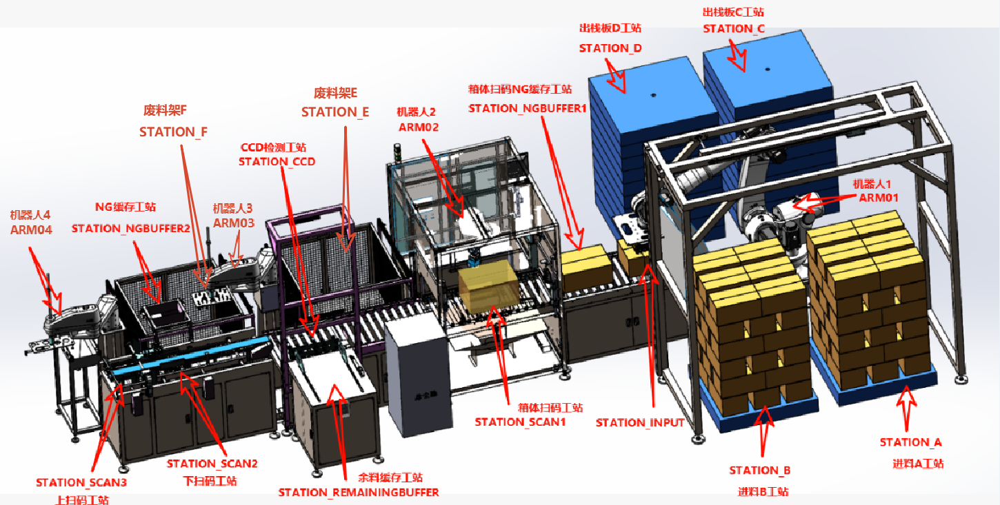
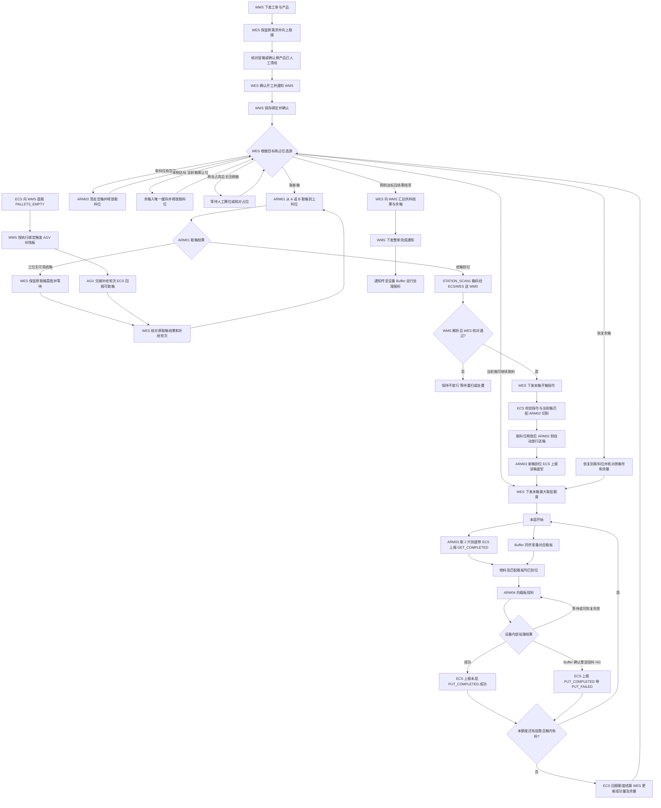

# 开箱机上下盖供料概要设计

版本：WES 开发评审稿 0.21

日期：2026-11-05  
评审对象：客户、WMS 方、WES 方、开箱机 ECS/PLC 方、Buffer 方

本次开发任务全部在 WES 内部。WMS 和 ECS 是外部系统，本稿中的外部动作和回报用于定义 WES 的输入、输出及依赖。第 3.3 节列出 WES 开发范围，第 9 节汇总 C01-C12 的接口约定，第 10 节给出 WES 本地验证场景。

## 1. 设计依据与目标

业务目标是将纸箱内的上盖、下盖放到载板，再由 Buffer 收入对应 Magazine，供产线成对安装。两类产品使用不同型号的上盖、下盖。

- 本次讨论确认的业务规则，见第 2 节。
- 《开箱机 ECS API 接口调用说明书》版本历史 1.10，日期 2026-10-31。接口以 PDF 的章节号为索引，见第 7 节。
- 历史随机推演和 2500 套样本用于开发阶段核对数量与选源规则。 [评审附件](attachments/opening-machine/README.md)
- Python 伪代码、数量约束和反例见[上下盖配对调度算法设计](opening-machine-pairing-algorithm-design.md)。

供应商 PDF 用于核对 ECS 的已有接口。WES 开发通过本地模拟报文验证任务推进，WMS 的业务决定及 ECS/PLC、Buffer 的执行事实均作为外部输入或依赖。

## 2. 已确认的业务规则

| 项目 | 约定 |
|---|---|
| 开工绑定 | WES 确认开工后通知 WMS。WMS 保存当前执行工单绑定并确认后，WES 才开始本单供箱或余箱取料 |
| 工单与来料 | WMS 下发产品和需求套数。A 仅放上盖栈板，B 仅放下盖栈板。缺箱时由 AGV 从库区补对应产品和盖型的栈板，工位确认可取箱后恢复供箱 |
| 任务数量 | 每套为上下盖各 1 片。每层 2 片，按整层取料和投料。奇数套数向上取偶，保留原始需求 |
| 箱内数量 | 当前满箱上盖 22 片、下盖 16 片，允许完整层的不满箱。WMS 按有效外箱码解析单箱数量。开箱回库的纸箱按核实后的余量重新出具外码 |
| 开箱与换箱 | SCAN1 在切割前扫码。WES 校验并下发本箱开箱指令后，ARM02 才切割。ARM03 移走空箱后设备自动送箱，下一箱到达取料位时 ECS 上报盖型 |
| 取料额度与配对 | WES 下发本箱最大取层数，ECS/PLC 按实际取出层数执行。换箱时优先供成功量较少的一侧。配对作为选侧目标 |
| 取料、备板及投料 | ARM03 取料到皮带和 Buffer 备板并行。物料与匹配载板均到位后 ARM04 投料，等待由设备处理。SCAN2/3 只采集条码用于追溯 |
| 逐层结果 | 同层 GET 和终局 PUT 携带同一个额度指令号和层序号。ECS 重发保持原事件内容。Buffer 处理整层投料 NG，ECS 用 `PUT_FAILED` 回报，WES 按结算结果补取一层 |
| 留箱与清线 | 取料位和余料缓存位各能放 1 箱。本单结束后可留箱供同产品下一单复用，也可人工清线。换产品前必须人工清线 |
| Magazine 与尾料 | 上下盖各最多 4 个待分配的空板 Magazine。Buffer 取板，装料后收入另一个成品 Magazine。成品只装同产品、同盖型，允许跨纸箱续装。WMS 下发整单完成通知后，设备自行补空板及出料 |
| 原结果恢复 | 沿用现有接口分工。ECS 断线恢复或重启后按原 `command_code` 重发最终 Result。本期通过现有回调恢复结果 |

容量和产品与盖型映射的配置见 C01。上盖 Magazine 26 片、下盖 34 片用于第 8 节仿真示例，设备内部容量由 Buffer 配置。

## 3. 系统与设备职责

### 3.1 系统边界

| 系统 | 负责事项 | 需要对外提供的事实或决策 |
|---|---|---|
| WMS | 下发带产品的需求，按开工通知保存执行绑定，解析箱码，按绑定安排栈板补给，接收供料汇总并下发整单完成通知 | 工单、箱码校验决策、AGV 补给任务、整单完成通知 |
| WES | 选择下一箱和取料额度，结算成功量与投料 NG，保护余箱缓存，向 WMS 汇总供料结果 | 来源指令、取料额度、供料汇总、转发整单完成通知 |
| 开箱机 ECS/PLC | 按授权驱动机内动作；维持工站与物料身份；与 Buffer 握手；限制取料额度；回传实际结果 | 扫码事件、原指令 Result、可追溯的取放料事实 |
| Buffer | 提供匹配的空载板，接收投料，管理 Magazine，收到整单完成通知后自行处理尾料 | 与开箱机完成设备内部握手 |

开箱机与 Buffer 负责备板、接料等待及恢复。Buffer 管理 Magazine 的分配及周转，满载搬运按现场 PLC、ECS、MCS 方案执行。WES 根据供箱、取料和投料的回报推进任务。

### 3.2 执行设备与事件工站

| 设备/工站 | 作用 | 事件或指令归属 | 说明 |
|---|---|---|---|
| STATION_A / STATION_B | A 仅放上盖栈板，B 仅放下盖栈板 | ARM01 的取箱来源 | 栈板所属产品与当前补给任务匹配 |
| ARM01 | 将选定纸箱取到上料位 | 执行 `PICK_AND_PUT`，由 ECS 回传原指令 Result | WES 根据工单产品和所选盖型指定箱型与来源。无可用纸箱时返回原因 |
| STATION_INPUT01 | 新箱上料位 | ARM01 目标位置 | 布局图使用 STATION_INPUT，接口使用 STATION_INPUT01，需统一 |
| STATION_SCAN1 | 开箱前扫描纸箱外码 | 发出 `SCAN_COMPLETED` | 原码由 WMS 解析。纸箱等待 WES 下发开箱指令 |
| ARM02 | 切割开箱，空箱移走后联动放行下一箱 | ECS/PLC 执行 WES 的开箱指令并控制设备内输送 | 开箱指令匹配当前纸箱后开始切割，清空箱后的送箱放行由设备联动完成 |
| STATION_CCD | 箱体检测、取料区域的逻辑位置 | `MOVE_BACKWARD` / `MOVE_FORWARD` 的指令地址 | 箱空、可切换、实际离位应分别确认 |
| STATION_REMAININGBUFFER1 | 唯一余箱缓存 | 由传送带 4 执行缓存/恢复 | WES 保留箱号和剩余量，不因恢复重置箱内数量 |
| ARM03 | 每次取 1 层共 2 片放到皮带上，同步向 Buffer 请求载板，并移走取空的纸箱 | 发出 `GET_COMPLETED`，新箱到位时由 ECS 上报盖型 | 到箱事件及工位释放字段见 C04 |
| STATION_SCAN2 / STATION_SCAN3 | 采集物料条码供追溯 | 发出 `SCAN_COMPLETED` | ARM04 按物料和载板到位条件投料，扫码结果用于追溯记录 |
| ARM04 | 向匹配载板投放 1 层，共 2 片 | 执行投料，由 ECS 以 STATION_OUTPUT01 上报结果 | 待物料和载板均到位后投料 |
| STATION_OUTPUT01 | 放料结果的逻辑发出工站 | 由 ECS 上报 `PUT_COMPLETED` | 带原额度指令号、层序号和投料结果 |
| STATION_NGBUFFER1 | 箱码异常缓存相关位置 | 异常去向由硬件确认 | 布局还有第二 NG 位置，设备表与用途尚未完整对应 |
| STATION_C / D / E / F | 空栈板、废料架等外围位置 | PDF 定义 ECS 与 WMS/MCS 的直接交互 | 不并入 WES 的上下盖配对算法 |

下图直接摘自 PDF，用于核对设备位置。图中的缓存、NG 和输送细节仍以现场确认结果为准。

### 3.3 WES 开发范围

| WES 交付项 | WES 内部工作 | 外部依赖 |
|---|---|---|
| 工单和箱码 | 接收 WMS 工单，换算目标，登记开工通知并消费 WMS 保存绑定的确认。发送原箱码并关联箱码决策 | WMS 提供产品、套数及箱码决策 |
| 选源和设备指令 | 管理取料位与唯一缓存，按盖型选源，生成取箱、开箱、取料额度及余箱移动指令 | ECS 接收指令并回报缺箱、到位、释放及执行结果。补给轮次随 AGV 任务交接给 ECS |
| 事件、入账和恢复 | 关联 GET/PUT 与原指令，处理重复及乱序回报，结算成功量和 NG，授权补取，恢复原指令等待 | ECS 提供同层身份及原 Result 重发。额度入账约定按 C07 对齐 |
| 任务交接及通知 | 管理同产品留箱复用和换产品清线门槛。向 WMS 汇总两侧供料结果，处理并转发整单完成通知 | WMS 发送整单完成通知。清线事实按 C10 确认来源 |
| 本地验证 | 在 WES 开发环境注入模拟 WMS 决策、ECS 事件及 Result，检查 WES 状态、指令和数量 | 模拟报文按已知接口约定构造 |

WES 业务按现有的工单回调、WMS 请求、ECS 命令、事件和 Result 接收机制接入。外部接口缺少的字段或回报能力记录为接入依赖，开发期间可用本地样例验证 WES 分支。

## 4. 正常工作流程

### 4.1 总体流程

图示采用单条来源流程。每层结清后，设备在本额度内继续取料。额度用完或箱空后回报结算，WES 再按当前占位和剩余目标选源。ARM03 按设备时序清走已取空的纸箱，WES 依据释放事实推进下一箱。

配对和任务数量均按设备确认已放到匹配载板的真实物料计算。Magazine 装满、离场及产线收料属于后续设备与搬运流程。

### 4.2 下单与供箱

1. WMS 下发工单、明确的产品及需求数量，例如产品 548、2501 套。WES 校验产品并生成上下盖各 2502 片的执行目标。
2. WES 取得本线执行资格并确认清线或留箱条件后，向 WMS 发开工通知。收到与当前工单原开工通知匹配的绑定保存确认后，才开始供箱或余箱取料。等待期间保留原通知身份。 [开工通知报文](opening-machine-api.md#task-started)
3. 有可复用的同产品余箱时，按 C10 核对后纳入本次选源。需要取新箱时，优先选择成功供料量较少且尚未完成的一侧，数量相同先上盖。
4. 若缓存箱仍属于当前任务且该侧尚未完成，先恢复该箱。缓存保护优先于配对优化。
5. WES 根据工单产品和本次所选盖型生成 ARM01 取箱指令。上盖从 STATION_A 取，下盖从 STATION_B 取，纸箱均送到 STATION_INPUT01。产品 548 或 558 使用相应的设备箱型参数，字段映射见 C01 开发契约。收到取箱到位结果后进入扫码校验。
6. STATION_SCAN1 扫描纸箱外码，经 ECS、WES 传给 WMS。WMS 解析外码中的数量，返回箱号、产品、盖型、物料型号、本箱实际可用数量和允许状态。开箱后回库的纸箱再次上线时扫描更新后的外码。批次等追溯信息按 WMS 业务需要返回。
7. WES 核对 WMS 返回的箱号、产品、盖型及数量，校验通过后下发与该箱和本次扫码关联的开箱指令。ECS/PLC 确认指令匹配当前待开纸箱，ARM02 才开始切割。扫描失败、业务校验失败或等待超时时，纸箱保持待放行并进入约定的重扫或处置流程。重发同一指令应沿用原身份，设备对同一开箱动作只执行一次。
8. 开箱后，设备在取料位释放时自动放行送箱。新箱到达 ARM03 取料位后，ECS 上报到达料箱的盖型。WES 将到位回报与已放行的供箱记录核对，确认盖型匹配且前一箱的取料结果已结清，再按本箱外码数量下发有限取料额度。到位回报建议附带箱号或能够唯一关联本箱的供箱身份。

#### 工位无可用纸箱时补给

1. ARM01 发现所选工位无可用纸箱，ECS 向 WES 回传关联原取箱指令的结果，至少指出工位和缺箱原因。WES 保留本次所需产品、盖型和来源，进入等待补给。
2. ECS 将栈板取空事件 `PALLETS_EMPTY` 直报 WMS。WMS 按当前执行绑定取产品，按 A/B 工位取盖型，登记补给轮次并触发库区栈板的 AGV 搬运。补给轮次关联原开工通知、工单、目标工位和 AGV 任务。重复取空沿用原轮次。
3. 补给轮次随 AGV 搬运任务交接给 ECS。放板和交接完成且工位可取箱后，ECS 回报补给轮次、工单及原缺箱取箱指令。WES 核对本线、当前工单、产品、盖型、工位和原指令。原指令明确未搬箱时，消费该轮次并登记一次新取箱。可取箱先到时先保存，待原结果明确后再推进。 [补给与交接报文](opening-machine-api.md#pallet-replenishment)

### 4.3 取料、投料和结算

WES 下发本箱本次最多可取的层数，ECS/PLC 按 ARM03 实际取出的层数扣减额度。达到额度后停止下一次取料，结清已取层并回报本次结果，箱内余料保留。例如上盖还差 4 片，箱内有 10 片，WES 本次最多授权取 2 层，实际取出 4 片后箱内剩 6 片。

ECS 在每层开始前检查剩余额度。ARM03 取出 2 片放到皮带上，同时 Buffer 准备对应产品、盖型的载板。物料经皮带运行至 ARM04，当前层和匹配载板均到位后，ARM04 才投料。SCAN2/3 采集条码用于追溯。两路先后到达的等待、恢复及互锁由开箱机与 Buffer 处理。

本层有终局投料结果后，设备才能在额度内开始下一层。整层投料 NG 由 Buffer 处理，ECS 以 `PUT_COMPLETED` 的 `pick_and_put_result=PUT_FAILED` 回报。这 2 片已从箱中取出并退出正常供料，记入 NG。WES 在额度结算后为每个失败层补取 1 层，优先使用当前箱。

ARM03 每实际取出一层，ECS 上报一条 `GET_COMPLETED` 和一条对应的终局 `PUT_COMPLETED`。两条事件都带原取料额度指令号和该额度内的层序号，WES 用这两个值配对，即使回报乱序也能关联到同一层。ECS 重发时沿用首次生成的 `device_code`、`event_type`、事件体 `timestamp` 和 `data`。WES 通用事件入口按这四项识别重复回报，同一失败层只产生一次补取资格。

拟由原额度指令的已结清 Result 统一入账，GET/PUT 作为逐层核对与追溯记录。入账依据和汇总字段在 C07 接口评审确认。

### 4.4 换箱及唯一缓存保护

正常策略尽量取完当前箱，减少缓存往返。本侧目标已经达到而箱内仍有料时：

- 另一侧未完成且缓存为空：先将余箱移入缓存，待移动完成、取料位可用后供另一侧。
- 两侧都完成：保留取料位及缓存中的箱号、产品、盖型和余量。余箱可人工清线，也可留在原位供同产品下一单复用。
- 缓存中仍有本任务未完成侧所需的余箱：必须先恢复并处理该箱，不能再制造一个需要停放的尾箱。

箱内物料取空后，由 ARM03 移走空纸箱。设备确认空箱离位后，ARM02 侧联动放行送箱，取料位恢复可接下一箱。按当前设计，自动放行指设备内部送箱，ARM02 切割继续执行 C03 的开箱指令互锁。WES 等待取料位释放和下一箱实际到位的事实，按到箱回报推进取料。空箱清除动作由设备执行，取料位释放可随原额度结果回报。

设备内暂存的余箱从缓存位恢复时，沿用原箱号及 WES 已结算的剩余数量。纸箱离开设备并回库时，按回库核实的实物余量重新出具外箱码，后续重新上线以该有效外码的数量为准。新外码如何关联原箱、旧码如何停用，由 WMS 方和回库作业方确认。

同产品下一单启动前，核对留箱位置、盖型和已结算余量，再将留箱纳入新单。两处均有箱时，先核对取料位的箱能否在达到本侧目标前取空。若本侧可能达标时仍有余料，且另一侧还需供料，先由人工腾出一处。切换产品时，先人工清线并确认完成，再启动新产品的设备动作。清线确认的责任人及回报入口待确认。

### 4.5 整单完成通知与尾料处理

单侧达到目标后，WES 停止该侧取料，继续处理另一侧。两侧均达标，且额度、在途层、投料 NG 和相关来源动作均已结清后，WES 向 WMS 汇总本次供料结果和已确认的余箱。

WMS 下发本次任务全部完成的通知。本稿按 WMS → WES → ECS 的路径传给开箱机及 Buffer，通知关联原任务及通知身份。设备收到后自行处理末个 Magazine 的补空板及出料，重复收到同一通知时沿用已开始的收尾处理。WES 按两侧供料结算汇总业务结果，设备内部收尾由设备跟踪。

若末个 Magazine 已装满，Buffer 按正常满载出料处理。空载板数量、具体补板动作和出料时序由 Buffer 决定。

## 5. 数量与配对口径

对每一盖型分别维护以下数量，单位统一为片：

| 数量 | 含义 |
|---|---|
| 原需求 | WMS 下发的业务需求 |
| 执行目标 | 原需求向上取偶后的成功供料目标 |
| 实际取出 | ARM03 已实际从来源箱取出的数量 |
| 成功供料 | ARM04 已成功投到匹配载板的数量 |
| 已确认投料 NG | 已确认不能回到正常供料的整层数量 |
| 未结清 | 已取出但尚未确认成功或终局 NG 的数量 |
| 已授权未结算额度 | 正在执行的最大取料预算；不能当作实际成功量 |

物理账满足 `实际取出 = 成功供料 + 已确认投料 NG + 未结清`。在全部结清时，满足 `实际取出 = 成功供料 + 已确认投料 NG`，且 `成功供料 <= 执行目标`。

只有已确认投料 NG 能增加补取额度。等待、超时、接口 ACK、未确认的失败均不能增加额度。空载板不计入任何成功物料量。

配对指标为 `成功上盖量 - 成功下盖量`。WES 在换箱边界优先供较少一侧，优化累计供料配对。不同 Magazine 容量和 Buffer 内部排队仍会影响实际交付顺序；产线成对到料不能仅由本算法保证。

## 6. 异常及恢复

| 场景 | 处理主体与动作 | WES 处理 |
|---|---|---|
| 箱码未读到或 WMS 未确认 | ECS 保持放行条件不成立，按约定重扫/处置 | 保留原扫码及工单关联，等待明确结果 |
| 箱码校验失败或箱内数量异常 | ECS 保持纸箱待处置或停止相关动作，具体去向待确认 | 按箱码或数量异常请求业务处置 |
| SCAN2/3 物料码未读到 | 按追溯异常处理，ARM04 继续按既定投料条件执行 | 追溯异常的记录方式待确认，投料数量按实际 GET/PUT 结果结算 |
| Buffer 暂时无板、投料可恢复失败 | 开箱机与 Buffer 内部等待同一层 | 不读取 readiness、不重复授权取料 |
| 整层投料 NG 已确认 | ECS 固定原层身份、确认状态和数量 | 只结算一次，补取 1 层 |
| 指令超时、结果缺失 | ECS 恢复连接后按原 `command_code` 重发已保存的最终 Result | 保留原指令待结清，收到匹配结果后再推进。结果仍未知时保持挂起并核对实际状态 |
| 重复、乱序、冲突结果 | 接收方按原事件/指令身份去重，冲突进入核对 | 禁止两次记成功或两次增加补取额度 |
| CCD 实测与 WMS 箱内量不符 | 停止相关额度并上报可核对事实 | 保留差异，请 WMS 确认余量；不自动改成标准满箱量 |
| 原料持续不足、持续 NG、Buffer 永久等待 | 设备停止或保持可恢复等待，告警 | 保留部分完成量和来源占位，不能宣告任务完成 |
| 重启或断电 | ECS 恢复后重发原指令已完成的 Result。执行结果不明的动作由设备核对实际状态 | 按原指令恢复箱号、余量和额度，结果核对后再执行 |
| 两侧完成仍有余箱 | 人工清线，或原位留箱供同产品下一单复用 | 记录实际位置与余量。换产品时等待人工清线确认 |

## 7. 最小交互接口清单

本节用 W1 至 W5（含 W1a）、C1 至 C6、E/R 标记 WES 的对接接口及外部事实。正式业务 operation、EVENT 名称及字段按接口约定确认。第 9 节的 C01 至 C12 是评审议题编号。

### 7.1 WMS 与 WES

| 编号/方向 | 触发与内容 | 关联设备/工站 | PDF 与补齐项 |
|---|---|---|---|
| W1 WMS → WES：开箱需求 | 工单生效时，下发任务、明确的产品（如 548 或 558）、原始套数及版本 | 产品用于后续 ARM01 取箱及实物校验 | WES 接收所依赖的 WMS 工单合同待确认 |
| W1a WES → WMS：开工通知 | WES 确认开工后发送。WMS 保存执行绑定的确认是供箱及余箱取料的前置条件 | 原工单、工作线、产品及原通知身份 | 正式字段和确认报文待对齐 |
| W2 WES → WMS：箱码解析校验 | 收到箱体扫码后，送原码、扫码身份、任务、期望产品/盖型、来源 | 发出工站 STATION_SCAN1，经 ECS 转交 | PDF §3.1 只有扫码事件；需补 WMS 决策 |
| W3 WMS → WES：箱码决策 | 对原 W2 返回箱号、产品、盖型、型号、从有效外箱码解析的数量、允许/拒绝及原因 | 同一个待放行纸箱，开箱回库后再次上线使用更新后的外码 | 待确认外码字段、有效性校验，以及采用响应还是异步回调 |
| W4 WES → WMS 供料汇总及异常事实 | 两侧达标且已结清后，汇总原需求、执行目标、取出量、成功量、NG、余箱和箱级耗用 | 来自 ECS 的已结算执行事实 | 待确认字段和库存处理 |
| W5 WMS → WES 整单完成通知 | WMS 确认本次任务全部完成后下发，携带原任务和通知身份 | 按本稿方案由 WES 转告 ECS | 待确认通知报文及路径 |

原料不足时，WMS 按当前工单产品、盖型和 A/B 工位提交库区栈板补给任务。正常取空沿用 ECS 直报 WMS 的 `PALLETS_EMPTY`，同一次缺料的 ARM01 结果用于 WES 等待及恢复。

### 7.2 WES → ECS 指令

| 编号/指令 | 执行设备与位置 | 触发时机与最小业务内容 | PDF 状态 |
|---|---|---|---|
| C1 下一箱供箱 | ARM01 从 STATION_A 或 STATION_B 取箱到 STATION_INPUT01 | 来源动作和原额度均结清后，按 WMS 工单产品确定箱型。上盖用 A，下盖用 B | §2.1 已有 `PICK_AND_PUT`。产品、箱型及原指令关联需补齐 |
| C2 开箱放行指令 | WES 下发至 ECS/PLC，由 ARM02 执行切割 | WMS 返回决策且 WES 核对通过后，下发关联任务、本次扫码和当前箱号的明确指令 | §3.1 描述扫码结果寄存器。WES 对接所依赖的开箱指令及结果报文待确认 |
| C3 本箱有限取料额度 | ECS/PLC 按实际取层数控制 ARM03。物料从 STATION_CCD 送至 STATION_OUTPUT01 | 核对 ARM03 新箱到位回报或余箱恢复结果，确认前额度已结清。指令关联任务、产品、盖型、箱号、最大取层数和原命令身份 | 设备接受最大取层额度的业务规则已确认。WES 对接所依赖的 ECS 命令和结算报文待确认 |
| C4 余箱入缓存 | 逻辑地址 STATION_CCD，实际传送带 4；到 STATION_REMAININGBUFFER1 | 当前层已结清、缓存为空，当前余箱需让位 | §2.3 已有 `MOVE_BACKWARD`，无 target；须补原箱身份及实际占位完成事实 |
| C5 余箱恢复 | 逻辑地址 STATION_CCD，实际传送带 4；缓存 → CCD | 取料位已清空，缓存箱仍需供料 | §2.3 已有 `MOVE_FORWARD`，无 target；须核对箱号与剩余量 |
| C6 转发整单完成通知 | WES 转发 WMS 的通知，ECS 传给设备 | 收到 WMS 对本任务的完成通知后转发，发送重试沿用原转发身份 | PDF 未定义。需确认通知报文及设备接收方式 |

下一箱的业务判断可以在当前箱结算时完成。ARM01 实际执行必须等相关来源路径和工站释放。不能只凭 CCD 报“无料”就启动下一箱；并行预取是否安全由硬件方确认，本稿先按单条来源流程串行处理。

### 7.3 ECS → WES EVENT 与 Result

| 编号/事实 | 发出设备/工站 | 触发时机 | WES 用途与需补字段 |
|---|---|---|---|
| E1 `SCAN_COMPLETED` 箱体扫码 | STATION_SCAN1 | 纸箱外码读取成功 | PDF §3.1 已有。补同箱多码、原动作关联和扫码结果身份，由 WMS 解析箱内数量 |
| E1 `SCAN_COMPLETED` 物料扫码 | STATION_SCAN2 / STATION_SCAN3 | 物料条码读取成功 | PDF §3.1 已有。条码仅用于追溯，拟关联对应层及物料，具体字段待确认 |
| E2 `GET_COMPLETED` | ARM03，location=STATION_CCD | 实际取出一整层 2 片后 | PDF §3.2.1 已有。带原取料额度指令号和层序号，与该层的 E3 配对 |
| E3 `PUT_COMPLETED` | STATION_OUTPUT01，动作执行者 ARM04，由 ECS 上报 | 整层投料成功，或 Buffer 处理后确认整层投料 NG | PDF §3.3 定义事件，§4 已列取放结果枚举。带与 E2 一致的原取料额度指令号和层序号，以及 `pick_and_put_result`。`PUT_FAILED` 表示整层终局 NG，成功拟用 `PUT_FINISHED` |
| R1 原指令 Result | ECS 代表原执行设备回传，保留原 device_code/command_code | ARM01 取箱到位或报告所选工位无可用箱。另覆盖缓存移动和取料额度结清 | PDF §4 已有框架。ARM01 缺箱原因及工位、原指令是否已实际搬箱和 C3 的结算字段需补齐 |
| R2 取料位释放事实 | ARM03 清走空箱，或传送带将余箱移出取料位，由 ECS 回报 | 箱体已离位，取料位可接下一箱 | PDF 未完整描述。建议并入原额度或移动指令 Result |
| E4 补料后工位可取箱 | STATION_A 或 STATION_B，由 ECS 转报 | 对应产品栈板已放到指定工位，门禁交接结束，设备确认可取箱 | 回报补给轮次及原缺箱取箱指令。正式字段和关联承载方式待对齐 |
| E5 ARM03 新箱到位 | ARM03 取料位，由 ECS 转报 | 新箱实际到达取料位时报告其上盖或下盖类型 | PDF 未定义。建议包含盖型及箱号或唯一供箱身份，正式 EVENT 名称和报文待确认 |

额度汇总 Result 拟关联原指令、任务、产品、盖型、箱号和授权层数，并回报取出、成功、已确认 NG、未结清、箱内余量和停止原因。工位释放事实可并入适用的原指令结果。WES 按实际发生的数量结算，包括指令失败前已取出或投料的部分。仍有未结清物料时，保留原额度并核对后再推进。汇总入账口径待 C07 确认。

### 7.4 设备内部及外围接口

| 交互 | 责任边界 | PDF 状态 |
|---|---|---|
| ARM03 取料及皮带输送与 Buffer 备板并行，ARM04 在两路到位后投料 | 开箱机 ECS/PLC 与 Buffer 直接握手，硬件方负责同层恢复 | 开发使用逐层 GET/PUT 结果模拟设备行为 |
| 尾料补空板、Magazine 满载及流转 | 设备接收整单完成通知后，由 Buffer 自行处理 | 开发验证整单完成通知的关联和转发 |
| A/B `PALLETS_EMPTY`，C/D `PALLETS_FULL`，E/F `WASTE_FULL` | ECS 直接通知 WMS。A/B 取空时，WMS 按当前供箱任务的产品及盖型从库区补对应栈板 | PDF §7 已描述。事件样例仅带工位，需明确如何关联工单产品及同一次缺料 |
| MCS/AGV 门禁访问与结束 | MCS 与 ECS/PLC；A-D 暂停 ARM01，E/F 暂停 ARM03 | PDF §6 已描述。WES 开发以工位可取箱事实为恢复条件 |

### 7.5 路由与原指令恢复

各段沿用现有接口分工。下表用于开箱机业务开发与模拟验证。

| 方向与用途 | 路径 |
|---|---|
| WES → ECS 设备指令 | `POST /api/v1/device/command` |
| ECS → WES 设备事件 | `POST /api/v1/callback/event` |
| ECS → WES 原指令 Result | `POST /api/v1/callback/result` |
| WMS → WES 业务下行 | `POST /api/v1/wms/events` |
| WES → WMS 业务决策请求和事实回报 | `POST /api/v1/wes/decisions`、`POST /api/v1/wes/facts` |

供应商 PDF §3 另列设备事件路径 `/api/v1/event/`。ECS 发往 WES 的回调地址按上表配置，认证、报文、版本和设备角色编码按 C12 对齐。

ECS 保存已完成指令的最终 Result。断线恢复或 ECS 重启后，按原 `command_code` 通过现有 Result 回调重发，保留原结果内容。WES 将回报关联到原指令并按原身份结算一次。结果未确认期间，WES 保留待结清状态。若重启时尚未形成最终 Result，设备先核对执行状态和实际占位，再按原指令结清。本期通过 ECS 主动重发恢复最终结果，暂不新增结果查询接口。

## 8. 2500 套正常流程随机示例

主例按每次整层投料尝试有 0.5% 的概率发生投料 NG，使用种子 88：上盖每箱随机 1-11 层，下盖每箱随机 1-8 层，下盖内部等待较长。每次补取也适用同一概率。设备内部等板及可恢复同层等待不算投料 NG，等待和时刻使用模型单位。0.5% 是本次约定的仿真输入，单次样本的实际 NG 比例允许随机波动。

| 项目 | 上盖 | 下盖 |
|---|---:|---:|
| 执行目标/成功供料 | 2500 / 2500 片 | 2500 / 2500 片 |
| 新纸箱数 | 207 | 282 |
| 实际取出 | 2510 片 | 2518 片 |
| 已确认投料 NG | 10 片，即 5 层 | 18 片，即 9 层 |
| 最大成功供料领先 | 22 片 | 14 片 |
| 末个 Magazine 中真实物料 | 4 片 | 18 片 |
| 末个 Magazine 补空板位置 | 11 层位 | 8 层位 |
| 最终来源余量 | 取料位箱 U207：2 片 | 缓存箱 L282：4 片 |

共 489 次新箱上料、489 次取料额度结算、2514 次取层，只有 1 次余箱入缓存。其中成功 2500 层，确认投料 NG 14 层，实际样本 NG 比例为 `14 / 2514 ≈ 0.557%`。两侧实际取出均等于成功量加确认 NG，没有成功超量或来源死锁。两侧完成供料后仍有两箱来源余料。历史轨迹保留旧模型的本侧结束及收尾标志，当前整单完成通知流程见 4.5。完整顺序和出料标志见[0.5% 异常率供箱记录](attachments/opening-machine/2500-ng005-carton-sequence.txt)和[逐层记录](attachments/opening-machine/2500-ng005-layer-results.txt)。

NG 补取另用定点异常验证：仅让上下盖各自的最后一层发生一次投料 NG，确认后各补取一层。两侧实际取出各 2502 片，其中成功各 2500 片、确认 NG 各 2 片，没有超量。这个场景不设置现场 NG 概率。

无 NG 样本保留作对照，原 25% NG 样本仅保留为压力验证附件，不作为正常生产、箱耗用量或现场质量表现的示例。0.5% 仿真输入不替代现场实际 NG 率，后者由质量统计确认。

历史主推演共 9472 组，包含奇数需求、随机不满箱、单侧 NG、连续 NG、末层 NG 和不同内部等待；有限恢复场景中未发现超量或来源调度死锁。该结果不证明 Buffer 内部有限资源不会互锁，也不证明 AGV 实际交付顺序满足配对需求。

## 9. C01-C12 业务结论与 WES 对接依赖

下表用于确认 WES 的输入、输出及状态推进条件。对接方提供约定和所需事实，WES 开发交付以 3.3 节为准。正式字段待确认时，可用本稿的逻辑字段编写 WES 本地模拟和验证用例。

| 编号与主题 | 已确认的业务规则 | WES 对接待确认 | 约定来源 |
|---|---|---|---|
| C01 供箱与补给 | WES 确认开工后通知 WMS，等 WMS 确认保存绑定才供箱或取料。A 上盖、B 下盖。缺料触发 AGV 补给，补给轮次随搬运任务交接给 ECS | 开工通知和确认报文、产品与箱型配置、补给轮次交接字段、可取箱回报和异常缺箱处置 | 客户、WMS、WES、硬件 |
| C02 外码数量 | WMS 按纸箱外码返回单箱数量。开箱回库后按实物余量重出外码 | 标签出具方、数量字段、旧码停用、原箱追溯和实物数量差异处置 | 客户、WMS、ECS、WES |
| C03 开箱放行 | SCAN1 在切割前扫码，WES 校验并下发本箱开箱指令后 ARM02 才切割 | 箱号与扫码关联、开箱指令字段、拒绝及超时状态 | WMS、WES、ECS |
| C04 清箱与到箱 | ARM03 移走空箱，设备自动放行下一箱。ARM03 新箱到位后，ECS 上报盖型 | 工位释放和新箱到位的回报名称、字段及原供箱关联 | ECS、WES |
| C05 取料额度 | WES 给出本箱最大取层数，设备按实际取出层数执行，达到上限后保留余箱 | 指令字段、数量单位、箱空或额度用完时的结算结果 | ECS、WES |
| C06 整层投料 NG | Buffer 处理整层 NG，ECS 以 `PUT_COMPLETED` 的 `PUT_FAILED` 回报。该层 2 片结清后可补取一层 | 成功结果枚举，拟沿用 `PUT_FINISHED`。确认终局失败及待结清的报文语义 | ECS、WES |
| C07 逐层配对与入账 | 每层 GET 和终局 PUT 均携带原额度指令号与层序号。ECS 重发保留原事件 | 字段名、额度汇总 Result 内容及数量入账依据。对齐重发、乱序和冲突处理 | ECS、WES |
| C08 并行备板 | ARM03 取料到皮带与 Buffer 备板并行，设备负责两路到位及同层等待 | 本地模拟覆盖 GET 后等待终局 PUT 的情形，WES 按逐层结果和额度结算推进 | ECS、WES |
| C09 整单收尾 | WMS 下发整单完成通知，设备自行补空板及出料 | 通知路径、报文字段、任务关联及重复通知处理 | WMS、WES、ECS |
| C10 留箱与换产品 | 余箱可人工清线或原位保留。同产品下一单可复用，换产品必须人工清线 | 余箱交接记录、清线确认入口及 WES 启动门槛 | 客户、WMS、WES |
| C11 物料扫码 | SCAN2/3 只采集物料条码用于追溯，ARM04 按物料和匹配载板到位条件投料 | 条码与物料、层的关联。读码异常如何记录 | 硬件、ECS、WES |
| C12 路由与恢复 | 沿用现有接口。断线或重启后，ECS 按原 `command_code` 重发最终 Result，本期通过回调恢复结果 | 接口版本、认证方式、开发环境角色绑定、超时与重试约定、原结果冲突处置 | WMS、WES、ECS |

## 10. 本地开发验证场景

以下场景均在 WES 开发环境执行。模拟 WMS 决策、ECS 事件及 Result，检查 WES 发出的指令、状态变化和数量入账。

| 场景 | 模拟输入 | WES 预期行为 |
|---|---|---|
| 开工绑定 | 模拟原工单开工通知未确认、原绑定保存确认和历史确认迟到 | 当前原通知确认前保持等待。只有匹配的确认才允许供箱或余箱取料 |
| 缺箱补给 | 模拟原缺箱 Result、匹配或不匹配的可取箱回报，以及重复或乱序 | 原指令明确未搬箱且补给关联匹配后，按同一轮次只登记一次新取箱 |
| 箱内数量及奇数工单 | 5 套工单、不满箱及回库更新后的外码解析结果 | 两侧目标各 6 片。当前额度同时受单箱余量与目标缺口约束 |
| 开箱放行 | 正确箱码决策、错产品或错盖型决策、旧箱决策晚到或决策超时 | 只对当前匹配箱生成开箱指令。其他情况保持待处置或等待 |
| 清箱和新箱到位 | 空箱离位回报、新箱到位及盖型 | 更新占位。核对新箱身份和盖型后再授权本箱额度 |
| 额度及整层 NG | 箱内 10 片，本侧缺 4 片。模拟额度内两层取出，其中一层终局 NG | 首次最多授权 2 层。结算后记录已取 4 片、成功 2 片、NG 2 片，按缺口补取 1 层 |
| 逐层配对及等待 | PUT 先于 GET 到达、同层事件重发、GET 后暂未收到终局 PUT | 按原额度指令号和层序号配对并去重。原额度未结清时保持等待 |
| 余箱缓存与续单 | 本侧达标仍有余料、单缓存、两处留箱且下一单需求很小 | 仅在缓存可用时移入。同产品复用按原余量；两处占用且可能卡住换箱时进入待腾位 |
| 换产品 | 新工单产品变化，分别注入清线确认前后的状态 | 清线确认前保持待启动，确认后允许新产品取箱 |
| 物料码追溯 | SCAN2/3 有条码或暂缺条码，随后收到正常投料结果 | 条码用于追溯，数量按实际 GET/PUT 和额度结算推进 |
| 整单完成通知 | 单侧达标、两侧均结清、WMS 整单通知及重发 | 双侧结清后向 WMS 汇总，收到对应整单通知后按原转发身份转告设备 |
| 原指令恢复 | 模拟结果暂缺，再按原 `command_code` 回报原 Result，并重发一次 | 等待期间保留原动作，收到匹配结果只入账一次并继续原流程 |
