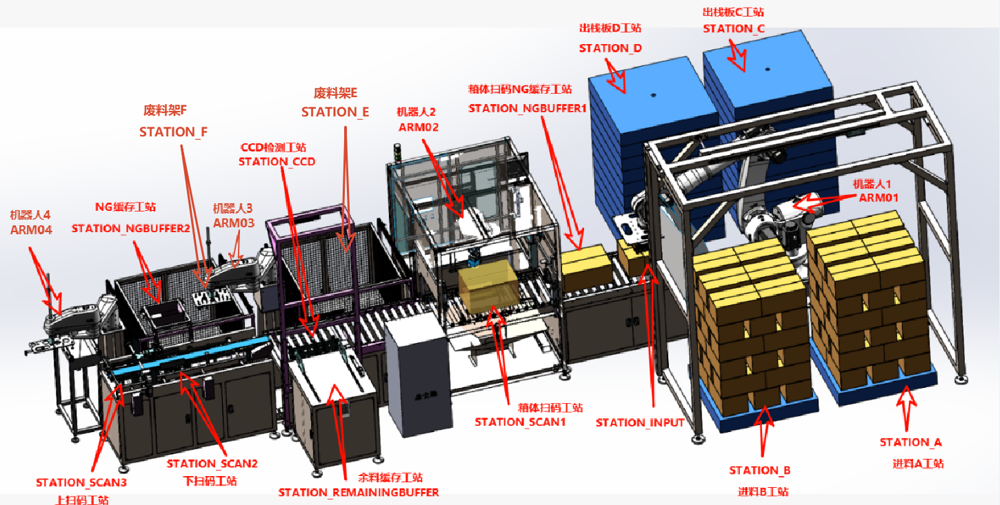
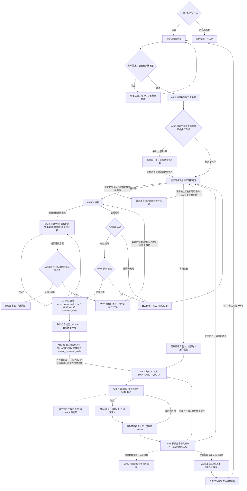
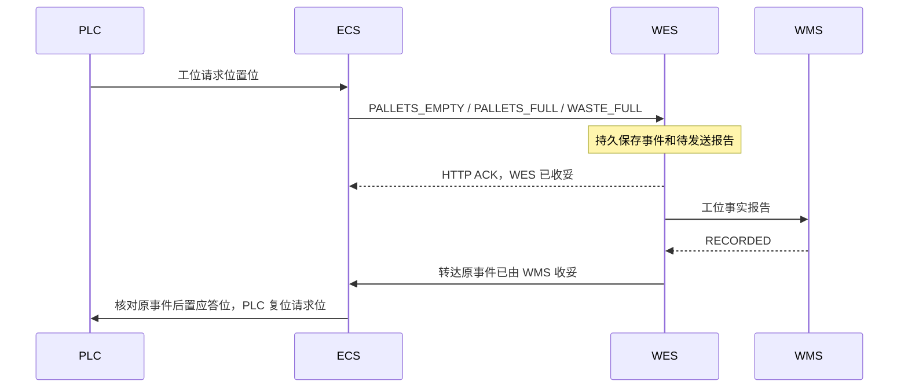

# 开箱机上下盖供料概要设计

本稿在 2026-11-13 工程评审 D1–D52 基础上，将单一产品定为 MVP。适用于客户、WMS、WES、开箱机 ECS/PLC 及 Buffer 对接。

本次开发任务全部在 WES 内部。WMS 和 ECS 是外部系统，本稿中的外部动作和回报用于定义 WES 的输入、输出及依赖。第 3.3 节列出 WES 开发范围，第 9 节汇总对接依赖和验收。

## 1. 设计依据与目标

业务目标是将纸箱内的上盖、下盖放到载板，再由 Buffer 收入对应 Magazine，供产线成对安装。MVP 按现场约定的一种产品完成上下盖供料，并支持该产品连续下单。

- 本次讨论确认的业务规则，见第 2 节。
- 《开箱机 ECS API 接口调用说明书》版本历史 1.10，日期 2026-10-31。按命令、事件和结果查阅 [ECS 交互与命令速查](opening-machine-api.md#ecs-interaction-index)。
- 历史随机推演和 2500 套样本用于开发阶段核对数量与选源规则。 [评审附件](attachments/opening-machine/README.md)
- 历史推演、数量约束和反例见 [上下盖配对调度算法设计](opening-machine-pairing-algorithm-design.md)。

供应商 PDF 用于核对 ECS 的已有接口。WES 开发通过本地模拟报文验证任务推进，WMS 的业务决定及 ECS/PLC、Buffer 的执行事实均作为外部输入或依赖。

## 2. MVP 业务规则

| 项目 | 约定 |
| --- | --- |
| 工单 | 只受理工作线约定产品的工单。同线按 `dispatch_sequence`、首次有效下发时间和工单号升序选单。未选中时可用更高版本提交完整目标或撤销，原排位保持。领取后锁定。续单领取前，需求套数须覆盖上盖和下盖各自的可用余量 |
| 数量 | 正整数套数向上取偶，每套上下盖各 1 片。整层固定 2 片。当前满箱上盖 22 片、下盖 16 片，单箱可用量按 WMS 解析的外箱码确认 |
| 可用来源 | 盖型统一用 `cover_type`，`UPPER` 对应 A 位上盖，`LOWER` 对应 B 位下盖。首批栈板由现场备好。取料位与余箱缓存各容一箱，支持同产品续用 |
| 供箱和开箱 | 串行供箱，每次供箱认一条有效 SCAN1，收到 WMS 同步允许后才切割。NG 或重读仍无码时由设备自主退箱 |
| 额度和入账 | ARM03 到箱只下发本箱额度，设备侧保留单层在途，WES 按原最终 Result 一次结算 |
| 工单收尾 | WES 保留逐箱执行记录。WMS 按工单汇总记实耗，按独立差异报告调整库存。收到 ECS 确认可接下一单的成功 Result 后交接 |

Buffer 上、下盖各最多 4 个待分配空板 Magazine，成品载板收入另一 Magazine。成品可跨箱续装，设备负责周转及尾料补空板。主动补板和提前备箱留待后续。

## 3. 系统与设备职责

### 3.1 系统边界

开箱机系统交互统一走 ECS ↔ WES ↔ WMS。WES 接收设备事实并调用 WMS 业务接口，匹配 WMS 决定后再向 ECS 下发相应授权。

| 系统 | 负责事项 | 需要对外提供的事实或决策 |
|---|---|---|
| WMS | 管工单版本、需求和库存。核对开工版本及执行目标，维护绑定，解析箱码，依据设备清位证据提供补板方案，协调搬运和业务完工 | 工单、箱码判定、栈板方案和搬运结果、完工通知 |
| WES | 选择下一箱和取料额度，依据设备事实结算执行量并跟踪余箱，向 WMS 汇总供料结果 | 来源指令、取料额度、供料汇总、箱量差异报告、转发完工通知 |
| 开箱机 ECS/PLC | 按授权驱动机内动作；维持工站与物料身份；与 Buffer 握手；限制取料额度；回传实际结果 | 扫码事件、原指令 Result、可追溯的取放料事实 |
| Buffer | 提供匹配的空载板，接收投料，管理 Magazine，收到整单完成通知后自行处理尾料 | 与开箱机完成设备内部握手 |

开箱机与 Buffer 负责备板、接料等待及恢复。Buffer 管理 Magazine 的分配及周转，满载搬运按现场 PLC、ECS、MCS 方案执行。WES 根据供箱、取料和投料的回报推进任务。

### 3.2 执行设备与事件工站

| 设备/工站 | 作用 | 事件或指令归属 | 说明 |
|---|---|---|---|
| STATION_A / STATION_B | A 仅放上盖栈板，B 仅放下盖栈板 | ARM01 的取箱来源 | 栈板所属产品与当前补给任务匹配 |
| ARM01 | 将选定纸箱取到上料位 | 执行 `PICK_AND_PUT`，由 ECS 回传原指令 Result | WES 根据工单产品和盖型指定箱型与来源。请供应商将 ARM01 盖型字段对齐为 `source.cover_type`。无可用纸箱时返回原因 |
| STATION_INPUT01 | 新箱上料位 | ARM01 目标位置 | 布局图使用 STATION_INPUT，接口使用 STATION_INPUT01，需统一 |
| STATION_SCAN1 | 开箱前扫描纸箱外码 | 发出 `SCAN_COMPLETED` | 原码由 WMS 解析。纸箱等待 WES 下发开箱指令 |
| ARM02 | 切割开箱，取料位空出后联动送已开箱 | ECS/PLC 执行 WES 的开箱指令并控制设备内输送 | 开箱按 WES 原授权。若已有已开箱，ARM03 位空出后 ECS/PLC 自动送箱 |
| STATION_CCD | 箱体检测、取料区域的逻辑位置 | `MOVE_BACKWARD` / `MOVE_FORWARD` 的指令地址 | 箱空、可切换、实际离位应分别确认 |
| STATION_REMAININGBUFFER1 | 唯一余箱缓存 | 由传送带 4 执行缓存/恢复 | WES 保留箱号和剩余量，不因恢复重置箱内数量 |
| ARM03 | 每次取 1 层共 2 片放到皮带上，同步向 Buffer 请求载板，并移走取空的纸箱 | 新箱到位发 `BIN_ARRIVED`，取层后发 `GET_COMPLETED` | 到位信号和原 ARM01 指令号传递见 C04 |
| STATION_SCAN2 / STATION_SCAN3 | 采集物料条码供追溯 | 发出 `SCAN_COMPLETED` | ARM04 按物料和载板到位条件投料，扫码结果用于追溯记录 |
| ARM04 | 向匹配载板投放 1 层，共 2 片 | 执行投料，由 ECS 以 STATION_OUTPUT01 上报结果 | 待物料和载板均到位后投料 |
| STATION_OUTPUT01 | 放料结果的逻辑发出工站 | 由 ECS 上报 `PUT_COMPLETED` | 带原额度指令号、层序号和投料结果 |
| STATION_NGBUFFER1 | 箱码异常缓存相关位置 | 异常去向由硬件确认 | 布局还有第二 NG 位置，设备表与用途尚未完整对应 |
| STATION_C / D / E / F | 空栈板与废料架工位 | ECS 向 WES 上报，WES 转报 WMS | 由 WMS 按工位处理，独立于上下盖配对 |

下图直接摘自 PDF，用于核对设备位置。图中的缓存、NG 和输送细节仍以现场确认结果为准。

### 3.3 WES 开发范围

WES 管理工单调度、占位、原动作和执行账，复用公共命令与回调、集成历史、RackDispatch 和 Transport。WMS 维护工单及开工绑定、栈板业务记录和库存账。设备提供实际位置、数量和恢复证据，控制物理动作和互锁。接口草案、字段和待联调项目见 [API 对接文档](opening-machine-api.md)。

## 4. 工作流程

### 4.1 总体流程

### 4.2 开工、供箱与补给

WMS 安排下一单时，需求套数须至少等于取料位和缓存位按盖型合计余量中的较大值。WES 领取前用当前余量复核。数量不足时，队首保持未选中，WMS 可改量或撤销。满足条件后，WES 领取原版本并发开工通知，WMS 核对该版本和按整层取偶后的执行目标，保存绑定后才供箱或使用余箱。例如原需求 5 套，开工与汇总均用执行目标 6 套。 [续单余量下限](opening-machine-api.md#continuation-quantity) · [开工绑定](opening-machine-api.md#task-started)

需要新箱时，ARM01 从当前盖型工位取箱，指令带原 `start_operation_id`。SCAN1 同码重报沿原校验请求，异码待核对。同步决定超时沿原请求恢复。明确 NG 由 WES 转发给 ECS，自主退箱。SCAN1 重读仍失败时 ECS 自主退箱。两种情况共用人工取走及入料口释放的恢复事件。

ARM02 开箱指令的 `source_command_code` 引用原 ARM01 取箱指令的顶层 `command_code`。ARM02 在设备侧先产生 Result，随后 ECS 确认新箱在 CCD 可取并以 ARM03 上报 `BIN_ARRIVED`，带实际位置、箱号、盖型和同一个 `source_command_code`。WES 匹配原供箱及开箱授权后触发本箱额度。到位信号和指令号随箱传递待联调。 [到位报文](opening-machine-api.md#ecs-carton-ready-example)

明确缺箱且未搬箱才向 WMS 请求。ECS 在 PLC 取空请求上升沿向 WES 报原绑定，WES 保存取空事实和待发送报告后 ACK。WES 按原报告身份向 WMS 交付并转达收妥结果，ECS 核对是原工位事件后应答 PLC。WMS 尚未收到取空事实或缺少清位证据时返回 `WAIT` 和 `retry_after_ms`。同产品续单只有同线、同工位、同一栈板入场轮次且期间未补换板时，才沿用上一单取空事实，原绑定保留。

WMS 核对设备侧实际清位证据后返回证据引用和新栈板号。WES 核对清位工位及原板或入场轮次，通过公共 RackDispatch 释放原作业并登记一次新 ENTER。WMS 按栈板号定位库区。AGV/MCS 与 ECS 确认可取后，WMS 回原 f0 成功，WES 匹配原搬运、栈板、工位和原等待后恢复一次取箱。 [补给报文](opening-machine-api.md#replenishment-handoff)

### 4.3 逐层执行与结算

额度取箱内可用层数和本侧成功缺口的较小值。ARM03 取料和 Buffer 为同层备板可并行。物料和载板到位后 ARM04 投料。只有当前层成功或整层 NG 已处理、额度仍有余量且设备互锁满足后才取下一层。GET/PUT 和 SCAN2/3 由 ECS 上报 WES 供追溯，ECS 沿原事件补报。设备无需等 GET/PUT 的 HTTP ACK。

每条 `PICK_LAYER_QUOTA` 对应一份最终 Result。ECS 在已取整层结清、实际数量核实后按原指令号回报。箱已取空时，先等自动清箱并确认实际离位，再用同一 Result 一并回报。WES 按原指令号入账一次，取空时同事务释放匹配的原箱占位。同一箱还需补取时，结清前一额度后用新指令号下发。正常箱余量扣减实际取出层数 × 2。提前箱空或应空仍有料时按实物差异处理。ECS ACK 后，WES 保留原动作和占位，持续等原 Result。

### 4.4 余箱和占位

ARM03 自行清走空箱。若 ARM02 已有按原授权开好的箱，取料位空出后设备自动送箱。清箱和送箱由 ECS/PLC 内部联动。WES 按原额度最终 Result 结算和释放原空箱占位，再核对新箱到位与原授权。取料位余箱需让位时移到空闲缓存。取料位空闲时，可恢复另一侧需要的缓存箱。原移动成功后更新位置，沿用结算余量。

同产品续单沿用原箱号、盖型、实际位置和已确认可取量。多料由 ECS 核实后随原额度最终 Result 回报，WES 保留原箱并将核实余量记为可用。续单下限同时计入取料位和缓存位的核实余量。

两个位置均有箱时，当前箱仍能供料就继续按额度取料。实物确认取料和缓存移动都无法继续，且工单仍有缺口时，保留占位并进入 [通用实物异常流程](opening-machine-api.md#quota-result)。

### 4.5 工单汇总与交接

供料结果只向 WMS 发送工单汇总和独立箱量差异报告。两侧达标且相关动作结清后，WES 发送工单汇总。末箱空时，WES 应用同时确认实际离位的原额度最终 Result 后再汇总。有可用余料时按原规则留箱。核实短少或多料后独立报告差异。

WMS 按工单和盖型以实际取出量（成功加整层 NG）记实耗，留箱余料归实际取出的工单。箱量差异按实物余量减推算余量调整来源库存。两种报告各按原身份应用一次。 [工单汇总](opening-machine-api.md#supply-report) · [箱量差异](opening-machine-api.md#carton-quantity-discrepancy-report)

WMS 完成通知引用当前有效汇总。原汇总已发或可能送达且本地事项结清时，匹配的完成通知可先于 HTTP 回执触发一次 ECS 转发。设备自行完成收尾，能安全接下一单时沿原通知回成功 Result。WES 收到后按原续单条件推进。

## 5. 数量与配对口径

对每一盖型分别维护以下数量，单位统一为片：

| 数量 | 含义 |
|---|---|
| 需求 | 领取时生效的 WMS 目标套数 |
| 执行目标 | 生效需求向上取偶后的成功供料目标 |
| 实际取出 | ARM03 已实际从来源箱取出的数量 |
| 成功供料 | ARM04 已成功投到匹配载板的数量 |
| 已确认投料 NG | 已确认不能回到正常供料的整层数量 |
| 未结清 | 已取出但尚未确认成功或终局 NG 的数量 |
| 已授权未结算额度 | 正在执行的最大取料预算；不能当作实际成功量 |

物理账满足 `实际取出 = 成功供料 + 已确认投料 NG + 未结清`。在全部结清时，满足 `实际取出 = 成功供料 + 已确认投料 NG`，且 `成功供料 <= 执行目标`。

只有已确认投料 NG 能增加补取额度。等待、超时、接口 ACK、未确认的失败均不能增加额度。空载板不计入任何成功物料量。

配对指标为 `成功上盖量 - 成功下盖量`。WES 在换箱边界优先供较少一侧，优化累计供料配对。不同 Magazine 容量和 Buffer 内部排队仍会影响实际交付顺序；产线成对到料不能仅由本算法保证。

## 6. 异常及恢复

| 情况 | 推进条件 |
| --- | --- |
| 设备断线或重启 | 设备核对实际动作和占位，沿原命令回唯一最终 Result。合法 ACK 后 WES 持续等待。重发保持原命令号和内容 |
| 已知取料失败 | ECS 结清已取层后回原 Result。WES 按实际数量结算，收到匹配原额度、箱和工位的设备恢复事实后才按缺口重新授权 |
| 数量未明 | 设备侧提示并核实。WES 保留原额度与箱位，等原命令最终 Result |
| 已核实箱量差异 | 按最终 Result 入账，并独立报告原箱和额度。短少由原额度最终 Result 确认箱空及离位后继续。多料核实后统一留箱续用，差异报告回执只确认收妥 |
| 最终结果失实或实物异常影响推进 | 按影响范围暂停，范围不明暂停整线。ECS／Buffer 及现场确认箱位、数量、原动作结果和可安全续作条件，WES 授权人员据此核对并具名确认，必要时追加一次差额。原报告已发或可能送达时，由 WMS 按原号人工核对更正，WES 留存结论 |

GET/PUT 明细缺失、迟到或单独冲突保留在集成历史，正常入账以合法最终 Result 为准。设备确认可安全续作且 WES 核清原实物、数量和指令后恢复相关动作。证据不足时继续暂停，依赖 WMS 报告的动作继续等核对结论。

## 7. 最小交互接口

| 方向 | 交互 |
| --- | --- |
| WMS → WES | 下发、排队改量与撤销、整单完成通知、原搬运结果 |
| WES → WMS | 开工绑定通知、箱码与补板请求、公共 ENTER、工单汇总、箱量差异及工位事实报告 |
| WES → ECS | 原供箱、开箱放行或 NG 转发、有限额度、缓存移动、整单完成转发及 WMS 工位事实收妥通知 |
| ECS → WES | 扫码、到箱、退箱恢复、逐层追溯、取料恢复及原命令 Result。空箱离位随原额度最终 Result 回报。工位事件为 A/B 取空 `PALLETS_EMPTY`、C/D 堆满 `PALLETS_FULL`、E/F 废料架满 `WASTE_FULL` |
| AGV/MCS ↔ ECS | 现场门禁与放板互锁。AGV/MCS 调用 ECS 的 `/door/accessReq` 和 `/door/accessFinish` |

报文与路径见 [WMS 交互与 operation 速查](opening-machine-api.md#wms-interaction-index) 和 [ECS 交互与命令速查](opening-machine-api.md#ecs-interaction-index)。现场联调验证现有网关仅允许指定 WMS/ECS 回调。

WES 按持久待发送记录独立交付 WMS。C/D 和 E/F 报告按原工位归属。 [工位报文及应答](opening-machine-api.md#station-event-report)

## 8. 2500 套正常流程随机示例

主例按每次整层投料尝试有 0.5% 的概率发生投料 NG，使用种子 88：上盖每箱随机 1-11 层，下盖每箱随机 1-8 层，下盖内部等待较长。每次补取也适用同一概率。设备内部等板及可恢复同层等待不算投料 NG，等待和时刻使用模型单位。0.5% 是本次约定的仿真输入，单次样本的实际 NG 比例允许随机波动。

| 项目 | 上盖 | 下盖 |
|---|---:|---:|
| 执行目标/成功供料 | 2500 / 2500 片 | 2500 / 2500 片 |
| 新纸箱数 | 207 | 282 |
| 实际取出 | 2510 片 | 2518 片 |
| 已确认投料 NG | 10 片，即 5 层 | 18 片，即 9 层 |
| 最大成功供料领先 | 22 片 | 14 片 |
| 末个 Magazine 中真实物料 | 4 片 | 18 片 |
| 末个 Magazine 补空板位置 | 11 层位 | 8 层位 |
| 最终来源余量 | 取料位箱 U207：2 片 | 缓存箱 L282：4 片 |

共 489 次新箱上料、489 次取料额度结算、2514 次取层，只有 1 次余箱入缓存。其中成功 2500 层，确认投料 NG 14 层，实际样本 NG 比例为 `14 / 2514 ≈ 0.557%`。两侧实际取出均等于成功量加确认 NG，没有成功超量或来源死锁。两侧完成供料后仍有两箱来源余料。历史轨迹保留旧模型的本侧结束及收尾标志，当前整单完成通知流程见 4.5。完整顺序和出料标志见[0.5% 异常率供箱记录](attachments/opening-machine/2500-ng005-carton-sequence.txt)和[逐层记录](attachments/opening-machine/2500-ng005-layer-results.txt)。

NG 补取另用定点异常验证：仅让上下盖各自的最后一层发生一次投料 NG，确认后各补取一层。两侧实际取出各 2502 片，其中成功各 2500 片、确认 NG 各 2 片，没有超量。这个场景不设置现场 NG 概率。

无 NG 样本保留作对照，原 25% NG 样本仅保留为压力验证附件，不作为正常生产、箱耗用量或现场质量表现的示例。0.5% 仿真输入不替代现场实际 NG 率，后者由质量统计确认。

历史主推演共 9472 组，包含奇数需求、随机不满箱、单侧 NG、连续 NG、末层 NG 和不同内部等待；有限恢复场景中未发现超量或来源调度死锁。该结果不证明 Buffer 内部有限资源不会互锁，也不证明 AGV 实际交付顺序满足配对需求。

## 9. 对接依赖与验收

首期合同按 [API 待联调事项](opening-machine-api.md#delivery) 确认。与 WMS 核对开工版本、取偶目标和冲突响应，确认实耗与库存差异的过账时点及去重。现场核对 ARM01 盖型与工位、取空应答、旧板清位证据及 f0 到位可取时序、异常恢复证据、NG／无读码退箱、单层互锁、GET/PUT 回执丢失后的节拍、自动清箱与送箱、空末箱离位及可接下一单确认。2500 套是历史数量推演，实际节拍以现场测量为准。

单一产品验收覆盖约定产品连续两单、按盖型合计的余量下限、队首改量或撤销、双箱在位续用，以及产品不匹配的工单在入队前被拒绝。其余软件用例覆盖工单领取并发、同工位两轮补板、旧板清位跨业务隔离、回报乱序与重报、实物阻断时的通用异常流程、最终 Result 一次入账和工单交接。见 [API 验收用例](opening-machine-api.md#102-验收用例) 和 [WES 实施计划](../superpowers/plans/2026-11-05-opening-machine-wes-implementation.md)。
