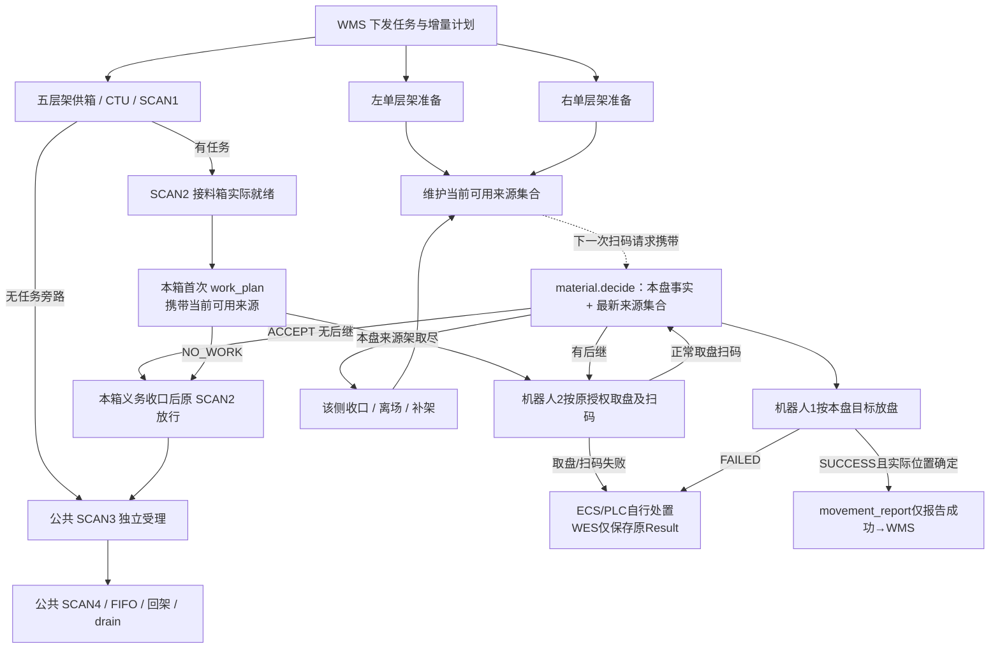
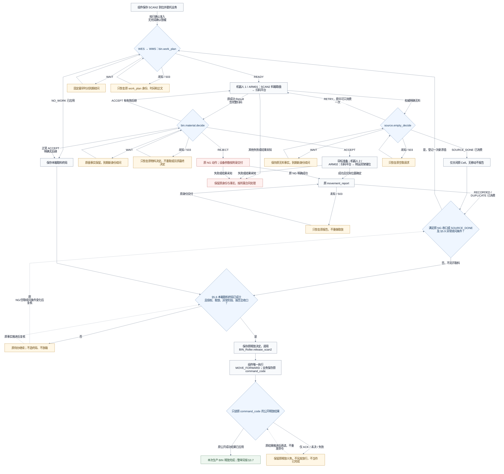
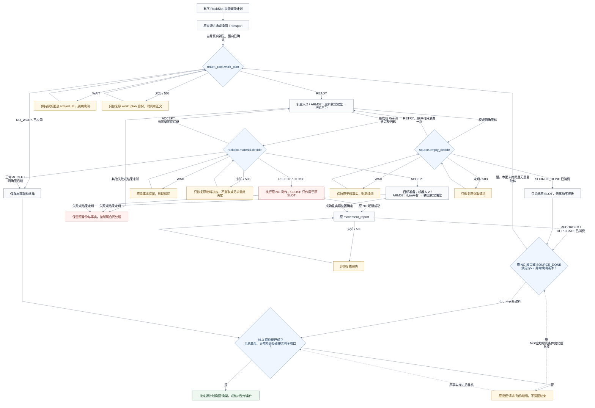
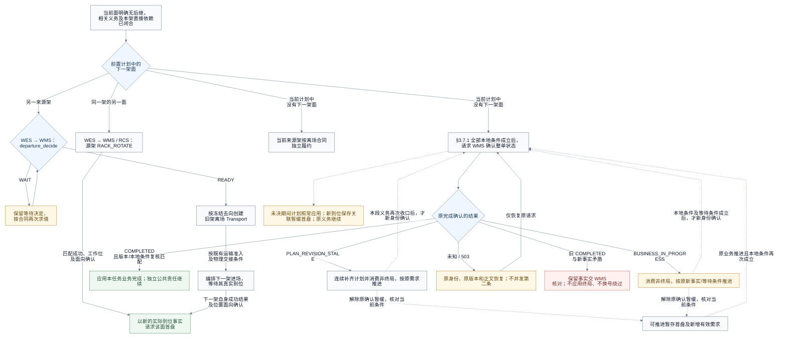

# SMT 自动上架与拣料 API 对接文档

合同版本日期：2026-10-31；交付状态核对：2026-11-01。本文统一维护smt_auto的AUTO/inbound和AUTO/outbound合同：共同项只定义一次，方向差异使用严格字段联合、差异表与专属子节。交付状态：**本方合同/设计，共享任务ST1/ST2已随[PR #44](https://github.com/kaizhoumasha/maintenance-admin/pull/44)合入develop（380aeba）；正式SMT业务实施、生产注册、部署、真实对端联调和现场验收仍未完成。** 示例仅供对接，不表示已发送或设备已接受。

跨仓库资料引用中，已提交且本地未改动的实现/附录/Markdown说明固定到源仓库已发布提交；尚未提交的WMS合同修订和未纳入源仓库提交的PDF仅保留明确来源路径，不作为可下载链接。本PR不发布这些源工作区材料，本方字段/响应仍以本文为准，对端签认及真实联调仍待独立验收。

## 目录

- [1. 业务范围、主体与方向](#business-scope)
- [2. 完整业务流程](#flows)
- [3. 统一任务接口](#tasks)
- [4. 逐盘业务接口](#material-operations)
- [5. 共同授权、等待、关联与收口](#production-rules)
- [6. 货架资源、准备与原搬运](#rack-flows)
- [7. ECS公共协议与方向参数](#ecs)
- [8. BIN_Roller统一接缝](#roller-seams)
- [9. 公共协议、字段、幂等与保存](#protocol)
- [10. 交付依赖与统一验收](#delivery)

快速定位：[plan_delta资源联合](#task-plan) · [完成前置差异](#task-completion-conditions) · [WAIT](#production-wait) · [原箱释放](#scan2-release) · [入库7天保留](#inbound-retention)。

<a id="business-scope"></a>
## 1 业务范围、主体与方向

`smt_auto` 是一个业务子包，统一任务、队列、版本、服务、工厂和 `scan_pending`。工作线绑定宿主；原 `issued.task_type=AUTO`、不可变 `business_type=inbound|outbound` 决定内部生产流程。人工两方向仍归 [smt_manual](manual-picking-api.md)。[业务设计](../superpowers/specs/2026-10-31-smt-auto-business-design.md)维护代码归属；六类任务合同及分派共用[sorting_task实施计划](../superpowers/plans/2026-10-31-sorting-task-implementation.md)，宿主任务状态、方向生产及组合验收按[smt_auto总实施计划](../superpowers/plans/2026-10-31-smt-auto-implementation.md)交付。

| 主体 | 共同责任 |
| --- | --- |
| WMS | 任务与计划、库存、箱架绑定/当前箱位、来源与目标分配、逐盘资格/参数/容量、取尽/关闭及最终业务结果、整单完成裁决 |
| WES / smt_auto | 原任务/成员、到位/执行引用、授权消费、原命令/Result/扫码、位置报告与交付、生产架准备及释放决定；不建库存、箱架绑定、同格在途/容量预留账 |
| sorting_task | 六类任务严格合同、单份注册及可信薄分派；无任务表、队列领取或独立调度 |
| BIN_Roller | 唯一受理 SCAN1～4，原事务委托 SCAN2 生产，执行原释放及公共供箱/回流/FIFO/drain/五层架流 |
| ECS / PLC | 机械臂动作/扫码、实际交接、并行/互锁、HOLD 和实物异常处置；返回原命令权威结果 |
| RCS / CTU | 货架/料箱实际搬运及交接，沿原 Transport 返回物理事实；接纳 ACK 不证明到位或搬离 |

| 方向边界 | inbound 自动上架 | outbound 自动拣料 |
| --- | --- | --- |
| 计划资源 | 五层料箱供箱架 + 单层来源架；不包含整箱交换 | 五层料箱供箱架 + 转运目标架 + 退料来源架 |
| 正常物料路径 | 单层架 → ARM02 → 扫码台 → ARM01 → SCAN2 接料箱 | BIN → ARM01 → 扫码台 → ARM02 → 转运架；RackSlot 两段均 ARM02 |
| 报告范围 | 仅正常明确成功放盘；FAILED/NG 不报告 | 正常与 NG 明确成功、位置确定均报告；空取无移动不报告 |
| 空取 | 明确 FAILED/0/PICK_EMPTY；SOURCE_ABSENT | 权威无料载体仍待设备附录；SOURCE_DONE，普通失败/0不证明空取 |
| 明细清理 | 仅本方向采用终态且直接义务收口后7天和最小终态摘要 | 保持原保存/恢复合同，不套入库7天清理及清理后拒绝 |

五层供箱架中的箱在可靠取出后由 WMS 依据 RCS 物理事实维护解绑/位置；BIN_Roller 只保存本线本点事实/投影，不构成库存、绑定或占位许可。已到 SCAN2 的 BIN 不再依赖原供箱架、面、投箱成员或原架进出场结果；RackSlot 和单层来源架仍保留自己的原到位关联。

实际设备码、位置、架型和模板由 WORKLINE 显式绑定，示例不作默认。按本次方向实际使用校验资源，不能要求仅做一种方向的线具备另一方向全部专属资源，也不能用设备前缀或任务号推断业务。

<a id="flows"></a>
## 2 完整业务流程

共同任务链为 issued → 唯一 prepare → 连续 plan_delta → 方向生产 → 原需求/生产/必报/释放收口 → completion_confirm。公共供箱、生产架准备、逐盘作业及公共回流按对象并行，不串成跨网络/动作的长事务。候选计划、ACK、任务终态、原物理义务及全线排空分别判断。

<a id="inbound-flow"></a>
### 2.1 inbound：单层架逐盘上架至接料箱

| 路径 | 步骤 / 方向 | 交互 | 推进条件 |
| --- | --- | --- | --- |
| 任务 | T1 / WMS → WES | [sorting.task.issued](#task-issued) | 保存任务、执行模式、业务方向、工作线和队列，不开始物理动作 |
| 任务 | T2 / WES → WMS | [sorting.task.prepare](#task-prepare) | 任务选中且本线满足启动条件；受理后等待异步计划 |
| 任务 | T3 / WMS → WES | [sorting.task.plan_delta](#task-plan) | 连续应用版本；分别安排单层料盘来源架、五层供箱架 |
| 资源 | R1 / 本业务及 BIN_Roller | 单层来源架与公共供箱准备 | 单层架由本业务确认原到位；五层架由组件执行，本业务不重复编排 |
| 供箱 | F1 / 本业务 → BIN_Roller | 原任务/计划供箱需求与进度接缝 | 组件执行公共分配及搬运，本业务按 §8.3 读取自己的原需求进度，不重复编排 |
| 公共箱流 | F2 / BIN_Roller | 公共 SCAN1 分流 | 本业务提供当前任务有效性；扫码、分流及方向命令按公共合同执行 |
| 首盘 | M1 / ECS → WES → WMS | SCAN2 到箱及 [putaway.work_plan](#putaway-work-plan) | 当前箱实际就绪，提供最新可用来源架；无其他待消费或未决取料授权 |
| 首盘 | M2 / WMS → WES → ECS | READY + source；原取盘命令 | 保存单盘授权、完整参数和原命令关联；只执行一次 |
| 逐盘 | M3 / ECS → WES → WMS | 可靠取盘及关联扫码；[material.decide](#putaway-decide) | 提供本盘来源、原条码及最新 source_racks |
| 逐盘 | M4 / WMS → WES → ECS | ACCEPT + target，可带 next_source_action | 分别登记机器人1本盘放盘和机器人2后继取盘；设备决定并行/互锁，WES 不以本盘放盘成功或报告确认作后继统一前置 |
| 逐盘 | M5 / WES → WMS | [movement_report](#putaway-report) | 仅原目标放盘明确成功且实际位置确定后报告 WMS；FAILED 由 ECS 自行处置，WES 只保存原 Result、不创建失败报告待办 |
| NG | N1 / WMS → WES → ECS | REJECT 后执行 [扫码台→STATION_NG](#putaway-ng) | 复用机器人1 PICK_AND_PUT，业务决定 NG_ZONE 映射设备 SCAN_NG，安全/占用互锁由 ECS/PLC 负责 |
| NG | N2 / ECS → WES | 原 NG 命令成功 Result | 保存本盘实际 NG 事实，不发送 WMS 报告或等待 NG 报告收妥；NG 成功后可按 [异常续取](#inbound-exception-example) 复用 work_plan 续问 |
| 换架 | R2 / WMS → WES | source_rack_exhausted=true，或独立 [source.rack_exhausted](#putaway-rack-exhausted) 通知 | 只确认原来源架及原到位取尽；本架取料及安全交接收口后离场，历史盘放盘/报告独立继续，不结束接料箱 |
| 换架 | R3 / WES → WMS / RCS | [departure_decide、旧架搬离、新架补入](#single-layer-exhaustion) | 左右独立；新架有自己的可靠到位事实后才加入可选来源 |
| 箱结束 | B1 / WES → ECS | [原 SCAN2 MOVE_FORWARD](#scan2-release) | 首盘 NO_WORK，或正常 ACCEPT 省略后继；本箱已发授权、取放及反馈收口 |
| 公共 | C1 / ECS → WES | [实际 SCAN3 → SCAN4 → 回架](workline-bin-return-api.md#return-sequence) | 公共能力独立接管；任务完成、上游结果迟到不改变本段规则 |
| 整单 | T4 / WES → WMS | [sorting.task.completion_confirm](#task-completion) | 本段业务义务结清后请求 WMS 裁决；不以公共 FIFO 清空或全部回架为前提 |

各路径按相关对象并行，不串成跨扫码、搬运、报告的长事务。没有可用来源、当前箱结束、单架取尽、计划暂时耗尽、任务完成及工作线清空分别判断。



图中的本盘放盘与后继取盘按 WMS 授权分别推进，实际运动并行、互锁及 HOLD 由 ECS/PLC 判断；WES 不因前盘 FAILED 取消或冻结已有效授权的后盘。WAIT 仍由 WMS 判业务，交付未知仍沿公共防重放规则；仅成功放盘发送 movement_report；失败由 ECS 自行处置，不创建失败报告或成功待报义务，见 [双臂流水与报告](#grant-consumption)。

<a id="outbound-flow"></a>
### 2.2 outbound：BIN / RackSlot 逐盘拣料至转运架

下表按路径列出交互和推进条件；接口名称、指令和回调均可点击跳转。表中的步骤号用于阅读导航，不作为请求字段。任务接口见 §3，逐盘请求见 §4，箱与任务收口分别判断。

| 路径 | 步骤 | 方向 | Operation / Event / Command | 交互 | 推进条件 |
| --- | --- | --- | --- | --- | --- |
| 供箱 | F1 | WMS → WES | [plan_delta / cancel](#task-cancel) | 原任务供箱面追加/撤销交 BIN_Roller | 本业务提交原需求并读取原进度，接缝见 §8；公共执行沿组件合同 |
| 供箱 | F2 | WES → WMS / RCS | [inbound_batch](manual-picking-api.md#manual-inbound)及组件原搬运 | 按实际到位供箱面取得原完整清单并执行 | 复用三字段请求及原公共流程，不从本稿 RackSlot 计划推导供箱 |
| BIN | B1 | ECS → WES | [SCAN2 到箱事实](#bin-work-plan) | 组件保存本点原扫码及到位事实，同事务委托生产业务 | 受理不以批次准入或旧作业收口为前提；事件合同沿公共声明 |
| BIN | B2 | WES → WMS | [outbound.bin.work_plan@v1](#bin-work-plan) | 按原生产上下文请求首个 Cell 授权 | 准入归生产业务；READY 才取盘，WAIT 等待，NO_WORK 进入放行条件判断；取消后原在制段见接入映射 |
| BIN | B3 | WES → ECS | [ARM01 / PICK_AND_PUT](#bin-pick-params) | 从工作位料箱取盘到扫码台 | 本次来源授权有效，参数齐全 |
| BIN | B4 | ECS → WES | [原 ARM01 命令 Result（含扫码）](#ecs-success-1) | 保存取出结果及本盘扫码 | 匹配原 command_code/device_code，ACK 不代表完成 |
| BIN | B5 | WES | [读取 Result 内扫码](#scan-result-correlation) | 应用本盘完整条码及实际扫码时间 | 同一原取盘 Result，不另等扫码 Event；扫码字段已本方确认，设备附录仍须签认 |
| BIN | B6 | WES → WMS | [outbound.bin.material.decide@v1](#bin-decide) | 决定本盘去向和可选下一 Cell/盘 | ACCEPT 按目标执行；有效后继按取盘条件返回 B3，不统一等待本盘报告 ACK |
| BIN | B7 | WES → ECS | [ARM02 / PICK_AND_PUT](#transfer-put-params) | 从扫码平台取盘，放到转运货架储位 | 需要时先完成目标换面或换架，并取得可靠就绪事实 |
| BIN | B8 | ECS → WES | [原 ARM02 命令结果](#ecs-success-2) | 保存实际放盘结果 | 物理成功且位置确定后才能报告完成 |
| BIN | B9 | WES → WMS | [outbound.material.movement_report@v1](#outbound-report) | 上报本盘实际移动事实 | RECORDED / DUPLICATE 仅闭合本次交付；后继取料条件见 B6 |
| BIN | B10 | WES 业务 → BIN_Roller → ECS | [原释放决定及点 2 / MOVE_FORWARD](#scan2-release) | 满足箱级条件后交组件唯一放行 | 已有效应用 NO_WORK 或正常 ACCEPT 明确无后继，且本 arrival 无待消费授权/未决取料阶段、原取放/正常及 NG 报告均收口；命令创建或 ACK 不表示已释放 |
| 公共回流 | C1 | ECS → WES → WMS / RCS | [SCAN3 / SCAN4 / FIFO / Return_Batch](workline-bin-return-api.md#return-sequence) | 实际下游交接后统一分流、回架及尾箱清退 | 不以 B10 命令创建或 ACK 证明已接到箱；按公共事实及原身份推进 |
| RackSlot | R1 | WMS → WES | [sorting.task.plan_delta@v1](#task-plan) | 安排有序来源货架及面 | 计划连续应用；不提前安排全部 SLOT |
| RackSlot | R2 | WES → WMS → RCS | [来源架 Transport](#rackslot-order) | 编排当前计划架面进场 | 按既有 Transport 合同执行，提交接纳不代表到位 |
| RackSlot | R3 | WMS → WES | [原 Transport 结果](#rackslot-order) | 保存来源架真实到位事实 | 原成功结果、实际工作位及面向匹配并已可靠应用 |
| RackSlot | R4 | WES → WMS | [outbound.return_rack.work_plan@v1](#rack-work-plan) | 取得当前面首个储位授权 | READY 才取盘；NO_WORK 进入面级收口；WAIT 等待 |
| RackSlot | R5 | WES → ECS | [ARM02 来源取盘 / PICK_AND_PUT](#rack-pick-params) | 从授权储位取单盘到扫码台 | 原授权有效，含 WMS 取盘前提供的来源层/列及本盘厚度/直径 |
| RackSlot | R6 | ECS → WES | [原取盘 Result（含扫码）](#rack-pick-params) | 保存取出结果和本盘条码 | 沿同一原命令关联，barcode/scanned_at 已本方确认，设备附录仍须签认 |
| RackSlot | R7 | WES → WMS | [outbound.rackslot.material.decide@v1](#rack-decide) | 决定本盘去向及同面下一储位 | next_source_action 只允许当前架、当前面；有效后继按设备条件返回 R5 |
| RackSlot | R8 | WES → ECS | [ARM02 目标放盘 / PICK_AND_PUT](#transfer-put-params-1) | 从扫码平台取盘，放到转运货架储位 | 目标可靠就绪，使用本盘参数 |
| RackSlot | R9 | ECS → WES | [原目标放盘结果](#ecs-success-2) | 保存本盘实际位置 | 匹配的确定成功结果及位置事实齐备 |
| RackSlot | R10 | WES → WMS | [outbound.material.movement_report@v1](#outbound-report) | 完整上报 RackSlot 来源与实际去向 | RECORDED / DUPLICATE 闭合本次交付；后继取料条件见 R7 |
| RackSlot | R11 | WES | [当前面结束条件](#rackslot-completion) | 收口本面授权及逐盘义务 | 确定无后继且相关义务闭合；WAIT、未知及 REJECT 字段缺省不能代替 |
| 换面 | R12a | WES → WMS → RCS | [源架 RACK_ROTATE](#rackslot-order) | 切换到下一计划面 | 该面真实到位后回到 R4，重新请求首盘 |
| 换架 | R12b | WES → WMS | [rack.departure_decide@v1](#rackslot-order) | 按共用合同决定旧架去向并编排原离场 Transport | READY 冻结去向；WAIT 等待；下一架自己的真实到位触发 R4 |
| 无下一架面 | R12c | WES → WMS | [sorting.task.completion_confirm@v1](#task-completion) | 确认整单状态 | 本地条件成立后请求；COMPLETED 才结束，不能仅凭当前计划耗尽 |
| NG / 空取 | 分支 | 按各自合同 | [异常续问与明确空取](#outbound-exception-example) | NG 成功且原报告收妥，或明确 SOURCE_DONE 后按原条件复用所属 work_plan | BIN CONTINUE 允许原 Cell 再参与新授权；CLOSE/SOURCE_DONE 仅关闭对应 Cell/SLOT，均不作为箱/面终局。已有有效授权继续，原上下文及无重复求值/取盘条件成立才开一次异常续问 |

命令触发的取盘及扫码通过同一原命令 Result 返回，按 command_code/device_code 关联；Event 仅用于 ECS 主动事件，不另等一份命令扫码 Event。Result 与命令 ACK 的到达顺序沿公共 ECS 合同，表中列序仅用于阅读导航。任何提交 ACK 都不代表物理完成；表中的后继循环表示授权推进，实际运动仍由对应设备合同及 ECS/PLC 互锁裁决。

<a id="outbound-flow-1"></a>
#### 2.2.1 BIN 逐盘处理



有效后继授权可在当前盘 PUT 或位置上报尚未闭合时被消费，仍须满足前一栈顶可靠取出、设备交接及[盘次唯一性约束](#plate-correlation)；同码歧义盘不得获得第二份最终去向授权。图中的循环不要求所有后继统一等待当前盘报告 ACK。

<a id="outbound-flow-2"></a>
#### 2.2.2 RackSlot 逐盘处理



`ACCEPT` 省略 `next_source_action` 才表达该正常分支的明确无后继。退料来源取盘和目标放盘均使用 ARM02；授权循环不表示同一机械臂可以同时执行两个物理动作。

<a id="outbound-flow-3"></a>
#### 2.2.3 源架面切换与整单确认

本图的来源架/面分支仅适用于 RackSlot。BIN 按原 task/arrival、当前箱格及本箱作业终局收口，不等待原供箱架面结束、换面或离场；整单仍独立核对本任务自己的计划需求与生产义务，见 §3.7。



源架换面、换架不使用目标侧 `target_preparation`。新架面真实到位后重新请求首盘，不沿用上一面的授权；当前计划耗尽不直接等于整单完成。

<a id="tasks"></a>
## 3 统一任务接口

六类 operation 在 sorting_task 全局只注册一次，任务状态及推进归 smt_auto。WMS → WES 通知入口为 `POST /api/v1/wms/events`；WES → WMS 决定请求为 `POST /api/v1/wes/decisions`。公共信封、鉴权、类型和错误见[协议规则](#protocol)。本章只在计划、撤销选择器和完成前置处区分方向，不创建两套任务生命周期。

本章与smt_manual共用[sorting_task计划](../superpowers/plans/2026-10-31-sorting-task-implementation.md)：[ST1](../superpowers/plans/2026-10-31-sorting-task-implementation.md#sorting-task-st1)交付任务模型、任务响应合同及必要receiver适配；[ST2](../superpowers/plans/2026-10-31-sorting-task-implementation.md#sorting-task-st2)交付可信原归属、按原模式/方向调用严格分支校验及单份注册/薄分派。具体归属见[共享计划唯一分工](../superpowers/plans/2026-10-31-sorting-task-implementation.md#sorting-task-ownership)。自动宿主只核对准入/实际连续版本/成员及状态，任务表、队列、原输入及prepare/完成确认推进由总计划S1/S5实现；方向资源、逐盘接口、机械臂/生产架流、完成资格和入库归档政策仍归smt_auto。共享组件只提供合同与分派，不承接这些业务状态。

共享验收先由ST1用隔离operation验证公共接缝、旧默认及收据重验保护，ST2创建四个真实callback后验证errors、仅plan的recheck和可选guard登记，再回归ST1；不反向要求ST1依赖这些正式入口。首个真实宿主可独立接入，但其前置共享合同须完整包含MANUAL/AUTO四分支并遵守[发布后冻结规则](../superpowers/plans/2026-10-31-sorting-task-implementation.md#sorting-task-v1-freeze)，无需等待另一宿主生产流程；共享部分已随PR #44合入develop，专项24 passed、修复后全仓4654 passed/52 skipped及最新复审/CI证据见[共享交付§11](../superpowers/plans/2026-10-31-sorting-task-implementation.md#sorting-task-merged)；实际宿主与正式组合仍待实施/验证。

<a id="task-envelope"></a>
### 3.1 任务命名、字段与原归属

新增任务统一 `sorting.task.*@v1`：issued、queue_changed、prepare、plan_delta、cancel、completion_confirm。只有 issued 必填 task_type/business_type/workline_code；其余操作按原 task_id 解析冻结模式、方向和业务，不额外发送选择器或业务码。首次 issued 先由工作线可信配置确定宿主并校验消费者关系，已有任务/终态摘要重报先读原归属，不能因当前工作线改配而转给新业务；缺失/歧义不广播、不猜测。 WMS负责task_id在sorting_task显式消费者范围唯一；接收方拒绝可见歧义，原归属读口不提供跨宿主任务表的全局数据库唯一约束。

新 WMS 请求本地 business_key=business:smt_auto，Transport owner_domain=smt_auto，新 ECS 意图使用 CommandOwner("smt_auto")。inbound/outbound 与组件都不是独立 owner；不改历史冻结请求或回填历史 null。任务号及业务编码遵循[字段规则](#field-rules)，工作线启停见[准入规则](#workline-admission)。

<a id="task-issued"></a>
### 3.2 sorting.task.issued@v1

方向：WMS → WES，`POST /api/v1/wms/events`。

```json
{
  "operation_id": "01a1887a-d46a-7da3-8e2c-81762c6ee601",
  "operation": "sorting.task.issued@v1",
  "timestamp": 1793376000000,
  "data": {
    "task_id": "PUTAWAY-001",
    "task_type": "AUTO",
    "business_type": "inbound",
    "workline_code": "SORTING-LINE-01",
    "queue_revision": 1,
    "dispatch_sequence": 100
  }
}
```

| data 字段 | 类型 / 约束 |
| --- | --- |
| task_id | WMS 生成的稳定业务任务号，不以任务号前缀推断方向 |
| task_type | MANUAL / AUTO；本文固定 AUTO，发布后不改 |
| business_type | inbound / outbound；必填 inbound 或 outbound，按本线支持的方向受理，发布后不改 |
| workline_code | 指定工作线，发布后不改派；须匹配业务、配置及执行模式 |
| queue_revision | JSON整数，1～9223372036854775807，issued 固定 1；与 plan_revision 分开 |
| dispatch_sequence | 非唯一正int64整数，越小越优先；同值按原 issued.timestamp 较早者优先，队列更新不刷新原下发时间 |
| not_before | 可选，非负int64 UTC毫秒；不早于该条件才能准备，无值省略 |

调度只比较本线 QUEUED 且满足 not_before 等启动条件的任务，按 dispatch_sequence 升序、原 issued.timestamp 升序选择；两者均相同时按原 task_id 稳定兜底，不新增排序字段。原下发时间取首次 issued 的信封 timestamp，不使用接收时间、重试时间或 queue_changed.timestamp。每条工作线最多一个在办任务，沿既有约定 PREPARING/EXECUTING 共用一个执行位，准备响应未到也不能再领取该线第二单；不同工作线独立推进。重复优先级不构成冲突。

发布只保存任务/初始队列，不携带来源架、Bin/Cell、逐盘清单、目标架/储位或箱格、Transport或ECS命令，不限定一单一架。首次持久受理响应示例：

<a id="response-received"></a>
```json
{
  "operation_id": "01a1887a-d46a-7da3-8e2c-81762c6ee601",
  "code": "RECEIVED",
  "timestamp": 1793376000100,
  "data": {}
}
```

HTTP 202；保留明细期间同消息重放 200 / DUPLICATE。同任务不能靠新的 operation_id 再创建一次执行；已完成或已取消的 task_id 不得重用。inbound明细清理后按[归档规则](#inbound-retention)拒绝旧任务重开；不将其清理政策扩到outbound。

<a id="task-queue"></a>
### 3.3 sorting.task.queue_changed@v1

方向：WMS → WES，`POST /api/v1/wms/events`。仅更新尚为 QUEUED 的任务，不更改原 issued 下发时间及任务不可变属性。

```json
{
  "operation_id": "01a1887a-d46a-7da3-8e2c-81762c6ee610",
  "operation": "sorting.task.queue_changed@v1",
  "timestamp": 1793376000500,
  "data": {
    "task_id": "PUTAWAY-001",
    "queue_revision": 2,
    "dispatch_sequence": 90,
    "not_before": 1793376000000
  }
}
```

| data 字段 | 约束 |
| --- | --- |
| task_id | 必填 Identifier，引用原任务 |
| queue_revision | 必填整数，2～9223372036854775807，严格为当前值 +1；issued 初始为 1，与 plan_revision 分开 |
| dispatch_sequence | 可省略的正 int64 整数，允许重复；省略保持原值 |
| not_before | 可省略的非负 int64 UTC 毫秒整数，省略保持原值；恢复立即具备时间条件时提供不晚于当前时间的明确值 |

两个可更新字段至少提供一项，实际至少改变一项；显式 null、类型/范围错误或未提供更新字段拒绝。请求不发送 task_type、business_type、workline_code、plan_revision，也不能通过额外字段修改这些属性。发送方只按字段表构造；接收方校验已定义字段，沿既有约定忽略真正未知字段。优先级同值合法，不因别的任务已使用该值拒绝。

冻结发生在 WES 领取任务、提交 QUEUED → PREPARING 并登记原 prepare 请求意图的同一事务，不等待 WMS 响应或货架到位；prepare 响应未知不重新开放队列。领取和更新串行裁决：更新先提交，则领取时重新核验最新排序/时间条件；领取先提交，则首次到达的更新返回 STATE_CONFLICT。

队列字段、连续版本及接收结果同事务提交后返回 HTTP 202；仅证明更新已保存，不表示已领取任务或开始准备：

响应使用[公共 RECEIVED 信封](#response-received)，回显本次 operation_id；历史重放仍保留首次响应时间。
明细保留期间同身份同有效内容重放返回 HTTP 200，沿用首次接收时间，不重新更新或检查当前任务阶段：

<a id="response-duplicate"></a>
```json
{
  "operation_id": "01a1887a-d46a-7da3-8e2c-81762c6ee610",
  "code": "DUPLICATE",
  "timestamp": 1793376000600,
  "data": {}
}
```

冲突完整示例：假设请求首次到达时 WES 当前版本已为 2，请求仍提交版本 2，返回 HTTP 409；与上述成功响应互斥，不是事后改判原消息：

```json
{
  "operation_id": "01a1887a-d46a-7da3-8e2c-81762c6ee610",
  "code": "CONFLICT",
  "timestamp": 1793376000600,
  "data": {"reason_code": "REVISION_CONFLICT"}
}
```

| 情况 | HTTP / code / reason_code |
| --- | --- |
| 字段合法，但版本不是当前 +1（跳版、旧版本） | 409 / CONFLICT / REVISION_CONFLICT |
| 首次请求到达时任务非 QUEUED/已终态，或字段实际均未改变 | 409 / CONFLICT / STATE_CONFLICT |
| task_id 不存在 | 409 / CONFLICT / REFERENCE_CONFLICT |
| 同身份已定义内容变化 | 409 / CONFLICT / IDEMPOTENCY_CONFLICT |
| 缺字段、类型/范围错误、显式 null、无更新字段 | 422 / REJECTED / INVALID_DATA |

其他冲突使用同一响应信封，仅按实际原因选择 reason_code，不增加当前/期望版本字段。拒绝不修改队列字段或版本，不阻塞已有计划。已确定拒绝按原原因及接收时间重放，不随后续任务变化改判；WMS 纠正数据后可用新身份提交合法的新更新，版本仍为当前 +1。响应未知或 503 则恢复原身份、timestamp 和正文，不换号重做。

相同版本换新身份提交按新请求校验，已应用版本返回 REVISION_CONFLICT，不当作消息重复。原成功更新的重放即使任务已进入 PREPARING/EXECUTING，仍返回 DUPLICATE，只返回历史结果、不修改冻结任务；inbound清理后按[归档规则](#inbound-retention)拒绝；outbound不新增清理政策，两方向均不得重开终态任务。

<a id="task-prepare"></a>
### 3.4 sorting.task.prepare@v1

方向：WES → WMS，`POST /api/v1/wes/decisions`。

```json
{
  "operation_id": "01a1887a-d46a-7da3-8e2c-81762c6ee602",
  "operation": "sorting.task.prepare@v1",
  "timestamp": 1793376001000,
  "data": {
    "task_id": "PUTAWAY-001",
    "workline_code": "SORTING-LINE-01"
  }
}
```

两个 data 字段必填且沿 issued 冻结值，不重复发送模式、方向或来源资源。WMS 可靠保存准备工作后返回 HTTP 202：

<a id="response-prepare-accepted"></a>
```json
{
  "operation_id": "01a1887a-d46a-7da3-8e2c-81762c6ee602",
  "code": "PREPARE_ACCEPTED",
  "timestamp": 1793376001100,
  "data": {}
}
```

该响应不表示计划已算出或资源已到位。同任务 prepare 只成功一次：WES 领取任务进入 PREPARING 时登记唯一的原请求，保留本线执行位；响应未知或 503 沿原 operation_id、timestamp 和正文恢复，不换线、不另建准备请求。明细保留期间，相同身份同有效内容重放首次完整 202 / PREPARE_ACCEPTED，包括原响应时间，不返回 DUPLICATE、不再次登记准备工作。

同身份内容改变返回 409 / CONFLICT、IDEMPOTENCY_CONFLICT；同任务已成功准备后换新身份再准备，或使用不符的 workline_code，返回 STATE_CONFLICT。重放历史响应不重新授予作业权，任务已取消/完成时不因迟到响应重新激活；inbound清理后按[归档规则](#inbound-retention)处理，outbound保持原保存合同。以上，首版计划早到的受理边界见 §3.5.2。

<a id="task-plan"></a>
### 3.5 sorting.task.plan_delta@v1

`sorting.task.plan_delta@v1` 是 **WMS → WES 的计划通知**。下表区分通知 `data` 的资源结构；不是将 WES 的受理 ACK 改成两种资源响应。WES 从原 `issued` 保存的 `task_type=AUTO`、`business_type` 选择严格分支，plan_delta 不重复携带模式/方向，也不根据本次有哪些字段推断或改变任务方向。

| 计划资源 / 字段 | AUTO/inbound 自动上架 | AUTO/outbound 自动拣料 |
| --- | --- | --- |
| task_id、plan_revision | 必填，关联原任务及连续版本 | 相同 |
| 五层料箱供箱架 added_bin_source_racks[] | 提供 SCAN2 接料箱，架对象为 rack_id + rack_face[] | 提供 SCAN2 待拣料箱，同一架面结构 |
| 单层来源架 added_source_racks[] | 支持；架对象仅 rack_id，不传动态业务面向 | 禁止；不得当未知字段忽略或改成退料架 |
| 转运目标架 target_rack | 禁止 | 首版必填对象 rack_id + 单值 rack_face；后续版本省略 |
| 退料来源架 added_return_racks[] | 禁止 | 支持；架对象为 rack_id + rack_faces[]，保持来源及面顺序 |
| 首版 / 后续增量 | 每版至少一种非空新增架数组；两类架可同版或分批补齐 | 首版可仅给转运架，也可同时给一种或两种来源；后续至少一种非空来源数组，不改首版 target_rack |

因此 inbound 的资源范围只有“五层料箱供箱架 + 单层来源架”，outbound 的资源范围是“五层料箱供箱架 + 转运目标架 + 退料来源架”。资源范围不要求每一版同时出现所有架型，候选计划也不证明物理到位。非本方向已定义资源字段混入时返回 `422 / REJECTED / INVALID_DATA`，不能静默裁剪后接受；真正未知字段仍沿任务字段合同。`rack_face[]`（供箱）、单值 `rack_face`（目标）与 `rack_faces[]`（退料）保留各自原结构，不统一字段名。

同一operation的两种data示例如下，均是各自任务的首版计划；使用9.1的共同信封，资源成员/顺序与连续版本分别见下文3.5.1～3.5.3。

AUTO/inbound：

```json
{
  "task_id": "PUTAWAY-001",
  "plan_revision": 1,
  "added_bin_source_racks": [
    {"rack_id": "FIVE-RACK-001", "rack_face": ["A", "B"]}
  ],
  "added_source_racks": [
    {"rack_id": "COARSE-RACK-001"},
    {"rack_id": "COARSE-RACK-002"}
  ]
}
```

AUTO/outbound：

```json
{
  "task_id": "PICK-20260811-001",
  "plan_revision": 1,
  "added_bin_source_racks": [
    {"rack_id": "FIVE-RACK-011", "rack_face": ["A"]}
  ],
  "target_rack": {"rack_id": "TRANSFER-RACK-01", "rack_face": "A"},
  "added_return_racks": [
    {"rack_id": "RETURN-RACK-01", "rack_faces": ["A", "B"]}
  ]
}
```

两方向均在原 prepare 已确认、计划及成员校验通过且事务实际应用提交后返回 `202 / RECEIVED`、`data={}`；已应用的原消息重放为 `200 / DUPLICATE`。准备未定的早到消息仍 `503 / UNAVAILABLE` 且不应用；版本、引用、状态、身份冲突分别沿原任务合同，不因资源联合改变。

<a id="plan-resources"></a>
#### 3.5.1 资源成员、顺序与分批追加

| 分支 | 完整资源形态与成员规则 |
| --- | --- |
| 五层供箱（两方向共用） | added_bin_source_racks[] 的项为 rack_id、非空有序且不重复的 rack_face[]；以 task_id/plan_revision/rack_id/face 保存，可跨版本同架同面追加新成员，原清单/在途/同面接续沿 U08，不用旧版完成覆盖新版需求 |
| inbound 单层来源 | added_source_racks[] 只列 rack_id，不加动态 rack_face、左右工作位、箱码、料格或取盘尺寸；按版本及数组原序形成候选，同架仍是原在途/在位过程时复用原进场，不双侧调入；版本递增不证明重新到位 |
| outbound 转运目标 | target_rack={rack_id,rack_face}，面为单值字符串，仅AUTO/outbound首版必填，允许首版只给目标；后续省略、不补充/改写。只准备初始目标架面，不授权单盘PUT；本盘精确目标和ROTATE/REPLACE来自material.decide |
| outbound 退料来源 | added_return_racks[] 的项为 rack_id、非空有序且不重复的 rack_faces[]，按架数组再按面数组原序展开；同任务同架面仅安排一次，后续只追加未安排面，不预列全部SLOT/条码/尺寸，不用added_direct_picks替代 |

无该类新增时省略，禁止null/空数组。入库每版至少一种非空新增；出库首版可仅目标，后续至少一种非空来源。架号/面值类型见[字段规则](#field-rules)，不改变rack_face[]/单值rack_face/rack_faces[]三个原字段结构；不增跨来源总队列、齐套字段或“正常新增/异常补足”分支。WMS按合法连续版本追加，WES不因追加原因要求另发任务，不自行补料或重授。

同一任务可先发布一类资源、后用新operation_id/下一连续revision补齐另一类，前版明确成功后再发后版；资源按原动作和工作位条件分别准备，不等所有计划齐套。真正取盘仍须接料箱或来源架/面实际就绪及WMS有效授权，缺资源不表示任务完成。新计划不覆盖原成员、READY、命令、参数、报告或未知动作；撤销另走cancel。

<a id="plan-early"></a>
#### 3.5.2 计划早于 prepare 结果

沿既有 prepare 未定规则（源仓库待提交合同：`wes_backend/docs/contracts/wms-outbound-picking-task-integration-requirements.md#821-prepare-未定与自动修正联调实现合同`），复用原消息恢复，不增加字段、接口或自动激活早到计划的流程。

| 到达条件 | 响应及边界 |
| --- | --- |
| 首版到达，任务及原 prepare 关联有效，但准备结果仍未定 | 保存原消息的待定接收信息，503 / UNAVAILABLE、data={}；不创建成员、不推进计划版本、不改变任务状态、不启动搬运 |
| 原 PREPARE_ACCEPTED 在 WES 可靠保存后，WMS 重试原计划 | 重验任务仍有效、原准备关联及计划合法性，同事务应用成员/版本；提交后 202 / RECEIVED、data={} |
| 原计划已成功应用，再次重放 | 200 / DUPLICATE、data={}；不重复应用或搬运 |
| 没有有效原准备关联，或任务已取消/完成 | 按引用/状态冲突拒绝，不作为早到等待，不恢复旧任务 |

例如 §3.5 的首版先到，而原准备结果未定，返回 HTTP 503：

<a id="response-unavailable"></a>
```json
{
  "operation_id": "01a1887a-d46a-7da3-8e2c-81762c6ee603",
  "code": "UNAVAILABLE",
  "timestamp": 1793376002100,
  "data": {}
}
```

WMS 保持原 operation_id、timestamp 和完整正文重试，不发布下一 revision。WES 不根据计划到达推定 prepare 成功，也不在原计划尚未重试时自动应用该待定消息；准备仍未定则继续 503。计划实际应用提交后，才按原资源及设备就绪条件推进，不要求 WMS 额外确认。关联任务终止后，迟到的准备响应或原计划不能重新激活任务，未决原义务按既有边界保留。

<a id="plan-revision"></a>
#### 3.5.3 连续版本、重放与原消息重验

以下首次受理/新身份判定以任务有效、原 prepare 已确认及明细仍保留为前提，当前版本指最高已应用 plan_revision；首次期望版本为 1。原消息按 §9.1 处理身份，inbound另受 §9.3 的归档准入顺序约束；成功消息只重放历史确认，不因当前任务阶段重验。未成功计划只允许准备未定、缺前序版、停用三个已记录原因按原消息重验。不复用 queue_revision。

| 情况 | HTTP / code / 行为 |
| --- | --- |
| 新版本为当前 +1 | 校验通过后原子应用成员/版本，202 / RECEIVED |
| 原消息已应用，同 operation_id 同有效内容重放 | 200 / DUPLICATE，即使原版已不是最新也不再应用 |
| 同 operation_id 已定义内容改变（包括请求 timestamp） | 409 / CONFLICT，IDEMPOTENCY_CONFLICT |
| 新 operation_id，版本等于当前最高已应用版本，完整已定义 data 相同 | 200 / DUPLICATE，登记该消息收妥但不新增成员/动作 |
| 新 operation_id，同上版本但 data 不同 | 409 / CONFLICT，REVISION_CONFLICT，不覆盖原版 |
| 新 operation_id，版本低于当前最高已应用版本 | 409 / CONFLICT，REVISION_CONFLICT；历史消息应沿原身份恢复 |
| 跳版、缺前序版本 | 409 / CONFLICT，REVISION_CONFLICT，不推进版本或执行缺版成员 |

同身份比较按原冻结信封及已定义内容；跨身份的同版比较只比较完整已定义 data，不比较两份信封的 operation_id/timestamp，不重排架或面数组。响应回显本次 operation_id；原消息身份、请求 timestamp 和首次接收信息不随重验刷新，成功重验后按成功收妥的响应时间返回DUPLICATE，不再重放此前未应用的503/409；原收据身份/创建时间不变，确定拒绝仍沿原响应时间。业务同版判重仅适用于当前最高已应用版本，不能把它扩成任意历史版本的新身份入口。

缺版时WMS先补前序并取得成功，再用原消息身份、timestamp和完整正文重报后版；WES不自动补版/应用。task_id不存在用REFERENCE_CONFLICT，新身份引用终态或不具备受理条件用STATE_CONFLICT；成功历史只重放原确认，inbound归档门禁按9.3优先级。连续版本和当前同版比较统一适用于两个AUTO方向，不复用queue_changed的确定拒绝重放规则。

并发原消息重验仅允许一次应用成员/版本/意图，成功收据不得被较晚的未成功结果覆盖；原身份及创建信息保留，成功重放沿成功收妥响应时间。receiver锁定/刷新原收据及异常回滚的实现要求见[共享计划1.1](../superpowers/plans/2026-10-31-sorting-task-implementation.md#sorting-task-recheck)，宿主原事务仍保存自己的事实，不为此增加请求字段、重试器或自动激活流程。

<a id="task-cancel"></a>
### 3.6 sorting.task.cancel@v1

WMS → WES events。取消不推进plan_revision、不改原计划正文或issued冻结属性，不代表设备急停、架已搬离或箱已退出滚筒。task_id和cancel_scope必填；两个分支严格互斥。

| cancel_scope | data联合与允许阶段 |
| --- | --- |
| TASK | 仅task_id/cancel_scope，不带成员选择器；只允许QUEUED/PREPARING且未应用首版计划，不能取消EXECUTING整单 |
| PLAN_MEMBERS | task_id/cancel_scope及至少一种非空选择器；不以父任务阶段限制，终态但仍保留原成员/义务也可精确撤销，不改父任务状态或重开任务 |

| 选择器 | inbound | outbound |
| --- | --- | --- |
| bin_source_racks[] | 共用：原plan_revision/rack_id/非空rack_face[]，只选原版本五层供箱面 | 相同，精确SourceFaceRef交SupplyChange.withdrawn |
| source_racks[] | 原plan_revision/rack_id，只选该版整单层架；不带左右位置、箱码、cell_id、slot_ids或rack_face | 禁止 |
| direct_pick_sources[] | 禁止 | 原plan_revision/rack_id/单值rack_face，选原added_return_racks面；不传slot_ids，不预列或撤销逐SLOT，不扩为目标架撤销 |

选择器可按本方向混合。版本必须是原成员版本，不能用当前最高版本替代；同架跨版精确区分，不预先取消未来版本。版本为正int64，面为原文、1～10个Unicode code point且不含NUL；省略无变化选择器，禁止null/空数组/重复选择器/重复面及跨方向业务字段。cancel.data严格拒绝额外字段，其他层级见[任务字段策略](#task-field-policy)。

原收据、成员变化及供箱变更在receiver同一事务保存，提交后202/RECEIVED/data={}；同身份同有效内容重放200/DUPLICATE，保留原时间，不重复apply_supply_change。合法选择器中不存在、已取消、当前不可取消者跳过，全部跳过仍成功，不增逐成员响应列表。WMS先获得计划成功再撤销成员；不存在任务REFERENCE_CONFLICT，TASK阶段非法STATE_CONFLICT，身份漂移IDEMPOTENCY_CONFLICT，结构/类型/null/重复/禁用字段422/INVALID_DATA。

未开始需求停止，原有效READY/后继、已取出盘、已入线箱、在途或未知动作、成功报告及公共冻结回流义务继续。取消不伪造来源取尽/成功，不强行离架，不阻断另一侧独立合法授权。已在制段取消后按原上下文与实际到位继续该阶段第一次合法WMS求值；未决请求恢复原身份，不因上游取消或task非EXECUTING丢掉义务。inbound仅剩终态摘要时按9.3拒绝重建成员；outbound不新增该清理政策。

两个方向的成员撤销data示例（信封均为sorting.task.cancel@v1）：

```json
{
  "task_id": "PUTAWAY-001",
  "cancel_scope": "PLAN_MEMBERS",
  "source_racks": [
    {
      "plan_revision": 1,
      "rack_id": "COARSE-RACK-001"
    }
  ],
  "bin_source_racks": [
    {
      "plan_revision": 2,
      "rack_id": "FIVE-RACK-001",
      "rack_face": [
        "B"
      ]
    }
  ]
}
```

```json
{
  "task_id": "PICK-20260811-001",
  "cancel_scope": "PLAN_MEMBERS",
  "direct_pick_sources": [
    {
      "plan_revision": 1,
      "rack_id": "RETURN-RACK-01",
      "rack_face": "B"
    }
  ]
}
```

<a id="task-completion"></a>
### 3.7 sorting.task.completion_confirm@v1

整单按原任务生命周期向 WMS 确认，不以任一来源架/面取尽、当前箱结束、当前计划暂时没有下一架或公共队列为空自行结束。

本地完成前置及原责任来源统一见[§3.7.1](#task-completion-conditions)。共同条件和方向专属前置按下表核对，包括原计划/生产来源需求、组件提供的原供箱进度、已受理生产/必报及原释放结果；公共在途/SCAN1 旁路及其收口归组件，不作额外逐箱前置。

原确认未决期间本业务不新开首盘求值或第二条完成确认；合法新计划仍按原事务应用并交付供箱变化，公共已登记需求/执行沿 BIN_Roller 原合同继续，不增加公共暂停门槛。实际到位保存原任务/arrival 及首盘待办，不把确认未决当成“无任务”直通；先消费原确认有效非终局才继续新增首盘。原已授权动作/报告继续，响应消费时复核新增义务，不用旧终局吞掉工作或私自删除需求/取消原动作。

方向：WES → WMS，`POST /api/v1/wes/decisions`。

```json
{
  "operation_id": "01a1887a-d46a-7da3-8e2c-81762c6ee609",
  "operation": "sorting.task.completion_confirm@v1",
  "timestamp": 1793376100000,
  "data": {
    "task_id": "PUTAWAY-001",
    "last_applied_plan_revision": 2
  }
}
```

两个 data 字段必填；task_id 为原任务 Identifier，last_applied_plan_revision 为 0～9223372036854775807 的 JSON 整数，表示已连续应用的最高版本；0 只表示尚无已应用计划，不创建虚构版本。WMS 依自己保存的任务、计划及处理事实裁决，不让 WES 上传一份自报完成成员清单替代主账。

登记请求时保存本次最高连续计划版本及必要本段进度；消费响应时在同一推进事务中重新核对当前版本、待处理计划和完成条件。COMPLETED 对应的原请求版本已落后、期间已接收新增计划或出现未决本段义务时，不应用旧终局，保留原响应及相关事实，由上游 WMS 处理矛盾；不能忽略新工作，也不能通过新请求身份绕过原最终决定。WMS 应在形成 COMPLETED 的事务内封口本任务计划，不能随后再为同任务发布新的有效成员；未送达的旧计划和重复通知按原版本/身份核对，不回退事实。

同任务最多一条未决 completion_confirm；原响应未知或 503 时恢复原 operation_id、timestamp 和正文，不因计划到达或重复唤醒同时发起另一条完成确认。同请求重放首次完整决定及原响应时间，不返回 DUPLICATE。有效 PLAN_REVISION_STALE / BUSINESS_IN_PROGRESS 被消费后，才按新的连续计划版本、完成条件和等待约定，以新身份登记下一次确认。

三个互斥分支均为 HTTP 200 / DECIDED。任务完成：

```json
{
  "operation_id": "01a1887a-d46a-7da3-8e2c-81762c6ee609",
  "code": "DECIDED",
  "timestamp": 1793376100100,
  "data": {"result": "COMPLETED"}
}
```

WMS 已有更高版本，与上述 COMPLETED 为同请求的互斥响应：

```json
{
  "operation_id": "01a1887a-d46a-7da3-8e2c-81762c6ee609",
  "code": "DECIDED",
  "timestamp": 1793376100100,
  "data": {"result": "PLAN_REVISION_STALE", "current_plan_revision": 3}
}
```

版本一致，但 WMS 业务尚未结束：

```json
{
  "operation_id": "01a1887a-d46a-7da3-8e2c-81762c6ee609",
  "code": "DECIDED",
  "timestamp": 1793376100100,
  "data": {"result": "BUSINESS_IN_PROGRESS", "retry_after_ms": 1000}
}
```

| data.result | 字段联合与处理 |
| --- | --- |
| COMPLETED | 只含 result，不带 current_plan_revision/retry_after_ms；双方版本一致、WMS 确认结束，本地条件复核通过后应用；WMS 同事务封口，不再追加计划 |
| PLAN_REVISION_STALE | 必填 int64 current_plan_revision，严格大于原请求版本，不带 retry_after_ms；WMS 补发缺失连续增量，不要求 WES 盲目轮询；若本地已补到该版，不重复等待，按新计划处理后再确认 |
| BUSINESS_IN_PROGRESS | 必填整数 retry_after_ms，1～60000，不带 current_plan_revision；双方版本一致但业务未完成，保存结果后等新事实或到期，以新身份和当前版本重新确认 |

已定义字段不接受 null，不混发其他分支字段；STALE 的比较基准是原请求版本，不是响应到达时可能已提高的本地版本。已最终 COMPLETED 后不再换身份申请原任务继续作业，未满足的需求由 WMS 使用新 task_id 下发。

<a id="task-completion-conditions"></a>
#### 3.7.1 共同完成前置与方向差异

所有读取得按原业务/工作线、task/成员、arrival或来源面/到位关联。确认发起前与消费COMPLETED时均核对以下条件，不用某盘报告、某箱结束、当前无下一架或空查询替代整单完成。

| 条件 | 共同规则 / 原进度 | inbound专属 | outbound专属 |
| --- | --- | --- | --- |
| 准备与计划 | 原prepare收口，最高连续plan_revision明确，无早到/缺版/其他待处理计划；无首版仅走3.7.2 | 相同 | 相同 |
| 五层供箱需求 | 原任务成员+公开SupplyProgress精确匹配SourceFaceRef；有效需求有完成依据且无pending，未开始撤销按原成员事实；pending=false/缺引用/空结果不证明成功 | 不查公共在途/SCAN1旁路箱全集 | 不反查每个BIN所属原供箱架/面/批次或投箱Transport |
| 方向来源需求 | 只查本任务实际存在的需求；取消不伪造取尽，原授权/在途独立收口 | 原单层成员有WMS取尽/终局或合法取消依据 | 原RackSlot来源面有明确终局；无RackSlot计划的BIN任务不补面结束条件 |
| 已受理生产 | 原授权、求值、取放/扫码、异常阶段、WAIT/RETRY、待消费前序事实及未知义务按所属合同结清；不能因尚无下一请求行而漏计 | 原SCAN2接料作业按5.6收口 | BIN按5.6收口；RackSlot按6.3面级终局与全部原盘义务收口，关闭一个SLOT不等于面结束 |
| 必报事实 | 原确定成功及movement_report已可靠消费RECORDED/DUPLICATE | 只含正常目标成功报告；FAILED/NG不新增报告/待成功报告 | 正常及NG成功均必报；空取无成功移动不报 |
| 原SCAN2释放 | 原arrival/command_code的公开已应用成功及必要核对依据；命令号/ACK/None/UNKNOWN/失败均不算释放成功 | 必须满足 | BIN必须满足；RackSlot不伪造SCAN2释放 |
| 生产位置 | 原直接物理依赖明确，不让旧结果覆盖新架 | 所选单层来源及本盘目标沿原事实处理 | RackSlot自身来源架/面及本盘真实目标架位置按原Transport核对，不借供箱架历史证明BIN来源 |
| 确认仍适用 | 原请求版本与当前连续版本/待处理计划/新增生产义务一致，只有合法COMPLETED同事务落终态 | 相同 | 相同 |

任务供箱需求与已受理生产是两组独立关联；不建立每箱到原供箱成员的强制映射。共同完成不要求公共SCAN3/4、FIFO/Return_Batch/drain排空、全部箱回架或无直接依赖的架离场。WMS整单终态不补造组件或机械臂成功；“终态后仍保留义务”不能用于跳过本表正常完成前置。

<a id="task-no-first-plan"></a>
#### 3.7.2 尚无首版计划

原PREPARE_ACCEPTED已可靠保存，超过双方明确配置的首批等待期限仍无首版，且无早到/缺版/其他待处理计划或本段义务，才允许last_applied_plan_revision=0。期限从原准备响应首次可靠保存起算，重报/重启不刷新；未配置继续PREPARING，不猜默认值、不借设备超时或新增WMS字段；工厂配置注入和原期限恢复见[总计划G04](../superpowers/plans/2026-10-31-smt-auto-implementation.md#integration-acceptance)。

版本0同样使用3.7的三个互斥分支并在消费时复核：双方无计划且WMS已结束可COMPLETED；WMS有更高版则STALE并补齐；双方都为0不能STALE。有效非终局消费后才按当前版本/本地条件新身份确认，不复用旧身份求新决定。

<a id="task-completion-races"></a>
#### 3.7.3 新计划、实际到位与完成响应交错

| 先后情况 | 处理 |
| --- | --- |
| WMS 已有更高版本再处理旧版本确认 | 返回 STALE 并补发连续计划，不能用旧版本返回 COMPLETED |
| 原确认未决期间新计划或新到位到达 | 计划按原连续版本事务接收/应用并交组件；保存新到位及原任务关联，但暂不新开inbound接料箱或outbound BIN/RackSlot首盘。有效非终局消费后重新核对当前条件再推进；不将有效任务判为无任务放行 |
| 旧 COMPLETED 到达时本地已有新计划或未决业务 | 核对原请求版本及当前本地条件，不用旧响应关闭新增工作；保留矛盾事实交 WMS 核对，不改原响应或换身份绕过 |
| 任务已最终完成后再到新计划 | 沿原状态冲突拒绝，不重开；原成功消息仅按历史确认重放 |

本项已本方确认：同任务只保留一条未决完成确认，未知/503 恢复原 operation_id、timestamp、正文；不另发确认或先启动新增首盘。原已有效授权动作、既有异常/WAIT 阶段、报告、释放及公共义务继续，不暂停整线或撤销有效授权。新异常阶段与“新到位首盘”分别判断，不能把这项暂缓扩成所有原义务停摆。

有效 PLAN_REVISION_STALE/BUSINESS_IN_PROGRESS 消费后，按原计划、等待及设备条件推进已暂存的首盘；不能只凭确认请求发送完毕或任意 HTTP 返回解除暂缓。旧 COMPLETED 与当前新增义务矛盾时保留原响应及新事实交 WMS 核对，不将其转成非终局、伪造完成或用新身份绕过。

版本 0 同样复核，不因原请求时没有计划就忽略后来已到计划。原逐盘报告、释放和独立回流/离场责任不因完成响应被删除。


###### 完成确认期间新计划与新到位示例

独立案例：PICK-COMPLETE-001 已连续应用第 1 版，原本地完成条件成立。WES → WMS decisions 登记唯一原确认：

```json
{
  "operation_id": "01a192ea-a036-7c93-b72e-620ab12a0212",
  "operation": "sorting.task.completion_confirm@v1",
  "timestamp": 1786066000100,
  "data": {
    "task_id": "PICK-COMPLETE-001",
    "last_applied_plan_revision": 1
  }
}
```

原确认尚未收妥，WMS → WES events 追加合法第 2 版供箱需求；首版已有 target_rack，故本版不再发送目标架：

```json
{
  "operation_id": "01a192ea-a036-7c93-b72e-620ab12a0213",
  "operation": "sorting.task.plan_delta@v1",
  "timestamp": 1786066000150,
  "data": {
    "task_id": "PICK-COMPLETE-001",
    "plan_revision": 2,
    "added_bin_source_racks": [
      {
        "rack_id": "FIVE-RACK-LATE-01",
        "rack_face": [
          "A"
        ]
      }
    ]
  }
}
```

响应使用[公共 RECEIVED 信封](#response-received)，回显本次 operation_id；历史重放仍保留首次响应时间。
| 此后原事实 | WES 已确认处理 |
| --- | --- |
| 组件随后受理 BIN-LATE-001 的真实 SCAN2 到位，scanned_at=1786066000300 | 保存组件原 arrival 与 PICK-COMPLETE-001 的生产关联；不新开 bin.work_plan，不将其当无任务放行。本箱不需要匹配第 2 版供箱成员或证明来自 FIVE-RACK-LATE-01/A；此处不新增 WMS 字段或另一份扫码 Event |
| 第 2 版供箱/原公共义务推进 | 仍按原计划及组件合同交付/执行；不因确认未决停止公共义务 |
| 唤醒、同到位重报或重启 | 恢复同一原确认及暂存作业，不并发第二条确认，不重置到位时间或重复首盘 |

原确认的有效 PLAN_REVISION_STALE 到达，HTTP 200 / DECIDED：

```json
{
  "operation_id": "01a192ea-a036-7c93-b72e-620ab12a0212",
  "code": "DECIDED",
  "timestamp": 1786066000400,
  "data": {
    "result": "PLAN_REVISION_STALE",
    "current_plan_revision": 2
  }
}
```

原非终局已可靠消费、第 2 版已应用且原箱/设备条件成立后，WES 才向 decisions 登记该暂存到位的首盘，不借完成确认的请求身份：

```json
{
  "operation_id": "01a192ea-a036-7c93-b72e-620ab12a0214",
  "operation": "outbound.bin.work_plan@v1",
  "timestamp": 1786066000500,
  "data": {
    "task_id": "PICK-COMPLETE-001",
    "bin_code": "BIN-LATE-001",
    "scanned_at": 1786066000300
  }
}
```

```json
{
  "operation_id": "01a192ea-a036-7c93-b72e-620ab12a0214",
  "code": "DECIDED",
  "timestamp": 1786066000600,
  "data": {
    "result": "READY",
    "cell_id": "BIN-LATE-0013",
    "cell_index": 3,
    "bin_type": 3,
    "reel_layer": 1,
    "reel_thickness": 20,
    "reel_diameter": 15
  }
}
```

本次生产及原报告/释放完成后，才可按当前版本 2 和本地条件登记下一次完成确认；不以 STALE 的消费直接结束任务。

以下是与上述 STALE 互斥的矛盾响应示例：若对端对原版本 1 请求返回 COMPLETED，而 WES 已有第 2 版或暂存新到位，保留该原响应及当前事实，不应用终态、不启动新首盘、不直接释放新箱，也不换号求另一个终局；由 WMS 按既有合同核对矛盾：

```json
{
  "operation_id": "01a192ea-a036-7c93-b72e-620ab12a0212",
  "code": "DECIDED",
  "timestamp": 1786066000400,
  "data": {
    "result": "COMPLETED"
  }
}
```

<a id="task-terminal"></a>
### 3.8 任务终态、取消、切换与原责任

| 任务变化 | 停止新增 | 原责任继续方式 |
| --- | --- | --- |
| COMPLETED | 本任务新需求及作业授权 | 正常完成前已按 §3.7.1 核对本任务生产报告及原释放；迟到/重复结果仍只处理原记录，独立公共回流/离场继续。历史终态若有未决原义务仍保留，不倒填成功或改挂新任务 |
| TASK 取消 | 原合同允许阶段的新准备/计划执行 | 迟到准备响应及计划不激活任务；原已发生事实及冻结义务沿原合同处理，不扩为执行中急停 |
| PLAN_MEMBERS 取消 | 精确指定成员的未开始需求 | 原 READY/后继授权、已取盘、在途动作及报告继续，不改变父任务或其他成员；公共在制段继续求值沿 §8 引用合同 |
| 合法任务切换 | 不再向旧任务登记新作业 | 新生产关联按本业务准入建立；旧 task/成员/arrival/请求/命令/报告不迁移给新任务 |

原业务 pending 继续发现旧任务未决责任，不只筛当前任务或 EXECUTING。任务终态不清空公共 FIFO，不取消原物理动作，也不据“保留义务”自行补料、重授或重建动作；公共内部恢复只引用 §8。

<a id="material-operations"></a>
## 4 逐盘业务接口

下列接口共用第9章信封、标量、错误和消息幂等；各自data/响应联合仍分别严格校验，不将putaway的target改成outbound的target_locator，不把BIN_CELL与RACK_SLOT来源互换。所有报文自包含本次业务对象/参数或事实，不通过前序请求号补齐payload、不新增外部盘次号。

| 类别 | inbound | outbound |
| --- | --- | --- |
| 首盘/合法异常续问 | putaway.work_plan@v1 | outbound.bin.work_plan@v1、outbound.return_rack.work_plan@v1 |
| 本盘去向/可选后继 | putaway.material.decide@v1 | outbound.bin.material.decide@v1、outbound.rackslot.material.decide@v1 |
| 实际成功位置报告 | putaway.material.movement_report@v1 | outbound.material.movement_report@v1 |
| 权威空取决定 | putaway.source.empty_decide@v1 | outbound.source.empty_decide@v1 |
| 初始空架取尽通知 | putaway.source.rack_exhausted@v1 | 不新增对应通知 |

work_plan的READY、WAIT、NO_WORK互斥；material.decide的ACCEPT、REJECT、WAIT互斥，当前盘已经取出时不能用NO_WORK丢掉本盘。正常ACCEPT省略后继才形成该授权范围取料终局，REJECT缺后继、WAIT、单一来源关闭不是终局。报告只返回RECORDED/DUPLICATE空data，不返回WAIT或业务REJECT。200/DECIDED/REJECT是有效异常决定，与422/REJECTED的校验拒绝不同。

<a id="material-contract-boundary"></a>
### 4.1 共同关联及方向参数边界

WMS负责单盘业务唯一性、最终授权、库存/位置，WES只保存原到位、授权、请求/响应、命令/Result/扫码、报告/交付等执行事实。当前盘目标与下一盘来源分别保存，不能按条码、时间接近或最新任务/命令猜归属；原授权唯一消费、同源同码WAIT与报告去重统一见第5章。

inbound的source_racks是当前可靠可取单层架集合，原盘source属于实际来源，target属于当前SCAN2接料箱；BIN上滚筒后不再查询箱架绑定。outbound的BIN来源只按原task/arrival/当前箱格关联，RackSlot保留自身架/面/储位/原到位；正常目标统一是转运架RACK_SLOT。静态位置/设备映射由WORKLINE提供，动态箱格/尺寸由当前WMS授权提供，缺值不补默认或借旧盘/目标/其他来源参数。

两方向的数值差异保持：inbound来源/目标总厚度由WMS分别给出，目标层数与深度是放盘前占用、空格0/0，WES不加一、不相乘推算；outbound保留BIN原参数规则及RackSlot取盘前完整层/列/厚度/直径。准确字段和设备映射见各data定义及第7章。

<a id="work-plans"></a>
### 4.2 首盘与合法异常续问 work_plan


<a id="putaway-work-plan"></a>
#### 4.2.1 inbound：putaway.work_plan@v1

方向：WES → WMS，`POST /api/v1/wes/decisions`。在当前 SCAN2 作业尚未取得取料终局，且没有其他未决取料请求、待消费授权或在途取盘时，首盘、NG 成功后或 SOURCE_ABSENT 明确收口后可调用；异常续取已按 [异常续取](#inbound-exception-example) 固定，来源执行条件异常尚未人工恢复时不能绕过。有效 NO_WORK 或末盘决定后，不用新 work_plan 重开本箱。新 arrival 首次受理时取本线当前有效执行任务的 task_id，后续本次作业及续问沿保存的原 task/arrival 和实际箱码请求；不校验该箱是否属于原 inbound_batch/投箱成员，不要求先有 SCAN1 记录，也不查询箱架绑定。WMS 判断本箱是否可执行，业务上不可执行返回 NO_WORK；接口错误/未知响应仍沿 [逐盘接口与协议规则](#putaway-payload-shapes) 原规则，不当作 NO_WORK。本箱重扫、WAIT 续问与同箱真实再次到位按 §5.8 区分，不因箱码相同复用旧一轮请求/授权，也不因重扫刷新时间而新开首盘。

```json
{
  "operation_id": "01a1887a-d46a-7da3-8e2c-81762c6ee605",
  "operation": "putaway.work_plan@v1",
  "timestamp": 1793376005000,
  "data": {
    "task_id": "PUTAWAY-001",
    "target_bin_code": "TARGET-BIN-001",
    "scanned_at": 1793376004900,
    "source_racks": [
      {"rack_id": "COARSE-RACK-001", "location_code": "STATION_A"},
      {"rack_id": "COARSE-RACK-002", "location_code": "STATION_B"}
    ]
  }
}
```

四个 data 字段必填；scanned_at 为本箱本次 SCAN2 有效读码时间，重试不刷新，不作为独立身份。source_racks 是 WES 已可靠确认的**当前在位且可取料范围**，不含取尽、退出、在途或未知位置架；数组允许 0～2 项，rack_id、工作位均不得重复，数组顺序不授予取料优先级。WMS 仍须核对计划、来源物料、当前箱和容量；首盘即使空集合也请求，由 WMS 判断 WAIT/NO_WORK，不根据空集合判本箱或整单完成；空集合不授权 READY。

HTTP 200 / DECIDED 的 READY（本例为左架最后一个非空料格的最后一盘，其他料格已取尽，因此层数为 1、来源占用深度为 20 mm）：

```json
{
  "operation_id": "01a1887a-d46a-7da3-8e2c-81762c6ee605",
  "code": "DECIDED",
  "timestamp": 1793376005100,
  "data": {
    "result": "READY",
    "source": {
      "rack_id": "COARSE-RACK-001",
      "location_code": "STATION_A",
      "bin_code": "SOURCE-BIN-011",
      "bin_location": "A",
      "cell_id": "SOURCE-BIN-011-1",
      "bin_type": 3,
      "cell_index": 1,
      "reel_layer": 1,
      "reel_thickness": 20,
      "reel_diameter": 15,
      "reel_totalthickness": 20
    }
  }
}
```

READY 的 source 必须属于该次原请求冻结的 source_racks，并提供本盘完整取料参数；不能因为另一架后来到位，就在旧响应中加入原请求范围外的来源。执行前还须按[授权执行前复核](#grant-consumption)核对原箱作业、所选架在位轮次及直接依赖。以下是互斥分支，不与 READY 字段混发：

```json
{
  "operation_id": "01a1887a-d46a-7da3-8e2c-81762c6ee605",
  "code": "DECIDED",
  "timestamp": 1793376005100,
  "data": {"result": "NO_WORK"}
}
```

```json
{
  "operation_id": "01a1887a-d46a-7da3-8e2c-81762c6ee605",
  "code": "DECIDED",
  "timestamp": 1793376005100,
  "data": {"result": "WAIT", "retry_after_ms": 1000}
}
```

NO_WORK 明确结束当前接料箱本次工作段；WAIT 是本次求值已完成的有效响应，但本箱尚未获得取料终局，不取盘、不放行、不解释为 NG。retry_after_ms 为整数 1～60000 ms，到期后即使用最新 source_racks 和新 operation_id/timestamp 重新求值，集合未变也续问。首盘业务等待上限由 WMS 控制，到限返回 NO_WORK；WES 不按本地累计等待自行放行。

<a id="bin-work-plan"></a>
#### 4.2.2 outbound BIN：outbound.bin.work_plan@v1

料箱实际到达 SCAN2 后，BIN_Roller 先保存本点原扫码、到位事实及原经过，在同一 receiver 事务委托自动拣料业务。首次生产委托按 §9.5 绑定有效执行任务；可读箱不要求 SCAN1 记录或原投箱成员匹配。完成确认未决时只保存原关联、不新开首盘；已有原作业不改挂当前任务。具备本次求值条件后，业务按[接入映射](#roller-seams)登记原作业授权请求；事实受理与生产准入分别处理。WMS 返回 `READY`、`NO_WORK` 或 `WAIT`。NG/明确来源结束后的合法续问仅见 §5.9.2，不改变请求字段，也不重开已有取料终局。

<a id="bin-work-plan-1"></a>
##### 4.2.2.1 接口

| 项目 | 值 |
| --- | --- |
| 调用方向 | WES → WMS |
| Method | `POST` |
| URL | `{{WMS_BASE_URL}}/api/v1/wes/decisions` |
| Content-Type | `application/json`，UTF-8 |
| operation | `outbound.bin.work_plan@v1` |
| Body 上限 | `256 KiB` |

<a id="bin-work-plan-2"></a>
##### 4.2.2.2 请求

```json
{
  "operation_id": "019f3407-8cf2-750a-af59-43366bc44e20",
  "operation": "outbound.bin.work_plan@v1",
  "timestamp": 1786064800000,
  "data": {
    "task_id": "PICK-20260811-001",
    "bin_code": "BIN-001",
    "scanned_at": 1786064799900
  }
}
```

| 字段 | JSON 类型 | 必填 | 说明与约束 |
| --- | --- | --- | --- |
| `data.task_id` | string | 是 | WMS 下发的拣料任务编号，原值传递 |
| `data.bin_code` | string | 是 | SCAN2 实际扫描到的料箱编号 |
| `data.scanned_at` | integer | 是 | 本次 SCAN2 有效读码发生时间，UTC Unix 毫秒，范围同 `timestamp`；不是 HTTP 发送时间 |

`task_id`、`bin_code` 必须匹配正则 `[A-Za-z0-9][A-Za-z0-9._:/-]{0,99}`。

<a id="bin-work-plan-3"></a>
##### 4.2.2.3 成功响应

HTTP 状态固定为 `200`，`code` 固定为 `DECIDED`。公共字段见[公共响应说明](#protocol-envelope)，`data` 按以下三种结果分支返回。

###### READY

```json
{
  "operation_id": "019f3407-8cf2-750a-af59-43366bc44e20",
  "code": "DECIDED",
  "timestamp": 1786064800100,
  "data": {
    "result": "READY",
    "cell_id": "BIN-0013",
    "cell_index": 3,
    "bin_type": 3,
    "reel_layer": 1,
    "reel_thickness": 20,
    "reel_diameter": 15
  }
}
```

| 字段 | JSON 类型 | 必填 | 说明与约束 |
| --- | --- | --- | --- |
| `data.result` | string | 是 | 固定为 `READY`，授权处理返回的单个料格 |
| `data.cell_id` | string | 是 | WMS 料格业务编码，按 `BIN_ID + INDEX` 编码；匹配正则 `[A-Za-z0-9][A-Za-z0-9._:/-]{0,99}` |
| `data.cell_index` | integer | 是 | 料格在料箱内的定位号，枚举 `1..7`；独立于 `cell_id` 提供 |
| `data.bin_type` | integer | 是 | 料箱类型，枚举 `2`、`3`、`6` |
| `data.reel_layer` | integer | 是 | 料盘层数 |
| `data.reel_thickness` | number | 是 | 单盘厚度，单位毫米；有限数值 |
| `data.reel_diameter` | number | 是 | 料盘直径，单位寸；有限数值 |

`READY` 不发送 `retry_after_ms`；返回单个 `cell_id`，不发送 `cell_ids` 数组。

###### NO_WORK

```json
{
  "operation_id": "019f3407-8cf2-750a-af59-43366bc44e20",
  "code": "DECIDED",
  "timestamp": 1786064800100,
  "data": {
    "result": "NO_WORK"
  }
}
```

| 字段 | JSON 类型 | 必填 | 说明与约束 |
| --- | --- | --- | --- |
| `data.result` | string | 是 | 固定为 `NO_WORK`，当前料箱无须取料 |

`NO_WORK` 仅发送 result，不发送 READY 字段或 retry_after_ms；它结束本箱本次取料链，原其他盘取放、报告和原责任仍按 §5.6 收口后才登记释放，不因该响应直接放箱。

###### WAIT

```json
{
  "operation_id": "019f3407-8cf2-750a-af59-43366bc44e20",
  "code": "DECIDED",
  "timestamp": 1786064800100,
  "data": {
    "result": "WAIT",
    "retry_after_ms": 1000
  }
}
```

| 字段 | JSON 类型 | 必填 | 说明与约束 |
| --- | --- | --- | --- |
| `data.result` | string | 是 | 固定为 `WAIT`，当前暂不能给出作业授权 |
| `data.retry_after_ms` | integer | 是 | 再次请求前的等待毫秒数，范围 `1..60000` |

`WAIT` 不发送 `READY` 分支字段。

<a id="bin-work-plan-4"></a>
##### 4.2.2.4 错误响应

见[公共错误响应](#protocol-envelope)。

<a id="bin-work-plan-5"></a>
##### 4.2.2.5 报文与重复请求约束

公共约束见[公共报文与重复请求规则](#protocol-envelope)。

- 收到确定的 `WAIT` 后，按[首盘与逐盘 WAIT 续问规则](#production-wait)到期续问，使用新的 `operation_id` 和请求 `timestamp`，`data.task_id + data.bin_code + data.scanned_at` 沿用本次 SCAN2 原值。
- 同箱是否为新的 SCAN2 经过只采用组件按[已确认 U02](../superpowers/specs/2026-10-30-bin-roller-capability-design.md#92-u02本线本点连续事件规则已确认)保存的原 arrival；不以旧作业收口、独立离位证明或旧放行 Result 的业务消费进度作为新经过受理前提。新经过的生产准入仍按本业务合同判断，成立后使用该经过的实际 `scanned_at` 和新的原请求身份。
- 归属同一 arrival 的重复扫码或恢复不新开首盘、不刷新原 `scanned_at`。WES 保存原到位及请求/命令/报告关联；旧响应、旧完成和旧释放只处理原记录，不放行新经过。新经过不授权重发旧未知命令，也不新增外部到箱号或箱架业务主账。


<a id="rack-work-plan"></a>
#### 4.2.3 outbound RackSlot：outbound.return_rack.work_plan@v1

<a id="rack-work-plan-1"></a>
##### 4.2.3.1 接口与请求

| 项目 | 值 |
| --- | --- |
| 调用方向 | WES → WMS |
| Method 与 URL | `POST {{WMS_BASE_URL}}/api/v1/wes/decisions` |
| Content-Type | `application/json`，UTF-8 |
| operation | `outbound.return_rack.work_plan@v1` |
| Body 上限 | `256 KiB` |

```json
{
  "operation_id": "019f3404-a100-7b01-8b01-000000000001",
  "operation": "outbound.return_rack.work_plan@v1",
  "timestamp": 1786064400000,
  "data": {
    "task_id": "PICK-20260811-001",
    "rack_id": "RETURN-RACK-01",
    "rack_face": "A",
    "arrived_at": 1786064399900
  }
}
```

| 字段 | JSON 类型 | 必填 | 说明与约束 |
| --- | --- | --- | --- |
| `data.task_id` | string | 是 | 当前拣料任务编号 |
| `data.rack_id` | string | 是 | 当前实际到位的退料货架编号 |
| `data.rack_face` | string | 是 | 当前实际到位面，须为本轮计划安排的面；面值约束同 [退料前置计划](#task-plan) |
| `data.arrived_at` | integer | 是 | WES 首次可靠确认本轮架面到位的时间，UTC Unix 毫秒，范围同 `timestamp`；保存一次，不随重试或 WAIT 续问刷新 |

任务绑定固定退料工作位，WES 在本地核对当前货架、实际位置及面向后才请求。请求不携带 `transport_task_id`、`outcome_revision` 或前序请求 ID；原 Transport 身份和证据继续由 WES 保存，不能因 wire 精简而丢失。
本作业请求同时表达本轮到位及取得取料授权，不再并列创建独立的退料货架到位报告。`arrived_at` 是 WES 对到位事实的首次可靠确认时间，不用 Transport 回调发送时间推定物理动作的精确完成时刻。

<a id="rack-work-plan-2"></a>
##### 4.2.3.2 作业响应

HTTP `200 / DECIDED`，公共字段见[公共响应说明](#protocol-envelope)。首盘或 §5.9.2 合法异常续问均只返回本次一个储位，不返回整面储位数组。

###### READY

```json
{
  "operation_id": "019f3404-a100-7b01-8b01-000000000001",
  "code": "DECIDED",
  "timestamp": 1786064400100,
  "data": {
    "result": "READY",
    "rack_id": "RETURN-RACK-01",
    "rack_face": "A",
    "slot_id": "A-03",
    "rack_layer": 2,
    "rack_column": 3,
    "reel_thickness": 15.3,
    "reel_diameter": 7
  }
}
```

| 字段 | JSON 类型 | 必填 | 说明与约束 |
| --- | --- | --- | --- |
| `data.result` | string | 是 | 固定为 `READY` |
| `data.rack_id` | string | 是 | 本次单盘来源货架，须与当前请求一致 |
| `data.rack_face` | string | 是 | 本次单盘来源面，须与当前请求一致 |
| `data.slot_id` | string | 是 | 当前面本次获准取料的精确储位；匹配业务编码正则，首盘及合法异常续问沿同一字段 |
| `data.rack_layer` | integer | 是 | WMS 提供的本次来源储位层号，不是目标层号；设备映射见 §7.4.2 |
| `data.rack_column` | integer | 是 | WMS 提供的本次来源储位列号，不从 slot_id 推算，不猜列数上限 |
| `data.reel_thickness` | number | 是 | WMS 在取盘前提供的本盘厚度，毫米；有限数值 |
| `data.reel_diameter` | number | 是 | WMS 在取盘前提供的本盘直径，寸；有限数值 |

READY 同时给出本次逻辑来源及四项完整来源参数，均由 WMS 在取盘前权威提供；沿用现有字段名、类型和单位，不另造查询接口。缺失、null 或类型非法的必需字段不形成可执行授权，不创建取盘命令，也不从 slot_id、目标坐标、BIN 或历史盘补齐；完整设备映射见 [RackSlot 来源取盘](#rack-pick-params)。

###### NO_WORK

```json
{
  "operation_id": "019f3404-a100-7b01-8b01-000000000001",
  "code": "DECIDED",
  "timestamp": 1786064400100,
  "data": {
    "result": "NO_WORK"
  }
}
```

`NO_WORK` 仅发送 `result`，确定当前面本轮没有进一步取料，停止本面取料链；原已登记动作和报告仍收口，不代表其他面、其他货架或整张任务已完成。

###### WAIT

```json
{
  "operation_id": "019f3404-a100-7b01-8b01-000000000001",
  "code": "DECIDED",
  "timestamp": 1786064400100,
  "data": {
    "result": "WAIT",
    "retry_after_ms": 1000
  }
}
```

`WAIT` 仅发送 `result + retry_after_ms`，等待时间为整数 `1..60000` 毫秒；本面尚未形成最终作业决定，不取盘、不结束架面、不据此换面或离场。

<a id="rack-work-plan-3"></a>
##### 4.2.3.3 错误响应

作业请求的公共错误结构与 [公共错误响应](#protocol-envelope)一致。当前任务未安排该架面、无法唯一关联当前到位作业时，返回 `409 / CONFLICT`、`reason_code=REFERENCE_CONFLICT`，不根据最近历史或相近时间猜测。

<a id="rack-work-plan-4"></a>
##### 4.2.3.4 授权与重复请求约束

- 当前架面有有效计划依据，匹配原进场或换面动作的确定成功事实已可靠保存并应用，且当前实际工作位及面向符合授权后，才创建本轮作业请求。计划、搬运 ACK 或未知位置都不能代替真实到位。
- 响应未知或 `503 / UNAVAILABLE` 时沿用原 `operation_id`、原 `timestamp` 和完整请求重提；确定 `WAIT` 后，按[首盘与逐盘 WAIT 续问规则](#production-wait)到期，以新请求身份和发送时间续问，保持 `task_id + rack_id + rack_face + arrived_at` 不变。
- 同一身份、同一有效内容重放首次完整业务响应，不返回 `DUPLICATE`；内容变化返回 `409 / CONFLICT + IDEMPOTENCY_CONFLICT`。
- 一次首盘阶段只消费一个 READY；正常链在 READY 后仅消费[RackSlot 物料决定](#rack-decide)的有效 next_source_action，不反复调用 work_plan。§5.9.2 已确认的 NG 收口或 SOURCE_DONE 可在原到位、本面尚未结束时触发一次新的异常续问阶段；不是重新受理到位或重问已最终决定的盘。同一授权的重放或重启不创建第二条取盘命令。
- 确定 `NO_WORK` 后不反复重问或重新开放本面。换到另一计划面并取得其真实到位事实后，才用新身份请求该面的首盘授权；不能通过新身份跳过原未决请求、未消费授权或在途动作。

<a id="material-decisions"></a>
### 4.3 本盘去向与后继 material.decide


<a id="putaway-decide"></a>
#### 4.3.1 inbound：putaway.material.decide@v1

方向：WES → WMS，`POST /api/v1/wes/decisions`。原取盘命令的已应用成功 Result 内含可靠完整扫码事实后请求；命令触发扫码不另等独立 Event，回传边界见 §7.5。

```json
{
  "operation_id": "01a1887a-d46a-7da3-8e2c-81762c6ee606",
  "operation": "putaway.material.decide@v1",
  "timestamp": 1793376010000,
  "data": {
    "task_id": "PUTAWAY-001",
    "target_bin_code": "TARGET-BIN-001",
    "source": {
      "rack_id": "COARSE-RACK-001",
      "bin_code": "SOURCE-BIN-011",
      "cell_id": "SOURCE-BIN-011-1"
    },
    "barcode": "P032-0561-000HF,Q3000,M0805S106K160CT,D260505,L100R028291,S72052872716100149602",
    "scanned_at": 1793376009900,
    "source_racks": [
      {"rack_id": "COARSE-RACK-001", "location_code": "STATION_A"},
      {"rack_id": "COARSE-RACK-002", "location_code": "STATION_B"}
    ]
  }
}
```

所有展示的 data 字段必填。source 是本盘已发生的历史实际来源；source_racks 是本次求值允许选择下一盘的当前范围，两者不能混用。WMS 必须验证本盘原授权；若本盘取出使左架取尽，即使请求尚列左架，WMS 也不得再从它授权下一盘。

当前盘已经取离来源架后，即使该架随后退出可取料集合，本盘 source 仍保留原值，不能按最新在位架改写；下一盘的选择范围才使用最新 source_racks。技术重试冻结整份旧请求；只有允许的新业务求值才携带更新后的集合。

HTTP 200 / DECIDED 正常响应（本例是左架末盘）：

```json
{
  "operation_id": "01a1887a-d46a-7da3-8e2c-81762c6ee606",
  "code": "DECIDED",
  "timestamp": 1793376010100,
  "data": {
    "result": "ACCEPT",
    "target": {
      "bin_code": "TARGET-BIN-001",
      "cell_id": "TARGET-BIN-001-2",
      "bin_type": 3,
      "cell_index": 2,
      "reel_layer": 6,
      "reel_thickness": 20,
      "reel_diameter": 15,
      "reel_totalthickness": 120
    },
    "source_rack_exhausted": true,
    "next_source_action": {
      "rack_id": "COARSE-RACK-002",
      "location_code": "STATION_B",
      "bin_code": "SOURCE-BIN-021",
      "bin_location": "A",
      "cell_id": "SOURCE-BIN-021-3",
      "bin_type": 6,
      "cell_index": 3,
      "reel_layer": 3,
      "reel_thickness": 20,
      "reel_diameter": 15,
      "reel_totalthickness": 60
    }
  }
}
```

| 响应字段 | 解释 |
| --- | --- |
| result=ACCEPT / target | 本盘唯一有效目标；箱码须等于当前 target_bin_code。必须包含 bin_code、cell_id、bin_type、cell_index、reel_layer、reel_thickness、reel_diameter、reel_totalthickness，满足目标 BIN 的动态参数要求 |
| source_rack_exhausted=true | WMS 明确确认本盘可靠取出后，本盘 source.rack_id 的整架物料已取尽；只作用于该架。不由 WES 以无匹配料、空取、失败或后继切架推断 |
| next_source_action | 正常连续授权，结构同 READY.source；rack_id/location_code 必须属于该次原请求冻结的 source_racks，且不能指向本响应已确认取尽的架；参数属于下一盘，只执行一次；可切换左右来源 |

取尽字段没有肯定事实时省略；不发送 null。正常 ACCEPT **省略 next_source_action 即明确结束当前接料箱本次作业**，不是“暂缺下一盘，稍后再问”。省略取尽字段不表示取尽；两种结束分别记录。

target 的尺寸/放盘前已占用层数/深度由 WMS 按本盘和精确目标统一保证，WES 按类型原值传递，不自行核算容量、预留/增减层数深度或据前盘结果重算参数。本盘放盘只使用本次 target，不借用 next_source_action。后继由 WMS 授权，机器人2取下一盘与机器人1放本盘分别登记命令，PLC 决定实际运动；前盘 FAILED 不成为 WES 阻断下一盘的条件。WMS 的业务决定及既有同源同码规则不改为 WES 自建并发/容量校验，详见 [双臂流水与报告](#grant-consumption)。

WAIT 示例只含 result=WAIT、retry_after_ms，不带 target、后继或取尽事实；它表示**当前已扫码盘**因目标、身份、容量或同源同码前序等条件尚不能形成最终决定。不能仅因未来后继暂不可用，把一个已能确定本盘合法目标的决定挂为 WAIT：若无合法后继，正常 ACCEPT 省略后继并结束本箱，避免末盘被扣在扫码台，延误本盘放盘/反馈和本箱放行。本合同不提供“本盘已 ACCEPT，但本箱留站等待将来补架再续取”的隐藏分支。

REJECT 的响应结构及含义已按 §4.3.1.2 固定；可靠空取决定按 §4.5.1；NG 命令及不报告边界按 §7.10.1/§7.10.1.1 固定，异常后继与空取后的续取按 [异常续取](#inbound-exception-example)/[一次重取授权](#putaway-empty-retry)，不可读码等设备失败由 ECS/PLC 处置，WES 只保存原事实。不能把 REJECT 缺少后继解释为正常箱结束。目标箱、来源范围、取尽和后继字段矛盾的响应留证核对，不创建冲突后继，也不能删掉异常后继字段后当作正常箱结束。技术错误不沿正常分支推进。

<a id="putaway-payload-shapes"></a>
##### 4.3.1.1 inbound 授权与目标的完整字段

READY.source 与 next_source_action 使用相同完整结构：rack_id、location_code、bin_code、bin_location、cell_id、bin_type、cell_index、reel_layer、reel_thickness、reel_diameter、reel_totalthickness。target 完整结构为 bin_code、cell_id、bin_type、cell_index、reel_layer、reel_thickness、reel_diameter、reel_totalthickness。

目标 reel_layer/reel_totalthickness 为放盘前已占用层数/深度，空格为 0/0；WMS 分别给值，WES 不加一、不估算。取尽及后继字段没有对应肯定事实/授权时省略；只有有效正常 ACCEPT 省略后继表示本箱结束。该正常报告 target 保持 bin_code/cell_id，不扩展 NG 分支；NG 实际执行及不向 WMS 报告已按 §7.10.1/§7.10.1.1 固定，异常续取按 §5.9.1。

<a id="putaway-reject"></a>
##### 4.3.1.2 inbound REJECT 与来源关闭

REJECT 完整响应示例：

```json
{
  "operation_id": "01a1887a-d46a-7da3-8e2c-81762c6ee606",
  "code": "DECIDED",
  "timestamp": 1793376010100,
  "data": {
    "result": "REJECT",
    "business_exception_code": "MATERIAL_REJECTED",
    "ng_locator": {"type": "NG_ZONE", "zone_code": "STATION_NG"},
    "source_disposition": "CLOSE"
  }
}
```

与 §4.3.1 的 ACCEPT 为同一请求的互斥示例，不表示同盘可同时收到两个最终决定。REJECT 四个展示的 data 字段均必填，ng_locator 的两个子字段均必填；自动上架 NG 区域角色码固定 STATION_NG，与 STATION_A/STATION_B 同属工作线位置角色，实际位置码由 WORKLINE.position_bindings 动态配置；不发送正常 target、next_source_action、source_rack_exhausted 或 retry_after_ms。

| business_exception_code | source_disposition | 业务含义 |
| --- | --- | --- |
| MATERIAL_REJECTED | CONTINUE 或 CLOSE | 本盘物料拒绝；CONTINUE 表示本盘确认进入 NG 后允许当前来源料格继续作业，CLOSE 表示关闭当前来源料格后续取料 |
| SOURCE_CELL_MISMATCH | 仅 CLOSE | 来源料格不匹配；本盘确认进入 NG 后关闭当前来源料格后续取料 |

CLOSE 不等于来源整架取空、当前箱结束或任务完成。CONTINUE 不提供完整后继参数，不能从旧层数、旧授权或当前在位架推算下一盘。REJECT 缺少后继不沿正常箱结束分支推进；同盘最终 ACCEPT/REJECT 只能形成一个，确定后不换请求身份重问。

异常决定结构及含义保持不变；NG 区到设备位置/完整参数及成功 Result 按 §7.10.1 固定，NG 不向 WMS 上报按 §7.10.1.1 固定，不扩展正常 movement_report。CONTINUE/CLOSE 在 NG 成功后按 §5.9.1 用新 work_plan 求值，由 WMS 返回完整下一来源、WAIT 或 NO_WORK；NG 成功本身不授予下一盘或结束当前箱。其他已存在的独立义务继续按原授权收口。

<a id="bin-decide"></a>
#### 4.3.2 outbound BIN：outbound.bin.material.decide@v1

WMS 返回 `READY` 后，来源机械臂按授权取出栈顶料盘并扫码。取得与本次取盘可靠关联的完整条码后，WES 调用物料决定 API，由 WMS 返回本盘去向，并在有后继时给出下一盘或下一 Cell 的取料授权。

<a id="bin-decide-1"></a>
##### 4.3.2.1 接口

| 项目 | 值 |
| --- | --- |
| 调用方向 | WES → WMS |
| Method | `POST` |
| URL | `{{WMS_BASE_URL}}/api/v1/wes/decisions` |
| Content-Type | `application/json`，UTF-8 |
| operation | `outbound.bin.material.decide@v1` |
| Body 上限 | `256 KiB` |

<a id="bin-decide-2"></a>
##### 4.3.2.2 请求

以下为料箱到达工作位后，从 `BIN_CELL` 取盘的请求。

```json
{
  "operation_id": "019f3410-af77-71fd-9bde-0df75fcdeea1",
  "operation": "outbound.bin.material.decide@v1",
  "timestamp": 1786064900000,
  "data": {
    "task_id": "PICK-20260811-001",
    "bin_code": "BIN-001",
    "cell_id": "BIN-0013",
    "barcode": "P032-0561-000HF,Q3000,M0805S106K160CT,D260505,L100R028291,S72052872716100149602",
    "scanned_at": 1786064899900
  }
}
```

| 字段 | JSON 类型 | 必填 | 说明与约束 |
| --- | --- | --- | --- |
| `data.task_id` | string | 是 | 当前拣料任务编号 |
| `data.bin_code` | string | 是 | 本次工作料箱编号 |
| `data.cell_id` | string | 是 | 本次取盘所属的 WMS 料格业务编码 |
| `data.barcode` | string | 是 | 完整扫码原文，非空，最多 `1000` 个 Unicode code point；不拆分、截断或转换 |
| `data.scanned_at` | integer | 是 | 本盘完整条码形成时间，UTC Unix 毫秒，范围同 `timestamp` |

`task_id`、`bin_code`、`cell_id` 必须匹配正则 `[A-Za-z0-9][A-Za-z0-9._:/-]{0,99}`。
operation 已明确料箱取料业务，请求不再套 `source_locator` 或发送来源类型字段。请求不发送原来源 `rack_id`、`rack_face`、`plan_revision` 或设备定位字段 `cell_index`。
WMS 必须将请求唯一关联到本任务当前未闭合的料箱作业并核对授权 Cell；关联只采用原任务、当前箱格及原单盘授权，不查询原供箱架/面或投箱成员。无法唯一关联时返回 `409 / CONFLICT`、`reason_code=REFERENCE_CONFLICT`，不按条码或最近历史猜测。本接口不接受货架储位来源或返回货架储位后继。

<a id="bin-decide-3"></a>
##### 4.3.2.3 成功响应

HTTP 状态固定为 `200`，`code` 固定为 `DECIDED`。公共字段见[公共响应说明](#protocol-envelope)，`data` 按以下三种结果分支返回。

###### ACCEPT

```json
{
  "operation_id": "019f3410-af77-71fd-9bde-0df75fcdeea1",
  "code": "DECIDED",
  "timestamp": 1786064900100,
  "data": {
    "result": "ACCEPT",
    "target_locator": {
      "type": "RACK_SLOT",
      "rack_id": "TRANSFER-RACK-01",
      "rack_face": "A",
      "slot_id": "A-05",
      "rack_layer": 1,
      "rack_column": 1
    },
    "next_source_action": {
      "cell_id": "BIN-0013",
      "cell_index": 3,
      "bin_type": 3,
      "reel_layer": 1,
      "reel_thickness": 20,
      "reel_diameter": 15
    }
  }
}
```

| 字段 | JSON 类型 | 必填 | 说明与约束 |
| --- | --- | --- | --- |
| `data.result` | string | 是 | 固定为 `ACCEPT`，本盘已获精确目标授权 |
| `data.target_locator` | object | 是 | WMS 已预留的唯一目标储位 |
| `data.target_locator.type` | string | 是 | 固定为 `RACK_SLOT` |
| `data.target_locator.rack_id` | string | 是 | 目标货架编号 |
| `data.target_locator.rack_face` | string | 是 | 目标货架面，长度 `1..10` 个 Unicode code point，不含 NUL；原样传递 |
| `data.target_locator.slot_id` | string | 是 | WMS 目标储位编码 |
| `data.target_locator.rack_layer` | integer | 是 | 目标货架层号 |
| `data.target_locator.rack_column` | integer | 是 | 目标货架列号 |
| `data.next_source_action` | object | 条件 | 有下一盘或下一 Cell 时提供；无后继时省略 |
| `data.next_source_action.cell_id` | string | 条件 | 后继料格业务编码 |
| `data.next_source_action.cell_index` | integer | 条件 | 后继料格定位号，枚举 `1..7` |
| `data.next_source_action.bin_type` | integer | 条件 | 料箱类型，枚举 `2`、`3`、`6` |
| `data.next_source_action.reel_layer` | integer | 条件 | 后继取料的料盘层数 |
| `data.next_source_action.reel_thickness` | number | 条件 | 后继取料的单盘厚度，单位毫米；有限数值 |
| `data.next_source_action.reel_diameter` | number | 条件 | 后继取料的料盘直径，单位寸；有限数值 |
| `data.target_preparation` | string | 条件 | 枚举 `ROTATE`、`REPLACE`；目标需要换面或换架时提供，无需准备时省略 |

`rack_id`、`slot_id`、`cell_id` 使用与请求业务编码相同的正则约束。
`next_source_action` 出现时，其六个子字段全部必填，可以授权同 Cell 下一盘或另一 Cell；省略表示本次授权范围内无后续来源，不发送 `null`。

`target_preparation` 直接使用枚举值，不再套单字段 `mode` 对象。两种字段片段如下，目标货架及面均取自同一响应的 `target_locator`：

```json
{
  "target_preparation": "ROTATE"
}
```

```json
{
  "target_preparation": "REPLACE"
}
```

`ROTATE` 表示同一目标货架换面，`REPLACE` 表示换成 `target_locator` 指定的新货架。当前货架离场去向由独立的 `rack.departure_decide@v1` 决定，本响应不携带旧架离场目的地。本方目标合同已确认，四字段请求、READY/WAIT、错误和重放规则直接引用[共用离场合同](workline-business-api.md#rack-departure-confirmed-wire)；仍待对端签认，未注册、未实施，不以本方确认改写历史请求。
`ACCEPT` 不发送 `REJECT` 或 `WAIT` 分支字段。

###### REJECT

```json
{
  "operation_id": "019f3410-af77-71fd-9bde-0df75fcdeea1",
  "code": "DECIDED",
  "timestamp": 1786064900100,
  "data": {
    "result": "REJECT",
    "business_exception_code": "MATERIAL_REJECTED",
    "ng_locator": {
      "type": "NG_ZONE",
      "zone_code": "MATERIAL_NG_01"
    },
    "source_disposition": "CONTINUE"
  }
}
```

| 字段 | JSON 类型 | 必填 | 说明与约束 |
| --- | --- | --- | --- |
| `data.result` | string | 是 | 固定为 `REJECT`，WMS 已形成确定的异常处理决定 |
| `data.business_exception_code` | string | 是 | 枚举 `MATERIAL_REJECTED`、`SOURCE_CELL_MISMATCH` |
| `data.ng_locator` | object | 是 | WMS 批准的 NG 位置 |
| `data.ng_locator.type` | string | 是 | 固定为 `NG_ZONE` |
| `data.ng_locator.zone_code` | string | 是 | NG 区域编码，使用与请求业务编码相同的正则约束 |
| `data.source_disposition` | string | 是 | `CONTINUE` 表示本盘确认进入 NG 区后允许当前 Cell 继续取料；`CLOSE` 表示本盘确认进入 NG 区后关闭当前来源 |

| `business_exception_code` | 含义 | 允许的 `source_disposition` |
| --- | --- | --- |
| `MATERIAL_REJECTED` | 本盘物料被拒绝 | `CONTINUE`、`CLOSE` |
| `SOURCE_CELL_MISMATCH` | 来源料格不匹配 | 仅 `CLOSE` |

P06 已本方确认：原 NG 放置成功且本业务 NG movement_report 已收妥后，按 §5.9.2 复用 bin.work_plan 取得完整新 READY。CONTINUE 允许原 Cell 继续参与；CLOSE 排除已关闭 Cell，不扩大为整箱关闭。没有完整新授权不得沿旧层数或旧参数取下一盘。

`REJECT` 不发送 `target_locator`、`target_preparation`、`next_source_action` 或 `retry_after_ms`。

###### WAIT

```json
{
  "operation_id": "019f3410-af77-71fd-9bde-0df75fcdeea1",
  "code": "DECIDED",
  "timestamp": 1786064900100,
  "data": {
    "result": "WAIT",
    "retry_after_ms": 1000
  }
}
```

| 字段 | JSON 类型 | 必填 | 说明与约束 |
| --- | --- | --- | --- |
| `data.result` | string | 是 | 固定为 `WAIT`，当前暂不能形成最终资格或精确目标 |
| `data.retry_after_ms` | integer | 是 | 再次请求前的等待毫秒数，范围 `1..60000` |

`WAIT` 仅发送 `result` 和 `retry_after_ms`，不发送 `ACCEPT` 或 `REJECT` 分支字段。

<a id="bin-decide-4"></a>
##### 4.3.2.4 错误响应

公共字段见[公共响应说明](#protocol-envelope)；HTTP 状态、错误码及 `data` 字段约束与 [公共错误响应](#protocol-envelope)一致。

业务结果 `200 / DECIDED`、`data.result=REJECT` 与请求校验失败 `422 / REJECTED` 分别使用上述各自的报文结构。

<a id="bin-decide-5"></a>
##### 4.3.2.5 报文与重复请求约束

- 字段大小写、JSON 类型、空值、冗余字段和幂等冲突规则与 [公共报文与重复请求规则](#protocol-envelope)一致。
- 响应未知或收到 `503 / UNAVAILABLE` 时，沿用原 `operation_id`、原 `timestamp` 和原请求内容；重复请求返回第一次的完整业务响应。
- 确定 `WAIT` 后，按[首盘与逐盘 WAIT 续问规则](#production-wait)到期，以新 `operation_id` 和请求 `timestamp` 重问，保持本盘 `task_id + bin_code + cell_id + barcode + scanned_at` 不变；相关新事实不提前本盘最早续问时点。
- 同一盘只能形成一个最终 `ACCEPT` 或 `REJECT`；确定结果后不以新的请求身份再次申请该盘的物料决定。
- 已扫描的后续同码盘若与前盘形成相同的未闭合业务键，保留本盘事实并按[盘次关联约束](#plate-correlation)等待，不复用前盘决定或重复取放。已确定的 `WAIT` 后仍按原事实、新请求身份续问。

<a id="rack-decide"></a>
#### 4.3.3 outbound RackSlot：outbound.rackslot.material.decide@v1

退料货架单盘已按有效授权取到扫码台，取得匹配原取盘的成功结果和可靠关联的完整条码后，WES 请求 WMS 决定本盘去向。有后继时，WMS 同时明确当前架面下一次取料的精确储位；不一次返回整面的储位清单。

<a id="rack-decide-1"></a>
##### 4.3.3.1 接口

| 项目 | 值 |
| --- | --- |
| 调用方向 | WES → WMS |
| Method | `POST` |
| URL | `{{WMS_BASE_URL}}/api/v1/wes/decisions` |
| Content-Type | `application/json`，UTF-8 |
| operation | `outbound.rackslot.material.decide@v1` |
| Body 上限 | `256 KiB` |

<a id="rack-decide-2"></a>
##### 4.3.3.2 请求

```json
{
  "operation_id": "019f3410-af77-71fd-9bde-0df75fcdeea2",
  "operation": "outbound.rackslot.material.decide@v1",
  "timestamp": 1786064900000,
  "data": {
    "task_id": "PICK-20260811-001",
    "rack_id": "RETURN-RACK-01",
    "rack_face": "A",
    "slot_id": "A-03",
    "barcode": "P032-0561-000HF,Q3000,M0805S106K160CT,D260505,L100R028291,S72052872716100149602",
    "scanned_at": 1786064899900
  }
}
```

| 字段 | JSON 类型 | 必填 | 说明与约束 |
| --- | --- | --- | --- |
| `data.task_id` | string | 是 | 当前拣料任务编号 |
| `data.rack_id` | string | 是 | 本盘实际来源货架编号 |
| `data.rack_face` | string | 是 | 实际来源面，长度 `1..10` 个 Unicode code point，不含 NUL，原样传递 |
| `data.slot_id` | string | 是 | 本盘实际来源储位编码 |
| `data.barcode` | string | 是 | 完整扫码原文，非空，最多 `1000` 个 Unicode code point |
| `data.scanned_at` | integer | 是 | 本盘完整扫码时间，UTC Unix 毫秒，范围同 `timestamp` |

任务、货架和储位编码匹配正则 `[A-Za-z0-9][A-Za-z0-9._:/-]{0,99}`。operation 已明确货架储位业务，不再发送 `source_locator.type`，不接受 `bin_code`、`cell_id` 或料箱取料后继。
前置计划的同任务同架面只安排一次，`plan_revision` 用于接收计划增量，不作为本盘请求的必填引用。WMS 必须用本请求的任务、实际来源和当前有效单盘授权唯一核对本次作业；无法唯一关联时返回 `409 / CONFLICT`、`reason_code=REFERENCE_CONFLICT`，不按最近历史或条码单独猜测。

<a id="rack-decide-3"></a>
##### 4.3.3.3 成功响应

HTTP `200 / DECIDED`，公共字段见[公共响应说明](#protocol-envelope)。

###### ACCEPT

```json
{
  "operation_id": "019f3410-af77-71fd-9bde-0df75fcdeea2",
  "code": "DECIDED",
  "timestamp": 1786064900100,
  "data": {
    "result": "ACCEPT",
    "target_locator": {
      "type": "RACK_SLOT",
      "rack_id": "TRANSFER-RACK-01",
      "rack_face": "A",
      "slot_id": "A-05",
      "rack_layer": 1,
      "rack_column": 1
    },
    "next_source_action": {
      "rack_id": "RETURN-RACK-01",
      "rack_face": "A",
      "slot_id": "A-04",
      "rack_layer": 4,
      "rack_column": 2,
      "reel_thickness": 20,
      "reel_diameter": 13
    }
  }
}
```

| 字段 | JSON 类型 | 必填 | 说明与约束 |
| --- | --- | --- | --- |
| `data.result` | string | 是 | 固定为 `ACCEPT` |
| `data.target_locator` | object | 是 | 本盘唯一目标储位，包含以下六个子字段 |
| `data.target_locator.type` | string | 是 | 固定为 `RACK_SLOT` |
| `data.target_locator.rack_id` | string | 是 | 目标货架编号 |
| `data.target_locator.rack_face` | string | 是 | 目标面，长度 `1..10` 个 Unicode code point，不含 NUL |
| `data.target_locator.slot_id` | string | 是 | 目标储位业务编码 |
| `data.target_locator.rack_layer` | integer | 是 | 设备定位所需目标层号 |
| `data.target_locator.rack_column` | integer | 是 | 设备定位所需目标列号 |
| `data.target_preparation` | string | 条件 | `ROTATE` 或 `REPLACE`，无需目标准备时省略；目标来自 `target_locator` |
| `data.next_source_action` | object | 条件 | 当前面有下一储位取料授权时提供，无后继时省略 |
| `data.next_source_action.rack_id` | string | 条件 | 后继实际来源货架编号，须为当前作业货架 |
| `data.next_source_action.rack_face` | string | 条件 | 后继实际来源面，须为当前已到位作业面 |
| `data.next_source_action.slot_id` | string | 条件 | 下一次单盘取料的精确储位 |
| `data.next_source_action.rack_layer` | integer | 条件 | WMS 提供的下一来源储位层号，不使用本盘 target_locator 的层号 |
| `data.next_source_action.rack_column` | integer | 条件 | WMS 提供的下一来源储位列号，不从 slot_id 推算 |
| `data.next_source_action.reel_thickness` | number | 条件 | WMS 在后继取盘前提供的该盘厚度，毫米；有限数值 |
| `data.next_source_action.reel_diameter` | number | 条件 | WMS 在后继取盘前提供的该盘直径，寸；有限数值 |

`next_source_action` 出现时，上述七个子字段全部必填，自包含本次后继的逻辑来源及 WMS 在取盘前提供的层/列、厚度/直径；缺失、null 或类型非法不形成可执行后继，不消费授权、不创建后继取盘命令。不得引用前一次请求、本盘 target_locator、旧盘或 BIN 参数补齐。该对象只授权下一盘，不改变本盘已冻结的取盘参数或本盘后续放盘尺寸；完整映射见 [RackSlot 来源取盘](#rack-pick-params)。后继授权仅消费一次。
后继只能是当前货架、当前已到位面上的下一储位，不允许跨面或跨架。`ACCEPT` 明确省略该字段表示当前面本轮确定无后继，不表示下一来源尚未算出；完成本盘及当前面的相关义务后，按[架面结束与换面换架](#rackslot-completion)推进。不得重新授权已有未决取盘动作或本轮已完成的储位。

以下为独立的末盘 `ACCEPT` 响应示例，省略 `next_source_action`，不发送 `null` 或空对象：

```json
{
  "operation_id": "019f3410-af77-71fd-9bde-0df75fcdeea3",
  "code": "DECIDED",
  "timestamp": 1786065600100,
  "data": {
    "result": "ACCEPT",
    "target_locator": {
      "type": "RACK_SLOT",
      "rack_id": "TRANSFER-RACK-01",
      "rack_face": "A",
      "slot_id": "A-06",
      "rack_layer": 1,
      "rack_column": 2
    }
  }
}
```

###### REJECT 与 WAIT

| `data.result` | 必填字段 | 约束 |
| --- | --- | --- |
| `REJECT` | `business_exception_code + ng_locator + source_disposition` | `business_exception_code=MATERIAL_REJECTED`；`ng_locator.type=NG_ZONE`，`ng_locator.zone_code` 为 WMS 授权区域编码；`source_disposition=CLOSE`，关闭本盘来源，不推定整个架面完成 |
| `WAIT` | `retry_after_ms` | 整数 `1..60000`；尚未形成最终目标，不发送目标、NG 或后继字段 |

REJECT 不返回 `SOURCE_CELL_MISMATCH` 或 `CONTINUE`，不套用 Cell 的异常范围。P06 已本方确认：NG 放置及本业务 NG 报告收口后，按 §5.9.2 复用 return_rack.work_plan 取得当前面其他 SLOT 的完整新 READY；排除已关闭 SLOT，不据 CLOSE 推定整面结束。

<a id="rack-decide-4"></a>
##### 4.3.3.4 错误响应与重复请求约束

错误结构与 [公共错误响应](#protocol-envelope)一致。响应未知或 `503 / UNAVAILABLE` 时沿用原 `operation_id`、原 `timestamp` 和完整请求重提，重复请求重放首次完整业务响应。
确定 `WAIT` 后按[首盘与逐盘 WAIT 续问规则](#production-wait)到期，使用新的 `operation_id` 和请求 `timestamp` 重问，保持本盘 `task_id + rack_id + rack_face + slot_id + barcode + scanned_at` 不变。不得以新身份绕过本盘已经形成的最终 `ACCEPT` 或 `REJECT`。

<a id="movement-reports"></a>
### 4.4 明确成功的实际位置报告


<a id="putaway-report"></a>
#### 4.4.1 inbound：putaway.material.movement_report@v1

方向：WES → WMS，`POST /api/v1/wes/facts`。仅原正常目标料箱放盘已明确成功、实际位置确定后发送，不以接纳、超时或预计完成替代；NG 放置无论成功或失败均不向 WMS 上报，不创建 NG 报告或待交付义务。FAILED 由 ECS 自行处置，WES 仅保存原 Result 过程事实，不发送 movement_report、不创建失败报告分支，也不为失败动作挂起一份等待成功的报告。以下成功报告结构保持不变。

```json
{
  "operation_id": "01a1887a-d46a-7da3-8e2c-81762c6ee607",
  "operation": "putaway.material.movement_report@v1",
  "timestamp": 1793376015000,
  "data": {
    "task_id": "PUTAWAY-001",
    "source": {
      "rack_id": "COARSE-RACK-001",
      "bin_code": "SOURCE-BIN-011",
      "cell_id": "SOURCE-BIN-011-1"
    },
    "barcode": "P032-0561-000HF,Q3000,M0805S106K160CT,D260505,L100R028291,S72052872716100149602",
    "target": {
      "bin_code": "TARGET-BIN-001",
      "cell_id": "TARGET-BIN-001-2"
    },
    "occurred_at": 1793376014900
  }
}
```

data 自包含，不发送 bin_visit_id、source_action_id、plan_revision、ECS command_code、层数或已占用深度。occurred_at 是实际放置完成事实时间，不是 HTTP 或扫码时间。WMS 先处理原消息幂等，再核对是否为已记录的完整完成事实，最后才匹配原未闭合单盘业务键和已授权精确目标，详见 §5.7；相同已记录事实返回 DUPLICATE，真正新事实的零匹配、多匹配或目标矛盾返回 REFERENCE_CONFLICT，不扣账或闭合其他盘。

WMS 同事务记录报告、更新原库存位置/占用并闭合授权，返回 HTTP 200：

<a id="response-recorded"></a>
```json
{
  "operation_id": "01a1887a-d46a-7da3-8e2c-81762c6ee607",
  "code": "RECORDED",
  "timestamp": 1793376015100,
  "data": {}
}
```

同消息成功重放返回 200 / DUPLICATE，data={}，不重复记账。不重复执行粗分阶段已经完成的 GRN 业务。响应未知时保留原物理完成，仅恢复原报告；后继按有效 WMS 授权独立推进，不由 WES 因前盘失败或其报告未收妥增加统一门槛；设备运动/HOLD 由 PLC 判断，WMS 判业务。

<a id="outbound-report"></a>
#### 4.4.2 outbound：outbound.material.movement_report@v1

WMS 返回 `ACCEPT` 后，WES 按授权准备目标位置，并由目标机械臂放盘。取得与本次命令匹配的成功结果和确定的实际位置后，WES 调用本 API 上报实际放置结果。WMS 保存上报并更新位置、库存及相关占用后，返回 `RECORDED`；相同请求重复上报返回 `DUPLICATE`。前序 `REJECT` 指定的单盘 NG 放置完成后，也使用本 API 上报。

<a id="outbound-report-1"></a>
##### 4.4.2.1 接口

| 项目 | 值 |
| --- | --- |
| 调用方向 | WES → WMS |
| Method | `POST` |
| URL | `{{WMS_BASE_URL}}/api/v1/wes/facts` |
| Content-Type | `application/json`，UTF-8 |
| operation | `outbound.material.movement_report@v1` |
| Body 上限 | `256 KiB` |

<a id="outbound-report-2"></a>
##### 4.4.2.2 请求

本次上报直接说明哪个任务的哪一盘，从哪个料箱及料格取出、实际放到了哪里、何时完成。以下为正常放入目标货架的请求。

```json
{
  "operation_id": "019f3422-f4a8-7247-98f0-8118dfb7f45e",
  "operation": "outbound.material.movement_report@v1",
  "timestamp": 1786065500000,
  "data": {
    "task_id": "PICK-20260811-001",
    "source_locator": {
      "type": "BIN_CELL",
      "bin_code": "BIN-001",
      "cell_id": "BIN-0013"
    },
    "barcode": "P032-0561-000HF,Q3000,M0805S106K160CT,D260505,L100R028291,S72052872716100149602",
    "to_locator": {
      "type": "RACK_SLOT",
      "rack_id": "TRANSFER-RACK-01",
      "rack_face": "A",
      "slot_id": "A-05"
    },
    "occurred_at": 1786065499900
  }
}
```

| 字段 | JSON 类型 | 必填 | 说明与约束 |
| --- | --- | --- | --- |
| `data.task_id` | string | 是 | 本次放置所属的拣料任务编号 |
| `data.source_locator` | object | 是 | 本盘实际取出的来源，支持下述两种完整位置结构 |
| `data.source_locator.type` | string | 是 | `BIN_CELL` 或 `RACK_SLOT`；本例为 `BIN_CELL` |
| `data.source_locator.bin_code` | string | 条件 | `BIN_CELL` 必填，本盘来源料箱编号 |
| `data.source_locator.cell_id` | string | 条件 | `BIN_CELL` 必填，本盘来源料格业务编码 |
| `data.barcode` | string | 是 | 本盘完整扫码原文，非空，最多 `1000` 个 Unicode code point；不拆分、截断或转换 |
| `data.to_locator` | object | 是 | 已实际放置的位置，按以下两种结构之一提供 |
| `data.occurred_at` | integer | 是 | 实际放置完成时间，UTC Unix 毫秒，范围同 `timestamp`；不是扫码时间或 HTTP 发送时间 |

上报自身提供完整业务数据。WMS 按任务、来源、条码及实际去向校验当前有效业务记录，不通过前序请求 ID 读取另一份报文来补齐字段；条码不单独作为全局唯一身份。

###### RackSlot 来源

退料货架单盘放置上报保持相同的 `task_id + source_locator + barcode + to_locator + occurred_at` 结构，`source_locator` 改为以下完整字段片段：

```json
{
  "source_locator": {
    "type": "RACK_SLOT",
    "rack_id": "RETURN-RACK-01",
    "rack_face": "A",
    "slot_id": "A-03"
  }
}
```

| 字段 | JSON 类型 | 必填 | 说明与约束 |
| --- | --- | --- | --- |
| `data.source_locator.type` | string | 是 | 固定为 `RACK_SLOT` |
| `data.source_locator.rack_id` | string | 是 | 本盘实际来源货架编号 |
| `data.source_locator.rack_face` | string | 是 | 本盘实际来源面，长度 `1..10` 个 Unicode code point，不含 NUL，原样传递 |
| `data.source_locator.slot_id` | string | 是 | 本盘实际来源储位编码 |

来源为 `RACK_SLOT` 时不发送 `bin_code` 或 `cell_id`。这里上报单盘移动事实，来源字段自包含；取料资格和后继选择分别由 [BIN 物料决定](#bin-decide)和 [RackSlot 物料决定](#rack-decide)负责。

###### 正常放置 RACK_SLOT

| 字段 | JSON 类型 | 必填 | 说明与约束 |
| --- | --- | --- | --- |
| `data.to_locator.type` | string | 是 | 固定为 `RACK_SLOT` |
| `data.to_locator.rack_id` | string | 是 | 本盘实际放入的目标货架编号 |
| `data.to_locator.rack_face` | string | 是 | 实际目标货架面，长度 `1..10` 个 Unicode code point，不含 NUL，原样传递 |
| `data.to_locator.slot_id` | string | 是 | 本盘实际放入的目标储位编码 |

`to_locator` 发送上述四个字段，不携带物料决定响应中的设备定位参数 `rack_layer`、`rack_column`。

两类来源的正常报告均保持 `RACK_SLOT`：核对本盘实际成功放置与原 `ACCEPT.target_locator` 的架号、面、储位一致后上报，不以首版 `target_rack` 替代本盘最终目标，不将来源 `bin_code/cell_id` 移到目标。设备层/列只用于执行定位，不能据其反推 `slot_id`。完整目标映射见[§6.1](#rack-role-mapping)。

###### NG 放置 NG_ZONE

本盘已按授权完成 NG 放置时，`to_locator` 直接提供实际 NG 区域，字段片段如下：

```json
{
  "to_locator": {
    "type": "NG_ZONE",
    "zone_code": "MATERIAL_NG_01"
  }
}
```

| 字段 | JSON 类型 | 必填 | 说明与约束 |
| --- | --- | --- | --- |
| `data.to_locator.type` | string | 是 | 固定为 `NG_ZONE` |
| `data.to_locator.zone_code` | string | 是 | 本盘实际放入的 NG 区域编码 |

`task_id` 及位置业务编码匹配正则 `[A-Za-z0-9][A-Za-z0-9._:/-]{0,99}`。`data` 只发送 `task_id + source_locator + barcode + to_locator + occurred_at`；`BIN_CELL` 来源不携带原来源货架及面，两种来源均不发送 `plan_revision`、业务异常分类或 ECS `command_code`。

<a id="outbound-report-3"></a>
##### 4.4.2.3 成功响应

公共字段见[公共响应说明](#protocol-envelope)。HTTP 状态固定为 `200`，本 API 不返回 `DECIDED` 或 `data.result`。

###### RECORDED

响应使用[公共 RECORDED 信封](#response-recorded)，回显本次 operation_id；历史重放仍保留首次响应时间。
WMS 在同一事务中保存结果上报，并更新物料位置、库存、来源占用和目标储位占用后，返回 `RECORDED`。`data` 固定为 `{}`。

###### DUPLICATE

响应使用[公共 DUPLICATE 信封](#response-duplicate)，回显本次 operation_id；历史重放仍保留首次响应时间。
同一身份、相同请求内容重复到达时，返回 `DUPLICATE`，复用首次成功响应的 `timestamp` 和 `data`，不重复更新业务数据。

<a id="outbound-report-4"></a>
##### 4.4.2.4 错误响应

公共字段见[公共响应说明](#protocol-envelope)；HTTP 状态、错误码及 `data` 字段约束与 [公共错误响应](#protocol-envelope)一致。

<a id="outbound-report-5"></a>
##### 4.4.2.5 报文与重复请求约束

- 字段名和枚举大小写敏感，按规定的 JSON 类型发送，不发送 `null`。本 API 的请求 `data` 拒绝额外字段。
- 正常放置须对应本盘最终 `ACCEPT` 及其精确目标；NG 放置须对应本盘最终 `REJECT` 及其 NG 去向。实际放置成功且位置确定后才发送上报。
- 幂等身份为 `(operation, operation_id)`。响应未知或收到 `503 / UNAVAILABLE` 时，沿用原 `operation_id`、原 `timestamp` 和原请求内容重试，不创建第二份上报身份。
- 同一身份、相同内容重复上报返回 `200 / DUPLICATE`；同一身份内容变化返回 `409 / CONFLICT`，`reason_code=IDEMPOTENCY_CONFLICT`。
- 收到 `RECORDED` 或 `DUPLICATE` 即完成本次上报确认，不等待额外结果回调。

<a id="empty-decisions"></a>
### 4.5 设备权威空取决定


<a id="putaway-empty"></a>
#### 4.5.1 inbound：putaway.source.empty_decide@v1

方向：WES → WMS，POST /api/v1/wes/decisions。复用 wes_backend 上架空取决定的分支；RETRY 是 WMS 对原来源的一次新取盘授权，WES 仅据该明确许可登记唯一新命令，不重发旧命令、不自主重试，完整约定见 §7.12。只有 ECS 明确确认原授权位置无料才调用；普通取盘失败、扫码失败或结果未知不构成空取，不新增失败 movement_report。

请求：

```json
{
  "operation_id": "01a1887a-d46a-7da3-8e2c-81762c6ee901",
  "operation": "putaway.source.empty_decide@v1",
  "timestamp": 1793377500100,
  "data": {
    "task_id": "PUTAWAY-001",
    "source": {
      "rack_id": "COARSE-RACK-001",
      "bin_code": "SOURCE-BIN-011",
      "cell_id": "SOURCE-BIN-011-1"
    },
    "observed_at": 1793377500000
  }
}
```

三个 data 字段及 source 三个子字段均必填；task_id/source 沿原任务和授权原值，observed_at 为 ECS 明确无料的实际发生时间，严格整数 UTC 毫秒，沿既有时间范围。字符串、信封身份、空值和额外字段处理沿 [逐盘接口与协议规则](#putaway-payload-shapes) 基础约定；不增加 barcode/scanned_at、target_bin_code/source_racks、预期条码、来源观察号、外部盘次号或设备证据副本。WES 保存原授权、命令 Result、空取请求及原架到位的内部关联，不按当前同码架重挂。

以下为同一请求的互斥 HTTP 200 / DECIDED 响应。RETRY：

```json
{
  "operation_id": "01a1887a-d46a-7da3-8e2c-81762c6ee901",
  "code": "DECIDED",
  "timestamp": 1793377500200,
  "data": {
    "result": "RETRY"
  }
}
```

WMS 不结束来源，RETRY 明确授予原位置一次新的取盘。WES 按原完整参数和仍有效的原上下文登记唯一新 PICK_AND_PUT；新动作由本次 RETRY 许可关联，不再次消费原 READY/next_source_action。同一许可重放不再创建命令，不重发旧命令或自主循环。ECS 执行实际运动/互锁/HOLD；成功接正常扫码决定，再次 PICK_EMPTY 才以新 operation_id/实际 observed_at 请求 WMS 决定。旧空取和旧命令终态不覆盖。

WAIT：

```json
{
  "operation_id": "01a1887a-d46a-7da3-8e2c-81762c6ee901",
  "code": "DECIDED",
  "timestamp": 1793377500200,
  "data": {
    "result": "WAIT",
    "retry_after_ms": 1000
  }
}
```

retry_after_ms 必填，沿既有整数 1～60000。保存有效 WAIT 后等待该时长，到期用新 operation_id/timestamp 重新求值；task_id/source/observed_at 保持原事实，不刷新观察时间。WAIT 不触发物理取盘，不表示来源、整架或接料箱结束，旧 WAIT 不回退后续已应用决定。

SOURCE_ABSENT：

```json
{
  "operation_id": "01a1887a-d46a-7da3-8e2c-81762c6ee901",
  "code": "DECIDED",
  "timestamp": 1793377500200,
  "data": {
    "result": "SOURCE_ABSENT"
  }
}
```

WMS 处理本次来源缺失并结束原授权所指来源；WES 不再执行该原授权，但不以此排除整架。若 WMS 同时明确整架已取尽，响应为：

```json
{
  "operation_id": "01a1887a-d46a-7da3-8e2c-81762c6ee901",
  "code": "DECIDED",
  "timestamp": 1793377500200,
  "data": {
    "result": "SOURCE_ABSENT",
    "source_rack_exhausted": true
  }
}
```

source_rack_exhausted 只允许在 SOURCE_ABSENT 有整架肯定结论时发送 true，否则省略，不传 false/null；RETRY/WAIT 不携带。记录后按原架独立收口，另一侧合法授权继续。

三个分支都不含 next_source_action；这里省略后继不表示当前接料箱结束。SOURCE_ABSENT 明确收口后按 §5.9.1 可用新的 work_plan 续问，RETRY/WAIT 不进入该分支；RETRY 按 §7.12 产生一次获准的新命令，不复用已终局命令或编造新扫码。ECS 明确空取使用 FAILED/0/PICK_EMPTY，普通 PICK_FAILED 不作为该信号；具体对端落地及现场验证独立交付。

技术恢复沿原 operation_id/完整正文，原未知请求不换号；同号同内容返回原完整 DECIDED/时间，同号内容漂移沿 IDEMPOTENCY_CONFLICT。WAIT 到期是新的业务求值。归档沿 issued.task_id、收口后 7 天明细/未决继续保留/最小终态摘要；已取消或完成任务不重开。可靠空取不是失败 movement_report，不修改 [双臂流水与报告](#grant-consumption) 的仅成功报告边界。

<a id="outbound-empty"></a>
#### 4.5.2 outbound：outbound.source.empty_decide@v1

方向：WES → WMS，`POST /api/v1/wes/decisions`。operation 及 RETRY/WAIT/SOURCE_DONE 联合沿用既有空取合同（源仓库待提交合同：`wes_backend/docs/contracts/wms-outbound-picking-task-integration-requirements.md#122-空取决定请求和响应`），请求继续使用既有字段名；BIN_CELL 来源按料箱解绑后的本稿字段表裁剪，不携带原架号/面；不套用上架的 SOURCE_ABSENT 名称，不增加复检接口、空取 Event 或重试计数字段。本方已确认的同箱/同面异常接续见 §5.9.2。

只有原来源命令及权威设备事实明确证明指定来源无料时才请求。普通 FAILED、PICK_FAILED、actual_qty=0、超时、online/IDLE 均不证明空取；结果未知继续原身份恢复。设备如何承载明确无料及其时间、补报保证属于严格附录交付，不以占位错误码或新造 Result 枚举触发。

<a id="outbound-empty-1"></a>
##### 4.5.2.1 原来源字段与空取请求

| data 字段 | 原字段与约束 |
| --- | --- |
| task_id | 必填原任务 Identifier |
| source_locator | 必填本次取盘的来源联合，沿任务、当前箱格或直接取料架储位匹配原执行；不套用最新记录 |
| source_locator.type=BIN_CELL | 仅 type、bin_code、cell_id；与当前任务及本次原取盘授权关联，不发送 rack_id、rack_face 或 plan_revision |
| source_locator.type=RACK_SLOT | 沿原 rack_id、rack_face、slot_id，且 data.plan_revision 必填原来源成员的正 int64 版本；不是当前最高版本 |
| observed_at | 必填非负 int64 UTC 毫秒整数，原权威设备事实明确无料的发生时间，不用请求/接收时间替代 |

料箱从货架取出并投入滚筒线后即与货架解绑，BIN 逐盘取料、空取及位置报告均按当前任务、箱码和 Cell 关联。原供箱架号、面及供箱成员版本不参与 BIN 空取准入、请求或 WMS 来源匹配，不维护历史架关联作为生产前提，也不查询或反推箱架绑定。RackSlot 仍直接从在位架储位取盘，沿其原架/面/SLOT 及本接口原成员版本处理。新增请求以本节为准；历史已冻结空取请求继续按创建时合同、原身份、正文及证据履约，不批量删字段、改号或重算摘要。

以下两个请求为独立案例。BIN-EMPTY-001 已在滚筒工作位，WMS 已授权当前 Cell BIN-EMPTY-0013，原设备事实明确本次取盘来源无料；请求不依赖该箱此前来自哪个货架：

```json
{
  "operation_id": "01a192ea-a036-7c93-b72e-620ab12a01f4",
  "operation": "outbound.source.empty_decide@v1",
  "timestamp": 1786066000200,
  "data": {
    "task_id": "PICK-EMPTY-BIN-001",
    "source_locator": {
      "type": "BIN_CELL",
      "bin_code": "BIN-EMPTY-001",
      "cell_id": "BIN-EMPTY-0013"
    },
    "observed_at": 1786066000100
  }
}
```

RackSlot 案例沿原第 1 版来源成员，不向正常 material.decide 或 movement_report 增加 plan_revision：

```json
{
  "operation_id": "01a192ea-a036-7c93-b72e-620ab12a01f5",
  "operation": "outbound.source.empty_decide@v1",
  "timestamp": 1786066000200,
  "data": {
    "task_id": "PICK-EMPTY-RACK-001",
    "plan_revision": 1,
    "source_locator": {
      "type": "RACK_SLOT",
      "rack_id": "RETURN-RACK-01",
      "rack_face": "A",
      "slot_id": "A-03"
    },
    "observed_at": 1786066000100
  }
}
```

<a id="outbound-empty-2"></a>
##### 4.5.2.2 原决定联合与唯一消费

以下三份是 BIN 请求的互斥 HTTP 200 / DECIDED 响应；RackSlot 使用同一联合，不以三份响应先后推进：

```json
{
  "operation_id": "01a192ea-a036-7c93-b72e-620ab12a01f4",
  "code": "DECIDED",
  "timestamp": 1786066000300,
  "data": {
    "result": "WAIT",
    "retry_after_ms": 1000
  }
}
```

```json
{
  "operation_id": "01a192ea-a036-7c93-b72e-620ab12a01f4",
  "code": "DECIDED",
  "timestamp": 1786066000300,
  "data": {
    "result": "RETRY"
  }
}
```

```json
{
  "operation_id": "01a192ea-a036-7c93-b72e-620ab12a01f4",
  "code": "DECIDED",
  "timestamp": 1786066000300,
  "data": {
    "result": "SOURCE_DONE"
  }
}
```

| result | 已确认执行与完成边界 |
| --- | --- |
| RETRY | WMS 明确授予原 source_locator 一次新取盘；沿仍适用的原完整参数、原位置和设备条件登记唯一新命令，不重发旧失败命令、不换来源。参数/原上下文不再适用时不据 RETRY 补造执行输入 |
| WAIT | 只带 retry_after_ms，整数 1～60000；按 §5.3 固定最早续问时点，以新请求身份续问，原任务、来源、observed_at 及 RackSlot 原成员版本不变；不把等待解释为新来源授权 |
| SOURCE_DONE | 只带 result；仅结束明确空取的当前 Cell/SLOT，不结束整箱、整面或整单。原其他合法需求及动作继续；满足 §5.9.2 条件后复用所属 work_plan，关闭来源不再参与 |

同身份同有效内容重放首次完整决定及响应时间，不返回 DUPLICATE，也不再次消费 RETRY 或 SOURCE_DONE；未知/503 恢复原冻结请求，内容漂移按 IDEMPOTENCY_CONFLICT。确定 WAIT 后到期的新请求只换 operation_id/timestamp；RETRY 后若再次明确空取，才按新的真实无料事实新建空取请求。SOURCE_DONE 不生成 movement_report，因为没有成功移动及条码事实。

本方确认优先于旧合同中“替代来源必须另发 PickingTask”的限制：WMS 仍可按原任务合法计划追加任意业务原因的来源，WES 只执行有效计划及授权，不自行补料、重授、创建替代成员或重建旧动作。空取响应仍不嵌入来源列表或尺寸；新来源由原计划/work_plan 提供。

原空取事实、请求、最终决定消费及下一合法意图沿本业务原事务保存；回滚不留下已消费而无意图，重复推进只恢复原动作。普通失败的恢复及设备取空证据交付见 §7.10.2/第10章。

<a id="putaway-rack-exhausted"></a>
### 4.6 inbound：putaway.source.rack_exhausted@v1

没有真实空取事实而 WMS 已确认来源整架为空时，由 WMS 主动通知；不伪造 empty_decide/observed_at、material.decide/条码或设备 Result，不复用 sorting.task.cancel。若 WMS 在编排计划前已知无料，应避免安排该架入线。

名称、方向与入口固定为 putaway.source.rack_exhausted@v1，WMS → WES，POST /api/v1/wms/events。请求：

```json
{
  "operation_id": "01a1887a-d46a-7da3-8e2c-81762c6ee905",
  "operation": "putaway.source.rack_exhausted@v1",
  "timestamp": 1793377600000,
  "data": {
    "task_id": "PUTAWAY-001",
    "rack_id": "COARSE-RACK-001",
    "transport_task_id": "T-IN-001-1"
  }
}
```

三个 data 字段均必填，沿原 Identifier/字符串类型约定；transport_task_id 必须是该架在原任务下本次进场的原 RACK_MOVE，不是离场、换面或后来再次进场任务。原记录关联原计划/实际工作位及 STATION_A/STATION_B，不增加 plan_revision、工作线/区域重复字段或外部到位编号。operation 本身表达整架取尽，不再发送 source_rack_exhausted、条码、observed_at 或空取证据。

WES 保存通知及原进场关联后返回 HTTP 202：

响应使用[公共 RECEIVED 信封](#response-received)，回显本次 operation_id；历史重放仍保留首次响应时间。
沿既有回调信封、字段/空值规则及幂等：同号同有效内容重发返回 200 / DUPLICATE、data={}，同号内容改变（包括 timestamp）返回 409 / CONFLICT、IDEMPOTENCY_CONFLICT。同一原进场的重复取尽事实不重复登记离场动作；技术恢复保持原身份和正文，归档沿 issued.task_id 的 7 天明细/未决保留/最小终态摘要规则，不因通知重开已结束任务。

WMS 在原进场已完成后发送；若通知先于 WES 应用原到位结果到达，先保存原关联，待原成功到位有效应用后推进，不以通知代替到位。只处理原进场/原架事实，旧通知不能标空或搬走当前同码新架。RECEIVED 表示通知收妥，不表示设备交出、原架已离场或任务完成。

原架排除后续取料范围，不再执行试取验证。无原取料授权/在途动作即可按 §6.2.3 接 departure_decide；有相关未决则按 [单架离场](#single-layer-exhaustion) 收口。READY 后创建唯一原架搬离，硬件互锁保证安全；原搬离按其结果独立收口；新架可靠后续到位更新当前架位，不因旧离场未决否认新事实。另一侧合法授权独立继续，已取出盘放盘及成功报告仍沿原身份履约。

<a id="production-rules"></a>
## 5 共同授权、等待、关联与收口规则

本章为两个方向共用的生产推进规则；方向专属字段、报告范围及异常触发分别明确列出。一个宿主pending推进原生产与组件待办，WMS决定顺序/资格/业务终局，ECS/PLC决定实际运动、交接、并行与HOLD。WES不建同格容量预留、机械臂/扫码台锁、同键业务锁或第二个调度器。

<a id="grant-consumption"></a>
### 5.1 单盘、后继授权与流水

READY.source或最终决定中的next_source_action只消费一次。响应最终目标、独立后继、消费标记及下一原命令意图在同一推进事务保存；同一本地盘即使WAIT续问换消息身份，也只能物化一份最终目标/后继。一动作一个稳定call_key/原command_code；重复响应、唤醒和重启只恢复原动作，不按operation_id不同各生一盘。

一盘形成最终ACCEPT/REJECT后不因来源集合变化重问material.decide，也不从旧层数/当前在位/下一盘尺寸计算新授权。当前合法目标与后继来源分别处理：仅后继来源失效不扣住本盘已经合法的放置；响应字段自身矛盾则整体留证，不能删冲突字段后执行。

| 方向 | 来源与后继的合法范围 |
| --- | --- |
| inbound | 原来源属于求值时冻结的source_racks及原进场；只核对所选原来源，不要求新集合整体相等。新增左架不使有效右架后继失效；前盘FAILED不由WES冻结/取消已有效授权的后盘 |
| outbound BIN | 原task/arrival及当前箱格；后继完整六字段。原供箱架/面/成员/批次变化不改变BIN原授权 |
| outbound RackSlot | 仅当前架当前面的完整七字段后继；新面由自己的真实到位和新work_plan启动，不沿用上一面READY/后继 |

有效后继不以当前盘PUT成功或报告ACK作为WES统一前置；同源同码业务等待由WMS按5.7判断。实际同臂不能同时执行两个物理动作，交接/互锁仍归设备。已确定成功报告独立可靠交付，后盘新授权不代替前盘报告收妥；最终放箱仍逐项检查本箱原义务。

<a id="scan-result-correlation"></a>
### 5.2 原取盘 Result 与扫码关联

WES合法消费原授权时保存本地盘、原task/arrival或架面到位、完整来源参数与唯一取盘命令关联。命令触发的扫码随同一Result通过POST /api/v1/callback/result返回，沿顶层command_code/device_code及冻结附录关联；不新增SCAN命令、命令扫码Event或外部盘次号，只有ECS主动事件走event入口。

仅公共读口已应用的正常成功Result与完整barcode/scanned_at齐备才登记一次对应material.decide，严格成功字段见7.5。source取原授权，barcode/scanned_at取原Result，不用回调时间、SCAN2到箱时间或finish_time代替扫码时间。inbound本次求值另携最新source_racks；outbound按原BIN/RackSlot来源接口调用，不能因共用扫码台切换接口。

| 原事实 | 共同处理 |
| --- | --- |
| Result先于ACK | 沿公共派发证据/结果应用规则；ACK不证明成功，未应用结果不推进 |
| 相同有效Result重报/重复唤醒 | 原结果及决定请求只消费一次，不重新取盘或重复决定 |
| 同命令结果、条码等内容矛盾 | 保留冲突，不覆盖已应用事实或换号绕过，不选择最近盘 |
| 缺码/扫码失败/无法唯一关联 | 不编造正常成功/占位条码，不借下一命令或时间接近配盘，不重取代替原盘；保留已知物理事实 |
| 旧Result迟到 | 只恢复原合法待办或补原历史，旧终局不重开新箱/新架作业 |

下游目标放盘Result不因取盘扫码规则而强制携带barcode/scanned_at；失败、重启补报及恢复按对应严格设备附录交付，不以本规则表示设备已支持。

<a id="production-wait"></a>
### 5.3 有效 WAIT、到期续问与技术恢复

有效WAIT是本次请求已完成的业务决定；以首次可靠保存该响应的本地时间+原retry_after_ms（整数1～60000）固定最早续问时点。到期前补架、报告确认、新扫码/事实、通知/Beat或重启均不提前或刷新计时；到期且原条件仍成立才新operation_id/timestamp求值，集合未变也求值。原响应未知/503没有形成WAIT，必须恢复原身份、时间和完整冻结正文。

| 求值分支 | 新业务求值保持 | 仅允许变化 |
| --- | --- | --- |
| inbound work_plan | 原task_id/target_bin_code/本次SCAN2 scanned_at | 新operation_id/timestamp、最新可靠source_racks及本地原进场映射 |
| inbound material.decide | 原task_id/target_bin_code/本盘source/barcode/实际scanned_at | 新operation_id/timestamp、最新source_racks；不重新取盘 |
| inbound empty_decide | 原task_id/source/observed_at与原PICK_EMPTY事实 | 只换operation_id/timestamp，不带source_racks、不刷新观察时间 |
| outbound两类work_plan、两类material.decide、empty_decide | 所属operation的全部原data，包括原scanned_at/arrived_at/observed_at及来源 | 只换operation_id/timestamp，不添加来源集合、前序号或恢复字段 |

同一箱首盘/合法异常续问阶段最多一条未决work_plan，同一在制盘最多一条未决material.decide，每个原空取事实最多一条未决empty_decide。到期/通知并发时，原事务重读终局/授权/当前求值，消费WAIT并唯一登记下一意图；不能先各造随机身份再依赖Outbox合并。旧WAIT不延长计时、不回退已授权/终局，也不清后继；当前合法未决请求迟到的WAIT仍正常消费，不能按到达时间一概丢弃。

inbound source_racks=[]仍首问work_plan，不省略/null、不等补架。WMS控制首盘累计业务等待上限，到限返回NO_WORK，重试/新求值不能刷新WMS对本箱原事实的累计等待；WES不加本地超时自动放行或新等待上限接口。material.decide当前盘已取出，仍只能ACCEPT/REJECT/WAIT，不能改为NO_WORK丢盘。有效WAIT期间不取代当前盘、不放箱。

等待由宿主pending与5秒Beat恢复，无独立WAIT调度器。[共用离场](workline-business-api.md#rack-departure-confirmed-wire)的“到期或相关新事实”只适用于其自身，不扩到逐盘WAIT。

<a id="source-continuity"></a>
### 5.4 来源变化、执行前复核与原授权延续

消费授权、原命令意图和原直接依赖同事务保存。先核对原task/arrival或来源架面/进场仍对应本次执行，当前箱未结束/放行，所选来源属于原冻结范围，实际架/位/必要面向、设备绑定和许可满足；同码新箱/新架不能承接旧许可。只检查所选直接依赖，不以无关另一侧等待或旧离场未回作全线门禁。

| 变化 | 保留与执行 |
| --- | --- |
| inbound新增无关来源/未选中架变化 | 更新后续合法求值集合，原有效所选授权继续，不重领首盘、不要求整体快照相同 |
| 设备暂未就绪但原上下文有效 | 保留原授权，直接条件恢复后继续；不换身份或来源 |
| 所选原架实际离位/换轮/确认取尽、原箱已结束或物理与数据不一致 | 不执行条件不成立的取盘，保留原授权/消息/事实，由人工恢复原上下文；不自动解授/重授、改源或新work_plan绕过 |
| 原命令在途、UNKNOWN/HELD | 沿原命令/公开结果收口，补架、online/IDLE、重启不能解除未知或自动补发 |
| 本盘已可靠取出，原来源随后变化 | source保持原历史，本盘合法决定/放置/报告继续，不要求原架继续在位；后继失效不扣住本盘 |
| 成员取消 | 停止后续新需求；inbound新求值集合排除已取消成员，历史source不改。已有有效授权按原直接执行条件处理，取消不推定取尽或强行离架 |
| outbound BIN原供箱架/面/批次归档或撤销 | 不影响原task/arrival、箱格、授权、空取/异常续问/报告；不回查箱架绑定 |
| outbound RackSlot换面/换架 | 用新实际rack_id/rack_face/arrived_at启动自己的work_plan；来源搬运走Transport，target_preparation只准备本盘目标，不能指挥来源换面 |

source_rack_exhausted只作用原source所属计划/同次在位，重报不重复离场；旧取尽不能标空新同码架。版本升高不等于真实再到位，旧结果只补原履约，不改当前新事实。原来源不一致不新增恢复API、外部轮次或WES占位/库存账。

<a id="production-terminal"></a>
### 5.5 取料终局、并发与迟到决定

取料终局只来自所属work_plan有效NO_WORK，或正常ACCEPT明确省略next_source_action。REJECT缺后继、CLOSE、SOURCE_ABSENT/SOURCE_DONE、WAIT、缺架、取消或查不到后继均不代替箱/面终局；失效或尚未执行的已有后继不能当“省略后继”。WES保存原授权范围终局，停止新取盘/续问，但原放置、成功报告、释放与独立责任仍继续。

同一本次作业的到期/补架/Beat/通知原子重验，后来唤醒复用已登记意图；终局后不因新计划/补架/旧计时/旧异常确认重开原链。最终目标/后继按本地盘只形成一次，旧WAIT不回退；不同求值给同盘矛盾终局/后继时留冲突、不消费第二份授权，不按最后到达选结果。当前合法未决响应仍按其原阶段消费。

终局只作用原箱/面，不放行其他新arrival，不结束整架/整单。RackSlot正常末盘无后继不额外要求面尾NO_WORK，但必须等原面全部义务收口才换面；新面仍需自己的真实到位。放箱条件只在5.6定义，整单只在3.7定义。

<a id="scan2-release"></a>
### 5.6 SCAN2 生产结束与唯一释放

两方向的生产箱都按原task/arrival处理，以下条件同时成立才保存释放决定：

1. 本次arrival已有5.5的有效取料终局，末盘原放置不因无后继被取消。
2. 已发授权均处理，无待消费授权/NG或空取前序事实、未决work_plan/material.decide/empty_decide、异常/WAIT/RETRY阶段、在途或未知取放扫码；不能用“下一请求尚未登记”漏掉原义务。
3. 原物理事实确定且必报已可靠应用RECORDED/DUPLICATE。inbound仅正常目标成功报告；明确FAILED与NG不新增报告/待成功报告，失败不代替终局。outbound正常及NG成功均必报；空取无移动不报，失败/位置未定按本方向原合同保留，不能补成功。

条件、释放决定、调用BIN_Roller.release_scan2(session, arrival_id=原arrival)及返回原command_code在原事务保存；重复只取得原命令，原未知不能造替代MOVE_FORWARD。参数、绑定、优先级、时间/期限沿组件冻结合同；原公开已应用成功及核对依据才证明释放，ACK、命令号、None、UNKNOWN或失败均不证明离位，也不满足正常整单完成前置。

只核对本箱生产，不回查原供箱架/面/投箱成员/Transport，不等公共回流、整架离场或整单completion_confirm；不增加箱尾work_plan、clearance_decide或私有回架前请求。首次无有效任务的直通、不可读箱及确认未决按8.2；已有在制取消不能改走无任务直通。下游新到位及旧释放结果隔离沿组件合同。

<a id="plate-correlation"></a>
### 5.7 单盘业务键、同源同码与报告去重

WMS负责未闭合最终授权的业务唯一性，WES只记录原执行过程，不建第二主账或业务锁。键是task_id + 完整实际来源 + 完整barcode，作用于尚未收妥完成报告的最终授权，不是永久盘号：

| 分支 | 完整来源参与键 | 不参与键的事实 |
| --- | --- | --- |
| inbound | source.rack_id/bin_code/cell_id | target_bin_code/target、source_racks、scanned_at/occurred_at、消息身份 |
| outbound BIN | source_locator.type/bin_code/cell_id | 原供箱架/面/成员/版本、目标、时间、消息身份 |
| outbound RackSlot | source_locator.type/rack_id/rack_face/slot_id | 目标、时间、消息身份；SLOT不同则键不同，不因同条码全线串行 |

对需要位置报告的最终授权（inbound正常ACCEPT，outbound的ACCEPT/REJECT），WMS事务保证同键最多一份尚未收妥完成报告的最终授权，并保留其原扫码事实/决定。后盘可以按合法后继取出扫码，前报未被WMS收妥时由WMS返回WAIT，不形成第二份最终授权；收妥闭合后同键真实后盘可获新授权。WES尚未收到前报确认不证明WMS未入账，不能再二次否决后盘有效决定；前报仍原身份独立可靠交付，后盘授权不能替代它的确认。不同键沿设备条件流水，WAIT仍按固定最早时点。inbound的NG不报告，不据此新增NG待报告义务或等待门槛，原NG成功后的续取仍按5.9。

WMS收报告必须按以下顺序：

1. 先处理已保存(operation,operation_id)：原有效内容重放DUPLICATE，内容或原timestamp漂移IDEMPOTENCY_CONFLICT；不再拿旧消息匹配后盘。
2. 新身份先精确核对已记录完整完成事实：task_id、完整source/source_locator、barcode、完整实际target/to_locator、occurred_at全部相同，返回200/DUPLICATE/data={}，不重入账或闭后盘。operation_id/timestamp不属于物理完成事实，此分支只处理错误换号，正常恢复仍保持原身份。
3. 真正新事实才唯一匹配该业务键未闭合最终授权，并核对原ACCEPT正常目标或REJECT NG去向。零匹配、多候选、去向矛盾用409/REFERENCE_CONFLICT，不扣账、不闭其他盘，不按最近记录/条码/时间接近猜测。

报告收据、库存/位置和授权闭合在WMS同一事务持久化；WES在自己的推进事务消费确认。回滚/崩溃/响应丢失只恢复原报告，不重做取放，不刷新occurred_at；原命令的重复完成仍归原执行，旧事实不分配给最新盘。若连完成事实也被改写，现有字段不能保证识别，不承诺猜归属。inbound归档后按9.3处理，不伪造DUPLICATE或重建旧作业。

<a id="plate-correlation-example"></a>
#### 5.7.1 一套完整案例：同键 WAIT、报告丢失与旧报告隔离

独立案例：PICK-CORRELATION-001、BIN-CORR-001/BIN-CORR-0013。A 盘已获最终 ACCEPT 并明确成功放入 TRANSFER-RACK-01/A/A-05；B 盘按合法后继取出并扫码，完整 barcode 与 A 相同。B 的真实扫码时间为 1786066000400，与 A 原事实分别保存；例中不新增盘次号。

A 的原报告（WES → WMS facts）尚未被 WMS 收妥：

```json
{
  "operation_id": "01a192ea-a036-7c93-b72e-620ab12a021c",
  "operation": "outbound.material.movement_report@v1",
  "timestamp": 1786066000300,
  "data": {
    "task_id": "PICK-CORRELATION-001",
    "source_locator": {
      "type": "BIN_CELL",
      "bin_code": "BIN-CORR-001",
      "cell_id": "BIN-CORR-0013"
    },
    "barcode": "P032-0561-000HF,Q3000,M0805S106K160CT,D260505,L100R028291,S72052872716100149602",
    "to_locator": {
      "type": "RACK_SLOT",
      "rack_id": "TRANSFER-RACK-01",
      "rack_face": "A",
      "slot_id": "A-05"
    },
    "occurred_at": 1786066000200
  }
}
```

WES 以 B 自己的原扫码事实请求 decisions；WMS 此时仍有 A 的同键未闭合最终授权，返回 WAIT，不向 B 复用 A 的 ACCEPT：

```json
{
  "operation_id": "01a192ea-a036-7c93-b72e-620ab12a021d",
  "operation": "outbound.bin.material.decide@v1",
  "timestamp": 1786066000500,
  "data": {
    "task_id": "PICK-CORRELATION-001",
    "bin_code": "BIN-CORR-001",
    "cell_id": "BIN-CORR-0013",
    "barcode": "P032-0561-000HF,Q3000,M0805S106K160CT,D260505,L100R028291,S72052872716100149602",
    "scanned_at": 1786066000400
  }
}
```

```json
{
  "operation_id": "01a192ea-a036-7c93-b72e-620ab12a021d",
  "code": "DECIDED",
  "timestamp": 1786066000550,
  "data": {
    "result": "WAIT",
    "retry_after_ms": 1000
  }
}
```

WMS 随后收到 A 的原报告，在同一事务完成收据、库存/位置与 A 授权闭合，形成以下响应；本例该响应在返回 WES 时丢失：

响应使用[公共 RECORDED 信封](#response-recorded)，回显本次 operation_id；历史重放仍保留首次响应时间。
B 的固定最早续问时点为 1786066001550；到期后以新身份和原完整 data 求值，WMS 已收妥 A，可独立授权 B 到 A-06。WES 尚未拿到 A 的确认也不二次拦截：

```json
{
  "operation_id": "01a192ea-a036-7c93-b72e-620ab12a021e",
  "operation": "outbound.bin.material.decide@v1",
  "timestamp": 1786066001600,
  "data": {
    "task_id": "PICK-CORRELATION-001",
    "bin_code": "BIN-CORR-001",
    "cell_id": "BIN-CORR-0013",
    "barcode": "P032-0561-000HF,Q3000,M0805S106K160CT,D260505,L100R028291,S72052872716100149602",
    "scanned_at": 1786066000400
  }
}
```

```json
{
  "operation_id": "01a192ea-a036-7c93-b72e-620ab12a021e",
  "code": "DECIDED",
  "timestamp": 1786066001650,
  "data": {
    "result": "ACCEPT",
    "target_locator": {
      "type": "RACK_SLOT",
      "rack_id": "TRANSFER-RACK-01",
      "rack_face": "A",
      "slot_id": "A-06",
      "rack_layer": 1,
      "rack_column": 2
    }
  }
}
```

A 的原消息继续以同一 operation_id、timestamp 和完整正文重试；WMS 先按原收据返回 DUPLICATE，沿用 A 首次成功响应时间，不拿它匹配已授权 B：

```json
{
  "operation_id": "01a192ea-a036-7c93-b72e-620ab12a021c",
  "operation": "outbound.material.movement_report@v1",
  "timestamp": 1786066000300,
  "data": {
    "task_id": "PICK-CORRELATION-001",
    "source_locator": {
      "type": "BIN_CELL",
      "bin_code": "BIN-CORR-001",
      "cell_id": "BIN-CORR-0013"
    },
    "barcode": "P032-0561-000HF,Q3000,M0805S106K160CT,D260505,L100R028291,S72052872716100149602",
    "to_locator": {
      "type": "RACK_SLOT",
      "rack_id": "TRANSFER-RACK-01",
      "rack_face": "A",
      "slot_id": "A-05"
    },
    "occurred_at": 1786066000200
  }
}
```

响应使用[公共 DUPLICATE 信封](#response-duplicate)，回显本次 operation_id；历史重放仍保留首次响应时间。
以下是错误换号的独立分支：A 的完整已定义完成事实与已入账内容相同，只有信封身份/发送时间变化；WMS 返回本消息的 DUPLICATE，不再次记账或闭合 B。正常恢复仍只用上面的原身份：

```json
{
  "operation_id": "01a192ea-a036-7c93-b72e-620ab12a021f",
  "operation": "outbound.material.movement_report@v1",
  "timestamp": 1786066001800,
  "data": {
    "task_id": "PICK-CORRELATION-001",
    "source_locator": {
      "type": "BIN_CELL",
      "bin_code": "BIN-CORR-001",
      "cell_id": "BIN-CORR-0013"
    },
    "barcode": "P032-0561-000HF,Q3000,M0805S106K160CT,D260505,L100R028291,S72052872716100149602",
    "to_locator": {
      "type": "RACK_SLOT",
      "rack_id": "TRANSFER-RACK-01",
      "rack_face": "A",
      "slot_id": "A-05"
    },
    "occurred_at": 1786066000200
  }
}
```

响应使用[公共 DUPLICATE 信封](#response-duplicate)，回显本次 operation_id；历史重放仍保留首次响应时间。
| 其他原事实 | 已确认处理 |
| --- | --- |
| 同身份的来源、barcode、目标或 occurred_at 漂移 | IDEMPOTENCY_CONFLICT，不以换号改写原事实 |
| 新报告没有唯一未闭合授权、出现多份候选或实际去向不符 | REFERENCE_CONFLICT，不扣账、不关闭任何其他盘；保留原事实，不按条码或时间接近猜测 |
| RackSlot 两盘来源 SLOT 不同但 barcode 相同 | 完整 source_locator 不同，因此业务键不同；不因同条码全线串行，也不重取本轮已完成 SLOT |
| 原报告处理或 WES 消费确认时回滚/崩溃 | 原收据/位置库存/授权闭合保持 WMS 事务原子性，WES 沿原报告恢复；不重新取放或重复消费后继 |

上述 B 的 ACCEPT 明确省略后继，仍须结清 B 自己及本箱全部相关报告/物理义务，才可保存原释放决定。A 的迟到确认不证明 B 已放置，也不替代 B 的报告；旧任务/旧 arrival 的报告不清空新到位义务。

<a id="arrival-history"></a>
### 5.8 原 arrival、新到位与旧结果隔离

经过识别与技术重报唯一归BIN_Roller；宿主不重复实现事件分隔、离位证明或扫码去重。组件在receiver原事务给Scan2Arrival，首次委托绑定当时合法任务及冻结方向；原arrival重放返回原受理，不重复首盘或刷新首次scanned_at。真实新arrival独立建立本次上下文，即使同箱旧作业未收口也不能吞掉；新任务/新箱不迁移旧请求、命令、报告或授权。

| 旧事实 | 只处理其原对象 |
| --- | --- |
| READY/ACCEPT目标/后继 | 原箱/盘/来源，已消费不再执行，不转给新箱或同码新架 |
| WAIT/NO_WORK/正常无后继 | 原求值或原箱/面终局；不重置新箱等待、不结束或放行新arrival |
| source_rack_exhausted | 原source及同次进场；原架仍属原在位就继续合法收口，离场后同码再到位不能套旧取尽 |
| 原报告/释放/搬架结果 | 只补原记录及独立义务，不清新在位或新作业，不回退更晚可靠物理事实 |

计划升版不等于新到位；真正离场再进场沿新的原Transport引用，旧同码来源不能接新授权。无法唯一恢复关联或事实矛盾保留证据，UNKNOWN/HELD不由新到位、online/IDLE或复位解除。业务WAIT到期只是同一原arrival/盘的新求值，既不是再次委托accept_scan2也不是新扫码经过；参数更新范围仅见5.3。

<a id="exception-continuation"></a>
### 5.9 NG、来源关闭后的合法异常续问

共同登记条件：原箱/面未取料终局，原执行上下文仍有效，无待消费取料授权、未决取料请求或在途取盘，且对应方向前序事实已合法收口。每个NG收口/来源关闭事实只消费一次，消费、异常阶段及新work_plan意图同事务；阶段内部WAIT只换求值身份，不再次消费前序事实。已有独立合法授权、正常盘放置/报告继续，不扩大为全线报告串行；终局后旧前序或新计划不能重开原链。

| 分支 | 合法前序 / 接续 |
| --- | --- |
| inbound NG | 原匹配NG成功Result已应用，不发NG报告；CONTINUE/CLOSE按原决定后复用putaway.work_plan，由WMS给完整来源/WAIT/NO_WORK |
| inbound SOURCE_ABSENT | 原空取最终决定及动作明确收口，只结束原来源；显式source_rack_exhausted=true才整架取尽，合条件后复用work_plan |
| outbound NG | 原NG成功位置确定且NG movement_report已RECORDED/DUPLICATE；CONTINUE可让原BIN Cell参与，CLOSE排除原Cell/SLOT，RackSlot只闭原SLOT |
| outbound SOURCE_DONE | 已消费原权威空取来源终局，无移动不报告；复用所属work_plan选原箱其他Cell/原面其他SLOT，不能把单源关闭当箱/面结束 |

不重问原盘已最终ACCEPT/REJECT的material.decide，不用旧READY/尺寸或别类来源补参，不增加异常原因、前序请求号、来源集合或恢复字段。BIN保留原task/arrival/箱格，RackSlot保留自身原面/到位；work_plan事实时间仍是原SCAN2.scanned_at或本轮arrived_at。原请求未知沿原身份恢复，条件暂不满足先推进已有义务，后来成立仍只登记一次。

<a id="inbound-exception-example"></a>
#### 5.9.1 inbound 异常续问细则与示例

以下情况可调用 §4.2.1 的原接口，不增加请求字段：NG 原命令成功 Result 已有效应用，或原空取明确结束且 SOURCE_ABSENT 决定已有效应用后，可复用 putaway.work_plan@v1。当前箱必须未结束，无其他未决取料请求、待消费来源授权或在途取盘；已有合法后继继续原授权，来源不一致未人工恢复时按 [来源人工恢复](#source-manual-recovery) 保留原授权/事实，不调用新 work_plan 绕过。不为等待无关正常盘放盘/报告收妥增加统一门禁，原义务独立继续，实际交接归 ECS/PLC。

每个原 NG 成功或原 SOURCE_ABSENT 最终决定只登记一次异常续问阶段，前序事实消费与原 work_plan 意图同事务保存；重复前序事实恢复原阶段，不另开首盘。该阶段的 WAIT 到期仍按原阶段登记一次新求值，不再次消费 NG/来源终局；这些仅是已有命令/决定的本地关联，不增加报文字段或独立调度器。

| 前序结果 | WMS 下一来源范围 |
| --- | --- |
| NG 成功 + CONTINUE | 原料格仍可参与，WMS 也可选其他料格/另一侧；必须返回完整新参数，不能自行沿旧层数递减 |
| NG 成功 + CLOSE | 排除已关闭料格，可选同架其他料格/另一侧；不据此排除整架 |
| SOURCE_ABSENT 明确收口 | 排除已结束来源，选择其他可用来源；若有 source_rack_exhausted=true，最新 source_racks 排除原架 |

WMS 依据自己保存的最终 REJECT/source_disposition 或 SOURCE_ABSENT 决定求值；不增加异常原因、来源/条码、前序决定 ID 或 NG 完成报告。WES 只以原本地 NG/空取事实确定本次允许求值，不重问已最终 REJECT 的 material.decide。WES → WMS，POST /api/v1/wes/decisions：

```json
{
  "operation_id": "01a1887a-d46a-7da3-8e2c-81762c6ee910",
  "operation": "putaway.work_plan@v1",
  "timestamp": 1793377701600,
  "data": {
    "task_id": "PUTAWAY-001",
    "target_bin_code": "TARGET-BIN-001",
    "scanned_at": 1793376004900,
    "source_racks": [
      {"rack_id": "COARSE-RACK-001", "location_code": "STATION_A"},
      {"rack_id": "COARSE-RACK-002", "location_code": "STATION_B"}
    ]
  }
}
```

四字段沿 §4.2.1；scanned_at 是原箱本次 SCAN2 到箱扫码时间，不改成 NG/空取/续问时间。source_racks 使用本次可靠可取范围，原架取尽则删除，两侧不可用传 []，WMS 仍判断 WAIT/NO_WORK。以下三分支为同一请求的互斥 HTTP 200 / DECIDED 响应。READY：

```json
{
  "operation_id": "01a1887a-d46a-7da3-8e2c-81762c6ee910",
  "code": "DECIDED",
  "timestamp": 1793377701700,
  "data": {
    "result": "READY",
    "source": {
      "rack_id": "COARSE-RACK-002",
      "location_code": "STATION_B",
      "bin_code": "SOURCE-BIN-021",
      "bin_location": "A",
      "cell_id": "SOURCE-BIN-021-3",
      "bin_type": 6,
      "cell_index": 3,
      "reel_layer": 3,
      "reel_thickness": 20,
      "reel_diameter": 15,
      "reel_totalthickness": 60
    }
  }
}
```

该新授权只执行一次，然后回到正常扫码/material.decide/放盘链，不沿旧参数重取。WAIT：

```json
{
  "operation_id": "01a1887a-d46a-7da3-8e2c-81762c6ee910",
  "code": "DECIDED",
  "timestamp": 1793377701700,
  "data": {"result": "WAIT", "retry_after_ms": 1000}
}
```

有效 WAIT 等待原时长，到期用新 operation_id/timestamp 和最新 source_racks 求值；原箱/scanned_at 不变，集合未变也续问，累计等待上限由 WMS 控制，到限 NO_WORK。原请求未知或 503 则恢复原身份/正文，不按 WAIT 换号。NO_WORK：

```json
{
  "operation_id": "01a1887a-d46a-7da3-8e2c-81762c6ee910",
  "code": "DECIDED",
  "timestamp": 1793377701700,
  "data": {"result": "NO_WORK"}
}
```

NO_WORK 明确结束本箱取料链，停止续问；已有取放动作、正常成功报告等原义务收口后按 §5.6 唯一放行。NG 无报告义务，不等待其 ACK。补架/旧 WAIT/重复异常事实或唤醒不得重开终局、重复领取授权或创建第二次放行。同一求值同号同内容重放原完整响应，不重新计算；正常 ACCEPT 省略后继后仍无箱尾 work_plan，NO_WORK 亦不表示整架或整单完成。

<a id="outbound-exception-example"></a>
#### 5.9.2 outbound NG / SOURCE_DONE 细则与示例

<a id="outbound-exception-example-1"></a>
##### 5.9.2.1 BIN：NG 报告收妥后复用 work_plan

独立案例：原 BIN-NG-001 的 SCAN2 scanned_at=1786066000100，本盘来源 BIN-NG-0013。WMS 的原最终 MATERIAL_REJECTED/CONTINUE 已保存且原 NG 动作成功；物理设备参数交付按第10章，不在此编造命令。WES → WMS facts 报告本盘实际 NG：

```json
{
  "operation_id": "01a192ea-a036-7c93-b72e-620ab12a01fe",
  "operation": "outbound.material.movement_report@v1",
  "timestamp": 1786066000600,
  "data": {
    "task_id": "PICK-NG-001",
    "source_locator": {
      "type": "BIN_CELL",
      "bin_code": "BIN-NG-001",
      "cell_id": "BIN-NG-0013"
    },
    "barcode": "P032-0561-000HF,Q3000,M0805S106K160CT,D260505,L100R028291,S72052872716100149602",
    "to_locator": {
      "type": "NG_ZONE",
      "zone_code": "MATERIAL_NG_01"
    },
    "occurred_at": 1786066000500
  }
}
```

响应使用[公共 RECORDED 信封](#response-recorded)，回显本次 operation_id；历史重放仍保留首次响应时间。
原确认已可靠消费后，WES → WMS decisions；即使原供箱架/面或投箱成员已结束，本箱尚未终局时仍按当前箱格求值。不把 scanned_at 改为 NG/续问时间，不加前序报告 ID：

```json
{
  "operation_id": "01a192ea-a036-7c93-b72e-620ab12a01ff",
  "operation": "outbound.bin.work_plan@v1",
  "timestamp": 1786066000800,
  "data": {
    "task_id": "PICK-NG-001",
    "bin_code": "BIN-NG-001",
    "scanned_at": 1786066000100
  }
}
```

```json
{
  "operation_id": "01a192ea-a036-7c93-b72e-620ab12a01ff",
  "code": "DECIDED",
  "timestamp": 1786066000900,
  "data": {
    "result": "READY",
    "cell_id": "BIN-NG-0013",
    "cell_index": 3,
    "bin_type": 3,
    "reel_layer": 2,
    "reel_thickness": 15.3,
    "reel_diameter": 7
  }
}
```

这里 CONTINUE 允许原 Cell 参与，新 2/15.3/7 参数只用于新盘，不覆盖原 NG 盘/命令。若原 disposition=CLOSE，WMS 不得再次授权 BIN-NG-0013，应选其他未关闭 Cell 或返回 WAIT/NO_WORK。NG 报告未知时只恢复原报告，不提前登记本例续问；报告本身只闭合原盘，不独立证明可以放箱。

<a id="outbound-exception-example-2"></a>
##### 5.9.2.2 RackSlot：SOURCE_DONE 后取得同面另一储位

独立案例沿 §4.5.2 的 RackSlot 原来源：RETURN-RACK-01/A/A-03 明确空取；本次原到位 arrived_at=1786065999900。WMS 对原请求的互斥 SOURCE_DONE 响应为：

```json
{
  "operation_id": "01a192ea-a036-7c93-b72e-620ab12a01f5",
  "code": "DECIDED",
  "timestamp": 1786066000300,
  "data": {
    "result": "SOURCE_DONE"
  }
}
```

该原决定仅消费一次，关闭 A-03 后，WES → WMS decisions 复用原接口；不携带空取 observed_at、前序请求号或新增 plan_revision：

```json
{
  "operation_id": "01a192ea-a036-7c93-b72e-620ab12a0200",
  "operation": "outbound.return_rack.work_plan@v1",
  "timestamp": 1786066000400,
  "data": {
    "task_id": "PICK-EMPTY-RACK-001",
    "rack_id": "RETURN-RACK-01",
    "rack_face": "A",
    "arrived_at": 1786065999900
  }
}
```

```json
{
  "operation_id": "01a192ea-a036-7c93-b72e-620ab12a0200",
  "code": "DECIDED",
  "timestamp": 1786066000500,
  "data": {
    "result": "READY",
    "rack_id": "RETURN-RACK-01",
    "rack_face": "A",
    "slot_id": "A-04",
    "rack_layer": 4,
    "rack_column": 2,
    "reel_thickness": 20,
    "reel_diameter": 13
  }
}
```

新取盘只能使用 A-04 的完整授权 4/2/20/13，不从 A-03 或 BIN 参数补齐。RackSlot NG/CLOSE 后也复用同一四字段 work_plan，但必须先结清该盘 NG 报告；不是套用空取的无报告路径。本例 SOURCE_DONE 及后续 READY 均不结束整面；其后正常末盘 ACCEPT 明确无后继，或合法异常续问得到 NO_WORK，才按 §6.3.2 在原面全部义务收口后换面/换架。WAIT、关闭一个 SLOT 或 REJECT 缺后继均不能证明整面结束。


<a id="outbound-exception-example-3"></a>
##### 5.9.2.3 异常续问、NO_WORK、BIN 释放与整单确认

独立案例：PICK-CLOSE-001 / BIN-CLOSE-001，本次 SCAN2 scanned_at=1786067000100。原异常前序是“NG 成功且原 NG 报告已收妥”或“明确 SOURCE_DONE 已应用”两种独立前提之一，均按 §5.9.2 只消费一次；原异常来源 Cell 已按决定处理。另一个正常盘已在 TRANSFER-RACK-01/A/A-05 实际放置成功，其报告还未被 WES 确认。例中不需要 BIN 的原供箱架号/面。

任务已连续应用计划到第 2 版，没有 RackSlot 来源需求；原任务供箱及其他直接责任按各自进度已有收口依据。以下专门展示剩余的本箱生产/报告/释放门槛，不能用这个背景替别的任务补认供箱完成。

**异常续问先 WAIT，再 NO_WORK。** WES → WMS decisions，只用原 task/bin/scanned_at：

```json
{
  "operation_id": "01a192ea-a036-7c93-b72e-620ab12a0258",
  "operation": "outbound.bin.work_plan@v1",
  "timestamp": 1786067000200,
  "data": {
    "task_id": "PICK-CLOSE-001",
    "bin_code": "BIN-CLOSE-001",
    "scanned_at": 1786067000100
  }
}
```

```json
{
  "operation_id": "01a192ea-a036-7c93-b72e-620ab12a0258",
  "code": "DECIDED",
  "timestamp": 1786067000300,
  "data": {
    "result": "WAIT",
    "retry_after_ms": 1000
  }
}
```

固定最早续问时点为 1786067001300；到期使用新 operation_id/timestamp、相同 data，不能提前或重新消费原 NG/SOURCE_DONE：

```json
{
  "operation_id": "01a192ea-a036-7c93-b72e-620ab12a0259",
  "operation": "outbound.bin.work_plan@v1",
  "timestamp": 1786067001300,
  "data": {
    "task_id": "PICK-CLOSE-001",
    "bin_code": "BIN-CLOSE-001",
    "scanned_at": 1786067000100
  }
}
```

```json
{
  "operation_id": "01a192ea-a036-7c93-b72e-620ab12a0259",
  "code": "DECIDED",
  "timestamp": 1786067001400,
  "data": {
    "result": "NO_WORK"
  }
}
```

NO_WORK 已可靠应用，表示本箱取料终局成立，但此前正常盘的原报告仍未收妥，所以此时不调用 release_scan2，也不登记 completion_confirm。该正常盘原报告的请求如下；发生过未知响应时仍保持这份原身份、时间和正文，不因 NO_WORK 重建它：

```json
{
  "operation_id": "01a192ea-a036-7c93-b72e-620ab12a025a",
  "operation": "outbound.material.movement_report@v1",
  "timestamp": 1786067000250,
  "data": {
    "task_id": "PICK-CLOSE-001",
    "source_locator": {
      "type": "BIN_CELL",
      "bin_code": "BIN-CLOSE-001",
      "cell_id": "BIN-CLOSE-0014"
    },
    "barcode": "P032-0561-000HF,Q3000,M0805S106K160CT,D260505,L100R028291,S72052872716100149602",
    "to_locator": {
      "type": "RACK_SLOT",
      "rack_id": "TRANSFER-RACK-01",
      "rack_face": "A",
      "slot_id": "A-05"
    },
    "occurred_at": 1786067000150
  }
}
```

响应使用[公共 RECORDED 信封](#response-recorded)，回显本次 operation_id；历史重放仍保留首次响应时间。
**原报告收口后登记释放，成功结果应用后才可确认整单。** 下表是原本地业务与组件接缝，不增加 WMS/ECS 报文字段或复制组件放行报文：

| 原条件 / 后续事实 | 本例动作与边界 |
| --- | --- |
| 原报告 RECORDED 已可靠消费，NO_WORK 有效，且本箱再无待消费授权/前序事实、异常/空取/WAIT/RETRY 阶段或未知取放 | 在原推进事务保存本 arrival 的释放决定，调用 release_scan2(session, arrival_id=原 arrival)，保存返回的原 command_code；不另发 MOVE_FORWARD |
| 方法返回原 command_code 或仅取得 ECS ACK | 仅证明释放意图/接纳，不证明物理释放；保持原义务，尚不满足正常整单完成前置 |
| get_scan2_release_result 返回原公开已应用成功结果，且当前版本仍为 2、本任务其他完成条件仍全部成立 | 本箱原释放闭合，才可登记下一份 sorting.task.completion_confirm，不等待公共 SCAN3/4、回架、drain 或独立架离场 |
| 重复 NO_WORK、原报告确认、释放登记重报或重启 | 恢复原阶段和原释放命令，不创建第二条放行，不刷新本箱事实或重开取料 |
| 原释放仍未知/失败，或出现新到位/新计划 | 未结释放不补成功；新事实按 §3.7.3 保存/复核，不能套用下面的完成响应关闭新增工作 |

WES → WMS decisions，当前条件成立后才发出本例任务确认：

```json
{
  "operation_id": "01a192ea-a036-7c93-b72e-620ab12a025c",
  "operation": "sorting.task.completion_confirm@v1",
  "timestamp": 1786067001800,
  "data": {
    "task_id": "PICK-CLOSE-001",
    "last_applied_plan_revision": 2
  }
}
```

```json
{
  "operation_id": "01a192ea-a036-7c93-b72e-620ab12a025c",
  "code": "DECIDED",
  "timestamp": 1786067001900,
  "data": {
    "result": "COMPLETED"
  }
}
```

只有原决定匹配当前版本及本地义务，才应用 COMPLETED；本例不是“NO_WORK 直接完成任务”，也不是“报告成功直接放箱”。任务终态后原公共回流/独立离场及迟到原结果仍按自身身份处理，不因任务完成补造物理成功或迁到新 arrival。

<a id="rack-flows"></a>
## 6 货架资源、准备与原搬运

所有架流沿原Transport及公开结果，候选/计划/ACK不证明在位。来源/目标业务角色按计划与本盘决定，不以物理层数或相同架号替换；旧结果只处理原动作，明确位置与原动作成功分别判断。公共五层供箱/回流只由BIN_Roller编排，生产单层/RETURN/TRANSFER仍归宿主。

| 角色 | 方向 | 搬运合同与准备责任 |
| --- | --- | --- |
| FIVE_RACK 五层料箱供箱架 | 两方向 | BIN_Roller CTU01/CTU02/CTU03，供箱/回箱及普通/drain统一生命周期 |
| STATION_A/B单层来源架 | inbound | 宿主RACK_MOVE/F01，current_face=null，不加动态target_face；左右独立，当前可选集合由可靠原到位形成 |
| RETURN/RETURN_RACK退料来源架 | outbound RackSlot | 宿主F01/CK04/F01，按原来源面真实到位开work_plan，不当作滚筒退箱目标 |
| TRANSFER/TRANSFER_RACK转运目标架 | outbound两类来源 | 宿主F01/CK04/F01，首版target_rack仅初始准备；本盘目标/ROTATE/REPLACE取原ACCEPT，不重申请已定物料资格 |

CK04沿现有RackScenarios能力及[Transport合同差异](wms-transport.md#仍需确认的合同差异)对接，不改用CTU02兜底；CTU03接纳释放的公共规则不扩到F01。实际绑定、模板/位置及设备时间由部署交付，不复制旧运行配置或示例默认。

<a id="rack-role-mapping"></a>
### 6.1 outbound 来源、目标及设备字段映射

本表区分料箱供箱资源和逐盘生产资源，不因都称为“货架”而互换计划字段或执行入口。

| 资源 | 本稿合同来源 | 接入与边界 |
| --- | --- | --- |
| 任务的料箱供箱架/面需求 | 沿现有 AUTO added_bin_source_racks[] = {rack_id, rack_face[]}，追加及精确撤销见[§3.6](#task-cancel)；投箱分配复用[现有合同](manual-picking-api.md#manual-inbound) | 本业务提交原任务/版本的独立供箱需求并读取原进度；不把该成员作为已在滚筒上的 BIN 来源关联。公共执行见 §8，不从 target_rack 或 added_return_racks 猜供箱需求 |
| RackSlot 逐盘取料来源架/面 | [§3.5](#task-plan)的 added_return_racks | 本业务按 §4.2.3/§4.3.3 和 §6.3.2 定义到位作业、取盘授权和面级收口；它不是料箱供箱清单，不自动触发 inbound_batch 或套用 feed_complete |
| 物料接料目标架/面 | [§3.5](#task-plan)首版 target_rack；后续本盘目标及准备取自 [§4.3.2](#bin-decide)/[§4.3.3](#rack-decide)的 ACCEPT | 本业务保留本盘精确目标、准备条件及放盘义务；不能将目标架登记成料箱供箱架或 drain 承接架 |

三类资源沿现有自动线声明及本仓库搬运场景映射，不以物理架层数替代业务角色选择模板：

| 资源 | 业务架型 / 工作位绑定 | 物理与 ECS 事实 | 进场 / 换面 / 离场模板 |
| --- | --- | --- | --- |
| 料箱供箱/承接架 | FIVE_LAYER / FIVE_RACK，RACK_POSITION | 五层料箱架，CTU/滚筒投回箱，不由机械臂直接取放盘 | CTU01 / CTU02 / CTU03，由 BIN_Roller 统一架流执行 |
| RackSlot 生产来源架 | RETURN / RETURN_RACK，RACK_POSITION | 复用供应商场景5：ARM02 从 FIVE_LAYER_RACK 取单盘到扫码台；来源层/列及本盘厚度/直径由 WMS 在原取盘授权中预先提供，P03 已本方确认 | F01 / CK04 / F01，沿现有 RackRole.RETURN 搬运场景；生产授权及面级收口归本业务 |
| 物料接料目标架 | TRANSFER / TRANSFER_RACK，RACK_POSITION | 自动机械臂附录已确认 ECS location_type=FIVE_LAYER_RACK；它与料箱供箱架的业务用途不同 | F01 / CK04 / F01，沿现有 RackRole.TRANSFER 搬运场景；由原 target_rack/ACCEPT 触发准备 |

依据为[旧 AUTO 资源声明](https://github.com/kaizhoumasha/wes_backend/blob/9c378c0c40e336d2247a0cc039aa6a360572491e/workline_plugins/automatic-picking/src/automatic_picking/definition.py)、[自动机械臂附录 §3](https://github.com/kaizhoumasha/wes_backend/blob/9c378c0c40e336d2247a0cc039aa6a360572491e/docs/integration/device-annex-automatic-picking-arms.md#3-%E8%AE%BE%E5%A4%87%E5%88%86%E5%B7%A5)及[本仓库 RackScenarios](../../app/integrations/wms_transport/rack_scenarios.py)。旧附录“typed RACK_ROTATE 只支持 CTU02”的实施限制不适用于本仓库现有 CK04 读写能力；对端合同同步及现场接受仍按[Transport 差异说明](wms-transport.md#仍需确认的合同差异)交付，不重新设计模板或改用 CTU02。

三处逻辑绑定分别取原 WORKLINE 配置，不硬编码 KT16/KT18 或 STATION_A/B，也不凭示例将不同角色合并成同一服务周期。机械臂目标 location_id 与原 TRANSFER_RACK 绑定对应；RackSlot 来源具体定位沿 P03。公共供箱/回流执行只通过 §8 接入，不将生产来源架或物料目标架交给公共投回箱流程。

**正常目标的四层合同映射**

| 层次 | 现有字段及含义 | 映射与边界 |
| --- | --- | --- |
| 初始目标资源 | `plan_delta.data.target_rack = {rack_id, rack_face}` | AUTO/outbound 首版安排转运接料架及面，业务角色 TRANSFER、工作位 TRANSFER_RACK；不指定单盘储位，不能直接据此创建单盘放盘命令 |
| 本盘最终授权 | 两类 `material.decide` 的 `ACCEPT.target_locator`：`type=RACK_SLOT`，`rack_id/rack_face/slot_id/rack_layer/rack_column` | WMS 预留本盘唯一目标储位；目标换面/换架按同响应的 `target_preparation`，不固定套用首版旧架面；`slot_id` 为业务储位，整数层/列由 WMS 同次明确提供，不相互推算 |
| 设备执行 | ARM02 `PICK_AND_PUT`：`params.source.location_type=SCAN_PLATFORM`，`params.target.location_type=FIVE_LAYER_RACK` | 目标 `location_id` 取 TRANSFER_RACK 实际绑定；架号/面取本盘最终授权原值，目标层/列由该授权整数转字符串，厚度/直径用本盘原取盘冻结的 JSON 数值（毫米/寸）。ECS 不发送 `slot_id` 或目标 `bin_*`，不从 BIN 来源复制箱型/箱格/层数/总厚度 |
| 实际位置报告 | `movement_report.data.to_locator`：`type=RACK_SLOT`，`rack_id/rack_face/slot_id` | 本盘确定放置成功且实际位置与最终授权一致后，报告原业务目标四字段；不报告设备层/列，不用报告 ACK 证明物理成功，不改变原报告匹配与去重规则 |

依据为现有 WMS 自动拣料合同 §8.1、§10.3、§12.4（源仓库待提交合同：`wes_backend/docs/contracts/wms-outbound-picking-task-integration-requirements.md`）、[自动机械臂附录 §3/§4.2.2/§4.3](https://github.com/kaizhoumasha/wes_backend/blob/9c378c0c40e336d2247a0cc039aa6a360572491e/docs/integration/device-annex-automatic-picking-arms.md)及[供应商说明书场景4、场景6和 §8.1](https://github.com/kaizhoumasha/wes_backend/blob/9c378c0c40e336d2247a0cc039aa6a360572491e/docs/hardware/SMT%E5%88%86%E6%8B%A3%E6%9C%BAECS%E6%8E%A5%E5%8F%A3%E8%B0%83%E7%94%A8%E8%AF%B4%E6%98%8E%E4%B9%A6V1-20260318.md)。供应商两种正常放盘场景均以五层货架为目标；附录已确认业务转运架对应 `FIVE_LAYER_RACK`。沿本稿已确认的 `params` 信封、`rack_face`、整数层列转设备字符串及尺寸数值规则，不复制旧示例的顶层 source/target、rack_side 或尺寸字符串。

原始供应商 PDF（源仓库本地附件：`wes_backend/docs/hardware/SMT分拣机ECS接口调用说明书.pdf`）已补充核对：第 10 页场景4和第 12 页场景6均由 ARM02 从 SCAN_PLATFORM 放到 FIVE_LAYER_RACK；第 37 页 PDF §8.1 列出目标架号、面、层、列及本盘尺寸；第 42 页 PDF §9.6 的出库图明确画出“SCAN2 流水线料箱 → 机器人1 → 扫码平台 → 机器人2 → STATION_A/B 五层料架”。该页 PDF §9.7 只有移库标题，没有对应流程图，不将缺失图示作为移库依据；RackSlot 路径仍以已确认分工及场景5/6为依据。原 PDF 场景4示例漏列 rack_id，沿 PDF §8.1 必填表和已确认附录保留；旧 rack_side、顶层 source/target、尺寸字符串也不覆盖本稿合同。

正常目标统一为转运货架储位，机械臂到五层目标架的路径及参数结构已有说明书和现有合同依据，本项术语及目标映射已确认关闭，不增加字段或另设映射交付项。工作线实际绑定、严格附录实现及真实设备验收仍沿第10章原交付依赖，不因本项关闭视为已经实施或现场通过。

<a id="single-layer-racks"></a>
### 6.2 inbound 单层来源架的独立生命周期


<a id="single-layer-association"></a>
#### 6.2.1 工作位、候选成员与原进场关联

单层架的位置绑定、计划成员和实际进场按下表关联，候选/选位规则见 §6.2.2，不增加外部关联字段。已有后继唯一消费、左右独立换架继续有效；当前架位按可靠物理事实更新，不等旧架离场结果补齐，原动作履约分别保存。

| 项目 | 已确认边界 |
| --- | --- |
| 单层架面向 | 业务计划/逐盘/取消不增加动态 rack_face，源箱仍用 bin_location，左右仍用 location_code；设备 PDF 第 7/37 页的 ONE_LAYER_RACK 必需字段没有 rack_side。固定入位姿态由工作位/搬运模板保证，实际 RCS 姿态按 [设备合同](#ecs)/[单层架搬运](#rack-departure) 落实，共用离场 current_face=null |
| 左右绑定 | 复用 WORKLINE.position_bindings，区域位置角色码固定 STATION_A（左侧）和 STATION_B（右侧），实际位置码由各工作线动态配置且不得相同，不硬编码 LEFT/RIGHT 示例值。取料臂通过原 device_bindings 绑定，左右是位置，不视为两台设备；WMS 计划只给候选架，逐盘只报可靠在位范围 |
| 计划成员身份 | 复用 task_id + plan_revision + rack_id，同版同架不得重复，跨版形成新成员；成员各自保存取消/完成关联，不覆盖旧成员，不据新版本抹去原物理取尽/未知事实 |
| 同架仍在同次在途/在位过程 | 新版本成员关联原进场 Transport 和原在位记录，不重复叫架、不把同架分配到左右两侧；复用到位事实不等于复制取盘授权或继承旧成员完成 |
| 离场后再次进场 | 新进场沿原 RACK_MOVE 创建独立 transport_task_id，已应用成功且架号/位置/必要姿态匹配后建立新的在位关联；旧 Result、取尽、扫码及授权只作用原关联，不按同 rack_id/位置码或最新版本猜匹配 |

绑定结构示意，非完整工作线管理请求；位置码为示例，运行时读取本线配置，不作为软件默认值：

```json
{
  "position_bindings": {
    "STATION_A": "STATION_A",
    "STATION_B": "STATION_B",
    "STATION_NG": "SORTING-LINE-01-NG"
  }
}
```

配置用于新的安排；已登记搬运和原在位记录仍引用原冻结位置/配置依据，改配置不视为货架实际移动，也不改写历史重试正文。执行许可沿 §9.5 和设备门禁复核，不因读取到新位置而迁移旧动作。

逐盘 work_plan/material.decide 仍使用已固定字段，不新增 rack_visit_id/source_action_id 或 plan_revision；WES 内部保存原请求、计划成员、实际架位、原进场 Transport/已应用结果和取盘动作的关系。只有计划版本不能证明重新到位或新增物料；同架新版本的可取资格仍按真实在位/取尽事实及 WMS 授权判断，不套用五层架 A/B 面规则。

<a id="single-layer-order"></a>
#### 6.2.2 候选顺序、左右选位与补架

复用原计划顺序：按 plan_revision 升序、版内 added_source_racks 数组顺序选择仍有效且尚需调入的候选；先过滤已取消/已满足的成员。同架已有候选或同次在途/在位关联时复用，不重复安排，也不通过新版本重排原在途动作。补架顺序不等于逐盘取料优先级，后者仍由 WMS 根据实际 SCAN2 箱及当前 source_racks 决定。

按当前事实和原调入意图选择来源工作位，两侧均适合新安排时按 STATION_A → STATION_B 分配，不按位置码字典序或配置对象顺序选边。选位表达原意图的目标分配，沿原事务/幂等避免重复叫同一候选，不建立物理预占、空闲许可或释放状态。调入/离场/UNKNOWN 是原动作进度，不能单独证明当前仍占位，也不阻止可靠新到位替换旧记录；实际排队和互锁归 WMS/RCS/设备。

以下为独立任务场景，prepare 已确认、左右均空，先下发两架及供箱计划。WMS → WES，`POST /api/v1/wms/events`：

```json
{
  "operation_id": "01a1887a-d46a-7da3-8e2c-81762c6ee626",
  "operation": "sorting.task.plan_delta@v1",
  "timestamp": 1793376500000,
  "data": {
    "task_id": "PUTAWAY-001",
    "plan_revision": 1,
    "added_source_racks": [{"rack_id": "COARSE-RACK-001"}, {"rack_id": "COARSE-RACK-002"}],
    "added_bin_source_racks": [{"rack_id": "FIVE-RACK-001", "rack_face": ["A"]}]
  }
}
```

应用提交后 HTTP 202，不表示已到位：

响应使用[公共 RECEIVED 信封](#response-received)，回显本次 operation_id；历史重放仍保留首次响应时间。
WES 将 001 调左、002 调右，各自登记原 RACK_MOVE。以下假设两架的原成功结果均已应用，再追加同架成员与新候选：

```json
{
  "operation_id": "01a1887a-d46a-7da3-8e2c-81762c6ee627",
  "operation": "sorting.task.plan_delta@v1",
  "timestamp": 1793376510000,
  "data": {
    "task_id": "PUTAWAY-001",
    "plan_revision": 2,
    "added_source_racks": [{"rack_id": "COARSE-RACK-001"}, {"rack_id": "COARSE-RACK-003"}]
  }
}
```

HTTP 202：

响应使用[公共 RECEIVED 信封](#response-received)，回显本次 operation_id；历史重放仍保留首次响应时间。
第 2 版的 001 成为新计划成员，但关联原左侧进场/在位，不再叫架；003 保留候选。原 001 的取料及安全交接沿原义务收口，003 的原进场按可靠结果确认；003 已有可靠后续到位事实时更新左侧，不等 001 迟到离场结果。原已取出盘放盘/报告及右侧 002 合法取料独立继续。

上游后来为 001 补料并安排再次进入，以新版本下发：

```json
{
  "operation_id": "01a1887a-d46a-7da3-8e2c-81762c6ee628",
  "operation": "sorting.task.plan_delta@v1",
  "timestamp": 1793376800000,
  "data": {
    "task_id": "PUTAWAY-001",
    "plan_revision": 3,
    "added_source_racks": [{"rack_id": "COARSE-RACK-001"}]
  }
}
```

HTTP 202：

响应使用[公共 RECEIVED 信封](#response-received)，回显本次 operation_id；历史重放仍保留首次响应时间。
此时左右仍占用则 001 等待。假设随后 002 原义务收口且明确离场，001 可补右，使用新的进场 Transport，不受上次在左侧限制。完整关联如下；Transport 名称仅示意既有 transport_task_id，不是新增请求字段，报文/结果沿公共 Transport 合同：

| 事件 | 计划成员 / 实际关联 | 处理 |
| --- | --- | --- |
| 第 1 版 001 调左 | (PUTAWAY-001,1,001) → T-IN-001-1 / 左位置 | 原成功结果应用后才列可用 |
| 第 1 版 002 调右 | (PUTAWAY-001,1,002) → T-IN-002-1 / 右位置 | 与左侧分别保存原动作 |
| 第 2 版再次包含 001 | (PUTAWAY-001,2,001) → 同 T-IN-001-1 / 同左在位 | 不重复调入，不复制旧成员取消/完成或取盘授权 |
| 001 原义务收口、T-OUT-001-1 已应用成功 | 旧左在位结束，003 候选可补左 | 不阻止右 002 继续；不凭离场 ACK 清空工作位 |
| 003 新进场成功 | (PUTAWAY-001,2,003) → T-IN-003-1 / 左位置 | 独立新在位 |
| 第 3 版 001 等待；随后 002 明确离场 | (PUTAWAY-001,3,001) 尚无新到位事实 | 两侧占用时不抢占；右位释放后安排 |
| 001 新进场成功 | (PUTAWAY-001,3,001) → T-IN-001-2 / 右位置 | 新 transport_task_id 和新在位关联，旧取尽事实不能应用到此轮 |
| 旧 T-IN-001-1/T-OUT-001-1、旧扫码或旧授权迟到 | 仍指原左侧关联 | 不清空右侧新 001，不重新取盘，不改挂最新成员 |

只取消其中一版成员，不撤销其他有效成员仍依赖的共享进场/在位事实；原动作是否仍需继续按全部相关原义务判断，不为同架跨版本重复叫架。补入不重领当前箱已有首盘/后继链，继续沿 §5 的原 next_source_action 和下一次 material.decide 衔接。

<a id="single-layer-order-1"></a>
##### 6.2.2.1 左右独立换架与连续取料

下例是在**新一只接料箱尚未领取首盘**时启动，避免与旧箱已有后继重复：

| 时点 | 请求及来源范围 | 结果 / 动作 |
| --- | --- | --- |
| 左架 COARSE-RACK-001 已离场，新箱 TARGET-BIN-002 到 SCAN2 | work_plan，source_racks 仅 COARSE-RACK-002 / RIGHT | 首盘 READY 只能从右架选择 |
| 右架首盘扫码，新左架仍未到 | material.decide，本盘 source 为右架，source_racks 仅右架 | ACCEPT 本盘目标，同时给右架下一盘 |
| COARSE-RACK-003 原补入结果已应用成功并核对 LEFT | 本地更新来源集合；不发另一份 work_plan | 已给出的右架授权继续取盘 |
| 右架下一盘扫码 | material.decide，source_racks 为新左架及原右架 | WMS 可把 next_source_action 切到新左架 |
| 后继执行 | 使用其完整参数与新命令身份 | 当前接料箱继续，不为切换来源放行换箱 |

若左架离场时当前箱已有右架后继，直接从该后继继续，不执行表中新的首盘请求。每次允许的新请求登记时，source_racks 反映当时可靠的实际范围；登记后按原快照冻结，不能因更新集合改写重试。不能只依赖首盘快照，也不只靠 WMS 看到搬运状态猜 WES 当前在位/可用集合。

<a id="single-layer-exhaustion"></a>
#### 6.2.3 取尽、原直接依赖与离场

WMS 独占来源结束及整架取尽的业务判定。正常取盘成功且有完整扫码时，沿 material.decide ACCEPT 返回 source_rack_exhausted=true；ECS 明确原授权位置无料时，沿下节空取决定处理。WES 不按 reel_layer=1、actual_qty=0、PICK_FAILED、无后继、NO_WORK 或 WAIT 推断取尽，也不建立库存/层数核对账。

两条决定路径的整架取尽均只作用于原请求 source.rack_id 及原实际到位，不指目标箱、后继来源或后来同码新架；正常取尽不要求先完成目标放盘。sorting.task.cancel 只表达 WMS 主动取消意图，不承载来源取尽事实；取消合同保持原样。跨版本同次在位、再次进场及旧事实隔离沿 [来源架关联](#single-layer-association)/[原作业关联](#plate-correlation)。

source_rack_exhausted 的整架业务判定及其依据由 WMS 自行负责，正常路径通过 material.decide 返回；WES 不核对库存/层数来自行计算或推断取尽。可靠空取通过已确认 [putaway.source.empty_decide](#putaway-empty) 的 SOURCE_ABSENT 可返回整架取尽事实；无真实空取事实的初始空架由 WMS 按 [putaway.source.rack_exhausted](#putaway-rack-exhausted) 主动通知，沿原进场关联处理。WES 保存该事实后，立即将原架移出后续可取料范围，继续收口该架取料及安全交接的直接依赖；已可靠取出盘的放盘/成功报告独立继续，不作为原架离场前提。“当前箱无后继”与“某架已取尽”不能互相推导。

正常离场步骤：

1. 本架原取料动作明确完成，无未消费的本架授权、仍可能为本架产生授权的未决求值、在途/未知取料或与本架安全交出有关的未决事实。取尽后停止本架新授权消费；若仍存在本架未消费授权或迟到决定重新授权本架，保留原事实并按 [异常处置](#putaway-ng) 明确收口，不静默删除、执行或伪造完成。已排除本架的右侧请求/授权不成为左架门禁。
2. 使用共用 rack.departure_decide，请求仅含原 workline_code、rack_id、已确认 current_location、current_face，不增加 task_id。
3. READY 冻结原目的地后创建唯一旧架 RACK_MOVE；实际搬架须由 ECS/RCS 交接互锁确认机械臂、夹具及搬架区域可安全交出。取盘成功不自动等于退出所有搬架区域；可复用已包含安全交出的原完成定义，否则由现场互锁等待，不新增 WES 状态轮询或自判安全。WAIT 仅让该侧等待，未知恢复原请求/任务，不换号再搬。
4. 原旧架搬离沿原任务/结果独立收口，不以 ACK 或 SOURCE_PICKED 伪造其成功；新架已有可靠后续到位结果时更新当前架位及面向，不等旧架离场结果补齐。旧在位关联退入历史，原未决责任保留，不能继续作为物理占位依据。
5. 新架有独立 RACK_MOVE 和结果。确认已应用成功、架号、工作位及必要面向匹配后加入可用集合，再参与下一次扫码决定。

盘已可靠取离原架后，目标放盘未完成或成功报告未收妥不阻止该架离场；原目标、历史来源及报告身份保持不变，沿原记录完成交付。单纯目标放盘失败仍由 ECS 处置，不新增失败报告；若料盘是否已完全取离或原架区域是否安全尚不明确，则保留本架物理依赖。报告未决继续按 §5.6/§3.7 约束原箱放行和任务收口，不因架已离场丢失。已有合法另一侧授权可继续执行，实际运动是否并行由共享机械臂/安全区域的 ECS/RCS 互锁决定，不以本侧搬架或报告等待统一阻断另一侧。

离场请求形状：

```json
{
  "operation_id": "01a1887a-d46a-7da3-8e2c-81762c6ee608",
  "operation": "rack.departure_decide@v1",
  "timestamp": 1793376016000,
  "data": {
    "workline_code": "SORTING-LINE-01",
    "rack_id": "COARSE-RACK-001",
    "current_location": {"type": "RACK_POSITION", "location_code": "STATION_A"},
    "current_face": null
  }
}
```

单层架不维护动态业务面向，共用离场 current_face=null；固定入位姿态仍由原工作位/搬运模板保证，不据此允许任意朝向。location_code 从本线 STATION_A/STATION_B 对应的原在位位置取得，不硬编码示例位置。READY 的 rack_destination 和 WAIT 的间隔、[原 Transport 请求与结果](wms-transport.md)及[结果公开读口](outbound-results.md)沿共用合同，不新增设备事件或回架私有协议。

**左右分别保存本侧候选、原动作与实际到位关联，同一原调入意图不重复登记。** 左侧 WAIT、旧架搬离未知、新架补入在途只约束左侧相关动作；右侧取料不把这些无关搬运列为自己的统一前序。共享机械臂、接料箱和现场安全的真实直接依赖仍须检查，实际互锁由 ECS/RCS 执行。空单层架不得被公共 return_batch 当作五层回箱承接架。

授权消费、原离场意图及架位事实更新复用现有事务、原身份幂等和 Outbox，不新增组件手工锁、预占/释放或协调版本。原流程身份与当前物理事实分开；旧 rack_id/迟到结果不能清空新架记录，旧报告或忙碌标记不充当物理占位。实际排队、接纳及安全互锁归 WMS/RCS/ECS/PLC。

<a id="rackslot-lifecycle"></a>
### 6.3 outbound 来源面与目标准备


<a id="rackslot-order"></a>
#### 6.3.1 原计划顺序与来源调入

| 下一计划架面 | WES 动作 | 继续取料的依据 |
| --- | --- | --- |
| 同一货架的另一面 | 按该面的原值创建源架换面 Transport，沿既有 `RACK_ROTATE` 合同执行 | 换面已取得匹配的权威成功结果，实际货架返回绑定工作位且面向为下一计划面，再以新身份请求该面的 `return_rack.work_plan` |
| 另一来源货架 | 请求共用 `rack.departure_decide@v1` 决定旧架去向；`READY` 后创建原离场 Transport，按既有运输准入及物理交接条件编排下一架进场 | 下一架自身的匹配成功结果、实际工作位及计划面已确认，再请求其首盘作业；旧架独立未结搬运继续沿原身份履约 |
| 当前已应用计划中没有下一架面 | 当前来源作业暂时耗尽，按离场合同处理旧架，并在本地完成条件成立后请求任务状态确认 | 不再创建来源取盘命令；整单是否结束由 [整单确认规则](#task-completion)中的 WMS 结果决定 |


原授权延续规则见 §5.4，来源与目标的搬运角色、离场合同接入见 §6.1/§6.4。

<a id="rackslot-completion"></a>
#### 6.3.2 原面终局、换面与换架

正常链按以下顺序推进：前置计划安排有序架面 → 当前架面真实到位 → `return_rack.work_plan` 返回首个储位 → 单盘取料扫码 → `rackslot.material.decide` 决定去向及同面下一储位 → 实际放置并上报。取得后继授权后回到单盘取料；确定无后继后进入面级收口。

<a id="rackslot-completion-1"></a>
##### 6.3.2.1 当前面结束条件

当前面取料终局沿下列两种决定判断；NG/CLOSE 或 SOURCE_DONE 只结束单个来源，不能替代：

| WMS 决定 | 含义 | 面级收口条件 |
| --- | --- | --- |
| `return_rack.work_plan.NO_WORK` | 首盘或合法异常续问已明确本面无进一步取料 | 原决定已应用，相关授权、NG/空取/异常续问、原取放及必报报告均收口；没有未决或待消费单盘义务 |
| `rackslot.material.decide.ACCEPT` 省略 `next_source_action` | 当前盘有确定去向，且当前面本轮不再授权后续取盘 | 当前盘及本面其他已创建单盘均已物理闭合，必需位置上报已获 `RECORDED / DUPLICATE`，无待消费后继授权 |

两种面级终局都必须结清当前面全部原义务：包括已授权或在途单盘、待消费的 NG/空取前序事实、异常续问/WAIT/RETRY 阶段及正常或 NG 必报报告。`WAIT`、请求结果未知、未消费授权、取放结果未知以及尚未确认的位置上报均不构成当前面完成；已取得终局也不能漏掉其他原盘义务。`REJECT` 中未出现后继字段只表达本盘异常决定，不能套用 ACCEPT 的无后继语义；空取和异常分支按各自明确的处理合同闭合。
面级收口前不换面、不离场；同时仍须满足本架当前轮次的在途动作、已冻结回架分配及其他直接依赖的闭合条件。单纯父任务状态变化、查询不到候选或 ACK 不代替这些事实。

<a id="target-preparation"></a>
#### 6.3.3 本盘目标准备与物理义务

初始物料目标取首版 target_rack，后续精确目标及 ROTATE/REPLACE 取本盘 ACCEPT.target_locator/target_preparation。ROTATE 换同一目标架的面，REPLACE 的旧架去向独立请求共用 departure_decide；模板沿 §6.1，不从物理层数猜角色，不向 ECS 机械臂发送搬架指令。

来源架面取料结束按 §6.3.2，当前盘目标放置及报告按 §4/§7；目标准备不指挥来源架换面，原目标已就绪不重新问物料资格。新架自己的真实到位才允许其后续作业；旧离场独立履约，任务完成条件仍见 §3.7。

<a id="rack-departure"></a>
### 6.4 共用 rack.departure_decide 与原位置事实

单层架离场前的取料授权、实际取尽及安全交出按 §6.2.3/[来源取尽](#single-layer-exhaustion)/[异常处置](#putaway-ng)；离场报文、READY/WAIT、错误/重放及唯一原搬离只引用[共用离场合同](workline-business-api.md#rack-departure-confirmed-wire)和[Transport 合同](wms-transport.md)。单层架 current_face=null，不将五层 CTU03 接纳释放规则扩到单层架。

<a id="rack-departure-1"></a>
#### 6.4.1 单层架 F01 请求示例

单层架进/出使用 RACK_MOVE/F01，target_face 省略；STATION_A/STATION_B 的实际位置由 WORKLINE 提供，离场去向沿原 departure READY。以下保留本业务两条原请求示例；五层模板/面向映射仅见[BIN_Roller 架流](../superpowers/specs/2026-10-30-bin-roller-capability-design.md)。

单层架进场，WES → WMS，POST /api/v1/wes/transport-requests：

```json
{
  "operation_id": "01a1887a-d46a-7da3-8e2c-81762c6ee950",
  "operation": "transport.task.submit@v1",
  "timestamp": 1793378100000,
  "data": {
    "transport_task_id": "TRANSPORT-PA-SOURCE-IN-001",
    "kind": "RACK_MOVE",
    "rack_id": "COARSE-RACK-001",
    "rcs_template_id": "F01",
    "source": {
      "kind": "RACK",
      "location_code": "COARSE-RACK-001"
    },
    "target": {
      "kind": "RACK_POSITION",
      "location_code": "STATION_A"
    }
  }
}
```

单层架离场：

```json
{
  "operation_id": "01a1887a-d46a-7da3-8e2c-81762c6ee951",
  "operation": "transport.task.submit@v1",
  "timestamp": 1793378200000,
  "data": {
    "transport_task_id": "TRANSPORT-PA-SOURCE-OUT-001",
    "kind": "RACK_MOVE",
    "rack_id": "COARSE-RACK-001",
    "rcs_template_id": "F01",
    "source": {
      "kind": "RACK_POSITION",
      "location_code": "STATION_A"
    },
    "target": {
      "kind": "RACK_POSITION",
      "location_code": "EMPTY-RACK-BUFFER-01"
    }
  }
}
```

<a id="rack-departure-2"></a>
#### 6.4.2 原架位事实与迟到搬运结果

本业务按原单层架搬运/到位关联维护来源集合、授权及取尽，旧结果不清新架或改挂新来源；本侧异常不形成另一侧合法取料的统一门槛，见 §6.2.3/[原作业关联](#plate-correlation)/[来源取尽](#single-layer-exhaustion)。可靠物理事实与原动作履约分开；通用 Transport 失败/未知/终位规则沿原合同，不新增私有恢复协议。

五层架当前投影、异常明确位置读口、CTU03 释放及原 owner 通知均由[BIN_Roller 物理事实与架流职责](../superpowers/specs/2026-10-30-bin-roller-capability-design.md)维护。本业务不直接维护该周期状态、重复消费其结果或为它增设锁/占位。

<a id="ecs"></a>
## 7 ECS 公共协议与方向参数

Command/ACK/Result、派发证据、冻结身份/期限与防重放沿[公共ECS合同](ecs-command.md)。下面只保留一份公共字段和正常Result定义，位置/参数按实际动作分支明确。两臂参数由宿主单份严格合同联合声明，不各注册冲突PICK_AND_PUT，也不以宽松字典吞掉分支差异。所有严格附录及签认仍是交付前置。

<a id="ecs-envelope"></a>
### 7.1 Command / ACK / Result 共用字段

WMS 业务参数取 §4 对应原授权，实际设备及工作位取 §6.1 的工作线绑定；来源取盘、目标放盘、原成功 Result 和箱型映射分别见 §7.4.1～§7.6。以下保留公共指令、接纳及回传字段，异常分支统一见 §7.10.2。

| 交互 | 调用方向 | Method 与 URL |
| --- | --- | --- |
| 下发设备指令 | WES → ECS | `POST {{ECS_BASE_URL}}/api/v1/device/command` |
| 回传指令结果 | ECS → WES | `POST {{WES_BASE_URL}}/api/v1/callback/result` |
| 上报 ECS 主动事件 | ECS → WES | `POST {{WES_BASE_URL}}/api/v1/callback/event` |

以上接口均使用 UTF-8 `application/json`。设备及位置编码取工作线实际绑定；本章 `ARM01`、`ARM02`、`STATION_WORK1`、`STATION_SCAN`、`STATION_A` 为对应正常链的示例值。`timeout=30000` 为示例毫秒值，实际值取指令创建时冻结的工作线配置。

<a id="ecs-envelope-1"></a>
#### 7.1.1 指令公共字段

| 字段 | JSON 类型 | 必填 | 说明与约束 |
| --- | --- | --- | --- |
| `device_code` | string | 是 | 执行设备编码 |
| `command_code` | string | 是 | WES 生成的本次设备命令身份；与 WMS `operation_id` 分别标识各自请求 |
| `task_type` | string | 是 | 设备动作类型，按本章对应步骤提供 |
| `priority` | integer | 是 | 固定为 `1` |
| `timeout` | integer | 是 | 期望完成时间，毫秒；超时不代表物理失败 |
| `timestamp` | integer | 是 | 指令创建时间，UTC Unix 毫秒 |
| `params` | object | 是 | 设备业务参数；机械臂的 `source`、`target` 放在此对象内 |

指令顶层只发送上述七个字段，不把 `source`、`target` 平铺到顶层。取放盘 params 中 `bin_cell_location`、`reel_layer`、`reel_thickness`、`reel_diameter`、`reel_totalthickness` 统一使用 JSON 数值，其中格位/层数为整数；`bin_type` 继续使用字符串。相同 `command_code` 重提时保持完整指令不变，ECS 不得再次驱动设备；结果未知不能通过更换命令身份再次执行。

<a id="ecs-envelope-2"></a>
#### 7.1.2 接纳响应

HTTP `200`，响应体为：

```json
{
  "code": 200,
  "message": "ACK"
}
```

`trace_id` 可选，出现时为非 `null` 的字符串。该 ACK 仅表示 ECS 已接纳，物理完成由匹配原 `command_code` 的结果回调确认，不套用 WMS 的 `DECIDED` 或 `RECORDED` 响应格式。

<a id="ecs-envelope-3"></a>
#### 7.1.3 结果回调公共字段

| 字段 | JSON 类型 | 必填 | 说明与约束 |
| --- | --- | --- | --- |
| `command_code` | string | 是 | 原设备命令身份 |
| `device_code` | string | 是 | 执行该命令的设备编码 |
| `result` | string | 是 | `SUCCESS` 或 `FAILED` |
| `finish_time` | integer | 是 | 实际完成时间，UTC Unix 毫秒 |
| `data` | object | 机械臂结果必填 | 明确结果的 actual_qty 为 JSON 整数：成功或取放已完成但扫码失败为 1，明确未完成本次取放为 0；pick_and_put_result 见下表，失败 barcode/scanned_at 省略 |
| `error_detail` | object 或 null | 条件 | `FAILED` 时必填对象，仅包含 `code`、`msg`；`SUCCESS` 时省略或为 `null` |

| `result` | `data.pick_and_put_result` | 含义 |
| --- | --- | --- |
| `SUCCESS` | `PUT_FINISHED` | 本次取放已完成 |
| `FAILED` | `PICK_FAILED` | 取料失败，不等于设备已确认空取 |
| `FAILED` | `PUT_FAILED` | 放料失败，不得发送已成功放置的 WMS 位置上报 |
| `FAILED` | `PUT_FINISHED` | 已取盘并放到扫码台但扫码失败，actual_qty=1；整体失败，省略 barcode/scanned_at，不进入正常物料决定或重做取盘，设备实物恢复及原结果补报按交付附录落实 |

明确取盘/放盘失败的 actual_qty=0 仅表示本次完整取放未完成，不证明料盘仍在原位或来源为空；位置/完成未知时不强造数量，沿原未知与异常处理。error_detail.code 的分类示例和原厂码映射分别记录，不把示意码当已签认设备码。

失败错误码及供应商原厂码对应仍待设备方确认；不以占位错误码作为可执行约定。本系统的 ECS 错误响应及回调接收确认见[ECS 命令与结果合同](ecs-command.md)。设备字段来源可查 [wes_backend 自动机械臂附录基线（c45e3ca7）](https://github.com/kaizhoumasha/wes_backend/blob/c45e3ca7be52ad6afc30b22e0b09406eefcb5714/docs/integration/device-annex-automatic-picking-arms.md)；其中待确认字段仍须形成已确认设备附录，不能据历史示例推断本系统已有正式业务注册。

<a id="putaway-pick-params"></a>
### 7.2 inbound：单层架 → 扫码台 params

单层架正常取盘 params 如下。动态字段来自本盘原授权，位置来自本线配置；device_code、timeout 及公共命令信封按各自合同配置，不由 params 推定。

```json
{
  "params": {
    "source": {
      "location_id": "STATION_A",
      "location_type": "ONE_LAYER_RACK",
      "rack_id": "110014",
      "bin_id": "A000001568",
      "cell_id": "A000001568",
      "bin_type": "3",
      "bin_location": "B",
      "bin_cell_location": 1,
      "reel_layer": 1,
      "reel_thickness": 20,
      "reel_diameter": 15,
      "reel_totalthickness": 20
    },
    "target": {
      "location_id": "STATION_SCAN",
      "location_type": "SCAN_PLATFORM"
    }
  }
}
```

| ECS 字段 | 沿现有 WMS 字段/配置的取值映射 |
| --- | --- |
| source.location_id | 原授权来源架所在工作位的 ECS 位置绑定，实例为 STATION_A；不从 bin_location 推断 |
| source.location_type | 固定 ONE_LAYER_RACK |
| source.rack_id | READY.source / next_source_action.rack_id 原值 |
| source.bin_id | 同一原授权的 bin_code 原值 |
| source.cell_id | 同一原授权的 cell_id 原值，保留完整业务编码，不追加格号或改写 |
| source.bin_type | 同一原授权 bin_type 的设备字符串表示，实例 3 → "3"；三格/六格/二格均由 WMS 提供设备所需编码，WES 不查业务映射表 |
| source.bin_location | 同一原授权 bin_location 原值，实例 B 为架内箱位，不是左右架位 |
| source.bin_cell_location | 同一原授权 cell_index 原 JSON 整数，实例 1，不转字符串、不拆 cell_id |
| source.reel_layer | 同一原授权取盘前已占用层数的原 JSON 整数，包含本盘；实例 1 |
| source.reel_thickness / reel_diameter | 同一原授权尺寸的原 JSON 数值，单位保持 mm/寸，实例 20/15 |
| source.reel_totalthickness | 同一原授权取盘前当前总厚度的原 JSON 数值，实例 20；由 WMS 提供，不相乘估算 |
| target.location_id / location_type | 本线扫码台的 ECS 位置绑定 / 固定 SCAN_PLATFORM，实例 STATION_SCAN |

bin_id 与 cell_id 在该实例中均为 A000001568，分别按上述原字段传递；实例相等不定义 cell_id=bin_id 的生成规则，不增加 WMS 字段或要求源箱/料格编码带特定后缀。target 按本节结构仅发送 location_id/location_type，不复制来源料盘字段。数值精度、单位和设备尺寸/层数/深度范围由 WMS 保证，见 §7.7.1；箱型/格位组合由 WMS 保证，不作为 WES 本地组合校验或准入项；后续放盘结构按 §7.3，两段五个数值参数采用统一 JSON 数值类型，其他字段按各自对象结构发送。

<a id="putaway-put-params"></a>
### 7.3 inbound：扫码台 → SCAN2 料箱 params

params 如下。source 为扫码台，target 为 SCAN2 对应的 ECS 放盘工位；本例工位码 STATION_WORK1，实际从本线 WORKLINE 对应绑定取值，不因业务点位叫 SCAN2 就改写设备位置码。该结构仅定义 params，不据此推定 device_code 或动作 timeout。

```json
{
  "params": {
    "source": {
      "location_id": "STATION_SCAN",
      "location_type": "SCAN_PLATFORM"
    },
    "target": {
      "location_id": "STATION_WORK1",
      "location_type": "BIN",
      "bin_type": "3",
      "bin_cell_location": 1,
      "reel_layer": 15,
      "reel_thickness": 20,
      "reel_diameter": 15,
      "reel_totalthickness": 300
    }
  }
}
```

| ECS 字段 | 现有 WMS 字段/配置映射及类型 |
| --- | --- |
| source.location_id / location_type | 本线扫码台 ECS 位置绑定 / 固定 SCAN_PLATFORM；本例 STATION_SCAN |
| target.location_id / location_type | 本线 SCAN2 放盘工位 ECS 位置绑定 / 固定 BIN；本例 STATION_WORK1 |
| target.bin_type | 本盘 ACCEPT.target.bin_type 转设备字符串，本例 3 → "3" |
| target.bin_cell_location | 本盘 ACCEPT.target.cell_index 原 JSON 整数，本例 1，不转字符串或拆 cell_id |
| target.reel_layer | 本盘 ACCEPT.target.reel_layer 原 JSON 整数，表示放盘前已占用层数，本例 15 |
| target.reel_thickness / reel_diameter | 本盘 ACCEPT.target 同名原 JSON 数值，单位 mm/寸，本例 20/15 |
| target.reel_totalthickness | 本盘 ACCEPT.target.reel_totalthickness 原 JSON 数值，表示放盘前当前已占用深度 mm，本例 300；不按层数×厚度计算 |

本例 15 层、300 mm 分别由 WMS 给出，保持同一目标格放盘前快照，不加一，也不因数值恰好可相乘而改用估算。目标为空仍沿层数/深度 0/0 口径，精度、单位和业务/设备范围由 WMS 保证，WES 按 §7.7.1 原值传递。

本段 target 仅发送以上字段，不自动增加 rack_id/bin_id/cell_id/bin_location；业务 target.bin_code/cell_id 继续用于原盘/箱关联及 movement_report。与 §7.2 统一：两段箱型均为字符串，bin_cell_location/reel_layer 为 JSON 整数，reel_thickness/reel_diameter/reel_totalthickness 为 JSON 数值，不将这五个数值字段字符串化。

<a id="outbound-arm-params"></a>
### 7.4 outbound 两类来源与转运目标 params


<a id="bin-pick-params"></a>
#### 7.4.1 BIN → 扫码台：ARM01

`work_plan` 返回 `READY` 后，WES 向机器人 1（ARM01）下发 `PICK_AND_PUT`，从 SCAN2 滚筒线当前工作位料箱的授权 Cell 取出栈顶料盘并放到扫码平台：

```json
{
  "device_code": "ARM01",
  "command_code": "019f3408-1a12-71ab-8cde-123456789001",
  "task_type": "PICK_AND_PUT",
  "priority": 1,
  "timeout": 30000,
  "timestamp": 1786064890000,
  "params": {
    "source": {
      "location_id": "STATION_WORK1",
      "location_type": "BIN",
      "bin_type": "3",
      "bin_cell_location": 3,
      "reel_layer": 1,
      "reel_thickness": 20,
      "reel_totalthickness": 20,
      "reel_diameter": 15
    },
    "target": {
      "location_id": "STATION_SCAN",
      "location_type": "SCAN_PLATFORM"
    }
  }
}
```

| ECS 参数 | 来源及映射 |
| --- | --- |
| `source.location_id`、`target.location_id` | 工作线当前工作位、扫码台位置绑定 |
| `source.bin_type` | WMS `READY.bin_type` 的字符串形式，`2`、`3`、`6` 原编号直接转换 |
| `source.bin_cell_location` | WMS `READY.cell_index` 的原 JSON 整数，范围 `1..7`；不转字符串、不拆解 `cell_id` |
| `source.reel_layer` | WMS `READY.reel_layer` 的原 JSON 整数 |
| `source.reel_thickness`、`source.reel_diameter` | WMS 对应参数的原 JSON 数值，厚度毫米、直径寸 |
| `source.reel_totalthickness` | 本例按厚度×层数得到 JSON 数值 `20`，即 `20 × 1 = 20`，不转字符串、不引入浮点尾差或额外取整 |

<a id="rack-pick-params"></a>
#### 7.4.2 RackSlot → 扫码台：ARM02

WMS `READY` 或后续 `next_source_action` 授权了精确储位，当前架面仍可靠就绪且授权未消费时，WES 准备一次机器人 2（ARM02）从退料货架取单盘到扫码平台的动作。

| 指令字段或输入 | 值或来源 |
| --- | --- |
| `device_code` | 退料单盘取料使用 ARM02 的实际绑定 |
| `command_code` | 本次单盘取料的新命令身份，按 [ECS 公共字段](#ecs-envelope-1)处理 |
| `task_type` | `PICK_AND_PUT` |
| `params.source.location_id` | 当前原来源架的 RETURN_RACK 工作线绑定，不使用 slot_id 或手册示例位置 |
| `params.source.location_type` | 已本方确认沿供应商场景5，固定为 FIVE_LAYER_RACK |
| `params.source.rack_id`、`params.source.rack_face` | 本次 READY 或 next_source_action 的原授权值；rack_face 沿已确认字段原样传递，不复制原文旧 rack_side |
| `params.source.rack_layer`、`params.source.rack_column` | 本次 READY 或 next_source_action 的整数来源层/列映射为设备字符串，不使用目标层列或拆解 slot_id |
| `params.source.reel_thickness`、`params.source.reel_diameter` | WMS 在本次 READY 或 next_source_action 中提供的本盘厚度/直径；JSON 数值，单位毫米/寸，不借 BIN、旧盘或下一盘参数 |
| `params.target.location_id` | 本工作线扫码台绑定，如 `STATION_SCAN` |
| `params.target.location_type` | `SCAN_PLATFORM` |

货架进场、换面及离场沿 WMS/Transport 路径执行，不向机械臂 ECS 发送搬架或旋转指令。机械臂取盘形态复用[供应商场景5](https://github.com/kaizhoumasha/wes_backend/blob/9c378c0c40e336d2247a0cc039aa6a360572491e/docs/hardware/SMT%E5%88%86%E6%8B%A3%E6%9C%BAECS%E6%8E%A5%E5%8F%A3%E8%B0%83%E7%94%A8%E8%AF%B4%E6%98%8E%E4%B9%A6V1-20260318.md)，沿本系统公共信封、rack_face 及数值类型，不复制原文的顶层 source/target、旧 rack_side 或数字字符串尺寸。不套用 BIN 的 bin_type、bin_cell_location、reel_layer 或 reel_totalthickness。

**P03 已本方确认。** rack_layer、rack_column、reel_thickness、reel_diameter 均由 WMS 在本次取盘前提供：首盘置于 return_rack.work_plan.READY，后继置于 RackSlot material.decide 的 next_source_action，沿现有字段名、类型和单位。WMS 负责原授权储位与本盘参数的正确对应；WES 不从 slot_id 推算层列、不借用 BIN 参数，不增加本地储位/尺寸映射、查询 API 或参数兜底流程。

| 来源参数 | 权威输入及设备映射 |
| --- | --- |
| rack_layer、rack_column | 取本次首盘/后继原授权的整数来源层/列，映射为 ECS 字符串；层沿既有设备1～5，不猜列数上限，不取 ACCEPT.target_locator 的目标坐标 |
| reel_thickness | 取本次原授权的有限 JSON 数值，单位毫米，按本系统命令使用 JSON 数值传递，不换算、估算或借旧盘值 |
| reel_diameter | 取本次原授权的有限 JSON 数值，单位寸，按本系统命令使用 JSON 数值传递，不换算或借 BIN 值 |

本确认明确了来源取盘参数的时序：WMS 在首盘/后继授权时已具备并提供四项所需值。旧参考合同中“到扫码台后才取得实际尺寸”的叙述不再作为本文取盘参数等待条件；本盘取出后的扫码及去向决定仍按原流程进行，不以扫码后数据倒填已创建的取盘命令。

以下为首盘 READY 到 ARM02 请求的字段映射示例；假定本线 RETURN_RACK 的执行位置为 STATION_B，实际位置和设备均取工作线绑定，不据示例自动配置。source 层2/列3来自原 WMS 授权，与 slot_id 文本及后续目标层/列无推算关系：

```json
{
  "device_code": "ARM02",
  "command_code": "019f3410-af77-71fd-9bde-0df75fcdeef1",
  "task_type": "PICK_AND_PUT",
  "priority": 1,
  "timeout": 30000,
  "timestamp": 1786064410000,
  "params": {
    "source": {
      "location_id": "STATION_B",
      "location_type": "FIVE_LAYER_RACK",
      "rack_id": "RETURN-RACK-01",
      "rack_face": "A",
      "rack_layer": "2",
      "rack_column": "3",
      "reel_thickness": 15.3,
      "reel_diameter": 7
    },
    "target": {
      "location_id": "STATION_SCAN",
      "location_type": "SCAN_PLATFORM"
    }
  }
}
```

来源参数、原授权及其消费关联与原取盘命令同事务保存，随原命令冻结；后续目标放盘仍复用本盘原来源尺寸，目标层列取本盘 ACCEPT.target_locator。缺失或非法来源参数不消费授权、不创建取盘命令；已有原命令优先恢复原身份/原正文，不因重启或后继参数变化重新组装。
ARM02 将单盘放到扫码台并完成命令触发扫码，取得该原取盘成功 Result 内的完整条码和实际扫码时间后，调用[RackSlot 物料决定 API](#rack-decide)。

<a id="transfer-put-params"></a>
#### 7.4.3 扫码台 → 转运架：ARM02

`outbound.bin.material.decide@v1` 返回 `ACCEPT`，且目标货架及面已按授权可靠就绪后，WES 向机器人 2（ARM02）下发 `PICK_AND_PUT`，从扫码平台取本盘并放到转运货架储位。以下示例沿现有 `FIVE_LAYER_RACK`、架面及层列字段定位，不能替换为 `BIN` 或套用来源料箱参数；RackSlot 来源正常放盘使用相同设备及路径，见 §7.4.3.1：

```json
{
  "device_code": "ARM02",
  "command_code": "019f3408-1a12-71ab-8cde-123456789002",
  "task_type": "PICK_AND_PUT",
  "priority": 1,
  "timeout": 30000,
  "timestamp": 1786065490000,
  "params": {
    "source": {
      "location_id": "STATION_SCAN",
      "location_type": "SCAN_PLATFORM"
    },
    "target": {
      "location_id": "STATION_A",
      "location_type": "FIVE_LAYER_RACK",
      "rack_id": "TRANSFER-RACK-01",
      "rack_face": "A",
      "rack_layer": "1",
      "rack_column": "1",
      "reel_thickness": 20,
      "reel_diameter": 15
    }
  }
}
```

| ECS 参数 | 来源及映射 |
| --- | --- |
| `source.location_id`、`target.location_id` | 扫码台及本次目标货架工作位的实际绑定；不把 `slot_id` 当成 `location_id` |
| `target.location_type` | 正常目标货架固定为 `FIVE_LAYER_RACK` |
| `target.rack_id`、`target.rack_face` | 本盘最终 `ACCEPT.target_locator` 的原值；面向不做 A/B 转换 |
| `target.rack_layer`、`target.rack_column` | 本盘最终 `ACCEPT.target_locator` 的整数转字符串；设备货架层为 `"1".."5"`，不猜列数上限 |
| `target.reel_thickness`、`target.reel_diameter` | 本盘原取盘指令已冻结的尺寸参数；不使用下一盘 `next_source_action` 的尺寸 |

两类来源正常放盘均复用上表及供应商场景4/6，投放至本盘授权的转运货架储位，字段链见[§6.1 正常目标映射](#rack-role-mapping)。目标保持 `FIVE_LAYER_RACK` 及现有必填字段，不用来源箱参数或供应商场景2的 `BIN` 目标替代。

<a id="transfer-put-params-1"></a>
##### 7.4.3.1 RackSlot 后续目标放置
从退料货架取盘到扫码平台、以及从扫码平台放到转运货架储位均使用机器人 2（ARM02），分别创建各自原命令并关联各自结果，不合并为绕过扫码平台的一次动作。来源取盘参数边界见 [RackSlot 来源取盘](#rack-pick-params)。本盘目标放置沿 [目标放盘](#transfer-put-params)的目标指令字段组装，但使用本盘 RackSlot 决定的精确目标和本盘已确认的物理参数，不借用 BIN 来源或下一盘参数。
本盘成功放置及位置事实齐备后才能上报实际结果。

<a id="ecs-success"></a>
### 7.5 正常取放成功 Result 与扫码字段

<a id="ecs-success-1"></a>
#### 7.5.1 取盘成功回调

以下是 §7.4.1 BIN 来源取盘的完整成功示例，匹配原 ARM01 命令；扫码结果字段已本方确认，具体说明见 §5.2。RackSlot 取盘使用相同 Result 字段结构，但必须匹配 §7.4.2 自己的原 ARM02 command_code/device_code，再调用 RackSlot 物料决定，不复制本例身份或套用 BIN 来源。不表示设备附录已实施或获得对端签认。

```json
{
  "command_code": "019f3408-1a12-71ab-8cde-123456789001",
  "device_code": "ARM01",
  "result": "SUCCESS",
  "finish_time": 1786064899950,
  "data": {
    "actual_qty": 1,
    "pick_and_put_result": "PUT_FINISHED",
    "barcode": "P032-0561-000HF,Q3000,M0805S106K160CT,D260505,L100R028291,S72052872716100149602",
    "scanned_at": 1786064899900
  },
  "error_detail": null
}
```

<a id="ecs-success-2"></a>
#### 7.5.2 目标放盘成功回调

```json
{
  "command_code": "019f3408-1a12-71ab-8cde-123456789002",
  "device_code": "ARM02",
  "result": "SUCCESS",
  "finish_time": 1786065499900,
  "data": {
    "actual_qty": 1,
    "pick_and_put_result": "PUT_FINISHED"
  },
  "error_detail": null
}
```

该结果匹配本盘原放盘命令且实际位置确定后，才发送 [物料位置上报 `movement_report`](#outbound-report)；`occurred_at` 使用本次实际放盘完成时间，不使用 HTTP ACK 时间。


取盘扫码的完整字段、原命令关联和重复/迟到规则见 §5.2；设备回调公共字段及失败阶段含义见 §7.1.3。

正常取盘须同时满足原结果已应用、result=SUCCESS、actual_qty为严格JSON整数1、pick_and_put_result=PUT_FINISHED，且barcode为非空完整原文、scanned_at为0～9223372036854775807的严格UTC毫秒整数，两者均不接受null。Result先于ACK沿公共派发证据应用；下游放盘不强制携带扫码字段。关联/幂等消费只见5.2，不另等命令扫码Event。

<a id="bin-layout"></a>
### 7.6 箱型与格位：WMS 单一责任

三格箱、六格箱、二格箱的编码对应、可用格位、设备支持及本线是否可执行，由上游 WMS 配置/分配和决定接口保证。WES 不建立箱型×格位矩阵、不额外判断某箱型允许哪些格位，不按 PDF 图示校验或改写 WMS 结果，也不为二格箱增加改型/旁路/拒绝分支。

WES 沿原协议处理：bin_type 仍是 WMS 的整数枚举 2/3/6，发送 ECS 时仅转换为字符串 "2"/"3"/"6"；cell_index 仍为 WMS 提供的 1..7 JSON 整数，原值传入 bin_cell_location。不拆 cell_id、不按箱型重编号、不用未知字段补位置。原必填字段/类型/枚举/范围和原授权/执行关联校验保持，不新增业务组合校验；ECS 拒绝、FAILED/未知仍沿原公共合同及 [异常处置](#putaway-ng)，不据参数组合伪造完成或换号重做。

完整传递示例：PUTAWAY-001 当前箱 A000001568 的本盘原 material.decide …e871 收到以下 WMS HTTP 200 响应。本例仅展示 WMS 给定值的传递，不构成三格箱允许格位表：

```json
{
  "operation_id": "01a1887a-d46a-7da3-8e2c-81762c6ee871",
  "code": "DECIDED",
  "timestamp": 1793377800200,
  "data": {
    "result": "ACCEPT",
    "target": {
      "bin_code": "A000001568",
      "cell_id": "A000001568-3",
      "bin_type": 3,
      "cell_index": 7,
      "reel_layer": 15,
      "reel_thickness": 20,
      "reel_diameter": 15,
      "reel_totalthickness": 300
    }
  }
}
```

WES 将本盘 target 按 §7.3 组装为以下完整 params；设备位置由本线绑定提供，公共命令外层仍沿七字段合同：

```json
{
  "params": {
    "source": {
      "location_id": "STATION_SCAN",
      "location_type": "SCAN_PLATFORM"
    },
    "target": {
      "location_id": "STATION_WORK1",
      "location_type": "BIN",
      "bin_type": "3",
      "bin_cell_location": 7,
      "reel_layer": 15,
      "reel_thickness": 20,
      "reel_diameter": 15,
      "reel_totalthickness": 300
    }
  }
}
```

业务 target.bin_code/cell_id 保留原值用于原盘/箱过程关联及 movement_report；设备格位直接用 cell_index=7，不从业务 cell_id 末尾推算。三格/六格/二格均走同一赋值逻辑，WMS 判断业务可执行性并沿原决定分支返回，WES 按有效决定执行。取盘的 READY.source/next_source_action 使用相同箱型/格位传递规则，不新增 WMS 字段或专门请求。例中 ACCEPT 省略后继仍沿 [等待与取料终局](#production-wait) 收口，不额外调用 work_plan。

<a id="putaway-parameter-mapping"></a>
### 7.7 inbound 动态参数与放盘前占用口径

来源：《SMT分拣机ECS接口调用说明书》PDF（源仓库本地附件：`wes_backend/docs/hardware/SMT分拣机ECS接口调用说明书.pdf`），版本历史 1.0.0（2026-03-18）；PDF §2.2、PDF §3.1.5 入库场景 1/2、PDF §8.1，对应 PDF 第 4、7～9、37～38 页。PDF §9.5 的单层架布局另见第 41 页。本节参数依据该 PDF 文本及页面对应条款，不以另一份 Markdown 的字段变化替代该文件。

| ECS 动作及参数 | 动态数据来源 / WMS 响应字段 | WES 处理边界 |
| --- | --- | --- |
| 单层架取盘：bin_type、bin_location | READY.source 或 next_source_action 同名字段 | 使用本次来源架的本盘参数，不自行查当前箱码位置回填历史动作 |
| 单层架取盘：rack_id、bin_id、cell_id | source.rack_id、source.bin_code、source.cell_id | 按原授权身份原样传递，按 §7.2 固定发送；bin_id 与 cell_id 不相互推导 |
| 单层架取盘：bin_cell_location | source.cell_index | 保留原 JSON 整数，示例 1；完整 cell_id 另行原样传递，不能拆字符串猜设备格位 |
| 单层架取盘：reel_layer、reel_thickness、reel_diameter、reel_totalthickness | READY.source 或 next_source_action 同名字段 | 全部由 WMS 给出，下一次取料也必须有独立完整授权 |
| SCAN2 放盘：bin_type、bin_cell_location | material.decide.target.bin_type / cell_index | 箱型转设备字符串，格位保持 JSON 整数，见 §7.3；不使用来源箱型或后继箱格参数 |
| SCAN2 放盘：reel_layer、reel_thickness、reel_diameter、reel_totalthickness | material.decide.target 同名字段 | 由 WMS 分别给出，层数保持 JSON 整数，尺寸/深度保持 JSON 数值；层数/深度为本次放盘前占用，不在请求或完成报告中要求 WES 自报 |
| 两段动作的 location_id、location_type | 本线已核对的左右架位、扫码台、SCAN2 工作位绑定及动作合同 | WES 按可信配置/映射组装；固定位置不逐盘向 WMS 索要，示例 STATION_A/STATION_WORK1 不作为全场默认值 |
| device_code、command_code、priority、timeout、timestamp | 原设备绑定及统一命令合同 | 由 WES 生成并冻结，与库存/箱格动态参数分别负责 |

BIN 目标响应必须提供本节全部动态参数，不能仅返回 cell_id 或已占用深度；ONE_LAYER_RACK 来源还必须补齐 bin_location。PDF 将 rack_id/bin_id 列为可选追溯字段；本业务单层架取盘 params 发送 rack_id/bin_id/cell_id，按 PDF §7.2 的结构和原授权身份取值，不据 PDF 可选性删减。

PDF 将 reel_totalthickness 标为“料盘总厚度(mm)”，未完整界定放盘前/后计数时点。**目标 reel_layer 与 reel_totalthickness 分别表示放盘前本格已占用层数和已占用深度，均不含当前待放盘**。已有六层、已占用 120 mm 时返回 6 和 120，不返回本盘放置层号 7；空格两项均为 0。两项必须来自同一目标格、同一放盘前状态，由 WMS 分别给出；盘厚可能不同，WES 不用层数乘厚度或深度除厚度互相推算，也不加一后传给 ECS。设备附录须保持上述放盘前计数口径。

本文 WMS 响应及两段 ECS params 的格位、层数、厚度、直径、总厚度统一采用 JSON 数值，其中格位/层数为整数；bin_type 继续用字符串，示例为 "3"，不改成 PDF 的中文箱型。取盘、放盘分别见 PDF §7.2/PDF §7.3；三格/六格/二格的箱型编码、格位对应及设备可用组合由 WMS 负责，WES 不维护矩阵或据 PDF 拦截；数值精度、单位及物理/业务范围由 WMS 保证，按 PDF §7.6 原值传递。ECS 顶层信封、公共时间戳、ACK 及取消/重试语义沿[公共 ECS 合同](ecs-command.md)。

<a id="putaway-numeric"></a>
#### 7.7.1 数值精度、单位、业务范围与原值传递

WMS 保证本盘参数精度、单位、业务范围和设备适用性；WES 只按本节字段类型原值传递，不增加设备数值上下限、固定小数位、步进或层数/厚度/深度关系等业务校验，不建立数值规格表。

| 参数 | 已定类型和单位 |
| --- | --- |
| bin_cell_location / reel_layer | JSON 整数，格位/层数 |
| reel_thickness / reel_totalthickness | 有限 JSON 数值，mm |
| reel_diameter | 有限 JSON 数值，寸 |

来源层数/深度包含待取盘，目标层数/深度为放盘前当前占用，空目标 0/0 等既定语义不变，由 WMS 保证取值有效。WES 不四舍五入、截断、补默认值、单位换算或按层数×盘厚/深度÷盘厚推算；传入的数值无需满足 WES 自建的盘厚、层数或设备规格规则。bin_type 仍按已有协议转换为字符串，不改变上述五字段数值类型，不新增单位/精度字段。

本边界不放宽既定报文结构、必填、类型及合法 JSON 要求；数字不接受字符串或布尔值，数值不接受非有限值。非法报文、ECS 拒绝、FAILED/未知继续沿[明确失败 Result](#ecs-failures)及[错误处理](#ecs-unknown) 及 [双臂流水与报告](#grant-consumption)/[异常处置](#putaway-ng) 报告/异常边界，不修正数值绕过错误或换号重做。WES 仍保存原授权/执行/Result/报告过程关联，业务判断及最终结果归 WMS。

<a id="ecs-failures"></a>
### 7.8 inbound 明确失败组合与事实保存

整体命令结果由 result 表达，物理取放结果由 pick_and_put_result/actual_qty 表达；actual_qty 由 ECS 根据实际完成情况提供，WES 只记录，不从 FAILED 自行改成 0。以下是具有明确事实的三种失败组合；正常取盘扫码成功继续沿 [取盘扫码关联](#scan-result-correlation) 的 SUCCESS/1/PUT_FINISHED 和必填 barcode/scanned_at。

| 场景 | result | actual_qty | pick_and_put_result | barcode/scanned_at |
| --- | --- | --- | --- | --- |
| 取盘失败，明确未完成本次取放 | FAILED | 0 | PICK_FAILED | 省略 |
| 放盘失败，明确未完成目标放置 | FAILED | 0 | PUT_FAILED | 省略 |
| 已取盘并放到扫码台，但扫码失败 | FAILED | 1 | PUT_FINISHED | 省略 |

明确空取另按 §7.12 使用 FAILED/0/PICK_EMPTY，不属于下述普通 PICK_FAILED 的推断。上述组合 actual_qty 必填 JSON 整数。0 只表示本次完整取放未完成，不证明未取出、仍在原位、来源为空或整架取尽。第三种保留料盘已到扫码台的事实，不回退为未取盘；允许 FAILED + PUT_FINISHED，不新增 pick_and_put_result 扫码失败枚举。

三种失败均省略 barcode/scanned_at，不填空字符串、0 或 null，不复制前一次命令扫码。FAILED 必填 error_detail 对象且仅 code/msg，SUCCESS 沿原省略或 null。下列 code 是错误分类示例，正式上报按 §7.9 保留 ECS 实际稳定原厂码，不据分类示例建立额外码表；发生在哪段由原 command_code 的冻结命令确定，设备码沿其原绑定。

以下为三次独立命令的完整示例，均 ECS → WES，POST /api/v1/callback/result。

取盘失败：

```json
{
  "command_code": "01a1887a-d46a-7da3-8e2c-81762c6ee881",
  "device_code": "ARM02",
  "result": "FAILED",
  "finish_time": 1793377900100,
  "data": {
    "actual_qty": 0,
    "pick_and_put_result": "PICK_FAILED"
  },
  "error_detail": {
    "code": "PICK_FAILED",
    "msg": "未能从来源位置取出料盘"
  }
}
```

扫码台→SCAN2 目标放盘失败：

```json
{
  "command_code": "01a1887a-d46a-7da3-8e2c-81762c6ee882",
  "device_code": "ARM01",
  "result": "FAILED",
  "finish_time": 1793377900200,
  "data": {
    "actual_qty": 0,
    "pick_and_put_result": "PUT_FAILED"
  },
  "error_detail": {
    "code": "PUT_FAILED",
    "msg": "料盘未成功放入目标箱格"
  }
}
```

已取盘并放到扫码台，但没有取得完整条码：

```json
{
  "command_code": "01a1887a-d46a-7da3-8e2c-81762c6ee883",
  "device_code": "ARM02",
  "result": "FAILED",
  "finish_time": 1793377900300,
  "data": {
    "actual_qty": 1,
    "pick_and_put_result": "PUT_FINISHED"
  },
  "error_detail": {
    "code": "SCAN_FAILED",
    "msg": "料盘已放到扫码台，但未获得完整条码"
  }
}
```

原结果成功持久受理后统一返回 HTTP 200，ACK 只确认收妥，不改变 FAILED：

```json
{
  "code": 200,
  "message": "ACK"
}
```

取盘失败不调用正常 material.decide，不据此认空/取尽。放盘失败由 ECS 自行处置，WES 只保存原失败 Result，不发送 movement_report 或创建失败报告待办；前一取盘命令的已知条码保留在原历史，本次 Result 不重复携带；来源机械臂向扫码台放盘失败亦用同一 PUT_FAILED 组合。扫码失败保存原动作及料盘已到扫码台事实，不另取一盘代替，不以占位条码调用正常物料决定或伪报正常完成；设备失败的重扫/实物恢复归 ECS/PLC；已授权 NG 与业务异常续问按 [异常处置](#putaway-ng)。

已经完整读出条码而物料业务不允许上架时，仍正常交 WMS 判断，不作为本节设备扫码失败。上述三例只覆盖明确事实；实物位置或是否完成不确定时，不强填 0/1 或改报 SUCCESS，沿既有未知处理及 [异常处置](#putaway-ng)。结果先于 ACK、重复/矛盾及原命令隔离继续沿公共 ECS 合同/[原作业关联](#plate-correlation)，不为恢复换号重做。

<a id="ecs-unknown"></a>
### 7.9 共用未接纳、交付未知及错误保存

接纳响应使用公共 ECS 固定 HTTP/code/message，顶层 code 为与 HTTP 相同的 JSON 整数；执行失败的 error_detail.code 为原厂字符串码、msg 为原错误描述，由 ECS 输出项目既有字段结构。原厂 error_code/error_message 分别对应 code/msg，WES 原值保存，不新增原厂码字段、二次映射表或从 msg 推断执行阶段。说明书示例 1001 目标阻挡、1002 取料失败、1003 放料失败均原样保留；扫码失败码使用 ECS 实际稳定原厂码，不假定 [设备合同](#ecs) 的分类示例已是原厂码表。

| 情况 | 固定处理 |
| --- | --- |
| 固定永久拒绝 HTTP/code/message | 公共 400/404/405/413/422 拒绝停止自动发送，不补造执行 Result；修正/恢复按 [异常处置](#putaway-ng) |
| 合法 503、带有效 Retry-After 的 429 或可证明 NOT_SENT | 仅原可靠投递在原冻结窗口按原 command_code/时间/正文退避，不另建重试器或换号 |
| 已接纳，随后收到 FAILED Result | 保存原失败事实并ACK，不冒充成功/空取。inbound失败不报告、不阻断有效后盘；outbound沿其原设备恢复合同，不借失败创建空取/成功报告 |
| 下发 HTTP 超时，无 ACK/合法 Result | 交付 UNKNOWN/HELD，停止自动发送，不改成未接纳/FAILED 或换号重发 |
| 已有 ACK，超过 timeout 仍无 Result | 已接纳、结果未决，不再下发、不补造 FAILED；等待原结果或按 [异常处置](#putaway-ng) 收口 |

只认可公共协议的状态与正文组合，裸 HTTP 状态、格式不符或解析失败不证明未接纳。timeout 与原可靠投递冻结窗口分别保留，原窗口届满仅停止新发送，不等于动作失败。合法迟到 Result 沿原派发证据/绑定/附录应用，不覆盖已应用结果；设备 online/IDLE 不解除未知，不驱动物理重做。PLC 为运动/人工处置的 HOLD 与可靠投递 UNKNOWN/HELD 分别记录，WES 不向 PLC 添加 HOLD 决策，也不取消公共防重放规则。

以下是独立场景示例，响应 Content-Type 均 application/json。明确参数拒绝 HTTP 422：

```json
{
  "code": 422,
  "message": "ANNEX_VALIDATION_FAILED"
}
```

明确暂时未接纳 HTTP 503（ECS 保证本次尝试未接纳/未执行）：

```json
{
  "code": 503,
  "message": "TEMPORARILY_UNAVAILABLE"
}
```

已接纳 HTTP 200，仅表示持久受理：

```json
{
  "code": 200,
  "message": "ACK"
}
```

该原放盘命令已接纳后目标被阻挡，ECS → WES，POST /api/v1/callback/result：

```json
{
  "command_code": "01a1887a-d46a-7da3-8e2c-81762c6ee891",
  "device_code": "ARM01",
  "result": "FAILED",
  "finish_time": 1793378005000,
  "data": {
    "actual_qty": 0,
    "pick_and_put_result": "PUT_FAILED"
  },
  "error_detail": {
    "code": "1001",
    "msg": "Target position blocked"
  }
}
```

WES 持久受理后仍返回上述 200/ACK，保留原厂根因 1001 和物理 PUT_FAILED，由 ECS 自行处置，不向 WMS 发送 movement_report 或创建待报成功。前盘 FAILED 不由 WES 转成后继停机条件；是否 HOLD/人工由 PLC 决定。HTTP 超时没有可构造的 Result 正文，不能自行生成失败事实。

<a id="ecs-ng"></a>
### 7.10 NG 的方向设备合同


<a id="putaway-ng"></a>
#### 7.10.1 inbound：扫码台 → STATION_NG；不报告WMS

WMS 最终 REJECT.ng_locator 指定 STATION_NG 后，复用机器人1的 PICK_AND_PUT 和原盘关联，WES → ECS，POST /api/v1/device/command。NG 的 ECS location_type 使用设备说明书 §3.1.4（第 6 页）已存在的 SCAN_NG，业务位置类型仍为 NG_ZONE。

```json
{
  "device_code": "ARM01",
  "command_code": "01a1887a-d46a-7da3-8e2c-81762c6ee906",
  "task_type": "PICK_AND_PUT",
  "priority": 1,
  "timeout": 30000,
  "timestamp": 1793377700000,
  "params": {
    "source": {
      "location_id": "STATION_SCAN",
      "location_type": "SCAN_PLATFORM"
    },
    "target": {
      "location_id": "STATION_NG",
      "location_type": "SCAN_NG"
    }
  }
}
```

params 两端仅 location_id/location_type，不增加箱型、格位、层数、厚度、直径或占用深度。device_code、location_id 取本线机器人1/扫码台/NG 实际 ECS 绑定；STATION_SCAN/STATION_NG 为本例同名位置，timeout=30000 为配置示例。保留原盘、REJECT 和命令关联，不把 task_id/barcode/前序决定 ID 塞入 ECS 参数。NG 占用、交接及运动互锁归 ECS/PLC，不增加 WES 查询 NG 就绪或自建等待接口。

ECS → WES，POST /api/v1/callback/result 的成功 Result：

```json
{
  "command_code": "01a1887a-d46a-7da3-8e2c-81762c6ee906",
  "device_code": "ARM01",
  "result": "SUCCESS",
  "finish_time": 1793377701500,
  "data": {
    "actual_qty": 1,
    "pick_and_put_result": "PUT_FINISHED"
  },
  "error_detail": null
}
```

SUCCESS/严格整数 actual_qty=1/PUT_FINISHED 必须表示本盘已实际放到原命令 NG 目标；取起、仍在机械臂中或 ACK 不足以成立。finish_time 是实际完成 UTC 毫秒，字段范围沿公共 Result。省略 barcode/scanned_at，不重复扫码，条码沿原本盘记录取得。error_detail 可省略或 null；原命令/设备匹配、Result 先于 ACK、重复/迟到/矛盾和 UNKNOWN 继续沿公共结果合同，不重做放盘或覆盖原终态。失败由 ECS 处置，不创建失败报告或自主物理重试。

<a id="putaway-ng-1"></a>
##### 7.10.1.1 NG 不向 WMS 报告

NG 成功或失败都不发送 putaway.material.movement_report，不新增 NG 专用报告、报告请求/响应或等待收妥义务。正常 movement_report 的 target={bin_code,cell_id} 及 RECORDED/DUPLICATE 保持不变，仅用于最终 ACCEPT 的正常目标料箱成功放盘。

完整交互为 §4.3.1 material.decide 请求 → §4.3.1.2 REJECT 响应（ng_locator.zone_code=STATION_NG）→ §7.10.1 NG 命令及原成功 Result；成功后 WES 保存原执行事实并结束该本地 NG 动作，不再向 WMS 发 NG 完成请求，也不等待 NG 报告 ACK。原 Result 重报只处理原命令，不重复物理动作或形成报告。

WMS 自行依据 REJECT 处理业务记录，不能以等待 NG movement_report 作为业务闭合、同源同码后续授权或箱/任务裁决的前提；WES 不为此维护业务主账。§5.7 中前盘报告等待针对正常 ACCEPT 的报告义务，不能套到没有报告的 NG 分支。NG 成功只证明本盘实际到 NG，不代表原接料箱、整架或任务结束；CONTINUE/CLOSE 和异常续取按 [异常续取](#inbound-exception-example)，不能使用旧参数或 work_plan 重开终局链。

NG 不报告的约定适用于本文自动上架业务；其他业务沿各自合同。

<a id="outbound-ng"></a>
#### 7.10.2 outbound：NG 位置/严格设备映射及故障交付边界

| 分支 | 本业务当前合同 |
| --- | --- |
| WMS WAIT | 保留原盘/作业事实，到期续问；不解释成 NG，见 §5.3 |
| WMS REJECT | 沿 BIN 的 business_exception_code/source_disposition 或 RackSlot 的本盘关闭语义；不将 REJECT 缺后继当整面完成 |
| NG 放置 | 去向由原 REJECT.ng_locator 给出；成功且位置确定后沿 movement_report 上报。设备执行映射是 P04 交付依赖，不直接把 NG_ZONE 当 ECS location_type |
| BIN CONTINUE、RackSlot 异常后的后继 | P06 已确认，原 NG 成功及本业务 NG 报告收口后按 §5.9.2 复用所属 work_plan，取得完整新授权；CLOSE 不扩大为整箱/整面关闭 |
| 明确空取 | 只凭原设备权威无料事实触发 §4.5.2；沿旧 empty_decide 的 RETRY/WAIT/SOURCE_DONE，SOURCE_DONE 后按 §5.9.2 合法续问，不从普通失败推断 |
| 取盘/放盘失败、已到扫码台但扫码失败 | 按 §7.1.3 保存原数量、阶段及错误事实；失败不等于空取，未知不强造数量，扫码失败不重做原取盘。设备恢复/原结果补报是交付依赖；已确认业务异常续问沿 §5.9.2，不据普通失败直接触发 |
| 响应或物理结果未知、HELD、冲突 | 原命令/请求及事实保持，不换身份重做或猜位置，不通过新任务/后继覆盖原义务 |

原厂错误码映射及设备重启补报是交付依赖，见 [交付依赖表](#delivery-dependencies)；它们不改变已确认的原命令关联、扫码字段和结果含义。

<a id="source-manual-recovery"></a>
### 7.11 inbound 来源不一致的人工恢复

原 READY/next_source_action 所依赖的来源货架、位置或执行上下文与现场不一致时，由人工在相应设备/所属系统中恢复到与原有效数据一致的状态。WES 不自动解除原授权、另授另一来源，不扩展 work_plan 请求字段、不新增恢复接口，不生成替代取料或库存补偿。原授权、原命令、在位及相关过程事实保留，不能删除事实后伪装成无授权首盘。

执行条件不满足时不执行该相关取盘。人工恢复后，只有原箱/原来源上下文仍有效、授权未消费且未创建对应取盘命令时，才按原完整授权继续一次；这不是领取新授权或重试原命令。若已经实际离场并再次进场、原箱已结束或原上下文不再有效，不能仅因同码架回到相同位置就沿用旧授权，由人工在所属系统处理，WES 不自动改挂或以新 work_plan 绕过。

已创建/已发令/在途/UNKNOWN/HELD 的动作继续原命令及公共结果合同，不因设备复位、online/IDLE 或人工整理现场就重发命令、覆盖终态或清除未知。WES 不新增人工审批、手工完成或复位 API；实际故障/HOLD/人工实物操作仍归 ECS/PLC 及现场既有流程。合法原迟到结果及历史响应仍按 [原作业关联](#plate-correlation)/公共合同处理，不能作为新箱/新架的执行许可。

只约束相关来源：当前盘已有合法目标的放盘/正常成功报告继续；另一侧已有合法授权可继续，实际运动服从 ECS/PLC 安全互锁。若本箱唯一后继就是异常来源且没有其他合法授权，则等待人工恢复，不能为保持节拍擅自从另一侧取料。可靠空取 SOURCE_ABSENT、NG 和本文异常续问仍按 [来源取尽](#single-layer-exhaustion)/[异常处置](#putaway-ng)，不将这些明确业务分支一并改为人工恢复。

<a id="putaway-empty-retry"></a>
### 7.12 inbound PICK_EMPTY 与一次新取盘授权

RETRY 执行语义见 §4.5.1：WES 不自主重试；每次 WMS RETRY 明确授予原来源一次新取盘，WES 仅据该许可创建唯一新命令。复用 empty_decide、PICK_AND_PUT 和 Result，不新增复检接口、Event、盘次号、重试计数或本地业务重试定时器，不重发旧命令或覆盖其终态。

ECS → WES，POST /api/v1/callback/result，原取盘明确空取：

```json
{
  "command_code": "01a1887a-d46a-7da3-8e2c-81762c6ee930",
  "device_code": "ARM02",
  "result": "FAILED",
  "finish_time": 1793377900000,
  "data": {
    "actual_qty": 0,
    "pick_and_put_result": "PICK_EMPTY"
  },
  "error_detail": {
    "code": "1002",
    "msg": "原来源位置确认无料"
  }
}
```

FAILED、严格整数 actual_qty=0、pick_and_put_result=PICK_EMPTY 明确表示原授权位置无料；省略 barcode/scanned_at，error_detail={code,msg} 必填并保留原厂值。PICK_EMPTY 为本接口的明确空取结果值，不能按普通 PICK_FAILED、0 或原厂 1002 推断；1002 在此只作原厂取料失败码示例，不定义为空取专用码。该空取 Result.finish_time 必须是 ECS 实际确认无料的结果时刻，原值作为 observed_at，不用接收/发送时间替代。Result 必须可靠关联原命令、来源和原到位。

WES → WMS，POST /api/v1/wes/decisions：

```json
{
  "operation_id": "01a1887a-d46a-7da3-8e2c-81762c6ee931",
  "operation": "putaway.source.empty_decide@v1",
  "timestamp": 1793377900100,
  "data": {
    "task_id": "PUTAWAY-001",
    "source": {
      "rack_id": "COARSE-RACK-001",
      "bin_code": "SOURCE-BIN-011",
      "cell_id": "SOURCE-BIN-011-1"
    },
    "observed_at": 1793377900000
  }
}
```

WMS 返回 HTTP 200：

```json
{
  "operation_id": "01a1887a-d46a-7da3-8e2c-81762c6ee931",
  "code": "DECIDED",
  "timestamp": 1793377900200,
  "data": {
    "result": "RETRY"
  }
}
```

该许可只适用于原来源、原完整取盘参数及仍有效的原执行上下文，WMS 保证其适用性。来源实际离位等不一致沿 [来源人工恢复](#source-manual-recovery) 人工恢复，不以 RETRY 绕过；WES 不重新消费原 READY/next_source_action，不再增加 work_plan 求值。WES → ECS，POST /api/v1/device/command：

```json
{
  "device_code": "ARM02",
  "command_code": "01a1887a-d46a-7da3-8e2c-81762c6ee932",
  "task_type": "PICK_AND_PUT",
  "priority": 1,
  "timeout": 30000,
  "timestamp": 1793377900300,
  "params": {
    "source": {
      "location_id": "STATION_A",
      "location_type": "ONE_LAYER_RACK",
      "rack_id": "COARSE-RACK-001",
      "bin_id": "SOURCE-BIN-011",
      "cell_id": "SOURCE-BIN-011-1",
      "bin_type": "3",
      "bin_location": "A",
      "bin_cell_location": 1,
      "reel_layer": 1,
      "reel_thickness": 20,
      "reel_diameter": 15,
      "reel_totalthickness": 20
    },
    "target": {
      "location_id": "STATION_SCAN",
      "location_type": "SCAN_PLATFORM"
    }
  }
}
```

新 command_code/timestamp 只生成一次，source/target 沿原冻结取盘参数；设备和位置仍须满足本线执行许可，timeout 为配置示例。同一原 empty_decide 的 RETRY 决定只关联这一个新命令，重复响应/唤醒/重启只恢复原已登记动作，不增加尝试。实际运动、互锁及 HOLD 归 ECS/PLC。

下列成功与再次空取为新命令的互斥结果示例，不能先失败再以成功覆盖。复检成功：

```json
{
  "command_code": "01a1887a-d46a-7da3-8e2c-81762c6ee932",
  "device_code": "ARM02",
  "result": "SUCCESS",
  "finish_time": 1793377902000,
  "data": {
    "actual_qty": 1,
    "pick_and_put_result": "PUT_FINISHED",
    "barcode": "P032-0561-000HF,Q3000,M0805S106K160CT,D260505,L100R028291,S72052872716100149602",
    "scanned_at": 1793377901900
  },
  "error_detail": null
}
```

WES 按该新命令的完整 barcode/scanned_at、原来源和最新 source_racks 调用正常 material.decide（§4.3.1），之后沿 ACCEPT/REJECT 正常执行，不新增复检成功报告。再次明确空取：

```json
{
  "command_code": "01a1887a-d46a-7da3-8e2c-81762c6ee932",
  "device_code": "ARM02",
  "result": "FAILED",
  "finish_time": 1793377902000,
  "data": {
    "actual_qty": 0,
    "pick_and_put_result": "PICK_EMPTY"
  },
  "error_detail": {
    "code": "1002",
    "msg": "原来源位置确认无料"
  }
}
```

真实新观察才发新的 empty_decide：

```json
{
  "operation_id": "01a1887a-d46a-7da3-8e2c-81762c6ee933",
  "operation": "putaway.source.empty_decide@v1",
  "timestamp": 1793377902100,
  "data": {
    "task_id": "PUTAWAY-001",
    "source": {
      "rack_id": "COARSE-RACK-001",
      "bin_code": "SOURCE-BIN-011",
      "cell_id": "SOURCE-BIN-011-1"
    },
    "observed_at": 1793377902000
  }
}
```

例如 WMS 决定结束该来源：

```json
{
  "operation_id": "01a1887a-d46a-7da3-8e2c-81762c6ee933",
  "code": "DECIDED",
  "timestamp": 1793377902200,
  "data": {
    "result": "SOURCE_ABSENT"
  }
}
```

每次新 RETRY 仅再许可一次原来源新取盘；没有新许可，WES 不继续尝试。WAIT 只等待，并按原观察事实/新求值身份续问，不取盘；SOURCE_ABSENT 在原动作明确收口后按 [异常续取](#inbound-exception-example) 用 work_plan 选择其他来源，NO_WORK 后收口本箱。若同时有 source_rack_exhausted=true，后续可用集合排除原架并沿单架离场处理。

普通取盘失败不自动转为空取；已登记/在途新命令超时未知或 HELD 时沿原命令收口，不能再问一份 RETRY 或换号绕过。消息原身份恢复、原终态保护和归档沿 [逐盘接口与协议规则](#putaway-payload-shapes)/[原作业关联](#plate-correlation)/[设备合同](#ecs)。对端实现 PICK_EMPTY、实际观察时刻及一次授权/去重行为仍须合同落地与现场验证；

<a id="roller-seams"></a>
## 8 BIN_Roller 的统一接缝

smt_auto只装配一份bin_roller，两个方向共用下面这些方法/事实。组件独立履约四点、五层供箱/回流/FIFO/drain/CTU生命周期，不取得业务码、owner或独立调度入口。业务不另注册SCAN2、不另发MOVE_FORWARD、不复制组件状态表，也不直接读组件/平台内部表替代公开进度。

公共执行与事务唯一引用[BIN_Roller设计](../superpowers/specs/2026-10-30-bin-roller-capability-design.md)、[公共回流](workline-bin-return-api.md)与[固定接口](../superpowers/plans/2026-10-30-bin-roller-implementation.md#文件责任与固定接口)，本章只定义宿主提供什么、消费什么。

<a id="roller-context"></a>
### 8.1 共用资源、任务/接续与供箱需求

| 资源/方法 | 宿主输入与唯一归属 |
| --- | --- |
| SCAN1～4、FIVE_RACK、INLET/OUTLET | 本线实际绑定，归组件；不增逐滚筒位配置。两臂/生产位、inbound单层架与NG、outbound RETURN/TRANSFER按第6/7章归宿主，不放入Feed/drain |
| read_current_task(session, work_line_id) → CurrentTask | 原task_id/is_valid；排队/终态不能充当前有效任务，上游取消不抹掉仍在制原上下文 |
| read_successor(session, work_line_id) → SuccessorContext | 原队列/prepare事实与UNKNOWN/CHECKING/AVAILABLE/NONE及evidence；信息不足或一次查空不报NONE，不增接续接口 |
| apply_supply_change(session, change) | 原receiver计划/取消事务内交SupplyChange的work_line_id/task_id/稳定change_id/精确added/withdrawn；change_id关联原受理消息 |
| SourceFaceRef | 原plan_revision/rack_id/单值rack_face；只由added_bin_source_racks展开，保留数组原序和跨版成员。inbound单层、outbound RackSlot/目标架不进入SupplyChange |

工厂构造BinRoller(context, capabilities, production)放components['bin_roller']；两个read方法使用调用方session，不查库构造第二运行时。具体架号/箱格/逐盘参数来自原计划或决定，不作为静态占位配置。取消后本地在制段仍按原上下文和实际到位继续对应阶段首次合法求值，未决恢复原请求，未开始需求才停止。

<a id="scan2-admission"></a>
### 8.2 SCAN2 唯一委托、方向准入与释放

组件先保存本点真实到位，再于同一receiver事务accept_scan2(ctx, arrival)；Scan2Arrival含arrival_id/work_line_id/device_code/raw_bin_code/bin_code/scanned_at。业务保存原arrival/任务/方向及合法待办，不另开事务、发HTTP或匹配SCAN1/投箱成员。

| 首次委托 | 两方向处理 |
| --- | --- |
| 有有效任务、箱码可读且无原完成确认未决 | 绑定原任务和方向；inbound登记putaway.work_plan（source_racks=[]也问），outbound登记bin.work_plan；箱是否可作业由WMS裁决 |
| 原completion_confirm未决 | 保存真实到位及原任务关联/首盘待办，暂不新开首盘，不误当无任务直通；有效非终局消费后按3.7.3恢复 |
| 可读无有效任务，且无原在制上下文 | 不编造task_id/work_plan/取盘；保存释放决定，经组件release_scan2原放行 |
| 不可读或字段不满足请求约束 | 保存到位与业务异常，不补默认箱码或虚假请求，不新增自动放行策略 |
| 原arrival重放/旧结果 | 只恢复原关联，不重读当前任务改绑或刷新首次时间；新arrival沿5.8独立受理 |

生产授权/WAIT/取放/报告归宿主推进。5.6条件成立时保存释放决定，调用release_scan2(session, arrival_id)，保存返回原command_code；只通过get_scan2_release_result读原公开已应用结果。组件提供原放行，不另建发送路径或以ACK/None/命令号补成功。

<a id="roller-progress"></a>
### 8.3 两组原关联、公开进度与共同恢复边界

原task→五层供箱成员→SupplyProgress，与原task→SCAN2 arrival→逐盘/报告→原释放分别保存，两者不是库存绑定，也不强制逐箱匹配供箱成员。来源/目标生产架及原进场/面另由宿主保留；任务切换不把旧进度、报告、释放或架流挂到新任务。

| get_supply_progress返回 | 宿主解释 |
| --- | --- |
| feed_complete=true | 原引用投料完成事实，仍检查pending及本业务责任 |
| pending=true | 原责任未决，取消/任务终态不能跳过 |
| pending=false | 只说明无所列pending，不能单独证明成功 |
| 未开始即撤销的false/false | 必须结合宿主原成员可靠撤销事实结清，不补造投料成功 |
| 空结果/缺少预期SourceFaceRef | 不证明任务需求完成，不套其他版本/任务进度 |
| original_ids | 原依据追溯，不据此直接接管inbound_batch/BIN_MOVE/回流或重复消费组件原结果 |

公开读口只读，原结果消费、已消费版本/成员范围、下一Outbox意图在宿主独立推进事务原子保存。原业务after_commit通知与同一scan_pending/5秒Beat恢复生产和组件待办，任务终态不停止旧责任，分页公平、不新增Sender/调度器/锁/占位。隔离、锁序、40001整事务重试及提交未知恢复沿[公共事务范围](../superpowers/specs/2026-10-30-bin-roller-capability-design.md#roller-u06-minimal-transaction)和[结果读口](outbound-results.md)，不能把技术提交未知改成物理成功或换号重建。

公共回流从实际SCAN3本点事实接管，不把上游NG/完成当作公共准入证明；父任务完成不清FIFO，不额外审批公共内部步骤。供箱/释放进度不直接等于整单完成，唯一映射在3.7.1。

<a id="protocol"></a>
## 9 公共协议、字段、幂等与保存边界

所有WMS接口共享本章规则，具体operation只定义自己的data/响应联合和明确例外。公共入口、鉴权及接口方向还见[交互索引](workline-business-api.md)；ECS的数字code/ACK/Result沿第7章及其公共合同，不能与WMS字符串code混用。

<a id="protocol-envelope"></a>
### 9.1 信封、HTTP/code 与消息幂等

通知/请求信封为operation_id/operation/timestamp/data；响应为operation_id/code/timestamp/data，不增加operation。响应原样回显合法operation_id；timestamp为响应原时间，不用技术重报刷新。请求JSON UTF-8 application/json，原始Body上限256 KiB。

| HTTP / code | data与适用条件 |
| --- | --- |
| 202 / RECEIVED | {}；issued/queue_changed/plan_delta/cancel已持久受理/实际应用提交，不证明物理动作 |
| 202 / PREPARE_ACCEPTED | {}；prepare已可靠保存，同身份重放原完整202及时间，不返回DUPLICATE |
| 200 / DECIDED | operation对应严格result分支；同身份重放原完整决定及时间，不重新求值或返回DUPLICATE |
| 200 / RECORDED | {}；原成功位置事实收妥 |
| 200 / DUPLICATE | {}；通知/报告重复已处理；不能套给prepare或业务决定重放 |
| 400 / 无 | 空体；非法JSON或无法提取合法operation_id |
| 413 / 无 | 空体；Body超限 |
| 422 / REJECTED | 必填reason_code=INVALID_ENVELOPE/UNSUPPORTED_OPERATION/INVALID_DATA；仅INVALID_DATA可选field_path |
| 409 / CONFLICT | 必填reason_code=IDEMPOTENCY_CONFLICT/STATE_CONFLICT/REFERENCE_CONFLICT；有版本的任务操作可用REVISION_CONFLICT，无请求版本的逐盘接口不引入该码 |
| 503 / UNAVAILABLE | 固定{}；未形成可执行决定，沿原身份恢复 |

(operation,operation_id)是消息幂等身份，不是盘号。有效内容包括冻结信封已定义字段（含请求timestamp）与完整已定义业务字段；不裁剪、变大小写、转换或重排数组，真正未知字段不参与，不按新配置或新schema重算历史摘要；@v1字段/规范化策略在首次正式发布后冻结，后续新语义按[共享计划版本规则](../superpowers/plans/2026-10-31-sorting-task-implementation.md#sorting-task-v1-freeze)处理，不把旧未知字段原地定义为同版有效字段。相同身份内容漂移409/IDEMPOTENCY_CONFLICT；未知/503/通信或解析失败只能恢复原身份、时间和正文，不换号、更新来源或假造WAIT/NO_WORK/取尽/成功。

原消息优先重放原响应，不因任务/箱推进而重匹配后盘；重放只确认历史，不授予终态任务新动作。通知确定拒绝按原原因/时间稳定重放，plan_delta仅按3.5.2/3.5.3的三类原未应用原因有限重验；不会将所有409/503自动重试或抹掉收据。技术拒绝422/409停止该意图自动重试，修正后合法新请求不允许绕过已形成的最终决定/冲突；任务/资源缺失及分支矛盾留证，不选最近记录。

报告先消息去重、再完整事实去重、再唯一授权匹配的业务顺序只在5.7定义。有效WAIT到期的新业务求值只在5.3定义，不能用原身份改正文。200/DECIDED/REJECT与422/REJECTED不同，不把任一错误/未知解释成正常省略后继。

任务出站结果先核对原message_id/operation/operation_id、公开availability=FOUND、response_state=VALID和精确HTTP/code，再用ST1响应合同解析：prepare仅202/PREPARE_ACCEPTED/data={}，completion_confirm仅200/DECIDED三互斥分支。不可用/无效响应不补默认成功、不解除首盘暂缓，不换身份绕过；真正未知备注按字段策略忽略，已知冲突/null仍拒绝。逐盘响应沿方向合同解析，不纳入sorting_task。

接收侧显式业务Unavailable留存沿[共享接缝](../superpowers/plans/2026-10-31-sorting-task-implementation.md#sorting-task-recheck)：只有可信原宿主已绑定且显式登记recheck的入口可保存原待定输入/503收据；其他显式Unavailable回滚本次receiver保存点的新收据/写入，保留调用方已有外层事实和历史成功收据。系统异常沿原回滚路径，已知任务不存在仍REFERENCE_CONFLICT；查询暂不可用不猜缺失/成功，归档查询失败不回退历史重放。原未成功计划的重验由共享receiver串行保护原收据，宿主不再实现第二套收据更新。

inbound已清理任务通知的唯一例外顺序见9.3：身份漂移先冲突，明确归档后STATE_CONFLICT先于原成功收据重放；不改变outbound或旧登记默认规则。

<a id="field-rules"></a>
### 9.2 严格类型、空值与额外字段

| 共享字段 | 类型 / 规范 |
| --- | --- |
| operation_id | 小写、带连字符RFC 9562 UUIDv7；响应原样回显 |
| Identifier（task_id/rack_id/bin_code/cell_id/location_code/zone_code等） | 完整匹配[A-Za-z0-9][A-Za-z0-9._:/-]{0,99}，原文不裁剪/改大小写；本operation的明确字段约束仍优先 |
| barcode | 非空完整原文，最多1000个Unicode code point，不拆分/裁剪/改写 |
| timestamp/scanned_at/occurred_at/arrived_at/observed_at | 严格JSON整数UTC Unix毫秒，0～9223372036854775807；原事实时间不能用接收/重试时间代替 |
| queue_revision/plan_revision | 严格JSON正int64整数；issued队列初版1，计划从1连续；last_applied_plan_revision单独允许0且须满足3.7.2 |
| retry_after_ms | 1～60000的JSON整数，仅用于operation允许的等待分支 |
| 面值 | 1～10个Unicode code point的非空原文，不含NUL，不强制A/B或转角度；数组顺序/重复规则沿计划/来源合同 |
| field_path | 仅INVALID_DATA可选RFC6901 JSON Pointer，长度1～256，无值省略、不传null |

数字不接收数字字符串或布尔值，尺寸不接收非有限数。已定义字段缺失、类型/枚举/大小写错误、非法null或重复JSON key拒绝；可选对象无值省略，出现则必须完整，不发空/部分对象。除明确允许（如共用departure.current_face=null）外不传null，不借其他operation的可空性放宽本分支。

发送方按字段表构造；WES本地RequestPayload严格且禁止额外字段。接收方默认校验已定义字段、忽略真正未知字段，operation另行要求严格data/层级时从其规定。已定义但跨模式/分支冲突的字段不能当未知静默丢弃：NO_WORK带取盘授权、WAIT带目标、REJECT带正常target或计划混入其他方向资源均拒绝/保留无效响应，不删字段后执行。类型严格不等于所有接口逐层拒绝未知字段，公共drain等独立合同仍保持。

<a id="putaway-field-rules"></a>
#### 9.2.1 inbound 逐盘专属字段与WMS数值责任

| 字段 | 类型及约束 |
| --- | --- |
| task_id、rack_id、target_bin_code、bin_code、cell_id、location_code、zone_code | Identifier：整个字符串匹配 `[A-Za-z0-9][A-Za-z0-9._:/-]{0,99}`，不裁剪或转换大小写 |
| source_racks | 必填数组，0～2 项；项必填 rack_id/location_code，架号及工作位分别不得重复；顺序不表示取料优先级 |
| bin_type / cell_index | 既定整数枚举 2/3/6、1～7；仅沿原协议校验类型/枚举/范围，不新增箱型×格位组合校验；具体对应及可用组合由 WMS 保证，不按 cell_id 推算 |
| 来源 bin_location | 字符串枚举 A/B/C/D，表示单层架上的箱位，不是架面或左右工作位 |
| 来源 / 目标 reel_layer | JSON 整数；来源至少 1、目标至少 0 的业务有效性由 WMS 保证，目标为放盘前已占用层数；WES 不增加范围校验 |
| reel_thickness / reel_diameter | 有限 JSON 数值，单位分别为 mm、寸；正值/物理规格及数值精度由 WMS 保证，WES 按类型原值传递 |
| 来源 / 目标 reel_totalthickness | 有限 JSON 数值；来源大于 0、目标至少 0 及空目标格 0/0 等业务有效性由 WMS 保证，WES 不校验相互关系、不推算 |
| source_rack_exhausted | 有整架取尽肯定事实时发送布尔 true，否则省略；仅正常 material.decide ACCEPT 或 empty_decide SOURCE_ABSENT 可携带，归原 source 及原到位 |

以上source_racks及来源/目标占用口径只适用于putaway分支。WMS保证业务/物理范围、精度、单位、箱型×格位、正值/空格关系及适用性；WES按本表类型原值传递，不增加尺寸上下限、小数位/步进、舍入/截断/换算或关系校验，不据cell_id/层数反推动态参数。outbound BIN/RackSlot参数继续沿4/7章自己的严格定义，不套入库总厚度算法。

<a id="task-field-policy"></a>
#### 9.2.2 六类任务的字段策略

接收方按下表处理各任务接口，不将“类型严格”一概解释为“逐层拒绝所有未知字段”。发送方只发送对应字段表内容；WES 本地 RequestPayload 继续禁止额外字段。响应信封仍只发送 operation_id/code/timestamp/data。

| 接口 | 接收方规则 |
| --- | --- |
| issued | 真正未知字段忽略；字段表明确禁用的资源/执行清单字段拒绝，不能作为冗余静默忽略 |
| queue_changed | 已定义字段严格校验，真正未知字段忽略；额外字段不能修改模式、方向、工作线或原下发时间 |
| prepare | 接收方忽略真正未知字段，含响应额外字段；规范请求仍仅 task_id/workline_code，PREPARE_ACCEPTED 的有效 data={} |
| plan_delta | 真正未知字段忽略；按原任务冻结模式/方向选择计划联合，混入其他模式已定义资源字段拒绝，不通过忽略字段改变计划含义 |
| cancel | data 层严格拒绝额外字段；信封和选择器项忽略真正未知字段，但跨分支/跨选择器的已定义资源字段拒绝，不能扩大取消范围 |
| completion_confirm | 接收方忽略真正未知字段；两字段规范请求及三分支有效响应不变，已定义的冲突分支字段不能忽略 |

例如 AUTO/inbound 的 plan_delta 不能把其他模式的 target_rack、added_direct_picks 或 added_return_racks 当未知字段忽略；单层整架取消选择器不能带 cell_id、slot_ids 或 rack_face 后被静默扩大成整架取消。真正未知备注字段与这些业务字段分别处理，不新增通用宽松 DTO。

请求的已定义字段缺失、类型/枚举错误、显式非法空值、禁用字段或不合法分支混发，按原公共校验返回 422 / REJECTED、INVALID_DATA；响应的已定义字段冲突则作为无效业务响应保留原阶段，不删除冲突字段后执行。原 HTTP/code 匹配、Body 上限及消息身份校验不因忽略未知字段放宽。

被忽略的真正未知字段不参与幂等有效内容比较；已冻结消息仍沿原合同、原有效内容和原接收结果恢复，不因本规则或后续字段定义变化重算历史摘要，也不把新字段反向加入历史身份。

六类sorting.task.*@v1按[共享计划1.4](../superpowers/plans/2026-10-31-sorting-task-implementation.md#sorting-task-v1-freeze)在首次正式发布前完整定义MANUAL/AUTO四分支；发布后冻结有效字段、规范化、在场性及未知字段策略。仅允许层级的未知备注变化仍按原版本比较，省略字段不补null/空数组，旧待定计划不随新模型改变含义。后到宿主不原地收紧@v1；后续新语义须另行设计显式新合同版本，本轮不增加新版本operation或通用版本框架。

<a id="inbound-retention"></a>
### 9.3 inbound 7天明细与最小终态摘要

以 issued 下发的稳定 task_id 归集本任务通知、计划、逐盘请求/原响应、报告及消费关联；task_id 用于归档和业务关联，不替代 (operation, operation_id) 消息幂等。已完成或已取消的 task_id 不得重新使用，新作业由 WMS 下发新的 task_id。

| 阶段 | 保存及处理规则 |
| --- | --- |
| 任务执行中或存在本任务未决义务 | 继续保存所需明细，包括报告未收妥、响应未知、原动作及消费未闭合内容；不因 issued 超过 7 天删除 |
| 任务已结束且本任务直接义务收口 | 从收口时间起保留 7 天完整业务交互明细；任务终态本身已阻止新作业，不等到清理才生效 |
| 收口满 7 天 | 可清理已闭合明细；持续保留task_id、冻结task_type/business_type、原work_line_id/workline_code、最终状态、关闭/直接收口/清理完成时间及已清理标记，支撑原TaskOwnerRef与固定拒绝；business_code由原宿主固定提供，不按当前工作线回填，不随明细删除防重开/原归属依据 |
| 明细尚在的原请求重放 | 沿 §9.1 返回原决定或报告确认，仅重放历史结果，不恢复或重新执行已关闭任务 |
| 清理后旧 issued 或其他试图重开/重新执行旧任务的请求 | 按终态摘要返回 409 / CONFLICT、reason_code=STATE_CONFLICT；不重建任务、不重新授权，不以缺少明细当成首次请求，也不伪造 DUPLICATE |

清理后的旧终态请求，WES 只记录并返回确定拒绝，不新建核对任务、不等待对账、不恢复旧作业；相关核对由上游 WMS 自行处理。没有原报告收妥证据时不能补造成功，原物理事实也不能改写。仍未闭合的原义务必须继续保留，不能借任务 CANCELLED/COMPLETED 或清理时间将其抹去；逻辑取消按 §3.6，原物理异常义务闭合仍见 [异常处置](#putaway-ng)，不等于重新执行旧任务。

本任务归档不等待公共 SCAN3/4、回架或 drain 排空，也不删除这些独立义务；无 task_id 的共用请求不为归档强加 task_id。公共恢复仍需的原关联/事实按公共保存合同保留，本任务归档不能删除组件恢复依据；本文不另定组件数据清理算法。

关闭时间与直接义务收口时间分别记录；7 天从任务已终止且相关直接义务已收口时起算，不按 issued、任务终态响应或 ACK 起算。清理前重验未决责任，只清理已闭合且不再作为恢复依据的明细；公共仍需的关联可单独保留，不因此把全部业务明细保留绑定到全局回流排空。最小终态摘要持续保留，重复消息不重置期限。

新自动上架 issued、queue_changed、plan_delta、cancel 和来源取尽五个通知显式接入只读归档检查。公共先校验信封/DTO 并比较原消息身份内容，漂移仍先 IDEMPOTENCY_CONFLICT；业务按原 task_id 确认“终态且业务明细已实际清理”后，返回 409 / CONFLICT、STATE_CONFLICT，timestamp 取持久化清理完成时间，原成功收据不能短路此拒绝。未清理或仅到期不作归档；公共恢复引用单独保留不撤销已清理标记。未命中才沿原收据重放/原未成功计划有限重验/首次受理；旧接口默认不变，查询失败 503 不回退成功。

归档及标记同事务提交，检查按接收事务可见的已提交事实；先于清理的历史确认不授予执行权。不覆盖/删除公共收据，不扩大 plan_delta 重验或接管 WES 出站、Transport、ECS 结果；实现/并发验证沿[总计划I4归档准入](../superpowers/plans/2026-10-31-smt-auto-implementation.md#inbound-archive-guard)，不另建调度器、锁/占位或归档拒绝表。

任务业务明细窗口、消息发送 TTL 和平台可靠消息保存期分别管理；终态摘要独立承担防重开责任，不通过修改全局保存期实现本任务归档，见[公开结果保存边界](outbound-results.md)。对端须落实本合同的 7 天明细窗口、未决保留和窗口外旧终态请求拒绝；历史冻结请求及其他业务仍遵循各自原合同。

该7天清理、归档标记与清理后通知拒绝仅作用于冻结inbound任务；outbound保持原保存/恢复政策，不因共用任务表而采用相同清理或拒绝。公共ECS/Transport原结果回调不接任务归档门禁，仍按原身份收口。

<a id="frozen-history"></a>
### 9.4 历史冻结请求与原合同履约

历史outbound.picking_task.*及不带business_type的旧AUTO请求仍按创建时合同、原operation/operation_id/timestamp、完整正文、路由、期限、owner和冻结附录履约；不补字段、改名、换号、重算摘要、回填null owner或重新授权/创建执行。引用旧系统仅说明行为出处，不将旧DTO/插件已存在当成本项目已注册，也不新增兼容入口或自动迁移另一项目生产数据。

任务明细、平台可靠消息保存期和发送TTL分别管理，业务必须保存原消费/防重开/未决恢复依据。公开结果NOT_FOUND/UNAVAILABLE不是动作完成/回滚或重建请求许可；任务终态不删除原物理/报告及公共独立责任。

<a id="workline-admission"></a>
### 9.5 共同工作线准入、停用与历史结果

沿用既有错误码。工作线绑定 smt_auto，按本线实际支持的 AUTO/inbound、AUTO/outbound 及各自资源校验，不新增工作线类型字段。两个方向按本线支持及原任务选择流程，不能重报改向。原任务/动作关联及其他字段须有效，停用不免除身份、唯一关联或真实结果校验。

| 首次 issued 的工作线条件 | HTTP / code / 行为 |
| --- | --- |
| 存在、启用且业务支持模式/方向 | 202 / RECEIVED，进入 QUEUED；本线已有在办任务也允许合法新任务排队 |
| 不存在 | 409 / CONFLICT，REFERENCE_CONFLICT，不创建任务或发起 prepare |
| 已停用，或业务不支持模式/方向 | 409 / CONFLICT，STATE_CONFLICT，不创建任务或发起 prepare |


首次发布已明确拒绝且未创建任务，WMS修正条件后可新operation_id发布；响应未知恢复原身份。已有任务或终态摘要不得换号重建。

| 在制期间停用 | 处理 |
| --- | --- |
| 领取新任务、发起新的 prepare、新建或发送设备作业命令 | 暂停；不自动将原任务置 CANCELLED/COMPLETED，不释放其执行位、不改任务归属 |
| 新 plan_delta 增加成员 | STATE_CONFLICT，不应用成员或推进版本；恢复启用后由 WMS 原消息重试，重新校验任务/准备/版本，不自动应用 |
| 已应用计划的重复消息 | 按原消息/当前同版判重规则确认，不新增义务，不把历史确认当恢复执行 |
| TASK / PLAN_MEMBERS 取消 | 不因停用拒绝，继续按 §3.6 的阶段、范围及原成员处理 |
| 合法原 ECS/Transport 结果、已发生事实报告及恢复 | 按原任务/动作身份和原合同接收交付，不因停用丢弃、不按新业务改挂 |
| queue_changed / completion_confirm | 按各自条件处理，不因此恢复物理执行或将未决义务视为完成 |


合法原结果与已发生报告仍按冻结身份/绑定/附录接收交付；历史成功消息只是确认，不恢复物理执行。恢复启用不自动解除HELD/UNKNOWN，不重绑原任务或换号，沿[设备发送门禁](device-management.md#正式命令接缝)。

<a id="delivery"></a>
## 10 交付依赖、验收与已确认边界

本文是合同及设计；sorting_task的ST1/ST2已随PR #44合入develop（380aeba），不表示smt_auto已实施或二者已正式注册、部署、现场通过。已完成的软件验收、52项跳过及未验收边界统一见[共享计划§11](../superpowers/plans/2026-10-31-sorting-task-implementation.md#sorting-task-merged)。共享任务合同/接收适配/分派按[sorting_task计划ST1～ST2](../superpowers/plans/2026-10-31-sorting-task-implementation.md)，宿主状态、方向生产及正式组合按[smt_auto总计划](../superpowers/plans/2026-10-31-smt-auto-implementation.md)，共享交付只验收一份，各宿主仍验证自己的实际接入。软件运行的非eager worker/Beat、原结果唤醒及公共宿主接入另按[总计划G01～G04](../superpowers/plans/2026-10-31-smt-auto-implementation.md#integration-acceptance)验证；只连独占测试资源/对端替身的worker证据与真实WMS/ECS/RCS、现场物理分别记录；ACK、启动、文档或单项Mock不能代替物理完成。

<a id="delivery-dependencies"></a>
### 10.1 一份共同交付清单与方向差异

| 交付物 | 共同要求 | inbound差异 | outbound差异 |
| --- | --- | --- | --- |
| 业务/任务合同 | sorting_task单份六操作与可信分派、显式重验/错误/可选guard已随PR #44合入；smt_auto任务/队列/归属/服务/推进仍待宿主实现，旧接口默认不变 | 单层架/接料生产与7天归档、五通知只读guard按9.3落实 | BIN/RackSlot生产、面级终局与目标架；不采用入库归档政策 |
| BIN_Roller及结果接缝 | B1～B5本地组件/分项验证、B6文档边界、B7共享声明/隔离装配已有；正式宿主/catalog、组件状态迁移/整体验收仍待交付。两方向只接第8章，不复制公共表/状态机/发送器，首宿主顺序沿B7 | 原五层供箱/arrival/释放及单层架原位置读口 | 原供箱/arrival/释放与RETURN/TRANSFER原位置，RackSlot不套feed_complete |
| WMS实现 | 任务族/严格方向联合、连续版本/精确取消、完整授权/决定、同键唯一未闭合授权、报告去重/入账事务、三分支完成确认及原等待配置 | 最新source_racks续问、仅正常成功报告、SOURCE_ABSENT及箱格/深度由WMS保证 | BIN空取locator仅type/bin_code/cell_id；NG必报收妥后续问、SOURCE_DONE仅闭原Cell/SLOT，四项RackSlot取盘参数完整 |
| ECS严格附录 | 原命令/Result/完整barcode-scanned_at、数量/阶段、ACK先后/重报、稳定原厂code/msg及重启补报；现场动作/恢复证据独立 | 两臂params及FAILED/0/PICK_EMPTY、STATION_NG完整映射与NG不报告；数值/放盘前口径保持 | 明确无料权威载体/observed_at、NG_ZONE→真实ECS位置/执行设备/完整params仍须交付；不猜PICK_EMPTY/错误码或直接用NG_ZONE当location_type |
| 资源/RCS配置 | 工作线实际设备/位置、模板/地址、超时/首批等待均显式配置，示例不默认；真实到位/面向与物理互锁验证 | STATION_A/B单层架F01、两臂SCAN平台/SCAN2/NG | RETURN/TRANSFER的F01/CK04/F01、供箱CTU；CK04对端支持同步，不把CTU03规则扩到F01 |
| 历史与启用 | 原身份/正文/owner/路由/期限/证据保留，迁移单head/旧数据保留；真实发送、迁移执行、部署另按授权 | 清理不删公共/未决恢复依据，最小摘要持续保留 | 不移植旧插件运行时、锁/容量窗口或历史生产数据 |

缺依赖时对应正式注册/严格解析/真实发送和现场验收保持未交付，不能用假组件、空模型、默认值或自动重建动作消除缺口；可独立完成不依赖该交付的文档/隔离验证。完整自动包须满足两个方向及共同装配的适用门槛。

<a id="acceptance"></a>
### 10.2 统一验收矩阵：共同规则一次覆盖，方向差异明确标记

以下是待验证要求，不是已执行结果。A01～A55、B01～B06保留总计划中原场景身份，共同场景适用于两方向；标为outbound的来源/参数/报告案例保持原约束。I01～I07保留入库专属验收，C01～C04补共同接入边界，共72项；禁止用另一方向通过代替。

| 编号 | 适用范围 | 场景 | 预期行为 |
| --- | --- | --- | --- |
| A01 | 共同（按方向合同） | 新增AUTO任务使用统一任务族 | 六类任务全部使用sorting.task.*@v1；issued显式提供task_type=AUTO及本任务的business_type=inbound或outbound，其余操作沿原最小字段；方向计划/取消形态保留，不因改名重建任务 |
| A02 | outbound | BIN 正常取放：SCAN2 滚筒线料箱 → 扫码平台 → 转运货架储位 | ARM01 执行授权 Cell 到 SCAN_PLATFORM 的取盘；原取盘成功 Result 含本盘扫码，取得本盘 ACCEPT 且目标就绪后由 ARM02 从 SCAN_PLATFORM 投入授权位置。两段命令/结果分别关联，不把目标放盘交给 ARM01 |
| A03 | outbound | RackSlot 正常取放：退料货架 → 扫码平台 → 转运货架储位 | 两段均由 ARM02 执行：先按原完整来源参数取到 SCAN_PLATFORM，再按本盘 ACCEPT 投入授权位置；分别保存取盘和放盘原命令/结果，不交给 ARM01，不跳过扫码决定，不将授权循环当成 ARM02 同时执行两个物理动作 |
| A04 | outbound | BIN/RackSlot 取得有效后继，或原取盘 Result 迟到/重复 | BIN 按六字段用 ARM01 取盘，RackSlot 按同架同面七字段用 ARM02 取盘；扫码 Result 只归各自原命令，分别调用 bin.material.decide/rackslot.material.decide，不因共用平台套用另一来源接口，不覆盖当前盘目标或尺寸 |
| A05 | outbound | 首版 target_rack、当前本盘 ACCEPT 和实际正常报告分别核对 | target_rack 只准备初始架面，不能单独授权 PUT；本盘 target_locator 保持 RACK_SLOT 六字段，ECS 取其架号/面和明确层/列，不解析 slot_id；成功实际位置匹配后 to_locator 仅报告 RACK_SLOT 四字段，不复制设备层/列或来源箱格。换架后取本盘新目标，不沿用首版旧架 |
| A06 | outbound | 两类来源正常目标与现有合同一致，或误将来源箱参数用于目标 | 正常目标统一为转运货架储位，目标授权与报告均为 RACK_SLOT，ECS 目标为 FIVE_LAYER_RACK；本项无额外映射依赖。不把目标改为 BIN，不复制来源 bin_code/cell_id/bin_type 或新增字段；现场动作仍按原验收要求验证 |
| A07 | outbound | 对照原始供应商 PDF 核对正常目标路径及字段 | 第42页 PDF §9.6 出库图与 BIN 机器人1取盘、机器人2放到五层料架一致；第10/12页场景4/6及第37页必填表支持现有 FIVE_LAYER_RACK 目标。保留本稿 rack_id、rack_face、params 和数值规则，不复制旧漏字段示例；第42页 PDF §9.7 无图，RackSlot 路径按已确认分工及场景5/6核对，不据标题补造移库流程 |
| A08 | 共同（按方向合同） | AUTO issued 缺少 business_type，或为 null、非法枚举、大小写/类型错误 | 422 / REJECTED、INVALID_DATA，不创建任务或执行位；不根据任务号、operation 或工作线默认补 outbound |
| A09 | 共同（按方向合同） | issued 为合法 AUTO/inbound，投递到 smt_auto 工作线；或队列更新试图修改原 business_type | 本线支持且资源满足则受理并走 inbound 上架流程，不进入 outbound 拣料链；不支持时按工作线准入拒绝。queue_changed 不能改变原已冻结方向，也不借 prepare 重设方向 |
| A10 | 共同（按方向合同） | 已冻结旧 outbound.picking_task.* 请求/旧 AUTO 正文尚未收妥，文档已切换新任务合同 | 沿创建时合同及原 operation、operation_id、timestamp、正文、路由和期限恢复；不补 business_type、不改名、换号、重算摘要或再次创建任务/动作；旧结果只收口原义务 |
| A11 | 共同（按方向合同） | 同线 QUEUED 任务优先序相同，或队列更新与领取任务并发 | 允许重复优先序，按原 issued.timestamp/task_id 稳定排序；更新先提交则领取复核新条件，领取先提交则新更新按 STATE_CONFLICT 拒绝，不等待 prepare 响应才冻结队列 |
| A12 | 共同（按方向合同） | queue_changed 已成功后任务进入 PREPARING，再重放原消息；或原确定拒绝后任务条件改变 | 成功重放原 DUPLICATE 及时间，不再更新；确定拒绝保留原原因，不随当前阶段变化改判。队列版本不替代计划版本 |
| A13 | 共同（按方向合同） | prepare 响应丢失，首版计划先到，随后原准备响应可靠保存 | 原准备沿冻结身份恢复，早到计划保存待定事实并返回 503，不创建成员；WMS 原计划重试且校验通过后才应用，不自动激活或新建准备请求 |
| A14 | 共同（按方向合同） | 本地尚无首版计划且首批等待期限未配置，或存在早到/缺版待处理计划 | 保留 PREPARING，不猜默认期限或按版本 0 关闭；满足原合同显式到期及本地条件时，才用 last_applied_plan_revision=0 确认 |
| A15 | 共同（按方向合同） | 完成确认尚未收妥时新计划到达，随后收到旧版本 COMPLETED | 保存新计划和原确认事实，复核版本及本地条件，不用旧终局关闭新增工作，不换身份绕过原最终决定；正常及 NG 必报责任继续 |
| A16 | outbound | 原 NG 已放置成功但报告未收妥；或只收到 SOURCE_DONE/REJECT.CLOSE，原箱/面没有取料终局 | NG 先恢复原报告；SOURCE_DONE/CLOSE 只关闭原 Cell/SLOT。两者均不直接放箱/换面或请求整单完成；满足 §5.9.2 才登记一次异常续问，已有授权/请求时不并发第二份 |
| A17 | outbound | 本箱已有有效 NO_WORK，但其他正常/NG 成功报告尚未确认，或存在待消费授权/异常阶段/RETRY/未知取放 | 保留取料终局及原义务，不调用 release_scan2，不登记正常 completion_confirm；原义务推进后重新核对，不以“无待发请求行”忽略待消费前序事实 |
| A18 | outbound | 普通盘报告已收妥，但正常 ACCEPT 带有后继，或原异常续问仍 WAIT | 报告只闭合原盘，不产生箱/面终局；有效后继继续，WAIT 保持原时点，不放箱、不结束整单 |
| A19 | outbound | NG/SOURCE_DONE 事实重复到达时，原箱/面已有正常 ACCEPT 无后继或 NO_WORK，或已有另一有效授权/取料请求 | 不重开终局，不重复领首盘；原前序事实与原义务保留。未终局且原条件后来成立时仍只登记一次合法异常续问 |
| A20 | 共同（按方向合同） | NO_WORK 与全部报告/授权/物理义务已结清，释放方法返回原命令号且 ECS 已 ACK，但原结果仍未决/失败 | 唯一释放意图已经登记，重复取得原命令；不能把 ACK、命令号或失败当成功，继续原释放义务，不登记正常整单完成确认 |
| A21 | 共同（按方向合同） | 原释放公开成功结果已应用，任务自身供箱/方向来源/报告等前置及当前版本均符合 | 允许登记唯一原 completion_confirm；COMPLETED 匹配复核后才应用任务完成，STALE/BUSINESS_IN_PROGRESS 仍非终局，未知沿原身份恢复 |
| A22 | 共同（按方向合同） | completion_confirm 未决期间，新计划及新的生产对象实际到位先到；原设备和公共义务仍在推进 | 新计划连续应用并交组件；新到位保存原关联但不新开首盘，不按无任务放行，不并发第二条确认。原已授权动作、报告、释放和公共义务继续 |
| A23 | 共同（按方向合同） | 原完成确认未知/503后重启；或有效 STALE/BUSINESS_IN_PROGRESS 已消费 | 未知只恢复原确认和暂存作业；有效非终局消费后复核原上下文、计划和设备条件，再登记一次原暂存首盘，保持原 scanned_at/arrived_at，不借完成请求身份取料 |
| A24 | outbound | BIN NG 成功但原 NG 报告未收妥；报告收妥后 CONTINUE | 未收妥时只恢复原报告，不提前新建本异常续问；收妥后原 NG 阶段只消费一次，bin.work_plan 返回完整新参数才取下一盘，允许原 Cell 参与，原其他合法授权不被统一串行 |
| A25 | outbound | BIN CLOSE 或 RackSlot REJECT/CLOSE 后，新 work_plan 仍返回已关闭 Cell/SLOT | 不把该响应作为合法新授权执行；保留原请求/决定核对，不用旧尺寸补值或改为别的来源，不把关闭单一来源当箱/面完成 |
| A26 | outbound | RackSlot NG 报告收妥，或原 SLOT 的 SOURCE_DONE 已应用后取得同面其他 SLOT 的 READY | 仅复用原四字段 return_rack.work_plan，原 arrived_at 不刷新；使用新 SLOT 自己的层/列、厚度/直径；不是重开首盘到位，不重问原 REJECT，不自动结束整面 |
| A27 | outbound | 普通 FAILED/PICK_FAILED/actual_qty=0、超时或位置未知 | 不产生 empty_decide、SOURCE_DONE 或空取报告，不据此推定料盘仍在原位；原结果/物理责任保留，设备恢复按附录交付 |
| A28 | outbound | 料箱已与货架解绑，原取盘明确空取，且没有原供箱架号/面或其记录已变化 | 按原任务、当前箱码/Cell、observed_at 构造合法 empty_decide，source_locator 仅含 type/bin_code/cell_id；不因缺少历史架关联阻塞，不查询箱架绑定，不让旧架信息改变本次来源、RETRY 或 SOURCE_DONE 范围 |
| A29 | outbound | BIN 已在制，原供箱架换面/离场、原成员撤销或投箱批次归档 | 保持原 task/arrival、当前箱格及有效授权；正常取料、NG/SOURCE_DONE 续问、空取和原报告不因原架/成员变化被拒绝或改挂，取消在制段仍沿 U03 |
| A30 | outbound | BIN 正常/NG 报告恢复时，原供箱关联缺失或已变化，但实际目标是 TRANSFER 架或 NG 区域 | 仅用原任务、BIN_CELL 来源、barcode、原实际去向和 occurred_at 处理原报告，不查询原供箱架；实际目标架/面作为去向保留，不误删目标字段 |
| A31 | outbound | BIN 作业与报告已结清、原释放已完成，且本任务供箱等其他独立需求亦有结束依据，但无法将某箱映射到原供箱成员 | 按两组原进度核对任务完成并请求 WMS，不新增逐箱架/面/投箱 Transport 证据；没有 RackSlot 需求时不要求来源架面结束 |
| A32 | outbound | 单个 BIN 已完成，但本任务自己的供箱计划成员仍有未决责任 | 本箱不回查原架，可以按本箱条件释放；整单仍按原供箱需求及其公开进度核对，不能因解除 BIN 来源关联就伪造本任务供箱完成或丢弃原义务 |
| A33 | outbound | 原 empty_decide 返回 RETRY，决定被重复消费、通知丢失或登记新命令后重启 | 仅 WMS 授予原来源一次新取盘；原决定消费与唯一新命令同事务，重复只恢复该新命令，不重发旧失败命令、不自行再次授予 RETRY |
| A34 | outbound | 原 SOURCE_DONE 重报，或其后同面仍有其他合法需求 | 只结清原 Cell/SLOT；满足 §5.9.2 时一次登记合法异常续问，有既有授权/未决请求时不并发第二份，没有条件时不强行跳转。无移动不报告，不把箱/面或整单认作完成 |
| A35 | outbound | NG 成功/报告确认或 SOURCE_DONE 消费时外层事务回滚 | 前序消费、原阶段及下一 work_plan 意图一起回滚；成功提交后的重复只恢复原意图，不留下已消费却无请求或同一事实触发两次续问 |
| A36 | outbound | work_plan 已 NO_WORK，或正常 ACCEPT 已明确无后继后，再收到旧异常确认/补架计划 | 不登记异常续问重开原箱/面；原报告/释放继续收口，新计划只按其有效成员与后续合法到位推进 |
| A37 | 共同（按方向合同） | 本地段已在制，上游取消后原箱/架才到位，且此前尚未登记该阶段的 WMS 请求 | 沿 U03 以原执行上下文及实际到位继续对应阶段第一次合法求值；未开始需求停止，未决请求恢复原身份，迟到决定不改挂新任务 |
| A38 | 共同（按方向合同） | 有效任务且可读箱缺 SCAN1/投箱成员；可读无任务无原在制；不可读箱 | 分别验证直接登记原 work_plan、只走原释放、仅保留到位/异常不发虚假请求；均保存原事实。原在制取消到位沿 U03，完成确认未决不按无任务直通 |
| A39 | 共同（按方向合同） | 所属 work_plan、material.decide 或 empty_decide 返回 WAIT，期间有报告确认、新扫码/唤醒或重启 | 均保持原固定最早续问时点；到期前不登记新求值，到期且原条件成立只登记一次，业务字段仅按 §5.3 的方向规则变化。异常阶段不二次消费 NG/SOURCE_DONE；响应未知只恢复原请求，不转成 WAIT 或换号 |
| A40 | 共同（按方向合同） | 所属 work_plan/material.decide 响应未知或 503，随后原结果可靠到达 | 原 operation_id、timestamp 和正文恢复；不创建第二份求值，不重取或绕过已形成的最终决定。收到原有效结果后按所属分支推进；未知不产生终局、异常续问或释放许可 |
| A41 | outbound | 首版仅有目标架，后续版本分别或同时追加两类来源 | 接收合法计划，不从目标架或 RackSlot 推导供箱；供箱只展开 added_bin_source_racks 的 rack_face 数组，经原 SupplyChange 交组件，原数组顺序保留，不增加跨来源总队列 |
| A42 | 共同（按方向合同） | 供箱同架同面跨版本追加，随后精确撤销其中一个版本 | 原成员分别保存，只撤销指定版本；不覆盖旧完整 READY/在途动作，原需求/版本进度分别匹配；公共同面接续沿 U08 |
| A43 | outbound | RackSlot 整面撤销、重复撤销或携带 slot_ids | 原 direct_pick_sources 整面选择器只处理对应原计划面，未开始需求停止，原单盘授权/动作及报告继续；重复不扩大范围，首版 AUTO 传 slot_ids 拒绝，不套用逐储位旧计划 |
| A44 | 共同（按方向合同） | WMS 在执行中因不同业务原因追加合法来源，原动作尚未收口 | WES 按来源/版本合同处理，不因“异常补足”要求另发任务，不自行补料、重授或重建动作；原终态限制、RackSlot 同面一次及未决原义务保持 |
| A45 | outbound | 计划同时涉及料箱供箱、RackSlot 来源架和物料目标架准备 | 各资源按 §6.1 映射，RackSlot 仍调用 return_rack.work_plan，目标准备仍取本盘 ACCEPT；不误建料箱 Feed/drain，不让公共 feed_complete 关闭逐盘生产面 |
| A46 | outbound | 三类货架进场/换面/离场及同角色恢复 | 供箱架使用 CTU01/CTU02/CTU03，RETURN/TRANSFER 使用 F01/CK04/F01；同物理层数不改变业务角色，恢复不替换模板/绑定，不把 CTU03 接纳释放扩到 F01 |
| A47 | outbound | RackSlot 首盘 READY 含来源层2/列3、厚度15.3毫米、直径7寸，slot_id=A-03；本盘目标为另一层/列 | 首盘 ARM02 来源坐标取 WMS 授权的2/3并映射为字符串，尺寸按原数值及单位传递；不按 SLOT 文本推算。后续 PUT 坐标取本盘 ACCEPT 目标，尺寸仍为本盘原取盘的15.3/7 |
| A48 | outbound | RackSlot 正常末盘 ACCEPT 明确无后继，但另一原盘仍有 NG/空取前序事实、WAIT/RETRY、未知动作或未确认报告 | 保存本面取料终局，不登记异常续问重开本面；原义务继续收口，未结清前不换面、不离场、不确认整单。全部原义务结清后可按 §6.3.2 推进，不额外要求再取得 NO_WORK |
| A49 | outbound | 后继 next_source_action 提供层4/列2、厚度20毫米、直径13寸，与当前盘参数不同 | 下一盘只按该后继完整七字段创建一次原取盘命令，使用4/2和20/13；当前盘 PUT 仍用自己的原尺寸，不被后继覆盖，不借用 BIN 或前一盘参数 |
| A50 | outbound | 首盘 READY 或后继对象中，四项参数任一缺失、null、类型错误；或完整参数仅存在于旧盘/BIN/目标对象 | 不将不完整对象认作有效取盘授权，不消费该授权或创建其取盘命令；按原合同保留请求/响应及关联，不补值、不查询推算、不以别处存在同名字段代替 |
| A51 | outbound | WMS 返回 NO_WORK/WAIT，或本盘最终 ACCEPT 明确省略 next_source_action | 按各自分支处理，不从原参数、默认值或后续扫码构造取盘；WAIT 到期求值仍沿原规则，无后继不复用旧来源开启下一盘 |
| A52 | 共同（按方向合同） | 首盘/后继授权响应丢失、原请求重放或命令登记后重启，WMS 后续另有新授权参数 | 同身份恢复首次完整授权及原命令正文，包含所属合同的完整来源及尺寸参数；不刷新已冻结参数、不按最新授权重新组装。只有独立合法后继才用其自己的值及新动作身份 |
| A53 | 共同（按方向合同） | 来源授权消费、命令登记后外层事务回滚，或提交后重复推进 | 原消费、来源参数/关联及命令意图同事务恢复；回滚不留下已消费但无命令，提交后的重复只取得原命令，不多取一盘 |
| A54 | 共同（按方向合同） | 生产委托/原释放登记后外层回滚；提交后重复处理或通知丢失 | 验证接缝原事务中的业务事实、消费及意图原子恢复，公共事务机制引用设计；成功委托不二次进行，重复合法释放返回原 command_code，原业务待办继续可发现，不另建组件发送路径 |
| A55 | 共同（按方向合同） | 正常任务已完成后原释放结果重复/迟到，或仍有独立公共回流/离场责任，随后新任务到来 | 正常完成前生产报告/释放已按 §3.7.1 核对；旧回调只归原记录，独立责任继续，不清新对象。历史/取消终态若保有未决释放，原 pending 仍保留履约，不据终态补造成功 |
| B01 | 共同（按方向合同） | A 盘报告未被 WMS 收妥，同源同码 B 盘；或 A 已入账但响应丢失 | 未收妥由 WMS 返回 WAIT，B 按原等待规则续问；已入账可按 WMS 新授权执行 B，不由 WES 再等 A 确认作业务拦截。A 报告独立原样恢复，不重做取放或用 B 授权代替 A 确认 |
| B02 | 共同（按方向合同） | 不同业务键的后继盘，前盘报告仍在恢复 | 满足设备交接条件时仍可流水推进，不能将同码唯一性门槛扩大为全工作线串行 |
| B03 | 共同（按方向合同） | A 原报告已收妥，后续盘已获授权，A 的延迟副本再到达 | 按 A 的报告身份返回原 DUPLICATE；不匹配或闭合后续盘，不重复更新库存 |
| B04 | 共同（按方向合同） | 新报告无匹配授权、多份匹配授权或目标冲突 | REFERENCE_CONFLICT，不扣账、不闭合其他盘；保留原事实核对，不按条码/最近记录/时间接近猜测 |
| B05 | 共同（按方向合同） | WMS 报告事务回滚，或已提交但响应丢失；WES 消费确认时崩溃 | 原身份恢复，收据、库存及授权状态保持各自事务原子性；重复处理不重复记账或产生第二条取放命令 |
| B06 | 共同（按方向合同） | 自动线请求货架离场 | 按本方已确认共用合同及其验收核对原在位、四字段、READY/WAIT 与唯一原搬离关联；不把离场的相关新事实续问规则扩到逐盘 WAIT |
| I01 | inbound | source_racks=[]及WMS累计等待 | 首次仍work_plan；固定最早时点后新身份/最新集合，WMS到限NO_WORK，WES不本地超时放行。 |
| I02 | inbound | 左右独立换架及原授权延续 | 新增无关架不重领；旧架结果不清新架，合法另一侧继续；失效所选授权不自动改源/重授。 |
| I03 | inbound | 单层取盘/SCAN2放盘与占用参数 | ARM02→扫码台→ARM01；WMS给放盘前层数/深度，空格0/0，不加一/相乘估算，不增格位矩阵。 |
| I04 | inbound | 正常成功、NG和FAILED报告范围 | 只正常目标明确成功生成原报告；NG/FAILED不报、不创建失败或待成功报告，ECS失败不阻断有效后盘。 |
| I05 | inbound | 明确空取与一次RETRY | 仅FAILED/0/PICK_EMPTY触发；SOURCE_ABSENT只闭原来源，显式true才整架取尽；每RETRY一次新命令，新事实才新决定，未知不绕过。 |
| I06 | inbound | 接料箱/原需求与整单完成 | NO_WORK/正常无后继只是取料终局；原授权/生产/正常必报/公开原释放收口才确认，不加公共在途/旁路/排空门槛。 |
| I07 | inbound | 7天保留、只读guard与方向隔离 | 摘要保留原TaskOwnerRef所需冻结字段，工作线改配/明细及原收据清理后仍定位原宿主/方向；终态/直接收口分别计时，未决继续留；清理后最小摘要/固定拒绝，身份漂移优先、不改旧收据；outbound与公共原结果不套此政策。 |
| C01 | 共同（按方向合同） | 工作线首次准入、在制停用及恢复启用 | 按9.5拒绝不存在/停用/不支持组合；停用不领取/prepare/新建或发送设备作业命令，新plan不应用且恢复后仍须原消息重试；合法取消、原结果/已发生报告继续，历史确认不恢复物理执行，不解除UNKNOWN/HELD |
| C02 | 共同（按方向合同） | 原prepare/完成确认结果缺失、无效或响应联合冲突 | 原公开引用/FOUND/VALID及精确HTTP/code均符合才消费ST1响应；允许真正未知备注，已知冲突/null不作有效决定；保留原身份/事实，不补成功或解除首盘暂缓，STALE仍比较原请求版本 |
| C03 | 共同（按方向合同） | 显式业务503、原归属/归档查询暂不可用及原身份重试 | 只在可信绑定+显式recheck条件下提交原待定输入/503；其他显式Unavailable回滚本次保存点的新收据/写入，不丢外层事实、不删历史成功或形成永久503；系统异常/明确缺失分别沿原规则，条件恢复后原身份再受理 |
| C04 | 共同（按方向合同） | 工作线只配置一种方向，或缺少本次方向必需资源 | 支持方向不要求另一方向全部专属绑定；本次缺必需设备/位置/模板按原准入及发送门禁阻止执行，不猜默认、不改线/改向绕过；完整自动包及现场验收仍须各自适用交付门槛 |

公共四点/经过/FIFO/投回箱/drain/架周期/CTU03/提交未知的内部验收统一引用[公共验收](workline-bin-return-api.md#return-acceptance)与[BIN_Roller B1～B7](../superpowers/plans/2026-10-30-bin-roller-implementation.md)；宿主只验证原需求、arrival、释放与公开进度正确交付/消费，不复制组件测试工程。

<a id="confirmed-boundaries"></a>
### 10.3 已确认业务与尚待交付项

outbound既有四项业务裁决均已本方确认：P01 首次生产准入、P06 异常续问与空取、P07 盘次关联，以及完成确认未决期间新增首盘暂缓。已确认规则索引见下表；P02 的具体设备故障恢复/补报、P04 的 NG 设备位置参数、P05 的原厂码，以及 WMS/本项目实施均在交付依赖表记录，不因未交付重开业务决定。

下表保留outbound既有P编号供追溯，不表示另有一套任务合同；inbound既定差异见1/4/5/7/9章。

| 原编号 / 范围 | 本方已确认内容 | 正文位置 |
| --- | --- | --- |
| P01（本方已确认关闭） | 三类资源/原计划追加撤销保持；可读箱有有效任务直接 work_plan，不要求 SCAN1/投箱成员；可读无任务且无原在制上下文走原释放，不可读只保留异常；既有在制段沿原 task/arrival 与 U03 | §3.5/§3.6、§8.2、§6.1、§9.5 |
| P02 已确认业务边界 | 原 Result 携带 barcode/scanned_at 并仅关联原命令；普通失败不推断空取、不重复取盘。具体设备恢复/补报列交付，不作为本轮业务问题 | §7.5.1/§5.2、§7.10.2、交付依赖表 |
| P06（本方已确认关闭） | NG 成功及原 NG 报告收口后、或明确 SOURCE_DONE 后，复用原 work_plan 取得完整授权；CLOSE/SOURCE_DONE 仅关闭对应 Cell/SLOT，不推定箱/面结束；empty_decide 沿原 RETRY/WAIT/SOURCE_DONE；BIN 解绑后仅按任务/箱格关联，不带原架号/面，RackSlot 保留自身原来源字段 | §4.5.2、§5.9.2 |
| P07（本方已确认关闭） | WMS 保证同键单一未闭合最终授权，同码 WAIT、报告先去重后匹配、歧义拒绝；WES 不建业务锁，原报告独立恢复 | §5.7/§5.7.1 |
| 完成确认期间新到位（本方已确认关闭） | 新计划正常应用交付，新增到位保存原关联并暂缓首盘；有效非终局消费后再按条件推进。原授权/报告/公共义务继续，不将有效任务当无任务放行 | §3.7.3 |
| 正常目标术语与映射（本方已确认关闭） | 两类来源均由 ARM02 从扫码平台放到转运货架储位；沿 target_rack 初始架面、target_locator 的 RACK_SLOT 最终授权、ECS FIVE_LAYER_RACK 参数及 to_locator 的 RACK_SLOT 实际报告，不新增字段，不保留由称谓引出的额外映射依赖 | §1、§4.4.2、§6.1、§7.4.3、§10.2 |
| P03（本方已确认关闭） | RackSlot 复用供应商场景5；WMS 在取盘前于首盘 READY/后继 next_source_action 提供来源层/列、厚度/直径，沿原名称/类型/单位；不从 SLOT 推算、不借 BIN 或目标参数 | §4.2.3/§4.3.3、§7.4.2 |
| P09（本方已确认关闭） | 六类任务接口统一 sorting.task.*@v1；issued 必填 task_type=AUTO、business_type=outbound，发布后不可变；其余接口保持最小字段，历史冻结请求按原合同履约；自动拣料计划及取消形态沿本稿已确认规则 | §3.1～§3.8、[统一任务合同](#tasks) |
| P08 已本方确认 | 共用 rack.departure_decide 四字段及 READY/WAIT、错误、重放和唯一原搬离关联，直接沿公共合同 | [已确认离场合同](workline-business-api.md#rack-departure-confirmed-wire)、§6 |
| 公共 U01～U08、C01～C07/R01 | 规则沿公共设计；本业务只交付 §8 接缝，不把其实施或现场验收依赖列为自动拣料业务未决 | §8、§10.2 |
