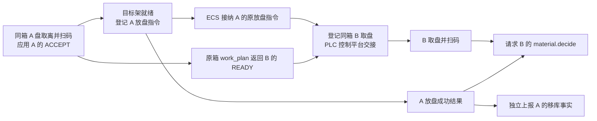
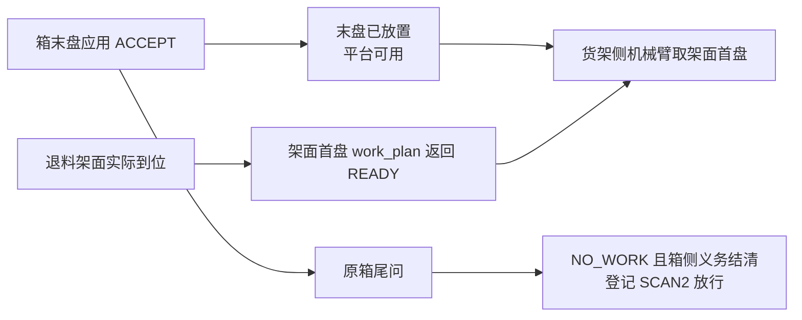
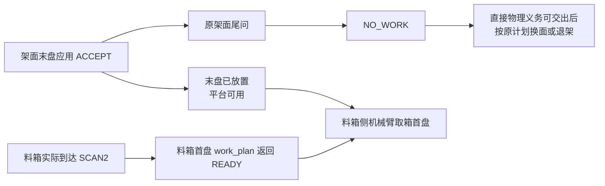
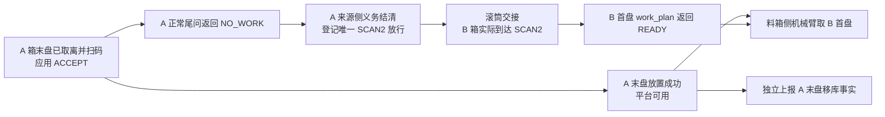

# SMT AUTO 出库 v1 接口与时序设计

本文是 BIN 料箱和 RackSlot 退料架面自动出库的评审稿。切换前以现行合同为准。 [SMT 自动拣料接口](smt-auto-api.md)

`material.decide@v1` 只决定本盘去向。正常 `ACCEPT` 生效后，WES 同时推进本盘放置和原来源的下一次 `work_plan@v1`。`work_plan` 以本次到位的箱或架面为单位，`NO_WORK` 是取料终局的唯一业务决定。每盘独立完成取盘、扫码、判定、放置和移库报告。

## 1. 接口合同

四条操作均由 WES 通过 `POST /api/v1/wes/decisions` 发给 WMS。请求沿用 `operation_id`、`operation`、`timestamp`、`data` 信封。决定响应使用 `HTTP 200 / DECIDED`，回显本次请求的 `operation_id`。业务时间和信封时间沿用 UTC Unix 毫秒。

| 操作 | 请求 `data` 必填字段 |
| --- | --- |
| `outbound.bin.material.decide@v1` | `task_id`、`bin_code`、`cell_id`、`barcode`、本盘扫码的 `scanned_at` |
| `outbound.rackslot.material.decide@v1` | `task_id`、`rack_id`、`rack_face`、`slot_id`、`barcode`、本盘扫码的 `scanned_at` |
| `outbound.bin.work_plan@v1` | `task_id`、`bin_code`、原 SCAN2 到箱的 `scanned_at` |
| `outbound.return_rack.work_plan@v1` | `task_id`、`rack_id`、`rack_face`、本轮架面实际到位的 `arrived_at` |

### `material.decide` 只决定本盘去向

| `data.result` | 响应字段与处理 |
| --- | --- |
| `ACCEPT` | `target_locator` 必填，包含 `type: RACK_SLOT`、`rack_id`、`rack_face`、`slot_id`、`rack_layer`、`rack_column`。需要目标架换面或更换时可带 `target_preparation: ROTATE / REPLACE`。WES 应用决定后推进本盘目标架准备和放置，同时登记原来源的一笔 `work_plan`。 |
| `REJECT` | 沿用 `business_exception_code`、`ng_locator` 和 `source_disposition`。原 NG 放置成功、原报告收妥后，按既有条件发起异常续问。`CLOSE` 的范围是对应 Cell 或 SLOT。 |
| `WAIT` | `retry_after_ms` 为 1 至 60000 的整数。本盘保留原去向待办和平台占用，到期再求本盘去向。 |

统一切换后，`ACCEPT` 响应移除 `next_source_action` 与字段省略推定末盘的语义。每次最终 `ACCEPT` 都触发原来源续问，报文无需末盘标记。

空取沿用 `outbound.source.empty_decide@v1`。`RETRY` 只授权一次原来源重取。`SOURCE_DONE` 关闭对应 Cell 或 SLOT，并按原条件发起异常续问。箱或架面的取料终局仍由 `work_plan.NO_WORK` 确认。 [原空取与异常续问合同](smt-auto-api.md#outbound-exception-example)

### `work_plan` 决定当前箱或架面是否还有作业

| `data.result` | 响应字段与处理 |
| --- | --- |
| `READY` · BIN | `cell_id`、`cell_index`、`bin_type`、`reel_layer`、`reel_thickness`、`size_inch`、`reel_diameter`。授权原箱内一次取盘，毫米字段允许为空。 |
| `READY` · RackSlot | `rack_id`、`rack_face`、`slot_id`、`rack_layer`、`rack_column`、`reel_thickness`、`size_inch`、`reel_diameter`。授权原架原面内一次取盘，毫米字段允许为空。 |
| `WAIT` | `retry_after_ms` 为 1 至 60000 的整数。原箱或架面保持开放，本盘已决定的放置照常推进。 |
| `NO_WORK` | 例如 `{"result":"NO_WORK"}`。WMS 确认本次到位的箱或架面已无后续取料作业。首问、正常续问和异常续问统一以此判定取料终局。 |

WMS 返回的 `size_inch` 原值填入 ECS 原合同的 `reel_diameter` 字段。WMS 的毫米 `reel_diameter` 同时保留并允许为空，ECS 报文结构保持原合同。

`READY` 的类型、单位及 ECS 参数映射沿现有合同。WES 用本次完整授权生成取盘参数，执行前复核原到位、设备和精确来源仍有效。WMS 用 `task_id`、来源和原到位时间定位作业，再根据已保存的授权、来源占用和作业进度作答。首问和续问使用同一请求结构。接口报文和单盘业务均无需前盘 ID，平台交接由原设备指令识别。 [BIN 授权](smt-auto-api.md#bin-work-plan) · [RackSlot 授权](smt-auto-api.md#rack-work-plan)

### 求值和恢复

1. WES 在首盘真实到位、正常 `ACCEPT` 应用或合法异常收口时，推进原来源的一次求值。决定消费、来源进度和唯一待发请求同事务保存，提交后可靠发送。同一次到位最多一笔未决 `work_plan`，已有有效授权先按原授权推进。重复通知、并发推进和重启复用原意图。
2. WMS 在发送 `ACCEPT` 前提交本盘决定，并将原授权标为已取出，使同次到位可继续求值。移库报告独立结算，保留原盘的报告归属。`material.decide` 凭原任务、实际来源和唯一有效授权定位该盘，关联不唯一时返回 `REFERENCE_CONFLICT`。`work_plan` 在同次到位内串行核对授权状态，原子保存请求结果和对应的 `READY` 授权或 `NO_WORK` 终局。同身份重放返回原结果。仍有未消耗授权时，新身份不能再得到一份 `READY` 或以 `NO_WORK` 关闭该到位。一个 `READY` 在 WES 只消费一次。
3. HTTP 超时、`503` 或响应丢失时，使用原 `operation_id`、`timestamp` 和正文恢复。收到有效 `WAIT` 后，用首次可靠记录时间加原 `retry_after_ms` 固定最早续问时点。到期重新求值时只换信封 ID 和时间，原来源及到位时间保持原值。
4. 对同一 Cell 连续取栈顶盘，只有 WMS 能安全确认下一层及其参数时才可返回 `READY`。若必须等原盘移库事实入账，先返回 `WAIT`。本轮已成功取离的 RackSlot 在 WES 验证下一份 `READY` 时排除，同一 SLOT 的合法原空取 `RETRY` 沿既有一次性授权处理。放置和移库报告独立恢复，同源同码的最终去向授权和报告去重继续遵守原合同。
5. `NO_WORK` 只关闭原到位的取料需求。已登记的放置、报告及释放动作继续按原身份收口。迟到响应只归原请求及原到位。同码箱新到位或同一货架新一轮到位有自己的首问和授权。

[现有 `WAIT` 与技术恢复](smt-auto-api.md#production-wait) · [同源同码与报告去重](smt-auto-api.md#plate-correlation)

## 2. 设备时序

来源取料终局、来源工位交出、扫码平台可用是三项独立条件。已就绪候选沿用同箱续取、退料架面、新箱首盘的优先级。等授权或等到位的候选不占用空闲平台。当前盘需要目标架进场、换面或更换时，按本盘 `ACCEPT` 推进。已确认的 `REPLACE` 按旧目标架的直接物理责任判断。原来源与其他来源仅求取盘授权或持有尚未下发取盘的 `READY` 时，可以继续准备，当前盘仍可推进所需换架。已可靠结清的 NG 和空取也继续保留原业务记录，并允许换架按直接物理条件判断。

### 2.1 同箱续取与 BIN 双臂重叠

重叠只适用于同一次 SCAN2 到位的正常续取。WES 从当前平台占用核对 ECS 已接纳的原放盘指令，确认它是货架侧机械臂从平台到转运架的正常放盘，再允许同箱下一盘登记取盘。PLC 必须在实际清台前拦住 B 的平台放入动作。即使 B 已排队，A 未能清台也继续拦截，ECS 按两条原指令保留各自执行状态。B 的扫码可以先到，B 的 `decide` 等 A 的原放盘成功。若原成功结果先于 ACK 到达，按平台已可用的路径推进。放盘失败、结果未知或需要核对时保留原平台和指令责任。A 的报告确认与 B 的设备调度独立。 [现有放盘接纳与平台门槛](../../app/businesses/smt_auto/outbound.py)

### 2.2 料箱 → 退料架面

退料架面可先完成进场和首盘求值。平台可用、架面仍在原工位且有有效授权时，货架侧机械臂接续取盘。老箱尾问为 `WAIT` 或结果未知时，老箱仍留在 SCAN2，已就绪架面可以接用空闲平台。老箱放行的结果和末盘移库报告各自收口。

### 2.3 退料架面 → 料箱

SCAN2 料箱真实到位即可求首盘。平台可用且料箱有有效授权时可接续取盘。原架面尾问未决时保留原架面。尾问 `NO_WORK` 生效后，沿原货架调度条件判断换面或退架。下一面凭匹配本轮原动作的真实到位启动首问。已完成物理动作的报告独立参与面和整单业务收口。 [原架面与物理交接规则](smt-auto-api.md#rackslot-completion)

同一架面继续取盘时，可在当前盘放置期间拿到同面下一个 `READY`。货架侧同一台机械臂负责取盘和正常放置，因此要等当前盘放置成功、平台可用且原架面仍有效，才开始下一次取盘。

### 2.4 料箱 A → 料箱 B 与末盘提前放箱

**正常尾问 `NO_WORK` 生效且 A 来源侧义务结清，就可以提前放箱。** 此时该箱末盘已可靠取离并完成对应扫码，箱内无待消费授权、在途取盘或未结清的来源异常。WES 为原 SCAN2 到位登记唯一放行，末盘放置和报告仍按原盘继续。首盘和异常续问的 `NO_WORK` 沿各自原放行条件检查。 [现行 SCAN2 放行合同](smt-auto-api.md#scan2-release)

B 以自己的真实到位启动首问。A 的放行命令或接纳 ACK 不能证明 B 到位。三种跨来源切换都等平台可用，再由具备有效授权的新来源取盘。若 A 的尾问比放盘更慢，A 仍占用 SCAN2，B 的到位推迟。此时已就绪的退料架面仍可接用空闲平台。

## 3. 同一 v1 的切换条件

WMS 和 WES 在同一窗口统一切换自动出库 `@v1`，恢复生产后只执行新版语义。四条操作名和报文字段按本设计使用。

| 阶段 | 条件与处理 |
| --- | --- |
| 旧流程收口 | 暂停下发及接纳新的自动出库任务，让旧在制任务完成，或在原系统完成现场对账和收口。核对 WMS 授权及库存、WES 待发消息、ECS/Transport 在途或未知动作，以及滚筒、平台和货架的实际状态。 |
| 历史清理 | 可清理已结清的 SMT AUTO 出库历史。清理范围按原任务及归属引用核对。缺少可核对 `NO_WORK` 的旧出库到箱记录会阻止升级，即使旧任务已经结清或盘记录已清理。应按原到箱及其关联范围处理，避免阻塞同码箱再次到位。对仍可能补报的老 SCAN2 等事件，保留去重依据，或在接收端提供已验证的旧事件隔离，防止旧扫码在切换后生成新到位。 |
| 双端升级与恢复 | WMS 和全部处理自动出库的 WES 实例完成切换及单链路验证后，恢复接单。核对首问、正常续问、正常尾问 `NO_WORK`、旧回报隔离和放行证据。 |
| 恢复后的故障处理 | 暂停新任务，保持已产生的新物理动作和系统记录，优先修复当前版本。若需要回退，两端先收口或核对新在制并恢复到共同可用的快照，再成对切换。 |

同名 `@v1` 存在不同的放箱语义，因此恢复接单以前须确认旧生产实例已退出，清理后的迟到请求、扫码和回报均无法产生新取盘、放盘或释放。

## 4. WMS 与 ECS 联调验收

| 对端 | 验收场景 | 通过条件 |
| --- | --- | --- |
| WMS | 两类 `material.decide` 的正常 `ACCEPT` | 只返回本盘目标及必要的目标准备。模拟下一盘计算变慢，本盘决定仍能先提交并响应。紧接的 `work_plan` 能读取该到位作业最新已提交进度。 |
| WMS | 首问、正常续问、异常续问 | 按原箱或架面返回正确的 `READY / WAIT / NO_WORK`。旧 Cell 或 SLOT 已关闭时不再次授权。`NO_WORK` 只关闭该到位，不影响另一来源、新到位或当前盘报告。 |
| WMS | 同箱同 Cell 连续取栈顶，原盘报告未入账 | 能安全计算下一层时返回其完整独立授权。无法可靠确定时返回 `WAIT`。无重复层位授权、误关来源或重复入账。 |
| WMS / WES | 超时、503、响应丢失、WAIT、并发唤醒及重启 | 技术失败重走同身份。业务 `WAIT` 只在到期后换信封身份。一个 `READY` 只生成一次取盘，迟到响应只归原到位，同码新到位可独立首问。 |
| WMS / WES / ECS | 同一 v1 统一切换，演练历史清理与恢复接单 | 放入旧答复、旧原指令回报及旧 SCAN2 事件，均不触发新业务动作。新到位仍可正常首问并以 `NO_WORK` 收口。 |
| ECS / PLC | 同箱双臂重叠，分别让 `READY` 或原放盘 ACK 先到，并在 B 已排队后让 A 未能清台 | 两条证据齐备才登记一次下一盘取盘。PLC 只允许向空闲平台放入物料。下一盘扫码可先到，自己的 `decide` 等原放盘成功。A 失败或结果未知时保留 A、B 原指令，B 不向仍占用的平台放入。 |
| ECS / PLC | 料箱 → 架面和架面 → 料箱，各模拟原来源尾问超时 | 新来源到位后可先获 `READY`。原盘放置成功、平台可用后，新来源接续。原来源仍保留待办，末盘报告未确认不阻挡接续。 |
| ECS / PLC | BIN A → BIN B，A 的正常尾问先于放盘成功返回 `NO_WORK` | A 来源侧收口即登记一次放行。B 真实到位后即求首盘，平台可用后可取盘。A 的放行 ACK 不替代 B 到位，A 的移库报告继续独立交付。尾问较慢时 A 留在 SCAN2。 |
| WMS / ECS | RackSlot 同面续取、换面及目标架 `REPLACE` | 同面 `READY` 可以先取得，实际取盘等机械臂和平台可用。来源换面等原面 `NO_WORK` 及物理交接条件，新面按自己真实到位首问。本盘所需目标架更换在同来源续问或另一来源首问尚未形成取盘动作时可推进，仍须满足旧目标架的直接物理条件。 |

联调统一记录事件时间和原身份。比较三种切换的**平台可用到下一来源开始取盘**，并记录 **BIN 末盘 `ACCEPT` 生效 → `NO_WORK` 生效 → SCAN2 放行登记 → 下一箱真实到位**。同时记录同箱下一盘 `READY`、原放盘接纳和原放盘结果，用于判断尾问延迟是否占满双臂重叠窗口。
