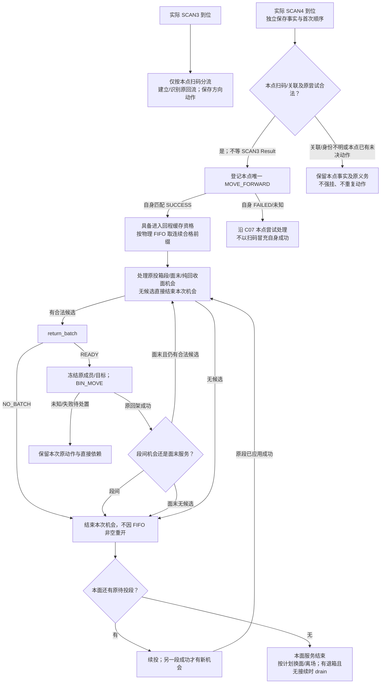

# 公共料箱回流 WES / WMS / ECS 对接文档

状态：**本系统公共能力对接草案；B1～B5 组件本地实现与分项验证、B6 文档边界核对已完成；B7 共享声明及隔离测试装配已完成，正式生产注册/接入及整体验收未完成，未部署。** 本文描述 BIN_Roller 内部的 `SCAN3 → SCAN4 → FIFO → Return_Batch` 回流段，统一描述正常/NG 分流、回架搬运、尾箱清退及恢复边界，供 smt_manual 的人工入/出库及 smt_auto 的自动上架/拣料流程复用。不因此新增业务包、数据库表、API 入口、发送器或调度器。

[人工线](manual-picking-api.md)归 smt_manual；[自动拣料](smt-auto-api.md#outbound-flow)与[自动上架](smt-auto-api.md#inbound-flow)归同一 [smt_auto](../superpowers/specs/2026-10-31-smt-auto-business-design.md) 的 outbound/inbound 工作段。每个宿主只装配一份 BIN_Roller，两方向不各建公共状态或 owner，生产准入及完成条件仍沿各自合同。自动上架的任务完成条件及与本文 C01～C07、R01 的[边界约定](smt-auto-api.md#roller-seams)在该正式对接文档维护。operation 仍保留参考合同名 `outbound.bin.return_batch@v1`、`workline.return_buffer.drain_rack_decide@v1`，不因名称含 outbound 将回流限制为出库；是否改名另行确认，不改变冻结请求。

## 目录

- [完整交互顺序](#return-sequence)
- [1. 流程与责任交接](#return-flow)
- [2. WMS API 与复用交互](#return-wms)
- [3. ECS 指令与回调](#return-ecs)
- [4. 公共规则与实现接缝](#return-rules)
- [5. 确认状态与对外交付依赖](#return-pending)
- [6. MOCK 与内部验收场景](#return-acceptance)

<a id="return-sequence"></a>
## 完整交互顺序

| 步骤 | 方向 | 交互 | 推进条件 |
| --- | --- | --- | --- |
| C0 | 人工/自动工作段 | 保存作业、原释放决定及组件返回的原命令关联 | 不向公共回流提供必需的上游准入证明；SCAN2 命令创建或 ACK 不证明下游已接到箱 |
| C1 | ECS → WES | SCAN3 / SCAN_COMPLETED | 独立受理本点实际到位，保存原扫码并建立/识别当前回流；不向前追溯 |
| C2 | WES → ECS | SCAN3 MOVE_FORWARD 或 MOVE_LEFT | 仅按本点条码/朝向规则分流，不检查上游任务、处置或命令结果，见[已确认 C02](#return-scan3) |
| C3 | ECS → WES | SCAN4 / SCAN_COMPLETED | 首次有效到位即保存事件身份和时间；本点扫码/本次关联合法即可登记自身放行，不等 SCAN3 Result |
| C4 | WES → ECS → WES | SCAN4 MOVE_FORWARD 及匹配 Result | 原 SUCCESS 表示离开扫码位进入下游缓存并形成对应资格，不表示已到最终取箱点；ACK 不替代 |
| C5 | WES | 工作线 FIFO 候选冻结 | 按首次 SCAN4 到位顺序取物理队首的连续合格前缀；遇未决队头停止，不先筛 READY 跳箱，见[已确认 C01](#return-fifo) |
| C6 | WES → WMS | [return_batch](#return-batch) | 当前面一段投料成功后的回箱机会、面末服务或纯回收面就绪；有合格候选且共享批次通道/本链前序允许 |
| C7 | WMS → WES | READY / NO_BATCH | READY 冻结候选连续前缀和精确目标；NO_BATCH 确定当前面无法承接本次 FIFO 队首，结束本次回架服务，不定时重试 |
| C8 | WES → WMS / RCS | [BIN_MOVE 回架](#return-transport) | CNV0302/CNV0402 为统一交接入口，CTU 与滚筒按冻结 FIFO 自动连续取箱；WES 不逐箱放行，本地交接与物理回架完成分别跟踪 |
| C9 | WES | 本线无可原子接续任务，仍有退箱 | 请求 [drain_rack_decide](#return-drain)取得一批可用货架，不绑定固定箱集合，不恢复旧父任务 |
| C10 | WES → WMS / RCS | drain 架进场、按面 return_batch、换面及离场 | 返回的所有架面按实际到位和原动作完成服务；本批原架服务及已创建整架动作收口后仍有待回箱时，新身份再次申请 drain，直到回程通道排空 |

每条工作线有自己的回程范围与队列；KT16 和 KT18 不共用 FIFO。请求内 sequence_no 只是此次候选顺序，不是跨请求永久队列号。

<a id="return-flow"></a>
## 1. 流程与责任交接



### 1.1 工作段与公共回流各自负责什么

| 范围 | 责任 |
| --- | --- |
| 人工工作段 | SCAN2 准入、人工完成、正常/NG 处置及本次释放决定；原放行命令交 BIN_Roller |
| 自动工作段 | 逐盘授权、取放/报告义务、箱结束及本次释放决定；原放行命令交 BIN_Roller |
| BIN_Roller | 四点唯一受理；SCAN2 先保存事实再同事务调用生产业务，释放决定经组件执行；内部统一供箱/回流、FIFO、分配、架流/drain 及原义务恢复 |
| Transport | 原搬运的可靠提交、应用结果及位置/直接前序公开读口；不决定人工是否完成或 FIFO 选箱 |
| 业务任务 | 按对应 completion_confirm 完成；不以公共 FIFO 清空和全部物理回架作为统一前提 |

SCAN2 每经过只成功委托一次，成功后组件受理项即可结束；生产准入/WAIT/完工及释放决定唯一归生产业务，组件不再保存一份业务决定，也不套统一的无任务处置。原释放只经组件唯一方法并返回原命令；迟到旧完成/Result 不改挂新经过。ECS 与物理流程在明确原 Result 后推进后续执行，WES 不另建跨点前驱等待、旧命令误动新箱的过期派发状态机或全线门禁。业务完成条件仍按各业务合同。

公共回流从实际 SCAN3 到位事实独立开始，不要求先取得人工/自动工作段的交接授权，不回查 SCAN1、SCAN2、WMS 作业决定、原任务/计划或上游命令 Result。原工作段继续保存自己的业务和命令事实，但这些记录不成为 SCAN3 的准入、等待或分流条件，见[已确认 C02](#return-scan3)。

SCAN3 按本点事实建立/识别当前回流，不查询“当前最新任务”挂接料箱，也不为补齐上游关系新增请求字段。SCAN4 仍须关联本次公共回流，但实际到位证明本点事实，不需要 SCAN3 原 MOVE_FORWARD 的 Result 才登记 SCAN4 放行。关联缺失/歧义先保存待关联，不按最新轮次强挂；本点已有同一未决动作不重复创建。任务完成或取消不删除各自未决义务；原工作段的迟到决定/Result 不改变 SCAN3 已确定的方向或重开公共回流。

NG 结果仅属于本次经过，不成为箱码永久属性。已闭合历史不阻挡合法新轮次，当前未知动作及直接物理依赖仍保留。NG 出口后的人工作业不在本文范围，不虚构 NG 出口完成报告。

### 1.2 到位、候选与交接的四个条件

| 条件 | 证明依据 | 不可替代它的事实 |
| --- | --- | --- |
| SCAN4 首次到位和顺序 | 本次唯一有效 SCAN4 事件、设备发生时间及稳定事件身份 | 命令完成顺序、HTTP 接收顺序、原投料清单顺序 |
| 当前回架资格 | 本轮对应 SCAN4 MOVE_FORWARD 尝试的原匹配 SUCCESS，表示离开扫码位进入下游缓存，且本次关联合法 | 命令创建、ACK、超时、其他轮次成功；不据此宣称已到最终取箱点 |
| 回架分配及本地执行权交接 | 原 WMS READY、冻结候选/目标和可信 Transport 接纳证据 | 发送成功、本地 Return 状态或未知响应 |
| 物理回架完成 | 原 Transport 已应用权威成功、最终位置匹配冻结目标且无未决核对义务 | Return 本地闭合、ACCEPTED、父任务 COMPLETED |

首次有效 SCAN4 到位直接保存；本点扫码/关联合法且无本点重复/未决尝试即可登记 SCAN4 MOVE_FORWARD，不等 SCAN3 Result。候选回架等待的是 SCAN4 自身放行成功，而不是上游成功回执。FIFO 在重复扫码、命令迟到或重启时不重新排序；C07 允许的同轮失败重扫仍保留首次顺序，候选资格来自本轮对应有效尝试的匹配 SUCCESS。同箱合法新回流轮次有自己的到位身份，不继承旧轮次顺序。

<a id="return-fifo"></a>
### 1.3 C01：物理 FIFO 连续前缀（已确认）

用户已确认 KT16、KT18 从 SCAN4 到出料口均为单通道，不能超车，也没有绕过前箱取后箱的机构；人工搬离是明确的例外退出事实。两线分别维护自己的物理 FIFO。

以本次首次有效 SCAN4 到位顺序为准，先从当前物理轮次中所有尚未完成/未确认人工移出的队列检查队首，再判断回架资格及来源条件；当前队列已分配/在途的直接义务不能在查询时先过滤掉。真正新 SCAN3 已取代的旧物理轮次不继续充当当前 FIFO 队头，旧命令/分配/Transport 仍独立履约，见 C07；这不允许过滤当前未就绪队头。取 1～4 箱连续合格前缀，前缀非空即可请求，不等凑满四箱或缓存容量数值；遇到不合格或未决成员立即停止。**先按物理顺序取连续合格前缀，禁止先过滤 READY 再排序。**

| 按物理先后顺序的状态 | 本次候选 |
| --- | --- |
| A READY、B READY、C READY | A、B、C |
| A MOVE_PENDING、B READY、C READY | 无；不能跳过 A |
| A READY、B MOVE_PENDING、C READY | 仅 A；不能跳过 B 选择 C |
| A 原分配请求响应未知、B/C READY | 恢复 A 的原请求，不以新批次绕过未决责任 |
| A 已分配或已提交原回架 Transport | 不重复分配 A；其未完成原搬运/执行依赖不能靠从候选中过滤 A 消失；不另建物理占位锁 |
| A 已按原物理结果收口，或已确认人工搬离并接管 | 从剩余物理队首重新取连续合格前缀，其他料箱仍须各自满足资格 |

Transport ACCEPTED 只证明执行权交接，不独自证明箱已取走或通道已让出；[已确认 C04](#return-handoff)采用统一交接入口和设备自动连续取箱，原回架成功仍以已应用权威结果、成员及冻结架槽匹配为准。第 2.1.2 节仅保留当前原执行步骤的具体依赖，不把同名架面全部历史结果作为分配门槛。对剩余候选的重新检查不重排首次到位顺序、不补认原命令成功，也不阻挡另一条独立工作线。

人工实际搬离并确认接管后，由 [TODO：人工移出与责任接管维护端点](../../TODOS.md#人工移出与责任接管维护端点)将对应本次回流记录从活动 FIFO 剔除，其余料箱继续按剩余物理队首取连续合格前缀。该箱后续处理由人工接管，不要求完成回库才退出本次队列。保留原事件、命令、分配、Transport 和接管审计，不伪造 SUCCESS、已回架或库存核销；迟到旧结果不能重开该次回流，同箱以后合法投入按新轮次处理。人工移出是小概率维护例外，不作为正常 return_batch 流程启用前置；本计划不展开冻结多箱接管联动或平台暂停发送方案。

正常 FIFO 实现与验证归 B4；组件已识别本次 ReturnRound.removed 持久事实，并按原 round_id 隔离迟到结果，不重开旧轮次或修改同箱新轮次。B6 仅复核既有行为证据及文档边界，不增加维护路由/权限/派发联动测试。人工移出维护端点尚未实现，独立交付且不是 B7 前置，已加入 [TODO：人工移出与责任接管](../../TODOS.md#人工移出与责任接管维护端点)。它确认已发生的人工搬离及接管，仅剔除对应本次活动队列记录，历史保留；当前只登记 TODO，不提供可调用端点。

<a id="return-scan3"></a>
### 1.4 C02：SCAN3 按到位事实独立处理（已确认）

用户已确认：**SCAN3 按本点实际到位事实处理，不向前追溯。** 人工/自动工作段释放、SCAN1 旁路、无任务直达或人工重新投入均采用同一规则，不分别核验上游资格。

| 本点事实 / 当前处理 | SCAN3 行为 |
| --- | --- |
| 本次实际扫码条码、朝向有效 | 创建/取得本次合法尝试的唯一 MOVE_FORWARD，建立/识别当前回流 |
| 本次不可读、条码无效或朝向错误 | 按本点异常规则 MOVE_LEFT，保存原扫码及方向命令；不补填预期箱码 |
| 上游无记录、WMS 决定未到/WAIT、人工尚无完成通知、原命令 Result 未到 | 不查询、不等待，也不据此判 NG；仍只按本点扫码分流 |
| 上游已记录 NORMAL/NG、取消或任务完成 | 不读取这些上游状态决定 SCAN3 方向；上游 NG 不自动成为本点 NG |
| 同一本点事件重放或当前回流重复处理 | 复用原身份及方向，不重复建回流或命令，不反转旧动作 |

这里的 NORMAL/NG 分流只表示本点扫码校验结果，不说明上游业务是否完成，也不代替 WMS 库存、设备 Result 或 Transport 的原事实。上游状态不明不是 SCAN3 停留等待的理由。

“不向前追溯”不取消本点事件幂等、当前回流的防重复和结果隔离，也不将重复到位一律视为新轮次。SCAN3/SCAN4 本段失败重扫、新轮次与旧命令隔离按[已确认 C07](#return-rescan)；不得重新引入上游任务或作业决定作为这些分支的准入条件。

<a id="return-no-batch"></a>
### 1.5 C03：分段投料与回箱交替、确定 NO_BATCH（已确认）

用户已确认：**当前面每一段投料成功后，可以执行一笔公共回箱；原回箱完成后再执行下一段投料。** 投箱与回箱按同线串行批次步骤交替；记录原请求/搬运进度，不增加手工锁、工作位预占或通道租约。段间每次至多一笔回箱批次，按 C01 取最多 4 箱的合法 FIFO 连续前缀；正常回箱成功后在组件内部续投，不要求排空 FIFO。本机会尚未登记请求且没有可请求候选时，记录本地 NO_CANDIDATES，不发送空请求或伪造 WMS NO_BATCH；确定 NO_BATCH 也结束本机会并继续下一待投段，不为等回箱阻塞投料。即使 READY 仅分配部分前缀，段间成功这一笔后也直接续投，不追加第二笔来排空尾部。已有未知请求、冻结搬运及未知位置的直接依赖仍按原身份收口，不能当作无候选跳过。

同一 FACE_END/PURE_RETURN 机会可连续多笔回架：每笔有独立本地批次引用、原 operation_id/候选/BIN_MOVE，内部结果回写必须显式携带该原批次引用，不能查“本面最新批次”；未知仍重试原批，成功后由统一架流选下一笔并经 return_flow 同事务登记意图；旧批重报不自己重发或再建批次。机会结束才结束面，一笔成功不等于整面完成；不另等一次定时交接。段间 SEGMENT 仍至多一笔。

每次段间机会关联本架原周期、当前面及原成功投料段 Transport；相同结果重放/重复唤醒不重复创建机会。以对应业务的权威最终结果判断该段投料成功；自动上架已确认成功 resulted 应用即允许接续，不等待 SCAN1/SCAN2 或可选中间到位事件。回箱分配仍由 WMS 根据实际架面和当前真实空槽决定，不能把后续未投箱的冻结来源槽当空槽，或仅凭 READY 计划推算可用槽。

整面 feed_complete 表示本次冻结清单全部预期投料段/成员已权威成功、交接终位匹配且结果已应用；最终空清单且无原未决投箱时也成立。不等待扫码/逐盘作业，不把失败、未知或取消当成功，也不作为段间回箱前提。最后一段的回箱机会直接进入面末服务，不重复创建；面末按正常回架流程处理当前合法候选。当前无可请求候选或确定 NO_BATCH，且本面已冻结回箱请求/搬运及直接义务闭合后，结束本次面服务，不等后续新箱；无可请求候选不等于回程通道物理排空，不据此结束 drain。纯回收面实际到位、面向明确且无投料义务后可服务，不制造额外投料动作；两者均不等 SCAN2 作业完成。

NO_BATCH 只表示 WMS 已完成本次分配判断，**当前实际架面无法承接本次物理 FIFO 队首**；不表示整个货架所有面均不适配，不表示 WMS 暂时未完成分配事务，也不表示料箱 NG。响应 data 仅 result=NO_BATCH，不带 retry_after_ms 或 moves。

确定 NO_BATCH 可靠保存后，本次服务机会结束，不因时间到期、重复唤醒、重扫或仅新增候选而重新请求。未分配箱保留原 FIFO；若本面还有待投段，则继续原投料计划；只有本面供箱/服务及直接义务已收口，才按计划换面，或满足整架条件后申请 departure_decide，READY 后再创建离场 Transport。NO_BATCH 不代替离场许可/物理离场，也不解除已冻结搬运或未知位置的直接依赖。

**后续另一投料段成功使架面出现新的空槽，是同面新的合法回箱机会。** WES 可用新 operation_id 冻结当时 FIFO 并重新求值；这不是重试或改写前次 NO_BATCH。下一实际架面或其他独立合法服务同理，不能仅换 operation_id 重开原机会。READY 未分配尾部保留队首；后续仍核对前轮搬运终态/终位，不越过在途前缀。

响应未知或 503 沿原 operation_id、timestamp、正文恢复，不按 NO_BATCH 处理；409/422 留证核对，不换身份求值。return_batch 仍仅 READY/NO_BATCH，不新增 WAIT，也不把 WMS 尚未做出的业务判断包装成 NO_BATCH 或技术故障。

普通架 4＋1 投回、同任务同面新服务和两架多面 drain 的逐步动作及计数，统一见[设计正常场景推演](../superpowers/specs/2026-10-30-bin-roller-capability-design.md#roller-normal-walkthrough)；本节不另复制一份轨迹或新增业务状态。

本节为本系统当前确认口径；正式接入需同步 WMS 合同及消费业务编排。历史冻结请求/原响应保持原身份、字节及解释依据，不原地删字段或重算幂等内容；B3～B5 已在隔离测试装配中验证段间交替，正式生产接入与现场验收仍待 B7/后续交付。

<a id="return-handoff"></a>
### 1.6 C04：下游缓存与统一交接入口（已确认）

用户已确认：SCAN4 的原 MOVE_FORWARD 返回 SUCCESS，表示该箱离开扫码位、进入下游缓存，**不保证已到最终出料取箱点**。首次有效 SCAN4 到位冻结 FIFO 顺序，原匹配 SUCCESS 形成该箱进入回程通道后的回架资格，两者分开记录。

KT16 的 CNV0302、KT18 的 CNV0402 定义为本线回程通道面向 CTU 的**统一交接入口**。return_candidates.source 和对应 BIN_MOVE 的 HANDOFF_POSITION 表示从该入口按 FIFO 提供指定料箱，不声明这些箱已同时停在同一个精确取箱点。已进入下游缓存且满足 C01 的连续合格前缀可组成最多 4 箱的批次，仍须满足 C03 的架面服务时点和本链直接依赖。

CTU 与滚筒自动配合，按冻结 FIFO 顺序将各箱送至取箱点并连续取走；**WES 不逐箱再次下发放行，不为缓存中的每个滚筒位新增位置或调度步骤**。统一交接入口也不能用于包装尚在 SCAN2、NG、通道外在途或位置未知的箱。

Transport ACCEPTED 只表示原搬运已接纳，不证明已经取走或回架；物理回架完成仍读取原 Transport 已应用的成功结果，核对成员及最终架槽与冻结目标一致、无相关未决核对义务。失败、未知及响应丢失保持原身份，不生成第二条搬运。仅本地 Return 关闭不能解除原物理依赖，本轮不新增凭 SOURCE_PICKED 历史里程碑提前结束回架责任的规则；人工搬离接管仍按 C01 的独立退出事实处理。

缓存步进、取箱顺序及物理互锁由 ECS/PLC 与 CTU/RCS 配合负责；本系统不根据旧库 capacity=1 或旧文档的约数推算实时空闲滚筒位。**本次未确认缓存总容量的数值**，不将它当作已知调度参数；[已确认 C05](#return-drain-supply)中的 drain 只申请可用架，不建立容量预留或核销账。

<a id="return-drain-supply"></a>
### 1.7 C05：按需供架、动态回架，直到排空（已确认）

用户已确认：**drain 只是请求 WMS 提供可用货架，可一次返回多个货架；货架实际到位后，再用普通 return_batch 确定当时本批次的料箱及精确回架槽位。** 不引入按料箱任务、业务方向等限制回架的“业务资格”，也不把 drain 定义成针对固定箱集合的容量预留承诺。

正常求架直接从本线原待回箱记录发现，不要求先有 DRAIN 或架周期。SCAN4 自身成功、接续变化及原服务收尾都可促使 service 检查：有合法原面步骤/原供架批次就继续原流程；确需新供架且 NONE 与非空前缀成立才登记原请求。接续未明确时原待回箱记录仍是持久 pending，不因扫码命令已完成丢掉后续求架，不新增调度表或私有通知。

正常路径如下：

1. 业务明确无可接续任务（NONE）且当前物理 FIFO 有非空可请求前缀时，用当前数量新申请 drain；队首未就绪不申请空批/跳箱。接续判断不重新审批原已登记周期的回架/换面/离场；请求技术重试保持原身份和数量。
2. WMS 返回一批可用货架及面，WES 保存原候选及各项进度；按需要选用并启动原进场，不因 READY 把所有候选都提前登记 CTU01。READY 不代表已到位，也不分配具体料箱或槽位。
3. 某架实际到位且当前面就绪后，按 C01 的当前物理 FIFO 连续合格前缀请求 return_batch，再经原 BIN_MOVE 回架；纯回收面无需投料。具体箱集合只在该次 return_batch 创建时冻结，后来到达的箱继续进入工作线 FIFO，不排除在整个 drain 流程之外。
4. 当前面不能再承接时，NO_BATCH 按 C03 结束该面服务，满足直接依赖后换面或申请离场，不在同面轮询、不重复分配在途箱。先继续本批已返回的其他架面，不能因第一架容量不足就重复申请供架；原当前架离场接纳后仍有可请求箱时，同事务选本批下一候选/登记原进场，不为本地交接等下一轮。若通道提前真实排空，剩余架/面按[已确认 R01](#return-drain-empty)收尾，不逐一换空面。
5. **本批应服务候选均完成原服务（真排空时未启动项记未用），进场/换面义务收口、各应离场架的 CTU03 已明确接纳后（不等最终位置/Result），若仍有待回箱，就以新 operation_id、当前数量再次申请 drain；持续到回程通道排空。** 前批原请求、响应和物理动作不改写，不复制重发。

箱流排空、单架释放、供架批次收尾分别判断；其他架尚未到位不否认本段箱流已空，但其原进场义务仍要在本批收尾处理。最后一个原周期进度更新后，同事务调用原批次汇总方法收尾并检查新供架条件，不要求另等 DRAIN work/Beat。这里“回程通道排空”不能只看 READY 候选数量为 0：已到 SCAN4 但原放行结果尚未确定的箱仍在本段责任内，已分配或在途箱也不能冒充已回架。无可请求前缀时保留原事实等待，不发送 required_slot_count=0，也不越过队头；原回架、货架动作按原结果收口。人工搬离并接管的箱按 C01 退出系统责任。

WES 不维护 drain reservation、固定 drain 成员清单、累计预留容量或核销账，不以 WMS 容量释放证明作为下一次正常供架的前提。WMS 负责提供可用架并在 return_batch 分配精确空槽，ECS/RCS 负责实际运动和交接。架槽暂时不足可以导致本面 NO_BATCH，但不存在因正常回流箱所属任务等“业务资格”而拒绝回架的独立分支。

新任务可按原共享资源规则承接工作线 FIFO，不能清空队列或改挂原动作；不照搬旧系统因新任务/超时自动退役 drain 的机制。受控停止、业务切换或整批供架的人工撤销不属于本轮新增功能，不以它们伪造已取消的对端搬运；已有请求未知、在途及迟到结果仍按原身份保存，不能自动重开已交由人工接管的箱。

本节替代旧参考合同的 drain 容量预留、固定成员与精确核销假设，是本系统已确认的目标用法；旧 DTO/实现及 WMS 交付版本需据此同步，本文不声明已经实施。

<a id="return-capability"></a>
### 1.8 C06：业务子包内代码复用与统一推进（已确认，实施入 TODO）

用户已确认：WORKLINE 只关联业务子包，公共箱流/架流统一为该子包内部复用的 BIN_Roller 组件；回流是其内部流程。一个业务子包可以组合多个内部能力；KT16、KT18 或后续 KT20 选择 SMT 手工上下料业务后，由该业务内部执行相同回流逻辑，各线仍使用自己的设备、位置和 FIFO，不自动发现或复制配置。

BIN_Roller 四点及供箱/回流合同只定义一次；本回流段的 SCAN3/4、return_batch/drain 规则按本文实现，多个业务使用时由目录编译使用关系；新事件按受信工作线业务分派到该业务内的唯一 BIN_Roller，原结果按创建时保存的业务归属处理。状态、命令、WMS 请求、Transport、pending 和恢复责任均属于原业务子包；BIN_Roller 不获得业务码、CommandOwner、独立 progression、Beat 或任务。共享表结构中的行仍按原业务、工作线、轮次隔离，不形成跨业务队列。

业务在公共箱流范围只声明 bin_roller.COMPONENT，任务合同另组合同源 sorting_task；组件内部统一普通/纯回收架 CTU01/02/03、供箱/回流及原步骤进度，不再装配两个组件或外置架面服务。生产业务提供任务/供箱/接续及 SCAN2 作业接缝；物理事实、当前投影和原履约分别保存，不增加组件手工锁/占位。动作 owner 均为原业务。扫码先到即受理，新有效架到位更新旧记录；迟到上游只补原履约，不回退已确定下游位置，见[BIN_Roller 设计/U01～U08](../superpowers/specs/2026-10-30-bin-roller-capability-design.md)。只有一处 rack_flow 实现 CTU01/02/03、departure 与面转换，work 种类只定位原事实；service 消费本次 FEED/RETURN_BATCH 等结果后同事务进入该实现准备下一原步骤/首个意图，不强制另等 RACK_CYCLE 待办或 Beat；原结果重报不重复开其原面服务，同任务新合法需求复用当前同面不增加架动作，实际异面才换面；DRAIN 只管理供架请求/批次及原周期引用；选中启动的周期由 service 交统一入口启动，后续不全批递归推进。供箱/回箱模块不复制架流决策，仍消费自己的原结果。面服务结束不等于离场许可或物理成功，不再设计跨 owner 协作或组件间通知。

**Transport 结果也必须即时唤醒原业务，5 秒 Beat 只做兜底。** ECS 新事件提交后通知本次受信解析的业务；ECS/WMS/Transport 结果提交后通知原持久业务归属。Transport 新结果实际应用，或位置事实使 pending 结果实际应用，均在提交后通知本业务 scan_pending，再由其推进内部回流待办。共享 WMS operation 不能只按源码位置猜归属，需保留每个原请求的业务关联；通知不广播各业务或各组件。

复用现有 receiver、BindingResolver、BusinessRuntime、公开读口、Outbox、after_commit、业务任务壳及 scan_pending；组件不新增 Sender、事件总线或调度器。阶段一、二已验收组合/分派及原归属通知接缝；BIN_Roller B1～B5 已完成组件本地实现与分项验证，B7 正式生产接入未完成，当前设计见[实现设计稿](../superpowers/specs/2026-10-30-bin-roller-capability-design.md)。

已登记 [TODO：业务子包组合接入与即时唤醒](../../TODOS.md#业务子包组合接入与即时唤醒)。**业务边界与代码复用归属已确认，B1～B5 组件实现已分项验证，B7 正式生产装配与整体验收未完成**，不据此提供生产可调用的新 API。

<a id="return-rescan"></a>
### 1.9 C07：失败重扫、人工重投与轮次隔离（已确认）

本节按已合并 BIN_Roller（PR #42，`e265ad7`）对齐：[组件轮次规则](../superpowers/specs/2026-10-30-bin-roller-capability-design.md#roller-return-rounds)与[记录场景验证](../testing/bin-roller-wes-recorded-cases.md)。**已有轮次内的 SCAN4 明确 FAILED 后，真实重扫可以产生同轮新尝试；符合本点分隔规则的真正新 SCAN3 到位独立建轮，不以旧轮闭合或人工移出为前置。** 超时/未知不授权重发原动作，新轮也不撤销旧履约；人工移出接管仍是 C01 的独立维护事实。

#### 1.9.1 已有轮次内的 SCAN4 重扫

| 原动作及新事实 | 处理 |
| --- | --- |
| 同一事件原文重报、重复消费或重复唤醒 | 返回/取得原事件与原动作，不增加尝试 |
| 本轮 SCAN4 原命令运行中、仅 ACK 或结果尚未确定 | 保留本轮原命令；SCAN4 重扫先留证，不产生本轮第二条运动命令；SCAN3 的未决 Result 不作为 SCAN4 新动作门禁 |
| 原命令已应用明确 FAILED，动作确定终止且无核对义务；其后同箱在失败点位发生新的真实重扫；本轮无已冻结回架分配或在途回架 | 可在本轮创建一次新尝试，保存新扫描与原失败的关联，使用新的稳定 call_key/command_code；新尝试的重复处理仍取得同一命令 |
| 本点原动作本地超时、UNKNOWN、HELD、结果冲突或位置/同箱关联不明 | 不视为明确 FAILED，不靠新时间戳、新身份或设备 online/IDLE 重发；等待原事实，必要时按 C01 人工移出接管 |
| 本点原动作已 SUCCESS，或本轮已有回架分配/搬运 | 本点重扫不再创建同点方向命令，不撤销分配/资格或重排 FIFO；不把上一个点的 SUCCESS 解释成阻止下一个点动作 |

本轮 SCAN4 新尝试只执行该点已确定的方向，不回查上游、不反转旧方向。不可读且不能唯一关联当前轮次的扫描不满足重试门槛。这里的新尝试是失败后本点真实重扫授权的动作，不是对旧命令换 ID 重发；原失败、参数、附录和结果均保留。另有真正新 SCAN3 到位时按 §1.9.2 建轮，不按本表把新轮当成旧动作重试或撤销。

SCAN4 首次有效到位冻结本轮 FIFO 顺序，失败后重扫和新尝试 SUCCESS 都不改变该顺序。新成功仅补齐本轮资格；当前物理队首未明确恢复前仍阻挡后箱，不能把失败箱移到队尾让后箱先走。新 SCAN3 轮次不继承旧 SCAN4 或回架成功，也不重新执行旧动作。

#### 1.9.2 人工重新投入与旧轮次隔离

同箱符合本线本点分隔规则的真正新 SCAN3 到位独立建立物理轮次，不等待旧轮正常结束或人工移出接管。原事件重报仍技术幂等；连续相同扫码且无本点分隔事实仍归原经过，不因新时间戳单独建轮。正常回架完成仍须原已应用权威成功及匹配终位；NG 分流按原 MOVE_LEFT 匹配成功结清其原责任，不虚构 NG 出口报告，实际离位含义仍按设备附录确认。新轮到位不补认这些旧结果。

旧轮尚未结束时，真正新 SCAN3 仍按自身事实建轮；旧命令、冻结分配及已创建的 Transport 保留原轮次并独立履约，**不自动 VOID、改号、重派或改挂新轮**。当前物理轮次由最新有效 SCAN3 的双向原关联确定；最新关联缺失/冲突不回退旧轮，孤立旧历史不设置全局门禁。旧的未派发 READY 被新实际经过取代时，由组件按原请求/机会/批次消费旧决定并释放仍当前的旧候选；已有 Transport 和未解决失败不因此自动解除。人工实际搬离并确认接管仍按 C01 移交原责任，但不作为承认新实际 SCAN3 的软件前置。

WES 本地保存工作线、回流轮次、点位及命令尝试的稳定关联；原 operation、分配成员和 Transport 也绑定创建时的轮次。Result 只按原 command_code/device_code、原搬运及所属动作消费，禁止仅凭 bin_code 查“最新轮次”应用。当前物理 FIFO 只纳入当前有效轮次，旧履约继续保存；旧结果不能替新轮生成资格或消除新轮 FIFO 阻挡。SCAN4 须关联当前轮次并取得自己的匹配 SUCCESS；SCAN3 不分隔 SCAN4 本点经过，不能只因新 SCAN3 就替旧 SCAN4 重发或改绑，同箱新轮的 FIFO 顺序由其自身首次有效 SCAN4 冻结。

组件持久保存事件消费身份与轮次关联，不能只依赖可清理的通用收据。供应商重报须保留原 timestamp 和完整 data，真实重扫才产生新事件事实；**时间戳变了不单独构成重新执行授权**。同一工作线/同一点位的新消息按业务内容判断，连续相同扫码且无其他本点相关事件归原经过，有其他有效扫码/原动作 Result 则新进站。其他点位/线、ACK/心跳、旧身份及重复 Result 不切分；相关 Result 以已持久/公开事实为准，不等 Beat 消费。真正新 SCAN3 建立独立轮次，SCAN4 新经过仍按当前轮次及本点原尝试判断；两者都不自动结束旧履约。剩余具体字段/重扫动作附录见 [TODO](../../TODOS.md#公共回流设备附录与事件重报约定)，不新增外部 bin_visit_id、事件总线或维护重置入口。

<a id="return-wms"></a>
## 2. WMS API 与复用交互

### 2.0 公共信封与位置

请求使用 `operation_id/operation/timestamp/data`；响应使用 `operation_id/code/timestamp/data`。两项决定均为 `POST {{WMS_BASE_URL}}/api/v1/wes/decisions`，UTF-8 application/json，Body 上限 256 KiB；详情见[公共信封](workline-business-api.md#wms-消息信封)。

operation_id 为小写 UUIDv7；timestamp 为非负 int64 UTC Unix 毫秒；Identifier 匹配 `[A-Za-z0-9][A-Za-z0-9._:/-]{0,99}`；面向为 1～10 个 Unicode code point 的非空原文、不含 NUL；drain WAIT 的 retry_after_ms 为整数 1～60000，return_batch NO_BATCH 不携带此字段。数字不接收字符串或布尔值。

| locator.type | 必填字段 | 用途 |
| --- | --- | --- |
| HANDOFF_POSITION | location_code | 本线已确认的统一 OUTLET 交接入口，不表示所有候选已同时到最终取箱点 |
| RACK_BIN_SLOT | rack_id、rack_face、slot_id | WMS 分配的精确回架槽 |
| RACK_POSITION | location_code | 承接架当前实际工作位 |

WMS 使用 type/bin_code；Transport 使用 kind/container_id，由调用方保存原关联并映射。RETURN_BUFFER 是工作线回程语义，不另造现场位置码；[KT16/KT18 配置](manual-picking-api.md#manual-config)中的 CNV0302/CNV0402 按[已确认 C04](#return-handoff)作为统一交接入口。SCAN4 到位及原 MOVE_FORWARD SUCCESS 均不表示箱已到最终取箱点，后者表示进入下游缓存。

<a id="return-batch"></a>
### 2.1 回架批次分配

| 项目 | 值 |
| --- | --- |
| 方向 / operation | WES → WMS，`outbound.bin.return_batch@v1` |
| 端点 | `POST /api/v1/wes/decisions` |
| 触发 | 本段投料成功后的回箱机会、面末或纯回收面服务就绪；有合格候选且共享通道/本链前序允许新分配 |
| 成功 | `200 / DECIDED`，READY / NO_BATCH |

段间机会、面末服务与纯回收服务必须区分：SEGMENT 成功一笔即结束本机会并由组件续投；FACE_END/PURE_RETURN 成功一笔只完成原回架批次，有合法候选则继续本面；无候选/NO_BATCH 且本面原义务收口才结束面服务。最后投箱段只进入面末服务，不能同时新开一份段间机会。最终空投箱清单直接进入面末服务，不制造空投箱；drain 本身不请求 inbound_batch。

#### 2.1.1 请求

```json
{
  "operation_id": "019f3406-2200-7b03-8b01-000000000003",
  "operation": "outbound.bin.return_batch@v1",
  "timestamp": 1793376050000,
  "data": {
    "workline_code": "KT16",
    "rack_id": "SOURCE-01",
    "rack_face": "90",
    "return_candidates": [{
      "sequence_no": 1,
      "bin_code": "A000000001",
      "source": {"type": "HANDOFF_POSITION", "location_code": "CNV0302"}
    }]
  }
}
```

| 字段 | 类型 / 必填 | 约束 |
| --- | --- | --- |
| workline_code | Identifier / 是 | 原工作线，不是 task_id |
| rack_id、rack_face | Identifier、面向原文 / 是 | 实际到位且可承接料箱的当前架面，不能取计划值 |
| return_candidates | array / 是 | 1～4 项，按确定的 FIFO 规则冻结；无候选不调用 WMS |
| sequence_no | integer / 是 | 请求内从 1 连续递增，不重复、不跳号 |
| bin_code | Identifier / 是 | 实际合格箱，不重复；不能用预期码或同码旧轮次代替 |
| source | HANDOFF_POSITION / 是 | 已确认统一交接入口；候选已进入本线回程缓存，不要求已到最终取箱点，禁止把 SCAN2 工作位、NG、通道外在途或未知位置包装成 OUTLET |

WES 本地同事务冻结候选的具体回流轮次、顺序和原请求；wire 不增加 task_id、盘次 ID 或 drain 原请求 ID。技术重试不能重排候选，新业务请求才按当时合法候选重新从 1 编号。WES 按[已确认 C01](#return-fifo)构造物理 FIFO 连续合格前缀；WMS 再在这份冻结候选中选择连续前缀，不能通过请求内连续编号掩盖请求构造时跳过物理队头。

#### 2.1.2 READY

```json
{
  "operation_id": "019f3406-2200-7b03-8b01-000000000003",
  "code": "DECIDED",
  "timestamp": 1793376050100,
  "data": {
    "result": "READY",
    "moves": [{
      "sequence_no": 1,
      "bin_code": "A000000001",
      "target": {"type": "RACK_BIN_SLOT", "rack_id": "SOURCE-01", "rack_face": "90", "slot_id": "02"}
    }]
  }
}
```

READY 必填非空 moves，数量不大于请求候选数且最多 4。sequence_no 和 bin_code 必须同时原样对应冻结候选从第一项开始的连续前缀；不跳过请求队首，不包含请求外箱。target 必须是请求 rack_id/rack_face 下不同的精确 RACK_BIN_SLOT。

READY 只能选原冻结候选的有序连续前缀，可以少于请求箱数，但不能跳过候选或重排；未分配尾部留在 FIFO，不由旧请求永久占有。未知响应、已分配成员及未闭合搬运仍保留原身份，不能重复申请；物理顺序按[已确认 C01](#return-fifo)，服务时点及结束条件按[已确认 C03](#return-no-batch)。人工移出并接管按第 1.3 节退出本次系统责任，不解释为原搬运成功。

WMS 在本次事务中分配精确目标，WES 不新增跨请求的储位预占。C03 同一原执行步骤的在途批次仍按具体原请求/Transport 收口，ACCEPTED 不等于物理成功；明确失败进入原恢复。依赖只限原周期、本次服务及实际相关箱/架，不能按同线+架号+面扫描全部旧 UNKNOWN 来阻挡当前实际架面。新物理到位照常保存，不替旧 Transport 结算成功，也不取消真实直接依赖。

创建 Transport 前校验本请求 READY 与原候选/架面/成员精确匹配、同批槽位不重复；同一原身份不生成第二条搬运。不维护“所有活跃搬运目标集合”作为跨请求储位锁，不以旧冻结目标代表当前占用；实际目标分配及库存/槽位可用性由 WMS 负责，物理接纳/交接由对端负责。非法响应保留核对，不自行改址。

#### 2.1.3 NO_BATCH

```json
{
  "operation_id": "019f3406-2200-7b03-8b01-000000000003",
  "code": "DECIDED",
  "timestamp": 1793376050100,
  "data": {"result": "NO_BATCH"}
}
```

data 仅包含 result=NO_BATCH，不发送 retry_after_ms 或 moves。它是 WMS 对“当前实际架面无法承接本次 FIFO 队首”的确定判断，不覆盖暂未完成的分配事务，不表示整架所有面都不合适，也不是 NG、运输失败或 STATE_CONFLICT。

确定 NO_BATCH 结束本次服务机会，不定时重试、不因重复唤醒或仅新增候选重开；候选仍保留，有待投段则继续投料，后续段成功可形成新机会；面末服务收口后才按计划换面或满足条件后申请离场。实际离场仍需 departure READY 和原 Transport；当前原服务已有冻结分配、在途动作和未知位置仍约束其真实相关动作，不否认独立新到位，不扩为同名架面历史占位。完整时点、纯回收面及历史合同边界见[已确认 C03](#return-no-batch)；未知响应始终沿原身份恢复。

#### 2.1.4 幂等与错误

同步决定的相同身份及相同有效内容重放首次完整响应，包括原响应时间，不返回 DUPLICATE；内容变化返回 409 / CONFLICT。503 / UNAVAILABLE 或响应未知保留 operation_id、timestamp、正文和候选关联；409/422 留证核对，不靠更换身份绕过，不增加 429/BUSY。

| HTTP / code | data 与边界 |
| --- | --- |
| 400 / 无 | 非法 JSON 或无法提取合法 operation_id，空响应体 |
| 413 / 无 | 原始 Body 超过 256 KiB，空响应体 |
| 422 / REJECTED | reason_code 为 INVALID_ENVELOPE / UNSUPPORTED_OPERATION / INVALID_DATA；仅 INVALID_DATA 可附 RFC 6901 field_path（1～256 字符，无值省略） |
| 409 / CONFLICT | reason_code 为 IDEMPOTENCY_CONFLICT / REVISION_CONFLICT / STATE_CONFLICT / REFERENCE_CONFLICT；不可包装成 NO_BATCH |
| 503 / UNAVAILABLE | data 固定 `{}`；不能用通信不可用代替有效 WAIT |

带 JSON 的错误响应仍回显原 operation_id，并带 code、timestamp、data；各 operation 只使用自身合同约定组合，不能从平台通用分类推导额外业务分支。

<a id="return-drain"></a>
### 2.2 尾箱清退承接架决定

| 项目 | 值 |
| --- | --- |
| 方向 / operation | WES → WMS，`workline.return_buffer.drain_rack_decide@v1` |
| 端点 | `POST /api/v1/wes/decisions` |
| 正常触发 | 先原子尝试准备下一任务；无可接续任务且本线仍有合格待回箱 |
| 成功 | `200 / DECIDED`，READY / WAIT |

#### 2.2.1 请求

```json
{
  "operation_id": "019f3406-2200-7b03-8b01-000000000004",
  "operation": "workline.return_buffer.drain_rack_decide@v1",
  "timestamp": 1793376060000,
  "data": {"workline_code": "KT16", "required_slot_count": 4}
}
```

两个 data 字段必填。required_slot_count 为正整数，表示本次请求时当前可请求物理 FIFO 连续合格前缀的待回箱数量，供 WMS 选架参考；不固定为 4，不包含工作位、NG、未知位置或已独立分配/在途成员，不根据旧库 capacity=1 截断为单箱。它不冻结整个 drain 的成员范围，不承诺一次返回足够容量。技术重试保持原数量；本批原服务及已创建整架动作收口后的新申请按当时数量重新计算。无可请求前缀时不发送零数量请求，也不据此认定通道已经排空。

Bin 身份、原顺序、生命周期原因和所有者由 WES 本地保存，不进入请求。请求信封和 data 逐层严格拒绝额外字段、null 和错误类型。

#### 2.2.2 READY

```json
{
  "operation_id": "019f3406-2200-7b03-8b01-000000000004",
  "code": "DECIDED",
  "timestamp": 1793376060100,
  "data": {
    "result": "READY",
    "racks": [
      {"rack_id": "DRAIN-01", "rack_face": ["90", "270"]},
      {"rack_id": "DRAIN-02", "rack_face": ["90"]}
    ]
  }
}
```

data 仅 result、racks。racks 非空、rack_id 不重复，可以返回多个货架；**架集合无序，每架 rack_face 面数组非空、有序且不重复**，不把返回数组顺序扩展成全局作业顺序。不要求这些面的容量一次覆盖 required_slot_count，不建立“每面预留一个槽位”或总面数与请求数量绑定的约束；本批原服务及已创建整架动作收口后仍有待回箱时继续申请供架。

READY 只是本批可用货架清单，**不是容量预留、逐箱槽位分配或实际到位**。架按原 RACK_MOVE 真实到位后，用普通 return_batch 按当时 FIFO 申请当前面精确目标，再以 BIN_MOVE 回架；不新增 drain 专用退箱或回架报告，不引入独立业务资格判定。

#### 2.2.3 WAIT

```json
{
  "operation_id": "019f3406-2200-7b03-8b01-000000000004",
  "code": "DECIDED",
  "timestamp": 1793376060100,
  "data": {"result": "WAIT", "reason_code": "NO_DRAIN_RACK_AVAILABLE", "retry_after_ms": 1000}
}
```

data 仅 result、固定 reason_code 和整数 1～60000 的 retry_after_ms。有效 WAIT 保存固定等待点；到期/有效新事实后新 operation_id 求值，不重新计时或修改旧请求。响应未知/503 用原身份恢复；409/422 留证核对。READY/WAIT 响应也逐层拒绝额外字段，operation_id 必须匹配请求。

#### 2.2.4 供架续行与排空

按[已确认 C05](#return-drain-supply)逐架、逐面完成本批供架的回架和流转；原面服务及已创建整架动作分别收口后仍有待回箱，再以新身份申请下一批；面结束/FIFO 排空不能代替本批其他原义务；CTU03 则按用户确认的原请求明确接纳即释放，不等待最终位置/Result。后来进入公共回流的箱按当时 FIFO 参与后续 return_batch，不冻结一份贯穿整个 drain 的箱清单，也不以一次 required_slot_count 全部回库作为 WMS 预留核销条件。

NO_BATCH 按 C03 结束当前面服务，剩余候选交给后续架面；原响应未知或已分配在途成员保留原身份，不重复分配。新任务可以承接本线 FIFO，不清空队列、不撤销原动作。 这不等于跨任务接管旧架周期；首版排除跨任务/普通-drain 目的留场复用，只限制周期归属/用途，不新增料箱父任务准入或拆分本线 FIFO，普通架既有投回交替保持。WES 本地流程状态不证明地点 EMPTY 或物理成功；已知本段待处理箱及已创建原动作仍须按事实收口，人工接管按 C01 退出本次系统责任。

<a id="return-drain-empty"></a>
#### 2.2.5 R01：提前排空后的余架与余面收尾（已确认）

本批供架尚未全部使用，但回程通道已真实排空时，**已到位架无其他直接义务即可正常申请 departure_decide，不为空回架逐一换面**；离场仍须取得原 READY 许可并按原 Transport 结果确认，不以本地服务结束代替实际离场。

仅 READY 可用架候选且尚未创建原叫架/CTU01 的项，真实提前排空后记录未使用，不为清空列表补发 CTU01/CTU03；不声称撤销对端动作或释放容量。已创建原 CTU01 的未到位架沿原叫架及搬运动作收口，不因通道排空自动撤销、改写原请求或伪造完成；后续实际到位且仍无待回箱、无其他直接义务时，按相同规则正常申请离场。不发送空候选 return_batch，不伪造 NO_BATCH，也不以 READY 候选暂为 0 代替真实排空；SCAN4 未决箱、已分配/在途回架及位置未知等仍按 C05 保留原责任。

<a id="return-transport"></a>
### 2.3 复用 Transport 与货架离场

| 意图 | 现有能力 / kind | 完成依据 |
| --- | --- | --- |
| 料箱 OUTLET → 精确架槽 | `BinScenarios.return_bins` / BIN_MOVE，每笔 1～4 箱 | 原 READY、统一入口 source 和精确 target；CTU/滚筒按 FIFO 连续取箱，核对原 Transport 已应用结果和终位 |
| drain 架进场 | Transport / RACK_MOVE，rcs_template_id=CTU01 | 原结果、实际工作位及对应面向 |
| 五层承接架换面 | Transport / RACK_ROTATE，rcs_template_id=CTU02 | 本架本轮直接搬运义务闭合，原换面实际结果匹配 |
| 五层承接架离场 | 共用 `rack.departure_decide@v1` READY 后 RACK_MOVE，rcs_template_id=CTU03 | 原 submit 有效 RECEIVED/DUPLICATE 即释放 WES 原周期；最终位置/运输由 WMS/RCS 管理 |

普通供箱与 drain 架的 CTU01/CTU02/CTU03 均由 BIN_Roller 内部唯一架流入口编排；供箱/回流内部方法只更新原批次/机会，不另建整架调度。两类整架动作经组件内部同一架面方法登记，不因回箱结束就重复创建整架离场。CTU01 原目标面确认后直接开始首次面服务，不多发一次 CTU02；下一面经原 CTU02 成功确认到位后开面，不重新 CTU01。drain 本架末面结束或 R01 真排空、无本架其他直接义务后申请 departure_decide；READY 才创建原 CTU03，WAIT/未知沿共用合同，未到位架不虚构离场。

回架批次、面服务、回程排空、WES 架周期及本批供架分别结束。CTU03 原 submit 明确接纳即释放 WES 周期、退出原可服务架面关联，不需要最终位置/Result；目的地运输由 WMS/RCS 管理。READY 或本地创建不算接纳，拒绝/未知仍待原响应；后续原 Transport 结果由平台保存，不继续阻塞组件收批或下一周期。迟到/重复结果不恢复旧面、不清新架，旧关联只按原周期退出，不删实际到位历史，也不宣称已到某最终库位。

协议入口为 transport.task.submit@v1，结果为 transport.task.resulted@v1；箱成员里程碑使用 transport.task.member_position_changed@v1，不用它伪造整架到位。读取 get_result / list_unclosed_predecessors，保存原 transport_task_id、client_request_id、caller、来源轮次及分配版本。

回流使用 WMS 提供的可用承接架和已配置的料箱回架工作位；这是物理能力与位置约束，不是按箱所属任务另加业务资格。**PDA 专用 RETURN_RACK 禁止承接滚筒退箱**，不默认转运架具有料箱回架能力。承接架不必是箱的原来源架/面/槽；具体箱及精确空槽由实际到位后的 return_batch 决定，见[已确认 C05](#return-drain-supply)。

本地 Return 交接、原 Transport 履约、下一轮分配、货架流转各自判断。统一交接入口、设备连续取箱和原结果的分工见[已确认 C04](#return-handoff)，不能用本地 CLOSED、HTTP 发送成功或 ACCEPTED 替代物理取走/回架成功。

离场请求按[共用离场合同](workline-business-api.md#货架离场决定的拟议共用合同)仅传 workline_code、rack_id、已确认 current_location、current_face；面向不适用或无法确认时显式 null。READY/WAIT 及幂等沿原合同；四字段严格组件声明与本地实现已完成，正式消费业务尚未注册；仍需对端签认及现场验证，不由公共回流另创版本。

<a id="return-ecs"></a>
## 3. ECS 指令与回调

### 3.1 Event

入口 `POST /api/v1/callback/event`，SCAN3/SCAN4 均为 SCAN_COMPLETED。人工两线参考后缀为 -B，保留设备原文并按确认规则归一化；自动线是否完全相同须形成设备附录，不从人工现场值推导。

```json
{
  "device_code": "STATION_SCAN11",
  "event_type": "SCAN_COMPLETED",
  "timestamp": 1793376045900,
  "data": {"bin_code": "A000000001-B"}
}
```

SCAN4 示例使用同线 STATION_SCAN12；KT18 对应 STATION_SCAN15/16。完整映射唯一维护在[人工线配置表](manual-picking-api.md#manual-config)。事件内容派生收据身份不能代替本次回流身份，重复接收不得创建第二轮回流或第二条方向命令。

### 3.2 方向与结果

| 场景 | 动作 / 条件 | 不能做的推断 |
| --- | --- | --- |
| SCAN3 本点条码及朝向有效 | 创建/取得本次 MOVE_FORWARD，建立/识别当前回流 | 不查询 SCAN1/2、WMS 决定、任务或上游命令 Result |
| SCAN3 本点不可读、条码或朝向异常 | 按本点规则 MOVE_LEFT，保存原分流命令 | 不使用上游 NG 代替本点判断，不伪造实际离位或 NG 出口处理完成 |
| SCAN3 无上游记录、上游决定未到或命令结果未知 | 按本点扫码照常处理，不等待上游补证 | 不将“没有上游授权”作为 HOLD 或 NG 的理由 |
| SCAN3 重复事件/重新投入 | 按[已确认 C07](#return-rescan)区分原事件、同轮新尝试及新轮次 | 不向前追溯，不因重放反转方向或重复创建当前动作 |
| SCAN4 合法首次到位，SCAN3 Result 未到 | 保存本点事实/首次顺序；本次关联及本点尝试合法则登记自身 MOVE_FORWARD | 不等 SCAN3 成功，不伪造其结果；关联不明先保存待关联 |
| SCAN4 不可读、方向错误或关联不唯一 | HOLD，即本地不发命令，保留点位异常 | HOLD 不是 ECS task_type，不制造 FIFO admission |
| SCAN4 本点扫码/本次关联及本点尝试合法 | 唯一 MOVE_FORWARD；本轮自身尝试匹配 SUCCESS 后具备批次资格 | 不表示已到最终取箱点；ACK、命令创建、其他轮次旧结果不构成当前资格 |
| 本段原命令明确 FAILED 后本点真实重扫 | 满足 C07 全部门槛才建同轮新尝试，保留首次到位顺序 | 不自动重试，不修改原失败，不重复已有分配/搬运 |
| 本段原命令超时或未知 | 保留原身份和证据，等待原事实；必要时人工搬离接管 | 不将超时当 FAILED，不因重扫自动重发 |

Command 使用 `POST /api/v1/device/command`；Result 使用 `POST /api/v1/callback/result`，匹配原 command_code/device_code 并通过冻结附录。Result 与 Event 不互相替代。设备附录只覆盖 SCAN3 的 MOVE_FORWARD/MOVE_LEFT、SCAN4 的 MOVE_FORWARD 及对应 Event/Result；对应 wire/空 params/Result 原关联基线采用用户确认已在联调服务器验证的 wes_backend manual-picking（见 [U04 源码映射](../superpowers/specs/2026-10-30-bin-roller-capability-design.md#94-u04沿已验证-manual-picking-提取合同不重新设计)），不再把 params={} 笼统列为未确认；本项目按原字段适配，不照搬粗分 actual_qty 或旧业务授权门槛。具体提取/绑定清单已加入 [TODO](../../TODOS.md#公共回流设备附录与事件重报约定)，不重开 C07 已确认的业务边界。

<a id="return-rules"></a>
## 4. 公共规则与实现接缝

### 4.1 唯一状态与恢复责任

公共回流按[已确认 C06](#return-capability)作为业务子包内部代码复用；本业务中的回流事实、FIFO、分配和 pending 按原业务/工作线/轮次隔离，由本业务统一推进。COMPONENTS 多能力组合、唯一注册与分派见[实现设计稿](../superpowers/specs/2026-10-30-bin-roller-capability-design.md)，B1～B5 已完成组件本地实现与分项验证，B7 正式生产接入未完成。

当前注册键 `(device_role, event_type)` 唯一；共享源码须由业务显式引用并保留真实 RegistrationSource，不能给同键注册多份处理器。目标接缝将合同唯一性与业务使用关系分开，新输入按受信业务进入唯一内部处理目标；命令 Result 按原业务 owner_domain 唤醒。TODO 及实施边界见第 1.8 节。

复用现有 receiver、BindingResolver、BusinessRuntime、WmsRequests、EcsCommands、Transport 和 after_commit / scan_pending。原输入 digest 到经过的关联与业务事实一起保留，不随收据清理丢失；连续同内容但摘要不同的消息也各保存原经过关联，完整旧消息先判原身份再判经过/任务。受理在接收器原事务保存事实与 pending；独立推进以公开结果读口核对完整前序，沿本专项进入架流/正常求架的原宿主独立 advance 的新会话 SERIALIZABLE 目标要求（通用 RR 基线的局部例外），消费版本、进度及下一 Outbox 意图同事务提交；组件沿用调用方 session，不手工取锁，不建立预占/释放机制。平台原事务/幂等/派发保护保持。40001 在新会话中有界重试含外层 commit 的整笔，耗尽保留 pending 并继续其他候选；提交连接异常不当作 40001/已回滚，原 work 进入完整 SERIALIZABLE 推进，已见原意图恢复原身份，查空不证明回滚/不授权首登；仍须重读业务集合、原唯一性及成功提交校验，不新增确认等待态。

同事务不代替业务唯一性：原经过、面服务/段、机会内批次、周期动作分别按具体业务键登记；不同 work 复用原记录/意图，不设通用父后继登记、本点前驱条件更新或流版本。drain 沿实际原待决/WAIT 求值和 READY 执行恢复当前业务，队首只提供需求与首次登记的输入快照，登记后不因换头重建/改挂；无 ACTIVE 不等于无历史，有已完历史也不等于有当前义务；后续依本次已知 WAIT/原执行完成事实定位单笔意图，不设固定 FIRST、查无后继链尾或来源协调链；READY 的原 operation_id 标识供架批次，不生成批次号/求值轮次，U06 明确该未决请求级唯一不足，删除该条件唯一补丁；仅进入架流/正常求架检查的原宿主单条独立 advance 首 SQL 前设 SERIALIZABLE，覆盖相关判定/登记/消费，复用原 session_factory/含 commit 的 40001 整事务新会话重试，实际重读作用域请求/执行/FIFO 并与原意图一起提交；不升级 receiver/短扫描/无关纯生产/其他业务，不改引擎或池默认、不新增锁/执行器/隔离选择器；不建本线所有未收口 drain 的排他索引，不把求架关联写到 FIFO 箱上；新到位按自己的原动作/周期保存，不改挂旧批。本点经过按本线本点、原分隔依据及原业务内容识别，A→B→A 不因旧 A 未收口或旧 Result 仍存在而合并；原 Result 只分隔其原经过一次，重启/技术重报不再造分隔。 正常新分隔立即保存新经过并进入原接缝，不等旧经过关单或人工核对；不以“关联待核对”作为新增状态/队列/恢复前置，真正协议关联异常仍沿原合同。已消费输入仍要保留明确原关联的后续义务，不以当前任务或另一次 Beat 作本地交接前提。重复/竞争、句柄返回或 savepoint 释放后外层回滚、提交结果不明、通知丢失及重启的处理见[设计 §7.1～7.3](../superpowers/specs/2026-10-30-bin-roller-capability-design.md#roller-recovery-walkthrough)；只延续现有整事务恢复，不新增手工锁、调度记录或重试器。

即时唤醒和 5 秒 Beat 走原业务同一已声明入口，Beat 只作兜底；Transport 实际结果应用和原提交接纳落库均已接入原 owner 的 after_commit 通知。原 submit 有效 RECEIVED/202 或 DUPLICATE/200 保存为 DONE 后，由主应用事务回调按原 operation_id、transport_task_id 定位 owner；仅外层提交后通知，失效租约、重复完成、失败/未知、无已知 owner 或回滚不误通知。CTU03 沿公开接纳收 WES 周期，不等最终 outcome；接纳不证明物理完成。通知可丢、可重，通知失败保留原 pending，由同入口恢复。业务不直接查询 ReliableMessage/TransportTask 内部列，不自建 Sender、设备轮询、事件总线、重试调度器或另一份结果消费器。

### 4.2 身份、时间与错误

技术重试保持原 operation_id、timestamp、冻结正文、候选及目标。已登记意图先按保存的原 message/command/Transport 引用读结果，仅原 Sender 按冻结输入重试，不因当前 target/设备/候选变化重新 send/create；提交响应不明沿原 work 的完整事务推进重读原逻辑依据；连接失败或暂时查空都不证明回滚，已见原记录恢复原身份，登记仍须经完整业务判定/唯一性/依赖校验及成功提交，不另设提交确认流程。有效 drain WAIT 已可靠消费后，满足等待条件才创建新求值；确定 return_batch NO_BATCH 按 C03 结束本面本次服务，不设置重试时间。目标冲突、身份歧义、UNKNOWN/HELD、位置未知都保留原证据和责任，不用改 ID、重新排序或改目标“恢复”；已确认人工搬离并接管的本次回流按第 1.3 节移交责任，保留原证据，不再自动恢复。

可选字段无值省略，除字段明确允许外禁止 null；current_face 的共用离场例外按其字段表。return_batch 沿其 wire 读取已定义字段及冗余字段处理规则，drain 请求/响应逐层拒绝额外字段；不套用统一宽松或严格策略，也不重算历史幂等摘要。

参考来源为 wes_backend 的 `wms-manual-outbound-picking-integration-requirements.md` 第 3.3/3.4、5.6 节及 `wms-outbound-picking-task-integration-requirements.md` 第 9.2.2/9.2.3 节。旧系统存在实现不代表本系统接入或现场通过。

<a id="return-pending"></a>
## 5. 确认状态与对外交付依赖

C01～C07 的本方业务边界均已确认；C06 确认业务内多能力组合、原业务归属和统一即时唤醒，具体实现仍入 TODO。设备合同及 WMS 交付版本仍需对端确认，业务结论不表示供应商已签认或本系统已实现。

| 编号 / 依赖 | 状态 | 唯一规则入口 | 后续工作 |
| --- | --- | --- | --- |
| C01 | 已确认 | [物理 FIFO 与人工接管](#return-fifo) | 人工移出维护端点待实现 |
| C02 | 已确认 | [SCAN3 到位独立受理](#return-scan3) | 不重新加入上游门禁 |
| C03 | 已确认 | [分段交替及 NO_BATCH](#return-no-batch) | 每段投料成功可回箱一次、收口后续投；后段成功形成新机会，同步消费业务/WMS，保留历史冻结请求 |
| C04 | 已确认 | [下游缓存与统一入口](#return-handoff) | 设备与 CTU/RCS 交接语义需联合验收，不推算缓存容量 |
| C05 | 已确认 | [循环供架与动态回架](#return-drain-supply) | 同步 WMS 多架供给及无预留账的目标合同 |
| C06 | 已确认 | [业务内复用及统一唤醒](#return-capability) | 阶段一、二已验收组合/分派及原归属通知；BIN_Roller B1～B5 已完成本地实现与分项验证，B7 正式生产接入未完成；U01/U02/U03 与 ECS 物理推进已确认，U04/U05 已实现参考与 U08 同任务接续转本系统适配，首版明确不做跨任务/跨普通-drain 目的留场复用及早到完工自动补绑；U01～U08 无首版待确认业务规则，U07 复用正常公开结果，仅异常明确架位置/原 owner 通知归入 B1/B7；B6 仅核对 FIFO/独立维护 TODO 边界，无异常批次或平台派发改造，U06 为实现验收 |
| C07 | 已按合并实现对齐 | [失败重扫与轮次隔离](#return-rescan) | 已有轮次 SCAN4 失败重扫保留首次 FIFO；真正新 SCAN3 独立建轮，不等旧轮闭合/人工移出，旧履约继续 |
| ECS / 现场 | manual-picking 基线已验证，本项目待适配 | [设备附录与重报 TODO](../../TODOS.md#公共回流设备附录与事件重报约定) | 沿 U04 已验证代码提取合同/绑定；本点事件流规则已确认，适配/本项目验收完成后启用 |

公共规则在本文唯一维护，人工、自动文档只引用；原业务各自的 M/P 编号未决项不因公共规则确认而一并关闭。后续仅按明确授权安排实现、对端合同确认及现场验收，不以文档状态代替交付证据。

整体复核补充的 R01 已确认，与 C01～C07 共同作为本方目标规则：

| 编号 | 已确认场景 | 规则入口与边界 |
| --- | --- | --- |
| R01 | drain 多架/多面尚未全部使用，回流通道提前真实排空 | [余架与余面收尾](#return-drain-empty)：已到位架无其他直接义务时正常申请离场，不逐一换空面；已创建原进场的未到位架沿原动作收口、不自动撤销；仅 READY 未发 CTU01 的项按未使用记录，不造空批次或 NO_BATCH |

<a id="return-acceptance"></a>
## 6. MOCK 与内部验收场景

以下均是待实现、待运行场景，不表示本轮已有代码或测试结果。

| 输入 / 场景 | 预期 |
| --- | --- |
| 人工 NORMAL / NG、自动释放、SCAN1 旁路或无任务直达 SCAN3 | 均只按本点实际条码及朝向分流；上游正常/NG 和任务状态不改变本点结果 |
| SCAN3 到位时 SCAN2 Result 未到、WMS 决定未知或无任何上游记录 | 不回查或等待上游，本点扫码有效即正常向前；迟到上游结果不回写公共回流 |
| SCAN4 本次关联合法而 SCAN3 Result 未到、重复扫码、Result 反序到达 | SCAN4 照常登记自身唯一放行；首次顺序不变，回架只等自身成功；迟到 SCAN3 Result 只补原动作 |
| SCAN4 命令仅 ACK、失败或未知 | 不生成当前回架资格，按 C01/C07 验证逐状态队头行为 |
| SCAN4 MOVE_FORWARD SUCCESS，箱仍在下游缓存 | 可按 C01/C03 纳入统一交接入口的合法候选，不伪造已到最终取箱点 |
| 同一统一入口请求最多 4 箱 | CTU/滚筒按冻结 FIFO 自动连续取箱；WES 不逐箱放行，不要求候选同时停在取箱点 |
| 回架 Transport 仅 ACCEPTED 或本地 Return 已关闭 | 不推导箱已取走或回架；仍按原结果和直接物理依赖判断 |
| A MOVE_PENDING、B/C READY；或 A READY、B MOVE_PENDING、C READY | 分别无候选、仅 A；不先过滤未合格箱后越序提交 |
| 人工确认料箱已搬离并接管 | TODO 维护端点剔除该次活动队列记录，按剩余队首正常检查；历史保留，不伪造该箱成功 |
| 人工接管重复提交、旧结果迟到、同箱新轮次 | 接管幂等、历史保留；不重开旧回流或影响新轮次 |
| 同箱正常重投；旧事件重放、旧命令迟到 | 合法新轮次独立；不继承旧 FIFO 时间，不反转旧动作 |
| 当前轮次 SCAN4 明确 FAILED、无核对义务、本点同箱真实重扫且无冻结回架分配/在途搬运 | 只建立同轮新尝试；重复该扫描不增命令，原失败及身份保留 |
| SCAN4 首次失败，重扫的新尝试 SUCCESS | 以本轮新成功取得资格，仍用首次有效 SCAN4 顺序，不排到队尾 |
| 本轮 SCAN4 原命令 ACK/运行中/超时/UNKNOWN/HELD/冲突时重扫，或失败但没有真实重扫 | 不产生本轮新运动命令；不以 online/IDLE、时间戳变化或 Beat 代替授权；真正新 SCAN3 另按新轮规则 |
| 重扫发生在明确 FAILED 之前，之后才收到失败结果 | 先前留存扫描不追认成失败后的重新执行授权，仍需失败后的本点真实重扫 |
| 本轮 SCAN4 已 SUCCESS 或已有分配/回架时重扫 | 不重复本轮方向命令，不清除原分配或搬运；不将此规则扩大为阻止真正新 SCAN3 建轮 |
| 活跃旧轮收到符合本点分隔规则的新 SCAN3 | 独立建立新轮，不等旧轮闭合或人工移出；旧命令/Transport 保持，新轮须有自己的 SCAN4 SUCCESS |
| 新 SCAN3 后，SCAN4 仍是未被本点事实分隔的连续重报 | SCAN3 不切分 SCAN4，不替旧 SCAN4 重发、改绑或给新轮生成资格 |
| 收据清理后重报旧事件，或旧结果在同箱新轮后到达 | 持久消费身份阻止旧事件建新轮；结果只消费原动作，不给新轮资格 |
| 原 CTU03 提交接纳已保存，尚无最终 outcome | after_commit 唤醒原业务，从原 RACK_CYCLE 读取公开接纳释放 WES 周期；重复/回滚不误通知，通知丢失由同入口 Beat 恢复，不宣称物理离场 |
| 供应商改时间戳重报，无法证明真实到位 | 留证、不凭时间变化授权新轮或新尝试，按供应商重报约定核对 |
| return_batch 候选 4 箱，READY 只分配前 2 箱 | 只创建对应冻结搬运；尾部保留，不能跳号或发两次相同成员 |
| 返回请求外箱、跳过队首、目标架面不匹配或同批槽重复 | 不创建非法 Transport，保留原响应和待核对；不将此校验扩为跨请求本地槽位锁 |
| 同一原服务的前一批 BIN_MOVE 仅 ACCEPTED、结果未知 | 按 C03 保留该原步骤，不新建同一步搬运；不把范围扩大为同名架面全部历史 |
| 旧周期 UNKNOWN 尚存，新架/新服务已有可靠实际到位 | 更新当前事实，旧动作继续独立核对；不据旧目标集合预占当前架位或槽位 |
| 当前面中间投料段成功，已有合格 FIFO | 可执行一次 return_batch/回箱；原回箱完成后再投下一段，不等待整面 feed_complete |
| 段间无候选或确定 NO_BATCH，随后下一投料段成功 | 先继续投料；新成功段形成新回箱机会，不重试旧 NO_BATCH；重复原段结果不重复创建 |
| 确定 NO_BATCH、同面重复唤醒/新候选加入 | data 仅 result；不定时重试、不重开已结束服务，保留 FIFO，按计划换面或申请离场 |
| 下一面实际就绪且满足投料完成条件；纯回收面实际到位且无投料需求 | 可以新身份申请合法队首；不等待虚构投料动作，不跳过原在途前缀 |
| 回架 Transport 已接纳后失败/未知 | 原物理义务继续，保留分配目标和成员，不冒充回库成功 |
| 父任务完成或取消、当前无任务但有 FIFO | 回流继续；先原子尝试接续任务，无可接续时申请 drain |
| drain 返回多个货架，本批总容量不足以排空 | 先完成本批原服务/进场换面义务及所有应离场 CTU03 的明确接纳，不等最终位置/Result，再以新身份、当前数量申请下一批，直至回程排空 |
| drain 多架/多面尚未全部使用，回流通道已提前真实排空 | 已到位架无其他直接义务时正常申请离场，不逐一换空面，不造空批次/NO_BATCH；已创建原进场的未到位架沿原动作收口、不自动撤销；仅 READY 未发 CTU01 的项按未使用记录 |
| 提前排空时仍有原进场在途，之后货架实际到位 | 保留原进场身份；到位后仍无箱/其他直接义务，经 departure READY→CTU03，不虚构提前离场或已撤销 |
| CTU01(A) 成功、重复结果；原 CTU02(B) 成功 | 直接服务 A，不额外旋转；B 确认后只开对应新面，不重发 CTU01、不开两次同一面服务 |
| 普通架正在回箱，重复业务唤醒 | 回流内部方法只更新批次/机会，组件唯一架流入口创建 CTU02/CTU03；不改原服务目的、不重复扫描/编排同周期 |
| 面末/纯回收面第一笔回架成功，仍有合法候选 | 继续本面，不将单批成功当面结束；段间机会成功一笔则续投 |
| 真实排空时 drain READY 中尚有未创建 CTU01 的候选 | 保存原清单/未使用事实，不补发空进场/离场；已经创建 CTU01 的架仍按原动作及 R01 收尾 |
| FIFO 已排空但本批 CTU01 未到位或应离场 CTU03 尚未接纳 | 保留对应原待办，不以排空完成整批；CTU03 接纳后不再等最终位置/Result |
| 本批原服务均结束且全部应离场 CTU03 已接纳，最终 Result 未到 | WES 周期/供架批次可完成，若仍有箱可求下一批；平台原运输独立保留 |
| drain 本架末面结束、departure READY/WAIT/未知，重复推进 | READY 冻结去向后唯一 CTU03；原请求明确接纳即 WES 释放，WAIT/接纳未知沿原身份恢复；回架成功不代替离场接纳 |
| 旧 CTU03 Result 迟到而新架已后续到位 | 只补原离场 Transport 历史，不清新架、不重开已接纳释放的周期；不因旧最终结果缺失保留组件阻塞 pending |
| 叫架后又有新箱进入公共回流 | 新箱按当前 FIFO 参与到位后的 return_batch，不被固定 drain 成员范围排除 |
| drain READY/WAIT、重复响应、未知响应、部分回库 | 供架与精确槽位分配分开；重复不重复供架，未知沿原身份恢复，不建立容量预留核销账 |
| READY 候选暂为 0，但有 SCAN4 MOVE_PENDING 或原回架在途 | 不将其判为排空，不发零数量 drain，不跳过原队头/动作 |
| 旧 drain 响应/货架迟到，新任务已开始 | 保存原响应和动作身份，不重复叫架或分配，不套用旧系统的自动退役/重开机制 |
| KT16 与 KT18 交错扫描、相同箱码 | 事件、FIFO、目标和 pending 按线隔离 |
| KT20 选择已声明使用公共回流的 SMT 手工上下料业务子包 | 自动组合相同基础能力；使用 KT20 自身设备/位置绑定，不增加独立回流业务选择或逐线开关，不复制 KT16/KT18 |
| Transport 新结果应用、位置回调补齐 pending 结果，或事务回滚 | 仅有效事实提交后即时唤醒相关原 owner；回滚不通知，不等到 Beat 才正常推进 |
| 多业务共享合同、同业务组合多个内部能力；重复认领输入、丢唤醒、重启 | 共享合同只注册一次且按业务唯一分派，组件不成为 owner/任务；同业务歧义启动失败，业务统一扫描，原 pending 可恢复 |

MOCK 和隔离测试只验证软件；ECS/RCS 接纳、真实物理位置、供架与回架履约及现场操作仍须分别验收。
