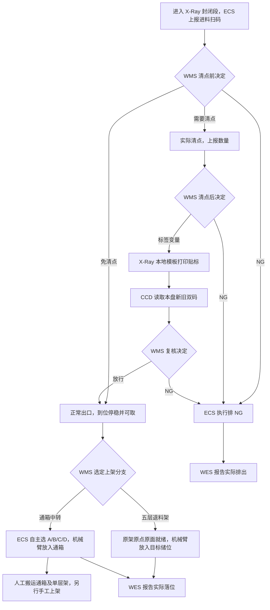
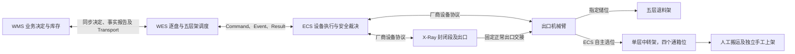

# X-Ray 清点、贴标与上架 API 对接设计

本文记录新 WES 的 X-Ray 工作线开发目标，按逐盘正常流程组织。X01～X08 为本轮讨论确定的设计口径。第 2 章逐项给出 X-Ray WMS Operation 与 ECS Event、Command、Result 的本地开发拟定合同。正式设备角色绑定及厂商协议映射在相应设备附录中确认。

历史参考为 [ECS 与 WMS HTTP 通讯协议 V1.2 项目附录](../../../wes_backend/docs/hardware/ECS与WMS_HTTP通讯协议_V1.2_项目附录.md)（2026-11-03 评审稿，引用 XRAY V3.3、机械臂 V3.4）及 [wes_backend SRS](../../../wes_backend/docs/architecture/SRS.md)。V1.2 的 WMS 直连 ECS、三次请求／15 秒排 NG 和带箱号的 `PUT_TO_BIN` 属于原方案。SRS 中 WES 生成 ZPL 的描述也属历史方案。新工作线按本文的职责、等待和通箱规则设计。跨仓库链接适用于同级 `wes_backend` 工作区。

## 目录

- [完整交互顺序](#xray-sequence)
- [1. 物料路线与设备拓扑](#xray-flow)
- [2. 正常业务流程与接口](#xray-api)
- [3. 公共规则与工作线配置](#xray-rules)
  - [3.5 代码复用与开发边界](#xray-reuse)
- [4. 确认结果与开发合同](#xray-pending)
- [5. 本地开发验收](#xray-acceptance)
- [6. WES 调度需要的 ECS 接口变更](#xray-ecs-changes)

<a id="xray-sequence"></a>
## 完整交互顺序

| 路径 | 步骤 | 方向 | Operation / Event / Command | 交互与推进条件 |
| --- | --- | --- | --- | --- |
| 进料 | E1 | ECS → WES | [`SCAN_COMPLETED`（`ENTRY`） Event](#xray-entry) | 保存本次进机及原扫码事实。读码 OK 后请求清点前决定。 |
| 进料 | E2 | WES → WMS | [`inbound.xray.pkg_decide@v1`](#xray-pkg-decision) | 按 WMS 决定进入清点、免清点、NG 或等待分支。 |
| 清点 | C1 | WES → ECS | [`COUNT`](#xray-ecs-count) | 原决定为 `COUNT_REQUIRED` 且本盘仍具备清点条件时登记。 |
| 清点 | C2 | ECS → WES | [`COUNT` Result](#xray-count-result) | 按原命令关闭清点动作。 |
| 清点 | C3 | ECS → WES | [`XRAY_COUNT_COMPLETED` Event](#xray-count) | 本盘实际数量有效时，请求一次清点后决定。 |
| 清点 | C4 | WES → WMS | [`inbound.xray.count_decide@v1`](#xray-count-decision) | 保存 WMS 原十变量，或按原 NG／WAIT 决定处理。 |
| 贴标 | L1 | WES → ECS | [`PRINT_LABEL`](#xray-ecs-print) | 取得本盘贴标许可及完整变量后登记。 |
| 贴标 | L2 | ECS → WES | [`PRINT_LABEL` Result](#xray-label-result) | 保存实际贴标终态，CCD 读码由独立事件提供。 |
| 复核 | V1 | ECS → WES | [`SCAN_COMPLETED`（`VERIFY`） Event](#xray-verify) | 核对原贴标上下文，再将实际双码或读码异常送复核。 |
| 复核 | V2 | WES → WMS | [`inbound.xray.verify_decide@v1`](#xray-verify-decision) | 按 WMS 决定放行、排 NG 或等待。 |
| 出料 | O1 | WES → ECS | [`ROUTE`（`OUTLET`）](#xray-ecs-route) | 复核放行走 `COUNTED`，原清点前决定免清点走 [`BYPASS`](#xray-bypass)。 |
| 出料 | O2 | ECS → WES | [`ROUTE`（`OUTLET`） Result](#xray-outlet-result) | 按原命令关闭出料动作。 |
| 出料 | O3 | ECS → WES | [`MATERIAL_ARRIVED` Event](#xray-arrived) | 本盘实际到位、停稳、保持且可取时触发一次选位。 |
| 出料 | O4 | WES → WMS | [`inbound.xray.put_target_decide@v1`](#xray-target) | WMS 给出五层架精确目标、通箱中转分支或等待决定。 |
| 上架 | P1 | WES → ECS | [`PUT_TO_RACK`](#xray-ecs-put-rack)／[`PUT_TO_TRANSIT_BIN`](#xray-ecs-put-transit) | 五层架按[公共架就绪证据](#xray-rack)和授权储位放料。通箱位由 ECS 自主选定。 |
| 上架 | P2 | ECS → WES | [`PUT_TO_RACK` Result](#xray-ecs-put-rack-result)／[`PUT_TO_TRANSIT_BIN` Result](#xray-ecs-put-transit-result) | 按原命令确认实际落位或入箱。 |
| 上架 | P3 | WES → WMS | [`inbound.xray.put_report@v1`](#xray-put-report) | 按原报告身份交付本盘实际去向。 |
| 等待 | W1 | ECS → WES | [`XRAY_WAIT_STATE_CHANGED` Event](#xray-wait-event) | 按本盘、本次等待及最新状态恢复请求、保持保护或登记排料。 |
| 排 NG | N1 | WES → ECS | [`ROUTE`（`NG`）](#xray-ecs-route-ng) | 原 WMS 决定为 NG，或设备明确无法继续等待且可安全排料。 |
| 排 NG | N2 | ECS → WES | [`ROUTE`（`NG`） Result](#xray-ecs-route-ng-result) | 按原命令关闭排料动作，保存实际结果。 |
| 排 NG | N3 | ECS → WES | [`NG_DISCHARGED` Event](#xray-ng-event) | 核对本盘实际排出，与同次排料 Result 归并为一个事实。 |
| 排 NG | N4 | WES → WMS | [`inbound.xray.ng_report@v1`](#xray-ng-report) | 实际排出确认后，按原报告身份交付。 |

表中步骤号只用于导航，不进入 wire。WMS 决定在请求的 HTTP 响应中同步返回，独立的 Event、Result 和不同盘的消息可以交错到达。机内及出口等待与原身份恢复分别见 [3.2](#xray-wait) 和 [3.3](#xray-recovery)。

<a id="xray-flow"></a>
## 1. 物料路线与设备拓扑

### 1.1 物料行进路线



入口到正常出口之间是封闭段，现场没有人工介入位。机内的清点前、标签和 CCD 复核等待按 [3.2](#xray-wait) 处理。正常出口后进入机械臂交接区，等待选位、货架或机械臂期间保留原任务并告警。

### 1.2 逻辑设备与通信拓扑



| 对象 | 职责与边界 |
| --- | --- |
| WMS | 判定清点、贴标、复核、NG 和上架去向。生成新条码及标签变量。管理库存、五层架离场决定和通箱后续手工上架业务。 |
| WES | 从 ECS 进料扫码开始调度。保存原事件、WMS 请求、设备命令、架动作、实际结果及报告之间的关联。 |
| ECS／X-Ray | 扫码、清点、本地模板贴标、CCD、出料和排 NG。确认实际工位、共享路径、容量和安全许可，提供逐盘事实。 |
| ECS／出口机械臂 | 从固定正常出口取盘。按指定储位放五层架，或自主选通箱位。实际放料后回原 Result。 |
| 五层退料架 | WES 编排进场、换面和离场。机械臂按 WMS 授权的架、面和储位放料。 |
| 单层中转架 | A、B、C、D 四个通箱位。通箱无箱号。机械臂放盘后，通箱和单层架由人工搬运，后续单独手工上架。 |

定位图用于说明封闭段、出口机械臂和两个放料方向。首版调度从 X-Ray 进料扫码开始。上游投料和 LCR 的衔接待有明确跨设备调度需求时再定义。

<a id="xray-api"></a>
## 2. 正常业务流程与接口

<a id="xray-common-integration"></a>
### 2.0 三方系统通用能力接入

X-Ray 业务子包负责声明业务合同、关联原事实和推进逐盘状态。与 WMS 的决定和事实报告统一走 **Operation 通用能力**。与 ECS 的交互统一走平台的 **Event、Command、Result 和 Status** 能力。HTTP 路径是这些公共能力的协议入口，业务子包通过下文的声明和公开 API 使用它们。

| 消息 | HTTP 请求方向和接收端点 | 响应或后续事实 |
| --- | --- | --- |
| 业务决定 | WES → WMS，`POST {{WMS_BASE_URL}}/api/v1/wes/decisions` | WMS → WES，同步返回原请求的业务决定。WES 可靠保存后消费 |
| 业务事实 | WES → WMS，`POST {{WMS_BASE_URL}}/api/v1/wes/facts` | WMS → WES，返回原报告的收件结果 |
| 设备命令 | WES → ECS，`POST {{ECS_BASE_URL}}/api/v1/device/command` | ECS → WES，同步返回接纳 ACK。实际执行结果通过 Result 另报 |
| 设备事件 | ECS → WES，`POST {{WES_BASE_URL}}/api/v1/callback/event` | WES → ECS，持久收件后返回 ACK |
| 设备结果 | ECS → WES，`POST {{WES_BASE_URL}}/api/v1/callback/result` | WES → ECS，按原命令及冻结合同核验、保存后返回 ACK |

WMS 决定和事实沿用现有公共信封，请求使用 `operation_id/operation/timestamp/data`，响应回显原 `operation_id`。有效 `DECIDED` 才能提供业务决定，事实的 `RECORDED/DUPLICATE` 证明报告收妥。设备命令沿用 `device_code/command_code/task_type/priority/timeout/timestamp/params`，`priority` 为 1，时间为整数纪元毫秒。设备 Event 用 `device_code/event_type/timestamp/data`，Result 用 `command_code/device_code/result/finish_time/data` 及按结果分支要求的 `error_detail`。公共规范见 [工作线交互索引](workline-business-api.md) 和 [ECS 命令合同](ecs-command.md)。

设备 HTTP 200、JSON 整数 `code=200`、`message="ACK"` 的接纳语义与物理终态分开。WMS 公共报文见 2.0.3，ECS 设备合同与公共报文见 2.0.4。下文按正常流程展示各项拟定合同。

#### 2.0.1 WMS Operation

| WES 发起的业务交互 | 公共能力 | 形成请求的原证据 |
| --- | --- | --- |
| [`inbound.xray.pkg_decide@v1`](#xray-pkg-decision) | `Endpoint.DECISIONS` | 原进料扫码事实和实际旧码 |
| [`inbound.xray.count_decide@v1`](#xray-count-decision) | `Endpoint.DECISIONS` | 原本盘实测数量及清点事实 |
| [`inbound.xray.verify_decide@v1`](#xray-verify-decision) | `Endpoint.DECISIONS` | 原实际双码或读码异常 |
| [`inbound.xray.put_target_decide@v1`](#xray-target) | `Endpoint.DECISIONS` | 原实际可取到料事实 |
| [`inbound.xray.put_report@v1`](#xray-put-report) | `Endpoint.FACTS` | 原取放 Result 及实际去向 |
| [`inbound.xray.ng_report@v1`](#xray-ng-report) | `Endpoint.FACTS` | 原实际排出事实、阶段及原因 |

- **声明与发送。** 在业务子包的 `request/` 用 `@request_operation(name, Endpoint.DECISIONS)` 或 `@request_operation(name, Endpoint.FACTS)` 声明精确的 `RequestPayload`。业务在自己的事务中调用 `WmsRequests.send(session, payload, operation_id=...)`，持久保存原 `operation`、UUIDv7 `operation_id`、`message_id` 和本盘关联。公共能力负责信封、原归属、可靠入队和投递。WMS 在 HTTP 响应中同步给出决定，WES 的业务推进在可靠保存后消费。
- **读结果与恢复。** 按原三元组通过 `WmsRequests.get_result(...)` 读取终局响应，再由 X-Ray 的严格分支模型核对业务结果。未知响应沿原请求恢复，事实补报沿原报告恢复。

见 [Operation 注册规范](registration.md) 和 [出站结果契约](outbound-results.md)。

#### 2.0.2 ECS Event、Command、Result 和 Status

| 交互 | 通用接入方式 | X-Ray 业务子包职责 |
| --- | --- | --- |
| Event | 在 `ecs_event/` 用 `@ecs_event(name, device_role=ROLE, data=Model)` 声明，由公共接收器核验信封、解析可信工作线绑定、持久收件并 ACK | 按实际角色和本盘阶段核对扫码、点料、CCD、出口、机内异常或排出事实，保存业务状态和待办 |
| Command | 在精确参数模型上用 `@ecs_command(...)` 声明角色、Result、错误及超时合同，模型列入 composition 的 `COMMANDS`。通过 `EcsCommands.create(session, owner=..., call_key=..., device_code=..., timeout_ms=..., command=...)` 在事务内登记 | 为每个实际动作保存稳定的原 `call_key` 和返回的 `command_code`。平台按角色绑定冻结地址、附录、原报文及投递窗口，由唯一 Sender 投递 |
| Result | 公共 Result 接收器按原身份及冻结附录验证、持久保存并结算 | 通过 `EcsCommands.get_command(...)` 或 `get_by_call(...)` 读取原结果，核对本盘、原命令及实际动作证据后推进一次 |
| Status | 复用平台 [通用 ECS Status](ecs-status.md) 查询 | 用于诊断。设备在线和整机空闲与逐盘许可、命令接纳及物理完成分别记录 |

WMS request 和 ECS Event 的入口在所属 composition 的 `ENTRY_MODULES` 显式声明。API 和 worker 共用业务 catalog，平台编译 ECS 命令附录并装配公共入口。提交后唤醒和周期兜底使用同一个业务 `scan_pending`。接收及推进均通过公共入口和公开读口。具体装配见 [业务包规范](business-packages.md) 和 [ECS 角色接入](ecs-roles.md)。

#### 2.0.3 X-Ray Operation 公共报文

以下六个 `inbound.xray.*@v1` 名称和业务 DTO 是本地开发拟定合同。HTTP 信封、投递、原身份查询和错误分类沿用平台。ECS Event 与 Command/Result 的拟定合同见 2.0.4 及各阶段小节。示例中的设备事实编号、时间、站点及货架都是本地样例。清点、正常落位构成一条示例链。NG 为替代路径。

WMS `data`、ECS `data` 和 Command `params` 的业务字段统一用 `snake_case`。原始条码用 `barcode`，CCD 实读的新码用 `new_barcode`，授权目标用 `target_locator`，实际去向用 `to_locator`。扫码、观察和实际完成分别用 `scanned_at`、`observed_at`、`occurred_at`。字段命名参考[粗分绑定请求](../../app/businesses/coarse_sorting/request/inbound_coarse_sorting_validate_bind_v1.py)、[SMT 自动线选位](../../app/businesses/smt_auto/outbound_contracts.py)及[物料移动报告](../../app/businesses/smt_auto/request/outbound_material_movement_report_v1.py)。ECS 对厂商字段做协议映射。`label_variables` 内的十个键采用 WMS 原始大小写。

| 公共字段 | 类型与约束 |
| --- | --- |
| 请求 `operation_id` | 小写带连字符的 UUIDv7。每次业务求值或事实报告创建一次，技术重试沿用原值。 |
| 请求 `operation` | 该节指定的完整版本名。请求顶层为 `operation_id/operation/timestamp/data`。 |
| 请求及响应 `timestamp` | UTC Unix 毫秒整数，范围 `0..9223372036854775807`。响应采用 WMS 的原响应时间。 |
| 响应 `operation_id/code/data` | 回显原 `operation_id`。响应顶层为 `operation_id/code/timestamp/data`。成功决定为 `200 / DECIDED`，事实为 `200 / RECORDED` 或 `200 / DUPLICATE`。 |
| `Identifier` | 非空字符串，匹配 `[A-Za-z0-9][A-Za-z0-9._:/-]{0,99}`。用于工作线、进机、事件、架及位置等身份。 |
| `Barcode` | 非空原始字符串，最多 1000 个 Unicode code point 且无 NUL。保留大小写、前导零和内容。 |
| `reel_id` / `source_event_id` | 分别为本次进机和触发本次决定的 ECS `event_id`，均为 Identifier。WES 使用可信设备事实和绑定形成关联。 |
| `scanned_at` / `observed_at` / `occurred_at` | 取原 Event 的 `timestamp` 或实际完成 Result 的 `finish_time`，保留 ECS 原值。UTC Unix 毫秒整数，范围同顶层 `timestamp`。业务先后以原事件、原命令和阶段关联判定。 |
| `actual_qty` | 严格非负整数。清点表示盘内实测 PCS，取放表示本次实际放料的盘数。字段随分支给出，未知时省略。 |
| `reason_code` / `reason_message` | 业务或设备原因。reason_code 为 Identifier，reason_message 为 1～256 个 Unicode code point 的无 NUL 字符串。公共错误响应的 reason_code 则按下表枚举。 |

各节字段表为 `data` 的完整形状。请求和各响应分支按严格类型校验，未列字段、显式 `null` 和类型强转均拒绝。数字字段以真实 JSON 数字发送，布尔值不能用作数字。UTF-8 JSON 正文上限为 256 KiB。

| HTTP / code | 完整 `data` 或处理 |
| --- | --- |
| 400 或 413 | 公共包络无法解析或正文超限，空响应体，保留原请求供核对。 |
| 409 / CONFLICT | `{"reason_code":"IDEMPOTENCY_CONFLICT"}`。引用不成立用 `REFERENCE_CONFLICT`，本盘或阶段状态矛盾用 `STATE_CONFLICT`，实际目标冲突用 `POSITION_CONFLICT`。仅含 reason_code。 |
| 422 / REJECTED | `{"reason_code":"INVALID_DATA","field_path":"/data/actual_qty"}`。reason_code 为 `INVALID_ENVELOPE / UNSUPPORTED_OPERATION / INVALID_DATA`，仅 INVALID_DATA 可选 field_path，格式为 1～256 字符的 JSON Pointer。 |
| 503 / UNAVAILABLE | `{}`。保留原身份、时间和冻结正文恢复。 |

四个决定请求均为同步 `200 / DECIDED`，每个分支见对应小节。决定重放返回首次完整决定及原响应时间。事实成功收件和重放均返回空 `data`。WMS 按 `(operation, operation_id)` 去重。同身份改有效内容返回冲突。不同身份若指向同一已登记的实际事实，WMS 核对内容后仅处理一次。失败、响应未知、协议错误和 `DECIDED` 内的业务 `NG` 各自留证。

本开发拟定合同的四个决定均可返回明确 `WAIT`。WES 保存 `retry_after_ms`（整数 1～60000）和首次可靠保存时计算的最早续问点。到期且原阶段仍有效才用新 `operation_id` 重新求值，原盘、原事件和业务 data 沿用。未取得有效响应只恢复原请求。WAIT 到期用于续问，机内自动排 NG 仍以 ECS 的明确排料条件为依据。

六个 X-Ray Operation 沿用注册的 `ttl=None`，保留公共投递退避和告警。本地自动恢复用例使用未设置有限 `max_not_received_attempts` 的公共 WMS 目标。若公共目标配置使原请求进入 `STALLED`，保留原身份和待办，按平台恢复规则处理。`STALLED` 与确定的协议拒绝都不能作为业务 NG 或新求值依据。

#### 2.0.4 ECS 设备合同及公共报文

以下是新 WES ↔ ECS 的**本地开发拟定合同**。逻辑角色暂用 `XRAY` 和 `OUTPUT_ARM`，示例设备为 `XRAY01` 和 `ARM01`。WES 使用平台对 ECS 的 HTTP 接口。ECS 自行映射 X-Ray 与机械臂的厂商设备协议。正文为 UTF-8 JSON，公共上限 256 KiB。

| 类别 | 方向 / 端点 | 业务消息 |
| --- | --- | --- |
| Event | ECS → WES，`POST /api/v1/callback/event` | [SCAN_COMPLETED / ENTRY](#xray-entry)、[XRAY_COUNT_COMPLETED](#xray-count)、[SCAN_COMPLETED / VERIFY](#xray-verify)、[MATERIAL_ARRIVED](#xray-arrived)、[NG_DISCHARGED](#xray-ng-event)、[XRAY_WAIT_STATE_CHANGED](#xray-wait-event)。均由 `XRAY` 角色上报。 |
| Command | WES → ECS，`POST /api/v1/device/command` | `XRAY` 接收 [COUNT](#xray-ecs-count)、[PRINT_LABEL](#xray-ecs-print)、[ROUTE](#xray-ecs-route)。`OUTPUT_ARM` 接收 [PUT_TO_RACK](#xray-ecs-put-rack)、[PUT_TO_TRANSIT_BIN](#xray-ecs-put-transit)。 |
| Result | ECS → WES，`POST /api/v1/callback/result` | 按原 `command_code` 和冻结附录回调。各动作下分别给出 SUCCESS 与 FAILED 的完整形状。 |

`SCAN_COMPLETED` 只在 `XRAY` 注册一次，`data.scan_stage` 区分 ENTRY 和 VERIFY。两个 `ROUTE` 目的地也共用一个动作附录。五个 Command 各自声明精确参数、Result、错误模型和附录版本，在 `COMMANDS` 列出。通箱使用独立的 `PUT_TO_TRANSIT_BIN`，对应无箱号的已确认分支。登记及消费继续使用 2.0.2 的公共能力。

| 字段 | 类型与约束 |
| --- | --- |
| 顶层 `device_code` | 公共设备编码，来源为工作线绑定。Result 须与原命令设备一致。 |
| 顶层 `command_code` | WES 生成的原命令 UUIDv7，Result 原值回传。 |
| 顶层 `timestamp` / `finish_time` | 非负 UTC Unix 毫秒整数，范围同 2.0.3。Event 为设备事实发生时间，Command 为原命令创建时间，Result 为实际结束时间。补报保留原值。 |
| Command `priority` / `timeout` | priority 为整数 1。timeout 为正毫秒整数，取原设备动作配置并按声明范围校验。样例时长用于本地报文。 |
| `event_id` / `reel_id` | Identifier。`event_id` 是 ECS 生成的事实标识，WES 另行保存平台收件 ID。`reel_id` 标识本次进机。补报保留原内容和时间。 |
| `source_event_id` / `source_command_code` | 前者回引 ECS 的原 `event_id`，后者回引 WES 的原 `command_code`（UUIDv7）。按具体分支要求携带，WES 核对本盘、原角色和阶段。 |
| `barcode` / `new_barcode` | 沿 2.0.3 的 Barcode 类型，分别保留原进料码和 CCD 实读新码。 |
| `reason_code` / `reason_message` | 沿 2.0.3 的原因字段类型，保留实际原因。 |
| Result `result` / `error_detail` | result 为 SUCCESS 或 FAILED。SUCCESS 省略 error_detail 或用 null。FAILED 必须含 `error_detail.code`（非空 Identifier）和 `error_detail.msg`（非空原因文本），仅含这两个字段。 |
| FAILED 的 `data.position` | 可选实际位置。已知时可用 `IN_MACHINE / OUTLET / GRIPPER / TARGET / NG / OTHER`，不明时可省略或填 `UNKNOWN`。以实物证据为准。 |

各节的 Command `params` 和 Result `data` 按冻结的严格业务模型校验。Event `data` 严格检查下列必填字段、分支和类型，协议扩展字段按通用接收器及声明的模型策略处理。可省略的业务字段在无事实时省略。Command 顶层为闭集，Event 和 Result 的顶层诊断扩展沿公共信封处理。

有效接纳和持久收件均使用以下 HTTP 200 响应。Command 的响应方向为 ECS → WES，Event 和 Result 的响应方向为 WES → ECS。

```json
{"code":200,"message":"ACK"}
```

Command 接纳只建立原动作履约责任。Event ACK 说明公共接收器已持久收件，业务推进仍须原事实有效。Result ACK 对应原结果收妥，物理推进读取原公开结果。公共错误语义、幂等、合法 Result 早于 ACK、结果冲突及 300 秒窗口沿 3.3 和 [ECS 命令合同](ecs-command.md)。示例中的失败和替代路径是独立用例。同一原命令在真实流程中只报告一个确定终态。

<a id="xray-entry"></a>
### 2.1 进料扫码

| 项目 | 值 |
| --- | --- |
| 方向 / 端点 | ECS → WES，`POST /api/v1/callback/event` |
| 角色 / event_type | `XRAY / SCAN_COMPLETED` |
| 触发 | 本次进机在入口完成最终读码或确认读码失败。 |

```json
{
  "device_code": "XRAY01",
  "event_type": "SCAN_COMPLETED",
  "timestamp": 1793413800000,
  "data": {
    "event_id": "1b2daf25-09b1-4734-ab69-57f40524e3be",
    "reel_id": "18520712-e29b-4197-b145-1aefa4c14cca",
    "scan_stage": "ENTRY",
    "scan_status": "OK",
    "barcode": "PKG-OLD-A",
    "template_id": "XX123456789"
  }
}
```

| `data` 字段 | 类型 / 必填 | 约束 |
| --- | --- | --- |
| event_id / reel_id | Identifier / 是 | 原事件与本次进机身份。 |
| scan_stage / scan_status | enum / 是 | scan_stage 固定 ENTRY，scan_status 为 OK 或 NG。 |
| barcode | Barcode / OK 必填，NG 已知时可带 | 实际旧码，无读码时省略。 |
| template_id | Identifier / 是 | 本次进机对应的设备模板标识。 |
| reason_code / reason_message | 原因字段 / NG 必填，OK 省略 | 实际读码失败原因。 |

**推进条件。** 经公共接收器确认 X-Ray 角色绑定后，按原事件和本次进机保存一次。只有 ENTRY OK 且实际旧码有效才请求 2.2 的清点前决定。ENTRY NG 保存原失败，后续按实际处置和排出事实推进。

<a id="xray-pkg-decision"></a>
### 2.2 清点前决定及设备动作

**WES → WMS 决定请求**。带原进料事实及实际旧码，由 WMS 检查发料和使用记录，返回需清点、免清点或 NG。**WES → ECS 命令**。保存有效决定并关联唯一原动作，需清点时安排 COUNT，免清点走正常出口，NG 走排料。

| 项目 | 值 |
| --- | --- |
| 方向 / 端点 | WES → WMS，`POST /api/v1/wes/decisions` |
| operation | `inbound.xray.pkg_decide@v1` |
| 触发 | 本盘 ENTRY 扫码 OK，原进料事实已保存。 |

```json
{
  "operation_id": "01a1887a-d46a-7da3-8e2c-81762c6ee601",
  "operation": "inbound.xray.pkg_decide@v1",
  "timestamp": 1793413801000,
  "data": {
    "workline_code": "XRAY-LINE-01",
    "reel_id": "18520712-e29b-4197-b145-1aefa4c14cca",
    "source_event_id": "1b2daf25-09b1-4734-ab69-57f40524e3be",
    "barcode": "PKG-OLD-A",
    "scanned_at": 1793413800000
  }
}
```

首次成功响应 `HTTP 200 / DECIDED`。

```json
{
  "operation_id": "01a1887a-d46a-7da3-8e2c-81762c6ee601",
  "code": "DECIDED",
  "timestamp": 1793413801100,
  "data": {
    "result": "COUNT_REQUIRED"
  }
}
```

| 请求 `data` 字段 | 类型 / 必填 | 约束 |
| --- | --- | --- |
| workline_code / reel_id / source_event_id | Identifier / 是 | 可信工作线、本次进机和原 ENTRY 事件。 |
| barcode | Barcode / 是 | 原进料实际读到的旧码。 |
| scanned_at | 毫秒整数 / 是 | 原 ENTRY 事件发生时间。 |

| HTTP / code | 完整响应 `data` 示例 | WES 处理 |
| --- | --- | --- |
| 200 / DECIDED | `{"result":"COUNT_REQUIRED"}` | 登记本盘唯一原清点命令。 |
| 200 / DECIDED | `{"result":"BYPASS_COUNT"}` | 直接安排正常出料，跳过清点、贴标和 CCD。 |
| 200 / DECIDED | `{"result":"NG","reason_code":"MATERIAL_REJECTED","reason_message":"WMS 判定该盘不适用"}` | 保存原拒绝原因，登记原排料动作，等待实际排出。 |
| 200 / DECIDED | `{"result":"WAIT","retry_after_ms":1000}` | 按公共 WAIT 规则保持本盘。 |

<a id="xray-ecs-count"></a>
#### 2.2.1 COUNT 命令

| 项目 | 值 |
| --- | --- |
| 方向 / 端点 | WES → ECS，`POST /api/v1/device/command` |
| 角色 / task_type | `XRAY / COUNT` |
| 触发 | 本盘原清点前决定为 COUNT_REQUIRED，入口扫码仍处于有效等待阶段。 |

```json
{
  "device_code": "XRAY01",
  "command_code": "01a1887a-d46a-7da3-8e2c-81762c6ee611",
  "task_type": "COUNT",
  "priority": 1,
  "timeout": 70000,
  "timestamp": 1793413801200,
  "params": {
    "reel_id": "18520712-e29b-4197-b145-1aefa4c14cca",
    "source_event_id": "1b2daf25-09b1-4734-ab69-57f40524e3be"
  }
}
```

| `params` 字段 | 类型 / 必填 | 约束 |
| --- | --- | --- |
| reel_id / source_event_id | Identifier / 是 | 本盘与原 ENTRY 事件。 |

**推进条件。** 业务以稳定的原调用键登记一次 COUNT。ECS 核对本盘在位及清点许可。ACK 后等待原 Result 和实际点料事实。

<a id="xray-count-result"></a>
### 2.3 清点完成

#### 2.3.1 COUNT Result

| 项目 | 值 |
| --- | --- |
| 方向 / 端点 | ECS → WES，`POST /api/v1/callback/result` |
| 原命令 | `COUNT`，按本次 `command_code` 与冻结附录 |
| 触发 | 原 COUNT 已获得实际清点结果或确定的动作失败终态。 |

成功示例。

```json
{
  "command_code": "01a1887a-d46a-7da3-8e2c-81762c6ee611",
  "device_code": "XRAY01",
  "result": "SUCCESS",
  "finish_time": 1793413808000,
  "data": {
    "reel_id": "18520712-e29b-4197-b145-1aefa4c14cca",
    "actual_qty": 4000
  }
}
```

失败示例为同一动作的替代结果。

```json
{
  "command_code": "01a1887a-d46a-7da3-8e2c-81762c6ee611",
  "device_code": "XRAY01",
  "result": "FAILED",
  "finish_time": 1793413808000,
  "data": {
    "reel_id": "18520712-e29b-4197-b145-1aefa4c14cca",
    "position": "IN_MACHINE"
  },
  "error_detail": {
    "code": "COUNT_FAILED",
    "msg": "本次清点已结束，未得到有效数量"
  }
}
```

SUCCESS 的 `data` 只含原 `reel_id` 和 `actual_qty`。actual_qty 是严格非负整数，单位 PCS，范围同 2.4 请求字段。FAILED 的 `data` 为原 reel_id 及可选实际 position，使用公共 error_detail，省略 actual_qty。

**推进条件。** Result 关闭原 COUNT 动作，清点后决定由实测数量 Event 触发。两条证据按 [2.3.3](#xray-count-evidence) 核对。

<a id="xray-count"></a>
#### 2.3.2 XRAY_COUNT_COMPLETED 事件

| 项目 | 值 |
| --- | --- |
| 方向 / 端点 | ECS → WES，`POST /api/v1/callback/event` |
| 角色 / event_type | `XRAY / XRAY_COUNT_COMPLETED` |
| 触发 | 原 COUNT 已完成测量或明确清点失败。 |

```json
{
  "device_code": "XRAY01",
  "event_type": "XRAY_COUNT_COMPLETED",
  "timestamp": 1793413808000,
  "data": {
    "event_id": "5ad0f02e-e98d-456d-bb52-dff0d8706865",
    "reel_id": "18520712-e29b-4197-b145-1aefa4c14cca",
    "source_command_code": "01a1887a-d46a-7da3-8e2c-81762c6ee611",
    "barcode": "PKG-OLD-A",
    "template_id": "XX123456789",
    "count_status": "OK",
    "actual_qty": 4000
  }
}
```

| `data` 字段 | 类型 / 必填 | 约束 |
| --- | --- | --- |
| event_id / reel_id / source_command_code | 原身份 / 是 | 原点料事实、本盘和原 COUNT。 |
| barcode / template_id | Barcode / Identifier，均必填 | 同盘原进料旧码和本盘模板标识。 |
| count_status | enum / 是 | OK 或 NG。 |
| actual_qty | integer / OK 必填，NG 省略 | 同 2.4 的实测 PCS 约束，0 仅来自实际测量。 |
| reason_code / reason_message | 原因字段 / NG 必填，OK 省略 | 实际清点失败原因。 |

**推进条件。** 核对原 COUNT、本盘和 [2.3.3](#xray-count-evidence) 的证据一致性。有效 OK 事件触发一次 2.4 的贴标业务决定。NG 保存实际清点失败事实，等待明确设备处置。

<a id="xray-count-evidence"></a>
#### 2.3.3 COUNT Result 与点料 Event 的一致性

按原设备、`reel_id` 和 Event 的 `source_command_code` 关联同一条原 `COUNT`。Event 的 `barcode` 和 `template_id` 须与本次进机的原值一致。原命令尚未可靠关联时保存 Event 待核对，关联成立后再消费。

| 已保存的原证据 | 推进规则 |
| --- | --- |
| 只有 `COUNT SUCCESS` | 保存原命令终态，等待同盘点料 Event。即使 Result 带 `actual_qty`，仍由 Event 触发清点后决定。 |
| 有效 `XRAY_COUNT_COMPLETED / OK`，原 Result 尚未到或已有数量一致的 SUCCESS | 按原 Event 登记一次 `inbound.xray.count_decide@v1`。迟到的同量 SUCCESS 独立结束原动作。实际清点 0 适用同一规则。 |
| `COUNT FAILED` 或点料 Event 为 NG，且无相反证据 | 保存实际失败。若收到相符的另一条失败证据，分别保存。保持本盘待处置，清点后决定和贴标均不登记。 |
| `COUNT FAILED` 与点料 OK、`COUNT SUCCESS` 与点料 NG，或两条成功证据的 `actual_qty` 不同 | 两条原证据均保留，本盘进入待核对。禁止发起新清点后决定，已返回的标签决定暂缓应用，不登记新的贴标或由该决定派生的动作。 |

WES 在消费 Event、消费 WMS 决定及登记下一动作时，在本盘推进事务内复核已保存的原证据。重复报文只补原身份。若后继动作已经登记，保留其原命令和发送证据，按原身份核对。迟到报文不得覆盖已记录的冲突，恢复须有可信事实。冲突或交付未知均不自动触发排 NG。下游贴标及出料沿用这项原证据核对原则。

<a id="xray-count-decision"></a>
### 2.4 清点后决定与标签

**WES → WMS 决定请求**。使用本盘实测数量、原旧码、模板标识及原清点事实。WMS 返回 NG 或本盘完整标签变量。**WES → ECS 命令**。WES 校验报文结构及原盘、阶段、决定关联，保存原变量并随原贴标命令交付。ECS／X-Ray 校验设备本地模板并实际打印贴标。

| 项目 | 值 |
| --- | --- |
| 方向 / 端点 | WES → WMS，`POST /api/v1/wes/decisions` |
| operation | `inbound.xray.count_decide@v1` |
| 触发 | 原点料 OK Event 已保存且无冲突，见 2.3.3。 |

```json
{
  "operation_id": "01a1887a-d46a-7da3-8e2c-81762c6ee602",
  "operation": "inbound.xray.count_decide@v1",
  "timestamp": 1793413809000,
  "data": {
    "workline_code": "XRAY-LINE-01",
    "reel_id": "18520712-e29b-4197-b145-1aefa4c14cca",
    "source_event_id": "5ad0f02e-e98d-456d-bb52-dff0d8706865",
    "barcode": "PKG-OLD-A",
    "actual_qty": 4000,
    "template_id": "XX123456789",
    "observed_at": 1793413808000
  }
}
```

首次成功响应 `HTTP 200 / DECIDED`。

```json
{
  "operation_id": "01a1887a-d46a-7da3-8e2c-81762c6ee602",
  "code": "DECIDED",
  "timestamp": 1793413809100,
  "data": {
    "result": "OK",
    "label_variables": {
      "ID": "XX123456789",
      "PHHPN": "100-0277-000HF",
      "SPKG": "SXCN0031482261000009NVD",
      "MMfrPN": "PZ2012S601AT000",
      "VVendor": "M000002870",
      "QQTYPC": "4000",
      "Location": "",
      "DDC": "2623",
      "DateTime": "2026-10-29 14:43:50",
      "LLC": "1T3330022677"
    }
  }
}
```

| 请求 `data` 字段 | 类型 / 必填 | 约束 |
| --- | --- | --- |
| workline_code / reel_id / source_event_id | Identifier / 是 | 本线、本次进机和原清点事实。 |
| barcode | Barcode / 是 | 同盘原进料旧码。 |
| actual_qty | integer / 是 | 实测 PCS，范围 `0..9223372036854775807`。失败和未知不生成数量或本请求。 |
| template_id | Identifier / 是 | 本盘原模板标识，沿设备提供值。 |
| observed_at | 毫秒整数 / 是 | 原清点事实发生时间。 |

| HTTP / code | 完整响应 `data` | WES 处理 |
| --- | --- | --- |
| 200 / DECIDED | `result=OK`，仅另含完整 `label_variables`，见上例 | 校验结构及模板标识关联，将原变量冻结到唯一贴标动作。 |
| 200 / DECIDED | `{"result":"NG","reason_code":"MATERIAL_REJECTED","reason_message":"WMS 判定本盘不能贴标"}` | 登记原排料动作。 |
| 200 / DECIDED | `{"result":"WAIT","retry_after_ms":1000}` | 按公共 WAIT 规则保持本盘。 |

上例的 `label_variables` 使用用户提供的十变量。键名大小写固定，十项都必填且为字符串。除 `Location` 可为空字符串外，其余须非空，所有变量均禁止 NUL。`ID` 须等于原请求的 `template_id`，`SPKG` 采用 Barcode 约束。`QQTYPC` 为数字字符串，`DateTime` 格式为 `yyyy-MM-dd HH:mm:ss`。变量的设备长度约束随模板配置明确，WES 保留原值交付。

| 变量 | 含义与处理 |
| --- | --- |
| `ID` | 本地固定模板的标识。示例值供开发数据参考。 |
| `PHHPN` / `MMfrPN` / `VVendor` | 客户料号、制造商料号和供应商编号。保留 WMS 原字符串。 |
| `SPKG` | WMS 给出的新标签码。保存本盘旧码及后续 CCD 实际读到的新码。 |
| `QQTYPC` | 标签显示数量，保留字符串。它与实测 `actual_qty` 的关系由 WMS 定义。 |
| `Location` | 标签显示库位，允许空字符串。 |
| `DDC` / `DateTime` / `LLC` | 日期码、标签日期和批次。业务含义和时区归 WMS，沿用原值。 |

<a id="xray-ecs-print"></a>
#### 2.4.1 PRINT_LABEL 命令

| 项目 | 值 |
| --- | --- |
| 方向 / 端点 | WES → ECS，`POST /api/v1/device/command` |
| 角色 / task_type | `XRAY / PRINT_LABEL` |
| 触发 | 本盘原清点后决定为 OK，十变量及原清点事实已保存。 |

```json
{
  "device_code": "XRAY01",
  "command_code": "01a1887a-d46a-7da3-8e2c-81762c6ee612",
  "task_type": "PRINT_LABEL",
  "priority": 1,
  "timeout": 40000,
  "timestamp": 1793413809200,
  "params": {
    "reel_id": "18520712-e29b-4197-b145-1aefa4c14cca",
    "source_event_id": "5ad0f02e-e98d-456d-bb52-dff0d8706865",
    "label_variables": {
      "ID": "XX123456789",
      "PHHPN": "100-0277-000HF",
      "SPKG": "SXCN0031482261000009NVD",
      "MMfrPN": "PZ2012S601AT000",
      "VVendor": "M000002870",
      "QQTYPC": "4000",
      "Location": "",
      "DDC": "2623",
      "DateTime": "2026-10-29 14:43:50",
      "LLC": "1T3330022677"
    }
  }
}
```

| `params` 字段 | 类型 / 必填 | 约束 |
| --- | --- | --- |
| reel_id / source_event_id | Identifier / 是 | 本盘和原清点事件。 |
| label_variables | object / 是 | 2.4 的完整十变量。键名、大小写及值沿原 WMS 决定。 |

**推进条件。** WES 复核原清点证据和原标签决定，冻结原数据并登记唯一贴标动作。ECS 用 `ID` 核对本地模板后执行实际打印贴标。后续 CCD 由设备自动执行。

<a id="xray-label-result"></a>
### 2.5 实际贴标完成

| 项目 | 值 |
| --- | --- |
| 方向 / 端点 | ECS → WES，`POST /api/v1/callback/result` |
| 原命令 | `PRINT_LABEL`，按本次 `command_code` 与冻结附录 |
| 触发 | 设备已实际打印贴标，或原贴标动作已经明确失败。 |

成功示例。

```json
{
  "command_code": "01a1887a-d46a-7da3-8e2c-81762c6ee612",
  "device_code": "XRAY01",
  "result": "SUCCESS",
  "finish_time": 1793413813000,
  "data": {
    "reel_id": "18520712-e29b-4197-b145-1aefa4c14cca",
    "label_status": "APPLIED"
  }
}
```

失败示例为同一动作的替代结果。

```json
{
  "command_code": "01a1887a-d46a-7da3-8e2c-81762c6ee612",
  "device_code": "XRAY01",
  "result": "FAILED",
  "finish_time": 1793413813000,
  "data": {
    "reel_id": "18520712-e29b-4197-b145-1aefa4c14cca",
    "position": "IN_MACHINE"
  },
  "error_detail": {
    "code": "LABEL_FAILED",
    "msg": "原贴标动作已结束，标签未贴上"
  }
}
```

SUCCESS 的 `data` 只含 `reel_id` 和固定 `label_status=APPLIED`。FAILED 的 `data` 为 `reel_id` 及可选实际 `position`，省略 label_status。

**推进条件。** SUCCESS 结束原贴标动作。CCD Event 按 [2.6.1](#xray-label-evidence) 独立核对。FAILED 保存原错误及实际证据，避免因失败回调自动重复打印。

<a id="xray-verify"></a>
### 2.6 CCD 双码

| 项目 | 值 |
| --- | --- |
| 方向 / 端点 | ECS → WES，`POST /api/v1/callback/event` |
| 角色 / event_type | `XRAY / SCAN_COMPLETED` |
| 触发 | 原贴标后设备完成 CCD 实际读码，或已确定读码失败。 |

```json
{
  "device_code": "XRAY01",
  "event_type": "SCAN_COMPLETED",
  "timestamp": 1793413814000,
  "data": {
    "event_id": "58132158-68da-4e5b-bbd2-63553c7b4856",
    "reel_id": "18520712-e29b-4197-b145-1aefa4c14cca",
    "source_command_code": "01a1887a-d46a-7da3-8e2c-81762c6ee612",
    "scan_stage": "VERIFY",
    "scan_status": "OK",
    "barcode": "PKG-OLD-A",
    "new_barcode": "SXCN0031482261000009NVD"
  }
}
```

| `data` 字段 | 类型 / 必填 | 约束 |
| --- | --- | --- |
| event_id / reel_id / source_command_code | 原身份 / 是 | 原 CCD 事实、本盘和原 PRINT_LABEL。 |
| scan_stage / scan_status | enum / 是 | scan_stage 固定 VERIFY，scan_status 为 OK 或 NG。 |
| barcode | Barcode / 是 | 同盘实际进料旧码。 |
| new_barcode | Barcode / OK 必填，NG 有实际读码时可带 | CCD 实际读到的新码，无读码时省略。 |
| reason_code / reason_message | 原因字段 / NG 必填，OK 省略 | 实际读码失败原因。 |

**推进条件。** 按原贴标命令和本盘保存事实。实际双码或读码异常在满足 [2.6.1](#xray-label-evidence) 后进入 2.7 复核。

<a id="xray-label-evidence"></a>
#### 2.6.1 PRINT_LABEL Result 与 CCD Event 的一致性

按原设备、`reel_id` 和 Event 的 `source_command_code` 关联同一条 `PRINT_LABEL`，并核对 `barcode` 等于本次进机的原旧码。CCD Event 的 `new_barcode` 是实际读数，可能和 WMS 发出的 `SPKG` 不同。WES 保留两者，实际双码由 WMS 复核。

| 已保存的原证据 | 推进规则 |
| --- | --- |
| 只有 `PRINT_LABEL SUCCESS` | 关闭原贴标动作，等待实际 CCD Event。 |
| 原贴标关联可靠，CCD Event 有效，原 Result 未到或已有相符 SUCCESS | 按原 CCD Event 请求一次 `inbound.xray.verify_decide@v1`。实际读码 NG 也可请求 WMS 判定，正常放行仍须实际双码有效。晚到的 SUCCESS 独立结束贴标。 |
| CCD Event 到达时原贴标关联尚未成立 | 先保存原事实，关联成立后重验。 |
| 只有 `PRINT_LABEL FAILED` | 保存原失败和实际位置，保留待处置。本盘不得据此请求复核或自动补打。 |
| 同一原 `PRINT_LABEL` 同时关联 FAILED 和有效 CCD Event | CCD 合同的触发前提是本盘已完成原贴标。无论回调先后，两条证据都保存并转待核对。停止新复核请求，已返回的决定暂缓应用，不登记新的出料或排料动作。 |

登记 `ROUTE` 前复核本盘原贴标和复核证据。已登记的原后继动作按 [2.3.3](#xray-count-evidence) 的规则保留并核对。设备已实际排出的独立证据仍按 2.14 处理。

<a id="xray-verify-decision"></a>
### 2.7 复核决定及出料

**WES → WMS 决定请求**。WMS 根据实际读码证据作出放行或 NG 决定。**WES → ECS 命令**。WES 按本盘有效决定登记一次出料或排料动作。免清点分支在 2.2 直接登记正常出料。

| 项目 | 值 |
| --- | --- |
| 方向 / 端点 | WES → WMS，`POST /api/v1/wes/decisions` |
| operation | `inbound.xray.verify_decide@v1` |
| 触发 | 本盘 CCD 原事件已保存，满足 2.6.1 的原贴标关联及证据一致性。 |

```json
{
  "operation_id": "01a1887a-d46a-7da3-8e2c-81762c6ee603",
  "operation": "inbound.xray.verify_decide@v1",
  "timestamp": 1793413815000,
  "data": {
    "workline_code": "XRAY-LINE-01",
    "reel_id": "18520712-e29b-4197-b145-1aefa4c14cca",
    "source_event_id": "58132158-68da-4e5b-bbd2-63553c7b4856",
    "scan_status": "OK",
    "barcode": "PKG-OLD-A",
    "new_barcode": "SXCN0031482261000009NVD",
    "scanned_at": 1793413814000
  }
}
```

首次成功响应 `HTTP 200 / DECIDED`。

```json
{
  "operation_id": "01a1887a-d46a-7da3-8e2c-81762c6ee603",
  "code": "DECIDED",
  "timestamp": 1793413815100,
  "data": {
    "result": "OK"
  }
}
```

| 请求 `data` 字段 | 类型 / 必填 | 约束 |
| --- | --- | --- |
| workline_code / reel_id / source_event_id | Identifier / 是 | 本线、本次进机及同一条 CCD 事件。 |
| scan_status | enum / 是 | `OK / NG`，ECS 的读码结果。 |
| barcode | Barcode / 是 | 同盘的实际旧码。 |
| new_barcode | Barcode / OK 必填，NG 且有实际读码时可带 | CCD 实际读到的新码。未读出时省略。 |
| reason_code / reason_message | 原因字段 / NG 必填，OK 省略 | ECS 上报的实际读码异常。 |
| scanned_at | 毫秒整数 / 是 | 原 CCD 事件发生时间。 |

| HTTP / code | 完整响应 `data` 示例 | WES 处理 |
| --- | --- | --- |
| 200 / DECIDED | `{"result":"OK"}` | 本盘确有合法双码、原阶段和贴标关联成立后，登记正常出料。 |
| 200 / DECIDED | `{"result":"NG","reason_code":"VERIFY_MISMATCH","reason_message":"WMS 复核未通过"}` | 沿原决定登记排 NG。 |
| 200 / DECIDED | `{"result":"WAIT","retry_after_ms":1000}` | 按公共 WAIT 规则保持本盘。 |

WMS 负责将实际读码与本盘发出的标签数据核对。读码 NG 的原事件缺少正常放行所需证据，对其返回 OK 时留证待核对。

<a id="xray-ecs-route"></a>
#### 2.7.1 ROUTE 命令，正常出口分支

| 项目 | 值 |
| --- | --- |
| 方向 / 端点 | WES → ECS，`POST /api/v1/device/command` |
| 角色 / task_type | `XRAY / ROUTE` |
| 触发 | 原复核决定允许正常放行，或原进料决定为 BYPASS_COUNT。 |

```json
{
  "device_code": "XRAY01",
  "command_code": "01a1887a-d46a-7da3-8e2c-81762c6ee613",
  "task_type": "ROUTE",
  "priority": 1,
  "timeout": 25000,
  "timestamp": 1793413815200,
  "params": {
    "reel_id": "18520712-e29b-4197-b145-1aefa4c14cca",
    "source_event_id": "58132158-68da-4e5b-bbd2-63553c7b4856",
    "destination": "OUTLET",
    "mode": "COUNTED"
  }
}
```

| `params` 字段 | 类型 / 必填 | 约束 |
| --- | --- | --- |
| reel_id / source_event_id | Identifier / 是 | 本盘和授权对应的原事件。COUNTED 引用 VERIFY，BYPASS 引用 ENTRY。 |
| destination | enum / 是 | 本分支固定 OUTLET。 |
| mode | enum / 是 | COUNTED 或 BYPASS。 |

**推进条件。** WES 在原阶段仍有效时只登记一次出料。ECS 核对实际盘位及通行条件。原动作到出口实际可取才回 SUCCESS，并另报一次到料 Event。排 NG 使用同一 ROUTE 附录的另一目的地分支，见 2.14。

<a id="xray-outlet-result"></a>
### 2.8 正常出口到料

#### 2.8.1 ROUTE OUTLET Result

| 项目 | 值 |
| --- | --- |
| 方向 / 端点 | ECS → WES，`POST /api/v1/callback/result` |
| 原命令 | `ROUTE`，按本次 `command_code` 与冻结附录 |
| 触发 | 本盘到达正常出口并停稳、保持且可取，或原出料动作已明确失败。 |

成功示例。

```json
{
  "command_code": "01a1887a-d46a-7da3-8e2c-81762c6ee613",
  "device_code": "XRAY01",
  "result": "SUCCESS",
  "finish_time": 1793413819000,
  "data": {
    "reel_id": "18520712-e29b-4197-b145-1aefa4c14cca",
    "destination": "OUTLET",
    "mode": "COUNTED"
  }
}
```

失败示例为同一动作的替代结果。

```json
{
  "command_code": "01a1887a-d46a-7da3-8e2c-81762c6ee613",
  "device_code": "XRAY01",
  "result": "FAILED",
  "finish_time": 1793413819000,
  "data": {
    "reel_id": "18520712-e29b-4197-b145-1aefa4c14cca",
    "position": "IN_MACHINE"
  },
  "error_detail": {
    "code": "OUTLET_MOVE_FAILED",
    "msg": "原出料动作已结束，料盘未到正常出口"
  }
}
```

SUCCESS 的 `data` 含 `reel_id`、固定 `destination=OUTLET`、和原命令一致的 `mode`。FAILED 的 `data` 为 `reel_id` 及可选实际 `position`。

**推进条件。** 原 Result 结束出料命令。WES 使用独立的实际到料 Event 作为选位触发事实，矛盾证据按 [2.8.3](#xray-outlet-conflict) 处理。

<a id="xray-arrived"></a>
#### 2.8.2 MATERIAL_ARRIVED 事件

| 项目 | 值 |
| --- | --- |
| 方向 / 端点 | ECS → WES，`POST /api/v1/callback/event` |
| 角色 / event_type | `XRAY / MATERIAL_ARRIVED` |
| 触发 | 本盘实际在固定正常出口到位、停稳、保持且可取。 |

```json
{
  "device_code": "XRAY01",
  "event_type": "MATERIAL_ARRIVED",
  "timestamp": 1793413819000,
  "data": {
    "event_id": "ae674c2d-635a-471e-bb2e-0dfa924c8a04",
    "reel_id": "18520712-e29b-4197-b145-1aefa4c14cca",
    "source_command_code": "01a1887a-d46a-7da3-8e2c-81762c6ee613",
    "barcode": "PKG-OLD-A",
    "mode": "COUNTED",
    "ready_for_pick": true,
    "new_barcode": "SXCN0031482261000009NVD"
  }
}
```

| `data` 字段 | 类型 / 必填 | 约束 |
| --- | --- | --- |
| event_id / reel_id / source_command_code | 原身份 / 是 | 原到料事实、本盘和对应 ROUTE OUTLET。 |
| barcode | Barcode / 是 | 原进料旧码。 |
| mode | enum / 是 | BYPASS 或 COUNTED，须和原路线一致。 |
| ready_for_pick | boolean / 是 | 固定 true，以设备实际条件为据。 |
| new_barcode | Barcode / COUNTED 必填，BYPASS 省略 | 同盘实际读到且已复核的新码。 |

**推进条件。** WES 按 2.8.3 核对原出料证据后，沿原到料事件登记一次 2.9 的选位请求。保持占位时沿原身份补报。机械臂执行前由 ECS 重验实时取盘条件。

<a id="xray-outlet-conflict"></a>
#### 2.8.3 出料 Result 与到料 Event 的一致性

按原设备、`reel_id` 和 `source_command_code` 将 `MATERIAL_ARRIVED` 与同一条原 `ROUTE OUTLET` 关联。核对原 `mode` 及进料 `barcode`。`COUNTED` 的原出料命令须关联本盘 VERIFY 事件和 WMS 放行决定，`new_barcode` 须等于该次已复核的 CCD 实际新码。码或模式冲突留证待核对。WES 消费到料、消费选位决定和登记取放时，均在本盘推进事务内复核已保存的原结果与待核对状态。

| 已保存的原证据 | 推进规则 |
| --- | --- |
| 只有 `ROUTE OUTLET` SUCCESS | 关闭原出料动作，等待本盘实际可取 Event。 |
| 实际可取 Event 有效，原 Result 尚未到达或已有一致的 SUCCESS | 按原到料身份登记一次选位。后续一致的原 Result 独立收口。 |
| 同一原 `ROUTE OUTLET` 已有 FAILED，又出现匹配的实际可取 Event | 无论到达先后，保留原 Result 和原 Event，将本盘标为待核对。停止发起新选位，已有选位决定也暂缓应用，不登记新的取放动作。 |
| 发现冲突时原取放已登记 | 保留原命令、发送证据及可能已经执行的物理责任。按原命令核对和恢复，避免换号重做。 |

重复回调沿原身份保存和去重。进入待核对后，迟到报文保留为补充证据，冲突解除需要可信事实核对。等待、未知或矛盾均不自动触发排 NG。此规则同时适用于 `COUNTED` 和 `BYPASS`。

<a id="xray-target"></a>
### 2.9 出口选位

**WES → WMS 决定请求**。在本盘实际可取之后发起，同步取得五层退料架目标或通箱中转分支。WMS 决定哪些料盘可放五层架，及哪些类型应走通箱。

| 决定分支 | WES 需要的授权和关联 | 后续调度 |
| --- | --- | --- |
| 五层退料架 | 本盘、原到料事实及精确目标架、工作位、面、储位 | 原架和目标面实际就绪后，按授权储位取放 |
| 通箱中转 | 本盘、原到料事实及通箱分支 | 交给 ECS 在单层中转架选位和放料 |

| 项目 | 值 |
| --- | --- |
| 方向 / 端点 | WES → WMS，`POST /api/v1/wes/decisions` |
| operation | `inbound.xray.put_target_decide@v1` |
| 触发 | 同盘在正常出口实际可取的事件已保存。 |

```json
{
  "operation_id": "01a1887a-d46a-7da3-8e2c-81762c6ee604",
  "operation": "inbound.xray.put_target_decide@v1",
  "timestamp": 1793413820000,
  "data": {
    "workline_code": "XRAY-LINE-01",
    "reel_id": "18520712-e29b-4197-b145-1aefa4c14cca",
    "source_event_id": "ae674c2d-635a-471e-bb2e-0dfa924c8a04",
    "mode": "COUNTED",
    "barcode": "PKG-OLD-A",
    "new_barcode": "SXCN0031482261000009NVD",
    "observed_at": 1793413819000
  }
}
```

首次成功响应 `HTTP 200 / DECIDED`。

```json
{
  "operation_id": "01a1887a-d46a-7da3-8e2c-81762c6ee604",
  "code": "DECIDED",
  "timestamp": 1793413820100,
  "data": {
    "result": "ACCEPT",
    "target_locator": {
      "type": "RACK_SLOT",
      "location_code": "XRAY-RACK-01",
      "rack_id": "RETURN-RACK-01",
      "rack_face": "A",
      "slot_id": "A-03",
      "rack_layer": 2,
      "rack_column": 3
    },
    "reel_diameter": 13,
    "reel_thickness": 15.3
  }
}
```

| 请求 `data` 字段 | 类型 / 必填 | 约束 |
| --- | --- | --- |
| workline_code / reel_id / source_event_id | Identifier / 是 | 本线、本盘及原正常出口可取事件。 |
| mode | enum / 是 | `BYPASS / COUNTED`。 |
| barcode | Barcode / 是 | 原进料旧码。 |
| new_barcode | Barcode / COUNTED 必填，BYPASS 省略 | WMS 已复核的实际新码。 |
| observed_at | 毫秒整数 / 是 | 本盘实际可取的发生时间。 |

| HTTP / code | 完整响应 `data` | WES 处理 |
| --- | --- | --- |
| 200 / DECIDED | `result=ACCEPT`，另含 `target_locator`（RACK_SLOT）、`reel_diameter` 和 `reel_thickness`，见上例 | 保存原授权和目标。准备原架、原点、原面后安排机械臂放料。 |
| 200 / DECIDED | `{"result":"ACCEPT","target_locator":{"type":"TRANSIT_BIN"}}` | 保存通箱中转分支。WES 调度放料，ECS 自主选位。 |
| 200 / DECIDED | `{"result":"WAIT","retry_after_ms":1000}` | 保留原出口任务，按公共规则续问。等待期间按工作线规则告警。 |

| 五层架响应字段 | 类型 / 必填 | 约束 |
| --- | --- | --- |
| target_locator.type | enum / 是 | 固定 `RACK_SLOT`。 |
| target_locator.location_code / rack_id / slot_id | Identifier / 是 | 精确到本线已配置工作位、原架、储位。 |
| target_locator.rack_face | enum / 是 | `A / B`。 |
| target_locator.rack_layer / rack_column | integer / 是 | 层为 1～5，列为正整数且须符合架位配置。与 slot_id 必须指向同一位置。 |
| reel_diameter | integer / 是 | `7 / 13 / 15` 英寸，沿 V1.2 的设备输入口径。 |
| reel_thickness | number / 是 | 正数，毫米，沿 WMS 返回的本盘尺寸。 |

通箱 `target_locator` 只有 `type=TRANSIT_BIN`。响应分支中省略箱号、箱位和尺寸。正常出口暂不能分配目标时返回 WAIT。

<a id="xray-rack"></a>
### 2.10 五层架与公共调度的接入边界

WMS 返回 `RACK_SLOT` 时，X-Ray 将原选位授权关联到公共 `RackDispatch` 作业，按原架、工作位提供 `PointDemand` 和 `DirectHandoff`，分别反映待放盘需求和在途取放责任。下发 `PUT_TO_RACK` 前，通过 `RackDispatch.progress(...)` 读取原进场或换面动作的已应用成功证据，核对目标架、工作位和面。`TRANSIT_BIN` 分支直接走通箱取放。

进场、换面、离场的顺序、方向及报文统一见 [公共货架调度设计](../superpowers/specs/2026-11-02-shared-rack-dispatch-design.md)、[离场决定合同](workline-business-api.md#rack-departure-confirmed-wire) 和 [Transport 合同](wms-transport.md)。X-Ray 作业类型的接入差距见 [3.5](#xray-reuse)。

<a id="xray-put"></a>
### 2.11 机械臂取放

**WES → ECS 命令**。一条原命令对应从固定正常出口取放一盘。

| 路径 | WES 下发 | ECS 执行 |
| --- | --- | --- |
| 五层退料架 | 本盘和 WMS 授权的精确目标。关联原架到位及当前面向证据。 | 核对出口、实际目标和互锁后执行取放。 |
| 通箱中转 | 本盘及通箱放料意图。通箱无箱号，业务命令以通箱分支为目标。 | 在 A/B/C/D 中自主选择，按盘轮转为当前考虑。箱位可放性、缺箱、满箱、跳位和等待由 ECS 决定。 |

通箱使用下文独立的 `PUT_TO_TRANSIT_BIN` 合同。WES 调度以本盘通箱放料结果为依据，通箱及单层架的搬运由人工处理。

<a id="xray-ecs-put-rack"></a>
#### 2.11.1 PUT_TO_RACK 命令

| 项目 | 值 |
| --- | --- |
| 方向 / 端点 | WES → ECS，`POST /api/v1/device/command` |
| 角色 / task_type | `OUTPUT_ARM / PUT_TO_RACK` |
| 触发 | 本盘实际可取，WMS 授权五层架精确目标，原架、工作位和面向已有有效就绪证据。 |

```json
{
  "device_code": "ARM01",
  "command_code": "01a1887a-d46a-7da3-8e2c-81762c6ee614",
  "task_type": "PUT_TO_RACK",
  "priority": 1,
  "timeout": 90000,
  "timestamp": 1793413820200,
  "params": {
    "reel_id": "18520712-e29b-4197-b145-1aefa4c14cca",
    "source_event_id": "ae674c2d-635a-471e-bb2e-0dfa924c8a04",
    "target_locator": {
      "type": "RACK_SLOT",
      "location_code": "XRAY-RACK-01",
      "rack_id": "RETURN-RACK-01",
      "rack_face": "A",
      "slot_id": "A-03",
      "rack_layer": 2,
      "rack_column": 3
    },
    "reel_diameter": 13,
    "reel_thickness": 15.3
  }
}
```

| `params` 字段 | 类型 / 必填 | 约束 |
| --- | --- | --- |
| reel_id / source_event_id | Identifier / 是 | 本盘与原 MATERIAL_ARRIVED 事件。 |
| target_locator | RACK_SLOT / 是 | 2.9 的完整授权储位对象，保留位置、架、面、储位、层和列。 |
| reel_diameter / reel_thickness | 数字 / 均必填 | 2.9 中本盘原直径和厚度，单位分别为英寸和毫米。 |

**推进条件。** WES 从固定正常出口调度一盘到授权储位。ECS 核对实时出口、机械臂、原架和目标储位后执行。原命令未明时保留取放责任。

<a id="xray-ecs-put-transit"></a>
#### 2.11.2 PUT_TO_TRANSIT_BIN 命令

| 项目 | 值 |
| --- | --- |
| 方向 / 端点 | WES → ECS，`POST /api/v1/device/command` |
| 角色 / task_type | `OUTPUT_ARM / PUT_TO_TRANSIT_BIN` |
| 触发 | 本盘实际可取，WMS 选位返回 TRANSIT_BIN。该示例替代 PUT_TO_RACK。 |

```json
{
  "device_code": "ARM01",
  "command_code": "01a1887a-d46a-7da3-8e2c-81762c6ee615",
  "task_type": "PUT_TO_TRANSIT_BIN",
  "priority": 1,
  "timeout": 90000,
  "timestamp": 1793413820200,
  "params": {
    "reel_id": "18520712-e29b-4197-b145-1aefa4c14cca",
    "source_event_id": "ae674c2d-635a-471e-bb2e-0dfa924c8a04"
  }
}
```

| `params` 字段 | 类型 / 必填 | 约束 |
| --- | --- | --- |
| reel_id / source_event_id | Identifier / 是 | 本盘与原 MATERIAL_ARRIVED 事件。 |

**推进条件。** 动作类型已指定通箱中转路径。ECS 根据实际可用条件自主选择 A/B/C/D 并安排机械臂放盘。WES 等待原结果，人工搬运与后续手工上架分别办理。

<a id="xray-put-result"></a>
### 2.12 实际放料与事实报告

<a id="xray-ecs-put-rack-result"></a>
#### 2.12.1 PUT_TO_RACK Result

| 项目 | 值 |
| --- | --- |
| 方向 / 端点 | ECS → WES，`POST /api/v1/callback/result` |
| 原命令 | `PUT_TO_RACK`，按本次 `command_code` 与冻结附录 |
| 触发 | 机械臂已实际放料并确认真实储位，或已确认原取放动作失败。 |

成功示例。

```json
{
  "command_code": "01a1887a-d46a-7da3-8e2c-81762c6ee614",
  "device_code": "ARM01",
  "result": "SUCCESS",
  "finish_time": 1793413840000,
  "data": {
    "reel_id": "18520712-e29b-4197-b145-1aefa4c14cca",
    "actual_qty": 1,
    "to_locator": {
      "type": "RACK_SLOT",
      "location_code": "XRAY-RACK-01",
      "rack_id": "RETURN-RACK-01",
      "rack_face": "A",
      "slot_id": "A-03",
      "rack_layer": 2,
      "rack_column": 3
    }
  }
}
```

失败示例为同一动作的替代结果。

```json
{
  "command_code": "01a1887a-d46a-7da3-8e2c-81762c6ee614",
  "device_code": "ARM01",
  "result": "FAILED",
  "finish_time": 1793413840000,
  "data": {
    "reel_id": "18520712-e29b-4197-b145-1aefa4c14cca",
    "position": "GRIPPER",
    "actual_qty": 0
  },
  "error_detail": {
    "code": "PUT_FAILED",
    "msg": "放料前停止，已确认料盘仍在抓手"
  }
}
```

SUCCESS 的 `data` 必含 `reel_id`、整数 `actual_qty=1` 和完整实际 `to_locator`（2.9 的 RACK_SLOT）。FAILED 必含 `reel_id`，可含实际 `position`，有可靠事实时可含整数 `actual_qty`（0 或 1）及实际 RACK_SLOT。数量和位置不明时省略对应字段。0 仅代表本次完整放料未完成，与已确认实际落位的 `to_locator` 互斥。

**推进条件。** 真实落位与原目标匹配才生成 2.12.3 的事实报告。实际目标不同、失败或仍有不确定责任时保留原结果和实际位置待核对。

<a id="xray-ecs-put-transit-result"></a>
#### 2.12.2 PUT_TO_TRANSIT_BIN Result

| 项目 | 值 |
| --- | --- |
| 方向 / 端点 | ECS → WES，`POST /api/v1/callback/result` |
| 原命令 | `PUT_TO_TRANSIT_BIN`，按本次 `command_code` 与冻结附录 |
| 触发 | 本盘已实际放入中转通箱，或已确认原动作失败。 |

成功示例。

```json
{
  "command_code": "01a1887a-d46a-7da3-8e2c-81762c6ee615",
  "device_code": "ARM01",
  "result": "SUCCESS",
  "finish_time": 1793413840000,
  "data": {
    "reel_id": "18520712-e29b-4197-b145-1aefa4c14cca",
    "actual_qty": 1,
    "to_locator": {
      "type": "TRANSIT_BIN"
    }
  }
}
```

失败示例为同一动作的替代结果。

```json
{
  "command_code": "01a1887a-d46a-7da3-8e2c-81762c6ee615",
  "device_code": "ARM01",
  "result": "FAILED",
  "finish_time": 1793413840000,
  "data": {
    "reel_id": "18520712-e29b-4197-b145-1aefa4c14cca",
    "position": "GRIPPER",
    "actual_qty": 0
  },
  "error_detail": {
    "code": "PUT_FAILED",
    "msg": "放料前停止，已确认料盘仍在抓手"
  }
}
```

SUCCESS 的 `data` 必含 `reel_id`、整数 `actual_qty=1` 及 `to_locator={"type":"TRANSIT_BIN"}`。FAILED 必含 `reel_id`，可含实际 `position`，有可靠事实时可含整数 `actual_qty`（0 或 1）及已确认的通箱去向对象。`actual_qty=0` 与已确认实际入箱的 `to_locator` 互斥。业务 Result 以本盘及实际放入中转为证据，箱位与箱号留在 ECS 侧。

**推进条件。** 确认本盘实际入箱后生成 2.12.3 的通箱放料报告。后续手工上架是独立作业。

<a id="xray-put-report"></a>
#### 2.12.3 实际放料事实报告

**WES → WMS 事实报告**。为本盘实际落位保存一个报告身份。五层架报告实际目标，通箱报告实际中转放料。响应未知时继续交付同一报告。通箱搬运及独立手工上架由后续人工流程完成，WMS 负责库存处理。实际落位、报告收妥与库存入账分别留证。

| 项目 | 值 |
| --- | --- |
| 方向 / 端点 | WES → WMS，`POST /api/v1/wes/facts` |
| operation | `inbound.xray.put_report@v1` |
| 触发 | 匹配原取放命令的实际放料成功结果已保存，实际去向可确认。 |

```json
{
  "operation_id": "01a1887a-d46a-7da3-8e2c-81762c6ee605",
  "operation": "inbound.xray.put_report@v1",
  "timestamp": 1793413841000,
  "data": {
    "workline_code": "XRAY-LINE-01",
    "reel_id": "18520712-e29b-4197-b145-1aefa4c14cca",
    "target_operation_id": "01a1887a-d46a-7da3-8e2c-81762c6ee604",
    "to_locator": {
      "type": "RACK_SLOT",
      "location_code": "XRAY-RACK-01",
      "rack_id": "RETURN-RACK-01",
      "rack_face": "A",
      "slot_id": "A-03",
      "rack_layer": 2,
      "rack_column": 3
    },
    "occurred_at": 1793413840000
  }
}
```

首次成功响应 `HTTP 200 / RECORDED`。

```json
{
  "operation_id": "01a1887a-d46a-7da3-8e2c-81762c6ee605",
  "code": "RECORDED",
  "timestamp": 1793413841100,
  "data": {}
}
```

| 请求 `data` 字段 | 类型 / 必填 | 约束 |
| --- | --- | --- |
| workline_code / reel_id | Identifier / 是 | 本线与已完成实际放料的本次进机。 |
| target_operation_id | UUIDv7 / 是 | 原已授权的 `put_target_decide` 请求身份。 |
| to_locator | object / 是 | 五层架用 2.9 的完整 RACK_SLOT 位置字段，均来自实际核对。通箱用 `{"type":"TRANSIT_BIN"}`，表示实际放入中转通箱。 |
| occurred_at | 毫秒整数 / 是 | 实际放料完成时间。 |

| HTTP / code | 完整 `data` | WES 处理 |
| --- | --- | --- |
| 200 / RECORDED | `{}` | 保存本次收妥。 |
| 200 / DUPLICATE | `{}` | 恢复同一事实报告的收妥。 |

WMS 按原选位决定、本盘和实际去向核对，同一次实际放料只处理一次。实际位置与授权不符时保留设备事实待核对。WES 按 [2.14.3](#xray-ng-event) 核对本盘去向是否存在冲突。WMS 若已登记本次进机的排 NG 事实，则按状态冲突处理本次落位报告。通箱放料与后续手工上架分别记录。

<a id="xray-bypass"></a>
### 2.13 免清点分支

WMS 清点前返回免清点后，WES 沿 2.7.1 登记 `ROUTE`，`destination=OUTLET`、`mode=BYPASS`、`source_event_id` 引用原 ENTRY 事件。本盘跳过 `COUNT`、清点后决定、`PRINT_LABEL`、CCD 和复核决定，保留原进料码。ECS 回报原出料 Result 和可取事件，均用 `mode=BYPASS`。到料 Event 和出口选位请求均省略 `new_barcode`。免清点盘可按 WMS 的原选位决定走五层架或通箱分支。

下列示例为一盘独立的免清点物料，WMS 选择通箱中转。ECS 同步 ACK 沿 2.0.4。命令、事件和 Operation 均使用对应小节的公共端点和字段约束。

#### 2.13.1 进料和免清点决定

**ECS → WES，`SCAN_COMPLETED / ENTRY` Event。**

```json
{
  "device_code": "XRAY01",
  "event_type": "SCAN_COMPLETED",
  "timestamp": 1793413900000,
  "data": {
    "event_id": "508db06a-ad88-42af-8da6-b6346162aa7d",
    "reel_id": "bb9f68e9-7d0c-480c-81a3-4e8153139c70",
    "scan_stage": "ENTRY",
    "scan_status": "OK",
    "barcode": "PKG-OLD-B",
    "template_id": "XX123456789"
  }
}
```

**WES → WMS，`inbound.xray.pkg_decide@v1` 请求。**

```json
{
  "operation_id": "01a1887a-d46a-7da3-8e2c-81762c6ee621",
  "operation": "inbound.xray.pkg_decide@v1",
  "timestamp": 1793413901000,
  "data": {
    "workline_code": "XRAY-LINE-01",
    "reel_id": "bb9f68e9-7d0c-480c-81a3-4e8153139c70",
    "source_event_id": "508db06a-ad88-42af-8da6-b6346162aa7d",
    "barcode": "PKG-OLD-B",
    "scanned_at": 1793413900000
  }
}
```

**WMS → WES，原清点前决定的 `200 / DECIDED`。**

```json
{
  "operation_id": "01a1887a-d46a-7da3-8e2c-81762c6ee621",
  "code": "DECIDED",
  "timestamp": 1793413901100,
  "data": {
    "result": "BYPASS_COUNT"
  }
}
```

#### 2.13.2 直达正常出口

**WES → ECS，`ROUTE / OUTLET` Command，引用原 ENTRY。**

```json
{
  "device_code": "XRAY01",
  "command_code": "01a1887a-d46a-7da3-8e2c-81762c6ee622",
  "task_type": "ROUTE",
  "priority": 1,
  "timeout": 25000,
  "timestamp": 1793413901200,
  "params": {
    "reel_id": "bb9f68e9-7d0c-480c-81a3-4e8153139c70",
    "source_event_id": "508db06a-ad88-42af-8da6-b6346162aa7d",
    "destination": "OUTLET",
    "mode": "BYPASS"
  }
}
```

**ECS → WES，原出料 Result。**

```json
{
  "command_code": "01a1887a-d46a-7da3-8e2c-81762c6ee622",
  "device_code": "XRAY01",
  "result": "SUCCESS",
  "finish_time": 1793413905000,
  "data": {
    "reel_id": "bb9f68e9-7d0c-480c-81a3-4e8153139c70",
    "destination": "OUTLET",
    "mode": "BYPASS"
  }
}
```

**ECS → WES，实际可取的 `MATERIAL_ARRIVED` Event。**

```json
{
  "device_code": "XRAY01",
  "event_type": "MATERIAL_ARRIVED",
  "timestamp": 1793413905000,
  "data": {
    "event_id": "83000c6b-d194-4ba1-96bf-39d6f37587a4",
    "reel_id": "bb9f68e9-7d0c-480c-81a3-4e8153139c70",
    "source_command_code": "01a1887a-d46a-7da3-8e2c-81762c6ee622",
    "barcode": "PKG-OLD-B",
    "mode": "BYPASS",
    "ready_for_pick": true
  }
}
```

#### 2.13.3 选位、放入通箱及实际去向报告

**WES → WMS，`inbound.xray.put_target_decide@v1` 请求，引用原到料 Event。**

```json
{
  "operation_id": "01a1887a-d46a-7da3-8e2c-81762c6ee623",
  "operation": "inbound.xray.put_target_decide@v1",
  "timestamp": 1793413905100,
  "data": {
    "workline_code": "XRAY-LINE-01",
    "reel_id": "bb9f68e9-7d0c-480c-81a3-4e8153139c70",
    "source_event_id": "83000c6b-d194-4ba1-96bf-39d6f37587a4",
    "mode": "BYPASS",
    "barcode": "PKG-OLD-B",
    "observed_at": 1793413905000
  }
}
```

**WMS → WES，原选位请求的 `200 / DECIDED`，目标为通箱中转。**

```json
{
  "operation_id": "01a1887a-d46a-7da3-8e2c-81762c6ee623",
  "code": "DECIDED",
  "timestamp": 1793413905200,
  "data": {
    "result": "ACCEPT",
    "target_locator": {
      "type": "TRANSIT_BIN"
    }
  }
}
```

**WES → ECS，`PUT_TO_TRANSIT_BIN` Command，引用原到料 Event。**

```json
{
  "device_code": "ARM01",
  "command_code": "01a1887a-d46a-7da3-8e2c-81762c6ee624",
  "task_type": "PUT_TO_TRANSIT_BIN",
  "priority": 1,
  "timeout": 90000,
  "timestamp": 1793413905300,
  "params": {
    "reel_id": "bb9f68e9-7d0c-480c-81a3-4e8153139c70",
    "source_event_id": "83000c6b-d194-4ba1-96bf-39d6f37587a4"
  }
}
```

**ECS → WES，原取放 Result，确认实际放入通箱。**

```json
{
  "command_code": "01a1887a-d46a-7da3-8e2c-81762c6ee624",
  "device_code": "ARM01",
  "result": "SUCCESS",
  "finish_time": 1793413909000,
  "data": {
    "reel_id": "bb9f68e9-7d0c-480c-81a3-4e8153139c70",
    "actual_qty": 1,
    "to_locator": {
      "type": "TRANSIT_BIN"
    }
  }
}
```

**WES → WMS，`inbound.xray.put_report@v1` 事实报告，引用原选位 Operation。**

```json
{
  "operation_id": "01a1887a-d46a-7da3-8e2c-81762c6ee625",
  "operation": "inbound.xray.put_report@v1",
  "timestamp": 1793413909100,
  "data": {
    "workline_code": "XRAY-LINE-01",
    "reel_id": "bb9f68e9-7d0c-480c-81a3-4e8153139c70",
    "target_operation_id": "01a1887a-d46a-7da3-8e2c-81762c6ee623",
    "to_locator": {
      "type": "TRANSIT_BIN"
    },
    "occurred_at": 1793413909000
  }
}
```

**WMS → WES，原事实报告的 `200 / RECORDED`。**

```json
{
  "operation_id": "01a1887a-d46a-7da3-8e2c-81762c6ee625",
  "code": "RECORDED",
  "timestamp": 1793413909200,
  "data": {}
}
```

同一到料 Event 重报沿用原 `event_id`，只登记一次选位。原出料 Result 与到料 Event 交错时按 [2.8.3](#xray-outlet-conflict) 核对。实际取放成功后才登记报告，收件响应未知时沿原报告身份恢复。

<a id="xray-ng"></a>
### 2.14 排 NG 分支

**WES → ECS 命令**。WMS 明确判 NG，或机内等待符合 [3.2](#xray-wait) 的例外处置条件时，WES 核对原阶段并登记唯一排料意图。ECS 裁决实际可排和安全条件。设备侧已发生的自主保护或实际排料需要可信原事实关联，WES 据实际事实收口，避免重复调度。

以下受命排 NG 样例采用 2.7 的原复核请求和其 NG 响应分支，替代 `COUNTED` 样例的放行响应及后续正常出料、选位和落位。

<a id="xray-ecs-route-ng"></a>
#### 2.14.1 ROUTE 命令，排 NG 分支

| 项目 | 值 |
| --- | --- |
| 方向 / 端点 | WES → ECS，`POST /api/v1/device/command` |
| 角色 / task_type | `XRAY / ROUTE` |
| 触发 | 原 WMS 决定为 NG，或 WES 已按 3.2 的最新有效设备事实封锁本盘机内等待阶段。 |

```json
{
  "device_code": "XRAY01",
  "command_code": "01a1887a-d46a-7da3-8e2c-81762c6ee616",
  "task_type": "ROUTE",
  "priority": 1,
  "timeout": 20000,
  "timestamp": 1793413815200,
  "params": {
    "reel_id": "18520712-e29b-4197-b145-1aefa4c14cca",
    "source_event_id": "58132158-68da-4e5b-bbd2-63553c7b4856",
    "destination": "NG",
    "stage": "VERIFY",
    "reason_code": "VERIFY_MISMATCH",
    "reason_message": "WMS 复核未通过"
  }
}
```

| `params` 字段 | 类型 / 必填 | 约束 |
| --- | --- | --- |
| reel_id / source_event_id | Identifier / 是 | 本盘及本次排料依据的原设备事件。业务 NG 引用原 WMS 决定对应的原事实，机内等待例外引用原有效等待状态事件。 |
| destination | enum / 是 | 本分支固定 NG。 |
| stage | enum / 是 | ENTRY、COUNT、LABEL、VERIFY。清点前、清点后、CCD 复核的 WMS NG 分别对应 ENTRY、COUNT、VERIFY。机内等待例外沿设备事件原 stage。 |
| reason_code / reason_message | 原因字段 / 是 | 原业务拒绝或设备异常依据。 |

**推进条件。** WES 保存本盘阶段的唯一原排料意图。ECS 在接纳及执行时重验原盘、阶段和实时可排条件。原动作可能已经执行时，先恢复原命令再裁决冲突动作。

<a id="xray-ecs-route-ng-result"></a>
#### 2.14.2 ROUTE NG Result

| 项目 | 值 |
| --- | --- |
| 方向 / 端点 | ECS → WES，`POST /api/v1/callback/result` |
| 原命令 | `ROUTE`，按本次 `command_code` 与冻结附录 |
| 触发 | 原排料动作已实际完成，或已确认原排料动作失败。 |

成功示例。

```json
{
  "command_code": "01a1887a-d46a-7da3-8e2c-81762c6ee616",
  "device_code": "XRAY01",
  "result": "SUCCESS",
  "finish_time": 1793413818000,
  "data": {
    "reel_id": "18520712-e29b-4197-b145-1aefa4c14cca",
    "destination": "NG",
    "stage": "VERIFY",
    "discharged": true
  }
}
```

失败示例为同一动作的替代结果。

```json
{
  "command_code": "01a1887a-d46a-7da3-8e2c-81762c6ee616",
  "device_code": "XRAY01",
  "result": "FAILED",
  "finish_time": 1793413818000,
  "data": {
    "reel_id": "18520712-e29b-4197-b145-1aefa4c14cca",
    "position": "IN_MACHINE"
  },
  "error_detail": {
    "code": "NG_DISCHARGE_FAILED",
    "msg": "原排料动作已结束，料盘未进入 NG 位"
  }
}
```

SUCCESS 的 `data` 含 `reel_id`、固定 `destination=NG`、原 `stage` 和固定 `discharged=true`。FAILED 的 `data` 为 `reel_id` 及可选实际 `position`，省略 discharged。

**推进条件。** SUCCESS 结束原排料动作并提供实际排出证据。FAILED 保存原失败与位置证据。两种结果均按 [2.14.3](#xray-ng-event) 核对同盘其他证据后再决定是否报告。

<a id="xray-ng-event"></a>
#### 2.14.3 NG_DISCHARGED 事件

| 项目 | 值 |
| --- | --- |
| 方向 / 端点 | ECS → WES，`POST /api/v1/callback/event` |
| 角色 / event_type | `XRAY / NG_DISCHARGED` |
| 触发 | 设备确认本盘已实际进入 NG 位。 |

```json
{
  "device_code": "XRAY01",
  "event_type": "NG_DISCHARGED",
  "timestamp": 1793413818000,
  "data": {
    "event_id": "02875582-439b-4a3e-948a-5c004862a5ed",
    "reel_id": "18520712-e29b-4197-b145-1aefa4c14cca",
    "source_command_code": "01a1887a-d46a-7da3-8e2c-81762c6ee616",
    "discharge_mode": "COMMANDED",
    "stage": "VERIFY",
    "barcode": "PKG-OLD-A",
    "reason_code": "VERIFY_MISMATCH",
    "reason_message": "WMS 复核未通过"
  }
}
```

| `data` 字段 | 类型 / 必填 | 约束 |
| --- | --- | --- |
| event_id / reel_id | Identifier / 是 | 实际排出事实及本次进机。 |
| discharge_mode | enum / 是 | COMMANDED 对应 WES 排料命令，AUTONOMOUS 对应设备保护已经实际排出的情形。 |
| source_command_code | 原命令号 / COMMANDED 必填，AUTONOMOUS 省略 | 对应原 ROUTE NG。自主保护事实保留原设备身份。 |
| stage | enum / 是 | ENTRY、COUNT、LABEL、VERIFY。 |
| barcode | Barcode / 已知时带 | 实际旧码，无码时省略。 |
| reason_code / reason_message | 原因字段 / 是 | COMMANDED 沿原排料命令的原因。AUTONOMOUS 使用设备记录的实际原因。 |

**推进条件。** 按原设备、本次进机、阶段及原命令核对实际排出。受命排料的 Result 与 Event 可以换序到达，分别留证后归并为一次实际排出。受命排料的报告原因取原冻结命令，自主排出取原 Event 的实际原因。

| 已保存的证据 | 推进规则 |
| --- | --- |
| 原 ROUTE NG SUCCESS 或匹配原命令的 COMMANDED Event 已确认实际排出，且无相反证据 | 保存本次实际排出并只生成一个 2.14.4 报告。后续一致的证据补入原关联。两条都到达时核对原盘、阶段、实际时间和原因。 |
| 同一原 ROUTE NG 的 FAILED 与实际排出 Event 矛盾，或排出证据的原阶段、实际时间、原因矛盾 | 保留原 Result 和 Event，标记本盘待核对。暂停新排料、新取放和新去向报告。已登记的动作或报告保留原身份核对。 |
| 已可靠确认 AUTONOMOUS 实际排出，且无相反去向证据 | 按本盘实际排出事实报告。原清点或贴标失败可与自主实际排出共存，分别保存。 |
| 同一进机同时有实际正常落位与实际排出证据 | 保留两份原证据并进入待核对。已经登记或已收妥的报告保留原记录，不生成另一份相反去向报告。 |
| NG 满、堵塞或结果未知 | 保持原责任，等待实际证据。 |

<a id="xray-ng-report"></a>
#### 2.14.4 实际排出事实报告

**WES → WMS 事实报告**。实际排出后按原事实身份报告阶段及原因。排 NG 成功代表实际排料，原清点或贴标失败保留原结果。

| 项目 | 值 |
| --- | --- |
| 方向 / 端点 | WES → WMS，`POST /api/v1/wes/facts` |
| operation | `inbound.xray.ng_report@v1` |
| 触发 | 在替代 NG 路径上，本盘实际排出已由原事实确认。 |

```json
{
  "operation_id": "01a1887a-d46a-7da3-8e2c-81762c6ee606",
  "operation": "inbound.xray.ng_report@v1",
  "timestamp": 1793413819000,
  "data": {
    "workline_code": "XRAY-LINE-01",
    "reel_id": "18520712-e29b-4197-b145-1aefa4c14cca",
    "stage": "VERIFY",
    "barcode": "PKG-OLD-A",
    "reason_code": "VERIFY_MISMATCH",
    "reason_message": "WMS 复核未通过",
    "occurred_at": 1793413818000
  }
}
```

首次成功响应 `HTTP 200 / RECORDED`。

```json
{
  "operation_id": "01a1887a-d46a-7da3-8e2c-81762c6ee606",
  "code": "RECORDED",
  "timestamp": 1793413819100,
  "data": {}
}
```

| 请求 `data` 字段 | 类型 / 必填 | 约束 |
| --- | --- | --- |
| workline_code / reel_id | Identifier / 是 | 原工作线、本次进机。 |
| stage | enum / 是 | `ENTRY / COUNT / LABEL / VERIFY`，排料所对应的原机内阶段。 |
| barcode | Barcode / 已知时发送 | 原进料实际旧码。无码时省略。 |
| reason_code / reason_message | 原因字段 / 是 | 沿本盘原业务拒绝或设备异常证据。 |
| occurred_at | 毫秒整数 / 是 | 本盘实际排出时间。 |

| HTTP / code | 完整 `data` | WES 处理 |
| --- | --- | --- |
| 200 / RECORDED | `{}` | 保存本次实际排出报告已收妥。 |
| 200 / DUPLICATE | `{}` | 恢复同一排出事实报告的收妥。 |

WMS 按本线、本次进机核对原去向。相同排出事实仅处理一次，已正常落位或与原排出事实矛盾时返回冲突。异常排料命令 ACK 和原动作失败各自保存，排出未确认时保持原责任。

<a id="xray-results"></a>
### 2.15 完成边界

| 证据 | 对应完成 |
| --- | --- |
| 清点 Result 与原数量事实 | 分别关闭原清点动作、提供请求清点后决定的实测证据 |
| 贴标 Result | 实际贴标完成，后续复核仍由 CCD 事实和 WMS 决定推进 |
| 正常出口到料 Event | 实际可取，具备申请一次上架目标的证据 |
| 机械臂原成功 Result | 实际落位或通箱放料，可生成原落位报告 |
| 实际排 NG 事实 | 本盘实际排出，可生成原 NG 报告 |
| WMS 事实响应 | 原报告收妥，库存业务由 WMS 处理 |

设备 Result 保留原 `command_code`、设备及实际完成时间。失败保留原错误、可确认的位置及失败环节，未知结果保持待恢复。

<a id="xray-counted-example"></a>
### 2.16 需清点完整样例与原身份核对

第 2.1～2.12 节的成功报文使用同一盘物料，可按下表组装为本地 `COUNTED` 主流程。样例取五层架放料分支，前提是已有该次目标架进场及面向的有效证据。需要叫架或换面时按 2.10 插入公共 Transport 流程。各节的失败示例、通箱取放及排 NG 是替代用例，分别验证。

| 步骤 | 完整报文位置 | 原身份及数据核对 |
| --- | --- | --- |
| 进料、清点决定、清点命令 | [ENTRY Event](#xray-entry) → [清点前 Operation 请求及 `COUNT_REQUIRED` 响应](#xray-pkg-decision) → [COUNT Command](#xray-ecs-count) | 清点前请求的 `source_event_id` 和 COUNT 的 `source_event_id` 均引用原 ENTRY `event_id`。WMS 响应回显原 `operation_id`。 |
| 实测清点、标签决定 | [COUNT SUCCESS Result](#xray-count-result)／[点料 OK Event](#xray-count) → [清点后 Operation 请求及十变量响应](#xray-count-decision) | 两条清点证据关联原 COUNT，数量同为 4000 PCS。清点后请求引用点料 `event_id`，沿用实际 `actual_qty`、旧码和模板标识。 |
| 贴标 | [PRINT_LABEL Command](#xray-ecs-print) → [原贴标 SUCCESS Result](#xray-label-result) | 贴标命令引用原点料事件，完整 `label_variables` 等于 WMS 原 `label_variables`。Result 回原贴标命令号及 `APPLIED`。 |
| CCD 和复核 | [VERIFY Event](#xray-verify) → [复核 Operation 请求及 OK 响应](#xray-verify-decision) | CCD 的 `source_command_code` 等于原贴标命令号。复核请求引用原 CCD 事件，发送该事件的实际旧码和新码。 |
| 放行和正常到料 | [ROUTE OUTLET Command](#xray-ecs-route) → [原出料 SUCCESS Result](#xray-outlet-result)／[实际到料 Event](#xray-arrived) | 出料命令引用原 VERIFY 事件。到料 Event 引用原出料命令，三个报文均为 `COUNTED`。`new_barcode` 沿用实际已复核的新码。 |
| 选位 | [上架选位 Operation 请求及 RACK_SLOT 授权](#xray-target) | `source_event_id` 是本盘到料 `event_id`。请求的旧码、新码和 `mode` 来自到料事实。WMS 响应回原选位身份并授权精确目标。 |
| 取放 | [PUT_TO_RACK Command](#xray-ecs-put-rack) → [原取放 SUCCESS Result](#xray-ecs-put-rack-result) | 取放命令引用同一原到料事件，携带原 WMS 授权储位和本盘尺寸。原 Result 核对设备、命令号及实际目标。 |
| 落位报告 | [落位事实 Operation 请求及 RECORDED 响应](#xray-put-report) | `target_operation_id` 引用原选位请求。`to_locator` 和 `occurred_at` 来自原取放 Result。报告的响应回显原报告身份。 |

样例中按相应小节使用公共 ACK。COUNT、PRINT_LABEL 和 ROUTE 的 Result 与 Event 可换序送达。各次决定只由本阶段指定的 Event 触发，Result 负责关闭原动作。清点、贴标和出料的矛盾证据分别按 [2.3.3](#xray-count-evidence)、[2.6.1](#xray-label-evidence) 和 [2.8.3](#xray-outlet-conflict) 处理。

<a id="xray-rules"></a>
## 3. 公共规则与工作线配置

### 3.1 原身份、推进和多盘并行

| 对象 | 关联与恢复 |
| --- | --- |
| 本次进机 | 工作线、原设备及 `reel_id`，贯穿本盘各阶段。返工重新进机使用新周期。旧码和新码均是业务数据。 |
| 原设备事实 | 保存设备、事实身份、实际时间及原内容。公共接收器处理原信封重报，X-Ray 再按原设备及 `event_id` 核对业务事实。同身份改内容留证待核对。同盘同阶段的同一实际动作只消费一次。 |
| WMS 请求／报告 | 独立 `operation_id`，关联原盘、阶段与事实。技术重试沿用原身份、时间和正文。 |
| 原设备命令 | 稳定调用身份及 `command_code`，关联本盘、原阶段、原 Event 及实际采纳的 WMS 决定或设备排料依据。冻结原设备、地址、动作、时间和参数。独立保存发送证据及原 Result。 |
| 五层架过程 | 用公共组件保存本次在位和原动作、原 Transport。不同次进场的同一架分别关联。 |

业务推进复用现有持久待办、公开结果读取和提交后唤醒。保存事实消费、盘进度和下一条唯一意图时保持原子性。事件、原结果和报告可以独立履约，重启从已保存的原待办恢复。

WES 按盘独立推进，ECS 根据实际工位、共享路径、曝光、打印和容量裁决并行。A 盘等待复核时，B 盘是否能清点取决于设备资源。同一机械臂一次执行一盘取放。原取放状态未知时保留相关责任，恢复原动作后再裁决冲突动作。整机状态用于诊断。

<a id="xray-wait"></a>
### 3.2 机内业务等待和正常出口等待

机内等待覆盖**清点前判定、清点后标签决定、CCD 后复核判定**。取消固定的 3 次请求和 15 秒业务截止。

| 情形 | WES 推进规则 |
| --- | --- |
| WMS 响应未知且 ECS 可安全保持 | 保留原盘、原阶段和原请求，沿现有可靠交付恢复。有效决定到达后核对本盘及当前阶段。 |
| WMS 明确返回 `WAIT` | 按 2.0.3 的开发拟定合同持久保存有效 WAIT 和最早续问时点。本盘仍处在原等待阶段。到期且原上下文有效才新一轮求值。 |
| ECS 明确本盘仍在原阶段、无法继续保持且可安全排 NG | 对同一盘同一阶段，WES 原子地选择采纳最终 WMS 决定并登记对应动作，或封锁等待并登记唯一异常排料命令。已保存的 WAIT 仍可按有效设备条件结束等待。排料命令未结时，迟到决定仅留证。 |
| 排料前收到更新的等待状态 | 原排料命令的投递已结束、全部发送证据均证明未接纳，且本盘仍处于同一次等待时，才解除该命令的封锁并按最新状态推进。`CAN_WAIT` 恢复原 WMS 请求或重验已收到的原决定。`HOLD` 保留保护并暂缓新动作。原命令可能已接纳或仍可投递时继续保留封锁。 |
| 原设备动作可能已经执行、排料条件不明或 NG 位不可用 | 保留原动作及保护责任，恢复原状态。ECS 按实际设备条件保护料盘并告警。 |
| 已到正常出口，等待目标、原架或机械臂 | 保留原任务和可取事实，告警并继续恢复。此阶段的等待不触发自动排 NG。 |

未知响应与有效 WAIT 的区分参考 [SMT 手工准入](manual-picking-api.md#manual-admission) 和 [SMT 自动线等待规则](smt-auto-api.md#production-wait)。X-Ray 的设备等待与排料证据仍按本业务定义。

<a id="xray-wait-event"></a>
#### 3.2.1 XRAY_WAIT_STATE_CHANGED 事件

| 项目 | 值 |
| --- | --- |
| 方向 / 端点 | ECS → WES，`POST /api/v1/callback/event` |
| 角色 / event_type | `XRAY / XRAY_WAIT_STATE_CHANGED` |
| 触发 | ECS 对本盘机内业务等待的设备可保持性发生变化。此例与 2.7 的正常放行是替代分支。 |

```json
{
  "device_code": "XRAY01",
  "event_type": "XRAY_WAIT_STATE_CHANGED",
  "timestamp": 1793413814500,
  "data": {
    "event_id": "f4c5040e-113e-4fe9-bae6-f16e78dce35f",
    "reel_id": "18520712-e29b-4197-b145-1aefa4c14cca",
    "waiting_event_id": "58132158-68da-4e5b-bbd2-63553c7b4856",
    "stage": "VERIFY",
    "wait_revision": 2,
    "wait_state": "NG_REQUIRED",
    "reason_code": "WAIT_CAPACITY_EXHAUSTED",
    "reason_message": "本盘无法继续保持，设备已确认具备安全排料条件"
  }
}
```

| `data` 字段 | 类型 / 必填 | 约束 |
| --- | --- | --- |
| event_id / reel_id / waiting_event_id | Identifier / 是 | 本条状态事实、本盘和触发当前 WMS 等待的原 ENTRY、点料或 VERIFY 事件。 |
| stage | enum / 是 | ENTRY、COUNT、VERIFY，分别对应机内三处业务等待。 |
| wait_revision | 正整数 / 是 | ECS 对同盘同次等待状态从 1 起单调递增，重报沿用。各版本为完整状态，允许乱序到达。 |
| wait_state | enum / 是 | CAN_WAIT 表示可继续保持，NG_REQUIRED 表示无法继续保持且可安全排 NG，HOLD 表示需要保护且当前未取得安全排料许可。 |
| reason_code / reason_message | 原因字段 / NG_REQUIRED 和 HOLD 必填，CAN_WAIT 省略 | 原设备判定依据。 |

**推进条件。** WES 核对本盘、本次等待及最新版本。CAN_WAIT 保留原请求恢复。HOLD 保留保护、告警和已取得的原 WMS 决定，暂缓新的物理动作，设备恢复后重验原阶段许可。当前有效 NG_REQUIRED 对应一次排料意图。只有本次等待没有已接纳、可能已接纳或仍可投递的冲突动作，才可在同一事务内封锁本盘阶段并登记原 ROUTE NG。旧排料命令明确未接纳时按 [3.2](#xray-wait) 解除封锁。新旧版本交错时，旧事实只留证。同版本内容冲突待核对。ECS 处理排料命令时按 `source_event_id` 和实时设备许可复核，确保迟到状态不会驱动物理排料。正常出口等待使用原任务和告警流程。

<a id="xray-recovery"></a>
### 3.3 设备命令重发和重启恢复

X-Ray 的设备命令复用平台 `PROTOCOL_RETRY_WINDOW`，在首次创建时冻结 **300 秒投递窗口**。设计目标是 ACK 超时且原动作仍具备发送条件时，窗口内退避重发**同一条原命令**。收到有效 ACK 就继续等待原 Result，收到可应用的原 Result 则结算原动作并停止后续发送。窗口到期后，保留原命令及证据，等待 ECS 按原 `command_code` 补报。投递窗口、设备执行 `timeout` 和 WMS 业务等待各自独立。重启沿用原截止时间和原请求。

ECS 对已接纳命令提供跨重启的接纳及结果恢复保证。同号同原载荷在执行中、终态或重启后均恢复原接纳／结果，仅产生一次物理动作。同号异载荷留证冲突。明确未接纳可按合同和原许可恢复。原地址及角色绑定变化、身份冲突和协议错误按各自发送门禁处理。整机在线、空闲或查无记录不足以证明原动作从未执行。

**平台开发依赖**。现有通用 ECS P1 对可能已交付但缺 ACK 的命令进入 `HELD`，仍能按条件应用原 Result。X-Ray 的 ACK 超时同号重发需要在 ECS 通用能力内增加可按冻结合同显式启用的投递策略，由现有 Sender 沿原发送记录、退避及路由授权执行。业务待办通过原命令读口跟踪结果。平台策略交付前，本地验证可覆盖原 Result 恢复，ACK 超时自动重发作为待实现能力单列。现行规则见 [ECS 命令交付](ecs-command.md)。

### 3.4 状态、配置和保留

| 配置／事实 | 开发口径 |
| --- | --- |
| X-Ray、出口机械臂 | 分别绑定工作线上的设备角色。附录的 `XRAY01/ARM01` 可用于示例。 |
| 机内和正常出口 | 机内封闭且无人工介入位。正常出口为机械臂固定取盘源。逐盘等待、可安全排 NG 及实际可取需要 ECS 事实。 |
| 通箱中转架 | 四个位置 A/B/C/D。通箱无箱号，ECS 负责箱位选择及可放性。 |
| 五层退料架 | 使用既有货架工作位、架及面向模型。正式站点、架位和搬运模板由部署配置提供。 |
| 模板 | 使用 ECS／X-Ray 本地模板和 WMS 原十变量。模板实物、标识及变量长度属于设备配置。 |
| 诊断 | Status 供观察设备状态。逐盘推进依赖已关联的原 Event、Result 和业务决定。 |
| 保留 | 持有料盘、物理结果未知、未收妥报告和其他未结义务保留原关联供恢复。关闭后按既有保留政策和冻结合同处理。V1.2 的 90 天建议留作历史参考。 |

<a id="xray-reuse"></a>
### 3.5 代码复用与开发边界

| 归类 | 能力 | X-Ray 接入边界 |
| --- | --- | --- |
| 直接复用 | WMS Operation 注册、可靠投递及原结果读取 | 四个决定和两个事实报告接入 2.0.1。业务提供严格 DTO、稳定的原请求身份和逐盘消费规则。见 [WmsRequests](../../app/integrations/wms_request/service.py)。 |
| 直接复用 | ECS Event 收件、角色绑定、Command 冻结、Result 应用及 Status | 按 2.0.2 声明设备合同，保存公共收件引用和原命令身份。业务核对同盘 Event 与 Result 的关联、冲突和推进条件。见 [ECS Event 读口](../../app/integrations/ecs_callback/results.py) 和 [EcsCommands](../../app/integrations/ecs_command/service.py)。 |
| 直接复用 | 业务 catalog、待办唤醒和事务配方 | 业务实现自己的 `scan_pending` 和推进事务，复用提交后唤醒、周期兜底、公开结果读取，以及状态与后继发送意图的原子提交。见 [业务包规范](business-packages.md) 和 [事务配方](business-transaction-recipes.md)。 |
| 复用并扩展 | `RackDispatch` 和 Transport | 复用组件及其作业、动作、需求和交出合同。当前来源白名单、动作模板映射和数据库约束尚无 X-Ray 作业类型。接入时补齐对应来源、映射与约束迁移，并由 X-Ray 提供 [2.10](#xray-rack) 的业务事实。见 [调度服务](../../app/businesses/_components/rack_dispatch/service.py) 和 [作业模型](../../app/businesses/_components/rack_dispatch/models.py)。 |
| 复用并扩展 | ECS 原命令投递 | 复用现有 Sender、原命令读口和 Result 恢复。按 [3.3](#xray-recovery) 在公共能力内补充按冻结合同启用的 ACK 超时同号重发策略。 |
| 参考实现 | `smt_manual` 和 `smt_auto` 的等待与结果消费 | 参考区分未收到结果和已消费 `WAIT`、冻结最早续问点、按原命令消费结果的做法。X-Ray 的进料由设备事实触发，通箱无箱号，分别使用逐盘状态和通箱命令。`sorting_task` 的 WMS 单据生命周期和 `bin_roller` 的箱批次逻辑不适用。见 [SMT 手工等待](../../app/businesses/smt_manual/manual_bin_flow.py) 和 [SMT 自动入库推进](../../app/businesses/smt_auto/inbound.py)。 |

X-Ray 子包负责逐盘状态及原身份关联、清点与免清点分支、实际双码复核、等待转排料的设备许可，以及实际落位或排出的唯一报告。公共入口的软件验证沿用[设备 MOCK 验收路径](business-development-single-api-acceptance.md)，用第 5 章的场景验证 X-Ray 的业务规则。

<a id="xray-pending"></a>
## 4. 确认结果与开发合同

| 编号 | 已确认的开发口径 | 实现前需落成的本地合同或配置 |
| --- | --- | --- |
| X01 | 新 WES 逐盘调度。机内三次决定和实际出口可取后的选位通过 WMS `DECISIONS` Operation，WMS 同步返回。实际正常落位和实际排 NG 通过 `FACTS` Operation 报告。 | 按第 2 章的六个拟定 operation 落成严格请求与响应 DTO、本地模拟合同和原身份关联。 |
| X02 | WMS 提供十变量和新码，WES 保存并下发原数据，ECS 使用本地模板执行，WMS 复核实际双码。 | 贴标决定用 2.4 的 `label_variables`，按十变量校验结构。数量关系和日期业务口径归 WMS。 |
| X03 | 从进料扫码开始。机内为封闭段，出口后由外置机械臂取盘。 | 按 2.0.4、2.1、2.8 和 2.14 的拟定设备合同声明事件、动作与结果，提供本地角色及工作位配置。 |
| X04 | 五层架接入公共调度。无箱号通箱由 ECS 选位并机械臂放盘，单层架及通箱由人工搬运，后续单独手工上架。 | 按 [2.10](#xray-rack) 接入五层架，并按 2.11 和 2.12 声明两种放料命令及 Result。 |
| X05 | 机内安全可保持则自动恢复原请求。仅有 ECS 的本盘本阶段无法继续等待且可安全排 NG 的明确事实，才按该例外调度排料。出口后等待保留原任务并告警。 | 按 3.2.1 落成逐盘异常事实及与迟到判定的竞争规则。明确 `WAIT` 的续问按 2.0.3 的拟定合同实现。 |
| X06 | WES 逐盘独立推进，ECS 裁决共享资源和真实容量，同一机械臂单盘取放。 | 交错事实及单盘机械臂命令的关联规则。真实容量由设备配置决定。 |
| X07 | ACK 超时在 300 秒窗口内沿原命令重发，原 Result 可先到，窗口后留原命令等待回调。 | ECS 通用能力按冻结合同启用的投递策略，以及 ECS 跨重启去重和原 Result 补报的模拟合同。 |
| X08 | 本阶段交付本地实现和可重复的软件验证。 | 冻结本地模拟报文、实现范围和用例，按第 5 章核对开发完成。 |

本表为开发合同收口项。对端联调、正式站点标定与真机验收留到后续阶段。

<a id="xray-acceptance"></a>
## 5. 本地开发验收

| 场景 | 本地可验证结果 |
| --- | --- |
| Operation 和 ECS 公共接入 | 本地模拟通过同一 catalog、WMS Operation、ECS Event／Command／Result 和 Transport 公共路径。校验四类决定、两类报告、五个设备 Event 注册项和五个 Command 附录，覆盖严格字段、互斥分支、原身份、业务归属、可靠入队及公开结果消费。 |
| 需清点完整链路 | 按 2.16 串起清点、贴标、CCD、放行、可取、选位、取放及报告。逐步核对 `reel_id`、`source_event_id`、`source_command_code`、WMS 原 `operation_id` 和实际去向。 |
| 免清点完整链路及重复到料 | 按 2.13 核对 ROUTE 引用原 ENTRY，出料 Result、到料 Event、选位均保持 BYPASS。到料和选位省略新码字段，跳过清点、贴标和 CCD。重复原到料只登记一次选位，实际放料只生成一次报告。 |
| 实际清点数量为 0 | 实际清点 0 保留测量事实，仍按需清点路径处理。 |
| COUNT Result 与点料 Event 乱序或矛盾 | 分别覆盖 Result 先到、Event 先到及重复。点料 OK 只触发一次清点后决定。验证成功数量不一致和成功／失败相互矛盾时，保留原证据，阻止新决定或新贴标。 |
| PRINT_LABEL Result 与 CCD Event 乱序或矛盾 | 只有贴标 SUCCESS 时等待 CCD。有效 CCD 先到且原贴标关联成立时，只登记一次复核。贴标 FAILED 与同一命令的 CCD 事实冲突时，保留证据并阻止新复核或新出料。 |
| CCD 实读新码和 WMS 给定新码不同 | 原 `SPKG` 与实际 `new_barcode` 分别保存，WMS 收到实际读数并作复核决定。 |
| 出料 FAILED 与同一原命令的可取 Event 交错 | 覆盖 FAILED 先到及 Event 先到两种顺序。两条原证据均保存，进入待核对。选位未发起时阻止发起，已有选位决定时暂停消费，不登记新的取放。已有取放命令沿原身份核对。 |
| COUNTED 到料的原命令、模式或标签码冲突 | 到料匹配本盘已放行的 VERIFY 和原 ROUTE。模式或实际新码矛盾时留证待核对，暂停新选位和取放。 |
| WMS 标签返回、CCD 双码交错 | 保存原十变量，WMS 接收同盘实际双码。不同盘的决定与标签相互隔离。 |
| 五层架未到／面向不符／原架实际到位 | 只在公共调度证据匹配原架、工作位和面时登记机械臂放料。原取放命令未决时，业务提供对应的交出阻断事实。 |
| 通箱分支与 ECS 自主选位 | 无箱号可以编排放料。实际放入后报告通箱中转完成，后续人工上架状态独立。 |
| 排 NG Result 与 Event 乱序、矛盾及自主排出 | 相符时只生成一个原报告。FAILED 与同一原命令的实际排出 Event 矛盾时留证待核对。已发生的自主排出与前序清点／贴标失败分别保存。正常落位与排出互相矛盾时暂停新去向报告。 |
| WMS 响应未知、有效 WAIT、重启后原响应到达 | 未知沿原身份恢复。有效 WAIT 到固定最早续问点后才新一轮求值。原盘和原设备事实保持，最终决定只推进一次。 |
| WMS 多次不可用后恢复或进入 STALLED | 用未设置有限次数的公共目标验证原请求和报告继续恢复。`STALLED` 保留原身份，走公共恢复和告警，业务不另发新请求。 |
| 机内等待状态交错、重复与冲突 | 按本盘原等待关联和 wait_revision 消费。WAIT 已保存且 ECS 随后明确具备排料条件时仍可封锁。最终决定和排料封锁只提交一项。覆盖 `NG_REQUIRED` 被更新的 `CAN_WAIT` 或 `HOLD` 替代后，原排料明确未接纳且投递已结束时才可按最新状态恢复。原排料可能已接纳时，迟到决定或旧状态不重开封锁阶段。 |
| 出口后的选位、货架、机械臂等待 | 保留原任务并告警。恢复后按原上下文推进。 |
| 多盘消息交错、机械臂原命令结果未知 | 按盘和原动作隔离。只在设备许可和原动作责任允许时推进冲突的取放。 |
| ACK 丢失、窗口内同号重发、ECS 模拟重启 | 报文及路由保留原值，模拟 ECS 恢复接纳并只执行一次。 |
| 原 Result 早于 ACK、重复 Result、窗口后迟到 Result | 可应用原结果只消费一次。终态和投递到期均阻止新发送，仍保留原结果恢复。 |
| 物理完成后报告响应丢失 | 保留完成事实，恢复同一报告，设备动作保持一次。 |

本地测试使用隔离配置和模拟对端，验证 WES 的行为与约定的报文及故障模型。软件实现及测试结果另行记录。

<a id="xray-ecs-changes"></a>
## 6. WES 调度需要的 ECS 接口变更

V1.2 由 WMS 直接向 ECS 下发业务判定。新流程由 WES 请求 WMS 判定，再向 ECS 下发设备动作。本章只列该变化对 WES 调度有直接影响的 ECS 接口要求。完整报文见 [第 2 章](#xray-api)。

### 6.1 WES 依据设备事实推进本盘

```text
WES → ECS  COUNT
ECS → WES  XRAY_COUNT_COMPLETED，引用原 COUNT
WES → WMS 按本盘实测数量请求标签决定

WES → ECS  PRINT_LABEL，携带 WMS 原十变量
ECS → WES  SCAN_COMPLETED / VERIFY，引用原 PRINT_LABEL
WES → WMS 送本盘 CCD 实读双码复核

WES → ECS  ROUTE OUTLET
ECS → WES  MATERIAL_ARRIVED，引用原 ROUTE OUTLET，确认本盘实际可取
WES → WMS 请求本盘放料目标
```

ECS 需支持独立设备动作，并在上述事件携带 `source_command_code`，使 WES 能将乱序到达的事实关联到原命令。免清点直接走最后一段，省略清点、贴标和复核。见 [清点事实](#xray-count)、[CCD 双码](#xray-verify) 和 [出口到料](#xray-arrived)。

### 6.2 WES 依据本盘等待状态决定是否调度排 NG

V1.2 的三次请求／15 秒耗尽排料改为 ECS 上报机内三处等待的逐盘状态。WES 用 `waiting_event_id` 和 `wait_revision` 确认本次等待及最新状态。

```text
ECS → WES  XRAY_WAIT_STATE_CHANGED
    CAN_WAIT    → WES 保留原请求，恢复后继续
    HOLD        → WES 保留原任务，暂缓新动作
    NG_REQUIRED → WES 核对当前等待；仍有效时调度 ROUTE NG

ECS → WES  实际排出证据
    WES 命令触发 → 关联原 ROUTE NG
    设备自主排出 → 识别为 AUTONOMOUS
WES → WMS 报告一次实际排出
```

正常出口后的等待由 WES 保留原任务并告警。见 [等待状态](#xray-wait-event) 和 [排出事实](#xray-ng-event)。

### 6.3 WES 下发通箱分支并报告实际放料

V1.2 的 `PUT_TO_BIN` 需要指定箱号和格位。本项目的通箱分支只需 WES 指定本盘和原到料事件。

```text
WMS → WES  授权 TRANSIT_BIN
WES → ECS  PUT_TO_TRANSIT_BIN(reel_id, source_event_id)
ECS → WES  原命令 SUCCESS，actual_qty=1，to_locator.type=TRANSIT_BIN
WES → WMS 报告本盘已放入中转通箱
```

WES 消费实际放料结果。A/B/C/D 的箱位选择由 ECS 决定。见 [通箱命令](#xray-ecs-put-transit) 和 [实际放料报告](#xray-put-report)。

WES 恢复原命令所需的跨重启去重及 Result 补报保证统一见 [3.3](#xray-recovery)。字段命名与报文形状统一见 [2.0](#xray-common-integration)。
