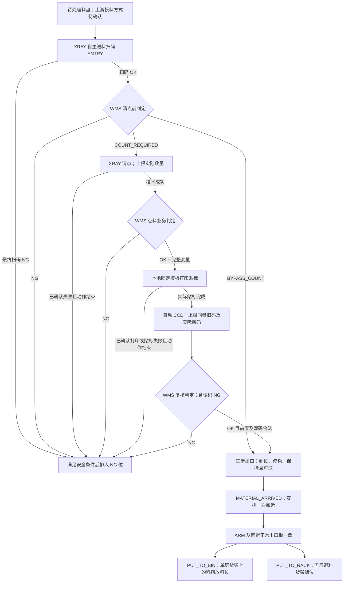
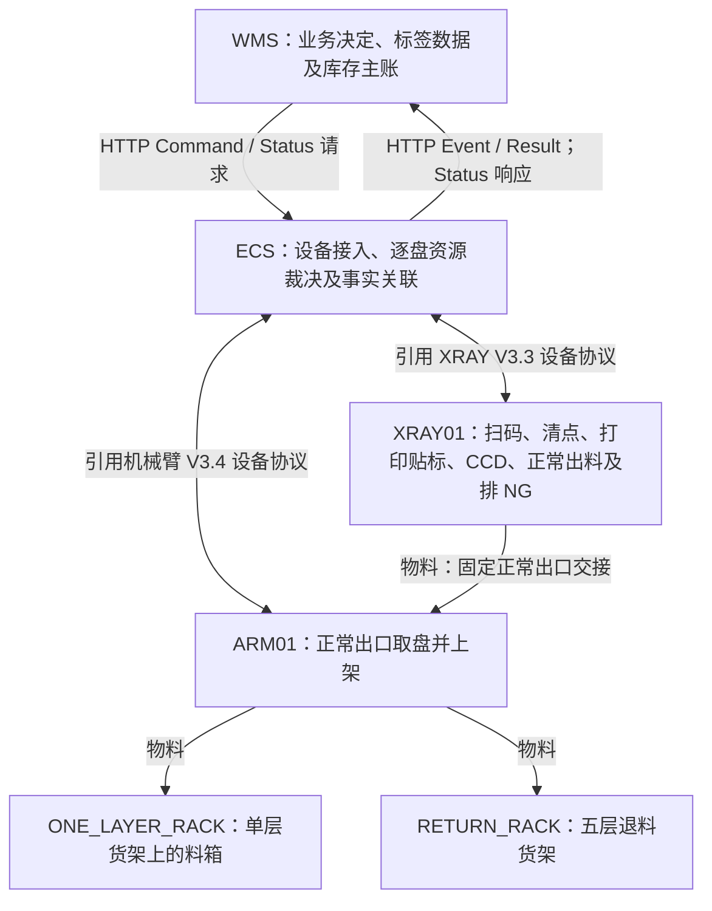

# X-Ray 清点、贴标与上架 API 对接文档（资料整理稿）

状态核对：2026-11-05。本文按 [SMT 手工对接文档](manual-picking-api.md)的章节、交互顺序表、完整报文、字段表和验收场景组织，整理已知 X-Ray 物料路线及设备拓扑。资料依据为 [ECS 与 WMS HTTP 通讯协议 V1.2 项目附录](../../../wes_backend/docs/hardware/ECS与WMS_HTTP通讯协议_V1.2_项目附录.md)（2026-11-03 评审稿，简称“项目附录”），其引用 XRAY V3.3、机械臂 V3.4 设备协议；本次未核验这两份厂商原协议。跨仓库链接依赖本地同级 `wes_backend` 目录。

**本文保留项目附录的 WMS ↔ ECS 通信方向和字段，不将其改写为已确认的 WES ↔ WMS 合同。** 本项目若由 WES 承接编排，仍须另行确认 WMS operation、决定/事实的请求响应、原身份映射和回调归属，见 [X01](#xray-pending)。本文不新增 operation、任务发布接口、业务包、配置或设备指令，不表示已经实现、部署、对端签认或现场通过。

资料差异：[wes_backend SRS §3.6.3](../../../wes_backend/docs/architecture/SRS.md#363-x-ray-智能清点与贴标-x-ray-counting--relabeling)仍描述 WES 下发 ZPL，且 §3.6 把退料工作线列为未来交付；项目附录采用固定本地模板与十个标签变量。本文描述项目附录方案，保留该差异为交付依赖，不据此宣布架构基线已经变更。

## 目录

- [完整交互顺序](#xray-sequence)
- [1. 流程图与设备拓扑](#xray-flow)
- [2. 正常业务流程与接口](#xray-api)
- [3. 公共规则与工作线配置](#xray-rules)
- [4. 规则状态与交付依赖](#xray-pending)
- [5. MOCK 与内部验收场景](#xray-acceptance)

<a id="xray-sequence"></a>
## 完整交互顺序

| 路径 | 步骤 | 方向 | Operation / Event / Command | 交互与推进条件 |
| --- | --- | --- | --- | --- |
| 进料 | E1 | XRAY → ECS → WMS | [SCAN_COMPLETED / ENTRY](#xray-entry) | 自主最终扫码；上报原 PKG、reelId、固定 templateId 和技术读码结果 |
| 进料 | E2 | WMS → ECS → XRAY | [APPLY_PKG_DECISION](#xray-pkg-decision) | COUNT_REQUIRED 清点；BYPASS_COUNT 直接正常出料；NG 排出 |
| 清点 | C1 | XRAY → ECS → WMS | [原清点命令 Result](#xray-count-result) | 实际 COUNT 终态结束原许可命令；ACK 不表示清点结束 |
| 清点 | C2 | XRAY → ECS → WMS | [XRAY_COUNT_COMPLETED](#xray-count) | 独立数量事实；与 C1 各自幂等，不能各派一次打印 |
| 标签 | L1 | WMS → ECS → XRAY | [APPLY_COUNT_DECISION](#xray-count-decision) | OK 带完整十变量，设备本地模板打印贴标；NG 实际排出 |
| 标签 | L2 | XRAY → ECS → WMS | [原贴标命令 Result](#xray-label-result) | LABEL_RESULT 映射原 HTTP Result；成功只证明实际贴标完成 |
| 复核 | V1 | XRAY → ECS → WMS | [SCAN_COMPLETED / VERIFY](#xray-verify) | 自动 CCD；同一事件上传旧码与实际新码；读码 NG 仍报告异常 |
| 复核 | V2 | WMS → ECS → XRAY | [APPLY_VERIFY_DECISION](#xray-verify-decision) | OK 正常出料；NG 排出；以实际对应出口到位结束原命令 |
| 出料 | O1 | XRAY → ECS → WMS | [原出料 Result](#xray-outlet-result) / [MATERIAL_ARRIVED](#xray-arrived) | 到位、停稳、保持且可取才上报；BYPASS 与 COUNTED 使用同一正常出口 |
| 上架 | P1 | WMS → ECS → ARM | [PUT_TO_BIN / PUT_TO_RACK](#xray-put) | 针对原到料事件，从固定正常出口取一盘并放一盘 |
| 上架 | P2 | ARM → ECS → WMS | [原搬运命令 Result](#xray-put-result) | 实际放料并核对实际目标；不把期望位置抄作成功证据 |
| NG | 分支 | XRAY → ECS → WMS | [NG_DISCHARGED](#xray-ng) | 只有实际排入 NG 位才报告；无正常到料、无机械臂 NG 搬运 |
| 等待 | 分支 | ECS ↔ WMS / ECS → XRAY | [原事件重报 / ROUTE NG](#xray-wait) | 三次业务请求、15 秒截止；先封锁阶段再排 NG；合同阻断/物理未知分别处理 |
| 恢复 | 分支 | ECS ↔ XRAY / ARM，ECS → WMS | [原任务查询 / 原回调补报](#xray-recovery) | 保留原任务和事实身份；未知不新建物理动作 |

步骤号只用于导航，不进入 wire。Result、事件及不同料盘消息可以乱序到达，不能把表格顺序作为 HTTP 到达顺序保证。项目附录没有定义 `sorting.task.*@v1`、整单完成或取消接口，不套用 SMT 手工任务合同。

<a id="xray-flow"></a>
## 1. 流程图与设备拓扑

### 1.1 物料行进路线

以下为业务阶段示意，不代表设备内部输送机构、工位距离或 CAD 布局。



免清点跳过本次清点、贴标和 CCD，不构造清点数量或新标签。正常出口持续占位只补报原到料事实。排 NG 满料/堵塞、动作可能仍在执行、位置未知时保持并报警/核对；实际安全许可不成立时不强行移动。等待业务判定耗尽的独立路径见 [3.2](#xray-wait)。

### 1.2 逻辑设备与通信拓扑



| 对象 | 当前资料中的职责 | 拓扑边界 |
| --- | --- | --- |
| WMS | 检查发料/未使用记录、清点及复核业务决定、生成标签变量、指定上架目标 | 图中按项目附录直接与 ECS 交互；本项目 WES 插入位置未定 |
| ECS | 持久接纳、设备任务关联、逐盘阶段和物理资源裁决、事件及结果回调 | 图为逻辑关系，不能推导单进程、单主机或网络部署 |
| XRAY01 | 自主扫码、清点、使用本地模板打印贴标、CCD、出料及排 NG | 编码为附录示例；打印/CCD 是该逻辑单元能力，独立硬件和控制器数量未定 |
| ARM01 | 从固定正常出口取盘并放入 WMS 指定目标；首版单任务 | 不承担 NG 搬运；不是粗分或 SMT 自动线的同名机械臂绑定 |
| 单层货架料箱 | A/B/C/D 箱位，每个料箱使用固定放料位 8 | 目标编号与实物配置/标定一致；不据箱位名推断现场方位 |
| 五层退料货架 | A/B 面、1～5 层及标定列/储位 | 本附录只定义机械臂放料，未定义换面、叫架、离场和补架合同 |

LCR、人工封包/干燥柜属于 SRS 的退料区业务范围，项目附录未定义它们与 X-Ray 的串并联物理连接。上游进机方式、正常/NG 出口坐标、缓存容量、工位数量和输送布局待现场确认，不能按流程节点数推导设备工位数。

<a id="xray-api"></a>
## 2. 正常业务流程与接口

### 2.0 通用报文与读法

本章按“需要清点、贴标、复核后正常上架”的主流程依次展示消息，免清点和 NG 在章末单列。保留**项目附录原 WMS ↔ ECS 合同**。WMS 向 `POST {{ECS_BASE_URL}}/api/v1/device/command` 发送业务决定和搬运任务；ECS 向 WMS 回调 Event/Result。它不使用手工线的 `operation_id/operation/data` 通知信封，也不将 `202 / RECEIVED` 用作设备命令 ACK。

Content-Type 为 UTF-8 `application/json`，Body 上限 `256 KiB`。命令顶层固定为 `device_code、command_code、task_type、priority、timeout、timestamp、params`；业务字段只在 params。时间为整数纪元毫秒，timeout 为正整数毫秒、priority 固定 1。原重提保留完整原载荷和时间戳。下列示例值用于对接说明，不表示真实任务或配置。

同步响应方向：Command 请求由 **ECS → WMS** 返回接纳响应；Event/Result 请求由 **WMS → ECS** 返回持久收件响应。命令确定接纳须同时满足 HTTP 200、JSON Content-Type、JSON 对象的整数 `code=200` 和 `message="ACK"`；仅表示接纳。事件和结果持久收件也使用同样 ACK。可选非 null 字符串 trace_id 仅诊断，未识别响应顶层字段按原白皮书忽略，不据此取得业务许可。

```json
{"code": 200, "message": "ACK"}
```

| 消息类型 | HTTP 请求方向 | 接收方端点 | 同步响应方向 |
| --- | --- | --- | --- |
| Command：业务判定/搬运任务 | WMS → ECS | `POST {{ECS_BASE_URL}}/api/v1/device/command` | ECS → WMS，接纳 ACK |
| Event：扫码/清点/到料/排 NG 事实 | ECS → WMS | `POST {{WMS_BASE_URL}}/api/v1/callback/event` | WMS → ECS，持久收件 ACK |
| Result：原命令物理终态 | ECS → WMS | `POST {{WMS_BASE_URL}}/api/v1/callback/result` | WMS → ECS，持久收件 ACK |

下文的 HTTP JSON 均为 WMS 与 ECS 之间的报文。XRAY/ARM → ECS 为设备事实来源，ECS → XRAY/ARM 为后续设备执行方向，不能把该南向设备消息与 HTTP 回调信封混用。主流程顺序用于说明业务依赖，实际网络消息仍可能乱序。

**Event 公共信封：**方向为 ECS → WMS，入口 `POST {{WMS_BASE_URL}}/api/v1/callback/event`。顶层为 device_code、event_type、timestamp、可选 is_debug 和 data；本附录 data 必须是对象且非 null。生产 is_debug 省略或 false，不接受以 true 驱动正式业务；ESTOP_PRESSED 不走该事件接口。

下文 Event 示例均给出完整信封。字段表补充各自正常/异常分支；`eventId/reelId` 均必填。timestamp 取原设备事实发生时间，重报不刷新。

<a id="xray-entry"></a>
### 2.1 进料：上报扫码结果（ECS → WMS）

**HTTP 方向：ECS → WMS；端点：`POST {{WMS_BASE_URL}}/api/v1/callback/event`。设备事实来源：XRAY → ECS。**

```json
{
  "device_code": "XRAY01",
  "event_type": "SCAN_COMPLETED",
  "timestamp": 1793413800000,
  "data": {
    "eventId": "1b2daf25-09b1-4734-ab69-57f40524e3be",
    "reelId": "18520712-e29b-4197-b145-1aefa4c14cca",
    "scanStage": "ENTRY",
    "scanStatus": "OK",
    "pkg": "PKG-OLD-A",
    "templateId": "XX123456789"
  }
}
```

| data 字段 | 类型 / 必填 | 约束 |
| --- | --- | --- |
| eventId / reelId | string / 是 | 本次事实及本盘处理身份 |
| scanStage / scanStatus | enum / 是 | ENTRY；OK / NG，读码 OK 不表示业务放行 |
| pkg | string / OK 必填，NG 已知时可附 | 非空实际原文，保留前导零；无码时不伪造 |
| templateId | string / 是 | 本周期固定模板配置 |
| reasonCode / reasonMessage | 非空 string / NG 必填 | 稳定读码原因码和说明 |

ENTRY 最终扫码 NG 时不请求清点许可、不默认满盘；设备满足安全条件后自主排 NG，另报真实排出事实。

<a id="xray-pkg-decision"></a>
### 2.2 清点许可：WMS 下发清点前判定（WMS → ECS）

| 项目 | 值 |
| --- | --- |
| 方向 / 端点 | WMS → ECS，`POST {{ECS_BASE_URL}}/api/v1/device/command` |
| device_code / task_type | `XRAY01 / APPLY_PKG_DECISION` |
| 触发 | ENTRY 扫码 OK；WMS 检查发料及未使用记录后决定 |

HTTP 接纳响应由 ECS → WMS 返回；接纳后 ECS → XRAY 下发对应设备动作，实际完成后再由 ECS → WMS 回调原命令 Result。

```json
{
  "device_code": "XRAY01",
  "command_code": "46381f71-3e91-40cb-848d-8f79abdd112a",
  "task_type": "APPLY_PKG_DECISION",
  "priority": 1,
  "timeout": 70000,
  "timestamp": 1793413801000,
  "params": {
    "reelId": "18520712-e29b-4197-b145-1aefa4c14cca",
    "sourceEventId": "1b2daf25-09b1-4734-ab69-57f40524e3be",
    "decision": "COUNT_REQUIRED"
  }
}
```

| params 字段 | 类型 / 必填 | 约束 |
| --- | --- | --- |
| reelId | string / 是 | 原 ENTRY 的本盘处理身份 |
| sourceEventId | string / 是 | 原 ENTRY.eventId，须与 reelId 同时匹配 |
| decision | enum / 是 | COUNT_REQUIRED / BYPASS_COUNT / NG |
| reason | string / NG 必填，其余省略 | 非空业务拒收原因 |

COUNT_REQUIRED 到实际 COUNT 终态才回 Result。BYPASS_COUNT 到正常出口实际到位才成功。业务 NG 到实际排出才成功，另发 NG_DISCHARGED；成功排 NG 不表示物料合格。临时无法判定按 [业务等待规则](#xray-wait)处理，不默认清点。

<a id="xray-count-result"></a>
### 2.3 清点完成：回传原命令终态与点料事实（ECS → WMS）

**HTTP 方向：ECS → WMS。设备事实来源：XRAY → ECS；下列 Result 与 Event 分别发送到各自端点。**

本步骤有两个独立 HTTP 请求：Result 结束 2.2 的原清点许可命令；Event 提交点料事实，供 WMS 在 2.4 生成标签判定。两者使用同一实际清点事实，各自幂等，不各登记一次数量或各派一次打印。

#### 2.3.1 原清点许可命令 Result

**方向 / 端点：ECS → WMS，`POST {{WMS_BASE_URL}}/api/v1/callback/result`。**

```json
{
  "command_code": "46381f71-3e91-40cb-848d-8f79abdd112a",
  "device_code": "XRAY01",
  "result": "SUCCESS",
  "finish_time": 1793413808000,
  "data": {
    "reelId": "18520712-e29b-4197-b145-1aefa4c14cca",
    "decision": "COUNT_REQUIRED",
    "qty": 4000
  }
}
```

<a id="xray-count"></a>
#### 2.3.2 点料事实 XRAY_COUNT_COMPLETED

**方向 / 端点：ECS → WMS，`POST {{WMS_BASE_URL}}/api/v1/callback/event`。**

```json
{
  "device_code": "XRAY01",
  "event_type": "XRAY_COUNT_COMPLETED",
  "timestamp": 1793413808000,
  "data": {
    "eventId": "5ad0f02e-e98d-456d-bb52-dff0d8706865",
    "reelId": "18520712-e29b-4197-b145-1aefa4c14cca",
    "pkg": "PKG-OLD-A",
    "templateId": "XX123456789",
    "countStatus": "OK",
    "qty": 4000
  }
}
```

| data 字段 | 类型 / 必填 | 约束 |
| --- | --- | --- |
| eventId / reelId | string / 是 | 原事实身份及原本盘身份 |
| pkg / templateId | string / 是 | 本周期原 PKG 及固定模板 |
| countStatus | enum / 是 | OK / NG，技术清点结果 |
| qty | integer / OK 必填，NG 省略 | >=0，PCS；0 必须为真实测量，不冒充失败 |
| reasonCode / reasonMessage | 非空 string / NG 必填 | 稳定技术失败原因码和说明 |

原 COUNT 命令 Result 与此事件分别幂等，只对有效 OK 事实产生正常标签业务判定。已确认清点失败且动作结束时自主排 NG，不等待 APPLY_COUNT_DECISION。

<a id="xray-count-decision"></a>
### 2.4 标签：WMS 下发业务判定及打印变量（WMS → ECS）

| 项目 | 值 |
| --- | --- |
| 方向 / 端点 | WMS → ECS，`POST {{ECS_BASE_URL}}/api/v1/device/command` |
| device_code / task_type | `XRAY01 / APPLY_COUNT_DECISION` |
| 触发 | 有效 countStatus=OK 的点料事实 |

HTTP 接纳响应由 ECS → WMS 返回；接纳后 ECS → XRAY 下发对应设备动作，实际完成后再由 ECS → WMS 回调原命令 Result。

```json
{
  "device_code": "XRAY01",
  "command_code": "fd59e7c9-1a8a-4728-991d-0a9e3b71516f",
  "task_type": "APPLY_COUNT_DECISION",
  "priority": 1,
  "timeout": 40000,
  "timestamp": 1793413809000,
  "params": {
    "reelId": "18520712-e29b-4197-b145-1aefa4c14cca",
    "sourceEventId": "5ad0f02e-e98d-456d-bb52-dff0d8706865",
    "decision": "OK",
    "label": {
      "variables": {
        "ID": "XX123456789",
        "PHHPN": "100-0277-000HF",
        "SPKG": "SXCN0031482261000009NVD",
        "MMfrPN": "PZ2012S601AT000",
        "VVendor": "M000002870",
        "QQTYPC": "4000",
        "Location": "",
        "DDC": "2623",
        "DateTime": "2026-10-29 14:43:50",
        "LLC": "1T3330022677"
      }
    }
  }
}
```

| params 字段 | 类型 / 必填 | 约束 |
| --- | --- | --- |
| reelId / sourceEventId | string / 是 | 原本盘及原点料事件 |
| decision | enum / 是 | OK / NG；与点料技术结果区分 |
| label | object / OK 必填，NG 省略 | 仅 variables；不另传模板文件、路径或 templateId 选择指令 |
| reason | string / NG 必填 | 非空业务拒绝原因 |

| label.variables 键 | 含义 | 类型 / 约束 |
| --- | --- | --- |
| ID | 固定模板标识 | string，等于本盘 templateId；附录值 XX123456789，正式配置须冻结 |
| PHHPN | 鸿海/客户料号 | 非空 string |
| SPKG | 新标签 PKG | 非空 string，不覆盖原 pkg |
| MMfrPN | 制造商料号 | 非空 string |
| VVendor | 供应商编号 | 非空 string，保留原内容 |
| QQTYPC | 标签元件数量 | 非空数字 string，单位 PCS；由 WMS 业务输出 |
| Location | 标签显示库位 | string，键必填，允许空字符串；不等于物理 location_id |
| DDC | 日期码 | 非空 string，原样保留 |
| DateTime | 标签显示日期时间 | 非空 string，yyyy-MM-dd HH:mm:ss；不是消息 timestamp |
| LLC | 批次码 | 非空 string，保留字母和前导零 |

十个键大小写固定，最大长度由实际模板冻结，不自动截断。ECS/XRAY 校验 ID 与原固定配置一致；有未结盘时不静默换模板。未收到完整有效变量前不打印、不正常放行、不借上一盘变量。QQTYPC 与实测 qty 的一致性规则仍由 WMS 明确，ECS 不擅改。OK 命令到实际贴标完成即结束，不等待 CCD 或 WMS 复核；NG 到实际排出结束。

<a id="xray-label-result"></a>
### 2.5 贴标完成：回传原打印贴标命令结果（ECS → WMS）

**HTTP 方向：ECS → WMS；端点：`POST {{WMS_BASE_URL}}/api/v1/callback/result`。设备事实来源：XRAY → ECS。**

XRAY 实际 LABEL_RESULT SUCCESS 后结束 2.4 的原命令；labelStatus=APPLIED 只表示已贴标。随后 XRAY 自动执行 CCD，另行上报 2.6 的复核事件。

```json
{
  "command_code": "fd59e7c9-1a8a-4728-991d-0a9e3b71516f",
  "device_code": "XRAY01",
  "result": "SUCCESS",
  "finish_time": 1793413813000,
  "data": {
    "reelId": "18520712-e29b-4197-b145-1aefa4c14cca",
    "decision": "OK",
    "labelStatus": "APPLIED"
  }
}
```

<a id="xray-verify"></a>
### 2.6 CCD：上报实际新旧双码（ECS → WMS）

**HTTP 方向：ECS → WMS；端点：`POST {{WMS_BASE_URL}}/api/v1/callback/event`。设备事实来源：XRAY → ECS。**

```json
{
  "device_code": "XRAY01",
  "event_type": "SCAN_COMPLETED",
  "timestamp": 1793413814000,
  "data": {
    "eventId": "58132158-68da-4e5b-bbd2-63553c7b4856",
    "reelId": "18520712-e29b-4197-b145-1aefa4c14cca",
    "scanStage": "VERIFY",
    "scanStatus": "OK",
    "oldPkg": "PKG-OLD-A",
    "newPkg": "SXCN0031482261000009NVD"
  }
}
```

| data 字段 | 类型 / 必填 | 约束 |
| --- | --- | --- |
| eventId / reelId | string / 是 | 原事实及本盘身份 |
| scanStage / scanStatus | enum / 是 | VERIFY；OK / NG，读码 OK 不表示业务复核 OK |
| oldPkg | string / 是 | 同盘 ENTRY.pkg，不能要求 WMS 从历史自行补齐 |
| newPkg | string / OK 必填，NG 无读码时省略 | CCD 实际新码，不使用待打印 variables.SPKG 冒充 |
| templateId | string / 可选 | 如填写，须为本周期固定值 |
| reasonCode / reasonMessage | 非空 string / NG 必填 | 稳定读码原因码和说明 |

正常复核的双码必须在同一事件，不用“最后条码”拼接；无新码 NG 不具备正常 OUTLET 放行条件。

<a id="xray-verify-decision"></a>
### 2.7 复核放行：WMS 下发出料判定（WMS → ECS）

| 项目 | 值 |
| --- | --- |
| 方向 / 端点 | WMS → ECS，`POST {{ECS_BASE_URL}}/api/v1/device/command` |
| device_code / task_type | `XRAY01 / APPLY_VERIFY_DECISION` |
| 触发 | VERIFY 读码事件，含读码 NG |

HTTP 接纳响应由 ECS → WMS 返回；接纳后 ECS → XRAY 下发对应设备动作，实际完成后再由 ECS → WMS 回调原命令 Result。

```json
{
  "device_code": "XRAY01",
  "command_code": "4c2adb8e-e7f4-428e-b392-d14f2cb8c501",
  "task_type": "APPLY_VERIFY_DECISION",
  "priority": 1,
  "timeout": 25000,
  "timestamp": 1793413815000,
  "params": {
    "reelId": "18520712-e29b-4197-b145-1aefa4c14cca",
    "sourceEventId": "58132158-68da-4e5b-bbd2-63553c7b4856",
    "decision": "OK"
  }
}
```

| params 字段 | 类型 / 必填 | 约束 |
| --- | --- | --- |
| reelId / sourceEventId | string / 是 | 原本盘及原 VERIFY 事件 |
| decision | enum / 是 | OK / NG |
| reason | string / NG 必填 | 非空复核不通过原因 |

OK 到正常出口实际到位才成功，NG 到实际排出才成功。无合法双码、旧码不符、前置清点/贴标事实不完整或本盘已被其他流程消费时，不接纳正常出料许可。读码 NG 仍由 WMS 下 NG 判定，未回复按有限业务等待处理。

<a id="xray-outlet-result"></a>
### 2.8 正常出口：原出料命令完成并上报可取料（ECS → WMS）

**HTTP 方向：ECS → WMS。设备事实来源：XRAY → ECS；下列 Result 与 Event 分别发送到各自端点。**

XRAY 实际 OUTLET_ARRIVED 形成两个独立 HTTP 请求：Result 结束 2.7 的原复核放行命令；MATERIAL_ARRIVED 报告料盘已到位、停稳、保持且可取。WMS 根据本次到料事实安排一次搬运，不因两个回调各派一次。

#### 2.8.1 原正常出料命令 Result

**方向 / 端点：ECS → WMS，`POST {{WMS_BASE_URL}}/api/v1/callback/result`。**

```json
{
  "command_code": "4c2adb8e-e7f4-428e-b392-d14f2cb8c501",
  "device_code": "XRAY01",
  "result": "SUCCESS",
  "finish_time": 1793413819000,
  "data": {
    "reelId": "18520712-e29b-4197-b145-1aefa4c14cca",
    "decision": "OK",
    "mode": "COUNTED"
  }
}
```

<a id="xray-arrived"></a>
#### 2.8.2 正常到料事件 MATERIAL_ARRIVED

**方向 / 端点：ECS → WMS，`POST {{WMS_BASE_URL}}/api/v1/callback/event`。**

```json
{
  "device_code": "XRAY01",
  "event_type": "MATERIAL_ARRIVED",
  "timestamp": 1793413819000,
  "data": {
    "eventId": "ae674c2d-635a-471e-bb2e-0dfa924c8a04",
    "reelId": "18520712-e29b-4197-b145-1aefa4c14cca",
    "pkg": "PKG-OLD-A",
    "mode": "COUNTED",
    "readyForPick": true,
    "labelPkg": "SXCN0031482261000009NVD"
  }
}
```

| data 字段 | 类型 / 必填 | 约束 |
| --- | --- | --- |
| eventId / reelId / pkg | string / 是 | 稳定事实、本盘身份和原进料 PKG |
| mode | enum / 是 | BYPASS / COUNTED |
| readyForPick | boolean / 是 | 固定 true；实际到位、停稳、保持且可取才发送 |
| labelPkg | string / COUNTED 必填，BYPASS 省略 | 已复核的 CCD 实际新码 |

设备 OUTLET_ARRIVED 同时结束原正常出料命令并形成此事件，WMS 只派一次搬运。持续占位重报原事件；历史到位不替代机械臂取盘时的实时安全许可。

<a id="xray-put"></a>
### 2.9 上架：WMS 下发取放任务（WMS → ECS）

| 项目 | 值 |
| --- | --- |
| 方向 / 端点 | WMS → ECS，`POST {{ECS_BASE_URL}}/api/v1/device/command` |
| device_code / task_type | `ARM01 / PUT_TO_BIN` 或 `PUT_TO_RACK` |
| 触发 | 原 MATERIAL_ARRIVED，针对该次到料只安排一次搬运 |

HTTP 接纳响应由 ECS → WMS 返回；接纳后 ECS → ARM 下发对应设备动作，实际完成后再由 ECS → WMS 回调原命令 Result。

```json
{
  "device_code": "ARM01",
  "command_code": "287df229-867e-403b-b4eb-1c23d09f2bcc",
  "task_type": "PUT_TO_BIN",
  "priority": 1,
  "timeout": 90000,
  "timestamp": 1793413820000,
  "params": {
    "reelId": "18520712-e29b-4197-b145-1aefa4c14cca",
    "sourceEventId": "ae674c2d-635a-471e-bb2e-0dfa924c8a04",
    "target": {
      "location_id": "STATION_B",
      "location_type": "ONE_LAYER_RACK",
      "rack_id": "110014",
      "bin_id": "A000001568",
      "bin_type": "1",
      "bin_location": "D",
      "bin_cell_location": 8,
      "reel_layer": 1,
      "reel_thickness": 20,
      "reel_diameter": 15,
      "reel_totalthickness": 20
    }
  }
}
```

`PUT_TO_RACK` 为替代分支，须使用自己的原命令身份；不是对上例同一次到料再发一次搬运。其完整命令包络相同，task_type 改为 PUT_TO_RACK，target 按下表 RACK 字段构造。

| params / target 字段 | 类型 / 必填 | 约束 |
| --- | --- | --- |
| params.reelId / sourceEventId | string / 是 | 原本盘及原 MATERIAL_ARRIVED.eventId |
| target.location_id | string / 两分支必填 | 现场目标站点；STATION_A/B 只是示例，不固定架型对应站点 |
| target.location_type | enum / 两分支必填 | PUT_TO_BIN 固定 ONE_LAYER_RACK；PUT_TO_RACK 固定 RETURN_RACK |
| target.rack_id | 非空 string / 两分支必填 | 与站点、类型共同唯一匹配已标定料架，单架也必填 |
| target.bin_id | string / BIN 必填 | 实际料箱身份，与站点箱位实物配置一致 |
| target.bin_type | string / BIN 必填 | 固定字符串 "1"，不传整数 |
| target.bin_location | enum / BIN 必填 | A / B / C / D |
| target.bin_cell_location | integer / BIN 必填 | 固定整数 8；每个料箱位置一个放料位 |
| target.reel_layer | integer / BIN 可选 | 放入前已有层数，>=0，空箱可为 0 |
| target.reel_totalthickness | number / BIN 可选 | 放入前已有总高度，>=0，毫米；不是放入后高度 |
| target.reel_thickness | number / BIN 可选、RACK 必填 | 本盘厚度，>0，毫米 |
| target.reel_diameter | number / BIN 可选、RACK 必填 | 7 / 13 / 15，英寸 |
| target.rack_face | enum / RACK 必填 | A / B |
| target.slot_id | 非空 string / RACK 必填 | 现场储位编号，不能按字符串猜坐标 |
| target.rack_layer | integer / RACK 必填 | 1～5 |
| target.rack_column | integer / RACK 必填 | >=1，且不超过现场标定范围 |

RACK 的 slot_id、face、layer、column 必须匹配同一映射，不发送 bin_*、reel_layer 或 reel_totalthickness。BIN 的四个 reel_* 按各自约束可选，不用层数乘本盘厚度推断已有高度；缺省时只能用已冻结配方/传感器/点位参数，无法确定实际控制参数则接纳前明确拒绝。

每条任务包含从固定正常出口取一盘并放一盘，不增加 source/qty，不要求机械臂预先持盘。没有独立 params.reel，不混用旧 PICK_AND_PUT、type/binType/cell/stackHeightMm 字段。项目附录未定义目标架补给、换面或离场的 WMS/RCS 接口，不能直接套用 SMT 架流合同。

<a id="xray-put-result"></a>
### 2.10 上架完成：回传实际放料结果（ECS → WMS）

**HTTP 方向：ECS → WMS；端点：`POST {{WMS_BASE_URL}}/api/v1/callback/result`。设备事实来源：ARM → ECS。**

ARM 实际取放结束并核对真实目标后，ECS 回传 2.9 原命令结果。actualQty=1 的单位为盘，不是元件数量；actualTarget 由实际执行核对形成，不以请求目标代替实际证据。下例为 PUT_TO_BIN；PUT_TO_RACK 的 actualTarget 字段见 2.13。

```json
{
  "command_code": "287df229-867e-403b-b4eb-1c23d09f2bcc",
  "device_code": "ARM01",
  "result": "SUCCESS",
  "finish_time": 1793413840000,
  "data": {
    "reelId": "18520712-e29b-4197-b145-1aefa4c14cca",
    "actualQty": 1,
    "position": "TARGET",
    "actualTarget": {
      "location_id": "STATION_B",
      "location_type": "ONE_LAYER_RACK",
      "rack_id": "110014",
      "bin_id": "A000001568",
      "bin_type": "1",
      "bin_location": "D",
      "bin_cell_location": 8
    }
  }
}
```

上架物理成功和回调收件 ACK 均不表示 WMS 库存已入账；库存业务确认仍由 WMS 负责。

<a id="xray-bypass"></a>
### 2.11 正常替代路径：免清点直达出口

| 步骤 | HTTP 方向 / 端点 | 内容与完成条件 |
| --- | --- | --- |
| 进料扫码 | ECS → WMS，`POST {{WMS_BASE_URL}}/api/v1/callback/event` | 沿 2.1 保存本盘 ENTRY 事实 |
| 免清点决定 | WMS → ECS，`POST {{ECS_BASE_URL}}/api/v1/device/command` | 沿 2.2，decision=BYPASS_COUNT，关联原 ENTRY 事件 |
| 正常出口到位 | ECS → WMS，`POST {{WMS_BASE_URL}}/api/v1/callback/result` | 结束原 APPLY_PKG_DECISION；data 含 reelId、decision=BYPASS_COUNT、mode=BYPASS |
| 正常到料 | ECS → WMS，`POST {{WMS_BASE_URL}}/api/v1/callback/event` | 沿 2.8.2，mode=BYPASS、readyForPick=true，省略 labelPkg |
| 机械臂上架 | WMS → ECS Command；ECS → WMS Result | 接续 2.9～2.10，仍针对同一次到料只搬一盘 |

免清点跳过 2.3～2.7 的清点、标签和 CCD 流程，不构造数量、新码或复核 OK；实际出口到位才结束原命令。

<a id="xray-ng"></a>
### 2.12 异常分支：实际排 NG 后上报（ECS → WMS）

**HTTP 方向：ECS → WMS；端点：`POST {{WMS_BASE_URL}}/api/v1/callback/event`。设备事实来源：XRAY → ECS。**

```json
{
  "device_code": "XRAY01",
  "event_type": "NG_DISCHARGED",
  "timestamp": 1793664011000,
  "data": {
    "eventId": "02875582-439b-4a3e-948a-5c004862a5ed",
    "reelId": "5e259bce-1630-48d6-b4e2-ad84680ad310",
    "stage": "COUNT",
    "reasonCode": "COUNT_FAILED",
    "reason": "清点确认失败，已实际排NG",
    "pkg": "PKG-COUNT-001"
  }
}
```

上例为另一盘异常分支，不是前述正常会话的后续动作。

| data 字段 | 类型 / 必填 | 约束 |
| --- | --- | --- |
| eventId / reelId | string / 是 | 排出独立事实及原本盘身份 |
| stage | enum / 是 | ENTRY / COUNT / LABEL / VERIFY |
| reason | 非空 string / 是 | 真实业务或技术原因，不依赖解析中文分类 |
| reasonCode | string / 可选，建议填写 | SCAN_FAILED / BUSINESS_REJECTED / COUNT_FAILED / LABEL_FAILED / WMS_DECISION_TIMEOUT 等 |
| pkg | string / 已知时填写 | 无码异常可省略，不使用上一盘码补齐 |

扫码/清点/贴标失败与实际排出是独立事实。NG 满料/堵塞或排出未确认时不报此事件。原失败动作保持 FAILED；自主排 NG 没有原 WMS 命令时不编造 command_code 或 Result，不产生正常 MATERIAL_ARRIVED。

<a id="xray-results"></a>
### 2.13 Result 公共字段与各分支完成边界

命令结构见 [2.0](#xray-api)。Result 方向为 ECS → WMS，入口 `POST {{WMS_BASE_URL}}/api/v1/callback/result`，必须匹配原 command_code、device_code；顶层 result 仅 SUCCESS / FAILED，finish_time 使用原物理终态时间，data 必须为对象并含 reelId。

| 原命令 / 分支 | 成功 data 必填内容（均含 reelId） | 物理完成证据 |
| --- | --- | --- |
| APPLY_PKG_DECISION / COUNT_REQUIRED | decision=COUNT_REQUIRED、qty 为 >=0 的 PCS 整数 | 原 COUNT 成功终态 |
| APPLY_PKG_DECISION / BYPASS_COUNT | decision=BYPASS_COUNT、mode=BYPASS | 实际 OUTLET_ARRIVED，不虚构 qty/CCD |
| APPLY_COUNT_DECISION / OK | decision=OK、labelStatus=APPLIED | 实际 LABEL_RESULT SUCCESS，只证明贴标完成 |
| APPLY_VERIFY_DECISION / OK | decision=OK、mode=COUNTED | 实际 OUTLET_ARRIVED |
| 三类判定命令 / NG | decision=NG、discharged=true | 对应原命令要求的实际排 NG；业务仍 NG |
| PUT_TO_BIN / PUT_TO_RACK | actualQty=1、position=TARGET、actualTarget | 实际放料且目标核对一致；actualQty 单位盘 |

BIN 成功的 actualTarget 仅含 `location_id/location_type/rack_id/bin_id/bin_type/bin_location/bin_cell_location`；RACK 仅含 `location_id/location_type/rack_id/rack_face/slot_id/rack_layer/rack_column`。不回填 reel_* 控制上下文，不把期望目标或预计高度冒充实际结果。真实位置与目标不符时保留实际证据，按失败/对账处理。

FAILED 的 data 至少含 reelId，顶层 error_detail 必填且只含非空 string 的 code/msg；SUCCESS 的 error_detail 省略或 null。可信时可附 position=SOURCE/GRIPPER/TARGET/OTHER/UNKNOWN、failureStage 和实际 actualTarget。搬运失败只有能证明未完成目标放料时才可附 actualQty=0，未知省略。LABEL_RESULT 是设备消息名，不作 HTTP result 枚举；设备原动作 id 不强制暴露给 WMS。

<a id="xray-rules"></a>
## 3. 公共规则与工作线配置

### 3.1 身份、幂等与多盘并行

| 字段 | 生成方 / 用途 | 稳定性要求 |
| --- | --- | --- |
| command_code | WMS 生成的全局命令身份 | 原载荷、timestamp、timeout、变量不变；同号改内容 409 |
| reelId | 进料设备生成，ECS 沿用的本次处理身份 | 不是 PKG；同盘各阶段不变，返工重新进机创建新周期 |
| eventId | ECS 持久生成的北向事实身份 | 同事实重报不改 eventId、timestamp、data；扫码和排 NG 各有身份 |
| sourceEventId | WMS 原样复制的被判定事件号 | 与 reelId 同时校验；不解析编号，不把 A 盘判定作用于 B 盘 |
| templateId / ID | ECS 固定模板配置 / WMS 原值回传 | 同周期冻结；不能临时选择其他模板 |
| pkg / oldPkg / newPkg | 原码 / 同盘旧码 / 实际 CCD 新码 | 原文保留，不以新标签替换原进料事实 |

reelId、eventId、command_code 建议 UUIDv4、36 字符且不带大括号，不能套用手工线 operation_id 的 UUIDv7 规则。相同命令原载荷重提只返回原接纳事实，不重复驱动；不同命令号也不能重复消费同盘同阶段或同次到料。事件冲突不换号绕过，乱序事实暂存待关联，不拼接上一盘数据。

A 盘 WAIT_VERIFY 时 B 盘 ENTRY/COUNT 可并行，前提是真实工位和共享路径/打印/曝光资源允许。整机 RUNNING、单个诊断主命令和 HTTP 到达顺序均不授予或否决另一盘许可；机械臂首版单任务，忙时明确未接纳，不隐式无限排队。

<a id="xray-wait"></a>
### 3.2 有限业务等待与异常处置

| 等待阶段 | 原事件 | 预期命令 | 耗尽后的 NG stage |
| --- | --- | --- | --- |
| PKG_DECISION | ENTRY 且 scanStatus=OK | APPLY_PKG_DECISION | ENTRY |
| COUNT_DECISION | XRAY_COUNT_COMPLETED 且 countStatus=OK | APPLY_COUNT_DECISION | COUNT |
| VERIFY_DECISION | VERIFY 事件，含读码 NG | APPLY_VERIFY_DECISION | VERIFY |

每盘每阶段独立持久保存原事件、次数、等待起点及截止。联调初值为含首次共 3 次，t=0/5/10 秒原样请求，t=15 秒截止，网络耗时不延长；不叠加第二个回调重试器。HTTP 收件 ACK 不结束业务等待，已 ACK 事件仍可在业务等待内原样重报；WMS 已生成判定时重发原 command_code/原正文，不创建第二个动作。

ECS 原子选择“有效判定已持久接纳”或“阶段已封锁进入 REJECTING”。已接纳则退出本阶段等待，设备执行/结果延迟不再触发此阶段排 NG。先封锁则迟到新判定一律 HTTP 422 ANNEX_VALIDATION_FAILED；既有已接纳命令原载荷重传仍幂等 ACK，改载荷仍 409。

耗尽后 ECS 下独立持久 ROUTE NG 设备任务，不伪造 WMS command_code/Result。WMS_TIMEOUT 只是按 reelId/阶段发往设备的报警通知，不驱动物料移动；设备自行清除报警，无 ECS 清除报警信号。业务等待截止不丢弃事实，未获 ACK 的原事件/Result 和 NG_DISCHARGED 继续可靠交付，封锁后补报不重开判定。

| 异常 | 已知处置 | 不确定性边界 |
| --- | --- | --- |
| ENTRY 最终扫码失败 | 保留扫码事实，安全条件满足后自主排 NG | 无码不填上一盘码，不 COUNT/BYPASS |
| 明确业务 NG | 不重求同一个拒收判定，实际排出后结束原命令 | SUCCESS 表示排出动作成功，不表示业务合格 |
| 清点/打印贴标已确认失败且动作已结束 | 原命令 FAILED；安全条件满足后自主排 NG | 不自动补打、不继续正常 CCD；排 NG 不改写原失败 |
| NG 位满/堵塞、排 NG 失败 | 保持并本地报警；有原命令且确认失败则回 FAILED | 未实际排出不报 NG_DISCHARGED，不强行连续新建排 NG |
| 设备失联、动作可能仍运行、料盘位置不明 | 保留原任务和物理保护，查询/对账 | 不由通信超时推导 FAILED，不盲目重做或排 NG |
| 合同/身份错误阻断 | 停止自动重试并核对 | 不作为等待耗尽自动排 NG |

自主排 NG 前须持久保存原 SCAN_RESULT/RESULT/LABEL_RESULT，实际排出事实也单独保存；断线分别补报，ECS 先关联前置事实。排出要求曝光/运动安全结束、料盘可识别、路径和 NG 容量满足。

### 3.3 HTTP 错误与交付边界

| 命令 HTTP / message | 接纳含义与处理 |
| --- | --- |
| 200 / ACK | 确定接纳后等待原结果，不持续重送命令 |
| 400 / INVALID_ENVELOPE；404 / DEVICE_NOT_FOUND；405 / METHOD_NOT_ALLOWED；413 / PAYLOAD_TOO_LARGE | 包络/设备/方法/大小不合法，未接纳 |
| 409 / IDEMPOTENCY_CONFLICT | 同号改载荷，停止自动处理，不换号绕过 |
| 422 / ANNEX_VALIDATION_FAILED | 字段、事件关联、阶段或目标不合法，明确未接纳 |
| 429 / CAPACITY_EXCEEDED | 明确未接纳；同时有有效 Retry-After 才按原身份原载荷延后重提 |
| 503 / TEMPORARILY_UNAVAILABLE | 明确未接纳，可原身份原载荷延后重提 |
| 500/502/504 / TEMPORARILY_UNAVAILABLE | 交付未知，进入对账，不自动重放物理动作 |

项目附录 §8.3 对等待期间命令 ACK 丢失/500/502/504 又使用“原身份重询/重提”的描述，与 §8.1“交付未知不自动重放”存在恢复方式需澄清的边界（X07）。本文不把该描述解释为自动再次驱动物理动作的授权。没有确定未接纳或原任务恢复证据时保留未知。

| 回调 HTTP / message | 收件含义与处理 |
| --- | --- |
| 200 / ACK | 持久收件；重复原回调仍 ACK，仅应用一次 |
| 400 / INVALID_ENVELOPE | error_detail.issues[] 每项含 field/code，可选 expected；不回显原始载荷/异常 |
| 404 / COMMAND_NOT_FOUND | 仅 Result，不认识原命令，核对记录 |
| 409 / IDEMPOTENCY_CONFLICT 或 RESULT_BEFORE_DISPATCH | 后者仅 Result；停止自动重报并对账，不换身份或重做 |
| 413 / PAYLOAD_TOO_LARGE | 按正确身份修正，不拆成多个业务动作 |
| 503 / TEMPORARILY_UNAVAILABLE | 未持久接收，保留原载荷延后补报 |

响应 code 为与 HTTP 状态对应的整数、message 为稳定文本。400 issues.code 为 INVALID_JSON/FIELD_REQUIRED/INVALID_TYPE/EXTRA_FORBIDDEN/INVALID_VALUE；其他表列回调错误不带 error_detail。未获确定 ACK 的事实保留原时间和内容补报，确定冲突除外；业务等待重报另按 3.2。业务字段保持 camelCase，位置 target 使用附录 snake_case，不混发历史同义键。各字段额外键/null 策略须按原公共白皮书和具体字段冻结，不套用手工线 operation 模型。

<a id="xray-recovery"></a>
### 3.4 重启恢复与保留

ECS 回复接纳 ACK 前持久保存原请求、command_code、reelId、sourceEventId、设备任务 id/动作、资源和接纳状态；设备 ACK ACCEPTED 前保存原任务及接纳事实。

| 窗口 / 查询结果 | 恢复要求 |
| --- | --- |
| 可确定尚未发往设备 | 重验原料盘和资源，沿原设备任务 id 继续，不新建 id |
| 下发可能已发生 / 设备 ACK 丢失 | 查询原 QUERY_TASK，核对南向 STATUS.reels/tasks，禁止盲目重发 |
| ACCEPTED / RUNNING | 恢复原任务跟踪及资源占用 |
| 原任务终态 | 找回完整原 RESULT/LABEL_RESULT/OUTLET_ARRIVED 及原时间，恢复原 WMS 结果关联 |
| UNKNOWN / NOT_FOUND / 关联不一致 | 保持物料与资源保护并对账；NOT_FOUND 不证明从未执行 |
| 物理完成到 WMS ACK 之间重启 | 设备先持久事实；ECS 原终态、命令关联和待发事件/结果一致提交后确认设备收件；向 WMS 原样补报 |

恢复覆盖所有未结盘，不只恢复最后一盘。未结、未知、待对账、在机/持有/位置未知和未获确定 ACK 的记录不自动过期；已闭环关联及去重记录在线至少 90 天，自最后业务闭环与相关回调获 ACK 的较晚时刻计。依赖未结则不得单独清设备终态；超过 90 天的停机恢复需求应延长窗口。归档保留完整原身份、载荷、实际时间和 ACK 证据，期限另行冻结；旧身份查档/对账，不作为全新任务执行。

### 3.5 时间预算与现场配置

以下均是附录联调初值，不是真机节拍承诺，也不是本项目已保存配置。timeout 到期不证明物理动作停止；北向预算小于已冻结南向预算时发送前修正或接纳前拒绝，不改原已接纳载荷。

| 项目 | 初值 |
| --- | --- |
| HTTP 命令 ACK 等待 / 回调单次请求 | 3000ms / 5000ms |
| 一般事实回调退避 | 1、2、5、10、30 秒封顶；协议阻断不自动套用 |
| 三阶段业务等待 | 含首次共 3 次，每轮 5000ms，总截止 15000ms |
| COUNT_REQUIRED / BYPASS_COUNT timeout | 70000 / 25000ms |
| APPLY_COUNT_DECISION OK / NG timeout | 40000 / 20000ms |
| APPLY_VERIFY_DECISION OK / NG timeout | 25000 / 20000ms |
| PUT_TO_BIN / PUT_TO_RACK timeout | 90000ms |
| Status 诊断间隔建议 | 1000～5000ms，不用轮询代替事实 |

| 逻辑资源 / 配置 | 资料值 | 确认边界 |
| --- | --- | --- |
| X-Ray / 机械臂逻辑设备 | XRAY01 / ARM01 | 附录编码，正式设备绑定待确认 |
| 模板标识 | XX123456789 | 附录固定值；正式值、模板版本和变量最大长度需双方冻结 |
| 正常出口源位 | 固定、每次一盘 | 无现场位置码/坐标/实时互锁参数 |
| BIN / RACK 目标站点 | 示例 STATION_B / STATION_A | 不是固定现场映射，不推导站点数量或方位 |
| 目标架/箱/储位 | 按 location_id+location_type+rack_id 及箱格/储位映射 | 须唯一匹配已配置标定实物；未知/多义接纳前拒绝 |
| ECS_BASE_URL / WMS_BASE_URL | 未给正式值 | IP、端口、认证/网络配置按部署合同确认 |
| 本项目 WorkLine / business_code / role / position 绑定 | 未定义 | 不复用 KT16/KT18 或粗分/自动线配置，不创建占位业务包 |

### 3.6 Status 诊断（辅助查询）

**请求方向：WMS → ECS；响应方向：ECS → WMS。** Status 是辅助诊断，不是正常主流程的执行前置。

`GET {{ECS_BASE_URL}}/api/v1/device/status[?device_code=XRAY01]`；唯一可选查询参数 device_code，不传按附录返回 XRAY01/ARM01，指定时只返回该项，未知设备 HTTP 404。成功顶层只有 devices，每项只有 device 和 state。

| 对象字段 | 类型 / 必填 | 含义 |
| --- | --- | --- |
| device.device_code | string / 必填非 null | 逻辑设备编码 |
| device.device_name / device_type / role | string 或 null / 键必填 | 诊断展示 |
| device.supported_commands / supported_events | string[] 或 null / 键必填 | 当前合同能力声明 |
| state.device_code | string / 必填非 null | 与同项 device 一致 |
| state.mode | string / 必填非 null | AUTO/MANUAL/MAINTENANCE/UNKNOWN |
| state.status | string / 必填非 null | IDLE/RUNNING/ERROR/PAUSED/STOPPED/OFFLINE/UNKNOWN |
| state.is_online | boolean / 必填非 null | ECS 在线判断，不表示可立即执行 |
| state.current_command_code | string 或 null / 键必填 | 多命令时选最早接纳且未终态的诊断主命令；不是完整列表 |
| state.scenario | string 或 null / 键必填 | 仅诊断 |
| state.updated_at | integer / 必填非 null | 状态更新时间，纪元毫秒 |

不增加北向 reels/tasks/resources 数组；南向恢复查询中的 STATUS.reels/tasks 不等于此 HTTP 字段。WMS 不必先查 IDLE 才发送，ECS 接纳时重新核对逐盘阶段、工位、共享资源和容量。

<a id="xray-pending"></a>
## 4. 规则状态与交付依赖

“附录已描述”表示现有评审稿有约定，不表示供应商已签认、程序已实现或设备已通过。本文仅完成资料归整。

| 编号 | 责任方 | 已知规则 / 尚缺资料 | 适配与实施边界 |
| --- | --- | --- | --- |
| X01 | WMS / WES / ECS | 附录 WMS ↔ ECS；本项目 WES 编排位置及 WMS operation 未定 | 先冻结调用/回调归属、决定/事实 DTO、幂等身份映射与恢复责任；不把设备决定直接改名为新 operation |
| X02 | WMS / ECS / XRAY | 固定模板、十变量、本地打印已描述；SRS 仍写 ZPL | 统一有效合同及 SRS；冻结模板实物、ID、长度、QQTYPC 与 qty 的业务口径、日期字符串时区口径 |
| X03 | XRAY / ECS / 现场 | 扫码→清点→贴标→CCD→正常/NG 出口的阶段路线已描述 | 上游投料、内部工位/缓存、LCR 连接、控制器数量、出口坐标及安全互锁未确认 |
| X04 | WMS / ECS / ARM / 现场 | 固定出口取盘、BIN/RACK 目标及实际结果已描述 | 校准正式设备、站点/架/箱/储位映射、厚度直径配方；换面/叫架/离场和 WMS/RCS 合同未定义 |
| X05 | ECS / XRAY / WMS / ARM | 三次等待、阶段封锁、NG、原任务恢复和 90 天最低保留已描述 | 厂商 V3.3/V3.4 原协议及跨方持久化/补报能力未核验；需验证截止竞态及原身份补报 |
| X06 | XRAY / 现场 | 多盘阶段交错、机械臂首版单任务已描述 | 最大在机盘数、曝光/打印/路径容量、NG 容量、精度、盘型范围和真实节拍无证据 |
| X07 | WMS / ECS | §8.1 交付未知不自动重放；§8.3 又提原身份重询/重提 | 冻结交付未知的恢复入口、原接纳查询/幂等重提条件；不得解释为无条件自动重发设备动作 |
| X08 | WES / WMS / ECS / 现场 | 当前只有本文整理和源附录验收清单 | 实现范围、软件验证、部署配置、供应商签认与真机验收分别留证；未产生新的上线授权 |

<a id="xray-acceptance"></a>
## 5. MOCK 与内部验收场景

以下为后续验证要求，本次未执行 MOCK、设备请求或现场动作，不能作为已通过证据。

| 场景 / 输入 | 预期 |
| --- | --- |
| ENTRY OK，COUNT_REQUIRED，标签 OK，双码复核 OK | 原清点/贴标/出料各自到真实边界才成功；一次正常到料只派一次搬运 |
| 未使用满盘记录，BYPASS_COUNT | 跳过清点、贴标、CCD；无虚构 qty/newPkg；实际出口到位后回原结果及到料事件 |
| ENTRY 无码 NG / 明确业务拒收 | 无码不补旧缓存；技术 NG 自主安全排出，业务 NG 沿原命令；实际排出另报事件 |
| COUNT 技术失败 / 真实 qty=0 | 失败省略 qty 并附原因；真实 0 为有效测量，不能混同失败 |
| 缺变量、ID 不符、Location 为空、变量截断 | 缺/错拒绝，Location 空串按合同合法；不取上一盘数据、不自动截断 |
| 贴标已完成但 CCD 未到 / 模板、打印、贴标失败 | 贴标成功不提前宣告复核或出料成功；已确认失败不补打，后续排 NG 不改原 FAILED |
| CCD 无读码 / 旧码不符 / 新码与标签不符 | 保存实际异常，不拿待打印 SPKG 补码；无合法双码不接纳正常出料 |
| BYPASS 与 COUNTED 出口持续占位、Event/Result 乱序/重复 | 保留各自原事实身份；只安排一次搬运，不用历史到位代替实时安全条件 |
| A 盘复核与 B 盘进料/清点交错 | 原身份和变量隔离；真实共享资源许可允许才接纳，整机 RUNNING 不作统一阻断 |
| 机械臂忙、源位未就绪、抓手持盘 | 明确未接纳或保留原未知责任；不隐式排无限队列，不新建重复取盘 |
| BIN A/B/C/D、固定格位 8、可选 reel_*；RACK 两面五层 | 校验标定映射及各字段；已有高度不改作放入后值，slot_id 不猜坐标 |
| 实际落点与期望不同、搬运结果未知 | 留存真实实际目标/位置，不抄目标报成功，不虚填 actualQty=0 |
| 三阶段 t=0/5/10 秒重报、ACK 已收到但无判定 | 业务等待继续，15 秒先封锁再排 NG；未获收件 ACK 的事实仍可靠保存 |
| 截止时判定接纳与封锁并发、迟到命令 | 原子地只成立一边；先接纳不超时排 NG，先封锁的新判定 422；原已接纳重传仍幂等 |
| 400/409 协议阻断、命令 429/503、ACK 丢失/500 | 协议阻断不自动排 NG；明确未接纳按条件原身份恢复；交付未知不新建动作 |
| NG 满料/堵塞、WMS_TIMEOUT 单独通知 | 保持并报警；无实际排出无事件，报警本身不驱动移动 |
| 设备 ACK 丢失、ECS/设备重启、QUERY_TASK UNKNOWN/NOT_FOUND | 查询原任务并保持保护；不推断从未执行、不重建物理身份 |
| 完成事实已落库但回调/ACK 丢失，再重启补报 | 保留原 eventId/command_code、时间、data/error_detail；只应用一次 |
| 未结超过 90 天、闭环归档、恢复旧身份 | 未结/未 ACK 不清理；归档保留完整关联，旧身份不成为全新动作 |

本地 MOCK 和软件检查只能验证本方行为；实际设备路线、物理动作、计数精度、共享资源并行、断电恢复和库存入账需各责任方分别验收。
