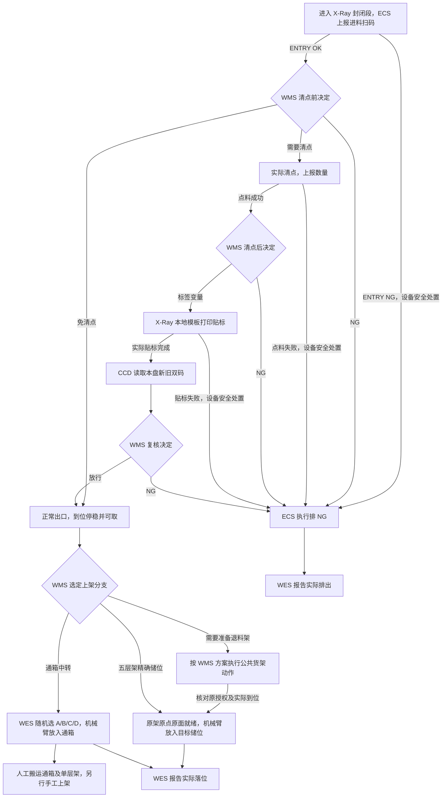
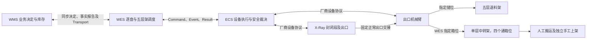

# X-Ray 清点、贴标与上架 API 对接设计

本文定义 X-Ray 逐盘调度接口，作为开发和验收依据。WMS 负责业务决定，WES 负责调度，ECS 负责设备执行和实时安全。

第 2 章按正常流程定义报文，免清点和 NG 分别见 2.13、2.14。通箱使用 PUT_TO_BIN，由 WES 随机选择 A/B/C/D；五层架使用公共调度能力。ECS 交互以 [项目通讯协议](../../../wes_backend/docs/hardware/ECS与WMS_HTTP通讯协议_V1.2_项目附录.md) 为基线，字段命名调整及其他项目对接要求见第 6 章。

## 目录

- [完整交互顺序](#xray-sequence)
- [1. 物料路线与设备拓扑](#xray-flow)
- [2. 正常业务流程与接口](#xray-api)
- [3. 公共规则与工作线配置](#xray-rules)
- [4. 代码复用与开发边界](#xray-reuse)
- [5. 本地开发验收](#xray-acceptance)
- [6. ECS 对接要求](#xray-ecs-changes)

<a id="xray-sequence"></a>
## 完整交互顺序

| 路径 | 步骤 | 方向 | Operation / Event / Command | 交互与推进条件 |
| --- | --- | --- | --- | --- |
| 进料 | E1 | ECS → WES | [`SCAN_COMPLETED`（`ENTRY`） Event](#xray-entry) | 保存本次进机及原扫码事实。读码 OK 后请求清点前决定。 |
| 进料 | E2 | WES → WMS | [`inbound.xray.pkg_decide@v1`](#xray-pkg-decision) | 按 WMS 决定进入清点、免清点、NG 或等待分支。 |
| 清点 | C1 | WES → ECS | [`APPLY_PKG_DECISION`（`COUNT_REQUIRED`）](#xray-ecs-count) | 原决定为 `COUNT_REQUIRED` 且本盘仍具备清点条件时登记。 |
| 清点 | C2 | ECS → WES | [`APPLY_PKG_DECISION`（`COUNT_REQUIRED`）Result](#xray-count-result) | 按原命令关闭清点动作。 |
| 清点 | C3 | ECS → WES | [`XRAY_COUNT_COMPLETED` Event](#xray-count) | 本盘实际数量有效时，请求一次清点后决定。 |
| 清点 | C4 | WES → WMS | [`inbound.xray.count_decide@v1`](#xray-count-decision) | 保存 WMS 原十变量，或按原 NG／WAIT 决定处理。 |
| 贴标 | L1 | WES → ECS | [`APPLY_COUNT_DECISION`（`OK`）](#xray-ecs-print) | 取得本盘贴标许可及完整变量后登记。 |
| 贴标 | L2 | ECS → WES | [`APPLY_COUNT_DECISION`（`OK`）Result](#xray-label-result) | 保存实际贴标终态，CCD 读码由独立事件提供。 |
| 复核 | V1 | ECS → WES | [`SCAN_COMPLETED`（`VERIFY`） Event](#xray-verify) | 核对原贴标上下文，再将实际双码或读码异常送复核。 |
| 复核 | V2 | WES → WMS | [`inbound.xray.verify_decide@v1`](#xray-verify-decision) | 按 WMS 决定放行、排 NG 或等待。 |
| 出料 | O1 | WES → ECS | [`APPLY_VERIFY_DECISION`（`OK`）／`APPLY_PKG_DECISION`（`BYPASS_COUNT`）](#xray-ecs-route) | 复核放行走 `COUNTED`，原清点前决定免清点走 [`BYPASS`](#xray-bypass)。 |
| 出料 | O2 | ECS → WES | [原正常出料判定 Result](#xray-outlet-result) | 按原命令关闭出料动作。 |
| 出料 | O3 | ECS → WES | [`MATERIAL_ARRIVED` Event](#xray-arrived) | 本盘实际到位、停稳、保持且可取时触发一次选位。 |
| 出料 | O4 | WES → WMS | [`inbound.xray.put_target_decide@v1`](#xray-target) | WMS 给出本盘精确目标及可选的架准备指示，或返回等待。 |
| 架准备 | R1 | WES → WMS；WMS → WES | [`rack.departure_decide@v1`／`transport.task.submit@v1`／`transport.task.resulted@v1`](#xray-rack) | 按 WMS 方案补架、换面、换架或退架，使用公共动作完成条件。 |
| 上架 | P1 | WES → ECS | [`PUT_TO_RACK`](#xray-ecs-put-rack)／[`PUT_TO_BIN`](#xray-ecs-put-bin) | 五层架按[公共架就绪证据](#xray-rack)和授权储位放料。通箱位由 WES 在 A/B/C/D 中随机选定并冻结。 |
| 上架 | P2 | ECS → WES | [`PUT_TO_RACK` Result](#xray-ecs-put-rack-result)／[`PUT_TO_BIN` Result](#xray-ecs-put-bin-result) | 按原命令确认实际落位或入箱。 |
| 上架 | P3 | WES → WMS | [`inbound.xray.put_report@v1`](#xray-put-report) | 按原报告身份交付本盘实际去向。 |
| 等待异常 | W1 | ECS → WES | [`XRAY_NG_REQUESTED` Event](#xray-ng-request-event) | 请求结束本盘原业务等待；WES 核对原事实及冲突命令后，登记一次原阶段排 NG 命令。 |
| 技术异常 | T1 | ECS → WES | [`ENTRY NG` Event](#xray-entry)／[点料 NG Event](#xray-count)／[贴标 FAILED Result](#xray-label-result) | 由设备按技术异常规则安全处置，实际排出后进入 N3、N4；不经 N1、N2，不由 WES 补发 NG 命令。 |
| 排 NG | N1 | WES → ECS | [原阶段 `APPLY_*_DECISION`（`NG`）](#xray-ecs-route-ng) | 原 WMS 决定为 NG，或设备明确无法继续等待且可安全排料。 |
| 排 NG | N2 | ECS → WES | [原阶段判定命令（`NG`）Result](#xray-ecs-route-ng-result) | 按原命令关闭排料动作，保存实际结果。 |
| 排 NG | N3 | ECS → WES | [`NG_DISCHARGED` Event](#xray-ng-event) | 核对本盘实际排出，与同盘 NG 成功 Result 归并为一个去向事实。 |
| 排 NG | N4 | WES → WMS | [`inbound.xray.ng_report@v1`](#xray-ng-report) | 实际排出确认后，按原报告身份交付。 |

表中步骤号只用于导航，不进入 wire。WMS 决定在请求的 HTTP 响应中同步返回，独立的 Event、Result 和不同盘的消息可以交错到达。机内及出口等待与原身份恢复分别见 [3.2](#xray-wait) 和 [3.3](#xray-recovery)。

<a id="xray-flow"></a>
## 1. 物料路线与设备拓扑

### 1.1 物料行进路线



入口到正常出口之间是封闭段，现场没有人工介入位。机内的清点前、标签和 CCD 复核等待按 [3.2](#xray-wait) 处理。正常出口后进入机械臂交接区，等待选位、货架或机械臂期间保留原任务并告警。

### 1.2 逻辑设备与通信拓扑



| 对象 | 职责与边界 |
| --- | --- |
| WMS | 判定清点、贴标、复核、NG 和上架去向。生成新条码及标签变量。管理库存、五层架离场决定和通箱后续手工上架业务。 |
| WES | 从 ECS 进料扫码开始调度。保存原事件、WMS 请求、设备命令、架动作、实际结果及报告之间的关联。 |
| ECS／X-Ray | 扫码、清点、本地模板贴标、CCD、出料和排 NG。确认实际工位、共享路径、容量和安全许可，提供逐盘事实。 |
| ECS／出口机械臂 | 从固定正常出口取盘。按指定储位放五层架，或放入 WES 指定的通箱位。实际放料后回原 Result。 |
| 五层退料架 | WES 跟踪配置工作位，按 WMS 方案编排补架、换面、换架和离场。机械臂按 WMS 授权的架、面和储位放料。 |
| 单层中转架 | A、B、C、D 四个通箱位。WES 随机指定箱位，按 ECS 配置提供完整目标；通箱不作为库存容器管理。机械臂放盘后，通箱和单层架由人工搬运，后续单独手工上架。 |

本接口从 X-Ray 进料扫码开始，上游投料不在本次调度范围。

<a id="xray-api"></a>
## 2. 正常业务流程与接口

<a id="xray-common-integration"></a>
### 2.0 三方系统通用能力接入

X-Ray 业务子包负责声明业务合同、关联原事实和推进逐盘状态。与 WMS 的决定和事实报告统一走 **Operation 通用能力**。与 ECS 的交互统一走平台的 **Event、Command、Result 和 Status** 能力。HTTP 路径是这些公共能力的协议入口，业务子包通过下文的声明和公开 API 使用它们。

| 消息 | HTTP 请求方向和接收端点 | 响应或后续事实 |
| --- | --- | --- |
| 业务决定 | WES → WMS，`POST {{WMS_BASE_URL}}/api/v1/wes/decisions` | WMS → WES，同步返回原请求的业务决定。WES 可靠保存后消费 |
| 业务事实 | WES → WMS，`POST {{WMS_BASE_URL}}/api/v1/wes/facts` | WMS → WES，返回原报告的收件结果 |
| 设备命令 | WES → ECS，`POST {{ECS_BASE_URL}}/api/v1/device/command` | ECS → WES，同步返回接纳 ACK。实际执行结果通过 Result 另报 |
| 设备事件 | ECS → WES，`POST {{WES_BASE_URL}}/api/v1/callback/event` | WES → ECS，持久收件后返回 ACK |
| 设备结果 | ECS → WES，`POST {{WES_BASE_URL}}/api/v1/callback/result` | WES → ECS，按原命令及冻结合同核验、保存后返回 ACK |

WMS 决定和事实沿用现有公共信封，请求使用 `operation_id/operation/timestamp/data`，响应回显原 `operation_id`。有效 `DECIDED` 才能提供业务决定，事实的 `RECORDED/DUPLICATE` 证明报告收妥。设备命令沿用 `device_code/command_code/task_type/priority/timeout/timestamp/params`，`priority` 为 1，时间为整数纪元毫秒。设备 Event 用 `device_code/event_type/timestamp/data`，Result 用 `command_code/device_code/result/finish_time/data` 及按结果分支要求的 `error_detail`。公共规范见 [工作线交互索引](workline-business-api.md) 和 [ECS 命令合同](ecs-command.md)。

设备 HTTP 200、Content-Type 为 application/json、JSON 整数 `code=200`、`message="ACK"` 才构成有效 ACK，其接纳语义与物理终态分开。WMS 公共报文见 2.0.3，ECS 设备合同与公共报文见 2.0.4。下文按正常流程定义各项接口。

#### 2.0.1 WMS Operation

| WES 发起的业务交互 | 公共能力 | 形成请求的原证据 |
| --- | --- | --- |
| [`inbound.xray.pkg_decide@v1`](#xray-pkg-decision) | `Endpoint.DECISIONS` | 原进料扫码事实和实际旧码 |
| [`inbound.xray.count_decide@v1`](#xray-count-decision) | `Endpoint.DECISIONS` | 原本盘实测数量及清点事实 |
| [`inbound.xray.verify_decide@v1`](#xray-verify-decision) | `Endpoint.DECISIONS` | 原实际双码或读码异常 |
| [`inbound.xray.put_target_decide@v1`](#xray-target) | `Endpoint.DECISIONS` | 原实际可取到料事实 |
| [`inbound.xray.put_report@v1`](#xray-put-report) | `Endpoint.FACTS` | 原取放 Result 及实际去向 |
| [`inbound.xray.ng_report@v1`](#xray-ng-report) | `Endpoint.FACTS` | 原实际排出事实、阶段及原因 |

在业务 request/ 中用 `@request_operation` 声明严格 DTO，事务内通过 `WmsRequests.send(...)` 登记，以原 `(operation, operation_id, message_id)` 调用 `get_result(...)` 读取已保存响应。注册及信封规则见 [Operation 注册](registration.md)、[出站结果契约](outbound-results.md)。

#### 2.0.2 ECS Event、Command、Result 和 Status

| 交互 | 接入方式 |
| --- | --- |
| Event | 用 `@ecs_event(name, device_role=ROLE, data=Model)` 声明，公共接收器解析绑定并持久收件。 |
| Command | 用 `@ecs_command(...)` 声明精确模型，列入 composition.COMMANDS；事务内调用 `EcsCommands.create(...)`，保存稳定 call_key 及原 command_code。 |
| Result | 公共接收器按原命令及冻结附录核验；业务通过 `EcsCommands.get_command(...)` 或 `get_by_call(...)` 消费。 |
| Status | 复用 [通用 ECS Status](ecs-status.md)，仅用于诊断，不提供逐盘执行许可。 |

入口显式列入 composition.ENTRY_MODULES。装配及待办唤醒沿 [业务包规范](business-packages.md)、[ECS 角色接入](ecs-roles.md)。

#### 2.0.3 X-Ray Operation 公共报文

示例的身份、时间和位置为开发样例，正式绑定和目标映射由工作线配置提供。ECS 示例描述下划线版合同，现场切换条件见 [6.1](#xray-ecs-cutover)。HTTP 信封、投递及错误分类沿用公共能力；各节字段表定义完整业务 DTO。

WMS 与 ECS 的接口字段统一使用下划线分隔（`snake_case`），涵盖信封、`data`、`params` 及其嵌套对象。标签模板的十个变量名是既有模板内容，按原键原值透传。CCD 复核前的 `barcode` 取入口实读原码，`new_barcode` 取 CCD 实读新码。复核 OK 后，正常出料、到料、选位和搬运使用已复核的实读新码作为 `barcode`。免清点继续使用入口实读码。WMS 授权目标用 `target_locator`，实际去向用 `to_locator`。WES 保存两侧原报文和关联。ECS 原事件统一写作 `event_id`，ECS 命令引用统一写作 `source_event_id`，本次进机身份统一写作 `reel_id`。WES 在内部将这些设备事实与 `operation_id` 关联，WMS 请求 `data` 仅发送各 Operation 所需的业务字段。映射见下表，WMS 字段命名参考 [SMT 自动线选位](../../app/businesses/smt_auto/outbound_contracts.py)和[物料移动报告](../../app/businesses/smt_auto/request/outbound_material_movement_report_v1.py)。

| WMS 业务字段 | ECS 字段 | 映射要求 |
| --- | --- | --- |
| barcode / new_barcode | barcode / new_barcode | 同名字段原值传递。复核阶段保留双码，COUNTED 到料及选位的两个字段都使用已复核的实读新码。 |
| expected_spkg | 原贴标命令的 label.variables.SPKG | 仅用于复核请求，由 WES 取本盘原 WMS 标签决定中冻结的 SPKG。 |
| actual_qty | qty | 清点实测 PCS。取放 Result 的 actual_qty 单位为盘。 |
| template_id / label_variables | template_id / label.variables | 保留模板关联和原十变量。 |
| target_locator | target | RACK_SLOT 映射为 location_type=RETURN_RACK，location_code 映射到已配置 ECS location_id，尺寸放入 target。TRANSIT_BIN 按 2.11 由 WES 随机选箱位并读取原 ECS 目标映射。 |
| to_locator | actual_target | 五层架从实际 location_id、location_type、架、面和储位核对后转换。通箱核对 PUT_TO_BIN 的完整 actual_target 后映射为 TRANSIT_BIN。 |
| reason_message | reason 或 reason_message | 业务判定命令和排出事件用 reason，扫码、点料及等待事件用 reason_message。 |

| 公共字段 | 类型与约束 |
| --- | --- |
| 请求 `operation_id` | 小写带连字符的 UUIDv7。每次业务求值或事实报告创建一次，技术重试沿用原值。 |
| 请求 `operation` | 该节指定的完整版本名。请求顶层为 `operation_id/operation/timestamp/data`。 |
| 请求及响应 `timestamp` | UTC Unix 毫秒整数，范围 `0..9223372036854775807`。响应采用 WMS 的原响应时间。 |
| 响应 `operation_id/code/data` | 回显原 `operation_id`。响应顶层为 `operation_id/code/timestamp/data`。成功决定为 `200 / DECIDED`，事实为 `200 / RECORDED` 或 `200 / DUPLICATE`。 |
| `Identifier` | 非空字符串，匹配 `[A-Za-z0-9][A-Za-z0-9._:/-]{0,99}`。用于工作线、进机、事件、架及位置等身份。 |
| `Barcode` | 非空原始字符串且无 NUL，保留大小写、前导零和内容，不截断；长度受正文上限及实际设备模板约束。 |
| `scanned_at` / `observed_at` / `occurred_at` | 取原 Event 的 `timestamp` 或实际完成 Result 的 `finish_time`，保留 ECS 原值。UTC Unix 毫秒整数，范围同顶层 `timestamp`。业务先后以原事件、原命令和阶段关联判定。 |
| `actual_qty` | 严格非负整数。清点表示盘内实测 PCS，取放表示本次实际放料的盘数。字段随分支给出，未知时省略。 |
| `reason_code` / `reason_message` | 非空、无 NUL 的原原因码和说明，长度受正文上限约束，不改写设备原因码。公共错误响应的 reason_code 按下表枚举。 |

各节字段表为 `data` 的完整形状。请求和各响应分支按严格类型校验，未列字段、显式 `null` 和类型强转均拒绝。数字字段以真实 JSON 数字发送，布尔值不能用作数字。UTF-8 JSON 正文上限为 256 KiB。

| HTTP / code | 完整 `data` 或处理 |
| --- | --- |
| 400 或 413 | 公共包络无法解析或正文超限，空响应体，保留原请求供核对。 |
| 409 / CONFLICT | `{"reason_code":"IDEMPOTENCY_CONFLICT"}`。引用不成立用 `REFERENCE_CONFLICT`，本盘或阶段状态矛盾用 `STATE_CONFLICT`，实际目标冲突用 `POSITION_CONFLICT`。仅含 reason_code。 |
| 422 / REJECTED | `{"reason_code":"INVALID_DATA","field_path":"/data/actual_qty"}`。reason_code 为 `INVALID_ENVELOPE / UNSUPPORTED_OPERATION / INVALID_DATA`，仅 INVALID_DATA 可选 field_path，格式为 1～256 字符的 JSON Pointer。 |
| 503 / UNAVAILABLE | `{}`。保留原身份、时间和冻结正文恢复。 |

四个决定请求均为同步 `200 / DECIDED`，每个分支见对应小节。WMS 按 `(operation, operation_id)` 去重，同身份改有效内容返回冲突；原身份重放返回首次完整决定及原响应时间。两个事实报告成功收件和重放均返回空 `data`。WES 按本次进机及原去向证据只登记一次报告，WMS 按原 `(operation, operation_id)` 去重。失败、响应未知、协议错误和 `DECIDED` 内的业务 `NG` 各自留证。

四个决定均可返回明确 `WAIT`。WES 保存 `retry_after_ms`（整数 1～60000）和首次可靠保存时计算的最早续问点。到期且原阶段仍有效才用新 `operation_id` 重新求值，WES 保留原盘和原设备事件关联，沿用业务 `data`；WMS 按新 `operation_id` 重新求值。未取得有效响应只恢复原请求。WAIT 到期用于续问，机内自动排 NG 仍以 ECS 的明确排料条件为依据。

六个 X-Ray Operation 沿用注册的 `ttl=None`，保留公共投递退避和告警。本地自动恢复用例使用未设置有限 `max_not_received_attempts` 的公共 WMS 目标。若公共目标配置使原请求进入 `STALLED`，保留原身份和待办，按平台恢复规则处理。`STALLED` 与确定的协议拒绝都不能作为业务 NG 或新求值依据。

#### 2.0.4 ECS 设备合同及公共报文

设备逻辑角色为 `XRAY` 和 `OUTPUT_ARM`。WES 工作线配置使用 `XRAY` 和 `XRAY_OUTPUT_ARM` 两个绑定键，分别绑定例如 `XRAY01`、`ARM01`。`XRAY_OUTPUT_ARM` 用于区分 X-Ray 与粗分的取放合同，设备报文仍使用原 `device_code` 和 `task_type`。Status 中的描述角色仅用于诊断。

| 类别 | 方向 / 端点 | 合同 |
| --- | --- | --- |
| Event | ECS → WES，`POST /api/v1/callback/event` | SCAN_COMPLETED（ENTRY／VERIFY）、XRAY_COUNT_COMPLETED、MATERIAL_ARRIVED、NG_DISCHARGED、XRAY_NG_REQUESTED。 |
| Command | WES → ECS，`POST /api/v1/device/command` | APPLY_PKG_DECISION、APPLY_COUNT_DECISION、APPLY_VERIFY_DECISION、PUT_TO_RACK、PUT_TO_BIN。 |
| Result | ECS → WES，`POST /api/v1/callback/result` | 按原 command_code 和冻结合同回报。三种判定命令根据原 decision 分支校验实际完成。 |

WES 将五种 Command 模型列入 `COMMANDS`。三个判定模型各自包含对应的互斥 `decision` 分支。`SCAN_COMPLETED` 在 `XRAY` 角色注册一次，以 `data.scan_stage` 区分 ENTRY 和 VERIFY。清点、贴标和出料通过对应 APPLY 命令驱动，接纳条件见 [第 6 章](#xray-ecs-changes)。

三个 APPLY 命令的 SUCCESS `data.decision` 必须等于原命令 `params.decision`。WES 按原命令分支消费清点、免清点、贴标、放行或排 NG 的实际结果。分支不符时保留证据待核对，暂停本盘后继动作。

| 字段 | 类型与约束 |
| --- | --- |
| 顶层 device_code / command_code | 可信绑定的设备编码和 WES 原命令 UUIDv7。Result 原值回传。 |
| 顶层 timestamp / finish_time | 非负 UTC Unix 毫秒整数，范围同 2.0.3。Event 为原事实时间，Command 为原创建时间，Result 为实际终态时间。 |
| Command priority / timeout | priority 为整数 1。timeout 为正毫秒整数。按原载荷冻结，各分支示例给出对应预算。 |
| event_id / reel_id | UUID 字符串，分别为 ECS 原事件与本次进机身份。Event 和 Result 沿用原 `reel_id`，WES 平台收件 ID 独立保存。 |
| Command source_event_id | UUID 字符串，引用本次决定对应的原 event_id。等待例外引用异常排料请求的 event_id，见 3.2.1。 |
| barcode / new_barcode | Barcode。复核前使用入口原码，复核 OK 后的正常路径使用实读新码。各报文的必填条件见对应小节。 |
| template_id / label.variables.ID | 固定模板标识 XX123456789。入口、点料和标签变量保持一致，未结盘期间不切换模板或变量定义。部署变更须明确配置，不按单盘临时选模板。 |
| reason_code / reason_message | 原设备原因码和说明，均为非空字符串。按各事件的条件携带；NG_DISCHARGED 使用 reason 作为说明。 |
| Result result / error_detail | result 为 SUCCESS／FAILED。FAILED 必含 error_detail 及非空字符串 code、msg，WES 忽略其中真正未知字段。SUCCESS 省略 error_detail 或为 null。 |
| 原命令与事件重报 | 同身份同原载荷恢复原接纳或收件。同号异载荷按公共冲突处理。正文 UTF-8 JSON，上限 256 KiB。 |

Command `params` 和 Result `data` 按冻结的严格分支校验。模型包含可选字段 `failure_stage`、实际位置和事实数量。Event 的业务字段以各事件字段表为准，缺少实际读数时按表中条件省略。Command 顶层为闭集，Event 和 Result 的顶层诊断扩展沿公共信封处理。正式 Event 的 is_debug 省略或为 false，不以 true 驱动正式业务。

有效接纳和持久收件的完整响应均为 HTTP 200。Command 的响应方向为 ECS → WES，Event 和 Result 的响应方向为 WES → ECS。

```json
{"code":200,"message":"ACK"}
```

Result／Event 可以乱序；各节成功样例、下列失败样例及 NG 分支互斥。设备预算和投递窗口见 [3.3](#xray-recovery)。

<a id="xray-ecs-failed"></a>
**通用 FAILED Result。** 所有命令复用以下信封。示例为原 PUT_TO_RACK 失败。各命令回传原 command_code、device_code、reel_id 和命令冻结的 barcode。

```json
{
  "command_code": "01a1887a-d46a-7da3-8e2c-81762c6ee614",
  "device_code": "ARM01",
  "result": "FAILED",
  "finish_time": 1793413840000,
  "data": {
    "reel_id": "18520712-e29b-4197-b145-1aefa4c14cca",
    "barcode": "SXCN0031482261000009NVD",
    "position": "GRIPPER",
    "actual_qty": 0
  },
  "error_detail": {
    "code": "PUT_FAILED",
    "msg": "放料前停止，已确认料盘仍在抓手"
  }
}
```

| 失败字段 | 约束 |
| --- | --- |
| data.reel_id | 必填，原料盘 UUID。 |
| data.barcode | 必填，原命令冻结的条码。 |
| data.position | 可选，可信实际位置 SOURCE／GRIPPER／TARGET／OTHER／UNKNOWN。 |
| data.failure_stage | 可选非空字符串，如 COUNT、PRINT、LABEL、PICK、PUT，不限定为封闭枚举。 |
| data.actual_qty | 仅搬运失败且可证实目标放料未完成时填整数 0，未知时省略。 |
| data.actual_target | 实际位置已知时可附，按实际 location_type 使用 2.12 的完整位置模型，允许与命令目标不同；位置未知时省略，不抄期望目标冒充。 |
| error_detail | 必填非空字符串 code、msg，WES 忽略真正未知的诊断字段。失败的 data 不携带成功分支的 decision、qty、mode、label_status 或 discharged。 |

动作未知保持待恢复，不按超时编造 FAILED。失败后的业务处置见对应阶段。

<a id="xray-entry"></a>
### 2.1 进料扫码

| 项目 | 值 |
| --- | --- |
| 方向 / 端点 | ECS → WES，`POST /api/v1/callback/event` |
| 角色 / event_type | `XRAY / SCAN_COMPLETED` |
| 触发 | 本次进机在入口完成最终读码或确认读码失败。 |

```json
{
  "device_code": "XRAY01",
  "event_type": "SCAN_COMPLETED",
  "timestamp": 1793413800000,
  "data": {
    "event_id": "1b2daf25-09b1-4734-ab69-57f40524e3be",
    "reel_id": "18520712-e29b-4197-b145-1aefa4c14cca",
    "scan_stage": "ENTRY",
    "scan_status": "OK",
    "barcode": "PKG-OLD-A",
    "template_id": "XX123456789"
  }
}
```

| `data` 字段 | 类型 / 必填 | 约束 |
| --- | --- | --- |
| event_id / reel_id | UUID 字符串 / 是 | 原事件与本次进机身份。 |
| scan_stage / scan_status | enum / 是 | scan_stage 固定 ENTRY，scan_status 为 OK 或 NG。 |
| barcode | Barcode 或 null | OK 使用实读旧码。NG 无码时填 null，兼容省略。 |
| template_id | Identifier / 是 | 本次进机对应的设备模板标识。 |
| reason_code / reason_message | 原因字段 / NG 必填，OK 省略 | 实际读码失败原因。 |

**推进条件。** 经公共接收器确认 X-Ray 角色绑定后，按原事件和本次进机保存一次。只有 ENTRY OK 且实际旧码有效才请求 2.2 的清点前决定。ENTRY NG 保存原失败，后续按实际处置和排出事实推进。

<a id="xray-pkg-decision"></a>
### 2.2 清点前决定及设备动作

WMS 根据本盘原入口事实检查发料和使用记录，决定清点、免清点、NG 或等待。

| 项目 | 值 |
| --- | --- |
| 方向 / 端点 | WES → WMS，`POST /api/v1/wes/decisions` |
| operation | `inbound.xray.pkg_decide@v1` |
| 触发 | 本盘 ENTRY 扫码 OK，原进料事实已保存。 |

```json
{
  "operation_id": "01a1887a-d46a-7da3-8e2c-81762c6ee601",
  "operation": "inbound.xray.pkg_decide@v1",
  "timestamp": 1793413801000,
  "data": {
    "workline_code": "XRAY-LINE-01",
    "barcode": "PKG-OLD-A",
    "scanned_at": 1793413800000
  }
}
```

首次成功响应 `HTTP 200 / DECIDED`。

```json
{
  "operation_id": "01a1887a-d46a-7da3-8e2c-81762c6ee601",
  "code": "DECIDED",
  "timestamp": 1793413801100,
  "data": {
    "result": "COUNT_REQUIRED",
    "reel_thickness": 15.3
  }
}
```

| 请求 `data` 字段 | 类型 / 必填 | 约束 |
| --- | --- | --- |
| workline_code | Identifier / 是 | 原事实所属的工作线。 |
| barcode | Barcode / 是 | 原进料实际读到的旧码。 |
| scanned_at | 毫秒整数 / 是 | 原 ENTRY 事件发生时间。 |

| HTTP / code | 完整响应 `data` 示例 | WES 处理 |
| --- | --- | --- |
| 200 / DECIDED | `{"result":"COUNT_REQUIRED","reel_thickness":15.3}` | 冻结 WMS 提供的本盘厚度（毫米，严格正数），登记本盘唯一原清点命令。 |
| 200 / DECIDED | `{"result":"BYPASS_COUNT"}` | 直接安排正常出料，跳过清点、贴标和 CCD。 |
| 200 / DECIDED | `{"result":"NG","reason_code":"MATERIAL_REJECTED","reason_message":"WMS 判定该盘不适用"}` | 保存原拒绝原因，登记原排料动作，等待实际排出。 |
| 200 / DECIDED | `{"result":"WAIT","retry_after_ms":1000}` | 按公共 WAIT 规则保持本盘。 |

<a id="xray-ecs-count"></a>
#### 2.2.1 APPLY_PKG_DECISION（COUNT_REQUIRED）命令

| 项目 | 值 |
| --- | --- |
| 方向 / 端点 | WES → ECS，`POST /api/v1/device/command` |
| 角色 / task_type | `XRAY / APPLY_PKG_DECISION` |
| 触发 | 本盘原清点前决定为 COUNT_REQUIRED，入口扫码仍处于有效等待阶段。 |

```json
{
  "device_code": "XRAY01",
  "command_code": "01a1887a-d46a-7da3-8e2c-81762c6ee611",
  "task_type": "APPLY_PKG_DECISION",
  "priority": 1,
  "timeout": 70000,
  "timestamp": 1793413801200,
  "params": {
    "barcode": "PKG-OLD-A",
    "source_event_id": "1b2daf25-09b1-4734-ab69-57f40524e3be",
    "decision": "COUNT_REQUIRED",
    "reel_thickness": 15.3
  }
}
```

| `params` 字段 | 类型 / 必填 | 约束 |
| --- | --- | --- |
| barcode / source_event_id | Barcode 与 UUID 字符串 / 均必填 | 实读进料条码与原 ENTRY 事件。 |
| decision | enum / 是 | 本分支为 COUNT_REQUIRED。BYPASS_COUNT 和 NG 分别见 2.13、2.14。 |
| reel_thickness | 正数 / COUNT_REQUIRED 必填 | 来自原 WMS 决定，单位毫米。BYPASS_COUNT 和 NG 省略。 |

**推进条件。** 业务以稳定的原调用键登记一次 APPLY_PKG_DECISION（COUNT_REQUIRED）。ECS 核对本盘在位及清点许可。ACK 后等待原 Result 和实际点料事实。

<a id="xray-count-result"></a>
### 2.3 清点完成

#### 2.3.1 APPLY_PKG_DECISION（COUNT_REQUIRED）Result

| 项目 | 值 |
| --- | --- |
| 方向 / 端点 | ECS → WES，`POST /api/v1/callback/result` |
| 原命令 | `APPLY_PKG_DECISION（COUNT_REQUIRED）`，按本次 `command_code` 与冻结附录 |
| 触发 | 原 APPLY_PKG_DECISION（COUNT_REQUIRED） 已获得实际清点结果或确定的动作失败终态。 |

成功示例。

```json
{
  "command_code": "01a1887a-d46a-7da3-8e2c-81762c6ee611",
  "device_code": "XRAY01",
  "result": "SUCCESS",
  "finish_time": 1793413808000,
  "data": {
    "reel_id": "18520712-e29b-4197-b145-1aefa4c14cca",
    "barcode": "PKG-OLD-A",
    "decision": "COUNT_REQUIRED",
    "qty": 4000
  }
}
```

SUCCESS 的 `data` 包含原 `reel_id`、`barcode`、`decision=COUNT_REQUIRED` 和严格非负整数 `qty`（PCS）。失败字段见 [通用 FAILED Result](#xray-ecs-failed)。

**推进条件。** Result 关闭原 APPLY_PKG_DECISION（COUNT_REQUIRED） 动作，清点后决定由实测数量 Event 触发。两条证据按 [2.3.3](#xray-count-evidence) 核对。

<a id="xray-count"></a>
#### 2.3.2 XRAY_COUNT_COMPLETED 事件

| 项目 | 值 |
| --- | --- |
| 方向 / 端点 | ECS → WES，`POST /api/v1/callback/event` |
| 角色 / event_type | `XRAY / XRAY_COUNT_COMPLETED` |
| 触发 | 原 APPLY_PKG_DECISION（COUNT_REQUIRED） 已完成测量或明确清点失败。 |

```json
{
  "device_code": "XRAY01",
  "event_type": "XRAY_COUNT_COMPLETED",
  "timestamp": 1793413808000,
  "data": {
    "event_id": "5ad0f02e-e98d-456d-bb52-dff0d8706865",
    "reel_id": "18520712-e29b-4197-b145-1aefa4c14cca",
    "barcode": "PKG-OLD-A",
    "template_id": "XX123456789",
    "count_status": "OK",
    "qty": 4000
  }
}
```

| `data` 字段 | 类型 / 必填 | 约束 |
| --- | --- | --- |
| event_id / reel_id | UUID 字符串 / 是 | 原点料事实及本次进机身份。 |
| barcode / template_id | Barcode / Identifier，均必填 | 同盘原进料旧码和本盘模板标识。 |
| count_status | enum / 是 | OK 或 NG。 |
| qty | integer / OK 必填，NG 省略 | 同 2.4 的实测 PCS 约束，0 仅来自实际测量。 |
| reason_code / reason_message | 原因字段 / NG 必填，OK 省略 | 实际清点失败原因。 |

**推进条件。** 核对原 APPLY_PKG_DECISION（COUNT_REQUIRED）、本盘和 [2.3.3](#xray-count-evidence) 的证据一致性。有效 OK 事件触发一次 2.4 的贴标业务决定。NG 保存实际清点失败事实，等待明确设备处置。

<a id="xray-count-evidence"></a>
#### 2.3.3 清点证据核对

ECS 从同一份已持久化的清点终态生成 Event 和原命令 Result，成功时两者使用同一实测 qty。WES 按原设备和 reel_id 找到本次进机的清点动作（APPLY_PKG_DECISION、decision=COUNT_REQUIRED），核对 barcode、template_id 与入口一致。阶段关联及乱序、冲突处理见 [3.1](#xray-rules)。

| 证据 | 推进 |
| --- | --- |
| 点料 OK，原 Result 未到或为同量 SUCCESS | 按 Event 发起一次 count_decide，0 为有效实测值。Result 单独到达时仅关闭原命令，即使带 qty 也不触发决定。 |
| 原 Result FAILED 或点料 NG，且无相反证据 | 保存失败，不请求标签决定；技术异常处置见 2.14。 |
| FAILED 与点料 OK、SUCCESS 与点料 NG，或两份成功 qty 不同 | 本盘待核对，停止新标签决定，暂缓应用已返回决定及新的贴标动作。 |

<a id="xray-count-decision"></a>
### 2.4 清点后决定与标签

WMS 根据原码、实测数量及原模板返回业务决定。本次清点请求独立求值，无需引用入口 Operation。WMS 保存成功请求发出的 SPKG，同一请求重放返回原标签；需要分别复核的在途标签须有可区分的 SPKG。WES 保存原十变量，ECS 使用本地模板打印贴标。

| 项目 | 值 |
| --- | --- |
| 方向 / 端点 | WES → WMS，`POST /api/v1/wes/decisions` |
| operation | `inbound.xray.count_decide@v1` |
| 触发 | 原点料 OK Event 已保存且无冲突，见 2.3.3。 |

```json
{
  "operation_id": "01a1887a-d46a-7da3-8e2c-81762c6ee602",
  "operation": "inbound.xray.count_decide@v1",
  "timestamp": 1793413809000,
  "data": {
    "workline_code": "XRAY-LINE-01",
    "barcode": "PKG-OLD-A",
    "actual_qty": 4000,
    "template_id": "XX123456789",
    "observed_at": 1793413808000
  }
}
```

首次成功响应 `HTTP 200 / DECIDED`。

```json
{
  "operation_id": "01a1887a-d46a-7da3-8e2c-81762c6ee602",
  "code": "DECIDED",
  "timestamp": 1793413809100,
  "data": {
    "result": "OK",
    "label_variables": {
      "ID": "XX123456789",
      "PHHPN": "100-0277-000HF",
      "SPKG": "SXCN0031482261000009NVD",
      "MMfrPN": "PZ2012S601AT000",
      "VVendor": "M000002870",
      "QQTYPC": "4000",
      "Location": "",
      "DDC": "2623",
      "DateTime": "2026-10-29 14:43:50",
      "LLC": "1T3330022677"
    }
  }
}
```

| 请求 `data` 字段 | 类型 / 必填 | 约束 |
| --- | --- | --- |
| workline_code | Identifier / 是 | 原事实所属的工作线。 |
| barcode | Barcode / 是 | 同盘原进料旧码。 |
| actual_qty | integer / 是 | 实测 PCS，范围 `0..9223372036854775807`。失败和未知不生成数量或本请求。 |
| template_id | Identifier / 是 | 本盘原模板标识，沿设备提供值。 |
| observed_at | 毫秒整数 / 是 | 原清点事实发生时间。 |

| HTTP / code | 完整响应 `data` | WES 处理 |
| --- | --- | --- |
| 200 / DECIDED | `result=OK`，仅另含完整 `label_variables`，见上例 | 校验结构及模板标识关联，将原变量冻结到唯一贴标动作。 |
| 200 / DECIDED | `{"result":"NG","reason_code":"MATERIAL_REJECTED","reason_message":"WMS 判定本盘不能贴标"}` | 登记原排料动作。 |
| 200 / DECIDED | `{"result":"WAIT","retry_after_ms":1000}` | 按公共 WAIT 规则保持本盘。 |

`label_variables` 固定包含十个键，大小写固定，全部必填且为字符串。除 `Location` 可为空字符串外，其余须非空，所有变量均禁止 NUL。`ID` 须等于原请求的 `template_id`，`SPKG` 采用 Barcode 约束。`QQTYPC` 为数字字符串，`DateTime` 格式为 `yyyy-MM-dd HH:mm:ss`。变量的设备长度约束随模板配置明确，WES 保留原值交付。

| 变量 | 含义与处理 |
| --- | --- |
| `ID` | 本地固定模板的标识。使用 2.0.4 的固定标识，与本盘 template_id 一致。 |
| `PHHPN` / `MMfrPN` / `VVendor` | 客户料号、制造商料号和供应商编号。保留 WMS 原字符串。 |
| `SPKG` | WMS 给出的新标签码。保存本盘旧码及后续 CCD 实际读到的新码。 |
| `QQTYPC` | 标签显示数量，保留字符串。它与实测 `actual_qty` 的关系由 WMS 定义。 |
| `Location` | 标签显示库位，允许空字符串。 |
| `DDC` / `DateTime` / `LLC` | 日期码、标签日期和批次。业务含义和时区归 WMS，沿用原值。 |

<a id="xray-ecs-print"></a>
#### 2.4.1 APPLY_COUNT_DECISION（OK）命令

| 项目 | 值 |
| --- | --- |
| 方向 / 端点 | WES → ECS，`POST /api/v1/device/command` |
| 角色 / task_type | `XRAY / APPLY_COUNT_DECISION` |
| 触发 | 本盘原清点后决定为 OK，十变量及原清点事实已保存。 |

```json
{
  "device_code": "XRAY01",
  "command_code": "01a1887a-d46a-7da3-8e2c-81762c6ee612",
  "task_type": "APPLY_COUNT_DECISION",
  "priority": 1,
  "timeout": 40000,
  "timestamp": 1793413809200,
  "params": {
    "barcode": "PKG-OLD-A",
    "source_event_id": "5ad0f02e-e98d-456d-bb52-dff0d8706865",
    "decision": "OK",
    "label": {
      "variables": {
        "ID": "XX123456789",
        "PHHPN": "100-0277-000HF",
        "SPKG": "SXCN0031482261000009NVD",
        "MMfrPN": "PZ2012S601AT000",
        "VVendor": "M000002870",
        "QQTYPC": "4000",
        "Location": "",
        "DDC": "2623",
        "DateTime": "2026-10-29 14:43:50",
        "LLC": "1T3330022677"
      }
    }
  }
}
```

| `params` 字段 | 类型 / 必填 | 约束 |
| --- | --- | --- |
| barcode / source_event_id | Barcode 与 UUID 字符串 / 均必填 | 实读进料条码与原清点事件。 |
| decision | enum / 是 | 本分支为 OK。NG 分支见 2.14。 |
| label | object / OK 必填 | 只含 variables。NG 时省略。 |
| label.variables | object / OK 必填 | 2.4 的完整十变量，等于 WMS 原 label_variables。 |

**推进条件。** WES 复核原清点证据和原标签决定，冻结原数据并登记唯一贴标动作。ECS 用 `ID` 核对本地模板，沿用同盘清点许可保存的厚度，执行实际打印贴标。后续 CCD 由设备自动执行。

<a id="xray-label-result"></a>
### 2.5 实际贴标完成

| 项目 | 值 |
| --- | --- |
| 方向 / 端点 | ECS → WES，`POST /api/v1/callback/result` |
| 原命令 | `APPLY_COUNT_DECISION（OK）`，按本次 `command_code` 与冻结附录 |
| 触发 | 设备已实际打印贴标，或原贴标动作已经明确失败。 |

成功示例。

```json
{
  "command_code": "01a1887a-d46a-7da3-8e2c-81762c6ee612",
  "device_code": "XRAY01",
  "result": "SUCCESS",
  "finish_time": 1793413813000,
  "data": {
    "reel_id": "18520712-e29b-4197-b145-1aefa4c14cca",
    "barcode": "PKG-OLD-A",
    "decision": "OK",
    "label_status": "APPLIED"
  }
}
```

SUCCESS 的 `data` 包含原 `reel_id`、`barcode`、`decision=OK` 和 `label_status=APPLIED`。失败字段见 [通用 FAILED Result](#xray-ecs-failed)。

**推进条件。** SUCCESS 结束原贴标动作。CCD Event 按 [2.6.1](#xray-label-evidence) 独立核对。FAILED 保存原错误及实际证据，避免因失败回调自动重复打印。

<a id="xray-verify"></a>
### 2.6 CCD 双码

| 项目 | 值 |
| --- | --- |
| 方向 / 端点 | ECS → WES，`POST /api/v1/callback/event` |
| 角色 / event_type | `XRAY / SCAN_COMPLETED` |
| 触发 | 原贴标后设备完成 CCD 实际读码，或已确定读码失败。 |

```json
{
  "device_code": "XRAY01",
  "event_type": "SCAN_COMPLETED",
  "timestamp": 1793413814000,
  "data": {
    "event_id": "58132158-68da-4e5b-bbd2-63553c7b4856",
    "reel_id": "18520712-e29b-4197-b145-1aefa4c14cca",
    "scan_stage": "VERIFY",
    "scan_status": "OK",
    "barcode": "PKG-OLD-A",
    "old_barcode": "PKG-OLD-A",
    "new_barcode": "SXCN0031482261000009NVD"
  }
}
```

| `data` 字段 | 类型 / 必填 | 约束 |
| --- | --- | --- |
| event_id / reel_id | UUID 字符串 / 是 | 原 CCD 事实及本次进机身份。 |
| scan_stage / scan_status | enum / 是 | scan_stage 固定 VERIFY，scan_status 为 OK 或 NG。 |
| barcode | Barcode / 是 | 同盘实际进料旧码。 |
| old_barcode | Barcode / 必填 | 与本事件 barcode 和原 ENTRY 实读旧码一致。 |
| new_barcode | Barcode / OK 必填，NG 有实际读码时可带 | CCD 实际读到的新码，无读码时省略。 |
| template_id | Identifier / 可选 | 模板追溯字段，提供时须与本盘模板一致。 |
| reason_code / reason_message | 原因字段 / NG 必填，OK 省略 | 实际读码失败原因。 |

**推进条件。** 按原贴标命令和本盘保存事实。实际双码或读码异常在满足 [2.6.1](#xray-label-evidence) 后进入 2.7 复核。

<a id="xray-label-evidence"></a>
#### 2.6.1 贴标与 CCD 证据核对

WES 按原设备、`reel_id` 和 `scan_stage=VERIFY` 找到本次进机保存的贴标动作（APPLY_COUNT_DECISION、decision=OK），核对 `barcode` 与入口实读原码一致，并从该动作冻结的原标签变量取 `expected_spkg`。

| 证据 | 推进 |
| --- | --- |
| 原贴标关联成立，CCD 有效，原 Result 未到或为 SUCCESS | 按 CCD Event 请求一次 verify_decide。读码 NG 也送业务判定；正常放行仍须合法双码。单独贴标 SUCCESS 等待 CCD。 |
| 只有贴标 FAILED | 保存失败，不请求复核、不自动补打，实际处置见 2.14。 |
| 贴标 FAILED 与有效 CCD 同时存在 | CCD 的前提是已完成原贴标，两份证据冲突，暂停新复核及其后继动作，按 3.1 待核对。 |

<a id="xray-verify-decision"></a>
### 2.7 复核决定及出料

WMS 复核本盘 CCD 实读双码，WES 按有效决定登记出料或排料。免清点不经过本节。

| 项目 | 值 |
| --- | --- |
| 方向 / 端点 | WES → WMS，`POST /api/v1/wes/decisions` |
| operation | `inbound.xray.verify_decide@v1` |
| 触发 | 本盘 CCD 原事件已保存，满足 2.6.1 的原贴标关联及证据一致性。 |

```json
{
  "operation_id": "01a1887a-d46a-7da3-8e2c-81762c6ee603",
  "operation": "inbound.xray.verify_decide@v1",
  "timestamp": 1793413815000,
  "data": {
    "workline_code": "XRAY-LINE-01",
    "scan_status": "OK",
    "barcode": "PKG-OLD-A",
    "expected_spkg": "SXCN0031482261000009NVD",
    "new_barcode": "SXCN0031482261000009NVD",
    "scanned_at": 1793413814000
  }
}
```

首次成功响应 `HTTP 200 / DECIDED`。

```json
{
  "operation_id": "01a1887a-d46a-7da3-8e2c-81762c6ee603",
  "code": "DECIDED",
  "timestamp": 1793413815100,
  "data": {
    "result": "OK"
  }
}
```

| 请求 `data` 字段 | 类型 / 必填 | 约束 |
| --- | --- | --- |
| workline_code | Identifier / 是 | 原事实所属的工作线。 |
| scan_status | enum / 是 | `OK / NG`，ECS 的读码结果。 |
| barcode | Barcode / 是 | 同盘的实际旧码。 |
| expected_spkg | Barcode / 是 | 本盘原贴标动作冻结的 `label_variables.SPKG`，读码 NG 时同样必填。 |
| new_barcode | Barcode / OK 必填，NG 且有实际读码时可带 | CCD 实际读到的新码。未读出时省略。 |
| reason_code / reason_message | 原因字段 / NG 必填，OK 省略 | ECS 上报的实际读码异常。 |
| scanned_at | 毫秒整数 / 是 | 原 CCD 事件发生时间。 |

| HTTP / code | 完整响应 `data` 示例 | WES 处理 |
| --- | --- | --- |
| 200 / DECIDED | `{"result":"OK"}` | 本盘确有合法双码、原阶段和贴标关联成立后，登记正常出料。 |
| 200 / DECIDED | `{"result":"NG","reason_code":"VERIFY_MISMATCH","reason_message":"WMS 复核未通过"}` | 沿原决定登记排 NG。 |
| 200 / DECIDED | `{"result":"WAIT","retry_after_ms":1000}` | 按公共 WAIT 规则保持本盘。 |

WMS 按 `expected_spkg` 找到原发标记录，核对工作线及原码，并将实际 `new_barcode` 与该记录的 SPKG 比对。只有读码 OK 且原码和新码均匹配才返回 OK。若 WMS 返回 OK 但原证据未满足此条件，WES 留证待核对。

<a id="xray-ecs-route"></a>
#### 2.7.1 正常出料判定命令

| 项目 | 值 |
| --- | --- |
| 方向 / 端点 | WES → ECS，`POST /api/v1/device/command` |
| 角色 / task_type | `XRAY / APPLY_VERIFY_DECISION`，免清点使用 `APPLY_PKG_DECISION` |
| 触发 | 原复核决定允许正常放行，或原进料决定为 BYPASS_COUNT。 |

```json
{
  "device_code": "XRAY01",
  "command_code": "01a1887a-d46a-7da3-8e2c-81762c6ee613",
  "task_type": "APPLY_VERIFY_DECISION",
  "priority": 1,
  "timeout": 25000,
  "timestamp": 1793413815200,
  "params": {
    "barcode": "SXCN0031482261000009NVD",
    "source_event_id": "58132158-68da-4e5b-bbd2-63553c7b4856",
    "decision": "OK"
  }
}
```

| `params` 字段 | 类型 / 必填 | 约束 |
| --- | --- | --- |
| barcode / source_event_id | Barcode 与 UUID 字符串 / 均必填 | COUNTED 放行使用原 VERIFY 实读新码和事件身份。BYPASS 命令见 2.13。 |
| decision | enum / 是 | COUNTED 使用 APPLY_VERIFY_DECISION、decision=OK，引用原 VERIFY。BYPASS 使用 APPLY_PKG_DECISION、decision=BYPASS_COUNT，引用原 ENTRY。 |

**推进条件。** WES 在原阶段仍有效时只登记一次出料。ECS 核对实际盘位及通行条件。原动作到出口实际可取才回 SUCCESS，并另报一次到料 Event。排 NG 使用原阶段判定命令的 decision=NG 分支，见 2.14。

<a id="xray-outlet-result"></a>
### 2.8 正常出口到料

#### 2.8.1 正常出料判定 Result

| 项目 | 值 |
| --- | --- |
| 方向 / 端点 | ECS → WES，`POST /api/v1/callback/result` |
| 原命令 | APPLY_VERIFY_DECISION（OK）或 APPLY_PKG_DECISION（BYPASS_COUNT），按原 command_code |
| 触发 | 本盘到达正常出口并停稳、保持且可取，或原出料动作已明确失败。 |

成功示例。

```json
{
  "command_code": "01a1887a-d46a-7da3-8e2c-81762c6ee613",
  "device_code": "XRAY01",
  "result": "SUCCESS",
  "finish_time": 1793413819000,
  "data": {
    "reel_id": "18520712-e29b-4197-b145-1aefa4c14cca",
    "barcode": "SXCN0031482261000009NVD",
    "decision": "OK",
    "mode": "COUNTED"
  }
}
```

SUCCESS 的 `data` 包含原 `reel_id`、`barcode`、`decision` 和 `mode`。复核放行的 decision=OK、mode=COUNTED，barcode 为原命令冻结的实读新码。免清点的 decision=BYPASS_COUNT、mode=BYPASS，barcode 为入口实读码。失败字段见 [通用 FAILED Result](#xray-ecs-failed)。

**推进条件。** 原 Result 结束出料命令。WES 使用独立的实际到料 Event 作为选位触发事实，矛盾证据按 [2.8.3](#xray-outlet-conflict) 处理。

<a id="xray-arrived"></a>
#### 2.8.2 MATERIAL_ARRIVED 事件

| 项目 | 值 |
| --- | --- |
| 方向 / 端点 | ECS → WES，`POST /api/v1/callback/event` |
| 角色 / event_type | `XRAY / MATERIAL_ARRIVED` |
| 触发 | 本盘实际在固定正常出口到位、停稳、保持且可取。 |

```json
{
  "device_code": "XRAY01",
  "event_type": "MATERIAL_ARRIVED",
  "timestamp": 1793413819000,
  "data": {
    "event_id": "ae674c2d-635a-471e-bb2e-0dfa924c8a04",
    "reel_id": "18520712-e29b-4197-b145-1aefa4c14cca",
    "barcode": "SXCN0031482261000009NVD",
    "mode": "COUNTED",
    "ready_for_pick": true,
    "new_barcode": "SXCN0031482261000009NVD"
  }
}
```

| `data` 字段 | 类型 / 必填 | 约束 |
| --- | --- | --- |
| event_id / reel_id | UUID 字符串 / 是 | 原到料事实及本次进机身份。 |
| barcode | Barcode / 是 | COUNTED 取已复核的实读新码，BYPASS 取入口实读码。 |
| mode | enum / 是 | BYPASS 或 COUNTED，须和原路线一致。 |
| ready_for_pick | boolean / 是 | 固定 true，以设备实际条件为据。 |
| new_barcode | Barcode / COUNTED 必填，BYPASS 省略 | 同盘实际读到且已复核的新码，与 COUNTED 的 barcode 相同。 |

**推进条件。** WES 按 2.8.3 核对原出料证据后，沿原到料事件登记一次 2.9 的选位请求。保持占位时沿原身份补报。机械臂执行前由 ECS 重验实时取盘条件。

<a id="xray-outlet-conflict"></a>
#### 2.8.3 出料证据核对

按原设备、reel_id 和 mode 找到本次进机保存的正常出料动作：COUNTED 对应 APPLY_VERIFY_DECISION（OK），BYPASS 对应 APPLY_PKG_DECISION（BYPASS_COUNT）。COUNTED 的 barcode 和 new_barcode 均须与同盘已复核的 CCD 实读新码一致。BYPASS 的 barcode 须与入口一致，省略 new_barcode。

| 证据 | 推进 |
| --- | --- |
| 可取 Event 有效，原 Result 未到或为一致 SUCCESS | 按到料身份登记一次选位；单独出料 SUCCESS 等待 Event。 |
| 出料 FAILED 与可取 Event 并存，或码、模式、原命令不符 | 暂停选位、应用已返回选位及新取放，按 3.1 留证待核对。 |

此规则适用于 COUNTED 和 BYPASS。消费到料、应用目标及登记取放时均复核本盘证据。

<a id="xray-target"></a>
### 2.9 出口选位

**WES → WMS 决定请求**。本盘实际可取后发起。选位请求沿 SMT 自动线的分工，由 WES 在内部核对当前架号、架面、空位、未知状态和在途作业。WMS 决定本盘走五层退料架还是通箱，五层架在同一决定中返回精确目标和可选准备指示。COUNTED 使用 `barcode` 中已复核的实读新码关联发标物料，BYPASS 使用 `barcode` 及 `mode` 求值。复核与到料是否属于同一次进机由 WES 按 [2.8.3](#xray-outlet-conflict) 核对。

| 项目 | 值 |
| --- | --- |
| 方向 / 端点 | WES → WMS，`POST /api/v1/wes/decisions` |
| operation | `inbound.xray.put_target_decide@v1` |
| 触发 | 原正常出口实际可取事件已保存。首次选位或有效 WAIT 到期时按本盘当前阶段发起。架准备结束后继续消费原 ACCEPT。 |

```json
{
  "operation_id": "01a1887a-d46a-7da3-8e2c-81762c6ee604",
  "operation": "inbound.xray.put_target_decide@v1",
  "timestamp": 1793413820000,
  "data": {
    "workline_code": "XRAY-LINE-01",
    "mode": "COUNTED",
    "barcode": "SXCN0031482261000009NVD",
    "new_barcode": "SXCN0031482261000009NVD",
    "observed_at": 1793413819000
  }
}
```

首次成功响应 `HTTP 200 / DECIDED`。

```json
{
  "operation_id": "01a1887a-d46a-7da3-8e2c-81762c6ee604",
  "code": "DECIDED",
  "timestamp": 1793413820100,
  "data": {
    "result": "ACCEPT",
    "target_locator": {
      "type": "RACK_SLOT",
      "location_code": "XRAY-RACK-01",
      "rack_id": "RETURN-RACK-01",
      "rack_face": "A",
      "slot_id": "A-03",
      "rack_layer": 2,
      "rack_column": 3
    },
    "reel_diameter": 13,
    "reel_thickness": 15.3
  }
}
```

| 请求 `data` 字段 | 类型 / 必填 | 约束 |
| --- | --- | --- |
| workline_code | Identifier / 是 | 原事实所属的工作线。 |
| mode | enum / 是 | `BYPASS / COUNTED`。 |
| barcode | Barcode / 是 | COUNTED 取已复核的实读新码，BYPASS 取入口实读码。 |
| new_barcode | Barcode / COUNTED 必填，BYPASS 省略 | WMS 已复核的实际新码。 |
| observed_at | 毫秒整数 / 是 | 本盘实际可取的发生时间。 |

| HTTP / code | 完整响应 `data` | WES 处理 |
| --- | --- | --- |
| 200 / DECIDED | `result=ACCEPT`，另含 `target_locator`（RACK_SLOT）、`reel_diameter`、`reel_thickness` 及可选 `target_preparation`，见上例 | 保存原储位授权。核对原架、工作位和面已就绪后安排放料。 |
| 200 / DECIDED | `{"result":"ACCEPT","target_locator":{"type":"TRANSIT_BIN"}}` | 保存通箱中转分支。WES 随机选择并冻结箱位，再登记 PUT_TO_BIN。 |
| 200 / DECIDED | `{"result":"WAIT","retry_after_ms":1000}` | 保留原出口任务，按公共规则续问。等待期间按工作线规则告警。 |

| 五层架响应字段 | 类型 / 必填 | 约束 |
| --- | --- | --- |
| target_locator.type | enum / 是 | 固定 `RACK_SLOT`。 |
| target_locator.location_code / rack_id / slot_id | Identifier / 是 | 精确到本线已配置工作位、原架、储位。 |
| target_locator.rack_face | enum / 是 | `A / B`。 |
| target_locator.rack_layer / rack_column | integer / 是 | 层为 1～5，列为正整数且须符合架位配置。与 slot_id 必须指向同一位置。 |
| reel_diameter | integer / 是 | `7 / 13 / 15` 英寸。 |
| reel_thickness | number / 是 | 正数，毫米，沿 WMS 返回的本盘尺寸。 |

| target_preparation | enum / 可选 | `ROTATE` 或 `REPLACE`，目标架号和架面取同次 `target_locator`。省略表示可直接使用已就绪的目标架，或在 WES 确认工作位空置后安排进场。通箱分支省略此字段。 |

暂无可执行的目标时返回 WAIT。通箱分支的 `target_locator` 仅含 `type=TRANSIT_BIN`，由 WES 按 [2.11](#xray-put) 选择并冻结箱位。

<a id="xray-rack"></a>
### 2.10 五层退料架工作位

WES 按工作线绑定退料架工作位，通过 `RackDispatch.progress(...)` 跟踪原架、实际面向及进场、换面和离场责任。启用或重启时，以匹配本线、本点、原架和面的原进场或换面成功结果恢复作业。发现已有在位架但缺少可信记录时，由现场沿既有流程核对。

WES 根据同一份精确储位授权推进架准备。原绑定变化、已有冲突责任或目标证据不匹配时留证待核对。整机 Status、空查询和离场提交接纳均不能证明物理空位。

| 原授权及当前事实 | WES 推进 |
| --- | --- |
| 原架、工作位和架面均已就绪 | 保留本盘授权，使用原格位。 |
| 省略 `target_preparation`，工作位已确认空置 | 复用公共空位门禁登记目标架进场。 |
| `target_preparation=ROTATE` | 核对当前是同一目标架后安排换面，等待原换面结果应用成功。 |
| `target_preparation=REPLACE` | 已知在位旧架时，先通过公共离场决定处理旧架，再调入指定目标架。点位无已登记架作业或冲突责任时可按该显式授权提交目标架进场，由 RCS 核对实际空位和互锁。 |

同一点一次推进一个原准备作业。其他料盘保留各自的精确目标，等待公共作业结束，再核对各自授权的架号和架面。现架面仍有其他已获授权且未放料的料盘时，先完成该架面的需求。原取放未结或责任未知时，`PointDemand` 和 `DirectHandoff` 继续保护现架，暂停换面和离场。正常架准备完成后沿用本盘原 `operation_id`、原到料事件和原储位授权，实际放料报告仍引用这条选位请求。通箱路径独立推进。

已有旧版架级准备决定继续按原记录恢复。旧版决定只有架级许可，准备完成后仍须重新求取本盘精确储位。新流程直接使用同一份 `ACCEPT` 的精确授权。

进场、换面和离场统一复用 [公共货架调度](../superpowers/specs/2026-11-02-shared-rack-dispatch-design.md)、[离场决定合同](workline-business-api.md#rack-departure-confirmed-wire) 和 [Transport 合同](wms-transport.md)。公共离场提交接纳只结束原离场调度责任，WMS/RCS 继续裁决实际点位和搬运互锁。

<a id="xray-put"></a>
### 2.11 机械臂取放

**WES → ECS 命令**。一条原命令对应从固定正常出口取放一盘。

| 路径 | WES 下发 | ECS 执行 |
| --- | --- | --- |
| 五层退料架 | 本盘和 WMS 授权的精确目标。关联原架到位及当前面向证据。 | 核对出口、实际目标和互锁后执行取放。 |
| 通箱中转 | 本盘、随机选定的 A/B/C/D 箱位及其 ECS 完整目标映射。 | 按 WES 指定箱位取放，核对实际箱、容量和安全条件。可恢复的通箱等待按 2.11.2 处理。 |

通箱使用下文的 `PUT_TO_BIN` 合同。WES 调度以本盘通箱放料结果为依据，通箱及单层架的搬运由人工处理。

WES 每次创建新的通箱取放意图时，在 A/B/C/D 中等概率随机选择一次。选择结果、目标映射和原命令关联一并持久保存；重复到料、技术重试或重启恢复均沿用原目标，不再次抽取。A/B/C/D 表示 bin_location。四个箱位的站点映射须齐备且与 ECS 一致，缺失时保留待办。

```text
已有原取放意图 → 恢复原箱位、原 target、原命令
新通箱取放意图 → 校验 A/B/C/D 的 ECS 目标映射齐备
                 随机选择一个箱位
                 读取该箱位的完整 target
                 在同一事务中保存选择并登记一次 PUT_TO_BIN
```

<a id="xray-ecs-put-rack"></a>
#### 2.11.1 PUT_TO_RACK 命令

| 项目 | 值 |
| --- | --- |
| 方向 / 端点 | WES → ECS，`POST /api/v1/device/command` |
| 角色 / task_type | `OUTPUT_ARM / PUT_TO_RACK` |
| 触发 | 本盘实际可取，WMS 授权五层架精确目标，原架、工作位和面向已有有效就绪证据。 |

```json
{
  "device_code": "ARM01",
  "command_code": "01a1887a-d46a-7da3-8e2c-81762c6ee614",
  "task_type": "PUT_TO_RACK",
  "priority": 1,
  "timeout": 90000,
  "timestamp": 1793413820200,
  "params": {
    "barcode": "SXCN0031482261000009NVD",
    "source_event_id": "ae674c2d-635a-471e-bb2e-0dfa924c8a04",
    "target": {
      "location_id": "XRAY-RACK-01",
      "location_type": "RETURN_RACK",
      "rack_id": "RETURN-RACK-01",
      "rack_face": "A",
      "slot_id": "A-03",
      "rack_layer": 2,
      "rack_column": 3,
      "reel_thickness": 15.3,
      "reel_diameter": 13
    }
  }
}
```

| `params` 字段 | 类型 / 必填 | 约束 |
| --- | --- | --- |
| barcode / source_event_id | Barcode 与 UUID 字符串 / 均必填 | 原到料事件的有效条码和事件身份。 |
| target.location_id | Identifier / 是 | 从 WMS target_locator.location_code 按已配置站点映射生成，示例两侧值相同。 |
| target.location_type | enum / 是 | 固定 RETURN_RACK。 |
| target.rack_id / rack_face / slot_id | 原定位字段 / 是 | 保留 WMS 原架、面和储位，面为 A／B。 |
| target.rack_layer / rack_column | integer / 是 | 层为 1～5，列为正整数。与 slot_id 对应同一已配置储位。 |
| target.reel_diameter / reel_thickness | number / 均必填 | 本盘直径为 7／13／15 英寸，厚度为正毫米数，允许小数。 |

**推进条件。** WES 从固定正常出口调度一盘到授权储位。ECS 核对实时出口、机械臂、原架和目标储位后执行。原命令未明时保留取放责任。

<a id="xray-ecs-put-bin"></a>
#### 2.11.2 PUT_TO_BIN 命令

| 项目 | 值 |
| --- | --- |
| 方向 / 端点 | WES → ECS，`POST /api/v1/device/command` |
| 角色 / task_type | `OUTPUT_ARM / PUT_TO_BIN` |
| 触发 | 本盘实际可取，WMS 选位返回 TRANSIT_BIN，与 PUT_TO_RACK 分支互斥。 |

以下样例选中 D 箱位。目标站点由本线配置提供。

```json
{
  "device_code": "ARM01",
  "command_code": "01a1887a-d46a-7da3-8e2c-81762c6ee615",
  "task_type": "PUT_TO_BIN",
  "priority": 1,
  "timeout": 90000,
  "timestamp": 1793413820200,
  "params": {
    "barcode": "SXCN0031482261000009NVD",
    "source_event_id": "ae674c2d-635a-471e-bb2e-0dfa924c8a04",
    "target": {
      "location_id": "STATION_B",
      "location_type": "ONE_LAYER_RACK",
      "bin_type": "1",
      "bin_location": "D",
      "bin_cell_location": 8
    }
  }
}
```

| `params` 字段 | 类型 / 必填 | 约束 |
| --- | --- | --- |
| barcode / source_event_id | Barcode 与 UUID 字符串 / 均必填 | 原到料事件的有效条码和事件身份。 |
| target | object / 是 | WES 原随机箱位对应的完整 ECS 目标，不得省略。 |
| target.location_id | 非空字符串 / 必填 | 已配置目标站点，与箱位共同定位。 |
| target.location_type | enum / 是 | 固定 ONE_LAYER_RACK。 |
| target.bin_type | string / 是 | 固定字符串 "1"，不能发整数。 |
| target.bin_location | enum / 是 | WES 原随机结果 A／B／C／D，不由 ECS 改选。 |
| target.bin_cell_location | integer / 是 | 固定 JSON 整数 8。 |

单层架和通箱实物由人工管理。ECS 根据站点和箱位定位并核对实时实物及安全条件。命令省略架号、箱号、尺寸及堆叠字段。

**推进条件。** WES 保存原随机箱位及完整目标。ECS 能安全保留原取放时，持久接纳 `PUT_TO_BIN`。满箱、缺箱等可恢复的等待由工人在设备端处理。条件恢复后，ECS 核对本盘、原目标及实时安全条件，继续原动作，并按原 `command_code` 回报实际终态。WES 保留原任务并等待 Result，沿用原箱位。

ECS 无法安全承担原任务时，按公共规则明确未接纳。WES 在原窗口内恢复投递，到期按 3.3 保留原任务及证据。设备端清箱只恢复 ECS 已接纳的原动作。已确认失败、结果未知或实际目标不符时，WES 保留原证据和责任待核对。通箱人工搬运及后续手工上架按独立作业处理。

<a id="xray-put-result"></a>
### 2.12 实际放料与事实报告

<a id="xray-ecs-put-rack-result"></a>
#### 2.12.1 PUT_TO_RACK Result

| 项目 | 值 |
| --- | --- |
| 方向 / 端点 | ECS → WES，`POST /api/v1/callback/result` |
| 原命令 | `PUT_TO_RACK`，按本次 `command_code` 与冻结附录 |
| 触发 | 机械臂已实际放料并确认真实储位，或已确认原取放动作失败。 |

成功示例。

```json
{
  "command_code": "01a1887a-d46a-7da3-8e2c-81762c6ee614",
  "device_code": "ARM01",
  "result": "SUCCESS",
  "finish_time": 1793413840000,
  "data": {
    "reel_id": "18520712-e29b-4197-b145-1aefa4c14cca",
    "barcode": "SXCN0031482261000009NVD",
    "actual_qty": 1,
    "position": "TARGET",
    "actual_target": {
      "location_id": "XRAY-RACK-01",
      "location_type": "RETURN_RACK",
      "rack_id": "RETURN-RACK-01",
      "rack_face": "A",
      "slot_id": "A-03",
      "rack_layer": 2,
      "rack_column": 3
    }
  }
}
```

SUCCESS 必含 `barcode`、`reel_id`、整数 `actual_qty=1`、`position=TARGET` 及 `actual_target`。实际位置对象包含 location_id、location_type=RETURN_RACK、rack_id、rack_face、slot_id、rack_layer、rack_column。失败字段见 [通用 FAILED Result](#xray-ecs-failed)。WES 保留实际位置与授权不一致的证据。

**推进条件。** 真实落位与原目标匹配才生成 2.12.3 的事实报告。实际目标不同、失败或仍有不确定责任时保留原结果和实际位置待核对。

<a id="xray-ecs-put-bin-result"></a>
#### 2.12.2 PUT_TO_BIN Result

| 项目 | 值 |
| --- | --- |
| 方向 / 端点 | ECS → WES，`POST /api/v1/callback/result` |
| 原命令 | `PUT_TO_BIN`，按本次 `command_code` 与冻结附录 |
| 触发 | 本盘已实际放入中转通箱，或已确认原动作失败。 |

成功示例。

```json
{
  "command_code": "01a1887a-d46a-7da3-8e2c-81762c6ee615",
  "device_code": "ARM01",
  "result": "SUCCESS",
  "finish_time": 1793413840000,
  "data": {
    "reel_id": "18520712-e29b-4197-b145-1aefa4c14cca",
    "barcode": "SXCN0031482261000009NVD",
    "actual_qty": 1,
    "position": "TARGET",
    "actual_target": {
      "location_id": "STATION_B",
      "location_type": "ONE_LAYER_RACK",
      "bin_type": "1",
      "bin_location": "D",
      "bin_cell_location": 8
    }
  }
}
```

SUCCESS 必含 `barcode`、`reel_id`、整数 `actual_qty=1`、`position=TARGET` 和完整 `actual_target`。实际目标仅含 location_id、location_type=ONE_LAYER_RACK、bin_type、bin_location、bin_cell_location，各身份字段须与原命令冻结目标逐项匹配。失败字段见 [通用 FAILED Result](#xray-ecs-failed)。WES 保存完整实际位置，核对后将本分支映射为 `to_locator={"type":"TRANSIT_BIN"}`，不改变 WMS 业务 DTO。

**推进条件。** 本盘实际入箱且完整 actual_target 与原随机目标一致后，生成 2.12.3 的通箱放料报告。目标不符、失败或结果未知时保存原证据待核对，不按期望目标报告成功。后续手工上架是独立作业。

<a id="xray-put-report"></a>
#### 2.12.3 实际放料事实报告

实际取放成功后，WES 向 WMS 报告一次真实去向。报告收妥与库存入账分别记录，通箱后续手工上架独立办理。

| 项目 | 值 |
| --- | --- |
| 方向 / 端点 | WES → WMS，`POST /api/v1/wes/facts` |
| operation | `inbound.xray.put_report@v1` |
| 触发 | 匹配原取放命令的实际放料成功结果已保存，实际去向可确认。 |

```json
{
  "operation_id": "01a1887a-d46a-7da3-8e2c-81762c6ee605",
  "operation": "inbound.xray.put_report@v1",
  "timestamp": 1793413841000,
  "data": {
    "workline_code": "XRAY-LINE-01",
    "target_operation_id": "01a1887a-d46a-7da3-8e2c-81762c6ee604",
    "to_locator": {
      "type": "RACK_SLOT",
      "location_code": "XRAY-RACK-01",
      "rack_id": "RETURN-RACK-01",
      "rack_face": "A",
      "slot_id": "A-03",
      "rack_layer": 2,
      "rack_column": 3
    },
    "occurred_at": 1793413840000
  }
}
```

首次成功响应 `HTTP 200 / RECORDED`。

```json
{
  "operation_id": "01a1887a-d46a-7da3-8e2c-81762c6ee605",
  "code": "RECORDED",
  "timestamp": 1793413841100,
  "data": {}
}
```

| 请求 `data` 字段 | 类型 / 必填 | 约束 |
| --- | --- | --- |
| workline_code | Identifier / 是 | 实际放料或排出事实所属的工作线。 |
| target_operation_id | UUIDv7 / 是 | 原已授权的 `put_target_decide` 请求身份。 |
| to_locator | object / 是 | 五层架用 2.9 的完整 RACK_SLOT 位置字段，均来自实际核对。通箱用 `{"type":"TRANSIT_BIN"}`，表示实际放入中转通箱。 |
| occurred_at | 毫秒整数 / 是 | 实际放料完成时间。 |

| HTTP / code | 完整 `data` | WES 处理 |
| --- | --- | --- |
| 200 / RECORDED | `{}` | 保存本次收妥。 |
| 200 / DUPLICATE | `{}` | 恢复同一事实报告的收妥。 |

WMS 用 `target_operation_id` 关联原选位授权并核对实际去向，同一授权的实际放料只处理一次。WES 按 [2.14.3](#xray-ng-event) 核对实际位置与授权，以及本次进机的落位与排出证据。证据冲突时留证待核对。通箱报告保持 TRANSIT_BIN 业务分支，WES 另存原随机箱位及完整实际目标。通箱放料与后续手工上架分别记录。

<a id="xray-bypass"></a>
### 2.13 免清点分支

WMS 清点前返回免清点后，WES 登记 APPLY_PKG_DECISION，decision=BYPASS_COUNT，source_event_id 引用原 ENTRY event_id。本盘跳过实际清点、清点后决定、贴标、CCD 和复核决定。ECS 到实际正常出口后回原命令 SUCCESS（decision=BYPASS_COUNT、mode=BYPASS），并报 MATERIAL_ARRIVED。到料 Event 和 WMS 选位请求均省略 `new_barcode`。后续按原选位决定走五层架或通箱分支。

下列独立料盘样例仅展开免清点分支的差异报文，共用接口沿对应章节。

#### 2.13.1 进料和免清点决定

**ECS → WES，`SCAN_COMPLETED / ENTRY` Event。**

```json
{
  "device_code": "XRAY01",
  "event_type": "SCAN_COMPLETED",
  "timestamp": 1793413900000,
  "data": {
    "event_id": "508db06a-ad88-42af-8da6-b6346162aa7d",
    "reel_id": "bb9f68e9-7d0c-480c-81a3-4e8153139c70",
    "scan_stage": "ENTRY",
    "scan_status": "OK",
    "barcode": "PKG-OLD-B",
    "template_id": "XX123456789"
  }
}
```

原进料 Event 按 [2.2](#xray-pkg-decision) 发起 pkg_decide，请求使用实际 `barcode`，WES 在内部保存上述 `event_id`、`reel_id` 与请求的关联。WMS 返回 `200 / DECIDED`，data 为 `{"result":"BYPASS_COUNT"}`。

#### 2.13.2 直达正常出口

**WES → ECS，APPLY_PKG_DECISION（BYPASS_COUNT），引用原 ENTRY。**

```json
{
  "device_code": "XRAY01",
  "command_code": "01a1887a-d46a-7da3-8e2c-81762c6ee622",
  "task_type": "APPLY_PKG_DECISION",
  "priority": 1,
  "timeout": 25000,
  "timestamp": 1793413901200,
  "params": {
    "barcode": "PKG-OLD-B",
    "source_event_id": "508db06a-ad88-42af-8da6-b6346162aa7d",
    "decision": "BYPASS_COUNT"
  }
}
```

**ECS → WES，原出料 Result。**

```json
{
  "command_code": "01a1887a-d46a-7da3-8e2c-81762c6ee622",
  "device_code": "XRAY01",
  "result": "SUCCESS",
  "finish_time": 1793413905000,
  "data": {
    "reel_id": "bb9f68e9-7d0c-480c-81a3-4e8153139c70",
    "barcode": "PKG-OLD-B",
    "decision": "BYPASS_COUNT",
    "mode": "BYPASS"
  }
}
```

**ECS → WES，实际可取的 `MATERIAL_ARRIVED` Event。**

```json
{
  "device_code": "XRAY01",
  "event_type": "MATERIAL_ARRIVED",
  "timestamp": 1793413905000,
  "data": {
    "event_id": "83000c6b-d194-4ba1-96bf-39d6f37587a4",
    "reel_id": "bb9f68e9-7d0c-480c-81a3-4e8153139c70",
    "barcode": "PKG-OLD-B",
    "mode": "BYPASS",
    "ready_for_pick": true
  }
}
```

#### 2.13.3 选位、放入通箱及实际去向报告

**WES → WMS，`inbound.xray.put_target_decide@v1` 请求，引用原到料 Event。**

```json
{
  "operation_id": "01a1887a-d46a-7da3-8e2c-81762c6ee623",
  "operation": "inbound.xray.put_target_decide@v1",
  "timestamp": 1793413905100,
  "data": {
    "workline_code": "XRAY-LINE-01",
    "mode": "BYPASS",
    "barcode": "PKG-OLD-B",
    "observed_at": 1793413905000
  }
}
```

WMS 按 [2.9](#xray-target) 返回 `{"result":"ACCEPT","target_locator":{"type":"TRANSIT_BIN"}}`。WES 按 [2.11.2](#xray-ecs-put-bin) 随机选箱并冻结完整目标，PUT_TO_BIN 引用本次到料 event_id。实际 Result 按 [2.12.2](#xray-ecs-put-bin-result) 核对，随后按 [2.12.3](#xray-put-report) 报告，target_operation_id 引用上述选位请求。重报沿原身份，不重复选位、取放或报告。

<a id="xray-ng"></a>
### 2.14 排 NG 分支

**WES → ECS 命令**。WMS 明确判 NG，或机内等待符合 [3.2](#xray-wait) 的例外处置条件时，WES 核对原阶段并登记唯一排料意图。ECS 裁决实际可排和安全条件。设备侧已发生的自主保护或实际排料需要可信原事实关联，WES 据实际事实收口，避免重复调度。

技术异常和业务等待分别按下列路径及 3.2 处理。

| 原事实 | 后续方向与消息 | WES 推进 |
| --- | --- | --- |
| ENTRY scan_status=NG | ECS → WES，自主 NG_DISCHARGED，stage=ENTRY | 保存原扫码失败；不请求清点前决定，不下发排料命令。 |
| 原清点命令 FAILED／点料 count_status=NG，且动作已结束、无相反证据 | ECS → WES，自主 NG_DISCHARGED，stage=COUNT | 保存原失败，等待设备安全处置及实际排出；不请求标签决定。 |
| 原贴标命令 FAILED，且动作已结束、无相反证据 | ECS → WES，自主 NG_DISCHARGED，stage=LABEL | 保存原失败，等待设备安全处置及实际排出；不补打，不发起正常复核。 |
| VERIFY scan_status=NG | WES → WMS，verify_decide；决定 NG 后 WES → ECS，APPLY_VERIFY_DECISION（NG） | 继续由 WMS 作业务决定；等待异常按关联本次等待的异常排料请求处理。 |

上述自主排料仍以设备确认安全条件成立为前提。未实际排出不生成 NG 报告，设备失联或动作结果未知不按技术失败处置。原失败命令保持 FAILED，自主排出不生成虚构的 WES NG 命令或 Result。

以下受命排 NG 样例对应 2.7 原复核请求的 NG 响应，与 COUNTED 放行及后续正常取放分支互斥。

<a id="xray-ecs-route-ng"></a>
#### 2.14.1 原阶段判定命令，NG 分支

| 项目 | 值 |
| --- | --- |
| 方向 / 端点 | WES → ECS，`POST /api/v1/device/command` |
| 角色 / task_type | `XRAY`，按原阶段选 APPLY_PKG_DECISION／APPLY_COUNT_DECISION／APPLY_VERIFY_DECISION |
| 触发 | 原 WMS 决定为 NG，或 WES 已按 3.2 的原异常排料请求封锁本盘机内等待阶段。 |

```json
{
  "device_code": "XRAY01",
  "command_code": "01a1887a-d46a-7da3-8e2c-81762c6ee616",
  "task_type": "APPLY_VERIFY_DECISION",
  "priority": 1,
  "timeout": 20000,
  "timestamp": 1793413815200,
  "params": {
    "barcode": "PKG-OLD-A",
    "source_event_id": "58132158-68da-4e5b-bbd2-63553c7b4856",
    "decision": "NG",
    "reason": "WMS 复核未通过"
  }
}
```

| `params` 字段 | 类型 / 必填 | 约束 |
| --- | --- | --- |
| barcode / source_event_id | Barcode 与 UUID 字符串 / 均必填 | 三个阶段的 NG 均使用入口实读旧码。业务 NG 引用原阶段事件，机内等待例外引用原 XRAY_NG_REQUESTED。 |
| decision | enum / 是 | 固定 NG。ENTRY 对应 APPLY_PKG_DECISION，COUNT 对应 APPLY_COUNT_DECISION，VERIFY 对应 APPLY_VERIFY_DECISION。阶段由原 source_event_id 关联。 |
| reason | 非空字符串 / 是 | WMS 原拒绝说明或异常排料请求的原 reason_message。原 reason_code 留在 WES 业务上下文。 |

机内等待例外使用同一命令合同，以下为与上例互斥的完整请求。source_event_id 引用 3.2.1 的原异常排料请求 event_id；再由该请求的 source_event_id 关联原 VERIFY 事实，命令阶段仍为 VERIFY。

```json
{
  "device_code": "XRAY01",
  "command_code": "01a1887a-d46a-7da3-8e2c-81762c6ee617",
  "task_type": "APPLY_VERIFY_DECISION",
  "priority": 1,
  "timeout": 20000,
  "timestamp": 1793413814600,
  "params": {
    "barcode": "PKG-OLD-A",
    "source_event_id": "f4c5040e-113e-4fe9-bae6-f16e78dce35f",
    "decision": "NG",
    "reason": "本盘无法继续保持，设备已确认具备安全排料条件"
  }
}
```

**推进条件。** WES 保存本盘阶段的唯一原排料意图。ECS 在接纳及执行时重验原盘、阶段和实时可排条件。原动作可能已经执行时，先恢复原命令再裁决冲突动作。

<a id="xray-ecs-route-ng-result"></a>
#### 2.14.2 排 NG 判定 Result

| 项目 | 值 |
| --- | --- |
| 方向 / 端点 | ECS → WES，`POST /api/v1/callback/result` |
| 原命令 | 原阶段 APPLY_*_DECISION（decision=NG），按原 command_code |
| 触发 | 原排料动作已实际完成，或已确认原排料动作失败。 |

成功示例。

```json
{
  "command_code": "01a1887a-d46a-7da3-8e2c-81762c6ee616",
  "device_code": "XRAY01",
  "result": "SUCCESS",
  "finish_time": 1793413818000,
  "data": {
    "reel_id": "18520712-e29b-4197-b145-1aefa4c14cca",
    "barcode": "PKG-OLD-A",
    "decision": "NG",
    "discharged": true
  }
}
```

SUCCESS 的 `data` 包含 `reel_id`、原排料命令冻结的旧码 `barcode`、`decision=NG` 和 `discharged=true`。阶段及原因从原命令与其 source_event_id 关联。失败字段见 [通用 FAILED Result](#xray-ecs-failed)。

**推进条件。** SUCCESS 结束原排料动作并提供实际排出证据。FAILED 保存原失败与位置证据。两种结果均按 [2.14.3](#xray-ng-event) 核对同盘其他证据后再决定是否报告。

<a id="xray-ng-event"></a>
#### 2.14.3 NG_DISCHARGED 事件

| 项目 | 值 |
| --- | --- |
| 方向 / 端点 | ECS → WES，`POST /api/v1/callback/event` |
| 角色 / event_type | `XRAY / NG_DISCHARGED` |
| 触发 | 设备确认本盘已实际进入 NG 位。 |

```json
{
  "device_code": "XRAY01",
  "event_type": "NG_DISCHARGED",
  "timestamp": 1793413818000,
  "data": {
    "event_id": "02875582-439b-4a3e-948a-5c004862a5ed",
    "reel_id": "18520712-e29b-4197-b145-1aefa4c14cca",
    "stage": "VERIFY",
    "barcode": "PKG-OLD-A",
    "reason_code": "VERIFY_MISMATCH",
    "reason": "WMS 复核未通过"
  }
}
```

| `data` 字段 | 类型 / 必填 | 约束 |
| --- | --- | --- |
| event_id / reel_id | UUID 字符串 / 是 | 实际排出事实及本次进机。 |
| stage | enum / 是 | ENTRY、COUNT、LABEL、VERIFY。 |
| barcode | Barcode 或 null | 实际旧码，无码时填 null，兼容省略。 |
| reason | 非空字符串 / 是 | 设备实际排出原因，原文保存。 |
| reason_code | 原因码 / 可选 | 设备已知的实际排出原因码，原文保存。 |

以下样例为贴标失败后的自主排出；未提供可选 reason_code 时，WMS 报告分类按 2.14.4 处理。

```json
{
  "device_code": "XRAY01",
  "event_type": "NG_DISCHARGED",
  "timestamp": 1793413813500,
  "data": {
    "event_id": "3d068a29-351b-4d52-9d75-a5fb00d0bb18",
    "reel_id": "18520712-e29b-4197-b145-1aefa4c14cca",
    "stage": "LABEL",
    "barcode": "PKG-OLD-A",
    "reason": "打印贴标失败，料盘已实际排入 NG 位"
  }
}
```

**推进条件。** NG_DISCHARGED 按原设备、reel_id 和 stage 归入本次进机的实际排出事实，核对已知 barcode。它不声明某条命令成功，也不凭待决 NG 命令推断排出来源。原命令仅由各自 command_code 的 Result 结算。

| 已保存的证据 | 推进规则 |
| --- | --- |
| 有效 NG_DISCHARGED，或原 NG 命令 SUCCESS | 确认本盘实际排出，仅登记一个 ng_report。两种证据先后到达时补入同一去向记录，不重复报告。 |
| NG_DISCHARGED 与某条命令 FAILED 并存 | 分别保存实际排出和原命令失败，不能仅因并存判定同一动作矛盾，也不能把 FAILED 改成 SUCCESS。 |
| 已确认实际排出，原命令结果未知 | 可以报告实际去向，继续保留原命令及资源责任，等待原 Result，不自动结算或换号重做。 |
| 本盘、旧码、实际阶段等事实矛盾，或同时有正常落位与排出证据 | 留证待核对，暂停新去向报告。已登记或已收妥报告保持原身份和内容。 |
| NG 满、堵塞或尚无实际排出证据 | 保留原责任，不生成成功报告。 |

排出事件先于入口上下文到达时先保存待关联，暂停本盘新物理动作。上下文补齐后按实际排出报告，前序失败和迟到 Result 独立保存，不靠它们推断本次排出的命令来源。实际去向确认后的终态及恢复规则见 3.1。

<a id="xray-ng-report"></a>
#### 2.14.4 实际排出事实报告

**WES → WMS 事实报告**。实际排出后按原事实身份报告阶段及原因。字段取值以首次登记报告时已保存的证据为准。排 NG 成功代表实际排料，原清点或贴标失败保留原结果。

| 项目 | 值 |
| --- | --- |
| 方向 / 端点 | WES → WMS，`POST /api/v1/wes/facts` |
| operation | `inbound.xray.ng_report@v1` |
| 触发 | 本盘实际排出已由原事实确认。 |

```json
{
  "operation_id": "01a1887a-d46a-7da3-8e2c-81762c6ee606",
  "operation": "inbound.xray.ng_report@v1",
  "timestamp": 1793413819000,
  "data": {
    "workline_code": "XRAY-LINE-01",
    "stage": "VERIFY",
    "barcode": "PKG-OLD-A",
    "reason_code": "VERIFY_MISMATCH",
    "reason_message": "WMS 复核未通过",
    "occurred_at": 1793413818000
  }
}
```

首次成功响应 `HTTP 200 / RECORDED`。

```json
{
  "operation_id": "01a1887a-d46a-7da3-8e2c-81762c6ee606",
  "code": "RECORDED",
  "timestamp": 1793413819100,
  "data": {}
}
```

| 请求 `data` 字段 | 类型 / 必填 | 约束 |
| --- | --- | --- |
| workline_code | Identifier / 是 | 实际放料或排出事实所属的工作线。 |
| stage | enum / 是 | `ENTRY / COUNT / LABEL / VERIFY`。有 Event 时取实际 stage；仅有 NG 成功 Result 时，由该原命令的 source_event_id 关联原等待阶段。 |
| barcode | Barcode / 已知时发送 | 原进料实际旧码。无码时省略。 |
| reason_code / reason_message | 原因字段 / 是 | 有 Event 时取 reason_code 和 reason；reason_code 省略时使用 DEVICE_NG_DISCHARGED。仅有 NG 成功 Result 时取该原命令已保存的业务或异常请求原因，不从其他待决命令猜测。 |
| occurred_at | 毫秒整数 / 是 | 有 Event 时取 timestamp；仅有 NG 成功 Result 时取 finish_time。 |

| HTTP / code | 完整 `data` | WES 处理 |
| --- | --- | --- |
| 200 / RECORDED | `{}` | 保存本次实际排出报告已收妥。 |
| 200 / DUPLICATE | `{}` | 恢复同一排出事实报告的收妥。 |

WES 按本次进机核对落位和排出证据，登记报告时冻结证据来源、正文及身份。迟到 Event／Result 只补充原记录。WMS 按 `(operation, operation_id)` 去重，已知 `barcode` 用于关联物料。无码排出仍可独立报告。

<a id="xray-rules"></a>
## 3. 公共规则与工作线配置

### 3.1 原身份、推进和多盘并行

| 对象 | 关联与恢复 |
| --- | --- |
| 本次进机 | 进料设备为本次进机分配一个 `reel_id`，相关 Event 和 Result 均沿用该值。Command 使用原 `source_event_id` 与该阶段实际条码关联同一盘。WES 保存该盘与 WMS 请求的内部关联。贴新码时保持原 `reel_id`，返工重新进机才分配新值。 |
| 原设备事实 | 保存设备、事实身份、实际时间及原内容。公共接收器处理原信封重报，X-Ray 再按原设备及 ECS event_id 核对业务事实。同身份改内容留证待核对。同盘同阶段的同一实际动作只消费一次。 |
| WMS 请求／报告 | 独立 `operation_id`，关联原盘、阶段与事实。技术重试沿用原身份、时间和正文。 |
| 阶段动作与命令 | 保存本盘各动作的输入 event_id、WMS operation_id、稳定 call_key、command_code、发送证据及 Result。冻结原设备、地址、动作、时间和参数，已完成记录仍参与迟到事实核对。 |
| 五层架过程 | 用公共组件保存本次在位和原动作、原 Transport。不同次进场的同一架分别关联。 |

WES 按 `(工作线, 原 X-Ray 设备, reel_id)` 保存本次进机的阶段记录，使用事件语义定位动作：

| Event | 阶段记录 |
| --- | --- |
| SCAN_COMPLETED／ENTRY | 建立本次进机及入口事实，无前置 WES 命令。 |
| XRAY_COUNT_COMPLETED | 原清点动作：APPLY_PKG_DECISION（COUNT_REQUIRED）。 |
| SCAN_COMPLETED／VERIFY | 原贴标动作：APPLY_COUNT_DECISION（OK）。 |
| MATERIAL_ARRIVED | 按 mode 选择原 COUNTED 或 BYPASS 出料动作，见 2.8.3。 |
| NG_DISCHARGED | 本次进机的实际排出记录，不据此反推命令来源。 |

每次进机的清点、贴标、正常出料各至多一个可能执行的动作。技术重试保持原命令；原动作可能已执行时，不创建第二个同类动作；失败不自动重复清点或补打，返工使用新 reel_id。确认未接纳的命令保留发送证据，不能当作已执行动作。关联查询覆盖已完成和未完成记录，不能按“最近命令”、时间戳或当前未完成状态猜测；原动作无法唯一关联时留待核对。

Event 的 event_id 标识原事实并用于去重；命令 source_event_id 引用原输入事实，Result command_code 精确结算原命令。Event 可按下列规则推进业务，但不替代命令 Result。

共用推进规则：

| 情形 | 处理 |
| --- | --- |
| Event 的进机上下文或所需阶段动作缺失、关联不唯一 | 保存待关联或待核对，不先驱动新动作。 |
| 有效 Event 先于 Result | 按对应阶段触发一次后继业务，原命令继续待结算；NG 事实按 2.14 独立报告。 |
| 证据冲突 | 保留全部原证据，暂停登记受影响的新决定、物理动作和去向报告，暂缓应用已有决定。恢复须有可信核对事实。 |
| 冲突发现前已登记动作或报告 | 按公共生命周期管理原动作和报告，保留原身份、发送证据及物理责任。原 Result 继续按原命令核对。 |

消费事实、推进盘状态和登记唯一后继意图在同一事务提交。结果未知、冲突及等待不自动产生 NG；排料按 2.14 和 3.2 的明确依据处理。

正常落位或排 NG 的实际去向一经确认，本次进机不再创建新的业务求值或物理动作；未结命令、迟到证据及原报告仍独立恢复。对同盘重复阶段事实，即使换了 event_id，也不能绕过原阶段消费记录创建第二条正常或排料意图。去向证据矛盾时按 2.14.3 留证待核对，返工须以新 reel_id 重新进机。

WES 按盘独立推进，ECS 根据实际工位、共享路径、曝光、打印和容量裁决并行。A 盘等待复核时，B 盘是否能清点取决于设备资源。同一机械臂一次执行一盘取放。原取放状态未知时保留相关责任，恢复原动作后再裁决冲突动作。整机状态用于诊断。

<a id="xray-wait"></a>
### 3.2 机内业务等待和正常出口等待

机内等待覆盖**清点前判定、清点后标签决定、CCD 后复核判定**。业务等待不设固定次数或截止时间。WES 保留原盘、原阶段和原请求，按公共能力恢复；ECS 保持本盘，不因消息重试次数或等待时长自主排料。等待转排 NG 必须由异常请求及 WES 命令驱动，技术失败的自主处置按 2.14。

| 情形 | WES 推进规则 |
| --- | --- |
| WMS 响应未知 | 沿原请求身份恢复。有效决定到达后核对本盘、原阶段及是否已有异常排料请求。 |
| WMS 明确返回 `WAIT` | 按 2.0.3 持久保存有效 WAIT 和最早续问时点。到期且原阶段仍有效、没有异常排料请求时才新一轮求值。 |
| ECS 发出关联本次等待的 XRAY_NG_REQUESTED | 保存原请求并暂停本盘正常推进及 WAIT 续问。核对原事实及冲突动作后，封锁原等待并登记唯一异常排料命令。迟到 WMS 决定仅留证。 |
| 已有同次等待的原 WMS NG 命令 | 将异常请求补入原排料关联，继续恢复同一原命令，不另建第二条 NG 命令，不改写原原因。 |
| 原正常命令已登记 | 不换号、不改载荷。若可能已接纳或仍可投递，先保留原命令和排料请求待核对；只有原正常命令投递已结束，且全部发送证据均证明未接纳，才可登记异常排料。已有接纳或执行事实与该请求的前提矛盾时，留证待核对，不自动改派。 |
| 排料请求后设备条件变化、NG 位不可用 | 保留原排料意图和保护责任，不恢复旧正常分支。ECS 在安全条件恢复后继续原动作；未接纳和已接纳的命令分别按公共投递、原结果恢复规则处理。 |
| 原设备动作可能已经执行、盘位不明或设备失联 | 保留原动作及保护责任，等待可信原证据。WES 不以超时或整机 Status 推断排料许可。 |
| 已到正常出口，等待目标、原架或机械臂 | 保留原任务和可取事实，告警并继续恢复。此阶段的等待不触发异常排料请求。 |

未知响应与有效 WAIT 的区分参考 [SMT 手工准入](manual-picking-api.md#manual-admission) 和 [SMT 自动线等待规则](smt-auto-api.md#production-wait)。异常排料请求是持续到实际处置完成的稳定意图。

<a id="xray-ng-request-event"></a>
#### 3.2.1 XRAY_NG_REQUESTED 异常排料请求

| 项目 | 值 |
| --- | --- |
| 方向 / 端点 | ECS → WES，`POST /api/v1/callback/event` |
| 角色 / event_type | `XRAY / XRAY_NG_REQUESTED` |
| 触发 | 本盘仍在机内原业务等待，ECS 明确无法继续该业务等待且当前可安全排 NG，原阶段尚无已接纳的判定命令。本分支与 2.7 的正常放行互斥。 |

```json
{
  "device_code": "XRAY01",
  "event_type": "XRAY_NG_REQUESTED",
  "timestamp": 1793413814500,
  "data": {
    "event_id": "f4c5040e-113e-4fe9-bae6-f16e78dce35f",
    "reel_id": "18520712-e29b-4197-b145-1aefa4c14cca",
    "source_event_id": "58132158-68da-4e5b-bbd2-63553c7b4856",
    "reason_code": "WAIT_CAPACITY_EXHAUSTED",
    "reason_message": "本盘无法继续保持，设备已确认具备安全排料条件"
  }
}
```

| `data` 字段 | 类型 / 必填 | 约束 |
| --- | --- | --- |
| event_id | UUID 字符串 / 是 | 原异常排料请求身份。同次请求补报保持原身份、时间和内容，不换号。 |
| reel_id | UUID 字符串 / 是 | 本次进机身份，与原业务等待事实一致。 |
| source_event_id | UUID 字符串 / 是 | 触发本次业务等待的原 ENTRY OK、点料 OK 或 VERIFY 事件。阶段从原事件推导，不另发 stage。 |
| reason_code / reason_message | 非空字符串 / 均必填 | 原设备异常原因码和说明，WES 保存并关联原排料命令及最终报告。 |

**ECS 接纳规则。** 同次等待只能形成一条已接纳判定命令，已接纳命令的同号同载荷重传恢复原 ACK／Result。

```text
准备产生异常请求：
    已接纳本次等待的判定命令 → 继续原动作，不产生异常请求
    尚未接纳判定命令         → 保存异常请求，停止接纳本次等待的正常判定
异常请求成立后接收判定命令：
    COUNT_REQUIRED / BYPASS_COUNT / OK → HTTP 422，ANNEX_VALIDATION_FAILED
    NG → 核对本盘及原业务事件或异常请求关联，按实时安全条件接纳一次
```

请求及 Event ACK 不触发自主排料，ECS 等待 WES 命令。等待期间由 ECS 保持物料保护，接纳及执行前重验实时安全条件。

**WES 处理。** 校验原设备、本盘及原等待事件，按 3.2 处理已登记命令、重复和迟到请求。保存请求、停止正常推进与登记唯一后继意图保持原子性。没有既有同次 NG 命令时：

```text
阶段 = 从 data.source_event_id 的原 ENTRY OK / 点料 OK / VERIFY 事件推导
命令 = 阶段对应的 APPLY_*_DECISION
命令.params = {barcode: 原阶段入口实读码, source_event_id: 本请求.event_id,
               decision: NG, reason: 本请求.reason_message}
```

原事实未到先待关联，不驱动新物理动作；已离开原阶段或已有实际去向时不回退。请求成立后不撤回，安全条件变化只保留原排料责任，实际排出按 2.14 收口。

<a id="xray-recovery"></a>
### 3.3 设备命令重发和重启恢复

X-Ray 的设备命令使用平台 `PROTOCOL_RETRY_WINDOW`，首次创建时冻结 **300 秒投递窗口**。已发出原请求且读取 ACK 超时，原动作仍具备发送条件时，窗口内按退避规则重发**同一条原命令**，保留原身份、载荷及路由。投递窗口、设备执行 `timeout` 和 WMS 业务等待各自独立，重启保持原截止时间。

| 投递证据 | 处理 |
| --- | --- |
| 有效 ACK | ECS 已接纳，停止发送并等待原 Result；可应用的 Result 先到时同样结算原动作。 |
| 合法 503 / TEMPORARILY_UNAVAILABLE，或合法 429 / CAPACITY_EXCEEDED 且 Retry-After 有效 | 依公共协议核对 JSON 响应、整数 code、HTTP 状态和 message 后，按明确未接纳规则退避。429 的 Retry-After 不合规时进入公共暂停。 |
| 已发出请求后读取 ACK 超时 | 保留该次可能已接纳的证据，按 X-Ray 原窗口同号重发。 |
| HTTP 500／502／504、响应畸形或其他无法确认的投递 | 保留交付未知，按公共对账规则处理。 |
| 身份、参数、路由等确定拒绝 | 停止自动发送，保留原命令待核对，不将协议拒绝当作业务 NG。 |
| 窗口到期 | 停止发送。已接纳或可能已接纳时等待原 command_code 回调；从未派发或全部证据均证明未接纳时，保存未执行事实和业务待办，按原阶段处理，不等待虚构的物理 Result。 |

公共原命令读口提供投递是否结束及原尝试能否证明未接纳的结论。确认未执行须覆盖全部原尝试。存在进行中、可能已接纳或证据缺失的尝试时保留原责任。后一次明确未接纳只说明该次尝试，先前未知仍可由合法的原 Result 结算。

ECS 对已接纳命令提供跨重启的接纳及结果恢复保证。同号同原载荷在执行中、终态或重启后均恢复原接纳／结果，仅产生一次物理动作。同号异载荷留证冲突。明确未接纳可按合同和原许可恢复。原地址及角色绑定变化、身份冲突和协议错误按各自发送门禁处理。整机在线、空闲或查无记录不足以证明原动作从未执行。

投递策略由公共 ECS Sender 根据冻结合同执行，业务通过原命令读口跟踪结果。协议规则见 [ECS 命令交付](ecs-command.md)。

### 3.4 状态、配置和保留

| 配置／事实 | 要求 |
| --- | --- |
| ECS 服务 | `http://10.24.209.33:18080`，Status 查询路径为 `/api/v1/device/status`。 |
| X-Ray、出口机械臂 | 工作线绑定键为 `XRAY`、`XRAY_OUTPUT_ARM`，设备编码示例为 XRAY01、ARM01。 |
| 机内和正常出口 | 机内封闭且无人工介入位。正常出口为机械臂固定取盘源。机内保持及安全互锁由 ECS 负责，等待异常使用最小排料请求，正常出口实际可取使用 MATERIAL_ARRIVED。 |
| 通箱中转架 | 工作线可用 `TRANSIT_BIN` 登记单层架工作位。四个位置 A/B/C/D，WES 创建取放意图时等概率随机选一位并持久保存。用 `XRAY_TRANSIT_TARGETS` 按 `workline_code → A/B/C/D → target` 配置 2.11.2 定义的五个目标字段。未配置时保留本盘选位及出口等待，ECS 负责实际可放性和安全互锁。 |
| 五层退料架 | 工作线绑定 `RETURN_RACK`。用 `XRAY_RETURN_RACKS` 按 workline_code 配置 `location_code`（与绑定一致）、ECS `location_id`、`templates`（ENTER、ROTATE、DEPART）及 `slots`（A/B → slot_id → rack_layer、rack_column）。原搬运结果须实际报告匹配的架号、工作位和面向。 |
| 模板 | 使用 ECS／X-Ray 本地模板和 WMS 原十变量。模板实物、标识及变量长度属于设备配置。 |
| 诊断 | Status 供观察设备状态。逐盘推进依赖已关联的原 Event、Result 和业务决定。 |
| 保留 | 持有料盘、物理结果未知、未收妥报告和其他未结义务不自动过期。ECS 的已闭环命令、事件、Result 及去重关联至少在线保留 90 天，自最后闭环和回调获 ACK 的较晚时刻计算；未结依赖不因到期清理。WES 复用公共保留机制，清理不得破坏原命令恢复及去重证据。 |

<a id="xray-reuse"></a>
## 4. 代码复用与开发边界

三方交互沿 [2.0](#xray-common-integration) 的公共入口、公开读口、catalog 和业务待办机制接入。X-Ray 只实现逐盘合同、状态与原事实关联，接入工作如下。

| 范围 | 开发要求 |
| --- | --- |
| X-Ray 子包 | 六个 WMS Operation 和五种 ECS Event 分别按注册项分文件，ENTRY／VERIFY 共用 SCAN_COMPLETED 入口。声明五种 Command，以一个业务服务推进原盘和本线架准备待办。 |
| WMS 请求 DTO 与装配 | 四个决定和两个事实 DTO 移除 `reel_id`，四个决定 DTO 同时移除 `source_event_id`。请求组装仅在复核时增加 `expected_spkg`，取本盘已冻结的原贴标变量；WES 的进机、原事件、Operation 和报告关联继续持久化。 |
| 公共货架调度 | 通过 RackDispatch／Transport 接入 X-Ray 作业来源、动作映射和数据库约束；业务接入见 [2.10](#xray-rack)，组件见 [调度服务](../../app/businesses/_components/rack_dispatch/service.py)。 |
| 公共 ECS 投递 | 由公共 Sender 按 [3.3](#xray-recovery) 对 X-Ray 的原 ACK 读取超时执行同号重发，并通过公开读口提供原尝试结论和 Result。 |

等待和结果消费可参考 [SMT 手工](../../app/businesses/smt_manual/manual_bin_flow.py)、[SMT 自动](../../app/businesses/smt_auto/inbound.py)。事务与唤醒沿 [业务包规范](business-packages.md)、[事务配方](business-transaction-recipes.md)。公共唤醒与 Beat 调用同一待办入口，按当前阶段的最早检查时间和稳定 ID 分页。未到期的有效 WAIT 暂缓续问。无原命令或报告待恢复的待核对盘退出常规扫描，收到本盘新 Event 后重新检查原证据。原命令或报告未结时继续恢复原身份。退料架准备按原作业推进，离场决定返回 WAIT 时沿原到期点续问。本地验证使用 [设备 MOCK 验收路径](business-development-single-api-acceptance.md)。本次报文调整需同步更新 WES 请求 DTO、请求组装、正式 WMS 合同及本地 Mock。切换前先收口旧合同的未结请求和报告；已冻结的原请求按登记时的合同、身份和正文恢复。启用专用 Mock 的工作线还需收口旧版已发标、尚未复核或放料的料盘，因为 Mock 发标和架位占用记录保存在进程内。实现及验收结果独立记录。

<a id="xray-acceptance"></a>
## 5. 本地开发验收

使用隔离配置及模拟对端，通过公共入口验证以下场景。验收结果另行记录。

### 5.1 X-Ray 专用 Mock WMS

仅在 `ENVIRONMENT=local` 启用。复用现有 `POST /api/v1/wes/decisions`，在 Mock WMS 模式为 `accept` 时按下表返回。匹配以扫描到的完整原码为准，保留原始大小写和内容。

| 入料 | 清点与贴标 | 正常出口 |
| --- | --- | --- |
| `PTEST-PART-01,Q3000,MTEST-MPN-01,D260101,LTEST-LOT-01,STEST-SERIAL-01` | 清点，标签 `QQTYPC` 取 ECS 上报的 `actual_qty`，CCD 核对本盘测试 `SPKG`。 | 五层退料架，使用第一盘配置的架位。 |
| `PTEST-PART-02,Q50000,MTEST-MPN-02,D260102,LTEST-LOT-02,STEST-SERIAL-02` | 清点，标签数量同样使用 ECS 实测值。CCD 读错盘码或未读出时返回 `NG`。 | 同架同面，使用第二盘配置的架位。 |
| 其他有效原码 | 免清点。 | 通箱，WES 按 `XRAY_TRANSIT_TARGETS` 选位。 |

`XRAY_WMS_MOCK_TARGETS` 是 JSON 对象，默认空。结构为 `workline_code → 完整原码 → RackAccept`，每个 `RackAccept` 使用 [2.9](#xray-target) 的 `ACCEPT / RACK_SLOT` 报文 `data`。两盘使用同架同面的两个不同空位，工作位和坐标须与 `XRAY_RETURN_RACKS` 一致，盘径和厚度按实物填写。使用搬运架且点位可提交准备时，同一次 `ACCEPT` 即返回精确格位及 `target_preparation=REPLACE`。有在途准备且尚未授权本盘时可返回 `WAIT`。已授权的本盘等 RackDispatch 确认原搬运任务完成后，沿用原授权放料。

现场已摆放测试架时，在该联调工作线的 `XRAY_RETURN_RACKS` 配置中填写 `fixed_test_rack` 为实物架号，仅配置当前可用的一面及格位，省略搬运模板。WES 核对指定架号、工作位、面向、格位及公共搬运责任后直接向 ECS 下发 `PUT_TO_RACK`。ECS 核验实际可放性并回传原放盘结果。固定架仅适用于启用本地 X-Ray Mock 的工作线。

#### XRAY-DEMO 固定测试数据

合成固定值收录于 [专用 MOCK 配置](../../deploy/xray-wms-mock.example.env)，仅用于 `XRAY-DEMO` 接口联调。五层固定架为 `DEMO-RACK`，WES 工作位和 MOCK 的 `PUT_TO_RACK.target.location_id` 均为 `DEMO-RACK-POINT`。厚度和格位坐标为测试输入。

| 完整原码 | `reel_diameter` | `reel_thickness` | `rack_face` | `slot_id` | `rack_layer` | `rack_column` |
| --- | --- | --- | --- | --- | --- | --- |
| `PTEST-PART-01,Q3000,MTEST-MPN-01,D260101,LTEST-LOT-01,STEST-SERIAL-01` | 7 | 8.1 mm | A | A-03 | 2 | 3 |
| `PTEST-PART-02,Q50000,MTEST-MPN-02,D260102,LTEST-LOT-02,STEST-SERIAL-02` | 7 | 9.2 mm | A | A-04 | 2 | 4 |

| 接口 | 联调值 |
| --- | --- |
| 出口臂 | `DEMO-OUTPUT-ARM`。使用现场 ECS 时，以设备 Status 登记该编码，命令与 Result 沿用同一编码。 |
| 通箱 `PUT_TO_BIN` | 固定 `location_id=DEMO-BIN-POINT`，按 A/B/C/D 区分四个箱位。通箱实物及换箱由人工管理。 |
| 通箱固定字段 | `location_type=ONE_LAYER_RACK`、`bin_type="1"`、`bin_cell_location=8`，`bin_location` 为 WES 选定的 A/B/C/D。ECS 的成功 Result 按原目标回报 `actual_target`。 |
| ECS 回调 | WES 联调地址为 `http://wes.example.test`，Event 发送到 `/api/v1/callback/event`，Result 发送到 `/api/v1/callback/result`。 |

该配置只在 `XRAY_WMS_MOCK_TARGETS` 登记 `XRAY-DEMO`。现场配置独立维护，实际搬运沿用原 WMS。

共享联调环境在 `RELIABLE_TARGETS.targets` 追加以下两个专用目标，`base_url` 使用 WES API 的内网地址。只有 `XRAY_WMS_MOCK_TARGETS` 中登记的工作线会把四个 X-Ray 决策和 `put_report`、`ng_report` 发往 Mock。其他工作线、业务及 Transport 继续使用原目标。已登记的请求按原目标完成恢复。

```json
{
  "xray-mock-wms-decisions": {
    "protocol": "wms-decisions",
    "base_url": "http://api:8000",
    "explicit_only": true
  },
  "xray-mock-wms-facts": {
    "protocol": "wms-facts",
    "base_url": "http://api:8000",
    "explicit_only": true
  }
}
```

Mock 清点以 `operation_id` 为种子生成测试 SPKG，并保存 SPKG 与工作线、完整原码的关联。同一请求重放沿用首次响应。CCD 根据 `expected_spkg` 核对原发标记录及实际 `new_barcode`；清点出料以 `barcode` 中的实读新码查找原发标记录并标识测试架位占用，免清点按原码分流。联调 API 保持单 worker，原决定、发标记录及测试架位占用保存在进程内。专用决策端验证 WES 对原请求正文的签名，联调环境使用至少 32 字符的随机 `JWT_SECRET_KEY`。启停 MOCK 或改动架位参数前，先收口该线的在途料盘和报告。重复上料前先清空并核对两个架位，再重启 Mock 进程开启下一轮。

### 5.2 回归场景

| 场景 | 核对重点 |
| --- | --- |
| 公共合同 | 六个 Operation、五种 Event、五种 Command 正确注册。WMS 请求省略 ECS 身份。ECS 命令用 `barcode` 和 `source_event_id`，Result 回显原 `reel_id` 和命令冻结的 `barcode`。APPLY SUCCESS 回显原 decision。 |
| 需清点链路 | 按进机身份及阶段记录关联清点、贴标、CCD 和出口，不按最近命令猜测；实测 0 有效；同码并行使用各自 SPKG，另一盘合法新码及未读出新码均不得放行。清点出料使用已复核新码，实际放料引用原选位 Operation。 |
| 免清点链路 | 只走入口、BYPASS 出口及后续取放；不生成清点、贴标或 CCD，不构造数量或新码。重复到料只触发一次选位。 |
| Result／Event 乱序和冲突 | 清点双回调使用同一实测值，覆盖两种顺序及重复。按 2.3.3、2.6.1、2.8.3、2.14.3 核对成功／失败、数量、模式和实际去向冲突。冲突留证，暂停登记新动作，已登记动作保留原责任。 |
| 退料架工作位 | 覆盖补架、换面、换架、仅退架及回库。首盘显式准备或确认空位后只登记一次进场。已知占位、错工作位、配置变化或冲突责任时留证。原架、工作位和面一致后沿原选位授权取放。 |
| 同点并发 | 多盘共享一次架准备。用隔离 PostgreSQL 验证取放与换面、离场互斥，回滚和 40001 后只登记一次原意图。 |
| 通箱 | 随机一次并冻结完整目标，重启沿用原箱位。覆盖接纳后满箱跨过 300 秒、人工处理、ECS 自动续作及原 Result 补报，实际目标一致才报告。 |
| 技术异常与实际排出 | 技术失败不由 WES 另发 NG；排出事实按本次进机报告，命令按各自 Result 结算。覆盖 NG Event 与 FAILED／未知命令并存、Event 先到、Result 先到及重复，只形成一个冻结报告。 |
| WMS 等待与恢复 | 未知响应恢复原请求；有效 WAIT 到最早续问点才新求值。多次不可用、重启或 STALLED 不换身份、不转业务 NG。 |
| 异常排料请求 | 重复或迟到请求不重复派料、不回退阶段；覆盖请求与原命令首次接纳竞争、请求成立后 NG 可接纳且正常判定被拒、原正常命令交付未知、已有 NG 命令及安全条件变化。规则见 3.2。 |
| 多盘和动作关联 | 清点、免清点和排 NG 各分支均沿用入口 reel_id，贴新码后保持原值。同码料盘按各自 reel_id 区分。晚到 Event 关联已完成阶段，关联不唯一时留待核对，原取放结果未知时不登记冲突取放。 |
| 命令交付 | 覆盖 ACK 读取超时、同号同字节重发、Result 先到、窗口到期和重启。先超时后明确未接纳仍保留原未知，合法迟到 Result 可结算。其他业务及其他未知原因沿公共规则。 |
| 报告与终态恢复 | 物理完成后只恢复原报告。去向确认后，迟到事件或决定不重启流程；未结命令和报告继续恢复，原证据不因到期丢弃。 |

<a id="xray-ecs-changes"></a>
## 6. ECS 对接要求

ECS 按第 2 章发送 Event 和原命令 Result，补报沿用原身份、时间及内容。清点双回调使用同一终态，见 [2.3.3](#xray-count-evidence)。已接纳的可恢复通箱等待由设备端处理并续作，见 [2.11.2](#xray-ecs-put-bin)。

ECS 与 WES 需同步采用第 2 章的报文。五种新登记的 ECS 命令均使用附录版本 `3`。现场按 [6.1](#xray-ecs-cutover) 切换。

正常业务等待由 ECS 保持本盘，WES 恢复原 WMS 请求；需要结束等待时，ECS 上报五字段 XRAY_NG_REQUESTED，由 WES 下发对应阶段的 APPLY NG 命令，source_event_id 引用该请求 event_id。完整报文、接纳条件和恢复规则见 [3.2](#xray-wait)。

<a id="xray-ecs-cutover"></a>
### 6.1 全量切换与在途恢复

现场切换前，确认相关工作线无待推进料盘、未结命令、待投递 WMS 请求或报告，ECS 的旧版待报队列已清空。WMS 须在进料清点许可提供正数 `reel_thickness`，并在清点盘选位时接受以实读新码作为 `barcode`。确认这两项后，与更新后的 WES、ECS 一起恢复进料。新增 Event 按本版校验，Result 按原命令冻结版本校验。

切换后，Event 补报沿用原 `event_id`、时间和正文，WES 按原设备及事件身份去重。命令保留原 `command_code`、`call_key`、设备地址、附录版本、请求字节和截止时间。同版原命令按原 300 秒窗口恢复投递。切换后，旧版路由须经原授权核对。迟到 Result 按原命令冻结的 `(annex_id, annex_version)` 校验，跨重启继续结算同一动作。

验收覆盖新版 Event 重报、旧字段和混合字段拒绝、五种 Command 的出站字段，以及 Result 乱序、重报和重启后恢复。需要回切时，先收口本版已登记的义务。
