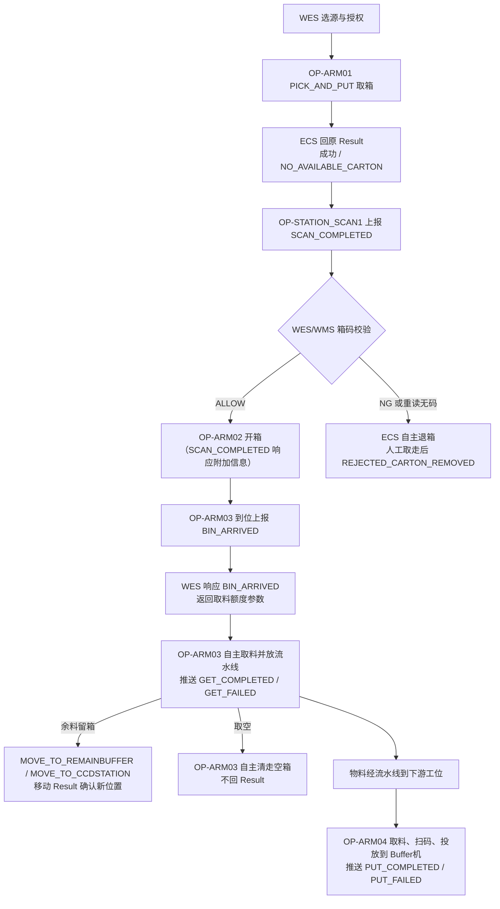
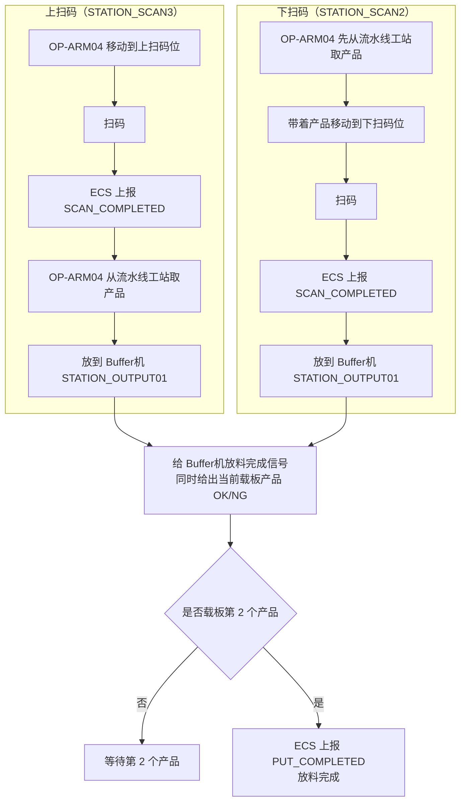

# 开箱机 ECS 相关接口摘录

> **来源**：`opening-machine-api.md`（开箱机上下盖供料 API 对接文档，2026-11-13 工程评审 D1–D52 版）
> **摘录范围**：仅保留 ECS/PLC 与 WES 相关的命令、事件、Result、门禁及恢复约定。
> **不含**：WMS 工单下发/改量/撤销、开工绑定、供料汇总、箱量差异报告等 WES↔WMS 业务接口。
> **性质**：评审/联调草案。带“待联调”的字段与命名尚未冻结。
>
> **device_code 前缀**：本文所有 `device_code` 统一带 `OP-` 前缀（如 `OP-ARM01`、`OP-STATION_SCAN1`、`OP-STATION_A`）；`data.location` 与 `location_id` 仍为不带前缀的位置编码（如 `STATION_SCAN1`、`STATION_A`）。占位符 `{{ECS_COMPLETION_DEVICE_CODE}}` 的实际取值同样带 `OP-` 前缀。与《开箱机ECS API接口调用说明书.md》一致。

## 目录

- [1. ECS 职责与工位编码](#1-ecs-职责与工位编码)
  - [1.1 工位与设备编码](#11-工位与设备编码)
  - [1.2 数量与来源约束](#12-数量与来源约束)
- [2. ECS 交互主流程（简化）](#2-ecs-交互主流程简化)
- [3. ECS → WES 事件](#3-ecs--wes-事件)
  - [3.1 SCAN1 箱码扫码（SCAN_COMPLETED）](#31-scan1-箱码扫码scan_completed)
  - [3.2 退箱恢复（REJECTED_CARTON_REMOVED，人工按按钮确认料箱已经移除）](#32-退箱恢复rejected_carton_removed人工按按钮确认料箱已经移除)
  - [3.3 新箱到位（BIN_ARRIVED）](#33-新箱到位bin_arrived)
  - [3.4 OP-ARM04 扫码与投料交互（SCAN2 / SCAN3）](#34-op-arm04-扫码与投料交互scan2--scan3)
  - [3.5 整层取料/投料（GET_COMPLETED / GET_FAILED / PUT_COMPLETED / PUT_FAILED）](#35-整层取料投料get_completed--get_failed--put_completed--put_failed)
  - [3.6 工位事件（PALLETS_EMPTY / PALLETS_FULL / WASTE_FULL）](#36-工位事件pallets_empty--pallets_full--waste_full)
    - [PLC 握手中继（拟议）](#plc-握手中继拟议)
- [4. ECS → WES 原命令 Result](#4-ecs--wes-原命令-result)
  - [4.1 OP-ARM01 取箱 Result](#41-op-arm01-取箱-result)
  - [4.2 缓存移动 Result（MOVE_TO_REMAINBUFFER / MOVE_TO_CCDSTATION）](#42-缓存移动-resultmove_to_remainbuffer--move_to_ccdstation)
  - [4.3 整单完成 Result（TASK_COMPLETED）](#43-整单完成-resulttask_completed)
- [5. WES → ECS 命令](#5-wes--ecs-命令)
  - [5.1 公共信封与 ACK](#51-公共信封与-ack)
  - [5.2 OP-ARM01 取箱（PICK_AND_PUT）](#52-op-arm01-取箱pick_and_put)
  - [5.3 OP-ARM02 开箱附加信息（SCAN_COMPLETED 响应，草案）](#53-op-arm02-开箱附加信息scan_completed-响应草案)
  - [5.4 箱码 NG 转发](#54-箱码-ng-转发)
  - [5.5 CCD 缓存与恢复（MOVE_TO_REMAINBUFFER / MOVE_TO_CCDSTATION）](#55-ccd-缓存与恢复move_to_remainbuffer--move_to_ccdstation)
  - [5.6 整单完成通知转发（TASK_COMPLETED，拟议）](#56-整单完成通知转发task_completed拟议)
  - [5.7 AGV 门禁与库位货架状态（AGV/MCS → ECS）](#57-agv-门禁与库位货架状态agvmcs--ecs)
    - [5.7.1 门禁接口 /door/accessReq、/door/accessFinish](#571-门禁接口-dooraccessreqdooraccessfinish)
    - [5.7.2 库位货架状态推送 /ecs/binStatus](#572-库位货架状态推送-ecsbinstatus)
- [6. 幂等、恢复与 ACK](#6-幂等恢复与-ack)
- [7. ECS 待联调事项](#7-ecs-待联调事项)
  - [ECS 相关验收要点](#ecs-相关验收要点)

---

## 1. ECS 职责与工位编码

| 主体 | 责任 |
| --- | --- |
| ECS/PLC | 执行取箱、开箱、取料、投料和缓存移动，提供实际到位、释放、逐层事件和原指令 Result |
| Buffer | 与开箱机握手，提供载板、处理整层投料 NG、管理 Magazine，接收整单完成通知后处理尾料 |
| AGV/MCS | 按 WMS 转交的原 Transport 任务完成栈板搬运，与 ECS 办理工位及门禁交接 |
| WES | 接收工单及决策，选源及授权设备动作，结算成功量和 NG，恢复原指令及转发整单通知 |

### 1.1 工位与设备编码

| 设备或位置 | 业务作用 | 对接方式 |
| --- | --- | --- |
| `OP-STATION_A` / `OP-STATION_B` | A 仅放上盖栈板，B 仅放下盖栈板 | OP-ARM01 取箱来源 |
| `OP-ARM01` / `OP-STATION_INPUT01` | 从 A/B 取纸箱到上料位 | `PICK_AND_PUT` 及原 Result |
| `OP-STATION_SCAN1` / `OP-ARM02` | 箱码扫描与切割开箱 | SCAN1 发 `SCAN_COMPLETED`；WES 响应该事件时直接返回开箱附加信息 |
| `OP-STATION_CCD` / `OP-STATION_REMAININGBUFFER1` | 取料区域与唯一余箱缓存 | 缓存、恢复按 `MOVE_TO_REMAINBUFFER`、`MOVE_TO_CCDSTATION`；位置及实际占用按原移动结果确认 |
| `OP-ARM03` | 新箱到位，逐层取料到皮带，移走空箱 | 新箱到位发 `BIN_ARRIVED`，取出每层时发 `GET_COMPLETED` / `GET_FAILED`；不需要 WES 指令，也不回 Result |
| `OP-STATION_SCAN2` / `OP-STATION_SCAN3` | 物料条码追溯 | `SCAN_COMPLETED`，仅用于追溯 |
| `OP-ARM04` / `OP-STATION_OUTPUT01` | 在 OP-ARM03 下游流水线工位取料、扫码，投放到 Buffer机 | ECS 以 `OP-STATION_OUTPUT01` 上报 `PUT_COMPLETED` / `PUT_FAILED` |

### 1.2 数量与来源约束

- 每套对应上、下盖各 1 片，每层 2 片。
- 当前上盖满箱 22 片，下盖满箱 16 片；开箱前按 WMS 解析的外码确认箱量。
- 取料位与已开箱余料缓存位各容纳一箱。
- Buffer 上下盖各最多 4 个待分配空板 Magazine；装载后的载板收入成品 Magazine。

---

## 2. ECS 交互主流程（简化）



ECS/PLC 内部联动，不需 ECS 与 WES 逐步交互：

- OP-ARM03 取空后自主清走空箱，PLC 确认离位。
- OP-ARM02 如已有按原授权开好的箱，取料位空出后自动送箱，OP-ARM03 再上报 `BIN_ARRIVED`。
- OP-ARM03 不需要 WES 下发取料指令，也不回 Result；取料/放料结果通过逐层事件通知 WES。

---

## 3. ECS → WES 事件

公共入口：`POST {{WES_BASE_URL}}/api/v1/callback/event`

| 公共字段 | JSON 类型 | 说明 |
| --- | --- | --- |
| `device_code` | string | 上报事件的逻辑设备或工站编码 |
| `event_type` | string | 事件类型。同名扫码事件按发出工站区分 |
| `timestamp` | integer | 首次生成事件的 UTC Unix 毫秒时间，重发保持原值 |
| `data` | object | 各事件业务字段 |

事件成功接收由 WES 返回 HTTP 200。除 SCAN1 响应携带开箱附加信息外，其余事件通用响应示例：

```json
{
  "code": 200,
  "message": "OK"
}
```
或
```json
{
  "code": 200,
  "message": "NG,error message indetail."
}
```

### 3.1 SCAN1 箱码扫码（`SCAN_COMPLETED`）

- **触发**：OP-ARM01 将纸箱送到上料位后，`OP-STATION_SCAN1` 成功读取外箱码。
- **用途**：采集纸箱外码并关联本次 OP-ARM01 供箱，供 WES 请求箱码校验。

```json
{
  "device_code": "OP-STATION_SCAN1",
  "event_type": "SCAN_COMPLETED",
  "timestamp": 1793836805000,
  "data": {
    "location": "STATION_SCAN1",
    "barcode": "EXAMPLE-U001-RAW",
    "source_command_code": "CMD-20261105-0001"
  }
}
```

| `data` 字段 | JSON 类型 | 说明与约束 |
| --- | --- | --- |
| `location` | string | 箱码扫描工站，本例为 `STATION_SCAN1` |
| `barcode` | string | 扫描到的外箱条码原文 |
| `source_command_code` | string | 本次 OP-ARM01 供箱的原指令号（拟议关联字段） |

> WES 对该事件的响应除 ACK 外，直接携带 OP-ARM02 开箱附加信息（`task_id`、`carton_id`、`product_code`、`cover_type` 等，字段待联调）；ECS 据此执行开箱，不接收 WES 下发的开箱命令，也不单独回 ARM02 开箱 Result。

**WES 响应示例（OK）**：

```json
{
  "code": 200,
  "message": "OK",
  "data": {
    "task_id": "OPEN-001",
    "carton_id": "U001",
    "product_code": "548",
    "cover_type": "UPPER"
  }
}
```

**WES 响应示例（NG）**：

```json
{
  "code": 200,
  "message": "NG,Error message in detail"
}
```

> `message` 为 `OK` 时携带开箱附加信息；为 `NG,...` 时 ECS 不执行开箱，按 NG 处理，设备自主将料箱移到 NGBUFFER1 位置。

- 每次 OP-ARM01 供箱仅认一条有效 SCAN1。
- 同码重报沿原校验请求；异码保留原箱和证据待核对。
- 超时沿原请求恢复，原箱保持待放行。

### 3.2 退箱恢复（`REJECTED_CARTON_REMOVED`，人工按按钮确认料箱已经移除）

- **触发**：纸箱自动退回后，人工取走料箱并按按钮确认料箱已移除，入料口工位已释放。
- **适用**：WMS 明确 NG，或 SCAN1 重读仍无码。

```json
{
  "device_code": "OP-STATION_NGBUFFER1",
  "event_type": "REJECTED_CARTON_REMOVED",
  "timestamp": 1793836808000,
  "data": {
    "location": "STATION_INPUT01",
    "source_command_code": "CMD-20261105-0001"
  }
}
```

| `data` 字段 | JSON 类型 | 说明与约束 |
| --- | --- | --- |
| `location` | string | 已实际释放的纸箱入料口工位 |
| `source_command_code` | string | 被退回纸箱的原 OP-ARM01 取箱指令号 |

### 3.3 新箱到位（`BIN_ARRIVED`）

- **触发**：已放行的新箱实际到达 `STATION_CCD` 且设备确认可取料，ECS 以 `device_code: OP-ARM03` 上报。
- **用途**：确认纸箱占用 OP-ARM03 取料位及盖型；WES 在该事件的响应中直接返回本箱取料额度参数，不再单独下发 `PICK_LAYER_QUOTA` 命令。

```json
{
  "device_code": "OP-ARM03",
  "event_type": "BIN_ARRIVED",
  "timestamp": 1793836810000,
  "data": {
    "location": "STATION_CCD",
    "carton_id": "U001",
    "product_code": "548",
    "cover_type": "UPPER",
    "source_command_code": "CMD-20261105-0001"
  }
}
```

| `data` 字段 | JSON 类型 | 必填 | 说明与约束 |
| --- | --- | --- | --- |
| `location` | string | 是 | OP-ARM03 新箱到位固定为 `STATION_CCD` |
| `carton_id` | string | 是 | SCAN1 经 WMS 校验并放行的箱号 |
| `product_code` | string | 是 | 产品型号：`548` 或 `558` |
| `cover_type` | string | 是 | `UPPER` 或 `LOWER`，须与开箱授权一致 |
| `source_command_code` | string | 是 | 原 OP-ARM01 取箱指令的顶层 `command_code`（不使用 ARM02 指令参数） |

WES 已通过 `SCAN_COMPLETED` 响应下发 ARM02 开箱附加信息；`BIN_ARRIVED` 继续携带原 OP-ARM01 `command_code`，用于关联本次供箱。

**WES 响应示例（OK）**：

```json
{
  "code": 200,
  "message": "OK",
  "data": {
    "command_code": "CMD-20261105-0003",
    "task_id": "OPEN-001",
    "carton_id": "U001",
    "product_code": "548",
    "cover_type": "UPPER",
    "max_get_layers": 3
  }
}
```

| `data` 字段 | JSON 类型 | 说明与约束 |
| --- | --- | --- |
| `command_code` | string | 本次取料额度标识，ECS 用作逐层事件的 `quota_command_code`；OP-ARM03 不回 Result |
| `task_id` | string | 当前执行工单号 |
| `carton_id` | string | 取料位当前纸箱标识 |
| `product_code` / `cover_type` | string | 当前箱产品及盖型 |
| `max_get_layers` | integer | 本箱允许取出的最大层数，每层 2 片 |

> 额度随 `BIN_ARRIVED` 响应一次性下发；同箱补取时 WES 重新下发额度（承载待联调），ECS 按新的 `max_get_layers` 执行，`layer_seq` 从 1 重新计数。

### 3.4 OP-ARM04 扫码与投料交互（`SCAN2` / `SCAN3`）

**扫码工站分工**：`OP-STATION_SCAN2` = 物料下扫码，`OP-STATION_SCAN3` = 物料上扫码。

**上扫码流程**（先扫码、后取料）：

1. OP-ARM04 先移动到上扫码位。
2. 扫码。
3. ECS 上报 `SCAN_COMPLETED`（`device_code=OP-STATION_SCAN3`）到 WES；上传完成后 OP-ARM04 再从流水线工站取产品。
4. 放到 Buffer机 `STATION_OUTPUT01`，给 Buffer机放料完成信号，同时给出当前载板上产品的 OK/NG 状态。

**下扫码流程**（先取料、后扫码）：

1. OP-ARM04 先从流水线工站取产品。
2. 带着产品移动到下扫码位。
3. 扫码。
4. ECS 上报 `SCAN_COMPLETED`（`device_code=OP-STATION_SCAN2`）到 WES；上传完成后放到 Buffer机 `STATION_OUTPUT01`，给放料完成信号并给出 OK/NG 状态。



上扫码事件示例：

```json
{
  "device_code": "OP-STATION_SCAN3",
  "event_type": "SCAN_COMPLETED",
  "timestamp": 1793836813000,
  "data": {
    "location": "STATION_SCAN3",
    "barcode": "EXAMPLE-PIECE-U001-02A",
    "quota_command_code": "CMD-20261105-0003",
    "layer_seq": 2
  }
}
```

下扫码事件示例：

```json
{
  "device_code": "OP-STATION_SCAN2",
  "event_type": "SCAN_COMPLETED",
  "timestamp": 1793836813200,
  "data": {
    "location": "STATION_SCAN2",
    "barcode": "EXAMPLE-PIECE-U001-02B",
    "quota_command_code": "CMD-20261105-0003",
    "layer_seq": 2
  }
}
```

| `data` 字段 | JSON 类型 | 说明与约束 |
| --- | --- | --- |
| `location` | string | `STATION_SCAN3`（上扫码）或 `STATION_SCAN2`（下扫码） |
| `barcode` | string | 本次读取的物料条码原文 |
| `quota_command_code` | string | 该物料所属的原取料额度指令号（拟议追溯字段） |
| `layer_seq` | integer | 物料所在层在原额度内的层序号，从 1 开始（拟议） |

> 扫码上传失败时 ECS 返回 502，设备侧按上传 NG 处理；是否继续放料按设备互锁执行。

### 3.5 整层取料/投料（`GET_COMPLETED` / `GET_FAILED` / `PUT_COMPLETED` / `PUT_FAILED`）

- **方向**：ECS → WES，`POST {{WES_BASE_URL}}/api/v1/callback/event`。
- **整层口径**：每条事件对应一整层 **2 片**（评审已通知 ECS 更新）。
- **配对键**：`quota_command_code` + `layer_seq`。
- **PUT 上报时机**：OP-ARM04 放置该载板第 1 个产品时只给 Buffer机放料完成信号和产品 OK/NG 状态，不上报事件；放置第 2 个产品（整层 2 片完成）时 ECS 上报 `PUT_COMPLETED`。

| 事件 | 触发方及触发点 |
| --- | --- |
| `GET_COMPLETED` | OP-ARM03 取出一整层并放到流水线完成后，ECS 以 `OP-ARM03` 上报 |
| `GET_FAILED` | OP-ARM03 取料故障、本层 2 片料掉落时，ECS 以 `OP-ARM03` 上报，通知 WES 这 2 片损失 |
| `PUT_COMPLETED` | OP-ARM04 完成该载板第 2 个产品投料并确认成功，ECS 以 `OP-STATION_OUTPUT01` 上报 |
| `PUT_FAILED` | OP-ARM04 投料失败或 Buffer 已确认整层 NG，ECS 以 `OP-STATION_OUTPUT01` 上报 |

```json
{
  "device_code": "OP-ARM03",
  "event_type": "GET_COMPLETED",
  "timestamp": 1793836812000,
  "data": {
    "location": "STATION_CCD",
    "quota_command_code": "CMD-20261105-0003",
    "layer_seq": 2,
    "quantity_pcs": 2
  }
}
```

```json
{
  "device_code": "OP-ARM03",
  "event_type": "GET_FAILED",
  "timestamp": 1793836813000,
  "data": {
    "location": "STATION_CCD",
    "quota_command_code": "CMD-20261105-0003",
    "layer_seq": 2,
    "quantity_pcs": 2
  }
}
```

```json
{
  "device_code": "OP-STATION_OUTPUT01",
  "event_type": "PUT_COMPLETED",
  "timestamp": 1793836814500,
  "data": {
    "location": "STATION_OUTPUT01",
    "quota_command_code": "CMD-20261105-0003",
    "layer_seq": 2,
    "quantity_pcs": 2
  }
}
```

```json
{
  "device_code": "OP-STATION_OUTPUT01",
  "event_type": "PUT_FAILED",
  "timestamp": 1793836814700,
  "data": {
    "location": "STATION_OUTPUT01",
    "quota_command_code": "CMD-20261105-0003",
    "layer_seq": 2,
    "quantity_pcs": 2
  }
}
```

| `data` 字段 | JSON 类型 | 适用事件 | 说明与约束 |
| --- | --- | --- | --- |
| `location` | string | GET / GET_FAILED / PUT_COMPLETED / PUT_FAILED | GET、GET_FAILED 为 `STATION_CCD`；PUT_COMPLETED、PUT_FAILED 为 `STATION_OUTPUT01` |
| `quota_command_code` | string | 全部 | 原取料额度指令号，同一层事件一致 |
| `layer_seq` | integer | 全部 | 从 1 开始，在同一额度内唯一，同一层事件共用 |
| `quantity_pcs` | integer | 全部 | 该层片数，固定为 2；取料掉落和整层 NG 时也为 2 |

- 取料故障：本层 2 片料掉落时上报 `GET_FAILED`，WES 据此记录该层 2 片损失（结算口径待联调）；该层不再产生 `GET_COMPLETED` / `PUT_COMPLETED`。
- 取料失败但未掉落、可恢复时，可在原额度内重试；OP-ARM03 不生成 Result，取料/放料终局仅通过事件通知 WES。
- 投料失败：Buffer 确认整层 NG 后上报 `PUT_FAILED`（`quantity_pcs: 2`）。WES 计来源箱耗用 2 片、成功 0 片、NG 2 片。
- 产品 OK/NG：由 ECS/PLC 在放料完成信号中同时给 Buffer机；`PUT_COMPLETED` / `PUT_FAILED` 在该载板第 2 个产品完成（整层）时上报。
- 故障处理：`GET_FAILED` / `PUT_FAILED` 推送后设备报警；人工取出掉落或 NG 料，报警复位后 OP-ARM03 继续取下一层。不发送恢复事件。

### 3.6 工位事件（`PALLETS_EMPTY` / `PALLETS_FULL` / `WASTE_FULL`）

- **触发**：PLC 检测到 A/B 栈板取空、C/D 空栈板堆满、E/F 废料架满，置请求位上升沿；ECS 向 WES 上报。
- **事件设备与位置**：
  - A/B：`OP-STATION_A` / `OP-STATION_B` → `PALLETS_EMPTY`（`data.location` 仍为 `STATION_A` / `STATION_B`）
  - C/D：`OP-STATION_C` / `OP-STATION_D` → `PALLETS_FULL`（`data.location` 仍为 `STATION_C` / `STATION_D`）
  - E/F：`OP-STATION_E` / `OP-STATION_F` → `WASTE_FULL`（`data.location` 仍为 `STATION_E` / `STATION_F`）

```json
{
  "device_code": "OP-STATION_A",
  "event_type": "PALLETS_EMPTY",
  "timestamp": 1793836803500,
  "data": {
    "location": "STATION_A",
    "start_operation_id": "01a1ac65-aef7-7b60-8c7b-87df787d9b05"
  }
}
```

- A/B 取空事件从导致取空的原 OP-ARM01 继承 `start_operation_id`；重报保留原绑定和原事件内容。
- C/D、E/F 事件省略 `start_operation_id`。

```json
{"device_code": "OP-STATION_C","event_type":"PALLETS_FULL","timestamp":1793836811000,"data":{"location":"STATION_C"}}
```

```json
{"device_code": "OP-STATION_E","event_type":"WASTE_FULL","timestamp":1793836812000,"data":{"location":"STATION_E"}}
```

#### PLC 握手中继（拟议）

1. ECS 向 WES 上报事件；WES 持久保存并返回 HTTP 200 / ACK。
2. WES 转报 WMS；WMS 持久收妥并返回匹配的 `RECORDED` 或有效 `DUPLICATE`。
3. WES 向 ECS 转达“已收妥”，ECS 核对仍在等待的原工位事件后置 PLC 应答位，PLC 再复位请求位。
4. WMS 暂不可用或回执丢失时，WES 按原 `operation_id` 继续交付，期间 PLC 请求保持。
5. WES → ECS 收妥通知的承载、关联字段与重发方式待联调。

---

## 4. ECS → WES 原命令 Result

公共入口：`POST {{WES_BASE_URL}}/api/v1/callback/result`

| 字段 | JSON 类型 | 说明 |
| --- | --- | --- |
| `command_code` | string | 原指令号 |
| `device_code` | string | 该指令的设备编码 |
| `result` | string | `SUCCESS` 或 `FAILED` |
| `finish_time` | integer | 原指令结束时间，UTC Unix 毫秒 |
| `data` | object | 各动作业务字段 |
| `error_detail` | object 或 null | 失败时提供字符串 `code` 和 `msg` |

### 4.1 OP-ARM01 取箱 Result

成功上料：

```json
{
  "command_code": "CMD-20261105-0001",
  "device_code": "OP-ARM01",
  "result": "SUCCESS",
  "finish_time": 1793836804000,
  "data": { "actual_qty": 1, "pick_and_put_result": "PUT_FINISHED" },
  "error_detail": null
}
```

明确缺箱且未搬箱：

```json
{
  "command_code": "CMD-20261105-0101",
  "device_code": "OP-ARM01",
  "result": "FAILED",
  "finish_time": 1793836803000,
  "data": {
    "actual_qty": 0
  },
  "error_detail": { "code": "NO_AVAILABLE_CARTON", "msg": "所选工位无可用纸箱，未搬箱" }
}
```

| 业务字段 | JSON 类型 | 说明与约束 |
| --- | --- | --- |
| `data.actual_qty` | integer | 实际搬运纸箱数，成功为 1，缺箱分支为 0 |
| `data.pick_and_put_result` | string | 成功搬放为 `PUT_FINISHED` |
| `error_detail.code` | string | 缺箱且明确未搬箱为 `NO_AVAILABLE_CARTON`（拟议） |
| `error_detail.msg` | string | 人工诊断说明 |

### 4.2 缓存移动 Result（`MOVE_TO_REMAINBUFFER` / `MOVE_TO_CCDSTATION`）

| 动作 | ECS Result 需确认的事实 |
| --- | --- |
| `MOVE_TO_REMAINBUFFER` | 原箱已到缓存位、取料位已释放 |
| `MOVE_TO_CCDSTATION` | 原箱已恢复到取料位、缓存已释放 |

`MOVE_TO_REMAINBUFFER` 成功 Result 示例（字段草案）：

```json
{
  "command_code": "CMD-20261105-0005",
  "device_code": "OP-STATION_CCD",
  "result": "SUCCESS",
  "finish_time": 1793836835000,
  "data": {
    "carton_id": "U001",
    "source_location": "STATION_CCD",
    "target_location": "STATION_REMAININGBUFFER1",
    "remaining_layers": 4,
    "next_layer_seq": 3
  },
  "error_detail": null
}
```

`MOVE_TO_CCDSTATION` 成功 Result 示例（字段草案）：

```json
{
  "command_code": "CMD-20261105-0006",
  "device_code": "OP-STATION_CCD",
  "result": "SUCCESS",
  "finish_time": 1793836839000,
  "data": {
    "carton_id": "U001",
    "source_location": "STATION_REMAININGBUFFER1",
    "target_location": "STATION_CCD",
    "remaining_layers": 4,
    "next_layer_seq": 3
  },
  "error_detail": null
}
```

- 位置及实际占用按原移动 Result 确认；余量沿原结算保留。
- Result 的箱号、余量、离位/到位字段待联调。

### 4.3 整单完成 Result（`TASK_COMPLETED`）

```json
{
  "command_code": "CMD-20261105-0009",
  "device_code": "{{ECS_COMPLETION_DEVICE_CODE}}",
  "result": "SUCCESS",
  "finish_time": 1793836929000,
  "data": {},
  "error_detail": null
}
```

- ECS/Buffer 确认可安全接下一单后，按原转发命令号回成功 Result。
- WES 只应用一次，随后按续单条件交接。
- 末个 Magazine 的补空板和出料由设备内部处理。

---

## 5. WES → ECS 命令

### 5.1 公共信封与 ACK

| 交互 | 方向 | Method 与 URL |
| --- | --- | --- |
| 下发指令 | WES → ECS | `POST {{ECS_BASE_URL}}/api/v1/device/command` |
| 回传 Result | ECS → WES | `POST {{WES_BASE_URL}}/api/v1/callback/result` |
| 上报事件 | ECS → WES | `POST {{WES_BASE_URL}}/api/v1/callback/event` |

| 指令字段 | JSON 类型 | 含义 |
| --- | --- | --- |
| `device_code` | string | 原执行设备编码 |
| `command_code` | string | WES 生成的原命令身份 |
| `task_type` | string | 动作类型 |
| `priority` | integer | 示例为 1 |
| `timeout` | integer | 期望时间，单位毫秒，发送时冻结 |
| `timestamp` | integer | UTC Unix 毫秒 |
| `params` | object | 业务参数 |

ECS 接纳指令后回复：

```json
{ "code": 200, "message": "ACK" }
```

> 设备 PDF 的指令 `timestamp` 使用字符串，本评审稿按整数发送，接收格式待核对（C12）。

### 5.2 OP-ARM01 取箱（`PICK_AND_PUT`）

```json
{
  "device_code": "OP-ARM01",
  "command_code": "CMD-20261105-0001",
  "task_type": "PICK_AND_PUT",
  "priority": 1,
  "timeout": 30000,
  "timestamp": 1793836801000,
  "params": {
    "start_operation_id": "01a1ac65-aef7-7b60-8c7b-87df787d9b05",
    "source": { "location_id": "STATION_A", "location_type": "BIN", "bin_type": "548", "cover_type": "UPPER" },
    "target": { "location_id": "STATION_INPUT01", "location_type": "BIN" }
  }
}
```

下盖取箱时 `params.source`：

```json
{"location_id": "STATION_B", "location_type": "BIN", "bin_type": "548", "cover_type": "LOWER"}
```

| `params` 字段 | 说明与约束 |
| --- | --- |
| `start_operation_id` | 原开工通知身份，ECS 随原取箱关联取空事件 |
| `source.location_id` | `STATION_A`（UPPER）/ `STATION_B`（LOWER） |
| `source.location_type` | 纸箱取放示例为 `BIN` |
| `source.bin_type` | 取箱箱型，按工单产品映射，如 `548` |
| `source.cover_type` | 目标协议字段：`UPPER`→A，`LOWER`→B |
| `source.bin_id` | 可选物理箱号；供箱前未知时省略 |
| `target.location_id` | `STATION_INPUT01` |
| `target.location_type` | `BIN` |

> 供应商现行 PDF 使用 `source.material_type`（`上盖`/`下盖`）。联调期间按已确认协议版本只发送一个盖型字段。

### 5.3 OP-ARM02 开箱附加信息（`SCAN_COMPLETED` 响应，草案）

WES 不再单独下发 `OPEN_CARTON` 命令；WES 对 SCAN1 `SCAN_COMPLETED` 的响应直接携带 OP-ARM02 开箱所需的附加信息。

```json
{
  "code": 200,
  "message": "OK",
  "data": {
    "task_id": "OPEN-001",
    "carton_id": "U001",
    "product_code": "548",
    "cover_type": "UPPER"
  }
}
```

| `data` 字段 | JSON 类型 | 说明与约束 |
| --- | --- | --- |
| `task_id` | string | 当前执行工单号 |
| `carton_id` | string | SCAN1 校验确认的纸箱标识 |
| `product_code` / `cover_type` | string | 校验通过的产品及盖型 |

> 附加信息字段为草案，按联调结果冻结；ECS 收到后直接执行开箱，无需再等待独立 WES 命令。

### 5.4 箱码 NG 转发

```json
{
  "source_command_code": "CMD-20261105-0001",
  "decision": "NG"
}
```

| 逻辑字段 | JSON 类型 | 说明与约束 |
| --- | --- | --- |
| `source_command_code` | string | 待退纸箱对应的原 OP-ARM01 取箱指令号 |
| `decision` | string | WES 转发的明确拒绝，示例 `NG`；WMS 侧仍用 `REJECT` |

- ECS/PLC 收到匹配当前箱的 NG 后，保持 OP-ARM02 切割未放行，自动退回纸箱到入料口，等待人工取走。
- 重复决定或转发重试沿同一原退箱意图。

### 5.5 CCD 缓存与恢复（`MOVE_TO_REMAINBUFFER` / `MOVE_TO_CCDSTATION`）

顶层设备为 `OP-STATION_CCD`，省略 `target`。`params` 除 `source` 外，还需携带当前料箱的物料层数与产品信息，供下次回到 CCD 时继续取料。

```json
{
  "device_code": "OP-STATION_CCD",
  "command_code": "CMD-20261105-0005",
  "task_type": "MOVE_TO_REMAINBUFFER",
  "priority": 1,
  "timeout": 30000,
  "timestamp": 1793836830000,
  "params": {
    "task_id": "OPEN-001",
    "carton_id": "U001",
    "product_code": "548",
    "cover_type": "UPPER",
    "next_layer_seq": 3,
    "remaining_layers": 4,
    "source": { "location_id": "STATION_CCD", "location_type": "CCD_PLATFORM" }
  }
}
```

| 动作 | 用途 | ECS Result |
| --- | --- | --- |
| `MOVE_TO_REMAINBUFFER` | 取料位余箱移入唯一缓存，为后续供料让位 | 成功后确认原箱到缓存位、取料位释放 |
| `MOVE_TO_CCDSTATION` | 将可续用的缓存余箱恢复到取料位 | 成功后确认原箱恢复到取料位、缓存释放 |

| `params` 字段 | JSON 类型 | 说明与约束 |
| --- | --- | --- |
| `task_id` | string | 当前执行工单号 |
| `carton_id` | string | 当前料箱标识 |
| `product_code` | string | 产品型号：`548` / `558` |
| `cover_type` | string | `UPPER` / `LOWER` |
| `next_layer_seq` | integer | 下次回到 CCD 时 ARM03 的起始层号，从 1 开始 |
| `remaining_layers` | integer | 当前箱剩余层数（每层 2 片） |
| `source.location_id` | string | 反向入缓存示例为 `STATION_CCD`；正向恢复使用实际缓存来源编码（待确认） |
| `source.location_type` | string | 反向为 `CCD_PLATFORM`；正向枚举待确认 |

`MOVE_TO_CCDSTATION` 命令示例（`source` 位置待联调）：

```json
{
  "device_code": "OP-STATION_CCD",
  "command_code": "CMD-20261105-0006",
  "task_type": "MOVE_TO_CCDSTATION",
  "priority": 1,
  "timeout": 30000,
  "timestamp": 1793836836000,
  "params": {
    "task_id": "OPEN-001",
    "carton_id": "U001",
    "product_code": "548",
    "cover_type": "UPPER",
    "next_layer_seq": 3,
    "remaining_layers": 4,
    "source": { "location_id": "STATION_REMAININGBUFFER1", "location_type": "CCD_PLATFORM" }
  }
}
```

> `MOVE_TO_CCDSTATION` 使用同一组 `params` 字段，`source` 替换为实际缓存来源位；`next_layer_seq` 用于恢复后继续取料。

### 5.6 整单完成通知转发（`TASK_COMPLETED`，拟议）

```json
{
  "device_code": "{{ECS_COMPLETION_DEVICE_CODE}}",
  "command_code": "CMD-20261105-0009",
  "task_type": "TASK_COMPLETED",
  "priority": 1,
  "timeout": 30000,
  "timestamp": 1793836921100,
  "params": {
    "task_id": "OPEN-001",
    "product_code": "548",
    "notice_operation_id": "01a1ac65-aef7-7b60-8c7b-87df787d9b04"
  }
}
```

| `params` 字段 | 说明与约束 |
| --- | --- |
| `task_id` | 原 WMS 完成通知对应的工单号 |
| `product_code` | 原工单产品编码 |
| `notice_operation_id` | 原 WMS 整单完成通知的 `operation_id` |

- ECS/Buffer 接收后自行处理尾料补空板和出料，确认可接下一单后回成功 Result。

### 5.7 AGV 门禁与库位货架状态（AGV/MCS → ECS）

#### 5.7.1 门禁接口 `/door/accessReq`、`/door/accessFinish`

##### device_code 与 direction

每个工站均支持 `IN`（进门/进光栅）和 `OUT`（出门/出光栅），不同方向使用各自独立的请求/响应寄存器。

| device_code | 区域 | direction | 含义 |
| --- | --- | --- | --- |
| `OP-STATION_A` | A 区放料架 | IN | AGV 进门（屏蔽光栅、暂停 ARM01） |
| `OP-STATION_A` | A 区放料架 | OUT | AGV 出门（屏蔽光栅、暂停 ARM01） |
| `OP-STATION_B` | B 区放料架 | IN | AGV 进门（屏蔽光栅、暂停 ARM01） |
| `OP-STATION_B` | B 区放料架 | OUT | AGV 出门（屏蔽光栅、暂停 ARM01） |
| `OP-STATION_C` | C 区取料架 | IN | AGV 进门（屏蔽光栅、暂停 ARM01） |
| `OP-STATION_C` | C 区取料架 | OUT | AGV 出门（屏蔽光栅、暂停 ARM01） |
| `OP-STATION_D` | D 区取料架 | IN | AGV 进门（屏蔽光栅、暂停 ARM01） |
| `OP-STATION_D` | D 区取料架 | OUT | AGV 出门（屏蔽光栅、暂停 ARM01） |
| `OP-STATION_E` | E 区废料架 | IN | AGV 进门（屏蔽光栅、暂停 ARM03） |
| `OP-STATION_E` | E 区废料架 | OUT | AGV 出门（屏蔽光栅、暂停 ARM03） |
| `OP-STATION_F` | F 区废料架 | IN | AGV 进门（屏蔽光栅、暂停 ARM03） |
| `OP-STATION_F` | F 区废料架 | OUT | AGV 出门（屏蔽光栅、暂停 ARM03） |

##### 请求（两个接口字段一致）

| 字段 | 类型 | 必选 | 说明 |
| --- | --- | --- | --- |
| `callId` | string | Y | 请求唯一标识；`accessFinish` 必须与对应 `accessReq` 使用同一个 |
| `device_code` | string | Y | `OP-STATION_A`~`OP-STATION_F` |
| `direction` | string | Y | `IN`=进门/进光栅；`OUT`=出门/出光栅；所有工站均支持 |

```json
{
  "callId": "1703126056902",
  "device_code": "OP-STATION_A",
  "direction": "IN"
}
```

`OUT` 请求示例：

```json
{
  "callId": "1703126056904",
  "device_code": "OP-STATION_A",
  "direction": "OUT"
}
```

##### 响应（始终 HTTP 200，以 `code` 判断业务结果）

```json
{
  "callId": "1703126056902",
  "code": 0,
  "msg": "allow access"
}
```

```json
{
  "callId": "1703126056902",
  "code": 0,
  "msg": "finish received"
}
```

```json
{
  "callId": "1703126056903",
  "code": 4005,
  "msg": "door busy"
}
```

##### 异常码

| code | 含义 | M4/MCS 处理 |
| --- | --- | --- |
| 0 | 成功 | 继续通行/结束 |
| 4001 | 参数缺失或格式错误 | 不重试 |
| 4002 | direction 枚举非法 | 不重试 |
| 4003 | 设备编码不存在 | 不重试 |
| 4004 | PLC 未在规定时间响应 | 重试；ECS 保留请求位，同 callId 继续等待 |
| 4005 | 门禁已被其他通行占用 | 按 2s 间隔重试，等待前一次通行结束 |
| 4006 | 权限不足 | 不重试 |
| 4007 | 完成通知无对应请求 | 不重试，丢弃 |
| 5000 | ECS 内部错误 / PLC 完成响应超时 | 重试 |

##### 超时与重试

| 项目 | 值 |
| --- | --- |
| 单次 HTTP 超时 | 3000 ms |
| 连接超时 | 1000 ms |
| ECS 等待 PLC 响应 | 2600 ms（预留 400 ms 回包） |
| HTTP 超时/连接失败 | 1s → 2s → 4s，3 次 |
| 4004 / 4005（被占用） | 固定 2s，5 次 |
| 5000 | 1s → 2s → 4s，3 次 |
| 4001/4002/4003/4006/4007 | 不重试 |

##### 幂等与通道占用

- 同一 `callId` 重复 `accessReq` 视为同一次，不重复开门。
- 同一门禁通道同时只允许一次通行；被其他 `callId` 占用返回 `4005`。
- `accessFinish` 的 `callId`、`device_code`、`direction` 必须与对应 `accessReq` 一致。

##### 门禁寄存器

| device_code | direction | 请求位（ECS 写） | 请求响应（PLC 写） |
| --- | --- | --- | --- |
| `OP-STATION_A` | IN | D7040 | D6040 |
| `OP-STATION_A` | OUT | D7042 | D6042 |
| `OP-STATION_B` | IN | D7044 | D6044 |
| `OP-STATION_B` | OUT | D7046 | D6046 |
| `OP-STATION_C` | IN | D7048 | D6048 |
| `OP-STATION_C` | OUT | D7050 | D6050 |
| `OP-STATION_D` | IN | D7052 | D6052 |
| `OP-STATION_D` | OUT | D7054 | D6054 |
| `OP-STATION_E` | IN | D7080 | D6080 |
| `OP-STATION_E` | OUT | D7082 | D6082 |
| `OP-STATION_F` | IN | D7084 | D6084 |
| `OP-STATION_F` | OUT | D7086 | D6086 |

> 依据《开箱机 PLC寄存器规划 D区域 -20261015 V0.4.csv》AGV 段；`accessReq`/`accessFinish` 按 `direction` 使用对应方向的请求位与响应位。读索引 = (D 地址 − 6000) ÷ 2，写索引 = (D 地址 − 7000) ÷ 2，读写索引数值相同。详细时序见《开箱机AGV进出API接口说明书.md》。

#### 5.7.2 库位货架状态推送 `/ecs/binStatus`

- **方向**：M4 → ECS
- **用途**：库位/货架数据变更时 M4 主动推送状态，ECS 更新内部库位货架数据。
- **入口**：`POST {{ECS_BASE_URL}}/ecs/binStatus`

##### 请求字段

| 字段 | 类型 | 必选 | 说明 |
| --- | --- | --- | --- |
| `callId` | string | Y | 请求唯一标识，建议毫秒时间戳 + 随机串 |
| `device_code` | string | Y | 数据来源设备：开箱机使用 `OP-STATION_A`~`OP-STATION_F`（按库位所属工站填写） |
| `bin_code` | string | Y | 库位编码，业务系统库位唯一编码 |
| `container_code` | string | Y | 货架编码；库位绑定货架时填真实货架编码，无货架时填 `""` |

##### 请求示例

```json
{
  "callId": "1703126056902",
  "device_code": "OP-STATION_A",
  "bin_code": "BIN001",
  "container_code": "SHELF05"
}
```

```json
{
  "callId": "1703126056903",
  "device_code": "OP-STATION_B",
  "bin_code": "BIN002",
  "container_code": ""
}
```

##### binStatus 响应

```json
{
  "callId": "1703126056902",
  "code": 0,
  "msg": "bin status get success"
}
```

```json
{
  "callId": "1703126056902",
  "code": 4102,
  "msg": "invalid device_code"
}
```

##### binStatus 异常码

| code | 含义 | M4 处理 |
| --- | --- | --- |
| 0 | 成功 | 结束本次推送 |
| 4101 | 参数缺失或格式错误 | 不重试 |
| 4102 | device_code 枚举非法 | 不重试 |
| 4103 | bin_code 库位编码不存在 | 不重试 |
| 4104 | ECS 服务繁忙/不可达 | 重试 |
| 4105 | 字段超长 | 不重试 |
| 5000 | ECS 内部错误 | 重试 |

##### binStatus 重试与幂等

| 项目 | 规则 |
| --- | --- |
| HTTP 超时/连接失败 | 1s → 2s → 4s，3 次 |
| 4104 / 5000 | 1s → 2s → 4s，3 次 |
| 4101/4102/4103/4105 | 不重试 |
| 幂等 | 同一 `callId` 5 分钟内重复请求视为同一次，ECS 不重复执行更新 |
| 时效 | `callId` 超过 5 分钟的重复请求返回 `4101` |

> `bin_code` 与开箱机 A/B 放料架位及 PLC 寄存器的对应关系按现场库位规划确定，联调时确认。库位货架状态推送详细约定见《库位货架状态推送 API 接口说明书.md》。

---

## 6. 幂等、恢复与 ACK

| 对象 | 用途 | 发出方与触发时机 | 原身份与约束 |
| --- | --- | --- | --- |
| Event | 上报设备业务事实 | ECS 在对应工站动作或状态发生后上报 | 接收器以 `device_code`、`event_type`、`timestamp`、`data` 识别重复；重发保留原内容 |
| 层 | 一次实际取出与终局投料配对 | ECS 分别上报 GET 与 PUT | 以原 `quota_command_code` + `layer_seq` 关联 |
| Command | 授权设备执行动作 | WES 在授权条件满足后发送 | 保持原 `command_code`、设备、参数、路由及期限 |
| Result | 回报原指令终局 | ECS 在原指令结束后回传，恢复时重发已保存终局 | 匹配原命令和设备；重复到达沿用原处理状态 |

- ECS 断线或重启后，按原 `command_code` 重发已保存的最终 Result。
- 合法命令 ACK 后，WES 保留原动作及占位，等待匹配的 Result；无截止时间。
- 合法 Result 可先于命令 ACK 应用。
- 事件 ACK 只表示接收持久化；业务推进依赖已注册处理及原关联。

---

## 7. ECS 待联调事项

| 编号 | 事项 |
| --- | --- |
| C01 | OP-ARM01 `source.cover_type`、原取箱与取空关联、PLC 应答复位 |
| C03 | SCAN_COMPLETED 响应中的 ARM02 开箱附加信息、NG 转发、无读码退箱与恢复事件 |
| C04 | OP-ARM03 自动清箱与送箱、到位信号、原 OP-ARM01 指令号随箱传递、缓存与实际离位 |
| C05–C08 | 整层额度、逐层事件、实物异常与可安全续作证据、逐层回调不阻塞 |
| C09 | ECS 可接下一单的时点、`TASK_COMPLETED` 接收角色与 Result 载荷 |
| C11 | SCAN2/3 的 `quota_command_code`、`layer_seq` 及漏读记录方式 |
| C12 | 公共报文、设备编码、`timeout` 字段、网关来源、证据留存及原身份重发 |

### ECS 相关验收要点

- OP-ARM01 缺箱时回 `NO_AVAILABLE_CARTON`，明确“未搬箱”。
- 扫码 NG 或重读无码时设备自主退箱，人工按按钮确认料箱已经移除后上报 `REJECTED_CARTON_REMOVED`。
- ARM02 开箱附加信息随 SCAN_COMPLETED 的 WES 响应下发；`BIN_ARRIVED.source_command_code` 仍上报，值为原 OP-ARM01 的 `command_code`。
- GET_COMPLETED / GET_FAILED / PUT_COMPLETED / PUT_FAILED 每条对应整层 2 片，`quota_command_code` + `layer_seq` 配对。
- OP-ARM03 不需要 WES 指令、不回 Result；额度信息随 `BIN_ARRIVED` 响应下发，取料/放料终局由逐层事件通知。
- 空箱离位由设备自主清箱确认（不回 Result）；缓存移动位置由原移动 Result 确认。
- A/B、C/D、E/F 工位事件由 ECS 报 WES，WES 转报 WMS；WMS 收妥经 WES 转达后 ECS 才应答 PLC。
