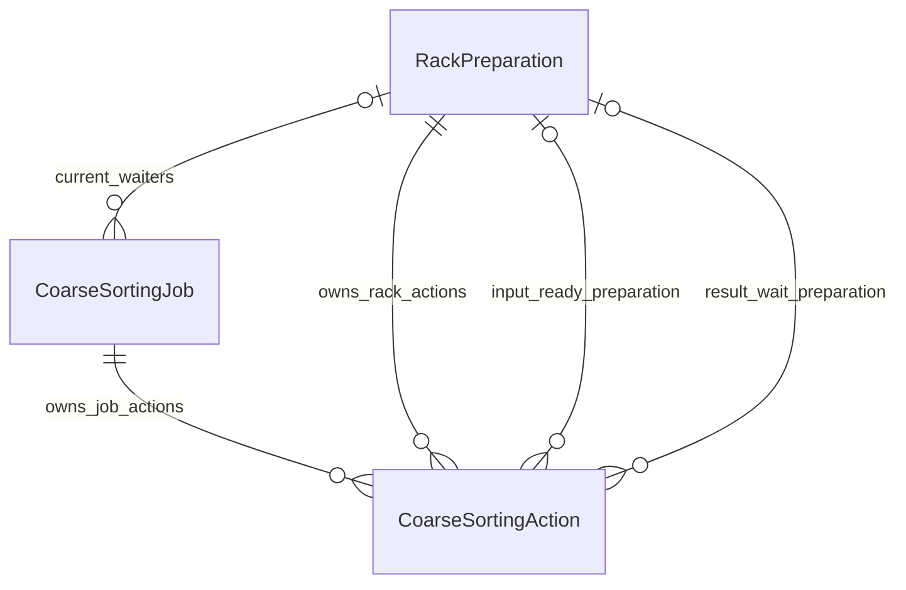
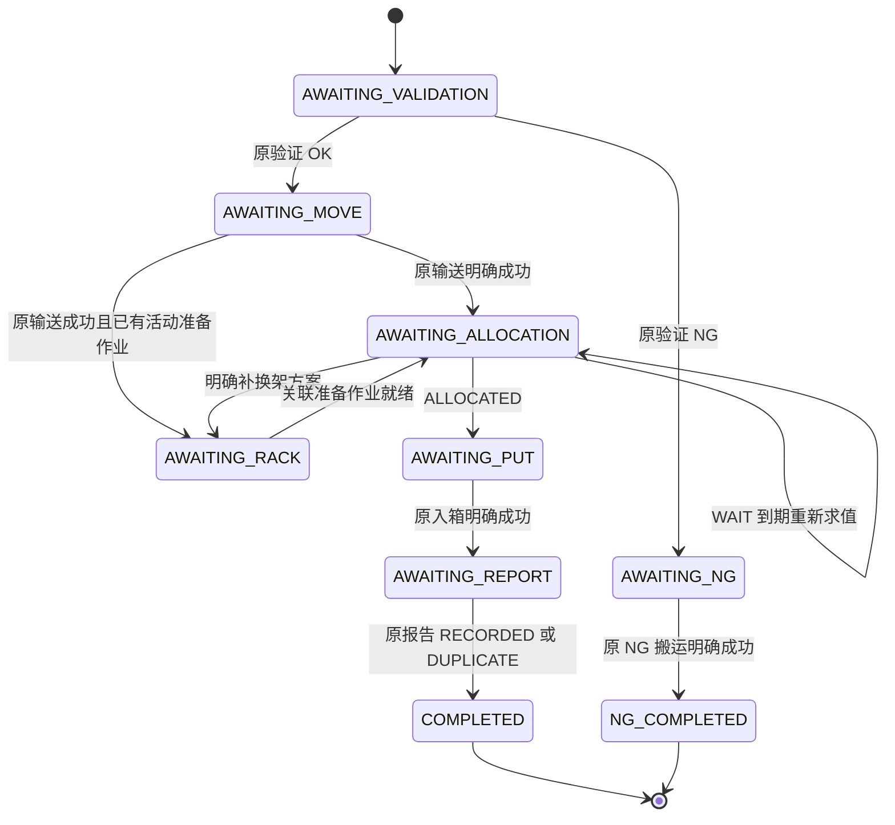

# 粗分机实体与状态机设计

> 2026-11-02 新目标决定：[公共货架调度设计](2026-11-02-shared-rack-dispatch-design.md)统一手工、自动、BIN_Roller、粗分及后续业务的货架调度实体/推进服务，生产条件仍归原业务。原动作是离开当前工作线货架工作位的DEPART/RACK_MOVE、模板为CTU03或F01时，有效提交接纳即完成调度；目标可为库区ZONE或不同的生产线等RACK_POSITION工作位，不按是否库区判定离场；最终回调仅保留终位/失败备查，不回退、不阻塞后继、不自动重搬。本点位无其他可由原过程承接的有效需求时，直接执行责任可安全交出就安排原架离场，不等父任务终态或独立报告ACK；未知不作无需求，原业务完成/报告义务仍独立保留。本文中与此冲突的目标规则及私有架调度表/装配规划由新设计覆盖；已合入实现和旧验收保留原时点含义，新公共能力尚未实施，当前代码不会因文档更新自动改变。

状态：2026-11-02，**设计草案，尚未实施**。用户已同意“两项业务实体、一张业务动作记录表”的方案，本轮细化字段、关联和状态转换；不修改应用代码、ORM、迁移或部署配置，不升级数据库、不提交。本文件中的新类型、表、状态和 WAIT 响应均为目标设计，不能据此宣称现有接口已经支持。

## 1. 已确认范围与方案

业务从 `SCAN_COMPLETED` 开始：料盘已经停在输送线上，此前机械臂取料、放料和扫码由设备自主完成。允许多盘分别处于验证、输送和等待出料阶段；原 `MOVE_FORWARD` 明确成功表示对应料盘已到出料机械臂可抓取的位置，停在那里等待自己的入箱命令。

WMS 负责验证/GRN 绑定、箱格容量预留和高度一致性；WES 使用原返回值，不自行计算库存或高度。原入箱明确成功后允许处理下一盘，原完成报告独立恢复，不因报告未收妥锁住原料格。验证 NG 只执行原料盘的 `MOVE_TO_NG`，明确成功后以 NG 结束，不向 WMS 另报 NG 搬运结果。

无可补入新架时等待，由 WES 定时重新申请分配。补换架搬运失败后保留原任务等待后续结果；任务最终按原目标完成后，由 WMS 回调恢复，WES 不区分手工/自动完成，也不自动另发搬运。ECS 命令异常的新增恢复机制留待联调，本设计只保留现有未决保护。

货架搬运范围固定为 **F01 入场和 F01 退场**，均为 RACK_MOVE，不增加换面任务或其他模板。入场 `target_face` 由 WMS 在 `incoming_rack` 中返回，属于原新架方案；WES 只保存、校验并原样使用，不增加工作位方向配置，不从位置编号推导方向。退场沿原 departure READY 去向，不增加本轮未约定的退场方向参数。

SCAN_COMPLETED 是 ECS 主动上报的业务事件，不是需要独立监控运行状态的设备。沿用既有 INPUT_ARM 事件归属：RS01 使用 RS-INPUT-ARM-01，RS02 使用 RS-INPUT-ARM-02，工作线通过可信 device_code 绑定解析；不新增虚拟扫码设备、事件状态表或轮询任务。该归属标识本执行单元的事件来源，不表示 WES 接管扫码之前的机械臂动作。

事件受理检查原信封、Payload、可信绑定和业务许可，不查询 Status，也不要求 Status.supported_events 必须列出 SCAN_COMPLETED。Status.role、data.location 或地址/编号后缀不替代工作线角色绑定；Status中的UNKNOWN不构成拒收合法扫码事件的依据。后续联调核对的是实际推送、源编码及原事件身份稳定性，能力清单缺少该事件不单独构成设计阻塞。

采用用户选定的对象模型：

| 方案 | 取舍 |
| --- | --- |
| **粗分作业 + 架位准备作业 + 统一业务动作记录** | 采用。单盘和共享架位各有生命周期；请求轮次及结果依据保留在同一张动作表 |
| 每个阶段一张表 | 不采用。阶段是状态，不构成新的业务对象；生命周期和关联会被拆散 |
| 所有盘、补换架和历史塞进一条 JSON | 不采用。共享作业、并发唯一性和多轮求值缺少明确约束 |

只有 `CoarseSortingJob`、`RackPreparation` 是推进聚合；`CoarseSortingAction` 是聚合拥有的动作依据，没有自己的扫描器、Sender 或独立流程。使用枚举和业务方法即可，不引入状态机库或通用工作流引擎。

依据：[当前接口草案](../../integrations/coarse-sorting-api-draft.md)、[现有粗分模型](../../../app/businesses/coarse_sorting/models.py)、[现有推进服务](../../../app/businesses/coarse_sorting/service.py)、[业务事务配方](../../integrations/business-transaction-recipes.md)、[公开结果读口](../../integrations/outbound-results.md)。本轮确认的业务增量以本文件为准；现有已实施范围仍止于扫码、验证及首个输送 Result。

## 2. 类型与持久化原则

- 新业务 ID 使用 UUIDv7 的标准字符串 `String(36)`；历史业务 ID 保留原值，不为重命名实体另造执行身份。关联配置的 ID 沿现有 BigInteger，事件摘要为 `String(64)`。
- 状态/动作枚举持久化为有 CHECK 的字符串，时间为 UTC `DateTime(timezone=True)`；协议时间保留 UTC Unix 毫秒 BigInteger。
- 冻结业务输入和结果依据使用项目现有 SQLAlchemy JSON；可空 JSON 采用 SQL NULL 语义。JSON 由各动作的严格合同校验，不成为任意扩展字段入口。
- 业务三表之间使用外键并限制删除；收据、配置和框架对象采用保留原身份的逻辑引用，不能因公共收据清理或配置删除级联删除业务事实。
- 不复制可靠消息的发送状态、租约、尝试次数、重试时间、HTTP 原字节、路由或附录。它们继续由原框架冻结和管理。
- 不另存 `pending` 布尔值：待办由业务非终态和固定扫描谓词派生，避免 state 与 pending 分歧。持久 state、原动作关联和到期点就是恢复依据。
- 不在事务内持有硬件资源直到物理结束；数据库锁只用于短事务内核对和登记。设备排队/互锁由 ECS 管理，业务状态不等同设备占用表。

## 3. 实体一：CoarseSortingJob

目标表：`coarse_sorting_job`。一行表示**一次独立扫码受理对应的一盘粗分作业**；相同条码不同有效事件可以产生不同作业，条码不设唯一约束。

| 字段 | 类型 / 空值 | 含义及冻结时机 |
| --- | --- | --- |
| `id` | String(36)，PK | 原业务经过 ID；现有扫码 ID 演进时保留 |
| `event_digest` | String(64)，非空 UNIQUE | 原完整核心事件的摘要；不从过滤后的业务模型重算 |
| `receipt_id` | BigInteger，非空逻辑引用 | 首次受理收据 ID，清理后仍保留该历史关联值 |
| `work_line_id`、`workline_code` | BigInteger / Text，非空 | 原受理工作线身份及编码快照，后续请求均沿用 |
| `acceptance_binding` | JSON，非空 | 原扫描设备 ID/code/角色/版本、工作线版本、binding.revision；只从可信绑定保存 |
| `scan_facts` | JSON，非空 | 原业务事实 `barcode / reel_diameter / reel_thickness`；ECS size_inch/thickness_mm 显式映射，英寸/毫米原值保留 |
| `event_timestamp` | BigInteger，非空 | 原外层事件时间；不使用 data.scan_time 或接收时间替代 |
| `state` | String(32)，非空 | 第 7 节的单盘主状态 |
| `wait_reason` | String(64)，可空 | 等待或核对原因，不作为另一套主状态 |
| `next_check_at` | UTC 时间，可空 | 仅用于已得到明确业务 WAIT 后的新求值到期点；不作为通信重试调度 |
| `current_action_id` | FK → Action，可空 | 当前阶段的动作；初次登记前可空，只能指向本作业自己的动作 |
| `binding_id` | Text，可空 | 仅合法验证 OK 后保存；不另设全局唯一，身份同时受原作业/工作线约束 |
| `ng_reason_code` | Text，可空 | 验证 NG 的原原因；与 binding_id 互斥 |
| `rack_position_code` | Text，可空 | 首次进入分配前，从原线 OUTPUT_RACK 绑定选定并保存 |
| `rack_binding_version` | BigInteger，可空 | 选择该位置时的工作线版本；同作业重试不换为新位置 |
| `rack_preparation_id` | FK → Preparation，可空 | 本轮等待的共享准备作业；历史等待关联另保留在对应分配动作 |
| `allocation_action_id` | FK → Action，可空 | 已选中、尚用于本次入箱的 ALLOCATED 决定，必须属于本作业 |
| `placed_at_ms` | BigInteger，可空 | 原 PUT_TO_BIN 成功 Result.finish_time；是报告业务事实，不是本地推断时间 |
| `received_at`、`updated_at` | UTC 时间，非空 | 接收及最近一次业务变更时间 |
| `completed_at` | UTC 时间，可空 | 正常报告收妥或 NG 搬运明确成功后的本地闭合时间 |

`scan_facts` 保留当前 payload 的三项业务事实格式，不存额外位置、箱码或设备 result。分配目标不再复制成另一份可改 JSON：通过 `allocation_action_id` 读取该动作保存的完整决定，包含原 rack_id、bin_code、bin_location、cell_id、bin_type、reel_totalthickness。入箱动作再次冻结自己实际使用的参数，报告沿原入箱目标形成。

约束与索引：

1. `event_digest` 唯一；`binding_id`、barcode 不单独作为作业唯一键。
2. `binding_id` 与 `ng_reason_code` 不能同时存在；正常路径从等待输送起必须有 binding_id，NG 路径必须有 ng_reason_code 且无 binding_id。
3. `rack_position_code/rack_binding_version` 同空或同非空；等待补换架必须有关联 preparation，等待入箱/报告和正常完成必须有关联 ALLOCATED 动作。
4. `completed_at` 只允许且必须在 `COMPLETED / NG_COMPLETED` 非空；`placed_at_ms` 在等待报告/正常完成必须非空。
5. `current_action_id`、`allocation_action_id` 在锁定事务内核对归属和动作类型，外键本身只保证引用存在。
6. 建立待办扫描索引 `(state, id)`、工作线查询索引 `(work_line_id, state)`；业务 WAIT 按 next_check_at 判断是否到期，不用条码或设备“最近一条”定位作业。

## 4. 实体二：RackPreparation

目标表：`coarse_sorting_rack_preparation`。一行表示**一个工作位的一次明确补架/换架方案及其执行过程**。只有 WMS 给出具体新架方案时才创建；“没有新架，等待”不创建空准备作业。

| 字段 | 类型 / 空值 | 含义及约束 |
| --- | --- | --- |
| `id` | String(36)，PK | 本次架位准备 ID，同时作为原 Transport cycle_id |
| `work_line_id`、`workline_code` | BigInteger / Text，非空 | 原工作线上下文 |
| `rack_position_code` | Text，非空 | 本次原目标工作位，不随配置改名/改绑变化 |
| `rack_binding_version` | BigInteger，非空 | 选择工作位时的原版本 |
| `generation_no` | Integer，非空，≥1 | 同工作线/工作位的准备代次；持有工作线锁后按该位置历史最大值+1登记，不从当前配置或时钟推断 |
| `mode` | String，非空 | `REPLENISH / REPLACE` |
| `old_rack_id` | Text，可空 | REPLACE 必填；REPLENISH 必须为空 |
| `incoming_rack_id` | Text，非空 | WMS 原方案选定的新架；与 old_rack_id 不得相同 |
| `incoming_target_face` | String(10)，非空 | WMS incoming_rack.target_face 原方向码；严格非空字符串，沿既有 target_face 的1～10字符/无NUL/有效UTF-8约束，创建时冻结 |
| `source_allocation_action_id` | FK → Action，非空 UNIQUE | 首次产生该方案的原分配动作；该动作由某个 Job 拥有，同一源动作不能再生成另一份准备作业 |
| `predecessor_action_ids` | JSON，非空，初值 [] | 创建时固定的同工作位已知直接前序 Action ID，去重且保留原归属；不以当前全部历史任务代替 |
| `state` | String(32)，非空 | 第 8 节的架位准备状态 |
| `wait_reason` | String(64)，可空 | 如等待原搬运恢复结果、等待结果或配置核对；不记录手工/自动完成方式，不改原阶段 |
| `next_check_at` | UTC 时间，可空 | 仅离场决定 WAIT 的固定到期点 |
| `current_action_id` | FK → Action，可空 | 当前准备动作，必须由本 Preparation 拥有 |
| `created_at`、`updated_at` | UTC 时间，非空 | 业务时间 |
| `ready_at` | UTC 时间，可空 | 原新架补入已应用成功且目标匹配后的本地确认时间；READY 必填 |

不另建“出架表”“入架表”或架位库存表；旧架去向保存于原 DEPARTURE_DECIDE 动作的 READY 决定，出入架任务分别是本 Preparation 的动作记录。

同一 `(work_line_id, rack_position_code)` 建立 `state <> 'READY'` 的部分唯一索引，并建立 `(work_line_id, rack_position_code, generation_no)` 唯一约束。等待原任务恢复结果时仍属于在途，不能创建替代准备作业。锁定原工作线后先查该工作位已有活动 Preparation：

- 同一 source_allocation_action_id 重入时，冻结的模式、旧/新架、入场方向和工作位必须一致，复用原准备作业；同一源动作方案矛盾则记 PREPARATION_PLAN_CONFLICT，不覆盖方案。
- 其他盘尚未发送分配或仅持有被新代次取代的迟到决定时，按第6.1节等待现有准备作业，再重新求值，不要求它的旧方案与活动方案相同，也不把旧方案改写成活动方案。新的、代次有效的分配方案只有在无活动准备作业时才能创建下一代。
- 已 READY 的历史准备作业不妨碍之后的新换架；分配请求登记时冻结本地准备代次，迟到结果按第 6.1 节处理，不能单凭“没有活动作业”重开旧方案。

## 5. 实体三：CoarseSortingAction

目标表：`coarse_sorting_action`。记录一次**业务求值或物理动作的稳定身份、原参数和消费依据**。通信重试不增加行；仅明确 WAIT 到期、准备作业就绪等允许的新业务求值增加轮次。该表不承载通用投递状态机。

| 字段 | 类型 / 空值 | 含义 |
| --- | --- | --- |
| `id` | String(36)，PK | 动作 ID；在原业务事务登记意图前生成 |
| `job_id` | FK → Job，可空 | 单盘动作的唯一所有者 |
| `preparation_id` | FK → Preparation，可空 | 架位准备动作的唯一所有者；与 job_id 恰有一个非空 |
| `kind` | String，非空 | 下表中的固定动作种类 |
| `round_no` | Integer，非空，≥1 | 同一所有者、同一种动作的业务轮次；不记录 HTTP 尝试次数 |
| `predecessor_action_id` | FK → Action，可空 | 本所有者内的直接前序；首验证/首补架可空，链与状态表一致 |
| `input_preparation_id` | FK → Preparation，可空 | Job 分配请求登记时依赖的已 READY 准备作业；首次分配或只经历普通 WAIT 时可空 |
| `result_preparation_id` | FK → Preparation，可空 | 本轮决定消费后所等待的共享准备作业；与请求登记前的 READY 依据分别保存 |
| `rack_generation_no` | Integer，可空，≥0 | ALLOCATE_STORAGE 必填：登记原请求时该工作线/工作位的最新准备代次；没有历史准备时为0。其他 kind 为空，不发送给 WMS |
| `request_data` | JSON，非空 | 通过该 kind 的严格模型校验的原业务输入；不含 HTTP 包络或重新构造的原字节 |
| `resource_snapshot` | JSON，可空 | ECS 的原设备 ID/code/版本/角色/绑定版本；Transport 的原架、来源/目标、F01模板、入场方向及原 result_policy；不保存可变的当前 Status |
| `operation`、`operation_id` | Text / String(36)，可空 | WMS 请求的原 operation 和 ID |
| `message_id` | BigInteger，可空逻辑引用 | WMS 请求原可靠消息引用；清理不删除动作 |
| `command_owner`、`call_key`、`command_code`、`device_code` | Text，可空 | ECS 原 owner.domain、调用键、命令和设备码 |
| `transport_task_id` | Text，可空 | Transport 原任务不透明标识，如 transport-<UUIDv7>，不截断为裸 UUID |
| `client_request_id`、`cycle_id` | String(36)，可空 | 本业务生成的 Transport 原客户端请求及 Preparation cycle 身份 |
| `transport_caller` | JSON，可空 | 原 TransportCaller 的 workline_id/station_id，按原值恢复读口 |
| `evidence_history` | JSON，非空，初值 [] | 追加保存已消费的必要业务决定/已应用结果、身份、版本和消费时间；不每轮轮询追加 |
| `created_at`、`last_consumed_at` | UTC 时间，后者可空 | 登记及最近一次消费时间 |

| 所有者 | kind | 原始身份与轮次 |
| --- | --- | --- |
| Job | `VALIDATE_BIND` | 一次验证，round_no=1；operation_id 由动作登记时生成并保留 |
| Job | `MOVE_FORWARD`、`PUT_TO_BIN`、`MOVE_TO_NG` | 每种最多一条，round_no=1；新动作 call_key 使用动作 id，历史调用保留原键 |
| Job | `ALLOCATE_STORAGE` | 明确 WAIT 到期或准备作业就绪后，才建立下一轮；每轮独立 operation_id |
| Job | `REPORT_COMPLETION` | 一次原完成报告，round_no=1；通信恢复不新增业务报告 |
| Preparation | `DEPARTURE_DECIDE` | 有效 WAIT 到期后可新一轮；READY 后不重新决定原旧架去向 |
| Preparation | `MOVE_RACK_OUT`、`MOVE_RACK_IN` | 每种最多一条，round_no=1；原 client_request_id 登记时生成，恢复沿原 task_id，不关心执行方式 |

MOVE_RACK_IN 固定 `rcs_template_id=F01`，request_data 必须携带原 incoming_target_face 对应的 target_face；MOVE_RACK_OUT 同样固定 F01，沿原 departure 目的地，不另设换面动作。两类任务在 Action.resource_snapshot 中保存原模板、架号、来源/目标，以及入场方向。WMS 缺失/错类型的 target_face 不能用默认值补齐或改从配置读取；该分配响应不形成可执行准备方案。

新公共调度目标：MOVE_RACK_IN仍需原应用成功，可按独立更正设计显式冻结F01_RESULT_CORRECTION_V1；MOVE_RACK_OUT只要是原工作位的F01 DEPART，无论去ZONE或不同RACK_POSITION均按原有效提交接纳完成调度，回调仅备查，Transport保持STRICT_TERMINAL，不为离场申请更正。两类均引用公共RackJob/RackAction，由公共动作保存原规则及Transport身份；不能为已有任务切换已冻结policy或把本地字段混入submit wire。

约束与消费规则：

1. CHECK 所有者 XOR；CHECK kind 与所有者匹配。分别建立 `(job_id, kind, round_no)`、`(preparation_id, kind, round_no)` 的非空部分唯一索引；一次性动作 CHECK round_no=1。
2. WMS 动作必须同时有 operation/operation_id/message_id，ECS 动作必须有四项命令引用，Transport 必须有原任务/请求/caller/cycle；ECS/Transport 的 resource_snapshot 必填，WMS动作可空；不相关协议列必须为空。登记和返回引用写入同一事务，不提交半份记录。
3. 唯一键明确为 WMS `(operation, operation_id)`、非空 `message_id`，ECS `(command_owner, call_key)`、非空 `command_code`，以及各自非空的 Transport `transport_task_id`、`client_request_id`。operation 本身不设唯一。Transport cycle_id 在同一次出入架间共用，不设全局唯一。
4. 所有者、kind、round_no、rack_generation_no、input_preparation_id、原输入和外部身份登记后不可改；前序必须属于同一所有者，且先于当前动作。Job 的验证→输送→首次分配→入箱→报告形成链；NG 直接以前序验证为依据。后续分配以前一轮为前序。input_preparation_id 和 result_preparation_id 仅供 ALLOCATE_STORAGE 使用；后者在本轮消费/关联时最多设置一次，不为后来换架改写旧关联。一次分配可以依赖上一代 READY，同时产生下一代准备需求，这两项关联不能合并为一个字段。
5. `evidence_history` 只追加新依据：WMS 按原请求、ECS 按原命令及公开 Result 摘要、Transport 按原任务及 outcome_revision 去重。记录严格解析后的必要业务字段、原身份和消费版本，不保存整个可变运行时或原 HTTP 字节。
6. 有相同消费依据不重复追加；更新采用 JSON 整体赋新值。失败后有合法新版本也保留旧失败依据，不覆盖。每次授予下一动作前仍核对公开读口当前结果、pending 和核对义务，历史成功片段不能盖过新 UNKNOWN。
7. 不增加 action.state/delivery_status/pending：是否应继续等待由所有者主状态、当前动作和公开结果决定；动作依据不能反向自动驱动其他所有者。

## 6. 关联关系

前两条所有权关系是 **XOR**：一条 Action 只属于 Job 或 Preparation 之一，不同时属于两者。其余通过 Job.rack_preparation_id、Action.input_preparation_id/result_preparation_id 分别表示当前等待、请求前的 READY 依据和结果后的等待关联。

另有三个有类型的指针：Job.current_action_id、Job.allocation_action_id、Preparation.current_action_id；Preparation.source_allocation_action_id 指向产生方案的 Job 分配动作。指针、归属、原工作线/工作位须在同一锁定事务内校验，不能只检查 FK 存在。

创建准备作业时，先保存原 Job 分配动作，再插入 Preparation，最后回填该动作的 result_preparation_id；全部在一个事务中完成。新准备作业不能通过当前指针反向“接管”其他 Job 的动作。

### 6.1 代次、迟到决定与新入箱门禁

这是 WES 自己的物理动作顺序门禁，不判断 WMS 的容量、高度或库存。准备代次只在本地三表中使用，不扩展 WMS wire。

1. 准备登记首轮/下一轮分配动作前，持有工作线锁查询该位置最新 Preparation。存在任何非 READY 准备作业时，不发新的分配请求：Job 关联该作业并进入 AWAITING_RACK。若尚未登记过分配动作，此时 current_action 允许仍指向已完成的 MOVE_FORWARD；已有未决原 WMS 分配时，仍保留 AWAITING_ALLOCATION 和原引用等待合法结果，不能借此转入准备就绪后的新轮次。
2. 没有活动准备作业时，首轮/合法新轮分配动作保存最新 generation_no（无历史为0）。该数字保存后不改；所有旧准备记录均保留，不能删除后重置代次。
3. 取得原请求**合法明确结果**后，在工作线锁内重读最新代次。与请求 rack_generation_no 相同且没有活动准备作业，才可据 ALLOCATED 创建 PUT_TO_BIN，或据明确新方案创建下一代 Preparation。位置、当前许可和箱格参数仍须同时合法。
4. 最新代次已增加，说明该请求发出后发生了新的架位准备。原决定保留为本轮消费依据，但不得用它创建 PUT_TO_BIN 或再开补换架。最新 Preparation 尚在途时等待它；已 READY 时，沿该盘原 binding_id 发新一轮分配并关联该 READY 作业，冻结新代次。这适用于迟到的 ALLOCATED、补架/换架或 WAIT 结果，不按模式/架号相同就假定是新方案。
5. 尚未取得合法原结果（通信未知、缺失或非法）时，不以代次变化为理由换号绕过原请求，保留原动作待恢复/核对。明确结果后才按第4条重新求值。WMS 负责同 binding_id 新求值与原容量预留的一致性，WES 不增加预留释放或高度修正接口。
6. 已有 Preparation 为 READY 的等待盘恢复时，也必须在工作线锁内查询最新代次。若又有较新活动准备作业，改为等待该作业；若较新作业已 READY，使用最新作业作为本次新求值依据。旧动作的历史 input/result_preparation_id 不覆盖，只更新 Job 当前等待指针及新动作的 input_preparation_id。
7. Preparation 从创建起（包括 AWAITING_DEPARTURE）就阻止向该位置创建新的 PUT_TO_BIN。此前已登记的入箱命令保留原目标和身份继续收口，离场动作必须等这些原动作明确完成；不能撤销它们、把它们重定向到新架或把未决当作完成。入箱登记和准备登记都在同一工作线锁内执行，消除“刚核对完就多了一条新入箱”的竞争。
8. 上述重新求值不授权物理动作。经历准备作业的新 ALLOCATED 还须匹配该次原新架和工作线；仍返回旧架，或同一等待盘的新结果与刚完成的原补架事实矛盾时，保留结果记 RACK_STATE_CONFLICT，不立即再叫架。只需核对本盘相关准备依据，不将历史 READY 当作永久在位库存。

input_preparation_id 只来源于本盘实际等待并已就绪的准备作业，不因为该工作位存在任意历史 READY 就默认关联。普通 WAIT 后再次申请时，若代次仍有效，沿用该盘原 input_preparation_id；发生新代次则按上述规则更新到新动作的准备依据。其他盘独立首次申请仍以当前 WMS 决定为准，WES 不拿无关历史 READY 推断当前有架。

## 7. 单盘状态机与转换

主状态：`AWAITING_VALIDATION / AWAITING_MOVE / AWAITING_ALLOCATION / AWAITING_RACK / AWAITING_PUT / AWAITING_REPORT / AWAITING_NG / COMPLETED / NG_COMPLETED`。

| 当前状态 / 触发 | 转换条件 | 同一事务必须保存的内容与后继 |
| --- | --- | --- |
| 新 SCAN_COMPLETED | 原事件未受理，绑定和输入有效 | 原收据 + Job，state=AWAITING_VALIDATION；原事务提交后才唤醒，无外部网络 |
| AWAITING_VALIDATION，尚无动作 | 当前许可有效 | 唯一 VALIDATE_BIND 与原框架引用；状态不变，等待原结果 |
| AWAITING_VALIDATION，原结果 OK | 原 HTTP 200/DECIDED，严格 OK + 非空 binding_id | 消费验证依据、binding_id、唯一 MOVE_FORWARD、current_action，进入 AWAITING_MOVE |
| AWAITING_VALIDATION，原结果 NG | 严格 NG + reason_code，无 binding_id | 消费原 NG、原因、唯一 MOVE_TO_NG，进入 AWAITING_NG |
| AWAITING_MOVE，原命令完成 | 原 SUCCEEDED/SUCCESS、actual_qty 严格整数 1，且无待核对项 | 消费原 Result，保存首次使用的 OUTPUT_RACK 位置；无活动准备作业则登记首轮分配进入 AWAITING_ALLOCATION；已有活动准备作业则直接关联并进入 AWAITING_RACK，current_action 仍指原 MOVE_FORWARD |
| AWAITING_ALLOCATION，WMS WAIT | 原请求合法明确 WAIT | 消费本轮决定，wait_reason=NO_AVAILABLE_RACK，next_check_at 固定为本轮消费时间+5000ms；不创建 Preparation 或搬运 |
| AWAITING_ALLOCATION，WAIT 到期 | 当前动作确为已消费 WAIT，当前许可有效 | 新轮次/新 operation_id 的分配动作，清除本轮到期点；重复唤醒不能多开轮次 |
| AWAITING_ALLOCATION，需补架/换架 | 工作线上下文匹配，具体新架方案有效 | 消费本轮决定，复用或创建唯一 Preparation，保存当前及历史关联，进入 AWAITING_RACK |
| AWAITING_RACK，准备就绪 | 原位置匹配，核对该位置最新代次且没有较新活动准备作业 | 保留原 binding_id，分配动作关联最新 READY 并冻结新代次；从未申请分配时为 round_no=1、前序为原 MOVE_FORWARD，否则为下一轮、前序为上轮分配；进入 AWAITING_ALLOCATION，不重做验证或输送 |
| AWAITING_ALLOCATION，ALLOCATED | 原线/原 binding 一致，箱位/箱型及 cell_id 末位合法；原请求准备代次仍有效、无活动准备作业，相关新架匹配 | 消费完整原目标，保存 allocation_action_id，唯一 PUT_TO_BIN，进入 AWAITING_PUT；迟到结果只按第6.1节处理 |
| AWAITING_PUT，原入箱完成 | 原命令可信 SUCCESS 保证指定箱格已放料；数量及严格附录合法，无待核对项 | 保存 Result、placed_at_ms、原目标及唯一 REPORT_COMPLETION，进入 AWAITING_REPORT；物理出料阶段已结束 |
| AWAITING_REPORT，报告收妥 | 原报告 HTTP/code 合法 RECORDED/DUPLICATE | 保存收妥依据，COMPLETED、completed_at；此前不阻塞其他盘或原料格 |
| AWAITING_NG，原 NG 搬运完成 | 原命令及原设备的可信成功结果、严格附录合法 | 保存结果，NG_COMPLETED、completed_at；不创建正常报告或 NG 报告 |

标准转换中，除新受理的 AWAITING_VALIDATION 尚未登记验证外，等待原外部结果的状态必须与对应动作引用一起提交，不能出现空 current_action 并让扫描器猜测是否需要重发。历史回填不完整或指针缺失时保留核对状态，不能从公共消息缺失推断“从未登记”。AWAITING_RACK 可指向已完成的 MOVE_FORWARD（尚未首次分配），或已消费明确结果的 ALLOCATE_STORAGE；其 rack_preparation_id 必填。

指针语义固定：AWAITING_VALIDATION→VALIDATE_BIND（首次可空）、AWAITING_MOVE→MOVE_FORWARD、AWAITING_ALLOCATION→ALLOCATE_STORAGE、AWAITING_PUT→PUT_TO_BIN、AWAITING_REPORT→REPORT_COMPLETION、AWAITING_NG→MOVE_TO_NG。终态保留闭合时的原动作引用。allocation_action_id 只指向本作业已选用的 ALLOCATED 结果，不能因后续报告或其他盘换架而覆盖。

设备命令拒绝/失败、UNKNOWN/HELD、缺结果、错关联、配置变化等不转成功：保留原 state/current_action，保存必要证据和 wait_reason。ECS 新恢复流程不在本轮设计范围；不提供自动换号或默认成功分支。

### 分配 WAIT 的目标合同

本轮用户确认了“暂无新架则等待、WES 定时再申请”的行为；为使实现无歧义，本设计选择在 storage_allocate 的 HTTP 200 / DECIDED 中增加严格分支 `data={"result":"WAIT","workline_code":"原工作线"}`。不包含架号或目标箱格，不包装通信失败为 WAIT。

轮询间隔 **5000ms 是本设计选择，待评审**，复用既有 5 秒 Beat，不新建调度器或配置项。原 WAIT 只设置一次到期点；到期后的新业务求值使用新请求身份，而该请求自己的网络恢复保持原身份。未知结果没有获得新求值许可。离场决定继续使用既有 retry_after_ms，不混用两个 WAIT 合同。

## 8. 架位准备状态机

补换架方案与空闲退架分别判断：RackPreparation只保存WMS明确给出的REPLENISH/REPLACE方案。原宿主确认本点位没有待服务单盘、仍可能授权本架的分配/在途取放等直接责任，并且原架可靠在位可安全交出时，即沿原公共RackJob申请离场，不等待REPLACE_REQUIRED或incoming_rack，不伪造Preparation/容量/新架。独立的已完成入箱报告继续由原Job推进并约束业务闭合，不单独占住货架；未知分配/位置不等于无需求。后来新盘仍向WMS取得明确分配和必要补架方案。

状态：`AWAITING_DEPARTURE / MOVING_OUT / MOVING_IN / READY`。Job 消费方案时只创建准备记录：REPLENISH 初始 MOVING_IN、REPLACE 初始 AWAITING_DEPARTURE，current_action 暂空。由独立 advance_preparation 登记初始动作；后续转换必须与下一动作引用原子提交，不把丢失指针当作可重新派发。

| 当前状态 / 事件 | 必须满足 | 原子更新与后继 |
| --- | --- | --- |
| 新补架 | 有明确新架方案，无其他活动准备作业 | 保存方案、前序及新代次，MOVING_IN/current_action空；独立推进在前序满足后登记唯一 MOVE_RACK_IN |
| 新换架 | 有代次有效的明确旧/新架方案，无其他活动准备作业 | 保存新代次和方案，AWAITING_DEPARTURE；从创建起禁止新入箱，满足旧架交出条件后登记 DEPARTURE_DECIDE |
| AWAITING_DEPARTURE，原 WAIT | 合法 WAIT + retry_after_ms | 保存原决定及固定到期点，状态不变；到期后新轮次求离场去向 |
| AWAITING_DEPARTURE，原 READY | 与旧架直接相关的已创建入箱/搬运无未决，当前许可有效，原工作位匹配 | 保存原目的地，唯一 MOVE_RACK_OUT，进入 MOVING_OUT；未收妥的已完成放料报告继续独立恢复 |
| MOVING_OUT，原旧架调度完成 | 旧架F01 DEPART的公共动作保存原有效202/RECEIVED或200/DUPLICATE接纳，原合法去向可为ZONE或不同RACK_POSITION（含生产线工作位） | 保存原调度完成依据，登记唯一新架公共ENTER并进入MOVING_IN；原DEPART不等最终回调、不重新请求departure，不伪造物理搬离 |
| MOVING_IN，原新架明确到位 | 原 F01 已应用成功、原新架/原目标工作位及原 target_face 匹配，无 pending/UNKNOWN | 保存原版本，READY、ready_at；等待盘随后各自重新分配 |
| MOVING_OUT/MOVING_IN，尚无所需完成依据 | 旧架离场没有合法接纳，或新架进场未获匹配成功 | 保存原依据和待核对原因，状态不前进、不新建替代任务；已接纳离场的后到失败仅备查，不使MOVING_IN/READY回退 |
| 原任务完成后收到结果 | 原任务通过合法框架规则应用成功，身份/版本/位置均有效 | 沿上面原成功转换继续，清除等待原因；不核对手工/自动方式，不需要额外恢复确认 |

Preparation 动作链固定：补架首个 MOVE_RACK_IN 的 predecessor_action_id 为空；换架首个 DEPARTURE_DECIDE 为空，WAIT 后下一轮指向前一轮，MOVE_RACK_OUT 指向获得 READY 的原决定，MOVE_RACK_IN 指向原 MOVE_RACK_OUT。跨聚合的已知设备/搬运前序由 Preparation.predecessor_action_ids 保留，不塞入只能指向同一所有者的 predecessor_action_id。

粗分对 departure WAIT 仅采用到期续问：首次消费时固定 next_check_at，重复消费不重置；其他盘扫码、结果通知或普通扫描不使尚未到期的 WAIT 提前创建新动作。到期后的同一轮新请求登记和清除旧到期点原子提交。共用合同允许的更广续问策略不自动成为粗分的触发条件。

旧架可交出仅保护WES已知、直接关联该架且尚未按各自完成规则收口的设备/搬运动作；离场的接纳完成不免除发起前这些条件；不计算 WMS 库存、容量或高度。已明确成功的入箱动作可以保留报告未收妥义务而不锁住料格。新得到的旧架目标不得用于另一盘、另一架或另一工作位。

入场普通成功沿现有 Transport 对 arrival_face 的规范化合同读取，必须与原 target_face 一致；显式报告不一致方向不能就绪。结果更正按独立更正设计要求显式回传同一 arrival_face，不以目标方向补造更正证据。入场目标方向和旧架离场 current_face 各属原请求上下文；后者继续按共用合同显式 null，不用新架方向推导旧架当前面。

## 9. 推进职责、锁序与幂等

- 具体粗分服务拥有 `advance_job(job_id)`、`advance_preparation(preparation_id)` 及既有业务 `scan_pending()`；这是目标服务方法，不新增平台执行器。实体方法表达合法转换和不变式，不在 ORM 构造/属性访问中访问网络、提交事务或触发调度。
- 同一个 `scan_pending()` 分别对两个聚合固定本轮 ID 上界、有界分页（每页100），独立扫描且交替处理批次，不能让等待盘阻止准备作业推进。已到期 WAIT/待原结果/等待原任务恢复均保留为非终态候选；未到期 WAIT 不能开新轮次。终态不扫描。
- 完整新流程的 advance_job/advance_preparation 均在新 session 首 SQL 前设 **SERIALIZABLE**，只提升这两个具体业务入口；当前已实现首阶段的 RR 代码、receiver、公共读口、其他业务和全局 factory 保持原范围。原因见第9.1节。40001 整事务重试最多3次，包含 commit，耗尽保留状态和原动作；其他存储异常回滚，不提交部分消费或下一动作。
- 接入公共调度后的固定锁序为WorkLine→Devices（ID顺序）→公共RackJob（ID顺序）→RackPreparation（ID顺序）→CoarseSortingJob（ID顺序）→相关Action；原纯本地顺序只作接入前基线。先定位本轮所有相关资源，再按序锁定重读，禁止拿着 Job 锁再回头锁 Preparation/新增设备锁；公共命令授权可能重入的设备也须在前面按序取得。
- 关联新共享准备作业时：锁原工作线后查找/插入 Preparation，再锁 Job 与其分配动作重读和关联。工作线短锁及活动准备部分唯一约束共同阻止并发创建；该锁不跨外部执行持有，不意味着整线只能处理一盘。
- 创建 Preparation 时，在同一 SERIALIZABLE 事务查询同工作线/原工作位已登记且尚未明确完成的相关入箱/搬运动作，保存去重的直接 predecessor_action_ids；这是建立门禁时的必要读集合。离场/补入推进按原集合和公开读口检查，分页超过100条仍在同一快照。已保存的充分、不可回退成功依据可用于其原范围；缺失/未知或仅 CLOSED 不等于完成。调用方事务只改业务表和登记原公共 Outbox，不锁写框架命令/任务或直接 settle。
- 新动作行、原 WMS/ECS/Transport 登记及引用、消费依据、主状态转换同一事务提交；重复任务/通知先按当前 state、action 和唯一键重入，不发第二份外部意图。
- 事件/结果 outer commit 后仍只唤醒 coarse_sorting；READY 不广播到其他业务，也不逐盘新增发布协议。既有 5 秒 Beat 兜底扫描等待盘；不要求平台发布器反查新业务表。
- 当前绑定变化不能把旧作业迁线或改址。新资源在首次动作登记时从原线可信角色绑定选择并冻结；已存在命令的恢复只读原引用。位置变化不替换原 Transport 目标。
- evidence_history 不是下一动作授权缓存；每次推进核对必要当前公开结果及全部直接前序，在同一事务保存消费。公共记录清理导致依据缺失且业务没有已保存的充分决定时，保留原动作待核对，不重建请求。

### 9.1 跨聚合门禁的并发依据

原草案仅依靠 RR 下的 WorkLine 行锁不足以证明门禁成立：事务A的快照中还没有 Preparation，等待仅被锁定、未更新的工作线行后，仍可能看不到事务B刚提交的 Preparation，从而登记新的 PUT；反向也可能漏掉刚登记的 PUT。准备活动唯一索引只能约束两个 Preparation，不能约束 Preparation 与 PUT 的交叉插入。

本设计采用仓库已有的窄隔离提升方式：**所有**可能登记新 PUT、创建准备或授予出入架动作的 Job/Preparation 推进事务统一 SERIALIZABLE，并在同一事务实际读取“同位置活动准备集合”和“同位置已知未完成动作集合”再写入。仅加行锁、只提升其中一个分支、扫描会话升隔离或仅在内层 helper 升隔离均不满足要求；缺少读集合也不能仅凭隔离级别宣称安全。序列化冲突必须从新事务完整重读并重试，不使用失败事务的 DTO/空集合。

这是完整设计的新增局部选择，不在本轮修改现有 RR 代码，也不增加运行时协调表或通过更新工作线配置版本来假装刷新快照。依据：[PostgreSQL 事务隔离说明](https://www.postgresql.org/docs/current/transaction-iso.html)。并发场景留待后续真实 PostgreSQL 验证，不能用文档推演或 SQLite 代替。

### 9.2 原结果消费与新动作授权分开

当前配置改绑、设备禁用或工作线被删除，不使已冻结的原动作/回调失效。仍可按原引用读取结果、追加必要证据、确认已发生的放料，并在原上下文登记/恢复完成报告；这些操作不要求设备保持当前绑定。配置行缺失时，仅走原事实消费/报告分支，按原业务行及动作加锁，不发新的设备或搬运命令。

新 MOVE_FORWARD、MOVE_TO_NG、PUT_TO_BIN、Transport 和新业务分配求值则仍须核对当前许可、原归属及所需资源；配置不一致保留当前动作和核对原因，不迁线、不改原目标。已明确物理完成的报告义务不因为其他阶段当前不可执行而饿死。完成报告若通道暂不可用，保留唯一报告动作及原事实，不回退为“未放料”。

若原结果已明确，但下一动作不具备当前许可，先保存原消费依据并保留原 state/current_action，不生成下一动作、不把状态先移过去留下空指针。例如旧架调度已完成但新架入场暂不可执行时，保留MOVING_OUT及原MOVE_RACK_OUT完成依据（旧架F01 DEPART按有效接纳，不按去向类型分支），待门禁满足后一次性登记新架公共ENTER并进入MOVING_IN；原失败记录或成功依据均不被改写。

## 10. 原代码与目标模型的演进边界

现有 `CoarseSortingScan` 演进为 Job；首阶段只承载一盘作业的事实继续保留，不把每个步骤拆表。目标将原 payload 改名 scan_facts、timestamp 改名 event_timestamp，并将离散验证/命令引用移入 Action。实际表名变更、列迁移、回填及外键建立在实施计划中统一完成，不能凭改名丢失数据。

已有验证/移动引用使用**原 operation_id/message_id、owner/call_key/command_code**生成历史动作关联；call_key 沿用现有 `{原扫码id}:MOVE_FORWARD`，不能用新动作 id 重发。历史无原结果的记录保留等待/核对，不能为满足目标约束捏造证据。当前 AWAITING_VALIDATION_STAGE/RESULT、AWAITING_MOVE_RESULT 等映射到新状态，原等待原因单独保留。

本轮不写迁移、不清理旧数据、不修改已实施生产目录或 `.env`。三表完成并不代表完整业务已可发真实命令；后续仍须严格命令合同、配置和供应商/现场验收。

完整业务资源声明目标为 INPUT_ARM（SCAN_COMPLETED、MOVE_TO_NG）、CONVEYOR（MOVE_FORWARD）、OUTPUT_ARM（PUT_TO_BIN）及唯一 OUTPUT_RACK 位置槽；新增角色/严格命令和模型装配须随完整阶段交付。target_face 只由 WMS incoming_rack 提供，不因此增加位置方向配置。当前首阶段仅声明 INPUT_ARM/CONVEYOR 的代码不在本轮修改；资源补齐及版本核对不得默默重写旧 Job.acceptance_binding。

## 11. 已发现的框架接缝与实施前门槛

### 11.1 原 Transport 失败后完成的回调

用户确定的目标是“原任务最终按原目标完成后，由 WMS 回调恢复，WES 不区分完成方式”。核对现有 `TaskCallbacks.apply_result` 发现：已应用 `FAILED` 属于不可改写终态；即使 outcome_revision 更高，随后 SUCCESS 也会记 `TERMINAL_CONFLICT`，不会成为公开已应用成功。

因此第8节中仍须应用结果的新架进场失败后恢复是**目标行为，不是现有能力**。F01 DEPART已取得原有效接纳后不需要该恢复，含去库区或其他不同工作位，失败仅备查，不阻后继。后续实施必须先单独细化并交付原回调的受控结果更正规则：仍使用原 task_id、原冻结目标和原回调入口，保留原失败证据，合法新版本显式关联原失败事实，只有公开读口反映已应用成功后业务才推进。不能在粗分层读取原回调正文、修改 TransportTask、把 FAILED/CLOSED 当成功或删除原任务后重建。

该接缝已继续细化为[原任务结果更正规则](2026-11-02-transport-result-correction-design.md)：按任务冻结窄合同，原回调显式关联原失败版本，保留失败快照，合法更正后公开已应用结果才更新为成功。该文档仍为设计草案、未实施；没有合法新事实时保持原任务等待，不自动发新任务，不放开其他终态或其他业务的原规则。

### 11.2 共用离场合同唯一注册

`rack.departure_decide@v1` 已有单一严格模型，位于 BIN_Roller 的 request 模块；该组件还带有其自己的设备、角色和业务能力。粗分不能为得到离场合同而整包挂载 BIN_Roller，也不能在粗分重复注册同名模型。

后续合同装配应将既有离场声明抽到一个只声明该共用请求合同的静态组件，再由原消费者和粗分通过现有 COMPONENTS 显式消费同一源模型。该静态组件没有业务身份、资源、状态表、任务或运行时方法；所需的纯合同声明装配若当前校验尚不支持，也必须先补齐装配设计。实体和状态机不因此增加第四张表，本轮不修改注册源码。

2026-11-02按已合入手工/BIN_Roller复核：当前`catalog.contract_consumers`及`WmsRequests.send`核对原绑定业务的显式消费关系，仅import模型或另列原组件模块路径不能使粗分获得权限。`ComponentDefinition`允许空资源/空required_methods，但`runtime.build_runtime`仍要求每个声明key都有非空运行时对象，组件也不支持嵌套。故上段是**尚待独立交付的装配变更**，不能用占位对象、挂整包BIN_Roller或绕过consumer校验来宣称已可复用。

将来提取须在同一改动中协调原BIN_Roller、已合入smt_manual及届时真实存在的自动消费者：operation/model/规范化和历史business_key/owner/消息字节保持，登记只一份，各真实业务的显式消费关系和组件映射同步验证；不把旧出站请求改成新owner，不重建其未决请求。该提取不要求把手工/自动任务表或生产状态抽为共享能力，也不是当前smt_auto计划的新增前置；粗分完整流程须先完成自身这项合同装配验收。

## 12. 设计验收场景（仅定义，不编写或运行测试）

| 场景 | 必须观察到的结果 |
| --- | --- |
| 同码不同有效事件、多盘同线 | 独立 Job/状态；原事件重报只命中原 Job |
| 验证 OK/NG | 分别唯一输送/NG 命令；NG 成功闭合且无 WMS 完成报告 |
| 输送 ACK/成功 | ACK 不进入分配；原有效 SUCCESS 才进入分配 |
| 分配多次 WAIT、重启及重复唤醒 | 原轮次/固定到期点保留；到期每轮至多一个新请求；未知不换号 |
| 两盘同时需要同工作位补换架 | 只形成一个活动 Preparation，动作仍归各自所有者 |
| 旧决定迟到、方案矛盾或配置变化 | 不创建替代准备作业、不覆盖原架位/任务；保留决定待核对 |
| 请求发出后发生新一代准备作业 | 合法旧决定只保存依据；原请求未知时仍恢复原身份；新准备 READY 后按新代次重新分配 |
| 搬离登记与旧 ALLOCATED 并发 | 准备创建后不再登记新入箱；已登记入箱先收口；任一串行顺序都不能同时授权搬架和新入箱 |
| 旧 READY 被下一代准备取代 | 等待盘不使用旧 READY 或旧 ALLOCATED 授权入箱，新动作核对最新代次 |
| 旧架离场 WAIT/READY | 到期新求值与原网络恢复分开；READY 只生成唯一原旧架搬离 |
| 搬运 ACK、FAILED、UNKNOWN、错目标或仅 CLOSED | 不宣称到位、不发后继搬运；失败保留原 task_id 等后续有效结果 |
| 原任务完成 | 只有经合法框架规则应用的原任务成功才恢复，手工/自动方式不影响判定；更正能力未交付时继续等待 |
| 新架到位 | Job 沿原绑定重新分配，不重复验证/输送，也不复用旧架箱格 |
| F01入场方向 | incoming_rack 必填 target_face，准备与动作冻结同一原值；新等待盘方案比对包含方向，错误/缺失不能补默认 |
| 原任务完成时方向不符 | 保留原失败/原任务，不能用其他方向的成功更正使 Preparation 就绪 |
| 入箱成功但报告未收妥 | 原报告可独立重试；其他盘及原料格不被 WES 额外锁定 |
| 并发推进、40001、提交结果未知和回滚 | 不提交半份动作/消费/状态，不换已提交外部身份 |
| 事务快照先于另一事务建准备/登记入箱 | 两个完整推进同用SERIALIZABLE并读取相互依赖集合；不能同时提交互相漏读的搬架/新入箱授权；40001新事务整组恢复 |
| 原命令已成功后配置改绑/禁用或工作线删除 | 仍可消费原事实、保存放料并报告原目标；不因此授予新设备/搬运或新分配求值 |
| F01创建/恢复规则或公共动作引用丢失 | CTU03/F01 DEPART必须验证原ACK才接纳完成，不按ZONE/RACK_POSITION分支，不需更正；进场按已冻结policy和结果核对；不假定从未派发或新建替代动作 |
| 原公共收据/消息清理 | 业务原身份和已保存必要依据仍在；缺失证据不默认为成功 |

本轮文档检查只核对关联、状态/字段一致性、来源链接及范围；上述场景留给后续经批准的实施与隔离验证，不作为已通过的测试证据。

## 13. 设计独立检查

独立实施者检查提出并已补齐：准备开始后禁止新的旧架入箱、请求代次与迟到决定、旧 READY 被新代次取代的处理，以及输送成功后直接等待已有准备作业的状态图/转换表分支。分配动作分别保存请求前的 input_preparation_id 和结果后的 result_preparation_id，避免连续补换架覆盖历史依据。此检查是文档可实施性审阅，不表示代码、数据库约束或现场流程已验证。

完整一致性评审进一步修订了以下具体反例：

| 原缺口 | 修订后的约束 |
| --- | --- |
| RR旧快照拿到未更新工作线锁后仍漏读新准备/入箱 | 两个完整推进统一SERIALIZABLE，固定读集合、前序及整事务重试；当前代码不变 |
| Job动作未保存新policy，Transport创建默认仍严格终态 | F01动作冻结并显式传入同一policy，恢复通过公开DTO核对 |
| 稍后重核已登记候选，被自身版本去重提前返回 | 重核直接走应用校验，不重新register_revision或制造收据 |
| 配置已变使原物理成功永远不能报告 | 历史事实消费/报告与新动作当前许可分开；许可不足不先移动到空指针状态 |
| 准备创建、初始动作及current_action存在两种相互冲突写法 | 固定初始登记责任、每状态动作类型及Job/Preparation各自前序链 |
| 接口草案仍无WAIT或把NG闭合列为待确认 | 同步四分支、明确到期、NG_COMPLETED以及不另报WMS |

修订后又经独立实施者只读复核，未发现仍需先作业务决定的关键衔接矛盾。该结论仅适用于本轮文档一致性；新增合同仍待对端签认，后续须完成PostgreSQL隔离/并发、实现及现场验收。

再次文档评审统一了粗分 departure WAIT 仅到期续问的规则，清除接口草案中“新事实可提前续问”的分支；同时明确首阶段 NG 停留点与完整目标 NG_COMPLETED 的范围，以及 Transport 首次202受理、同消息重报200去重的区别。独立审读未发现其余关键衔接问题；本轮未修改应用代码或重新查询现场。

## 14. 双机配置的只读核对

用户补充 ECS origin=`http://10.24.209.32:8080`、对应工作位CLN01/CLN02后，已按[双机设计配置核对记录](../../testing/2026-11-02-coarse-sorting-design-configuration-check.md)进行一次真实Status GET和场景推演。六个设备与三类命令分工对应，可通过原工作线绑定映射至INPUT_ARM/CONVEYOR/OUTPUT_ARM。

注意Status的输送线role为PIPELINE，不能直接当作WES业务角色CONVEYOR自动分发。本次两个入料臂supported_events未列SCAN_COMPLETED只是能力清单观察，不要求ECS为该主动事件维护状态或补清单后才允许受理，也不据此新增虚拟设备；六台设备运行态均为UNKNOWN，不据此授予新动作或推断现场完成。位置与角色方案是本次设计代入，未读取或修改实际WES配置数据库，真实事件推送仍留待联调核对。
