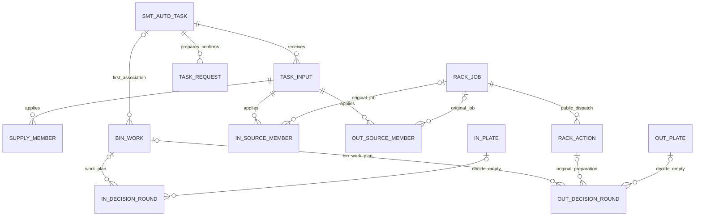

# smt_auto 数据模型设计

**当前工作区状态（2026-11-05）**　见[SMT AUTO 实施与验收](../../testing/smt-auto.md)。入库、出库正常流、共同原释放/完成确认及实际宿主已接入隔离装配，代码迁移 head 为 `smtautosources`。出库空取和 NG 已接入隔离验证，ECS/WMS 联调及实机验收归后续交付。下文任务记录中的状态与测试数字保留当时范围。

历史实现快照（Task 12 后、后续迁移前）：2026-11-05，develop 基线 `98008ff`；原 AUTO S1 foundation 的7表及 `smtautofoundation` 是历史基线。本工作区 ORM 已有11张AUTO表及原成员/输入/首目标的 typed job/action 引用；增量迁移链为 `smtautofoundation` → `smtautorackfacts` → `smtautofirstplan` → `smtautosourcearrival` → `smtautofirstdeadline` → 唯一代码 head `smtautobarcode`；Task 10/11增补原首问/终局、原到位时间和期限typed字段，保留既有表/身份/数据，有证据时拒绝有损降级。迁移未应用，既有部署未改变；手工宿主5表、BIN_Roller 4表、RackDispatch 2表保持。**S1/S2整体未完成，AUTO未正式注册/装配或现场验收**；PR #49 表数及 `sharedrackdispatch` 仅为历史快照。

Task 8历史有界进展（2026-11-05，未提交）：在Task 7公共三类AUTO来源/固定模板基础上，真实持久化 `AutoRackPorts` 已提供原任务/工作线十一类集合的 FactRef/Coverage、PointDemand/DirectHandoff、原 DeviceBinding 快照与当前绑定/代际/启用归属核对，以及初始 ENTER 和原最终 BIN/RackSlot 目标 ROTATE 门禁。WORK_PLAN只认对应真实 operation、原subject/request及完整 HTTP 200/DECIDED/READY；最终决定按原盘主体分别核对 `outbound.bin.material.decide@v1` / `outbound.rackslot.material.decide@v1` 的原请求、完整最终 ACCEPT 和目标。RackSlot来源还须原准备动作 APPLIED/SUCCEEDED，原目标/实际/当前point与face精确一致；原pending/applied动作重放复用原身份且不新增意图，原引用/动作/outbox同事务回滚；旧PUT、报警、未知物理责任及非空 `physical_closure_basis` JSON不能据此授予CLEAR。聚焦组合验证 **339 passed / 118 skipped**，独立有界复审无未解决Important/Critical；该测试结果来自实施报告，非本次文档同步重跑。生产Alembic RackJob来源CHECK仍只允许原四来源，保留扩充归S6；不得据此创建真实AUTO job。具体AUTO ECS合同/公开严格物理Result读者、方向完整writer、NEXT/RETRY/取尽运行写入、完整锁集/40001事务装配、资源现场准入及catalog激活仍未实施；PostgreSQL/SSI、全仓库、浏览器及现场未验证。

Task 9历史有界进展（2026-11-05，未提交）：真实 AUTO `RollerPorts` 已提供当前/后继任务、原计划顺序供给面及 SCAN2 原到箱关联；当前 PREPARING/EXECUTING 保留原任务身份，有效性核对恰好一条原PREPARE关联、精确 `sorting.task.prepare@v1` operation及原已消费 PREPARE_ACCEPTED、启用及宿主/编码，revision 0不被排除。错误operation或多条PREPARE关联保留原无效任务，后继为 `CHECKING`，SCAN2冻结原方向并保持 `CONTEXT_NOT_READY`/nonpending。SCAN2冻结原arrival/line/device/bin/scanned_at/task/方向，重放先返原关联，不随取消或配置变化改绑。宿主注入实际 `BinRoller` 时，规范已应用计划及实际供给成员撤回以原输入change_id、精确版本成员引用，在同一调用方事务交付公共 `apply_supply_change`；重复、别名确认及已撤回不重复交付。未注入时没有供给交付，也不证明以后自动补送。聚焦适配器 **15 passed**，AUTO/BIN_Roller/RackDispatch/迁移有界组合 **668 passed / 384 skipped**；证据来自Task 9实施报告，独立有界复审PASS，本次文档同步未重跑。SQLite证据不证明PostgreSQL锁/SSI；未完成全S2验收。S5仍须权威原在制查询、无任务旁路门禁、原释放决定/命令/结果消费、方向首次WMS work_plan及原完成确认恢复；`NO_TASK`/pending只保留关联，不授权旁路或证明释放，历史COMPLETION请求仍保守保持 `CONFIRMATION_PENDING`，`CONTEXT_NOT_READY`不自动激活。S6实际组件注入、唯一正式runtime装配/catalog激活及完整receiver路径仍未实施；11张AUTO表及代码head不变，迁移未应用，无真实WMS/ECS、部署或现场验收。 以下Task 10/11状态取代本段当时的S5待实现/代码head及事务缺口描述；历史测试数字不变。

Task 12当前有界进展（2026-11-05，未提交）：正常 inbound I2 已贯通原 READY/NEXT 授权→原架侧取盘→实际原 SUCCESS/1/PUT_FINISHED 及完整 barcode/scanned_at→`putaway.material.decide@v1`→当前 ACCEPT 的原 BIN 侧放盘→实际原成功 Result→`putaway.material.movement_report@v1`→严格原公开报告收妥→TaskFlow 原 BIN 释放及实际 roller MOVE_FORWARD Result。无效 NEXT 不阻合法当前 PUT/报告，也不能伪装无后继或闭箱；有效 NEXT 创建独立下一盘。非空物理/报告闭合须实际注入可选 normal-inbound 证明读者，重读原公开命令及报告身份/状态/数据；裸 JSON、时间戳或 ACK 不足，未注入仍保守阻塞。正常正例保留独立活跃来源责任，task 仍为 EXECUTING，不证明来源离场或整单完成。

原来源取尽修正已按原已消费 MATERIAL_DECIDE 的公开严格 ACCEPT/source_rack_exhausted、原盘/任务/请求/目标及原 RackDispatch job/action/到位资源证明派生，立即排除后续 work_plan/material_decide 的 source_racks、新取盘准入及迟到原 READY 消费；重启/重放仍保留原身份，回滚不遗留消费事实，同码新 job 不继承旧到位取尽。当前已合法授权的 PUT/报告继续；取尽后的 PointDemand NONE 不等于 DirectHandoff CLEAR，不制造撤回、离场或释放证明。原始空目标占用 0/0、完整 Unicode 条码最多1000 code point 保持；新增双向 barcode 扩容迁移 `smtautobarcode` 接 `smtautofirstdeadline`，降级先核对两表并拒绝有损收窄，仍11表、迁移未应用。

`BIN_ARM`/`RACK_ARM` 为内部逻辑角色，正常两段共用严格命令声明；每线原身份/版本、来源工位映射及两臂 timeout 必须 typed 注入，不取示例30000默认值。1..2**63-1仅协议数值边界，不代表供应商/现场 timeout 签认；S6必须提供真实配置适配及正式组件/catalog/runtime装配。Task 12修正受影响快照 **224 passed**，最后补原资源/点位/工作线核对后的 inbound 独立快照 **26 passed**，数字不可相加或当最终组合；修正后最终组合门槛 **1297 passed / 650 skipped（102.53s）**，精确命令见Task 12实施报告；这是受影响组合证据，不代表全仓库或PostgreSQL验证，本次文档同步未重跑。原独立复审的重要取尽问题及修正见实施报告，尚不据此声称全 I2/S2 验收通过。NG、空取/重试、outbound实际执行、material WAIT重求值、迟到结果更正、来源交出/整单闭合、撤回never-started、生产RackJob来源CHECK扩充（仍原四类）、PostgreSQL迁移/锁/SSI及现场验收仍明确开放；无正式激活、真实发送、部署或现场完成。

Task 10/11历史有界进展（2026-11-05，未提交）：`WorkPlans` 已实现三方向首问（inbound BIN、outbound BIN、outbound RETURN）及严格 READY/WAIT/NO_WORK 原请求/公开结果消费。RETURN 的 `arrived_at_ms` 仅在原 ENTER/ROTATE 首次可靠 APPLIED/SUCCEEDED 且原任务、成员、绑定、point/face 核对通过时同事务写一次；迟到首问/恢复/WAIT沿用原时间，历史缺失不得用后来时间补造。WorkPlans/AutoRackPorts共用 WorkLine → Devices → RackJobs → 固定顺序AUTO主体 → RackActions 锁序；锁集漂移整事务重试。

Task 11 的共同 `TaskFlow` 已提供原线/BIN在制查询与原任务责任保持、无任务/矛盾到位暂缓、同事务原释放决定及实际 BinRoller `release_scan2` 命令引用；只认公开原命令严格 SUCCESS/SUCCEEDED 且无hold/reconciliation的释放结果。完成确认复用严格 CompletionConfirm/CompletionDecision，保留原请求身份、版本及恢复责任，COMPLETED重查当前依据，STALE须严格超过原请求版本；有效非终局按原到期/新依据恢复原held首问，CONTEXT_NOT_READY/ORIGINAL_INPROCESS不自动放行。可选首计划等待默认None，原prepare首次可靠接纳时冻结显式配置及期限（含时间0），重启/改配置不刷新。独立入口首SQL前SERIALIZABLE，RackLockSetChanged/40001含commit最多三次新会话整事务重试；不改变receiver的RR合同。两方向已通过原WAIT完整链→到期续问→NO_WORK→实际原释放SUCCESS→CONFIRMING→COMPLETED的隔离公开入口回归，核对每轮原关联、连续编号、前序链接、scan上下文、严格公开结果及原retry/due依据；孤儿、未决及损坏历史仍阻完成。

Task 10/11独立有界复审均PASS，最终受影响组合 **928 passed / 388 skipped** 包含到位时间、锁序、STALE/物理标记及WAIT链修正；这是实施报告证据，本次文档同步未重跑，也不代表全仓库验证。当时真实方向正常生产ECS/报告writer、非空物理责任闭合及撤回成员严格never-started证明仍缺失并保守阻塞（正常 inbound 局部能力以下述Task 12状态为准），不以JSON/ACK/空进度替代。S1/S2/S5整体验收仍未完成；S6正式catalog/runtime、组件/资源政策与生产RR装配、PostgreSQL锁/SSI及生产RackJob来源CHECK扩充仍为前置门槛（现仍仅原四来源）。无真实WMS/ECS请求、迁移应用、部署或现场验收。

当前共享边界：复用工作线 `positions[].capacity` 的共享、按本任务/点位准入：额度只约束当前任务在该点的申请，不预准备未来任务，不另设AUTO额度。容量不证明物理到位、交接或任务完成；roller原CTU01/公共job释放责任仍由组件维护。新工作须核对 WorkLine 的原业务、启用状态及编码/归属；停用、删除或改绑不能清除原结果、必报、已开始动作与原身份恢复责任，也不能授权新生产。KT16/KT18 的 `smt_manual` 配置不构成AUTO验收；AUTO只用隔离fixture及KT11/KT14目标配置，本轮不操作现场。

共享 `PrepareAccepted` 只在原请求公开结果 `FOUND/VALID` 且 HTTP `202/PREPARE_ACCEPTED` 时按其解析器消费，`data` 不要求 `result`、版本或重试字段，额外data字段按该模型忽略；这不放宽 `CompletionDecision` 的严格分支或其他协议。早到计划须WMS重试原消息，在原prepare可靠保存后重新核验；不得prepare一到便自动应用。AUTO宿主已有调用方事务内的持久队列领取、唯一原prepare登记/公开原结果消费及TaskHost原计划重验入口；Task 6已通过测试专用catalog/runtime、真实共享WMS receiver及公开WmsRequests/Outbox结果口验证早到503原收据/BLOCKED、原prepare接纳不自动应用、原重试202/重复200空data、两方向成员/版本/输入/收据原子回滚及原归属恢复。新增仅供当前S1 prepare领取/原结果消费的AutoS1Transactions独立入口，首SQL前SERIALIZABLE，40001含commit最多三次新会话整事务重试；耗尽保留已提交原身份/pending，不改receiver的RR合同。聚焦验证221 passed / 82 skipped；本次未配置TEST_DATABASE_URL，PostgreSQL用例跳过。设备/位置/方向完整资源声明与准入、正式catalog/runtime激活及PostgreSQL锁/SSI并发证据仍开放；SQLite及注入40001不证明真实SSI冲突或物理完成。

## 1. 目标、边界与取舍

一个smt_auto宿主、冻结inbound/outbound两方向，一份任务/队列/推进。授权、机械臂生产、报告、任务完成和inbound保留归宿主；架进场/换面/离场作业及动作归公共RackDispatch。API以[smt_auto API](../../integrations/smt-auto-api.md)为准，实施见[总计划](../plans/2026-10-31-smt-auto-implementation.md)。

设备/现场点位/地址采用2026-11-03用户确认的[KT11/KT14配置](../../integrations/smt-auto-api.md#auto-config)。原现场PointRef及OUTxx/CNVxx用于WMS/RCS；机械臂命令按[独立ECS位置映射](../../integrations/smt-auto-api.md#auto-ecs-locations)冻结内部位置常量（左A转运/单层、右B退料/单层）。不得用STATION_A/B替代原现场点位，也不把OUTxx直接送作ECS location_id；本次不新增位置实体、配置列或迁移，不改历史冻结命令。

采用关系列约束身份/关联、冻结JSON保留业务输入/决定。原14表草案中的两张方向rack_visit及smt_auto_rack_action取消实施，当前目标为**11张AUTO表**：根5张（task、task_input、task_request、supply_member、bin_work），每方向3张（source_member、plate、decision_round），另直接复用公共RackJob/RackAction。生产取尽/撤回事实留在原input/round/member，不另建私有架周期或影子位置表。

| 布局 | 结论 |
| --- | --- |
| 任务大JSON内嵌所有盘/WAIT/动作 | 缺少并发关系约束，不采用 |
| 各宿主再建架visit/action及离场发送链 | 与#49重复，不采用 |
| 11张宿主表保留业务真相，引用公共job/action | 采用；不抽取跨宿主任务/逐盘状态机，不复制Outbox/Transport |

### 1.1 已实现与AUTO接入缺口

当前ORM表数为手工5、BIN_Roller4、RackDispatch2及AUTO 11；Task 8以新增4张方向plate/decision_round表和typed原引用保留历史7表foundation，代码唯一head为smtautofirstdeadline。迁移未应用，不证明部署schema或生产可用。

**生产迁移的RackJob.source_kind CHECK仍只允许MANUAL_RETURN、MANUAL_TRANSFER、ROLLER_ORDINARY、ROLLER_DRAIN；Task 7仅扩充公共服务及隔离ORM的三类AUTO固定来源/模板。AUTO生产架不能仅改owner直接接入。** 完整S2/S6还须交付方向事实、当前授权/资源门禁及保留数据迁移；不能伪装MANUAL_/ROLLER_，不能放开任意来源或模板。

PointDemand/DirectHandoff是现有类型，但其内容须由AUTO在原事务从本宿主真实记录生成；类型合法不证明覆盖完整。手工私有repository/表/完工通知只供参考，不继承。公共能力的5490/47等既有验收范围见[#49最终验收](../plans/2026-11-03-shared-rack-dispatch-implementation.md#最终验收2026-11-03)，不证明AUTO适配已完成。本轮不重跑产品测试。

## 2. 类型、身份与关联约定

| 约定 | 设计 |
| --- | --- |
| 本地主键 | 除任务外采用现有 `uuid7` 字符串；任务以 WMS 原 `task_id` 字符串为主键，不另造对外任务号 |
| 外部标识 | 字符串按原合同保存，不按前缀推断类型，不扩充 API 字段，不自设比合同更窄的长度限制 |
| 版本、顺序、业务时间 | int64；版本/顺序范围沿 API，业务时间是 UTC 毫秒；`created_at` 等数据库审计时间用带时区时间类型 |
| JSON | 使用仓库已有 SQLAlchemy `JSON` 方式；可空 JSON 使用 SQL NULL 语义。只查询身份、状态和期限关系列，不把生产扫描建立在 JSON 路径索引上 |
| 不可变快照 | 原信封已定义内容、契约版本/有效内容摘要、原 timestamp、原授权/参数、原请求 data、公开已应用结果的必要业务字段。未知字段处理沿已冻结 @v1；不按未来模型重算历史摘要 |
| FK 范围 | 宿主内部外键用于同任务关联；不向可清理的平台收据、消息、结果、组件经过及可删除配置行建立级联外键。外部 ID 连同恢复所需快照保存，公开读口核对原引用 |
| 同任务/同方向 | 子表保留 `task_id`，复合外键核对 `(parent_id, task_id)`；被引用父表显式提供 `UNIQUE(id,task_id)`，原计划输入另提供可引用唯一键 `(id,task_id,applied_plan_revision)`。任务提供 `(task_id,business_type)` 唯一键，方向子表用固定方向检查及复合 FK 防止串支；跨表用途/同主体约束仍由原事务校验 |
| 删除 | 宿主 FK 默认限制删除；inbound 明细清理由业务事务按依赖顺序显式执行，不用从任务/工作线删除触发全库 CASCADE |
| 扫描字段 | 待推进聚合使用 `pending`、可空 `next_check_at_ms`，只表达业务扫描候选；没有期限的原结果等待也必须能被公平轮扫，不新增 WAIT 调度器 |

下文列出业务必要字段；各表另有 `created_at`。`?` 表示允许 NULL，未标记的字段必填。结果快照必须能支持原合同判断、保留数量严格类型及原厂错误依据，不用字符串化数量或仅存布尔 `success`。首次可靠记录时间、外部发生时间、业务关闭时间分别保存。

图仅展示主要关系；RackJob/RackAction属于公共组件而非AUTO迁移，决定轮次的主体严格选择一个。图中的可空父关系不表示允许两边同时为空。

## 3. 共同任务与原输入

### 3.1 `smt_auto_task`：唯一任务与保留摘要

| 字段组 | 必要字段及语义 |
| --- | --- |
| 原归属 | `task_id`；`task_type=AUTO`；`business_type=inbound/outbound`；`work_line_id`、`workline_code`；`issued_timestamp`。首次受理后冻结，业务码固定为宿主 `smt_auto` |
| 队列 | `status=QUEUED/PREPARING/EXECUTING/COMPLETED/CANCELLED`；`queue_revision`；`dispatch_sequence`；`not_before_ms?`；`plan_revision` 初始 0，始终为最高连续已应用版本 |
| 准备 | `prepare_accepted_at_ms?` 为原响应首次可靠保存时间；`first_plan_deadline_ms?` 只按当时显式配置登记一次，不随重启或配置变化刷新 |
| 确认 | `confirmation_next_check_at_ms?`；`confirmation_basis?` 保存上次已消费决定/原请求版本及相关新事实依据，不用最后一次响应覆盖未消费原请求 |
| 独立架恢复 | `rack_retention_basis?`只在inbound清理后仍需向原公共job提供事实时保留固定最小业务证明，见§8；不保存另一份调度状态 |
| 关闭/保留 | `closed_at_ms?`、`direct_obligations_closed_at_ms?`、`details_cleaned_at_ms?`；`details_cleaned`；`pending`、`next_check_at_ms?` |

约束和索引：

- PK `task_id`；`task_type=AUTO`、方向/状态检查；`queue_revision>=1`、`plan_revision>=0`、正排序值及非负可选时间按 API 检查。
- 部分唯一索引 `UNIQUE(work_line_id) WHERE status IN ('PREPARING','EXECUTING')`，两个方向共用执行位。队列索引以 `(work_line_id, dispatch_sequence, issued_timestamp, task_id)` 覆盖 QUEUED，领取仍过滤 `not_before` 及启动条件；不让未到期优先项阻塞其他已具资格项。
- `details_cleaned=true` 只允许 inbound 终态且两项关闭时间存在、清理时间存在。关闭不等于可以清理或 `pending=false`；公共独立义务不能被任务状态隐藏。
- 清理后仍保留同一任务行作为最小摘要：原 `TaskOwnerRef`、终态、关闭/直接收口/清理时间及标记；队列/确认等非摘要细节届时置空。相关列因此允许“未清理时必填、已清理时空”的条件约束，不另造 tombstone 表。上表队列初值及范围约束均适用于未清理行。

工作线配置删除/改绑不改变原工作线标识，也不删除此行。清理后四类共享通知仍能解析原 owner，inbound guard 按固定清理时间回复；不把该政策扩到 outbound。

### 3.2 `smt_auto_task_input`：原通知、阻碍及唯一应用

| 字段组 | 必要字段及语义 |
| --- | --- |
| 原身份 | `id`、`task_id`、`operation`、`operation_id`、`request_timestamp`、`first_received_at_ms`、`effective_digest`、`contract_version`、`effective_request` JSON |
| 判定 | `disposition=BLOCKED/REJECTED/APPLIED/DUPLICATE`；`block_reason?` 只取原已记录原因；`business_outcome`、`outcome_recorded_at_ms`，保留稳定业务响应依据，不替代平台收据 |
| 版本归属 | `requested_revision?`；`applied_plan_revision?`；`applied_queue_revision?`；`canonical_input_id?` 指向同任务原成功应用输入 |
| 组件交接 | `supply_change_id?`、`supply_change?` 保存本次真实已应用增加/撤回的原 `SupplyChange`；无变化则空 |

该表承接四类 sorting.task 回调的宿主业务记录，inbound `putaway.source.rack_exhausted` 也沿原操作保存业务依据；没有可解析任务的拒绝只由平台原收据负责，不伪造任务行。实际SourceExhausted DTO/错误仍沿API；原取尽通知内部保存rack_job_id/preparation_action_id及原到位匹配依据，不给wire新增字段。

约束：`UNIQUE(operation,operation_id)`；两个部分唯一索引分别约束非空 `(task_id,applied_plan_revision)` 和 `(task_id,applied_queue_revision)`。只有实际应用输入占用版本，早到/缺版/停用不占；别名重复的两个 applied 字段为空，`canonical_input_id` 指向唯一原应用行。原应用行不指自己，也不指别名，别名不保存另一份应用成员/计划正文。每条输入本身的冻结有效请求仍保留用于原身份冲突判断。

同版新身份的 DUPLICATE 只用于当前最高计划版且完整已定义 data 相同；不扩展到 queue_changed 或任意历史计划版。成员外键直接指原应用输入，无独立重复的计划正文表。应用状态、版本字段、成员及 SupplyChange 必须同事务；`block_reason` 是原因事实，重验资格按完整现状重查，不另存 `can_retry`。

### 3.3 `smt_auto_task_request`：原 prepare/完成确认

| 字段组 | 必要字段及语义 |
| --- | --- |
| 原请求 | `id`、`task_id`、`purpose=PREPARE/COMPLETION`、`operation`、`operation_id`、`message_id`、`requested_plan_revision?`、`request_data` |
| 消费 | `response_snapshot?`、`response_recorded_at_ms?`、`consumed_at_ms?`；`unresolved`；完成结果及 `retry_after_ms?`、`next_eligible_at_ms?` |

`UNIQUE(operation,operation_id)`、非空 `message_id` 唯一；PREPARE 对 task 部分唯一；COMPLETION 对 `unresolved=true` 的 task 部分唯一。登记意图时即取得原消息引用，同事务失败则整笔回滚，不留下可再次换身份发送的半行。

`unresolved` 直到原响应按公开读口 FOUND/VALID、精确 HTTP/code/联合及本地资格复核后才结束；未知或与新增计划/义务矛盾的 COMPLETED 不变成已消费成功。已消费 BUSINESS_IN_PROGRESS/STALE 的历史行保留，新请求另建行；新事实/到期触发下一确认，不复用逐盘 WAIT 的严格计时语义。无并行第二确认，也不以更新原行身份绕过冲突。

## 4. 公共供箱成员和 BIN 作业

### 4.1 `smt_auto_supply_member`

字段：`id`、`task_id`、`plan_input_id`、`plan_revision`、`rack_id`、`rack_face`、`rack_array_index`、`face_array_index`；`withdrawn_by_input_id?`、`withdrawn_at_ms?`；`supply_change_id`。

`UNIQUE(task_id,plan_revision,rack_id,rack_face)`；复合 FK 保证原应用计划属于同任务且版本一致，原输入确为 PLAN_DELTA 的业务校验同事务完成。原数组/面顺序分别保存，不造跨来源统一顺序。同架同面在下一版可再成为不同成员；撤回精确定位版本，不能撤掉后来成员。

供箱 Feed/清单/CTU/回流/架离场状态完全由 BIN_Roller 记录。宿主沿原 `SourceFaceRef` 和 `SupplyChange` 调用公开接口，必要进度按该引用读取；不在此表复制 `feed_complete` 作为独立真相。

### 4.2 `smt_auto_bin_work`

| 字段组 | 必要字段及语义 |
| --- | --- |
| 原经过 | `id`、`work_line_id`、组件原 `arrival_id`、`device_code`、`raw_bin_code`、`bin_code?`、`scanned_at` |
| 冻结关联 | `task_id?`、`business_type?`、`association=TASK/NO_TASK/EXCEPTION`；关联一旦形成不改绑，方向为空当且仅当无原任务；异常另存 `exception_basis?` |
| 暂缓 | `production_hold_reason?` 保存确认未决等阻碍，不将“已关联”当成“允许首盘” |
| 终局与释放 | `terminal_basis?`、`terminal_at_ms?`；`release_decided_at_ms?`、`release_command_code?`；`release_result_ref?`、`release_result_snapshot?`、`release_consumed_at_ms?`；`pending`、`next_check_at_ms?` |

`UNIQUE(work_line_id,arrival_id)`，不对箱码或“未收口”做唯一约束。`task_id/business_type` 一起为空或一起存在；存在时复合 FK 指原任务方向，另核对原工作线。可读无有效任务且无在制上下文的旁路释放由同一组件接口登记，不创建虚拟任务/盘；不可读/请求字段不合约只保存异常，不新增自动放行策略。

终局依据只能是原有效 work_plan.NO_WORK 或正常 ACCEPT 明确无后继的引用/快照；终局和释放资格分开。释放引用只保存组件 `release_scan2` 原返回及公开已应用结果，不另建放行命令。重复委托先按原 arrival 找此行；同箱真实新 arrival 新建行。

BIN 生产不强制关联供箱成员/Feed/历史架面；outbound 原 BIN 的 decide/report 不携供箱架归属。任务完成读自己的供箱进度和本表原生产/释放，两组事实不能相互替代。

## 5. 来源成员与公共货架调度

### 5.1 方向成员

| 表 | 必要字段及约束 |
| --- | --- |
| smt_auto_inbound_source_member | id/task_id、固定inbound、plan_input_id/plan_revision、rack_id、rack_array_index、rack_job_id?、preparation_action_id?、withdrawn_by_input_id?/withdrawn_at_ms?；UNIQUE(task_id,plan_revision,rack_id)，不设NULL面组合键 |
| smt_auto_outbound_source_member | id/task_id、固定outbound、plan_input_id/plan_revision、rack_id/rack_face、原数组索引、rack_job_id?、preparation_action_id?、first_work_plan_round_id?、撤回引用/时间、terminal_basis?/terminal_at_ms?/direct_obligations_closed_at_ms?；UNIQUE(task_id,rack_id,rack_face) |

宿主内部FK仍核对同任务/原应用版。公共引用通过progress核对owner、原task/workline、point/rack/source_kind及原ENTER/ROTATE动作，不直接查询公共ORM。成员未选中引用可空，绑定后不能迁往新job。单层同次服务仅在公共job ACTIVE、未登记原离场链且未取尽时承接新成员。release_requested是暂定标记：离场根尚未登记时，求值必须包括仍可由本job服务的未绑定新有效成员；完整CONTINUE由公共advance清除此标记后再关联，不直接改公共状态。进入RELEASING/原离场根已登记后新增成员留未选中，新的有效业务出处才可注册独立job，不因原作业NOT_ARRIVED/COMPLETED自动重搬。

RETURN面首次work_plan意图及first_work_plan_round_id同事务登记即为STARTED；此前可撤回，之后保留原面义务，全部跳过仍成功。架ENTER在途不等于面生产开始，取消未开始面仍保留原搬运/位置责任。五层供箱沿组件自身规则，不套此门槛。面NO_WORK/正常无后继与SLOT关闭、成员撤回分别保存。

### 5.2 公共job/action引用与宿主事实

不创建两张方向rack_visit表。原“同次在位”以原rack_job_id及其实际preparation_action_id表达，前者不能只按架号查询最新值；引用在原prepare事务返回后即保存，不等待到位才落关联；动作尚在途不授予生产资格。实际生产前还须该准备动作是公共当前position_action_id、严格已应用成功且精确工作位/面，无后续已登记的未闭搬运/换面/离场、位置未知或阻断核对，不能借历史成功动作复用旧架面。公共job已COMPLETED或正在RELEASING不允许新取放，离场接纳也不是新架到位。

inbound正常/empty决定或rack_exhausted输入保留原source_rack_job_id/source_preparation_action_id；同job任一有效肯定取尽只关闭该原来源，不能影响后来同码job。全撤回按原成员非空完整集合及原输入证明，不写exhausted=true。PointDemand的NONE/CONTINUE/UNKNOWN与DirectHandoff的CLEAR/BLOCKED/UNKNOWN由这些事实计算，接口细则见§5.3。

初始outbound target_rack仍冻结在原首版input，内部绑定target_job_id/target_preparation_action_id；后续ROTATE/REPLACE来自本盘最终决定，盘另保存自己的原目标job/action，不覆盖首版或前盘。新job的source_ref来自原成员/首版input/最终目标变更授权等稳定出处，cycle_id用本地原job身份；未知不换出处/身份重试。

### 5.3 公共服务接缝及DEPART完成

| 门面 | 本地调用与责任 |
| --- | --- |
| register(session, JobOrigin) -> str | 原owner/line/task、source_kind/source_ref、rack/point/initial_face、caller/cycle/resources冻结；消费返回的原job ID，不自行拼接公共表主键 |
| prepare(session, *, job_id, kind, source_ref, face) | 仅ENTER/ROTATE；新动作会同事务绑定Transport及其提交意图，调用前宿主须完成当前原授权/资源/交接核对。返回ID不证明可靠接纳或实际到位；原关联与意图同提交 |
| advance(session, *, job_id, demand, handoff, now_ms, authorized_original_id=None) | 同一宿主事务提供原点位事实；仅恢复已有且有原证据的LOCAL_ONLY动作时核对当前原授权并传确切action ID。正常新prepare已绑定Transport，不把此参数当成第二阶段发送许可；已有绑定动作只恢复原引用 |
| progress/final_result/jobs/pending_ids/pending_upper_id | 原owner/source_kind过滤的只读投影与分页；pending=false不代表报告收妥或实物已离位 |
| lock_jobs/lock_actions/note_facts_changed | 沿§7统一锁序；输入/授权/物理消费影响需求/交接时同事务通知相关原jobs，不能只发after_commit而漏事实版本 |

DEPARTURE_DECIDE的唯一根/WAIT后继、READY及唯一DEPART由公共模型约束，AUTO不再建一套。当前非MANUAL来源WAIT只按固定到期续问；MANUAL原位置/任务状态提前触发分支不自动授予AUTO。AUTO来源扩充须保持未知原身份恢复，不把普通唤醒或任意新事实作为绕过到期许可。

DEPART/RACK_MOVE、CTU03或F01离开原point，去向ZONE或不同RACK_POSITION：只有公共get_submission_acceptance严格匹配原owner/caller/cycle/task/client、submit operation/message/target及完整frozen，且202/RECEIVED或200/DUPLICATE时，才记录ACCEPTED/closure_reason=DEPARTURE_ACK并结束调度。裸ACK、READY、命令号、错误/缺失/未知接纳均不算。最终落地或FAILED仅由原Transport备查，不能回退该完成、不阻后继、不自动重搬；不把这一规则套到ENTER/ROTATE、机械臂或SCAN2_RELEASE。

公共job无动作且NONE/CLEAR可WITHDRAWN；原ENTER失败/取消已经可靠终结、终位在非受管外部位置且无冲突时可NOT_ARRIVED；原点位非成功但安全事实完备时，仅明确NONE/CLEAR才可开始安全离场。生产始终不从这些分支获得到位/成功资格。缺事实/覆盖空缺为UNKNOWN，不能强行送NONE。具体保护沿公共advance，不复制旧手工补偿代码。

### 5.4 准备、交接与异常续问的事实边界

register返回原job ID不证明重入参数一致：按稳定出处读取原progress核对task/line/source_kind/source_ref/rack/point/face/caller及冻结resources，使用原canonical job/cycle身份；冲突留原事实，不借新的cycle_id或当前配置覆盖原job。prepare对重复source_ref或未决同类动作可能返回已有动作，宿主必须核对其原source_ref/用途、kind/face及Transport，不能仅凭非空ID当成新来源/新目标授权已执行。同次仍可承接服务的成员/盘可增加对原准备动作的引用，但不改写原动作source_ref。

**prepare新动作立即登记Transport意图。** 进入前须按§7锁序在同一事务检查有效计划/本盘最终目标授权、公共当前动作/位置、当前新作业资源门禁及下表交接条件，再调用并保存原job/action引用；不能先prepare提交、下一轮才检查授权。LOCAL_ONLY是既有原动作的恢复证明，不由AUTO正常新流程制造，也不通过写公共ORM伪造。纯register无动作的job不能作为物理到位；公共WITHDRAWN/NOT_ARRIVED也不能满足来源成员或目标准备的生产条件。

| 原事实/阶段 | PointDemand与搬运许可 |
| --- | --- |
| 有效成员/首版目标或本盘授权正在等待它所要求的ENTER/ROTATE，尚无依赖旧位/旧面的取放 | 保留CONTINUE；授权自身不是物理占位，不因“待本次准备”将DirectHandoff永久置BLOCKED。仍须原授权与无冲突、可交接证据，才可调用prepare；缺证UNKNOWN |
| 另一盘仍持有旧目标面待执行PUT、已登记命令在途、报警原命令未终结，或动作/位置待核对 | 该原job的ROTATE/DEPART受保护；不得因新盘有B面授权或本盘REPLACE而清除A盘对旧面/旧架的责任。报告已独立且不再影响原点物理执行者另算 |
| RackSlot的material.decide未知/WAIT、空取WAIT/RETRY，或NG成功待报告收妥后仍应合法复用原面work_plan | 仍可能许可原点取料，不能NONE；确定仍有服务需求时CONTINUE，关联/资格不全则UNKNOWN。纯报告可以独立，尚未消费的原面异常续问责任不能丢；本面已有取料终局时不再续问，只保留原直接责任 |
| inbound原来源已安全取离，合法新work_plan/material.decide的最新source_racks已排除全撤回架，且无其他原授权/潜在求值可再取该架 | 可按完整撤回依据求NONE/CLEAR，目标放盘/正常报告独立继续；此前已冻结且仍含该架的未知请求不得被新集合覆盖，晚到READY/NEXT/RETRY仍归原义务并重新核对，未明确收口前不退架 |
| 本盘REPLACE需要不同目标架、旧job仍在离场WAIT/submit未知 | 新目标授权保留在原盘/原决定；同一point的新job/ENTER在原job严格离场接纳完成后才登记，避免把两个互相等待的公共job同时引入候选。旧架有其他直接责任则先保留，不用本盘REPLACE抹掉；新架仍须自身原成功到位 |

DirectHandoff评价的是拟议搬运会影响的原点位/面及直接执行责任，不能把“无需求”与“可交出”混成同一布尔值。报警处置中没有合法最终取盘/安全交接结果，不能凭人工移动、IDLE或全撤回声明来源已清；已可靠取离、只剩目标处恢复的盘不反向冻结无直接依赖的旧来源。各状态只是事实投影，不新增预占/报警/搬运协调表。

## 6. 两方向盘尝试与业务决定轮次

### 6.1 `smt_auto_inbound_plate` / `smt_auto_outbound_plate`

一行表示一次获准取盘尝试，**不表示库存料盘身份**。真实 RETRY 新建尝试，保留旧空取/失败及其原命令。未取到盘时条码/扫码时间可空，不能用箱码或请求时间补值。

| 字段组 | 必要字段及语义 |
| --- | --- |
| 父主体 | `id/task_id`、固定方向；inbound 必填 `bin_work_id`；outbound 为 `bin_work_id` 或 `source_member_id` 严格二选一，RackSlot另存原 `source_rack_job_id/source_preparation_action_id`；两方向盘均保存取料来源/目标涉及的原job/action引用，BIN来源不补历史供箱架引用 |
| 唯一授权出处 | `grant_kind=READY/NEXT/RETRY`；`grant_round_id?`、`grant_parent_plate_id?`。READY/RETRY 来自本方向已消费原最终决定轮次，NEXT 来自父盘唯一最终后继，二选一。两种引用分别非空唯一 |
| 原授权 | `grant_snapshot`、`source_locator`、`source_params`、`source_arrival_snapshot`；原来源选择、参数及来源过程不可变，不从当前架/当前任务/slot_id 反推 |
| 原取盘 | `pick_call_key`、`pick_command_code?`、`pick_result_ref?`、`pick_result_snapshot?`、`pick_consumed_at_ms?`；`barcode?`、`scanned_at_ms?`；`empty_observation?` 保存权威载体/原 finish_time |
| 最终决定 | `final_decision_round_id?`、`target_snapshot?`、`next_source_action?`。一个盘只接受一份有效最终决定，WAIT 不填最终字段；REJECT/NG 与正常 ACCEPT 严格分支 |
| 原放盘/NG | `put_call_key?`、`put_command_code?`、`put_result_ref?`、`put_result_snapshot?`、`put_consumed_at_ms?`；正常和 NG 互斥，原明确成功使用原 finish_time |
| 必报 | `report_operation_id?`、`report_message_id?`、`report_data?`、`report_response?`、`report_consumed_at_ms?`；无需报告的分支不建“待成功报告” |
| 直接义务 | `source_closed_basis?`、`physical_closure_basis?`、`direct_obligations_closed_at_ms?`、`pending`、`next_check_at_ms?` |

约束及方向差异：

- `grant_kind` 与引用 XOR 检查、复合 FK 核对同方向/同任务；父盘 NEXT 对父引用唯一，原 READY/RETRY 对轮次引用唯一。循环 FK（盘最终轮次、轮次盘主体）以先建盘后补最终引用的同事务写法处理，不要求可延迟约束；授权轮次与后续盘必须属于同一 BIN/原面主体，由事务内校验补足跨表语义。
- `pick_call_key` 唯一，非空 `put_call_key`/命令号/报告 operation_id 分别唯一；稳定 call_key 带方向、原授权出处和动作类型，不用 WAIT 新 operation_id 当授权出处。失效后仍保留唯一消费事实，不能删除后重授。
- 不对 `barcode`、`(task,source,barcode)` 或源槽设置永久唯一键；同源同码的未闭合授权由 WMS 裁决。一份报告未收妥，不在 WES 加统一后盘屏障。
- inbound 来源快照必须关联原单层job/准备动作；source_racks 每次求值另冻结当时可靠 0～2 架及本地过程映射，本盘已取来源不随换架变化。目标参数是放盘前层数/总厚度原值；只有正常成功放盘报告，NG/FAILED 无报告。
- outbound BIN 不含历史供箱架/面；RackSlot 保存原成员版本、面、槽及原ENTER/ROTATE准备动作/arrived_at，普通 decide/report 不因此新增 plan_revision 字段。RackSlot 源层/列/厚度/直径来自该次完整授权；正常和 NG 明确成功且位置确定均必报，NG 收妥才可进入它的异常续问。
- 原 FAILED、UNKNOWN/HELD、WMS REJECT、业务来源关闭分别保存，不压成一个 `DONE`。`physical_closure_basis` 可空表示仍无合同规定的收口证据；有 FAILED 结果不自动填入此列，不改写其为 SUCCESS。

`pick_consumed_at/put_consumed_at`只关闭对应原动作的消费责任；`physical_closure_basis`是本盘物理链依据，必须引用该盘所有应执行取盘/扫码/正常放盘或NG的原命令及已应用Result身份/版本、严格数量/阶段/实际去向和已结清核对义务。只成功取到扫码台不能将整盘置物理收口，后续放盘仍未决；合法空取按其独立原事实收口本次无料尝试，不补成功放盘。物理收口也不等于`direct_obligations_closed_at`：应报报告、决定/后继/异常等仍须按原方向全部结清，箱/面终局及原释放另判，不因一条SUCCESS或人工已处理说明越级。

取放失败的事实消费、直接物理收口及范围选择见§10.3。不得为了让任务可结束填入推定证据；命令协议终态与盘的物理责任是否闭合分别判断。

### 6.2 `smt_auto_inbound_decision_round` / `smt_auto_outbound_decision_round`

| 字段组 | 必要字段及语义 |
| --- | --- |
| 主体 | `id/task_id`、固定方向、`purpose=WORK_PLAN/MATERIAL_DECIDE/EMPTY_DECIDE`；`bin_work_id?`、`source_preparation_action_id?`、`plate_id?`，按 purpose 严格一个主体；inbound 没有来源面 work_plan |
| 阶段/轮次 | `stage_key`、`round_no` 从 1 开始；`previous_round_id?`；`trigger_plate_id?` 为异常续问原 NG/空取触发；初始阶段与异常阶段不同 |
| 原求值 | `operation`、`operation_id`、`message_id`、`request_data`；inbound `source_rack_bindings?` 额外保留 wire source_racks 对应本地原job/action，不对外发送本地 ID |
| 原决定 | `response_snapshot?`、`response_recorded_at_ms?`、`consumed_at_ms?`、`unresolved`；`wait_recorded_at_ms?`、`retry_after_ms?`、`next_eligible_at_ms?` |

`UNIQUE(operation,operation_id)`、`message_id` 唯一；`UNIQUE(task_id,stage_key,round_no)`；非空 `previous_round_id` 唯一；对 `unresolved=true` 的 `(task_id,stage_key)` 部分唯一。前驱 FK 核对同任务/阶段、轮次递增，阶段锁内还需核对前驱为 WAIT 且到期；非 WAIT 最终决定不能追加另一轮。阶段主体必须属于原任务工作线，成员/服务动作必须属于该原来源面。

`stage_key` 由本地主体与确定触发事实构成：首问为原 BIN arrival 或原 RackSlot 服务动作；异常为原盘的最终 NG/empty 阶段；material.decide/empty_decide 为原盘及其本次观察。它是本地幂等键，不新增 WMS 恢复字段、事件流或通用 stage 表。异常触发在这一阶段只消费一次，阶段内 WAIT 不再产生另一异常阶段。

首次可靠保存有效 WAIT 的本地时间固定 `next_eligible_at = wait_recorded_at + retry_after_ms`（1～60000），原轮次终结但留下后继责任；下一轮登记后通过唯一前驱防止重复。原消息重放不重置时间；结果消费/新轮次与下一意图在同一事务。阶段最终 READY/RETRY 只物化一次盘，WAIT 期间不物化盘。

两方向各自处理不可变 data：inbound work_plan/material.decide 续问只允许更新当时可靠 source_racks，原 arrival/scanned_at/条码等其余事实不变；empty_decide 保留原观察。outbound 五类求值续问 data 全部保持原值，仅外部身份/信封时间更新。保存每轮 request_data 便于证明差异，不覆写上一轮 JSON。

## 7. 真相源、事务及调度事实

宿主只拥有任务/成员/授权/机械臂与报告事实，公共RackDispatch拥有架job/action及离场完成；BIN_Roller拥有供回箱生产事实，WMS拥有库存/容量，平台拥有receipt、Outbox、Transport、ECS结果。不能直读ReliableMessage/TransportTask或组件模型替代公开读口。

所有TASK、INBOUND/OUTBOUND_RACK/BIN/PLATE及roller SCAN/FEED/RETURN_BATCH/RACK_CYCLE/DRAIN推进首SQL前SERIALIZABLE。独立INBOUND_REPORT/OUTBOUND_REPORT、SCAN2_RELEASE及不启动生产的归档按RR；候选轮扫用一个只读RR快照，各advance独立事务。40001含commit、RackLockSetChanged式锁集合变化均在新会话整笔重试最多3次，耗尽保留原事实；不重用失败快照/DTO，不以更新配置版本刷新快照。receiver不整体升隔离。

锁序固定：WorkLines按ID→Devices按ID→同owner原RackJobs按ID→宿主主体按固定表类型/PK（task/input/成员/BIN/盘/轮次/请求）→RackActions按ID。先发现需处理的本线生产及ROLLER公共jobs，再取共享锁、宿主与roller相关主体，锁后复核job集合；改变则整笔重试。不能先锁自己的盘/成员再调用公共job锁，也不能在嵌套helper重复开启事务。已完成job关联的原报告不依赖本线配置仍存在或job仍pending。

PointRef必须精确owner/workline/job/rack/point。每个PointDemand/DirectHandoff都给出非空Coverage列表；Coverage声明原集合/同点scope、真实anchor及成员FactRef的原key/version，可覆盖合法空集合但不能缺anchor/漏读集合。当前共享服务仅检查结构和点位一致，AUTO必须核对实际连续计划/未应用输入、全部成员及撤回/取尽、原来源和目标授权、待决定/WAIT/RETRY、ECS未知/核对、原SCAN2释放等集合；一次查空、缺行、旧完成或当前task切换均不证明NONE/CLEAR。纯独立目标报告不作交出门槛，但依然阻各自业务完成；尚可能复用原面取料的NG异常续问/未决决定仍属点位需求，按§5.4区分。

receiver计划/取消/原取尽及推进授权/结果/释放等改变相关点位事实时，在同事务收齐原job锁并调用note_facts_changed，消耗版本/下一意图一起提交。显式读取相关谓词集合并核对原行，不能只凭SERIALIZABLE标签或WorkLine锁宣称并发安全。跨归属/缺原输入/数量对不上等返回UNKNOWN而非补默认值；推进不反向锁共享收据。任务接受、原版本/成员、SupplyChange及下一个原意图仍原子提交。

pending是业务扫描投影：INBOUND_RACK/OUTBOUND_RACK的record_id为公共job ID，按新增AUTO source_kind与本owner分页；roller RACK_CYCLE只扫ROLLER_ORDINARY/DRAIN，record_id也是公共job ID，不能再用original_record("rack_cycle")定位。BIN/盘沿自己的原行，不按job未完成筛掉；已有movement_report意图按INBOUND_REPORT/OUTBOUND_REPORT独立分页（record_id=本方向原plate ID），无报告行但仍应产生报告的物理成功由原生产待办发现。报告候选只消费已登记报告的原公开响应，不登记work_plan/decide/Transport/ECS或消费NG异常触发；避免job完成后报告饿死。

receiver/结果通知仍outer commit后只唤醒smt_auto，5秒Beat兜底同一scan_pending；不加公共组件独立任务、第二Sender、私有离场发送链或结果反查路由。原ECS命令内恢复保持§10.3，RackDispatch的DEPART接纳不能使机械臂失败变成功。

### 7.1 报告消费与后续生产的事务交接

独立REPORT/RR只核对原报告身份/正文与RECORDED/DUPLICATE并保存report_consumed_at，不依赖当前工作线配置仍存在/启用，不取得生产执行许可。outbound NG报告收妥后，原PLATE/BIN/RACK的SERIALIZABLE推进再按完整锁序读取该持久事实，原异常触发消费、唯一续问阶段与下一work_plan意图同事务。RR报告提交不等于异常触发已消费；崩溃在两事务之间，原NG成功+报告收妥+尚无对应已消费阶段仍必须是生产候选，不能因报告pending已清或当前task改向漏掉，也不能靠通知才能恢复。若首个续问已提交但ACK未知，重启只恢复原请求，不新建阶段。

结果消费/报告登记属于原义务，不因停用、删除或改绑而跳过。特别是PUT已提交、进程在保存成功/产生报告前中断：原PLATE候选仍能读取原命令结果、保存严格成功并一次登记原movement_report，再由REPORT继续；当前配置门禁仅禁止新的取放/搬运，不能提前挡在旧结果消费/必报之前。缺原授权/合法结果继续留核对，不据配置缺失补造成功。纯报告消费不调用公共advance，不在RR顺带发起新生产；后续真正改变点位需求/交接的生产步骤按原SSI事务note_facts_changed。

## 8. 归档、公共引用和历史保留

仅inbound：任务终态且直接义务真实收口后完整保留7天；报警、未知/失败未闭物理、未决授权/决定/报告/释放继续保留，不因task终态/时间删除。清理保持原TaskOwnerRef与固定摘要/guard时间，不重建旧任务。outbound不新增此清理政策。

不删除或清理公共RackJob/RackAction、组件独立回流/排空及Transport；DEPART已严格接纳后不再以最终落地未回当调度pending。若独立公共job仍待离场且需要AUTO事实，清理原业务详情前在原task.rack_retention_basis冻结最小证明，按原job ID索引：owner/task/line/rack/point/source_kind/source_ref、原准备action、非空原成员及撤回/取尽输入身份/版本、直接责任已收口依据、原公共离场根/action引用。该固定归档证明不是可改写的第二份job状态/消息或重执行许可。

归档适配器仅在原终态/清理标记、同原job作用域和已闭合业务证明均匹配时生成原PointDemand/DirectHandoff；不读取已删明细后猜NONE/CLEAR，不移植到后来同码job。公共job/action仍由其公共门面推进，原WAIT/READY/Transport身份不重建；若无法提供完整证明则保留所需原明细、返回UNKNOWN，不伪造清理完成。允许已清理业务主体仍留这一独立恢复依据，不撤销details_cleaned或刷新时间，不等待全局物理排空。

清理在原锁序/事务中先重验直接义务，再按宿主内部FK删除闭合子图；断开同聚合可空最终引用/自引用链再删叶子，最后标记原task摘要。公共ID不级联删除，其原origin.source_ref即使指向已清业务行也保留原值及必要证明，不回填/改号。公共原结果不接archive_guard。原平台收据可按自身政策清理，宿主未闭责任必须保留足够业务依据；结果缺失不能换身份重发。

## 9. 数据模型验收与实施定位

这些是完整模型/事务验收；Task 8仅有上述有界原事实/准备与迁移测试证据，**不代表下表全部通过**。沿现有 S1～S7/I/O 任务交付，不新增平行专项计划；API 72 项、G01～G04、D1～D8 仍是原唯一业务追踪，下面 M 编号只定位持久化层遗漏。

| 编号 | 必须验证的持久化不变量 | 原实施位置 / 对应已有验收 |
| --- | --- | --- |
| M01 | 同线混合方向并发领取只有一个在办/prepare；不同线独立，重复优先级合法 | S1共同队列验收；G01 |
| M02 | 未应用输入不占版本；原重验/当前同版新身份只一份成员/SupplyChange；queue 与 plan 互不替代；回滚不留半应用 | S1；API计划重验/取消；C03 |
| M03 | 单层无 NULL 面唯一漏洞；供箱同面可跨版追加；RETURN 同任务同面不能重排；每成员引用原版本及数组顺序 | S1/I1/O1；API计划资源矩阵 |
| M04 | 方向/同任务 FK 拒绝跨任务关联；同箱新arrival可新增、重委托不改绑；prepare未知保留原task/阻碍且不误直通/自动回放，接纳后0版资格与确认暂缓分别处理 | S2/I2/O2/S6；G01、I02及§10.1资格矩阵 |
| M05 | WAIT 重放/并发/重启不刷新期限，只一轮后继；最终 READY/NEXT/RETRY 各一次盘/命令，旧空取/失败不变，源快照按方向差异冻结 | I2/I3/O2/O3/S6；I01/I05及WAIT案例 |
| M06 | 原结果与下一意图原子消费；报警/重启沿原命令，合法Result先于ACK/迟到/重复仍按阶段；取到扫码台不误记整盘物理收口，物理成功但必报未闭不误记直接收口；最终FAILED/未知不改成功，NG报告差异不变 | I2/I3/O2/O3/S7步骤1a～1b；A27/I04、D3/D4/D5依赖 |
| M07 | 同源同码第二次尝试可保存；父最终后继唯一但不强加前盘报告ACK屏障；原报告未知不重做动作 | S7；B01～B05 |
| M08 | 非空完整覆盖全撤回、完整NONE/CLEAR才请求原公共离场；其他有效版本/潜在授权/取料及在本点未闭物理交接仍阻。两方向SSI及公共锁序验证新plan先提交与离场根先登记；仅release_requested尚可由真实CONTINUE撤销，RELEASING后新成员不绑旧job。公共唯一根/WAIT链、原F01/CTU03 DEPART严格接纳完成且迟到FAILED不回退，ENTER/ROTATE仍须实际成功；纯独立报告不占架但仍阻业务完成，原面NG/empty/material潜在续取保留需求；等待本次准备的授权不自锁，旧面授权/报警阻后盘换面，prepare前门禁与原引用/意图同提交 | I1步骤1～1a/I3/O1/O3/O4/S5；B06/I02、§10.2 |
| M09 | 一条未决确认；旧COMPLETED遇新事实不清除未决/不关单，STALE与原请求版本比较；显式首批期限固定，无配置不伪造0版完成 | S5/S6；G04及确认交错案例 |
| M10 | inbound完整7天及直接未决不删；独立离场未闭时保留公共job/action原身份及宿主rack_retention_basis非空覆盖/交接证据，清理后原pending可构造相同事实并继续原链，缺证返回UNKNOWN且不清理。摘要/guard时间固定，报警取放直接未决不准绕过保留；outbound无此清理 | I4/S6；I07、A55 |
| M11 | 外层回滚、只读RR候选、两方向SSI/40001含commit及锁集合变化按原身份恢复；三组件同实例装配，公共job分AUTO/ROLLER来源分页。方向REPORT独立RR且job/任务完成后仍可发现，六类roller原具名ID不混淆，不再读取rack_cycle私有键；完整Coverage和note_facts_changed实证；RR报告到SSI续问间崩溃不丢触发，配置删除前已提交PUT仍消费原结果并一次登记必报，额度不重复计数 | S2/S6/S7；G01～G03 |
| M12 | 历史AUTO7表经Task 8增量迁移补齐11表（未应用），S6验证保留演进并补3类AUTO source_kind CHECK，接最新head（当前smtautofirstdeadline），不重建全套表，不重复公共2表/roller4表/手工5表及旧迁移；已有数据/原身份保留，存在AUTO公共job/新证据时有损降级先拒绝，不伪造MANUAL来源；清理无悬挂引用 | S2/S6；tests/migrations/test_smt_auto_state.py及I4保留用例 |

实施时在独占 PostgreSQL 验证部分唯一索引、NULL、复合 FK、并发和回滚；普通行为通过真实宿主公开入口验证，不以直接灌表或仅 SQLite 通过代替。这里只确定需要的结果，测试命名和具体 ORM 声明留给实施，不新增一组复制 API 字段测试。

## 10. 三项业务边界的收敛记录

2026-11-02对照已合入手工源码，区分“直接沿用”“用户已选增量”“仍待交付”；本节不是新增恢复接口或实施授权。引用源码只证明当时现有手工行为，AUTO方向生产仍待实施，当前局部S1状态见本文基线。

### 10.1 当前任务资格与首盘：直接沿用已有规则

依据：[手工RollerPorts.read_current_task](../../../app/businesses/smt_manual/roller_ports.py)、[原SCAN2受理](../../../app/businesses/smt_manual/manual_bin_flow.py)、[确认阻碍判定](../../../app/businesses/smt_manual/repository.py)。自动使用同一资格结构，将宿主匹配改为自身`smt_auto`，不调用手工私有服务。

| 原任务/工作线事实 | CurrentTask及到箱处理 | 可否开始新的自动生产 |
| --- | --- | --- |
| QUEUED或终态，没有其他在办任务 | 不充当当前有效任务；旧arrival仍查自己的原关联 | 只有可读且确无在制上下文时沿原无任务旁路；不借此放行旧在制作业 |
| PREPARING，原prepare未可靠确认 | 返回原task_id，is_valid=false；原到箱保留任务/方向及CONTEXT_NOT_READY阻碍，不误作无任务直通 | 不首问、不取盘、不放箱；沿手工异常保留边界，不把后来prepare接纳当作自动回放该异常到箱的授权 |
| PREPARING，原prepare已可靠接纳，尚无首版 | 工作线仍启用、业务/原编码匹配时is_valid=true；资格不附加plan_revision>0 | 可读合法到箱且无确认阻碍时按原方向首问；inbound允许source_racks=[]。真实取放仍须完整授权、原箱/来源/目标及设备条件，缺计划/缺架不伪造完成 |
| EXECUTING且prepare已可靠接纳 | 同上按原工作线资格判断 | 原方向生产，不重绑当前新任务；原授权/物理门禁仍逐项核对 |
| 原completion_confirm未决或有效结果尚未解除暂缓 | is_valid不因确认状态改成“无任务”；保存原arrival/任务/方向及CONFIRMATION_PENDING | 暂不新开首问，按API3.7.3原非终局/版本条件解除后只恢复这一原待办，不能绕成直通或换arrival |
| 原工作线禁用、删除、宿主/原编码不匹配 | is_valid=false，保留原身份与阻碍 | 阻止新的生产意图；既有结果/报告/释放按原合同独立消费，恢复配置不改原归属 |

“prepare未知到箱”与“完成确认暂缓到箱”必须保存不同阻碍：手工HOLD不因prepare后来成功自动转ADMISSION_PENDING；DEFERRED有原确认恢复路径。自动也不能把两者写成同一个可自动清除的布尔hold。若未来需要前者自动续办，须另行确认，不能由这次资格复用顺带实现。

### 10.2 成员撤回、点位无需求与原架交出

五层供箱原SupplyChange与roller责任不变；RETURN面第一次work_plan意图即开始保护，未开始可精确撤回，已有授权/取放责任不删除，TRANSFER不在成员撤回选择器内。全部跳过仍成功，不制造取尽/箱面终局。

inbound全撤回是已选无需求依据：原job实际覆盖成员集合必须非空、原版本撤回证据完整，其他有效覆盖/可能授予本架取盘的责任仍保留，不能以查空作NONE；取尽也是原input/round上的肯定事实，不从新版本推断。业务提供PointDemand/DirectHandoff，公共服务统一安排离场，不由AUTO保存另一套departure_basis/WAIT/Transport。

无需求范围是原point上本job还可承接的真实需求，不仅看父任务是否COMPLETED。TRANSFER已无本点剩余接料/保留义务，且无原PUT/NG/未知等安全交出责任时可以NONE/CLEAR，不等父任务终态或独立报告ACK；未知未来计划/未处理输入及现有目标授权不能算无需求。已可靠取离盘在目标的决定/报告不一律作为来源退架门槛；empty WAIT/RETRY、尚可能产生原面后继的material.decide及outbound NG原面异常续问仍保留点位需求，不能当成纯报告放架，具体见§5.4。

正常生产仍须原ENTER/ROTATE已应用成功及精确point/face。无动作、非成功但已终结的ENTER、原外部终位等只沿公共WITHDRAWN/NOT_ARRIVED/安全离场规则，必须明确NONE/CLEAR或公共要求的事实，不授予生产成功，也不自动重建原ENTER。RackDispatch开始RELEASING后不承接后来新成员；它们留未选中，按新的有效业务出处准备新job，原动作不取消/改号。

DEPART的严格原submit接纳完成调度，ZONE/不同RACK_POSITION均同一规则；迟到FAILED、同源终位或长期无结果只备查，不回退、不阻已合法后继。SCAN2释放/盘报告/整单确认仍保留自己的完成条件。AUTO source_kind/模板/事实适配扩充未交付前不能以这些设计文字直接登记生产job。

### 10.3 报警、人工处理与ECS恢复：用户已选择原命令内恢复

手工可复用的是“不造成功、原结果消费、直接架安全保护及独立义务继续”；人工完工通知承载的是人工生产合同，不能拿`manual_bin.work_completed`或人工NORMAL/NG去关闭自动机械臂失败。

| 原权威事实 | 直接沿用的处理 | 不可推出的结论 |
| --- | --- | --- |
| 合法原成功取放/NG及完整扫码、位置事实 | 按本方向正常/NG链消费，满足其他前置后收口；保留原时间/参数/报告范围 | ACK或当前IDLE不能替代这些事实 |
| inbound明确FAILED/0/PICK_EMPTY | 已有原空取合同有效，保留失败并触发原empty_decide；RETRY仅一次新尝试，SOURCE_ABSENT沿原异常续问 | 不能把其他FAILED/0套成空取；不能把旧失败改成功或直接结束整箱 |
| outbound权威无料事实 | 只沿D4签认载体及原empty_decide，未交付保持未交付 | 不复制inbound PICK_EMPTY或按普通PICK_FAILED猜测 |
| 已最终上报的扫码失败、PICK_FAILED、PUT_FAILED或位置/阶段不明确 | 原Result如实消费，命令已终态不等于盘的直接物理责任已闭合；无合法收口依据时physical_closure_basis及direct_obligations_closed_at保持空 | 不重做原取盘、不报成功、不自动释放受影响箱/面、不允许整单完成或7天清理绕过 |
| UNKNOWN/HELD、冲突或仅人工口头说明已处理 | 保留原待办/事实，按原公开结果合同恢复；仅阻碍相关来源/盘/箱的直接责任 | 不凭复位/online/IDLE换号、覆盖终态或阻断其他已合法独立授权 |

**用户已选择：先由硬件停机报警，人工处理后ECS在原命令内恢复；处置期间不先发送终态FAILED。** 本地数据与推进边界如下：

1. ECS/PLC负责报警、暂停及安全互锁，决定实际受影响设备/区域的停机范围；WES不发送新增HOLD/复位/重试指令，不建立报警表、人工审批或全线停机开关。报警不是对现有Result接口增加ALARM/RUNNING状态，也不等于可靠投递HELD。
2. 原命令已可靠接纳、尚未发最终Result时，ECS持久保留原command_code、执行上下文和真实阶段。WES继续等待原公开结果，盘、来源、目标、授权出处和原命令引用不变；未取得新权威事实时不能自己记录一条“物理失败后已修复”。
3. 人工处理后ECS核对原料盘、实际来源/当前位置和原冻结目标，只恢复本命令未完成部分：盘已到扫码台则不再去来源重取，目标部分完成也不能盲目重放整个PICK_AND_PUT。不得换条码/换盘/换目标后仍报原授权成功；无法安全按原命令继续时保持处置，或最终如实上报FAILED，不能伪造SUCCESS。
4. 同一原command_code最终只按既有严格合同上报SUCCESS/FAILED；成功仍需原数量/阶段、barcode/scanned_at或最终位置等本阶段必需字段。恢复后的扫码时间/finish_time取真实发生时刻，不取人工点击、重试或接收时间。ECS已接纳是设备侧原事实，不新增“WES必须先收到ACK”的条件：合法Result先于ACK仍按原证据应用/消费；没有合法已应用结果的UNKNOWN/HELD不能凭假定接纳、报警解除或IDLE清除保护。WES仅在原公开已应用结果及全部直接条件成立后继续对应阶段，取盘/扫码成功只进入本盘决定，放盘/NG成功才核对报告，所有直接义务结清后再判释放，不新增“人工处理完成”凭证。
5. timeout及冻结可靠发送窗口继续各管原职责，不自动延长、不换身份重发，也不因处置较久合成FAILED；合法迟到Result沿原证据/路由/附录判定。ECS重启后须能保留原命令和阶段，不能丢失后让WES重新创建。
6. **ECS一旦已发送最终FAILED，就不能再把它当成原命令内可恢复中间报警。** WES仍只按合法公开已应用结果认定原失败，不借“结果尚未应用/ACK未收到”的窗口允许另报SUCCESS。保留失败和未闭合责任，不以同command改报SUCCESS、重复下发或粗分拟议Transport更正解除。若将来必须恢复这类既成终态，另行设计权威恢复合同；本轮不新增。相同最终结果的原身份技术重报仍合法；明确PICK_EMPTY及WMS RETRY仍走已定空取例外，不与普通可恢复报警混用。

模型不因此新增表/状态或第二套计时器：处置期使用既有原命令待结果和盘未闭合事实；每个原成功只关闭其动作阶段，全部应执行物理链及核对责任满足才形成physical_closure_basis，必报等直接义务另判。最终FAILED保持原结果及未闭合依据。相关原箱/面/任务不得提前释放、完成或归档；已可靠取离的盘在目标处恢复不重新阻止无直接安全依赖的原来源架离场。其他已合法独立授权不因WES新增全线门禁而被阻断，实际能否运动仍由设备安全互锁决定。

该选择确定的是目标业务语义，不证明现有ECS已支持。D3/D4须交付原命令持久化、处置期不提前报FAILED、只恢复未完成部分、重启及最终结果的供应商证据；没有交付时该自动恢复路径保持未完成，不用Mock代替对端事实。

outbound权威无料载体与NG实际设备映射继续沿D4/D5待交付；模型能够保存原事实不代表这些分支已可解析或执行。表名、局部ORM组织和索引命名留给实施，身份、方向差异、唯一性、原子交接与保留要求不因实现方便削弱。本轮没有ORM、迁移、产品测试或真实执行。
