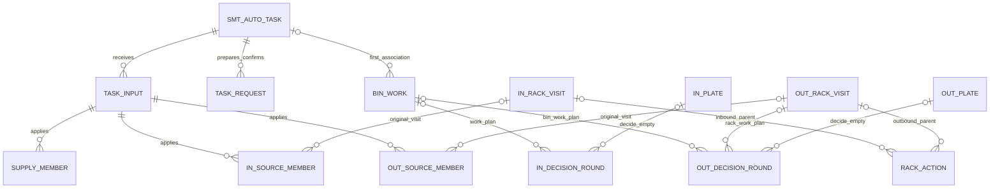

# smt_auto 数据模型设计

> 2026-11-02 新目标决定：[公共货架调度设计](2026-11-02-shared-rack-dispatch-design.md)统一手工、自动、BIN_Roller、粗分及后续业务的货架调度实体/推进服务，生产条件仍归原业务。原动作是离开当前工作线货架工作位的DEPART/RACK_MOVE、模板为CTU03或F01时，有效提交接纳即完成调度；目标可为库区ZONE或不同的生产线等RACK_POSITION工作位，不按是否库区判定离场；最终回调仅保留终位/失败备查，不回退、不阻塞后继、不自动重搬。本点位无其他可由原过程承接的有效需求时，直接执行责任可安全交出就安排原架离场，不等父任务终态或独立报告ACK；未知不作无需求，原业务完成/报告义务仍独立保留。本文中与此冲突的目标规则及私有架调度表/装配规划由新设计覆盖；已合入实现和旧验收保留原时点含义，新公共能力尚未实施，当前代码不会因文档更新自动改变。

状态：2026-11-02，**设计草案，尚未实施**。本轮只设计表、关联、约束及验收，不创建 ORM、迁移或产品注册，不运行数据库升级、不提交。下文表名是拟定物理表名；业务合同仍以 [smt_auto API](../../integrations/smt-auto-api.md) 为准。

## 1. 目标、边界与取舍

为已确定的一个 `smt_auto` 宿主、`inbound/outbound` 两条流程提供可恢复的数据模型。一个任务生命周期、一份工作线队列和一个 pending 入口；授权、取放、NG、来源终局、完成资格及保留政策按原任务方向处理。补充 [业务设计](2026-10-31-smt-auto-business-design.md)，细化 [总计划§2](../plans/2026-10-31-smt-auto-implementation.md#execution-records)，不重新定义 wire DTO。

采用“关系字段约束身份和关联，冻结 JSON 保存完整业务输入/决定/参数”的方案。比较过的布局如下：

| 布局 | 取舍 |
| --- | --- |
| 任务大 JSON 内嵌全部成员、WAIT、盘及动作历史 | 表少，但并发约束薄弱；WAIT 无限增长、旧授权与当前盘易互相覆盖，不采用 |
| 所有方向统一成通用任务节点/授权/消息/事件表 | 类型与外键退化，重复平台状态机并混淆方向合同，不采用 |
| 共同任务/到箱记录 + 方向生产实体 + 有界职责的决定轮次/架动作记录 | **本草案选择**；数据库约束本地身份，方向代码解释自身严格合同，发送与重试继续由既有平台负责 |

决定轮次保存的是原业务求值及消费事实，不是第二套 Outbox：没有发送租约、HTTP 尝试计数、可靠消息状态、重试退避或独立调度。架动作只保存原 Transport 引用及消费依据，不复制 TransportTask。也不建库存、料盘主数据、跨任务条码唯一表、工作线占位许可、通用补偿或事件溯源系统。

原草案布局为14张宿主表：根6张、每方向4张，作为本次修改前的字段/关系基线保留。**新公共调度方案取代宿主rack_action及两张方向rack_visit**，这些不再作为AUTO自有新表实施；按其余原实体计为11张宿主表，另引用公共RackJob/RackAction。§5.2/5.3原字段及恢复要求用于迁入公共模型的对照，不再指定私有物理表；最终约束/迁移以公共设计为准。BIN_Roller既有调度表也将统一迁移，供回箱生产事实保留原归属，Transport/Outbox不重复建设。

### 1.1 对照已合并源码的复用边界（2026-11-02）

主目录HEAD为手工合入提交064b5c8（PR #47），[catalog](../../../app/businesses/catalog.py)已有coarse_sorting/smt_manual。[手工7表](../../../app/businesses/smt_manual/models.py)、[BIN_Roller10表](../../../app/businesses/_components/bin_roller/models.py)及head fiveracklimit均已存在；原14表仅为改动前AUTO基线；本次公共方案按§1调整为11张宿主生产/任务表并共享架调度表，不重复旧组件布局，也不删除自动授权/取放证据。

| 现有来源 | 自动如何复用 | 明确不复用的私有状态 |
| --- | --- | --- |
| sorting_task合同、TaskOwnerRef及TaskHost | 原DTO/分支、归属读口、重验和可选guard，组件只装一份 | 无共享任务表；自动原输入/队列/保留摘要仍自有 |
| BIN_Roller ports/service | 原arrival、SupplyChange、任务级SupplyProgress、释放及六类原pending；使用公开原记录读口定位/加锁 | 不依赖FaceWork/Decision物理布局，不按合表主键替换原demand_id/release_record_id，不复制供回箱状态 |
| 手工ManualInput/ManualRequest及service结构 | 参考“多份原输入+唯一应用基线”“原请求/多轮WAIT保留”、只读RR候选快照及逐条advance | 不导入手工repository、继承task_flow或读写其7表；不把人工准入/完工通知换名用于逐盘授权 |
| WorkLine.five_rack_request_limit及公共CTU计数 | 原配置/版本语义及组件额度门禁，不新增自动额度模型 | 不把额度当在位库存/生产许可；CTU03/F01的DEPART统一按有效接纳完成调度，但不借此证明物理搬离或目的地到位 |

用户已新增选择跨宿主公共货架调度实体/推进服务，departure单份声明随之转入真实rack_dispatch组件，手工/BIN_Roller迁移与AUTO/粗分接入共同协调；不抽取跨宿主任务/生产状态机。Transport更正仍独立未实施，CTU03/F01离场不论库区或生产线等不同工作位，均无需它完成调度。原§5.2/5.3和§8私有最小恢复行按新公共作业保留职责映射，不能继续据旧14表计划建私有架流。

## 2. 类型、身份与关联约定

| 约定 | 设计 |
| --- | --- |
| 本地主键 | 除任务外采用现有 `uuid7` 字符串；任务以 WMS 原 `task_id` 字符串为主键，不另造对外任务号 |
| 外部标识 | 字符串按原合同保存，不按前缀推断类型，不扩充 API 字段，不自设比合同更窄的长度限制 |
| 版本、顺序、业务时间 | int64；版本/顺序范围沿 API，业务时间是 UTC 毫秒；`created_at` 等数据库审计时间用带时区时间类型 |
| JSON | 使用仓库已有 SQLAlchemy `JSON` 方式；可空 JSON 使用 SQL NULL 语义。只查询身份、状态和期限关系列，不把生产扫描建立在 JSON 路径索引上 |
| 不可变快照 | 原信封已定义内容、契约版本/有效内容摘要、原 timestamp、原授权/参数、原请求 data、公开已应用结果的必要业务字段。未知字段处理沿已冻结 @v1；不按未来模型重算历史摘要 |
| FK 范围 | 宿主内部外键用于同任务关联；不向可清理的平台收据、消息、结果、组件经过及可删除配置行建立级联外键。外部 ID 连同恢复所需快照保存，公开读口核对原引用 |
| 同任务/同方向 | 子表保留 `task_id`，复合外键核对 `(parent_id, task_id)`；被引用父表显式提供 `UNIQUE(id,task_id)`，原计划输入另提供可引用唯一键 `(id,task_id,applied_plan_revision)`。任务提供 `(task_id,business_type)` 唯一键，方向子表用固定方向检查及复合 FK 防止串支；跨表用途/同主体约束仍由原事务校验 |
| 删除 | 宿主 FK 默认限制删除；inbound 明细清理由业务事务按依赖顺序显式执行，不用从任务/工作线删除触发全库 CASCADE |
| 扫描字段 | 待推进聚合使用 `pending`、可空 `next_check_at_ms`，只表达业务扫描候选；没有期限的原结果等待也必须能被公平轮扫，不新增 WAIT 调度器 |

下文列出业务必要字段；各表另有 `created_at`。`?` 表示允许 NULL，未标记的字段必填。结果快照必须能支持原合同判断、保留数量严格类型及原厂错误依据，不用字符串化数量或仅存布尔 `success`。首次可靠记录时间、外部发生时间、业务关闭时间分别保存。

图仅展示主要关系；架动作的两个父引用严格二选一，决定轮次的主体也严格选择一个。图中的可空父关系不表示允许两边同时为空。

## 3. 共同任务与原输入

### 3.1 `smt_auto_task`：唯一任务与保留摘要

| 字段组 | 必要字段及语义 |
| --- | --- |
| 原归属 | `task_id`；`task_type=AUTO`；`business_type=inbound/outbound`；`work_line_id`、`workline_code`；`issued_timestamp`。首次受理后冻结，业务码固定为宿主 `smt_auto` |
| 队列 | `status=QUEUED/PREPARING/EXECUTING/COMPLETED/CANCELLED`；`queue_revision`；`dispatch_sequence`；`not_before_ms?`；`plan_revision` 初始 0，始终为最高连续已应用版本 |
| 准备 | `prepare_accepted_at_ms?` 为原响应首次可靠保存时间；`first_plan_deadline_ms?` 只按当时显式配置登记一次，不随重启或配置变化刷新 |
| 确认 | `confirmation_next_check_at_ms?`；`confirmation_basis?` 保存上次已消费决定/原请求版本及相关新事实依据，不用最后一次响应覆盖未消费原请求 |
| 关闭/保留 | `closed_at_ms?`、`direct_obligations_closed_at_ms?`、`details_cleaned_at_ms?`；`details_cleaned`；`pending`、`next_check_at_ms?` |

约束和索引：

- PK `task_id`；`task_type=AUTO`、方向/状态检查；`queue_revision>=1`、`plan_revision>=0`、正排序值及非负可选时间按 API 检查。
- 部分唯一索引 `UNIQUE(work_line_id) WHERE status IN ('PREPARING','EXECUTING')`，两个方向共用执行位。队列索引以 `(work_line_id, dispatch_sequence, issued_timestamp, task_id)` 覆盖 QUEUED，领取仍过滤 `not_before` 及启动条件；不让未到期优先项阻塞其他已具资格项。
- `details_cleaned=true` 只允许 inbound 终态且两项关闭时间存在、清理时间存在。关闭不等于可以清理或 `pending=false`；公共独立义务不能被任务状态隐藏。
- 清理后仍保留同一任务行作为最小摘要：原 `TaskOwnerRef`、终态、关闭/直接收口/清理时间及标记；队列/确认等非摘要细节届时置空。相关列因此允许“未清理时必填、已清理时空”的条件约束，不另造 tombstone 表。上表队列初值及范围约束均适用于未清理行。

工作线配置删除/改绑不改变原工作线标识，也不删除此行。清理后四类共享通知仍能解析原 owner，inbound guard 按固定清理时间回复；不把该政策扩到 outbound。

### 3.2 `smt_auto_task_input`：原通知、阻碍及唯一应用

| 字段组 | 必要字段及语义 |
| --- | --- |
| 原身份 | `id`、`task_id`、`operation`、`operation_id`、`request_timestamp`、`first_received_at_ms`、`effective_digest`、`contract_version`、`effective_request` JSON |
| 判定 | `disposition=BLOCKED/REJECTED/APPLIED/DUPLICATE`；`block_reason?` 只取原已记录原因；`business_outcome`、`outcome_recorded_at_ms`，保留稳定业务响应依据，不替代平台收据 |
| 版本归属 | `requested_revision?`；`applied_plan_revision?`；`applied_queue_revision?`；`canonical_input_id?` 指向同任务原成功应用输入 |
| 组件交接 | `supply_change_id?`、`supply_change?` 保存本次真实已应用增加/撤回的原 `SupplyChange`；无变化则空 |

该表承接四类 sorting.task 回调的宿主业务记录，inbound `putaway.source.rack_exhausted` 也沿原操作保存业务依据；没有可解析任务的拒绝只由平台原收据负责，不伪造任务行。实际 SourceExhausted DTO/错误仍沿 API。

约束：`UNIQUE(operation,operation_id)`；两个部分唯一索引分别约束非空 `(task_id,applied_plan_revision)` 和 `(task_id,applied_queue_revision)`。只有实际应用输入占用版本，早到/缺版/停用不占；别名重复的两个 applied 字段为空，`canonical_input_id` 指向唯一原应用行。原应用行不指自己，也不指别名，别名不保存另一份应用成员/计划正文。每条输入本身的冻结有效请求仍保留用于原身份冲突判断。

同版新身份的 DUPLICATE 只用于当前最高计划版且完整已定义 data 相同；不扩展到 queue_changed 或任意历史计划版。成员外键直接指原应用输入，无独立重复的计划正文表。应用状态、版本字段、成员及 SupplyChange 必须同事务；`block_reason` 是原因事实，重验资格按完整现状重查，不另存 `can_retry`。

### 3.3 `smt_auto_task_request`：原 prepare/完成确认

| 字段组 | 必要字段及语义 |
| --- | --- |
| 原请求 | `id`、`task_id`、`purpose=PREPARE/COMPLETION`、`operation`、`operation_id`、`message_id`、`requested_plan_revision?`、`request_data` |
| 消费 | `response_snapshot?`、`response_recorded_at_ms?`、`consumed_at_ms?`；`unresolved`；完成结果及 `retry_after_ms?`、`next_eligible_at_ms?` |

`UNIQUE(operation,operation_id)`、非空 `message_id` 唯一；PREPARE 对 task 部分唯一；COMPLETION 对 `unresolved=true` 的 task 部分唯一。登记意图时即取得原消息引用，同事务失败则整笔回滚，不留下可再次换身份发送的半行。

`unresolved` 直到原响应按公开读口 FOUND/VALID、精确 HTTP/code/联合及本地资格复核后才结束；未知或与新增计划/义务矛盾的 COMPLETED 不变成已消费成功。已消费 BUSINESS_IN_PROGRESS/STALE 的历史行保留，新请求另建行；新事实/到期触发下一确认，不复用逐盘 WAIT 的严格计时语义。无并行第二确认，也不以更新原行身份绕过冲突。

## 4. 公共供箱成员和 BIN 作业

### 4.1 `smt_auto_supply_member`

字段：`id`、`task_id`、`plan_input_id`、`plan_revision`、`rack_id`、`rack_face`、`rack_array_index`、`face_array_index`；`withdrawn_by_input_id?`、`withdrawn_at_ms?`；`supply_change_id`。

`UNIQUE(task_id,plan_revision,rack_id,rack_face)`；复合 FK 保证原应用计划属于同任务且版本一致，原输入确为 PLAN_DELTA 的业务校验同事务完成。原数组/面顺序分别保存，不造跨来源统一顺序。同架同面在下一版可再成为不同成员；撤回精确定位版本，不能撤掉后来成员。

供箱 Feed/清单/CTU/回流/架离场状态完全由 BIN_Roller 记录。宿主沿原 `SourceFaceRef` 和 `SupplyChange` 调用公开接口，必要进度按该引用读取；不在此表复制 `feed_complete` 作为独立真相。

### 4.2 `smt_auto_bin_work`

| 字段组 | 必要字段及语义 |
| --- | --- |
| 原经过 | `id`、`work_line_id`、组件原 `arrival_id`、`device_code`、`raw_bin_code`、`bin_code?`、`scanned_at` |
| 冻结关联 | `task_id?`、`business_type?`、`association=TASK/NO_TASK/EXCEPTION`；关联一旦形成不改绑，方向为空当且仅当无原任务；异常另存 `exception_basis?` |
| 暂缓 | `production_hold_reason?` 保存确认未决等阻碍，不将“已关联”当成“允许首盘” |
| 终局与释放 | `terminal_basis?`、`terminal_at_ms?`；`release_decided_at_ms?`、`release_command_code?`；`release_result_ref?`、`release_result_snapshot?`、`release_consumed_at_ms?`；`pending`、`next_check_at_ms?` |

`UNIQUE(work_line_id,arrival_id)`，不对箱码或“未收口”做唯一约束。`task_id/business_type` 一起为空或一起存在；存在时复合 FK 指原任务方向，另核对原工作线。可读无有效任务且无在制上下文的旁路释放由同一组件接口登记，不创建虚拟任务/盘；不可读/请求字段不合约只保存异常，不新增自动放行策略。

终局依据只能是原有效 work_plan.NO_WORK 或正常 ACCEPT 明确无后继的引用/快照；终局和释放资格分开。释放引用只保存组件 `release_scan2` 原返回及公开已应用结果，不另建放行命令。重复委托先按原 arrival 找此行；同箱真实新 arrival 新建行。

BIN 生产不强制关联供箱成员/Feed/历史架面；outbound 原 BIN 的 decide/report 不携供箱架归属。任务完成读自己的供箱进度和本表原生产/释放，两组事实不能相互替代。

## 5. 两方向来源成员与生产架过程

### 5.1 方向成员

| 表 | 字段及约束 |
| --- | --- |
| `smt_auto_inbound_source_member` | `id/task_id`、固定 `business_type=inbound`、`plan_input_id/plan_revision`、`rack_id`、`rack_array_index`、`rack_visit_id?`、`withdrawn_by_input_id?`、`withdrawn_at_ms?`；`UNIQUE(task_id,plan_revision,rack_id)`。**不设 rack_face 列**，避免 NULL 面组合键绕过唯一性 |
| `smt_auto_outbound_source_member` | `id/task_id`、固定 `business_type=outbound`、`plan_input_id/plan_revision`、`rack_id/rack_face`、两个原数组索引、`rack_visit_id?`、`service_action_id?`、`first_work_plan_round_id?`、撤回输入/时间、`terminal_basis?`、`terminal_at_ms?`、`direct_obligations_closed_at_ms?`；`UNIQUE(task_id,rack_id,rack_face)`，同任务不跨版本再安排同面 |

两表均用复合 FK 核对同任务原应用计划/版本及原架过程。成员未被选中时 visit 可空；一旦关联不得切到后来过程。重复单层架新成员只可共指尚未进入离场链、未取尽且仍可承接新需求的原在途/在位过程；首次departure_decide原意图登记起，该visit不再承接后来新成员。此后追加同架成员保持visit为空/未选中，后续按原安全条件关联独立新进场，不绑旧visit后再迁移。新进场须有独立Transport及真实可靠到位，不能据版本递增复用旧到位或新增物料。撤回不删成员、不改原计划，不自动置取尽/终局/离场。

RETURN 成员的 `service_action_id` 精确关联该面实际到位动作及原时间；NO_WORK/正常末盘形成该成员的面终局，原盘/异常/必报全部结清后才记直接收口。CLOSE/SOURCE_DONE 保存在原盘来源决定内，不填成面终局；不能仅以整个架 visit 已到位/已离场替代逐面判断。

RETURN面沿手工“未开始可撤回、STARTED保留”语义：自动以该面首次work_plan原意图登记为开始边界，`first_work_plan_round_id`在同事务指向原首轮，不等响应/首盘命令才算开始。尚无首轮且没有已受理取放生产责任的成员可精确撤回；已有首轮、授权或本面在途取放责任者跳过，全部跳过仍成功。货架原进场Transport在途不等于该面生产已开始，撤回后仍保留原搬运及到位后的安全退架责任。开始依据不是另一个可独立改写的状态；该引用须核对同任务/同成员/原服务动作。五层供箱撤回仍走组件自身开始/未决语义，不能套此面生产判断。

inbound没有独立逐架work_plan，不能把“出现在source_racks里”机械映射成RETURN面STARTED。按§10.2用户已选规则精确撤回原版本成员，既有盘授权/求值仍保留；同次在位全部有效覆盖撤回且本架直接依赖收口后可安全退架，不要求补造取尽。

outbound 首版 `target_rack` 保留在原 PLAN_DELTA 的严格数据内，实际生产由 `purpose=TARGET` 的 outbound 过程关联该原计划。初始目标只建一次，不因此获得单盘 PUT 授权；后续合法 ROTATE/REPLACE 沿原 material.decide 作为新动作/过程出处。

### 5.2 `smt_auto_inbound_rack_visit` / `smt_auto_outbound_rack_visit`

共同字段：`id/task_id`、固定方向、`rack_id`、`origin_kind`、`origin_id`、`origin_ordinal`、`previous_visit_id?`、`position_snapshot?`、`position_basis_action_id?`、`departed_at_ms?`、`pending`、`next_check_at_ms?`；inbound 另有 `recovery_only` 和 `recovery_origin_snapshot?`，仅用于§8的独立义务最小保留。

- `origin_kind/id/ordinal` 组成非空的本地出处键，各表唯一；它来自原成员选择或原最终目标变更授权，不是新的 wire 身份。相同出处重入只能取得原过程。
- inbound：`station_code=STATION_A/STATION_B`、`arrived_at_ms?`、`exhausted_basis_input_id?`、`exhausted_basis_round_id?`、`exhausted_at_ms?`；另有`departure_basis?`保存实际登记原离场求值时的依据，`kind=EXHAUSTED/ALL_MEMBERS_WITHDRAWN`，后者含原visit、全部覆盖成员及各原撤回输入引用，只在§10.2条件满足时登记，不对外发送。首次取尽依据来自原 rack_exhausted 通知或正常/empty 最终决定轮次，两个取尽引用至多一个；普通业务记录存在取尽时间时必须有一个。全撤回退架不填写取尽列。仅§8实际清理后的 `recovery_only=true` 原行可解除取尽FK，此时必须保留有效 `recovery_origin_snapshot` 的原身份/结论及原时间，约束允许“二者均空且recovery_only且快照存在”，不能删除取尽事实或给普通行此豁免；全撤回退架的成员/输入原依据也以同样方式保留最小快照。其他原通知/决定仍在未清明细内保留。单层不加动态面；`position_snapshot`只来自原已应用Transport，离场current_face为空。
- outbound：`purpose=RETURN/TARGET`；`current_service_action_id?`。RETURN 原成员按实际服务动作确定原 `rack_face/arrived_at`；同一来架可有多个依次服务的面，每面由自己原动作证明到位。TARGET 按初始计划或原最终决定准备，盘精确目标仍由本盘决定给出。
- 不用 `is_current` 唯一架号代替调度许可。业务在 WorkLine 锁内核对可靠物理事实及原在途动作；旧结果仅更新它原过程/动作。位置快照带原动作及结果版本，不能因迟到旧结果使已离场旧过程重新当前化。

`position_basis_action_id` 和 `current_service_action_id` 是可空、可重建的消费投影，权威依据是架动作的原结果。跨过程引用必须核对同任务/同 visit，不允许指向另一个来架的成功。部分成员撤回仍可保留该过程的在制及离场义务。

### 5.3 `smt_auto_rack_action`：原生产架 Transport 动作

字段：`id/task_id`、`inbound_visit_id?`、`outbound_visit_id?`（严格一个非空）；`kind=ENTER/SERVE_FACE/DEPART`；`cause_kind/cause_id/cause_ordinal`；`previous_action_id?`；`client_request_id?`、`transport_task_id?`；`caller_snapshot`、`requested_target?`；`result_revision?`、`applied_result_snapshot?`、`consumed_at_ms?`；`departure_operation_id?`、`departure_message_id?`、`departure_response?`、`departure_response_recorded_at_ms?`、`departure_next_eligible_at_ms?`、`departure_trigger_basis?`、`departure_unresolved`；`pending`、`next_check_at_ms?`；`recovery_only`。

非空 `client_request_id`、`transport_task_id` 分别唯一；离场 `operation_id/message_id` 非空分别唯一。按父 visit 分别建立部分唯一 `(visit_id,kind,cause_kind,cause_id,cause_ordinal)`。出处为实际原需求/原授权，不能每次扫描造新 cause。公共离场决定如有 WAIT/后续轮次，按原业务离场阶段追加新动作记录保存新身份，并以 `previous_action_id` 串联；同一离场阶段出处不变、ordinal递增，前驱引用非空唯一，按visit对 `departure_unresolved=true` 约束至多一个未决离场轮次。响应有效消费后才清除此标志；按[共用离场合同](../../integrations/workline-business-api.md#rack-departure-confirmed-wire)，WAIT后到期或出现本次离场相关新业务事实才允许一个后继，`departure_trigger_basis` 冻结本轮使用的到期/新事实出处，重复旧事实不换号。固定原WAIT可靠保存时间/到期，新事实可提前触发，不套逐盘严格最早时点。READY后只恢复原Transport，不再建新离场求值。尚未获得READY的记录不创建Transport，`client_request_id/requested_target`可空；ENTER/SERVE_FACE则在登记意图时必有原身份/目标。READY后冻结目的地并登记原身份，同事务取得Transport引用。一次许可只物化一个原搬离Transport，不能因轮询重建。原阶段及待办仍是生产架动作，不增加通用离场调度器。

还须约束**每个visit只能有一条离场链**，不能只限制“当前一条未决”：DEPART的`previous_action_id`专指同visit前一轮DEPART，首轮为空；分别对非空inbound/outbound父visit建立`kind=DEPART AND previous_action_id IS NULL`部分唯一索引。后继只能接原已消费WAIT，且同原出处、ordinal连续；READY/未知/最终拒绝不能另起根。重复撤回、另一条取尽通知或后来相同退架理由仅补原事实，不改变首次`departure_basis/cause`、原根及已冻结意图；合法新事实最多按同一WAIT链登记一个后继。原READY、Transport引用和结果消费原子提交，回滚不留下已消费但无原动作的半状态。

每次换面都有自己的动作、原结果、服务面及真实到位时间，RETURN 的 work_plan 关联精确服务动作；不把前一面时间赋给新面。inbound 不创建 SERVE_FACE。原失败/未知动作保留，不覆盖成新 ENTER。生产架搬运/离场遵循现有 Transport 和 shared departure 合同，不复制供箱 CTU01/02/03 或另发 ECS 搬架命令。

## 6. 两方向盘尝试与业务决定轮次

### 6.1 `smt_auto_inbound_plate` / `smt_auto_outbound_plate`

一行表示一次获准取盘尝试，**不表示库存料盘身份**。真实 RETRY 新建尝试，保留旧空取/失败及其原命令。未取到盘时条码/扫码时间可空，不能用箱码或请求时间补值。

| 字段组 | 必要字段及语义 |
| --- | --- |
| 父主体 | `id/task_id`、固定方向；inbound 必填 `bin_work_id`；outbound 为 `bin_work_id` 或 `source_member_id` 严格二选一，RackSlot 另存原 `source_visit_id/source_service_action_id` |
| 唯一授权出处 | `grant_kind=READY/NEXT/RETRY`；`grant_round_id?`、`grant_parent_plate_id?`。READY/RETRY 来自本方向已消费原最终决定轮次，NEXT 来自父盘唯一最终后继，二选一。两种引用分别非空唯一 |
| 原授权 | `grant_snapshot`、`source_locator`、`source_params`、`source_arrival_snapshot`；原来源选择、参数及来源过程不可变，不从当前架/当前任务/slot_id 反推 |
| 原取盘 | `pick_call_key`、`pick_command_code?`、`pick_result_ref?`、`pick_result_snapshot?`、`pick_consumed_at_ms?`；`barcode?`、`scanned_at_ms?`；`empty_observation?` 保存权威载体/原 finish_time |
| 最终决定 | `final_decision_round_id?`、`target_snapshot?`、`next_source_action?`。一个盘只接受一份有效最终决定，WAIT 不填最终字段；REJECT/NG 与正常 ACCEPT 严格分支 |
| 原放盘/NG | `put_call_key?`、`put_command_code?`、`put_result_ref?`、`put_result_snapshot?`、`put_consumed_at_ms?`；正常和 NG 互斥，原明确成功使用原 finish_time |
| 必报 | `report_operation_id?`、`report_message_id?`、`report_data?`、`report_response?`、`report_consumed_at_ms?`；无需报告的分支不建“待成功报告” |
| 直接义务 | `source_closed_basis?`、`physical_closure_basis?`、`direct_obligations_closed_at_ms?`、`pending`、`next_check_at_ms?` |

约束及方向差异：

- `grant_kind` 与引用 XOR 检查、复合 FK 核对同方向/同任务；父盘 NEXT 对父引用唯一，原 READY/RETRY 对轮次引用唯一。循环 FK（盘最终轮次、轮次盘主体）以先建盘后补最终引用的同事务写法处理，不要求可延迟约束；授权轮次与后续盘必须属于同一 BIN/原面主体，由事务内校验补足跨表语义。
- `pick_call_key` 唯一，非空 `put_call_key`/命令号/报告 operation_id 分别唯一；稳定 call_key 带方向、原授权出处和动作类型，不用 WAIT 新 operation_id 当授权出处。失效后仍保留唯一消费事实，不能删除后重授。
- 不对 `barcode`、`(task,source,barcode)` 或源槽设置永久唯一键；同源同码的未闭合授权由 WMS 裁决。一份报告未收妥，不在 WES 加统一后盘屏障。
- inbound 来源快照必须关联原单层 visit；source_racks 每次求值另冻结当时可靠 0～2 架及本地过程映射，本盘已取来源不随换架变化。目标参数是放盘前层数/总厚度原值；只有正常成功放盘报告，NG/FAILED 无报告。
- outbound BIN 不含历史供箱架/面；RackSlot 保存原成员版本、面、槽及原服务动作/arrived_at，普通 decide/report 不因此新增 plan_revision 字段。RackSlot 源层/列/厚度/直径来自该次完整授权；正常和 NG 明确成功且位置确定均必报，NG 收妥才可进入它的异常续问。
- 原 FAILED、UNKNOWN/HELD、WMS REJECT、业务来源关闭分别保存，不压成一个 `DONE`。`physical_closure_basis` 可空表示仍无合同规定的收口证据；有 FAILED 结果不自动填入此列，不改写其为 SUCCESS。

`pick_consumed_at/put_consumed_at`只关闭对应原动作的消费责任；`physical_closure_basis`是本盘物理链依据，必须引用该盘所有应执行取盘/扫码/正常放盘或NG的原命令及已应用Result身份/版本、严格数量/阶段/实际去向和已结清核对义务。只成功取到扫码台不能将整盘置物理收口，后续放盘仍未决；合法空取按其独立原事实收口本次无料尝试，不补成功放盘。物理收口也不等于`direct_obligations_closed_at`：应报报告、决定/后继/异常等仍须按原方向全部结清，箱/面终局及原释放另判，不因一条SUCCESS或人工已处理说明越级。

取放失败的事实消费、直接物理收口及范围选择见§10.3。不得为了让任务可结束填入推定证据；命令协议终态与盘的物理责任是否闭合分别判断。

### 6.2 `smt_auto_inbound_decision_round` / `smt_auto_outbound_decision_round`

| 字段组 | 必要字段及语义 |
| --- | --- |
| 主体 | `id/task_id`、固定方向、`purpose=WORK_PLAN/MATERIAL_DECIDE/EMPTY_DECIDE`；`bin_work_id?`、`source_service_action_id?`、`plate_id?`，按 purpose 严格一个主体；inbound 没有来源面 work_plan |
| 阶段/轮次 | `stage_key`、`round_no` 从 1 开始；`previous_round_id?`；`trigger_plate_id?` 为异常续问原 NG/空取触发；初始阶段与异常阶段不同 |
| 原求值 | `operation`、`operation_id`、`message_id`、`request_data`；inbound `source_rack_bindings?` 额外保留 wire source_racks 对应本地原 visit，不对外发送本地 ID |
| 原决定 | `response_snapshot?`、`response_recorded_at_ms?`、`consumed_at_ms?`、`unresolved`；`wait_recorded_at_ms?`、`retry_after_ms?`、`next_eligible_at_ms?` |

`UNIQUE(operation,operation_id)`、`message_id` 唯一；`UNIQUE(task_id,stage_key,round_no)`；非空 `previous_round_id` 唯一；对 `unresolved=true` 的 `(task_id,stage_key)` 部分唯一。前驱 FK 核对同任务/阶段、轮次递增，阶段锁内还需核对前驱为 WAIT 且到期；非 WAIT 最终决定不能追加另一轮。阶段主体必须属于原任务工作线，成员/服务动作必须属于该原来源面。

`stage_key` 由本地主体与确定触发事实构成：首问为原 BIN arrival 或原 RackSlot 服务动作；异常为原盘的最终 NG/empty 阶段；material.decide/empty_decide 为原盘及其本次观察。它是本地幂等键，不新增 WMS 恢复字段、事件流或通用 stage 表。异常触发在这一阶段只消费一次，阶段内 WAIT 不再产生另一异常阶段。

首次可靠保存有效 WAIT 的本地时间固定 `next_eligible_at = wait_recorded_at + retry_after_ms`（1～60000），原轮次终结但留下后继责任；下一轮登记后通过唯一前驱防止重复。原消息重放不重置时间；结果消费/新轮次与下一意图在同一事务。阶段最终 READY/RETRY 只物化一次盘，WAIT 期间不物化盘。

两方向各自处理不可变 data：inbound work_plan/material.decide 续问只允许更新当时可靠 source_racks，原 arrival/scanned_at/条码等其余事实不变；empty_decide 保留原观察。outbound 五类求值续问 data 全部保持原值，仅外部身份/信封时间更新。保存每轮 request_data 便于证明差异，不覆写上一轮 JSON。

## 7. 真相源、约束和事务边界

| 责任 | 唯一真相源及落库要求 |
| --- | --- |
| 原身份冲突/ACK | 平台 CallbackReceipt；宿主输入只保留自己的业务依据。不重复收据锁、HTTP receiver 或消息幂等框架 |
| 任务/队列/版本 | 宿主 task/input；WorkLine 锁后判资格，输入/应用版本/成员/精确 SupplyChange/下一意图原子提交。prepare 与执行位领取同事务 |
| 供回箱/原放行 | BIN_Roller；宿主仅保存原委托/引用并消费公开结果，不复制组件内部状态 |
| 授权消费 | 本方向最终决定/盘尝试；锁原主体/授权出处，保存最终决定、一次盘及原命令意图同事务。RETRY 不修改旧失败 |
| 原执行结果 | ECS/Transport 公共已应用结果读口；消费原结果/版本及下一 decide/report 同事务。ACK、查空、设备 IDLE 不作为动作完成 |
| WMS 决定/报告/确认 | 公开 `WmsRequests.get_result`，原 message_id/operation/operation_id + FOUND/VALID + 精确 HTTP/code + 严格响应联合通过后消费 |
| 库存/绑定/条码资格 | WMS；本地盘行只是执行事实，不作为库存入账、容量或业务同码唯一性真相 |

独立推进沿 WorkLine → Devices 按 ID → 业务动作加锁；复用已合并手工TASK及组件SCAN/FEED/RETURN_BATCH/RACK_CYCLE/DRAIN的SERIALIZABLE覆盖；AUTO为全撤回与原授权的跨聚合交接，额外将INBOUND_RACK/INBOUND_BIN/INBOUND_PLATE在新会话首SQL前设SERIALIZABLE，INBOUND_ARCHIVE/SCAN2_RELEASE保持原范围；新公共调度下outbound自有架与可能登记其PUT/目标准备的完整推进也纳入局部SERIALIZABLE和真实相关读集合，不能仅提升搬架一侧。具体入口以公共设计§7的共同锁序和交接验证为准。候选轮扫使用一个只读REPEATABLE READ快照取得各kind上界/游标，每条advance独立事务；不依赖WMS task_id单调递增。40001在新会话有界整事务重试，覆盖commit最多3次；失败保留原待办。receiver沿共享既有隔离/收据锁入口，advance不反向锁收据。提交未知必须重读原本地出处/原外部意图，不凭查空换号。

全撤回交接不能只依赖RR的WorkLine锁：较早快照等待该锁后仍可能看不到刚提交的成员或可能授权请求。三个inbound推进入口须在同一SERIALIZABLE事务真实读取原visit全部覆盖及相关未闭合授权/求值/取盘集合，再写消费/新意图；不能只改隔离标签而不读取这些集合。原task、受影响成员及来源visit在WorkLine→Devices之后按固定顺序锁定/重读（task→成员ID→visit ID→BIN/盘/动作），锁前定位只取标识，不复用旧DTO。receiver仍用原隔离，但相同锁序下新plan更新原task.plan_revision、撤回更新原成员，推进必须锁定这些原行，以检测其快照后的变化并整笔重试。候选快照、手工推进及全局factory不提升，不更新工作线配置版本来假装刷新快照，不新增锁表或协调器。

机制依据是PostgreSQL的[RR固定快照及序列化重试](https://www.postgresql.org/docs/current/transaction-iso.html#XACT-REPEATABLE-READ)、[RR/SERIALIZABLE下锁定已变化原行的冲突](https://www.postgresql.org/docs/current/explicit-locking.html#LOCKING-ROWS)。receiver保持原隔离时，不能宣称单凭推进的SERIALIZABLE标签已证明全部并发安全；原行变化检测、真实相关读集合及上述两种提交顺序必须在独占PostgreSQL验证。本轮只是设计修订，没有数据库验证结果。

原Transport终态仍沿当前严格规则；同用RACK_MOVE/F01不表示能消费粗分拟议的失败→成功更正，也不允许在业务层覆盖失败。生产架CTU03/F01的DEPART改按原有效提交接纳完成调度，去向包括ZONE和不同RACK_POSITION（含生产线工作位），最终原地终位或失败仅备查，不阻后继；不虚构物理已离场。RETURN/TRANSFER适用同一离场规则，ENTER/ROTATE仍须原结果；取消不自动生成新进场。参考已合并手工修复验证边界，自动须在自己的I1/O1中验证。

`pending/next_check_at_ms` 只做可重建投影。权威未决事实是未消费原请求/结果、WAIT 未建后继、阶段终局/直接义务未闭合、原释放/确认未决。scan_pending 公平覆盖任务、两个方向及组件六类公开待办，不以当前任务/方向或任务终态统一过滤。可空时间原结果待办参加轮扫，定时等待按各自语义比较。after_commit 丢失仍由同一 5 秒 Beat 恢复。

内部推进继续使用总计划固定kind：任务请求归原 `TASK`；BIN及其work_plan归原 `INBOUND_BIN/OUTBOUND_BIN`；盘及其decide/empty轮次归原 `INBOUND_PLATE/OUTBOUND_PLATE`；架动作/RETURN面work_plan归原 `INBOUND_RACK/OUTBOUND_RACK` 的原visit。子记录登记/消费时同步父聚合pending投影，候选修复可从子事实重建，不为每张表新增任务、结果反查路由或唤醒kind。归档仍由 `INBOUND_ARCHIVE`，公共六类kind沿组件原RollerWorkRef。

索引以真实待办读口为界：各聚合 `(task_id)`；原父引用；`(next_check_at_ms,id) WHERE pending` 以及无期限原结果等待候选索引；决定阶段未决及任务请求未决部分唯一索引。候选扫描与加锁后重查分开；不扫描/加载整段历史 JSON。大规模索引调整留给实施时查询计划，不能为未出现的筛选功能建全套索引。

## 8. 归档、外部引用和历史保留

仅 inbound：任务终态且直接义务真实收口，以两者均满足的起点保留完整明细 7 天；未决/无法证明收口继续保留。清理前重新加锁核对义务，不仅按时间删除。全量明细包括原输入、成员、生产架/动作、BIN/盘、决定轮次及原请求/业务结果快照。

清理同一事务先识别本任务直接未决（阻止清理）与已独立的公共恢复引用（最小保留、不阻止归档），再按 FK 依赖删除可清明细：先断开同聚合的可空最终/位置投影引用，再删决定后继/盘后继、架动作、关联成员和 BIN 等叶子，最后删 task_input/task_request 明细并标记原 task 摘要。自引用链按后继先删；盘与决定循环需先清空最终引用，再删除该盘后续求值轮次、再盘、再授权轮次。实施时由完整依赖图生成确定删除顺序，禁止关闭 FK 检查或全任务 CASCADE。所有明细互相只连同一任务，禁止跨任务悬挂引用。

公共 SCAN3/4、回架及 drain 的原关联/事实由组件按公共保存合同保留，任务归档不删除它们、不为无task_id请求补task_id、不等待全局排空。若独立离场恢复仍需要宿主原架过程/动作，则在上述两张已有表保留最小原行并标记 `recovery_only=true`：原主键/task/rack/工作线和出处、原离场决定/WAIT期限、冻结位置/目标、Transport身份及未消费结果依据。必要同过程前驱也保留；不留已闭合盘、授权和整份任务交互历史。

这类保留行的原取尽或全撤回、安全交出等必要已闭合依据先冻结到`recovery_origin_snapshot`：全撤回须含原visit、非空覆盖成员集合、各原撤回input身份及直接依赖已结清结论；保留首次departure_basis、唯一离场根/WAIT前驱及未消费的原决定/Transport引用。再解除指向待清输入/轮次的可空FK，保留原出处值，不要求重建被清历史。`recovery_only`只推进这条既有原独立离场，不补建第二根、不重授/首问/恢复生产；宿主同一pending仍扫描，原公开结果继续消费。义务收口后按其保留要求清理最小子图，不重新开启7天任务窗口。

`details_cleaned=true` 表示任务已闭合业务明细已实际清理，**允许这类最小独立恢复行仍存在**；不因此撤销清理标记或刷新其时间，guard继续固定拒绝。本任务原盘/报告/释放等直接未决则不能被标成 recovery_only 绕过7天保留。平台原收据可先清理，未清直接责任仍保留完整业务消费依据。独立公共结果入口不接入 task archive_guard。

outbound 本轮无自动清理期限；不沿 inbound 定时器删除、不对清理后通知套用 inbound 错误。两方向都不更改其他项目或历史已冻结 owner/operation/路由/正文/期限；无历史 null 回填或旧库任务搬迁。

## 9. 数据模型验收与实施定位

这些是未来模型/事务验收，**本轮没有执行**。沿现有 S1～S7/I/O 任务交付，不新增平行专项计划；API 72 项、G01～G04、D1～D8 仍是原唯一业务追踪，下面 M 编号只定位持久化层遗漏。

| 编号 | 必须验证的持久化不变量 | 原实施位置 / 对应已有验收 |
| --- | --- | --- |
| M01 | 同线混合方向并发领取只有一个在办/prepare；不同线独立，重复优先级合法 | S1共同队列验收；G01 |
| M02 | 未应用输入不占版本；原重验/当前同版新身份只一份成员/SupplyChange；queue 与 plan 互不替代；回滚不留半应用 | S1；API计划重验/取消；C03 |
| M03 | 单层无 NULL 面唯一漏洞；供箱同面可跨版追加；RETURN 同任务同面不能重排；每成员引用原版本及数组顺序 | S1/I1/O1；API计划资源矩阵 |
| M04 | 方向/同任务 FK 拒绝跨任务关联；同箱新arrival可新增、重委托不改绑；prepare未知保留原task/阻碍且不误直通/自动回放，接纳后0版资格与确认暂缓分别处理 | S2/I2/O2/S6；G01、I02及§10.1资格矩阵 |
| M05 | WAIT 重放/并发/重启不刷新期限，只一轮后继；最终 READY/NEXT/RETRY 各一次盘/命令，旧空取/失败不变，源快照按方向差异冻结 | I2/I3/O2/O3/S6；I01/I05及WAIT案例 |
| M06 | 原结果与下一意图原子消费；报警/重启沿原命令，合法Result先于ACK/迟到/重复仍按阶段；取到扫码台不误记整盘物理收口，物理成功但必报未闭不误记直接收口；最终FAILED/未知不改成功，NG报告差异不变 | I2/I3/O2/O3/S7步骤1a～1b；A27/I04、D3/D4/D5依赖 |
| M07 | 同源同码第二次尝试可保存；父最终后继唯一但不强加前盘报告ACK屏障；原报告未知不重做动作 | S7；B01～B05 |
| M08 | 非空完整覆盖全撤回+原可靠在位/直接取料责任结清才退架；新plan/潜在授权交错在inbound三类SERIALIZABLE事务重读，其他有效覆盖/原授权仍阻；每visit唯一离场根/WAIT链，重复撤回/后到取尽不另起；历史来源不误拦独立目标责任，RETURN/TRANSFER的CTU03/F01离场接纳完成，含生产线工作位去向；进场/换面仍须实际到位 | I1步骤1～1a/I3/O1/O3/O4/S5；B06/I02、§10.2及手工既有修复边界 |
| M09 | 一条未决确认；旧COMPLETED遇新事实不清除未决/不关单，STALE与原请求版本比较；显式首批期限固定，无配置不伪造0版完成 | S5/S6；G04及确认交错案例 |
| M10 | inbound完整7天及直接未决不删；独立全撤回离场保留非空成员/撤回依据、唯一根/WAIT链及未消费引用，清理后不重建动作、不刷新摘要/guard时间；报警取放直接未决不能伪装recovery_only；outbound无此清理 | I4/S6；I07、A55 |
| M11 | receiver/推进外层回滚、按kind隔离、只读RR轮扫及40001/commit未知后重读原出处，不换外部身份；无通知/非eager worker仍覆盖旧方向责任；实际手工+自动同catalog仍单份共享合同，六类原pending保留具名ID，额度不重复计数 | S6/S7；G01～G03 |
| M12 | 新迁移只增加自动宿主必要表/约束，接实施时最新head；不重复组件10表/手工7表/额度列；填数升降级保留既有数据，有损先拒绝；明细依赖清理不产生悬挂FK | S6；tests/migrations/test_smt_auto_state.py及I4保留用例 |

实施时在独占 PostgreSQL 验证部分唯一索引、NULL、复合 FK、并发和回滚；普通行为通过真实宿主公开入口验证，不以直接灌表或仅 SQLite 通过代替。这里只确定需要的结果，测试命名和具体 ORM 声明留给实施，不新增一组复制 API 字段测试。

## 10. 三项业务边界的收敛记录

2026-11-02对照已合入手工源码，区分“直接沿用”“用户已选增量”“仍待交付”；本节不是新增恢复接口或实施授权。引用源码只证明现有手工行为，AUTO仍未实施。

### 10.1 当前任务资格与首盘：直接沿用已有规则

依据：[手工RollerPorts.read_current_task](../../../app/businesses/smt_manual/roller_ports.py)、[原SCAN2受理](../../../app/businesses/smt_manual/manual_bin_flow.py)、[确认阻碍判定](../../../app/businesses/smt_manual/repository.py)。自动使用同一资格结构，将宿主匹配改为自身`smt_auto`，不调用手工私有服务。

| 原任务/工作线事实 | CurrentTask及到箱处理 | 可否开始新的自动生产 |
| --- | --- | --- |
| QUEUED或终态，没有其他在办任务 | 不充当当前有效任务；旧arrival仍查自己的原关联 | 只有可读且确无在制上下文时沿原无任务旁路；不借此放行旧在制作业 |
| PREPARING，原prepare未可靠确认 | 返回原task_id，is_valid=false；原到箱保留任务/方向及CONTEXT_NOT_READY阻碍，不误作无任务直通 | 不首问、不取盘、不放箱；沿手工异常保留边界，不把后来prepare接纳当作自动回放该异常到箱的授权 |
| PREPARING，原prepare已可靠接纳，尚无首版 | 工作线仍启用、业务/原编码匹配时is_valid=true；资格不附加plan_revision>0 | 可读合法到箱且无确认阻碍时按原方向首问；inbound允许source_racks=[]。真实取放仍须完整授权、原箱/来源/目标及设备条件，缺计划/缺架不伪造完成 |
| EXECUTING且prepare已可靠接纳 | 同上按原工作线资格判断 | 原方向生产，不重绑当前新任务；原授权/物理门禁仍逐项核对 |
| 原completion_confirm未决或有效结果尚未解除暂缓 | is_valid不因确认状态改成“无任务”；保存原arrival/任务/方向及CONFIRMATION_PENDING | 暂不新开首问，按API3.7.3原非终局/版本条件解除后只恢复这一原待办，不能绕成直通或换arrival |
| 原工作线禁用、删除、宿主/原编码不匹配 | is_valid=false，保留原身份与阻碍 | 阻止新的生产意图；既有结果/报告/释放按原合同独立消费，恢复配置不改原归属 |

“prepare未知到箱”与“完成确认暂缓到箱”必须保存不同阻碍：手工HOLD不因prepare后来成功自动转ADMISSION_PENDING；DEFERRED有原确认恢复路径。自动也不能把两者写成同一个可自动清除的布尔hold。若未来需要前者自动续办，须另行确认，不能由这次资格复用顺带实现。

### 10.2 成员撤回与在位来源退架：共同规则沿用，单层增量已由用户选择

共同依据：[手工accept_task_cancel](../../../app/businesses/smt_manual/task_flow.py)、[手工自有架规则](2026-10-31-smt-manual-business-design.md#进场取消与离场收口2026-11-02-已实现)。沿用精确原版本、未命中/不可取消跳过、全部跳过仍成功、不改父任务终态；原授权/求值/在途/报告不被取消抹去。成员撤回和Transport.CANCELLED严格区分。

- 五层供箱仍通过原SupplyChange交组件；已开始的CTU/feed等义务继续，不以撤回证明feed_complete或离场。
- outbound RETURN仅未开始的来源面可撤回，开始边界及原轮次引用见§5.1；已开始面保留原面生产直至真实终局和直接义务收口。未开始面全撤回且无剩余面/直接义务时可沿既有departure退架；部分撤回不提前跨过仍有效面。目标TRANSFER不是该选择器对象，不获得取消补偿特权。
- 正常ENTER生产成功、非成功终位、角色释放、原pending分别判断；统一无需求安全清架适用于单层/来源/目标架，但必须有各自原位置和交出依据，不把手工取消补偿当作所有业务生产成功。独立报告保留自身候选/义务，不以公共RackJob未完成为唯一发现条件。

**用户已选择：inbound单层架可按全撤回依据安全退架，不要求先由WMS标记取尽。** 具体条件只有一份：

1. 按原task/同次在位visit汇总实际关联/选定覆盖它的单层成员，原集合必须非空、精确原版本均有有效撤回依据；其他版本仍有效、仅撤一个成员、查空/引用缺失，均不满足。原选架/绑定在途或在位关联不因撤回删除。生产选架仍必须有原公开已应用成功及可靠在位/当前位置依据。安全清架按公共设计§3.3独立判断：ENTER在途/未知保留待释放与原责任；FAILED/CANCELLED可靠在本点位、NONE且可安全交出时进入唯一离场链，不补认生产成功；原执行责任已终结、无继续执行/更正/未决核对且可靠未进入、无其他受管点位冲突时NOT_ARRIVED，无需虚构DEPART。
2. 停止该撤回来源的新选择，但本架已有有效READY/后继、尚未消费授权、仍可能授权本架的未决求值、在途/未知取盘及安全交出依赖全部沿原事实收口；不能静默丢弃授权或重授别源。已可靠取离盘的目标放盘/报告独立继续，不统一拦原来源架离场。

   “仍可能授权本架”按原阶段及冻结来源映射判断，不仅凭历史source.rack_id：已取离盘的目标决定/报告若不能再授予本架取盘，不算离场依赖。物料WAIT已消费且其后继依法可更新source_racks时，后继排除已撤回来源，不能仅凭上一轮旧集合永久阻架；empty_decide WAIT/RETRY等仍绑定原来源、可能许可原处取盘的责任则继续阻该架。不能为解除门禁而改写旧请求data或已授予权限。
3. WorkLine→Devices→原visit锁序内重查覆盖、原在位及直接依赖，登记`departure_basis=ALL_MEMBERS_WITHDRAWN`及原成员/撤回输入引用，并以现有四字段`rack.departure_decide`求去向；不填写exhausted_at、不对外加取消原因/task_id/成员列表。依据、原成员快照和唯一离场首轮意图同事务；与新计划/最后一个撤回/同架取尽通知交错时，要么仍有有效覆盖且不启动，要么原链已登记且后到成员留待新过程，不从锁前快照猜测。
4. WAIT/未知、READY及唯一原搬离沿原合同，UNKNOWN不换号；CTU03/F01的DEPART取得有效ACK即完成调度，去库区或不同的生产线等工作位同样适用，回调只备查，不等实际终位。ENTER/ROTATE仍按原结果。原首次departure_decide意图尚未登记时如又有有效覆盖须重新判断；一旦登记，即使WAIT/尚未取得搬离Transport，原visit也不再承接后来新成员，已登记原链不因追加计划取消/重建。后来同架成员保持未选中，待独立新进场按真实结果建立自己的visit；不把它绑旧visit再迁移，也不把旧退架过程变回可取料。
5. 撤回只让来源需求有合法取消依据，不形成箱/面NO_WORK、不补完成报告，不改变SCAN2原释放与整单确认前置，也不新增“所有来源架必须离场”的整单门槛。

### 10.3 报警、人工处理与ECS恢复：用户已选择原命令内恢复

手工可复用的是“不造成功、原结果消费、直接架安全保护及独立义务继续”；人工完工通知承载的是人工生产合同，不能拿`manual_bin.work_completed`或人工NORMAL/NG去关闭自动机械臂失败。

| 原权威事实 | 直接沿用的处理 | 不可推出的结论 |
| --- | --- | --- |
| 合法原成功取放/NG及完整扫码、位置事实 | 按本方向正常/NG链消费，满足其他前置后收口；保留原时间/参数/报告范围 | ACK或当前IDLE不能替代这些事实 |
| inbound明确FAILED/0/PICK_EMPTY | 已有原空取合同有效，保留失败并触发原empty_decide；RETRY仅一次新尝试，SOURCE_ABSENT沿原异常续问 | 不能把其他FAILED/0套成空取；不能把旧失败改成功或直接结束整箱 |
| outbound权威无料事实 | 只沿D4签认载体及原empty_decide，未交付保持未交付 | 不复制inbound PICK_EMPTY或按普通PICK_FAILED猜测 |
| 已最终上报的扫码失败、PICK_FAILED、PUT_FAILED或位置/阶段不明确 | 原Result如实消费，命令已终态不等于盘的直接物理责任已闭合；无合法收口依据时physical_closure_basis及direct_obligations_closed_at保持空 | 不重做原取盘、不报成功、不自动释放受影响箱/面、不允许整单完成或7天清理绕过 |
| UNKNOWN/HELD、冲突或仅人工口头说明已处理 | 保留原待办/事实，按原公开结果合同恢复；仅阻碍相关来源/盘/箱的直接责任 | 不凭复位/online/IDLE换号、覆盖终态或阻断其他已合法独立授权 |

**用户已选择：先由硬件停机报警，人工处理后ECS在原命令内恢复；处置期间不先发送终态FAILED。** 本地数据与推进边界如下：

1. ECS/PLC负责报警、暂停及安全互锁，决定实际受影响设备/区域的停机范围；WES不发送新增HOLD/复位/重试指令，不建立报警表、人工审批或全线停机开关。报警不是对现有Result接口增加ALARM/RUNNING状态，也不等于可靠投递HELD。
2. 原命令已可靠接纳、尚未发最终Result时，ECS持久保留原command_code、执行上下文和真实阶段。WES继续等待原公开结果，盘、来源、目标、授权出处和原命令引用不变；未取得新权威事实时不能自己记录一条“物理失败后已修复”。
3. 人工处理后ECS核对原料盘、实际来源/当前位置和原冻结目标，只恢复本命令未完成部分：盘已到扫码台则不再去来源重取，目标部分完成也不能盲目重放整个PICK_AND_PUT。不得换条码/换盘/换目标后仍报原授权成功；无法安全按原命令继续时保持处置，或最终如实上报FAILED，不能伪造SUCCESS。
4. 同一原command_code最终只按既有严格合同上报SUCCESS/FAILED；成功仍需原数量/阶段、barcode/scanned_at或最终位置等本阶段必需字段。恢复后的扫码时间/finish_time取真实发生时刻，不取人工点击、重试或接收时间。ECS已接纳是设备侧原事实，不新增“WES必须先收到ACK”的条件：合法Result先于ACK仍按原证据应用/消费；没有合法已应用结果的UNKNOWN/HELD不能凭假定接纳、报警解除或IDLE清除保护。WES仅在原公开已应用结果及全部直接条件成立后继续对应阶段，取盘/扫码成功只进入本盘决定，放盘/NG成功才核对报告，所有直接义务结清后再判释放，不新增“人工处理完成”凭证。
5. timeout及冻结可靠发送窗口继续各管原职责，不自动延长、不换身份重发，也不因处置较久合成FAILED；合法迟到Result沿原证据/路由/附录判定。ECS重启后须能保留原命令和阶段，不能丢失后让WES重新创建。
6. **ECS一旦已发送最终FAILED，就不能再把它当成原命令内可恢复中间报警。** WES仍只按合法公开已应用结果认定原失败，不借“结果尚未应用/ACK未收到”的窗口允许另报SUCCESS。保留失败和未闭合责任，不以同command改报SUCCESS、重复下发或粗分拟议Transport更正解除。若将来必须恢复这类既成终态，另行设计权威恢复合同；本轮不新增。相同最终结果的原身份技术重报仍合法；明确PICK_EMPTY及WMS RETRY仍走已定空取例外，不与普通可恢复报警混用。

模型不因此新增表/状态或第二套计时器：处置期使用既有原命令待结果和盘未闭合事实；每个原成功只关闭其动作阶段，全部应执行物理链及核对责任满足才形成physical_closure_basis，必报等直接义务另判。最终FAILED保持原结果及未闭合依据。相关原箱/面/任务不得提前释放、完成或归档；已可靠取离的盘在目标处恢复不重新阻止无直接安全依赖的原来源架离场。其他已合法独立授权不因WES新增全线门禁而被阻断，实际能否运动仍由设备安全互锁决定。

该选择确定的是目标业务语义，不证明现有ECS已支持。D3/D4须交付原命令持久化、处置期不提前报FAILED、只恢复未完成部分、重启及最终结果的供应商证据；没有交付时该自动恢复路径保持未完成，不用Mock代替对端事实。

outbound权威无料载体与NG实际设备映射继续沿D4/D5待交付；模型能够保存原事实不代表这些分支已可解析或执行。表名、局部ORM组织和索引命名留给实施，身份、方向差异、唯一性、原子交接与保留要求不因实现方便削弱。本轮没有ORM、迁移、产品测试或真实执行。
