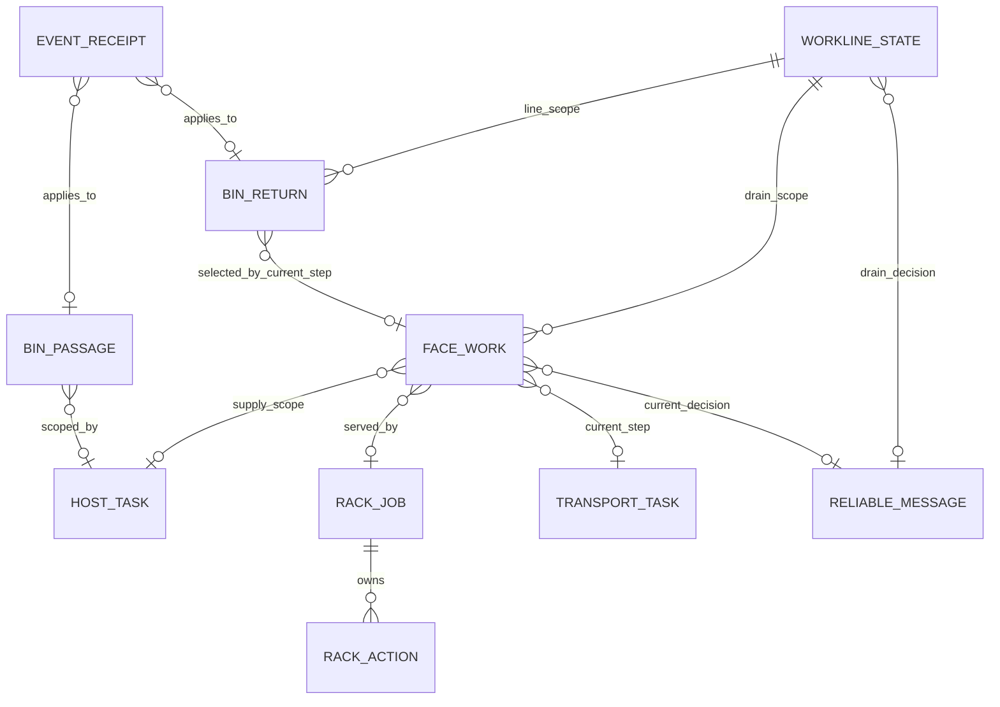
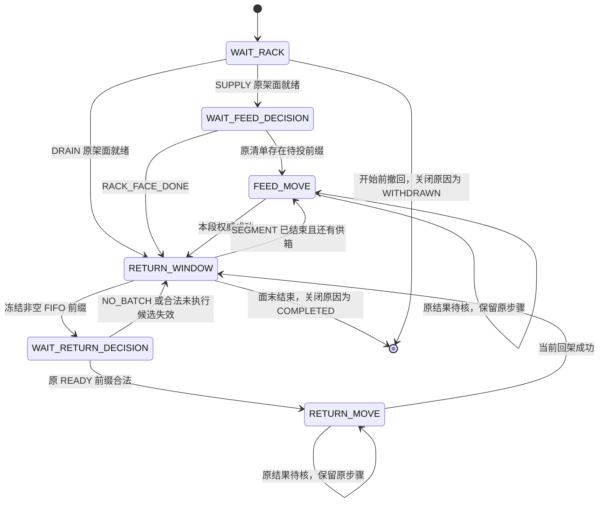

# BIN_Roller 四表实体与状态机设计

日期：2026-11-03。状态：**已按用户授权实施，本地软件验收完成**。

本轮审查决定：**旧表数据不迁移**。只安排无旧在制责任的 schema 切换；旧私表记录可丢弃，公共证据/其他业务数据不清空。删除原历史兼容字段与回填/重建方案；详见 §12。

本文记录已确认的字段、关系、推进和清理边界。实现以 `caca3c0` 为基线，工作区代码已切换四张组件表，并在可丢弃测试库验证迁移；未提交、推送或部署。软件证据和现场限制见[验收记录](../../testing/2026-11-03-bin-roller-four-table-acceptance.md)。

## 1. 目标、已确认边界与方案选择

### 1.1 已确认边界

1. WES 保存当前有效调度所需的进度，不建立永久业务历史。
2. 原所属任务已完成或已取消后，WES 不再恢复该任务的旧调度；后续由 WMS 根据最终业务状态产生新任务。
3. 调度终止不等于物理成功、原请求未发送或外部动作已被撤销。已发生事实保持原含义。
4. 普通供箱架与排空架共用 RackJob/RackAction，以来源和目的区分，不增加 DrainJob 或第二套架搬运状态机。
5. WMS 请求与响应复用 ReliableMessage，箱搬运复用现有 Transport，命令发送及 Result 复用 ECS 基础能力。
6. 原始 EVENT、技术幂等及原接收上下文归公共接收层；组件只保存事件应用后形成的业务关联与当前调度状态。
7. 组件采用四张表：bin_passage、bin_return、face_work、workline_state。前向经过和回流采用横表，一轮一行，不是一条箱码永久一行。
8. SCAN1/SCAN2 按同线同箱、原任务一致、原方向为向前且只有一个合格前驱时关联；歧义时独立保存，不新增协议字段。
9. 旧表不搬数据、不保留旧身份映射或恢复旧流程。schema 切换不等于授权执行清库、迁移或终止现场动作。

### 1.2 路线与取舍

| 路线 | 取舍 | 结论 |
| --- | --- | --- |
| 保留八表，只封装查询和对象 | 改动较小，但分段、窗口、批次和决定仍各自形成持久实体 | 不采用为最终模型 |
| 四张当前调度表，复用公共事件、消息、命令和搬运 | 减少业务关联链；需要同步补齐基础 EVENT、任务终止与清理能力 | **本轮已选方向** |
| 将所有状态和动作压入一个通用工作流表 | 混合箱、面、架和可靠投递语义，产生类型驱动的通用执行器 | 不采用 |

本设计使用现有服务、事务和公开读口，不引入状态机库、节点/边表、通用工作流、第二个 Sender、独立调度器或重试循环。

### 1.3 本设计明确作出的细化建议

- 保留现有无生产任务也可运行的公共回流。SCAN3/SCAN4 不向前追溯生产任务，不因某个生产任务终态而清空整线回流。
- 用 TASK 与 LINE 两种明确的本地执行范围区分归属。TASK 对应原宿主任务；LINE 是本线独立箱流的有限执行范围，不是新增 WMS 任务或 DrainJob。
- 工作线状态只保存排空申请及其当前执行范围，不复制全线箱位、架位和扫码点头指针。
- 活跃范围所需的公共证据在范围结束前保持可读；结束后按有限保存期清理。不为已结束流程保留无限档案。
- 横向 SCAN1/SCAN2 关联采用 §4.2 的已确认唯一前驱规则；不要求设备提供共同经过编号，不增加 EVENT/WMS wire 字段。内部宿主端口提供原任务上下文即可，部分行不阻塞本点业务。

以上为本次授权实施边界；最终软件检查与外部未验条件单独记录。

## 2. 实施基线与参考来源

基线 `caca3c0` 的旧组件八表见 `app/businesses/_components/bin_roller/models.py`：ScanFact、ScanArrival、RackPositionFact、FaceWork、FeedSegment、ReturnOpportunity、ReturnBatch、Decision。货架 cycle/action 已由公共 rack_dispatch 接管，Decision 当前 CHECK 仅允许 DRAIN。

该旧基线 `BinRoller.advance` 的回箱关联链是 batch → opportunity → face_work → RackJob；FIFO 在 scan_arrival 上自关联原 SCAN3 根和首次 SCAN4。FaceWork 已合并 demand/service/feed 的存储，但代码仍使用多个旧实体视角。

参考 `wes_backend`，仅借鉴实体职责，不照搬其所有表和恢复机制：

| 来源 | 借鉴内容 |
| --- | --- |
| `../wes_backend/src/app/transport/models.py` 的 transport_tasks / transport_members | 具体搬运的冻结身份、成员和结果由 Transport 承接 |
| `../wes_backend/workline_plugins/manual-picking/src/manual_picking/application/bin_line/return_model.py` 的 bin_line_returns | 一箱一回流轮次；SCAN3、SCAN4、命令及 FIFO 依据横向关联 |
| `../wes_backend/workline_plugins/manual-picking/src/manual_picking/application/passage_model.py` | 前向经过与生产宿主接缝采用明确的经过身份 |

不照搬该项目的 drain execution/member、Transport decision binding、永久历史或跨上下文恢复表。维护项目现有库与协议继续拥有可靠投递及物理执行证据。

## 3. 所有权、范围与实体关系

### 3.1 四表与公共能力

| 实体/能力 | 唯一责任 |
| --- | --- |
| bin_roller_bin_passage | 一次前向经过的 SCAN1/SCAN2、原生产委托、原释放责任 |
| bin_roller_bin_return | 一次独立回流轮次的 SCAN3/SCAN4、FIFO、当前分配与退出 |
| bin_roller_face_work | 一个原需求/服务在某架某面的串行供回箱进度 |
| bin_roller_workline_state | 每 owner/工作线一行，保存当前独立线级范围和排空申请进度 |
| rack_dispatch_job/action | 单架进场、换面、离场及原动作/决定 |
| Transport | 每笔 BIN_MOVE 等具体搬运的冻结请求和已应用结果 |
| ReliableMessage / WmsRequests | 原 WMS 请求、响应和可靠发送 |
| EcsCommand / send/result evidence | 原命令、发送尝试、Result 及其应用 |
| 公共 EVENT 接收 | 原事件、原绑定、技术去重、事件到业务对象的应用关联 |

图中的公共关联以公开接口读取，不授权组件直接查询框架私表。宿主任务类型由原 owner 的固定装配决定，不建立跨业务任务总表。

### 3.2 执行范围

三张过程表均保存 `scope_id`；范围种类按实体确定，只有 BinPassage 需要实体列 `scope_kind`：

| scope_kind | scope_id | 授权/终止来源 |
| --- | --- | --- |
| TASK | 原宿主 task_id | 宿主公开任务生命周期读口；COMPLETED/CANCELLED 后结束原范围 |
| LINE | workline_state 当前 line_run_id | 本线已受理的独立箱流；自然完成或显式结束本线原范围 |

SUPPLY FaceWork 必须归 TASK；DRAIN FaceWork 归 LINE。SCAN3/SCAN4 创建的 BinReturn 归 LINE，不能为了清理方便改挂当前生产任务。SCAN1 在本次合法处理时确定原 TASK 或 LINE；SCAN2 由宿主接缝给出可信原任务引用，不能由外部 EVENT 自填 task_id。

BinReturn 的范围固定为 LINE；FaceWork 的范围由 purpose 唯一确定，二者不再重复保存 scope_kind。只有可终止的调度消息保存显式范围标签；EVENT 不再重复保存范围列，依赖保护由业务原关联确定。

LINE 范围有明确结束条件：无该范围活跃 passage/return、无当前面服务或原 RackJob 待推进、无尚待业务应用的 EVENT，且排空阶段为 IDLE。满足后结束该 line_run_id；下一次新的独立事实可建立新范围。显式停止只停止指定原范围；若仍有未知物理队列，其 BinReturn 保留为只接受事实的 WAIT_FACT，不因清空 line_run_id 就删除或宣称 EMPTY。新范围的 FIFO 仍必须看到这些未确认退出的当前队首。

TASK 终态只结束它自己的对象和消息；不撤销其他 TASK、LINE 箱流或其他 owner 的工作。本设计不授权把一个旧架作业转交新任务。

动作归属在创建时固定：SUPPLY 面中的供箱、回箱分配和搬运随该 FaceWork 归 TASK；DRAIN 面及独立 SCAN3/SCAN4 归 LINE。BinReturn 是 LINE 队列事实，不意味着它参与的 TASK 动作可改挂 LINE。TASK 结束后，只允许独立可靠事实更新队列，不继续旧动作或创建旧任务后继，见 §9.4。

### 3.3 共用列与约束

除 workline_state 外，三张过程表均具有下列列。`text` 表示项目现有字符串 ID；新 ID 沿 UUIDv7 入口产生。新系统登记后的外部身份继续冻结；没有旧表兼容 ID 或迁移映射列。

| 列 | 类型/空值 | 规则 |
| --- | --- | --- |
| id | text，PK，非空 | 一次 passage/return/face 的内部稳定身份 |
| owner_domain | text，非空 | 原业务归属，不取当前工作线配置覆盖 |
| work_line_id | integer，非空 | 原工作线 ID，不按编码重建关联 |
| scope_id | text，非空 | 原 TASK ID 或 LINE run ID；范围种类按 §3.2 解释，一经登记不得改挂 |
| revision | bigint，非空，初始 0 | 每次业务变更递增，供事实依据核对，不作物理排序或分布式锁 |
| created_at / updated_at | timestamptz，非空 | 受理/变更时间，不代替设备动作事实 |
| closed_at | timestamptz，可空 | 未结束为空；终止推进时固定 |
| close_reason | text，可空 | COMPLETED / WITHDRAWN / TASK_COMPLETED / TASK_CANCELLED / LINE_CLOSED / SUPERSEDED / REMOVED / MERGED 等固定原因；各表约束允许子集 |

每张过程表具有 `(id, owner_domain, work_line_id)` UNIQUE，内部跨表引用以此三元组约束，禁止跨 owner/工作线关联。涉及 TASK 的外部引用由原宿主公开端口核对。所有更新先核对原归属及范围；不得以“同箱码最新一行”更新对象。

`closed_at` 与 `close_reason` 同空/同非空。业务状态终态必须对应 closed_at；终态不再进入自动推进。只在索引所需列保存阶段，不再保存可独立修改的 pending、feed_complete 等重复布尔值。

统一以 closed_at/close_reason 表达生命周期结束：FaceWork.phase 和 BinReturn.return_state 只保存结束前的业务阶段，不再另存 FINISHED/EXITED/CLOSED 等与关闭列重复的终态枚举。对外状态由关闭原因优先投影；索引和 pending 查询先检查 closed_at。保留原阶段是为识别在哪一步停止，不授予终态后的恢复权。

下文“某阶段必须有当前引用”等在制约束仅作用于 `closed_at IS NULL` 的行，CHECK 采用关闭行豁免；当前步骤的部分唯一索引也排除关闭行。已关闭行可以保留结束前阶段但清除已无责任的引用，不能因两者不同步而被误当在制。

## 4. BinPassage：前向经过横表

表名 `bin_roller_bin_passage`，模型 `BinPassage`。一行覆盖一次 SCAN1→SCAN2 经过，也允许只观察到其中一个点位。无效扫码保留原始码，bin_code 可空。

### 4.1 字段

下列为共用列之外的列；`?` 表示可空。

| 列 | 类型 | 含义 |
| --- | --- | --- |
| bin_code | text? | 标准箱码，不能用预期清单补不可读实际码 |
| scan1_event_id / scan2_event_id | bigint? | 各点本次规范业务经过的首条公共 EVENT 收据引用 |
| scan1_visit_key / scan2_visit_key | text? | 原本点经过身份；保留原分隔依据形成的键，不用消息时间戳充当轮次 |
| scope_kind | text，非空 | TASK / LINE；本表不能仅由点位或箱码推导范围 |
| scan1_command_code | text? | 原 MOVE_FORWARD/MOVE_RIGHT 命令 |
| scan1_consumed_result_id | text? | 原已消费 Result 身份 |
| production_record_id | text? | 成功委托后保存宿主生产记录 ID；类型由固定宿主接缝解释，不再包装任务/owner/线或生产状态 JSON |
| release_command_code | text? | SCAN2 原释放命令 |
| release_consumed_result_id | text? | 原释放 Result 的消费身份 |

每点 event_id/visit_key 成对出现；只出现另一点时本组为空。原始码、设备、时间和分隔依据经公共 EVENT 读口从原事件/上下文/应用关联读取，不在业务表再存一份。bin_code 是规范化且用于关联查询的列，原始码不可读时为空。命令消费位非空必须有原 command_code；production_record_id 的范围必须由宿主核对，不能指向其他任务/工作线。

不保存 scan1_state、delegation_state、release_state。它们作为只读投影：event 为空为 ABSENT；事件已保存而 command 为空为待登记；command 非空且消费位为空为待结果；消费位非空为已消费；production_record_id 非空为已委托；closed_at 非空则停止自动推进。已消费不等于 SUCCESS，成功/失败从原公开 Result 读取。生产委托与释放仍是独立责任，只是不再多存一份可独立修改的枚举。

释放 call_key 在新登记时由稳定 passage_id 确定；登记后恢复只使用已保存的 release_command_code，原 call_key 与冻结输入由 EcsCommand 保有；未登记命令没有需要另存的随机 call_key。

### 4.2 关联与状态机

1. 同技术消息由公共收据先去重，直接重放原 ACK，不重新求值方向或生产委托。
2. 新技术消息按原本点规则识别业务经过：连续相同内容且没有新的原本点有效分隔，仍属原经过；内容改变或合法原命令结果形成新分隔时为新经过。A→B→A 必须保留为不同经过。
3. 处理 SCAN2 时先按本点业务经过键查重；已经有原 SCAN2 关联的事件直接复用，不重新搜索 SCAN1 候选。新经过在原 receiver 事务和原锁序内，由宿主只读/锁定接缝确定本次原任务上下文，再检查前驱；不先向宿主提交一个临时 passage_id 后又换号。
4. 合格前驱必须同时满足：相同 owner_domain/work_line_id；两个规范 bin_code 都非空且相同；前驱归 TASK 且其原 scope_id 与宿主确认的 SCAN2 原 task_id 一致；原 TASK 仍有效、前驱未关闭；有原 SCAN1 事件和原方向命令，公开 ECS 命令投影确认原 task_type 为 MOVE_FORWARD；尚无 scan2_event_id。原方向只检查已冻结命令类型，不等待 SCAN1 SUCCESS、ACK 或上游 Transport，不新增 Result 准入门槛。
5. 恰好一个合格前驱时，锁定该行并重验全部条件后填入 scan2_event_id/visit_key，沿该 passage_id 同事务完成一次生产委托并保存 production_record_id。零个或多个时建立独立 SCAN2 部分行，照常处理本点，不按最大 ID、最近时间或当前任务改挂旧行。task_id 不一致、没有原任务或箱码不可读均不合并；不因此拒收扫码。迟到 SCAN1 不反向搜索并拼接已经独立受理的 SCAN2。
6. 会新增前向候选的新 SCAN1 和执行匹配的新 SCAN2，均在 receiver 原事务按 WorkLine → Devices 按 ID → 宿主主体 → Passage 的顺序锁定本线，再读取候选集合并登记；只锁一条已选前驱不足以防止另一 SCAN1 并发加入候选。并发 SCAN2 在前驱锁下重验本点去重和全部匹配条件，不能因前驱已被等价消息填入就另建一份委托。保持 receiver 原隔离级别，不新增点位头、占位或进程内锁；锁后原绑定/任务依据已失效时整事务技术回滚，不能改挂新 owner。scope 和点位填入后不再因队列切换重新关联。
7. 公共 EVENT 的 application_ref 保存原 subject_id、canonical_event_id 和本点分隔依据；点位从原 DeviceBinding.device_role 读取。业务 visit_key 是该原依据的内容键，仅在业务表为唯一查询保存；canonical_event_id 是首条原事件引用，二者不混用。不再生成/保存第二套 point_visit_id。后续技术消息逐条关联同一 canonical_event_id，不在业务行保存无限事件数组。

状态迁移如下：

| 输入/条件 | 原子变更与后继 |
| --- | --- |
| 首次 SCAN1 | 保存点位经过及原范围；按既有有效任务/-B 规则登记并保存原方向 command_code |
| SCAN1 原匹配 Result | 保存消费身份；失败/未知不伪装成成功 |
| 首次 SCAN2 | 按唯一前驱规则关联或建立部分行；同 receiver 事务调用宿主 accept_scan2，成功后保存 production_record_id；异常整笔回滚 |
| 原宿主释放许可 | 同事务登记一次原 call_key 并保存 release_command_code |
| 原释放 Result | 匹配原命令/设备后保存消费身份；不把宿主整任务完成当释放成功 |
| 本经过的实际责任结束 | closed_at 固定；派生状态 FINISHED，不重建生产义务 |
| 原 TASK 终态 | closed_at 固定、close_reason=TASK_COMPLETED/TASK_CANCELLED；保留已观察的引用/消费事实，不另覆盖子状态，不再生成释放命令 |

只有 SCAN1 的向前部分行在原 Result 消费后不再有命令消费待办，可在原 TASK 有效期间保留为后续 SCAN2 候选，不能因为消费已完成就先关闭该候选；任务终态时统一关闭。缺失的 SCAN2 不构成新的释放责任。零个/多个合格前驱时，SCAN2 部分行独立委托/释放，不等待未来补入 SCAN1。关联规则只有上述一套，不增加共同经过号、设备流水号或模式开关。

索引：两个非空 visit_key 各自按 `(owner_domain, work_line_id, visit_key)` 部分唯一；两个 canonical event_id 各自部分唯一；`(owner_domain, work_line_id, scope_kind, scope_id, closed_at)`；唯一前驱候选的 `(owner_domain, work_line_id, scope_id, bin_code)` 部分索引（TASK、未关闭、有 SCAN1、无 SCAN2）；原 release_command_code 非空唯一。原方向经命令公开投影核对，不为索引再加 direction 标志。不设“每线每箱只有一条未结束 passage”约束，避免合法新经过被旧责任误挡。

## 5. BinReturn：回流横表与 FIFO

表名 `bin_roller_bin_return`，模型 `BinReturn`。合法回流一箱一轮；也容纳 SCAN3 无效码分流和尚无可靠轮次关联的 SCAN4 本点观察。横表不要求事件按网络接收顺序到达。

### 5.1 字段

| 列 | 类型 | 含义 |
| --- | --- | --- |
| bin_code | text? | 合法回流非空；无效码分流观察允许为空 |
| scan3_event_id / scan3_visit_key | bigint?/text? | 原 SCAN3 规范经过；合法轮次以它为根 |
| scan3_command_code / scan3_consumed_result_id | text? | 原方向命令与消费位 |
| first_scan4_event_id | bigint? | 本轮首次有效 SCAN4 到位引用，固定不变 |
| first_scan4_received_at / fifo_visit_key | timestamptz?/text? | 固定 FIFO 排序对，重扫不刷新 |
| scan4_event_id / scan4_visit_key | bigint?/text? | 当前本点观察/尝试依据，区别于首次 FIFO 依据 |
| scan4_command_code / scan4_consumed_result_id | text? | 当前原命令与消费位 |
| is_current | boolean，非空 | 是否属于本箱当前物理轮次；不是动作成功/完成标记 |
| return_state | text，非空 | OBSERVED / WAITING / READY / ALLOCATING / MOVING / WAIT_FACT；是否结束统一看 closed_at/close_reason |
| selected_face_work_id / selected_step_id | text? | 当前明确选中本轮的面作业/步骤；分配或搬运期间必须成对存在 |
| transport_task_id / client_request_id | text? | 当前原回架 Transport 引用，不能从箱码反查最新任务 |
| caller | JSON? | 当前原 TransportCaller，随动作冻结 |
| consumed_outcome_revision | bigint? | 本轮对当前原搬运结果的消费进度 |

首次 SCAN4 的 event/time/fifo_visit_key 同空或同非空。未关闭行的 `ALLOCATING` 必须有选中引用；MOVING 必须有原 Transport 引用及有效原步骤；WAIT_FACT 保留原引用但没有旧步骤执行权，见 §9.4。固定成员顺序保存在 FaceWork 当前步骤，不能从实时 FIFO 重建已提交请求。已关闭行不再要求当前选择或 Transport 引用，但不得改写已保存的结果事实。候选 round_id 使用本表 id，不以 SCAN3 event_id 替代。

原码、设备和本点分隔依据从公共 EVENT 读取；不另存 point_visit_id 或尝试次数。合法新尝试由新 canonical SCAN4 event_id 和原 command_code 唯一标识。首次 SCAN4 时间/fifo_visit_key 仅为固定 FIFO 索引保留，不再保存一份通用扫码时间。

### 5.2 状态机与特殊分支

| 状态/事实 | 迁移 |
| --- | --- |
| 无效 SCAN3 或先观察到 SCAN4 | OBSERVED；事件及原分流命令照存，合法关联不足不冒充回架资格 |
| 合法 SCAN3 建立本轮 | WAITING；本点合法即按原规则放行，不检查生产任务或上游 Result |
| SCAN4 原本点 SUCCESS 且轮次关联合法 | READY；不等待 SCAN3 Result，不把 ACK 当 SUCCESS |
| 连续合格前缀被当前请求冻结 | ALLOCATING，关联原 face_work/step |
| WMS READY 的获准前缀建立原 Transport | MOVING；未分配尾部释放本次选中关系，恢复自身原资格 |
| WMS NO_BATCH | 本次窗口结束；未搬运轮次解除分配，回到自身原资格，不改 FIFO |
| 原成员成功、终位严格匹配、无 pending 核对 | 固定 closed_at/close_reason=COMPLETED，投影 EXITED；清除本轮当前调度关系 |
| 原动作失败/未知/不合法结果 | 保持 WAITING/ALLOCATING/MOVING 原阶段并从原公开结果给出阻塞原因；保留当前引用，不自动换号重搬，不再额外存 REVIEW 状态 |
| TASK 动作已停止但可能已发，箱的退出事实仍不明 | WAIT_FACT；仅接受原匹配结果、新可靠扫码或明确接管事实，不再调度旧 TASK 动作 |
| 明确人工移出接管/所属范围终止 | 固定 closed_at 及准确原因，投影 CLOSED；不标已回架 |

同轮 SCAN4 重扫沿用已确认 C07：只有原本点命令明确 FAILED、确定停止且无核对义务，之后真实重扫、同轮尚无冻结分配/在途搬运时，才能创建新尝试。更新 current scan4 事件/命令引用；first_scan4/FIFO 不变。原失败与旧命令仍在公共 EVENT/Command/evidence 中，不能覆写。ACK、超时、HELD、UNKNOWN 或新时间戳都不是重发依据。

真正新 SCAN3 可使旧轮次 is_current=false，但不把旧原搬运伪造成成功。旧轮仍有当前有效范围内的冻结动作时，旧 FaceWork 保存该动作及原成员，按原身份处理；新轮不能继承旧 SCAN4 成功。不得仅因为出现新轮就终止仍有效的外部执行。

关联不明的 SCAN4 以 OBSERVED 行保存，并通过公共 EVENT 原应用关联定位。该行立即冻结首次到位排序键；尚未确认它已退出或被后续物理经过替代时，仍是未就绪的 FIFO 队列观察，不能因为没有 SCAN3 根就过滤掉。以后若有唯一原依据可关联，事务内将当前观察并入合法回流行，更新公共引用，原观察行以 MERGED 原因关闭；首次 FIFO 键复制而不刷新，不修改原事件或首次受理时间。合并是同一已观察经过的关联细化，不允许任意把已应用事件改挂另一物理经过。始终歧义则不授权该箱回架；只按真实 FIFO 队头约束影响同线后箱，不建立额外全线正常扫码等待门禁。

### 5.3 FIFO 与索引

读取本线所有带首次 SCAN4 排序键且未确认退出的队列记录：既包括 `is_current=true` 的合法轮次，也包括仍有效的孤立 OBSERVED SCAN4。OBSERVED 的有效性按原本点事件关联及已确认的替代/退出依据判断，不使用合法 round 根唯一索引筛掉它。先按冻结排序对检查队首，再截取至多四箱连续合格前缀。不得先 WHERE READY 后排序，也不得过滤 ALLOCATING/MOVING/OBSERVED 或结果待核的队首再跳到后箱。

新记录使用首次到位受理时间与稳定 visit_key 冻结顺序；不复制旧 FIFO。**现有 API 部分文字写设备发生时间，与当前源码的受理时间排序存在口径差异，启用新模型前须统一。** 设备 timestamp 继续在原事件中保存，重报/失败重扫均不刷新首次 FIFO。WAIT_FACT 不可过滤后越过；它不进入旧动作的自动推进待办，也不对其他独立工作线设门禁。

索引：`(owner_domain, work_line_id, bin_code)` 在合法、is_current=true 且 closed_at IS NULL 的回流根上部分唯一；SCAN3 visit_key 非空部分唯一；FIFO 索引 `(owner_domain, work_line_id, first_scan4_received_at, fifo_visit_key)`；选中步骤索引；范围/closed_at 索引。OBSERVED 孤立观察不抢占合法当前轮次唯一键；同箱已关闭旧轮不能阻挡合法新轮登记。

## 6. FaceWork：一面一个串行供回箱状态机

表名仍为 `bin_roller_face_work`，模型 `FaceWork`。一条原需求/面服务一行。同任务同架同面后续合法新需求可形成新行；A→B→A 的原服务与 RackAction 身份不能合并。

### 6.1 字段

| 列 | 类型 | 含义 |
| --- | --- | --- |
| purpose | text，非空 | SUPPLY / DRAIN，周期内不互转 |
| plan_revision / change_id | integer?/text? | SUPPLY 的原计划版本/变化身份，DRAIN 为空 |
| rack_id / rack_face | text，非空 | 原架面，不从当前配置重算 |
| rack_job_id / preparation_action_id | text? | 原公共架作业、该面实际准备动作 |
| demand_state | text? | SUPPLY 为 ACTIVE/WITHDRAWN，DRAIN 为空 |
| phase | text，非空 | WAIT_RACK / WAIT_FEED_DECISION / FEED_MOVE / RETURN_WINDOW / WAIT_RETURN_DECISION / RETURN_MOVE；结束统一看关闭列 |
| feed_operation_id / feed_message_id | text?/bigint? | 原整面供箱请求，SUPPLY 开始后固定 |
| feed_cursor | integer? | 已成功消费的原清单前缀数量；总数从原供箱结果读取，DRAIN 为空 |
| window_id / window_kind | text? | 当前回箱窗口身份；SEGMENT / FACE_END / PURE_RETURN |
| step_id | text? | 当前步骤稳定身份；步骤种类从原 phase 推导，不另存 step_kind |
| return_operation_id / return_message_id | text?/bigint? | 当前回箱分配请求 |
| return_members | JSON? | 当前最多四项固定 `(round_id, bin_code, sequence_no)`；不是历史批次数组 |
| current_client_request_id / current_transport_task_id | text? | 当前原箱搬运身份 |
| consumed_outcome_revision | bigint? | 仅供箱步骤的已消费版本；回箱成员消费位归 BinReturn，不再同步维护第二份 |
| review_reason | text? | 当前阶段不能推进的固定原因；阻塞时保留原 phase，不另转 REVIEW，不保存原异常字符串 |

不再保存一份完整 feed/return manifest、历次分段、机会或批次列表。整面供箱清单从原 feed_message 的公开结果读回；当前目标成员在 Transport 登记后由冻结 Transport 承接。return_members 是 wire 中没有的本地轮次映射，必须保存到当前步骤完成。

不保存 feed_count、step_start、step_count：当前供箱区间为原 feed_cursor 起的至多四项，cursor 在原步骤确定成功前不移动；Transport 建立后再用其冻结成员核对。caller 和 INLET/OUTLET 从原 RackJob.origin.caller/resources 读取，不复制、不用当前配置替换；原 RackJob 缺失或上下文不符时不能发送。

不保存 window_basis_transport_id/window_closed_reason：成功供箱消费、推进 cursor、打开唯一窗口同事务完成；原步骤身份可用于产生 window_id，但不把已确定成功的旧步骤作为后续恢复依赖。结束窗口直接转下一阶段或固定关闭列，不另存“窗口已结束”状态。review_reason 只保存业务校验失败等当前需要解释且不能由原公开结果唯一推导的固定原因，不复制可靠投递状态、HTTP 错误或原始异常；已结束过程不为排障新增历史列。

窗口和步骤用具名列及固定校验，不实现可扩展 kind 注册器。每面同时至多一个当前箱搬运；不同面作业仍各自保存进度。

### 6.2 状态机

任一未关闭行均可因原范围结束固定关闭列，保留结束前 phase；图省略这些重复边。review_reason 不为空时暂停该原阶段的新后继，仍可沿原结果读取/补齐并在同事务清除原因；不能统一按“重试”创建新搬运。step_kind 是只读派生值：仅对未关闭行，FEED_MOVE 为 FEED，WAIT_RETURN_DECISION/RETURN_MOVE 为 RETURN；其他阶段没有当前 step_id。关闭行不再投影当前步骤种类。独立的原供箱请求由 feed_message_id 保持，不因此丢失。

### 6.3 当前步骤与窗口规则

1. 创建步骤时分配并保存 step_id、原请求/成员及下一个外部意图，同事务提交。重复推进先读当前原身份。
2. 供箱每段不超过四箱。只在该段所有原成员权威成功、终位匹配且无待应用核对时推进 cursor。折叠成功段依赖现有 Transport 确定终态不能由后续结果改写的合同；后续矛盾走原 TERMINAL_CONFLICT，不能回退游标重投。UNKNOWN/pending 或尚可补齐的非确定步骤不能折叠。
3. SEGMENT 窗口至多一笔回箱；成功一笔即续投，即使 READY 仅分配部分前缀，也不为排空尾部追加第二笔。
4. FACE_END/PURE_RETURN 可连续多笔，但每次只保存当前批次。消费原成功批次和登记下一批在同一事务内完成；旧 batch/step 重报不能推进当前新批次。
5. 未登记请求且没有候选可按原规则结束窗口；不发送空请求、不伪造 NO_BATCH。面末无合格候选不等于物理通道排空；drain 是否排空另看完整回流状态。
6. 确定 NO_BATCH 结束本窗口，重复唤醒或仅新增候选不得重新打开；下一供箱段成功或新合法面服务才有新窗口。
7. 当前请求未知、409/422、Transport UNKNOWN 或未决更正继续原步骤；不能通过清空引用逃到下一步。
8. 消费部分结果时，只按原匹配成员更新对应 BinReturn。已明确离开来源但未成功到目标，可撤销旧当前位置关联，但不把整批改成成功。
9. 供箱完成投影由原供箱结果与 cursor 计算；面服务完成由 close_reason=COMPLETED 判断。二者不互相代替。DRAIN 不伪造 feed_complete。回箱结果消费按各 BinReturn 的原引用和 consumed_outcome_revision 原子更新；FaceWork 的本步执行成员只取原 WMS READY.moves 批准的有序前缀，并与当前冻结 Transport 成员逐项核对，不能使用全部 return_members 候选作为完成集合。未分配尾部解除选择后保留原 FIFO 资格，不阻止本步完成。获准前缀的原 Transport 权威结果和对应 BinReturn 完成事实均满足后才能推进，不再维护同一回箱消费版本副本。
10. 需求成员撤回不等于宿主任务终态。开始前可用 WITHDRAWN 原因关闭；已开始且 TASK 仍有效时沿原已冻结责任处理。原 TASK 已终态则按本文终止，不再沿旧规则无限履约。

### 6.4 约束与关联

- SUPPLY 的范围派生为 TASK，且 plan_revision/change_id/demand_state 非空；DRAIN 的范围派生为 LINE，且这些列为空。
- 活跃 SUPPLY 原需求按 `(owner_domain, work_line_id, scope_id, plan_revision, rack_id, rack_face)` 唯一；历史重复/撤回仍沿原语义核对。
- 未关闭行的当前 step_id 按 FEED/RETURN 两种派生种类分别建立部分唯一索引：FEED_MOVE 与 WAIT_RETURN_DECISION/RETURN_MOVE 各自唯一，review_reason 不改变原 phase；client_request_id、transport_task_id 在未关闭且非空的行中部分唯一。消息引用与 operation_id 成对存在。旧 feed_segment 与 return_batch 是不同身份命名空间，不能假定二者字符串 ID 永不相同。
- RETURN 分配期间有完整有序 return_members，至多四项，轮次不重复；BinReturn 反向引用必须匹配该面、step_id 和 owner/线。
- 登记下一步骤前，原 current step 必须已确定完成或取得原合同允许的不执行依据。不能只因有较新结果就覆盖当前步骤。
- 新普通 RackJob 的原需求来源引用 FaceWork.id；面准备动作 source_ref 也使用该面作业 id，不再分配另一套 service ID。DRAIN RackJob 来源为原 drain_operation_id。FaceWork 不另存重复 source_ref/origin_service_id；生产许可仍要求原准确工作位/面向的已应用 ENTER/ROTATE。

## 7. WorklineState：最小线级运行上下文

表名 `bin_roller_workline_state`，模型 `RollerWorklineState`。主键 `(owner_domain, work_line_id)`；不扩展管理配置表 WorkLine，不建设平台通用 workline_state。

### 7.1 字段

| 列 | 类型 | 含义 |
| --- | --- | --- |
| owner_domain / work_line_id | text/integer，PK | 固定组件归属/线 |
| line_run_id | text? | 当前有限 LINE 范围，结束后可清空；新范围新 ID |
| revision / updated_at | bigint/timestamptz，非空 | 业务版本/更新时间 |
| drain_phase | text，非空 | IDLE / REQUESTED / WAIT / USING；原响应异常保留原阶段并记录原因 |
| drain_operation_id / drain_message_id | text?/bigint? | 当前原 WMS 申请，不复制 request/decision JSON |
| drain_retry_at | timestamptz? | 原 WAIT 消费后固定截止，不随重读推迟 |
| candidate_cursor | integer? | 原 READY 中当前要处理的候选位置；该架结束才推进，不保存可重复推导的 current_rack_job_id |
| drain_review_reason | text? | 原响应/关联非法时的固定原因 |

不保存全线箱位、架位、扫码点头指针、容量计数、通道占位、分布式租约或历次 drain 数组。行锁用于本地一致性，不表示物理资源被 WES 占用。

不保存 run_state：line_run_id 非空表示原 LINE 范围有效，结束时与原范围关闭动作同事务清空；按已保存 scope_id 查询时，只有与当前 line_run_id 相同才有效，旧 ID 不复用。无 workline_state 或读取失败是 UNKNOWN，不能据此推断某范围已关闭。无当前运行与已关闭的旧运行不再用一行上的枚举同时表示。

### 7.2 排空推进

1. 原生产接续求值为 NONE，且仍有需要服务的原 FIFO 前缀，按现有规则申请 drain；UNKNOWN 不当 NONE，不因普通架无新记录就求架。
2. 同一事务登记 operation_id、消息及 REQUESTED。已有引用总是先恢复，不能因队首变化换号；不再生成另一个 drain_request_id/source_ref 字段。
3. 合法 WAIT：保存一次固定 retry_at，进入 WAIT；到期且仍有需要才建立下一请求。原 WAIT 已消费、下一请求引用与消息在同一事务切换，不靠历史链寻找末端。
4. 合法 READY：严格解析原候选/有序面，进入 USING。候选清单按原消息读取；cursor 仅记录已选进度。
5. 按 candidate_cursor 从原 READY 读取当前 rack_id，经公开 RackDispatch.jobs 查询精确的 `(owner, line, source_kind=ROLLER_DRAIN, source_ref=drain_operation_id, rack_id)`；没有则同事务 register 并保持游标，有一条则恢复它，多条为原关联冲突。注册唯一性仍由公共原来源约束保证，不用“最新作业”。一架的所有面服务通过原 RackJob 与原候选关联。
6. 当前架离场按公共原提交接纳规则结束调度，不等 CTU03 最终 Result；消费结束依据、推进 candidate_cursor 与选择下一候选同事务完成。若还需排空，同事务恢复/登记原 READY 下一候选，不重新申请整批，也不依赖更旧已完成作业历史来计算游标。
7. 提前排空时，不建立后续候选作业。已登记但尚未产生外部执行义务的作业沿公共 withdraw_unused；已开始的原架在本 LINE 范围仍有效时沿原规则处理，不能伪造撤回。
8. 所有原候选服务及相关直接步骤已结束，清除本次申请字段、drain_phase=IDLE。若有新合法需要可同事务登记下一次求值。仍被当前 RackJob 引用的原请求消息在引用结束前不可删除。

`USING` 不表示有架在位；原候选关联也不授予生产许可。原 line_run_id 已结束后不得因晚到旧响应恢复本范围。drain_review_reason 只解释原阶段的阻塞，不另维护一套 REVIEW 阶段。

### 7.3 代替 position_fact 的方式

本设计删除独立位置历史表，但不把“查不到”变成“空位”。

- 原扫码位置由公共 EVENT 的固定本点经过及其业务应用关联解释；需要本点最近经过时经公开事件查询按原作用域读取，不建立可抢改的点位头表。
- 当前架位/面向使用原 RackProgress.actual_position/actual_face/position_action_id；多个作业涉及同点时依据原已确认动作及当前事实核对，不用 job 创建时间取最新，也不新增跨 Transport 排序器。
- 箱搬运的位置使用原 Transport 公开已应用成员结果；BinReturn 的 current/退出状态只描述本轮关联，不是全场位置账。
- 旧 INLET 结果不能覆盖后续已观察到的 SCAN1/2；旧 CTU02/03 结果不能重置已由后来原事实确认的新架面。因果关系无法唯一核对时返回未知，不授予下一动作。

公开 RackDispatch 增加 `get_point_preparations(owner, work_line_id, point)` 只读投影，复用现有 progress/final_result/has_position_conflict。确定可服务架必须同时满足：原 job 为 ACTIVE 且范围有效；`current_action_id=position_action_id=该面 preparation_action_id`；动作是原已应用成功 ENTER/ROTATE；位置/面、结果版本与该动作一致；无较新 pending/position observation、无原直接动作冲突。只有一条完整匹配候选时才能作为本点可服务原架；零条为未具备许可，多条为 POSITION_CONFLICT，不能按 job ID、创建时间或回调接收时间挑一条。后者是明确异常，不新增长期当前关系表。

正常跨架接续中，旧架原 DEPART 接纳已使旧 job 退出 ACTIVE/pending，其保留的 actual_position 不再参与可服务候选；旧 job 的最终 CTU03、旧动作的 CTU02 迟到不能重进候选。一个仍 ACTIVE 的 job 内，只有原 current preparation 的匹配结果可授权；旧动作的更新观察按既有冲突机制处理。新运行若无法满足该查询唯一性则报告 POSITION_CONFLICT，不能靠隐藏 current 架指针或任意最新行兜底；切换不迁移旧位置数据。

这些规则必须形成替代读口与负向测试后才能启用四表。旧位置记录不重建；切换基线必须无待恢复的旧位置/搬运责任，不任意选择旧“最新”行作为新当前状态。

## 8. 公共 EVENT 接收：最小基础层改动

### 8.1 唯一证据来源

ECS send/result evidence 分别属于原命令发送尝试和 Result；主动 SCAN_COMPLETED 走 callback_receipt。callback_snapshot 是后台限流/可截断排障材料，不能用于推进。复用 callback_receipt，只增加三个 EVENT 专用可空列，不新建事件表或事件执行框架：

| 列 | 类型 | 用途 |
| --- | --- | --- |
| event_envelope | JSON? | 校验后的 device_code/event_type/timestamp/data，完整有界保存 |
| event_context | JSON? | 原 owner/component、work_line_id、device_id/role、设备与工作线版本；不复制整份 device_bindings/position_bindings 或可执行模块路径 |
| application_ref | JSON? | 固定结构 `{subject_kind, subject_id, canonical_event_id, predecessor_event_id, separator_command_code}`，定位原业务对象/规范经过与分隔依据 |

原 digest、唯一约束、256 KiB 限制、ACK 与先查重顺序不变。非 EVENT 回调仍可空；切换前旧收据不回填，缺少规范内容时公开读口返回 UNAVAILABLE，不编造历史。原收据在保留期内仍可按原身份重放 ACK。

不加 application_state、EVENT scope_kind/scope_id，也不重复保存 component/point/visit_key；前者从原业务关联和活跃引用判断，后者分别来自 event_context 和业务唯一索引。事件有效处理与业务事实同事务提交，错误整笔回滚。

### 8.2 只读端口与应用关联

使用 `app.integrations.ecs_callback.results` 的无状态公开函数读取原事件及本点规范经过。调用方传入原 session；返回独立 DTO/副本，不暴露 ORM、不加写锁、不 autoflush、不提交、不发网。原始内容缺失、身份/上下文不符必须显式区分，不能当作没有事件后重新建动作。

不要求给所有 Capabilities 构造者新增 EventReader 参数，不把业务范围查询注入可靠发送，不提供未知事件通用 replay。原 EcsEventContext 只收集本次可信 application_ref，receiver 在原事务写回；多条技术消息逐条关联同一个 canonical_event_id。

本点顺序由原规范经过的首次受理依据确定，不以最后技术重报刷新顺序。只需要原 ID 精确读取及本点有界查询，不建立全场事件搜索/物理排序服务。

### 8.3 SCAN2 内部接缝

沿原事务先解析/锁定本次宿主任务上下文，按 §4.2 判定唯一前驱，再以最终 passage_id 委托并保存 production_record_id。调整的是内部端口，不向设备/WMS 新增 task_id、passage_id 或流水号。ECS 命令公开投影补齐冻结 task_type/device_code 供原方向核对；SCAN2 DTO 只传一个本地经过身份。

## 9. 任务终态、独立回流与有限清理

### 9.1 先固定动作所有权

TASK 终态只取原宿主已持久化的 COMPLETED/CANCELLED；成员撤回、取消请求未获准、查不到任务都不等于任务终态。现有整任务取消准入不因本设计放宽。

| 对象/意图 | 创建时归属 | TASK 终态后的处理 |
| --- | --- | --- |
| SUPPLY FaceWork、对应供箱/回箱决定与箱搬运、普通 RackJob、该 TASK 的前向/释放命令 | 原 TASK | 停止原发送和自动推进，不转移到 LINE |
| SCAN3/SCAN4 与 BinReturn 队列事实 | 原 LINE | 独立接收事实；不因原生产任务结束虚构已退出 |
| DRAIN 面、排空申请与对应 RackJob/搬运 | 原 LINE | 继续原 LINE 自己的调度，不接管已关闭 TASK 的旧动作 |
| 已提交的事实报告、回调 ACK、结果证据 | 原公共可靠交付 | 不因任务关闭被一并丢弃；它们不是待撤销的调度许可 |

消息范围标签仅用于**可终止的调度意图**；不得给全部 facts/report 批量贴 TASK 标签并在终态吞掉原事实交付。其他业务/无标签调用者保持原行为，本次不全仓推广“任何父状态变化都取消消息”。

### 9.2 基础停止能力：保留消息标签，不回查业务

现有 settle 证明对端已接收，hold 是可恢复暂停，均不能代表任务责任已结束。保留最小公开能力：可靠消息新增 `scope_owner/scope_kind/scope_id`（可空、全有或全无），可终止调度登记时冻结；新增技术终态 ABANDONED 表示本地不再投递，不等于外部取消/失败/成功。

业务在原任务终态事务中调用 `Outbox.stop_scope(session, scope, reason)`，精确终止标签匹配的未结束消息，清租约与排期，保留请求、已观察响应及不确定事实。消息已 DONE/FAILED/EXPIRED 不重写。ECS snapshot 走既有 lifecycle 的正确锁序，不直接改 framework 私表。ABANDONED 分支只更新原投递状态/停止依据，保持实际执行/Result/needs_reconciliation 事实；不得落入旧默认映射把 DISPATCHING/WAITING_RESULT 重置为 QUEUED。

**删除原方案的通用 lock_scope/scope_status 授权回调框架。** Sender 不新增宿主任务/四表生命周期回查，不把原业务恢复注入 reliable；既有 ECS 冻结路由、角色授权和配置代次发送门禁必须保留，不能以精简为由删除。所有会给原 TASK 创建新意图的业务事务，与终态关闭使用同一 WorkLine/原任务锁序，并在锁后重验任务；因此消息要么先提交并被关闭事务停止，要么关闭后不再登记。后续维护/重报也必须遵守这个入口，不绕过它。

### 9.3 两条发送路径与明确竞争边界

普通 send_one 与 snapshot 都必须在真正尝试前校验原消息状态/租约；仅带调度范围标签的消息在框架事务中设置首个 `dispatch_started_at`。未标签消息保留原保守判断，不因无关业务发送引入新增范围证据或降级限制。领取时间 last_attempt_at 不是派发证据。gate 不持数据库事务/连接跨 HTTP，不向业务请求授权。

- stop 先取得消息锁并提交：旧 claim 不得再取得派发权，HTTP 次数为零。
- gate 先提交持久派发权：该次请求保守按可能已发处理；stop 只能禁止后续尝试，不能承诺召回网络中的请求。
- finish/recover/maintain/settle/resume 不得把 ABANDONED 复活；原迟到证据照实接收，不授予业务后继。
- `NEVER_DISPATCHED` 必须有原生命周期及 dispatch_started_at 为空等明确证据；ABANDONED、超时、消息缺失、HTTP 失败或 delivery_terminal 本身都不能推出从未下发。停止结果分别标明 NEVER_DISPATCHED / MAY_HAVE_DISPATCHED / TERMINAL，TERMINAL 只是消息终态。

保留 ABANDONED 与派发起点是为表达真实的停止/竞争，不能为减少状态而用 DONE 冒充。无需再建立 scope 表、scope 调度器、租约系统或第三个执行范围管理器。

### 9.4 TASK 关闭时，独立回流不接管旧动作

同一原事务：持有原 WorkLine/任务及业务锁 → 写任务终态 → stop_scope → 关闭原 FaceWork/Passage/RackJob 后继 → 处理选中 BinReturn → 提交。RackJob 用 CLOSED_BY_SCOPE 和原关闭依据退出调度，不能伪造 DEPARTURE_ACK。

独立 LINE BinReturn 可能被 TASK 面服务选中，但它不因此取得旧 TASK 的执行权：

| 原 TASK 步骤状态 | BinReturn 的处理 |
| --- | --- |
| 只有 WMS 分配请求，尚未登记物理 Transport | 停止原决定请求；解除旧选择，按原本点资格回到 READY/WAITING。WMS 决定是否有业务预留归 WMS 最终状态处理；不声称旧响应是 NO_BATCH |
| Transport 已登记，取得明确 NEVER_DISPATCHED | 解除原选择，恢复本轮自身原资格，不重用旧 TASK 意图 |
| 可能已派发或只知道提交接纳，退出事实仍不明 | 清旧 FaceWork 选择，保留原 Transport/client/caller/消费位，转 WAIT_FACT；不把消息/作业改挂 LINE，也不继续其发送 |
| 已有原匹配成员最终事实 | 只按实际终位更新本轮：已明确退出则结束；明确仍在来源且资格有效才可回 READY，已被真实新轮替代则以 SUPERSEDED 关闭旧检查点并保留原结果关联；未知保持 WAIT_FACT |

WAIT_FACT 不是旧任务的恢复待办：Beat 不为它重发、重新申请分配、创建原步骤后继或建立 WMS 对账任务。可靠结果通知、新扫码/已确认物理状态或明确接管输入到达时，业务可经原公开结果读口更新该队列事实；既有 business pending/Beat 也可有界消费已经到达的事实，但 WAIT_FACT 分支禁止所有 send/create/move/prepare/release，不能增加独立对账/轮询任务；不能仅凭父任务终态把物理队首删掉。当前通道里未知队首仍不允许越序，其他独立任务/工作线不因旧历史被全局阻挡。

原 LINE 的 DRAIN 动作仍按自己的有效范围恢复；TASK 消息不能只因为引用转存到 BinReturn 就取得同样权限。旧 FaceWork 可在无活跃引用后清理，不为保留它而使旧 TASK 无限待办。

### 9.5 有限清理：业务收集引用，框架只删本批记录

复用现有有限保存期，不新增永久墓碑/历史表或每张表一套配置。最小清理方式是：应用/业务保留查询在原锁序下收集本批确实仍需要的 event/message/job/transport IDs，框架清理函数接收保护 ID 集合并删除其余到期候选；不让 reliable 回调多业务 ScopeStatus、也不接受任意 resource_kind 调度器。

引用查询、候选确认和删除必须使用同一事务及相同 WorkLine 锁顺序，或提供等价的数据库引用保护；不能拿事务外的旧保护集合无条件删除。有界分页不能截断后漏保活跃引用。其他业务数据及未纳入本次语义的消息按原规则处理。

- 原 TASK 未结束且确实需要的供箱决定、canonical EVENT、分隔依据不得提前删除；包括本点最新规范经过的锚点，不能只保护未消费消息。
- TASK 已终态即不再因旧步骤状态无限保活；WAIT_FACT 只保护仍需解释新到可靠事实的最小原身份/结果关联，不持有旧任务执行权。
- 原事实报告继续由既有可靠层交付；本地任务关闭不丢原 ACK/报告，也不把它们算作继续旧调度。
- 清理先解除当前依赖，再删关闭过程行，释放公共内容引用，最后删有限终态摘要；防止先删摘要后把旧范围永远当 UNKNOWN。
- 空 run 不积累历史；旧 scope ID/task_id 不复用。在有限保存窗口以外不承诺无限去重，也不凭不可验证 timestamp 拒收新物理事实。

最大重报窗口/超窗规则与 WMS task_id 不复用仍需对端确认；这不是旧数据迁移要求。不得因为旧表无需保留，就把新的在制证据也提前清掉。

## 10. 事务、锁序、待办与对象接口

- 受理继续使用 receiver 原事务；不在 handler 中途换隔离、新开写事务或发送 HTTP。
- 会进入架流、供回箱和排空集合判断的原宿主独立 advance 保持首 SQL 前 SERIALIZABLE；纯 SCAN2 Result 消费等原 RR 边界不因合表升级全局隔离。
- 沿既有顺序：WorkLines 按 ID → Devices 按 ID → RackJobs 按 ID → 宿主主体 → 四表业务主体（固定表序和主键）→ RackActions 按 ID。关闭范围也遵守相同顺序，不由消息清理器反向锁业务。
- 消费身份/版本、游标、轮次关联、下一外部意图同事务提交。40001 包含 commit，最多三次新 session 整事务重试；耗尽保留待办，其他错误不冒充成功。
- 沿原 after_commit/Beat 和 business-owned scan_pending，通知仍只携带 business_code，不增加组件 Celery task 或结果反向扫描器。
- 建议内部 work kind 收敛为 PASSAGE / RETURN / FACE / WORKLINE / RACK_JOB；每种只定位原对象并由业务服务推进。外部原任务/operation/wire 不因内部 work kind 调整而改名。
- SCAN2 释放可以作为 PASSAGE 的独立状态轴分页推进，不能因委托已应用而从待办消失。
- pending 索引用具体状态和 closed_at 派生。扫描使用每类固定上界、有界分页；同一 face 的旧步骤响应不能成为新步骤的 work。

对象接口建议：BinPassage.accept_point/delegate/release/consume；BinReturn.observe/select/consume/close；FaceWork.advance；RollerWorklineState.advance_drain。数据库、公共读口和外部意图仍由现有服务/事务组织，不把 HTTP 和数据库会话藏进 ORM 实体，不增加通用状态机执行器。

宿主接口只补齐原任务有效性/终态关闭和 SCAN2 上下文返回，不建设跨业务 scope 授权框架；`get_supply_progress` 保留业务合同，由新游标/状态计算 feed_complete 与 pending；调用方不认识新物理表。所有新运行的公共结果读取继续只经 WmsRequests、TransportService、ECS 和无状态 EVENT 读口。WAIT_FACT 不列入动作恢复待办；原可靠事实到达时允许有界消费，不新建专门轮询器。

## 11. 旧表功能替代与删除映射

本节是功能归属映射，**不是旧行数据转换**。

| 旧表 | 新系统功能归属 | 切换处理 |
| --- | --- | --- |
| scan_fact | 公共 callback_receipt 原事件/关联 | 删除组件旧表，不搬旧 digest/原绑定或恢复已清理收据 |
| scan_arrival 的 SCAN1/SCAN2 | bin_passage 横表 | 新事实按唯一前驱规则受理，不复制旧 arrival ID |
| scan_arrival 的 SCAN3/SCAN4/round | bin_return 横表 | 新回流新身份/首次 FIFO，不复制旧轮次/队列 |
| position_fact | 公共扫码/Transport/RackProgress 的原事实读口 | 删除旧投影，不重建旧位置 |
| face_work | 新 face_work 检查点 | 旧记录不搬；无 origin_service_id、旧 ID 别名或重复 source_ref |
| feed_segment | FaceWork 当前步骤 + Transport | 删除旧表，不折叠旧段、不恢复旧 segment ID |
| return_opportunity | FaceWork 当前窗口 | 删除旧表，不搬旧窗口或结束原因 |
| return_batch | FaceWork 当前请求 + BinReturn + Transport/消息 | 删除旧表，不搬旧成员/批次 |
| decision（DRAIN） | workline_state 的原申请引用与候选游标 | 删除旧表，不搬旧 WAIT/READY 或历史来源；新来源用 drain_operation_id |
| rack_dispatch / ReliableMessage / ECS / Transport | 继续复用 | 公共表及其他业务记录保留，不整表清空、不回填旧 BIN scope |

组件 metadata 固定四表；公共层仅做新字段/约束增量。旧八表私有数据可丢弃，不等于可删除共享表或新系统仍在制的数据。

## 12. 无数据兼容的 schema 切换

### 12.1 前提与范围

追加 Alembic revision 到实施时真实唯一 head，历史 revision 不改。只做新结构建立/旧结构删除，不写数据转换器、旧行映射报告、原事件恢复或 scope 回填；共享记录不变的测试断言仍需保留。

切换前停止 API/worker/Beat 旧版本写入，并确认没有仍需执行/恢复的旧 BIN_Roller 任务、扫码命令、架作业和外发消息。旧私表可含可弃历史，不要求它们全部为空；但旧未终止公共消息/可能已接纳动作不能因为“不搬数据”而任其在新版本恢复。发现旧责任未结束则切换失败，由独立授权的运维流程处理，本设计不自动清库或伪造完成。

共享 RackDispatch 的 MANUAL 等其他来源、其他 owner 的消息/命令/收据不属于旧表删除范围。若旧宿主私有记录仍指向被删除 BIN 经过，也必须先证明已不再活动或由已授权宿主重置处理，不能把悬空引用留给新运行时。

### 12.2 DDL 顺序

1. 追加公共增量：三个 EVENT JSON 列、可靠消息调度范围/派发起点/ABANDONED、RackJob 关闭语义；旧公共行不回填、不换字节或身份。
2. 在首个破坏性 DDL 前检查旧执行责任/公共队列及宿主活跃引用；发现任何待处理项则失败，不能用 CASCADE 顺便删除共享依赖。
3. 创建四表及新索引/约束；旧 face_work 同名时使用迁移内部临时命名完成结构替换，结束时只留下最终四表，不建立运行时双写/别名表。
4. 删除八表旧结构，允许丢弃已明确不需要的旧私表历史。迁移不调用 send/create/advance，不建立新业务或外部意图。
5. 验证新四表为空、metadata 一致、公共表行数/原字段/冻结字节未变化（仅新增可空字段除外）、一个 head；启动同版新代码，等待新事实/新任务。

### 12.3 回滚

仅在新四表还无业务数据、公共新停止语义不阻碍降级时允许 schema downgrade，重建的是**空旧结构**，不恢复已丢弃旧行。新运行已有数据或 ABANDONED 等事实无法由旧 schema 表达时，在任何破坏性 DDL 前拒绝；需要回滚使用维护备份/对应代码恢复，仍不把备份变成运行依赖。

本轮仅更新设计和计划，不生成/执行这些 revision 或运维操作。

## 13. 实施影响范围与验收

### 13.1 要同步的范围

| 范围 | 文件/调用者 | 核对重点 |
| --- | --- | --- |
| 组件 | models/repository/service、scan/feed/return/rack_flow、ports/composition | 四表、横向经过、游标、窗口/步骤、FIFO 和原身份 |
| 基础 EVENT | models/callback、ecs_callback receiver/registry、无状态公开 EVENT 读口、dev 查询 | 原规范事件/上下文、原关联、技术幂等、同事务 ACK |
| 可靠层及装配 | reliable types/store/outbox/lifecycle/runtime、WMS/ECS/Transport 组装 | 显式 scope、ABANDONED、发送竞争、原通知/冻结语义 |
| 公共架调度 | rack_dispatch models/contracts/service | 原 scope、CLOSED_BY_SCOPE，不伪造 DEPART 接纳 |
| 宿主 | smt_manual service/repository/task_flow/roller_ports；AUTO 设计中的同接口 | 原任务终态接缝、SCAN2 passage 引用、供箱进度，不直接读组件表 |
| 清理 | callback/reliable/宿主清理入口和固定引用查询 | 本批保护集合、同事务防竞争、有限窗口，不引入通用授权回调 |
| schema/测试 | 追加 revision、DDL 测试、四表测试 MetaData、组件/宿主/基础层 fixtures | 空库/旧结构切换、活跃责任拒绝、共享数据保全、无旧行搬迁 |
| 合同/文档 | 能力设计、公共回流 API、ECS Event、出站结果、手工/AUTO 设计与验收说明 | 新旧语义边界、FIFO 口径、有限重放和对端接纳 |

本轮不修改这些文件。现有工作区并行设计不由本文自动覆盖；批准后实施计划再确定同步清单。

### 13.2 必须验证的行为

- 原事件重报不调用新绑定、不改变原 owner；事件/委托/命令同事务回滚；先 SCAN2 后 SCAN1、同内容多报、A→B→A 不误合并。
- 同线同箱/原任务/原向前命令的唯一未配对前驱才合并；零/多候选、不同任务、旁路、不可读码均独立；SCAN1 Result 未到也不阻塞合法 SCAN2；并发等价 SCAN2 只委托一次，并发新 SCAN1 不绕过本线候选集合锁，wire 不增加字段。
- 横表的 SCAN2 委托和释放独立；任务终态停止释放恢复，晚到结果不重开旧任务。
- SCAN3 无生产任务仍按本点事实处理；SCAN4 不等 SCAN3 Result；原本点 FAILED 合法重扫沿同轮保留首次 FIFO；未知/ACK 不新发。
- FIFO 先检查所有当前队头再截连续前缀；孤立 SCAN4 不被查询过滤而让后箱越过；旧轮结果不作用同码新轮。
- 4+1 分段、段间至多一批、面末多批、NO_BATCH 不重问、部分 READY 尾部保留、部分失败/结果更正和游标不误前移。
- 普通/drain 共用架调度，多架多面按原候选推进；提前排空不使用剩余候选；CTU03 接纳只结束调度不制造物理成功。
- 当前步骤消费/下一意图原子，丢唤醒和重启可恢复；旧 step 结果不能创建新一批；多个 owner/工作线不串扰。
- TASK 关闭与消息领取/派发/结果竞争，关闭前已发可能被接纳的事实保留；ABANDONED 不再自动发送，不被迟到发送结果复活。
- TASK 终态不结束独立 LINE 事实；其旧 TASK 动作不转移、不重发。可能已发的箱进 WAIT_FACT，只消费新到可靠事实，不能重领；原 LINE DRAIN 的消息不受无关 TASK 关闭影响。
- 活跃长任务的必要消息/事件不被保存期清理；终态后删除组件闭合历史仍能接收新任务和新独立回流；不需要永久表才能工作。
- 无旧数据搬迁；旧私表有可弃历史也可切换；旧活跃外发/宿主引用阻止破坏性 DDL。共享公共记录/其他业务保全，空四表可降级，新数据不可逆时事前拒绝。

相关 pytest/ruff、一次完整软件门槛及独立 PostgreSQL 并发/schema 切换验证由后续实施执行。本文件不提供虚构 PASS；软件测试不能代替供应商或现场验收。

## 14. 需要确认的合同边界与进入实施的条件

本文给出完整目标模型；下列事项是明确的验收门槛，不靠实施者猜测补齐：

1. **独立 LINE 回流**：本设计保留现有不向前追溯生产任务的行为；TASK 终态只结束自己的范围。若要求任务终态清掉全部本线回流，必须另改业务归属及 WMS 合同，不能仅变更清理条件。
2. **FIFO 口径**：旧队列不迁移，新记录采用首次到位受理时间/稳定 visit_key 的建议，启用前与当前 API 的设备时间文字对齐；重报和重扫不重排。
3. **有限重放**：在删除组件永久技术身份记录前，明确供应商最大重报窗口、超窗输入准入和 WMS task_id 不复用保证。没有无限防重承诺，也不增永久墓碑。
4. **在途外部请求**：本地停止不召回已开始请求。WMS/ECS/RCS 对已接受动作的最终处理与新任务安排按原职责承担；不得把本地 ABANDONED 当对端取消回执。
5. **切换基线**：旧私表历史不迁移，但旧在制执行/外发及宿主引用必须结束或经另行授权处理；公共表/其他业务不得顺便清空。

横表跨点关联已由用户确认，按 §4.2 唯一前驱规则实施，不再列为未决合同，不要求共同经过号或其他新增协议字段。

对应实施计划已同步本轮决定；本轮仅审查并更新设计/计划，不授权产品代码、运行库操作、提交、推送、部署或实际业务发送。

## 15. 字段与重复状态复核

### 15.1 本次删除或改为只读推导的内容

| 位置 | 删除/不再单独保存 | 唯一来源或推导方式 |
| --- | --- | --- |
| BinPassage | 原码、设备、扫码时间、分隔 JSON 副本；各点 visit_id | 原公共 EVENT/context/application_ref；规范经过使用 canonical_event_id |
| BinPassage | scan1_state、delegation_state、release_state | 事件/命令引用、消费位、production_record_id、关闭列 |
| BinPassage | release_call_key、生产上下文 JSON 包装 | 新 call_key 按 passage_id 确定，原命令保有冻结值；宿主引用只存生产记录 ID |
| BinReturn | 原码/设备/一般扫码时间/分隔 JSON 副本、point visit_id、scan4_attempt_no | 原事件与命令身份；合法新尝试由当前 canonical event/command 区分 |
| BinReturn/FaceWork | REVIEW 与原阶段双重状态；额外 FINISHED/EXITED/CLOSED 枚举 | 原阶段不变，业务本地阻塞原因或公共原结果解释待核；生命周期结束统一用关闭列 |
| FaceWork | origin_service_id/source_ref、feed_count、step_start、step_count、step_kind | 原清单总数、feed_cursor、固定四箱上限、原 phase；登记后核对冻结 Transport 成员 |
| FaceWork | caller/handoffs 副本、window_basis_transport_id、window_closed_reason | 原 RackJob 固定上下文；消费成功段/开窗/阶段切换原子完成，不依赖闭合旧段 |
| FaceWork | 回箱 consumed_outcome_revision 副本 | 回箱成员消费位只由 BinReturn 保存；FaceWork 的消费位仅用于供箱 |
| BinReturn/FaceWork | scope_kind 列 | BinReturn 恒 LINE，FaceWork 由 purpose 推导 |
| WorklineState | run_state、current_rack_job_id、drain_request_id/drain_source_ref | line_run_id、原来源/候选架查询；source_ref 直接用 drain_operation_id |
| 公共 EVENT | application_state、scope_kind/scope_id、整份配置快照和 component/point/visit_key 副本 | 最小原路由上下文、application_ref、固定活跃引用保护 |

### 15.2 明确保留且不属于重复真相的字段

| 字段 | 保留理由 |
| --- | --- |
| bin_code、visit_key | 规范化查询及业务唯一索引；是原事件的确定投影，不能独立改写原事件 |
| first_scan4_received_at / fifo_visit_key | 新轮次固定 FIFO 索引，当前重扫事件不能替代首次顺序；没有旧排序兼容字段 |
| BinReturn.is_current | 当前物理轮次与旧未决履约是独立轴；不能由关闭状态代替 |
| FaceWork.demand_state | 原成员撤回与原任务终态、当前已开始步骤彼此不同 |
| FaceWork.window_id/window_kind/step_id | SEGMENT 至多一笔与面末多笔规则、旧步骤隔离需要原身份，不等于投递状态 |
| BinReturn.return_state / FaceWork.phase / drain_phase | 已消费到哪一步的检查点，不复制框架消息的投递/执行状态 |
| 原消息 operation_id 与 message_id、Transport task/client ID 与 caller | 精确核对原身份和新到可靠事实；引用不授予恢复已关闭 TASK 的权限 |
| BinReturn 当前 Transport 引用及 WAIT_FACT | 旧 TASK 停止后仍需识别当前物理事实，避免误重领；不恢复旧动作，不依赖 FaceWork 历史 |
| 消息上的调度范围标签、ABANDONED、dispatch_started_at | 精确停止原调度和区分派发竞争；无需 Sender 查询业务或另建 scope 表 |
| scope/revision/关闭列 | 生命周期、事实版本和有限清理的依据；不新增 pending/feed_complete 等副本 |

对未列入四表及公共扩展字段清单的便利缓存、状态标志和冗余快照默认不增加。实施若证明还需字段，应说明其无法由哪个现有原引用表达，而不是以减少查询为由复制第二套状态。

## 附：设计阶段再审查结论（实施前）

- 原稿的通用业务 scope 授权回调、全仓 Capabilities.events 扩散和多资源回调清理属于过度扩展，已缩为原消息标签/状态门禁、无状态 EVENT 读口及本批保护集合。
- 原稿允许 TASK 终止后由 LINE 继续消费并恢复原步骤，边界不够清楚；现固定动作归属，新增 WAIT_FACT 只表示独立队列等新事实，不授予旧执行权，并保留 facts/report 的原可靠交付。
- 按用户最新决定删除旧数据搬迁、身份映射、收据恢复、scope 回填和旧表重建数据；同时删除对应兼容字段。改为 schema 切换、旧责任准入、公共数据保全和新数据降级保护。
- 补充普通/snapshot 门禁、终态与登记并发、WAIT_FACT 不重发、事实报告不被误停、长任务引用及本点锚点保护、共享数据与 DDL 原子性测试。
- 本轮只改设计/计划，未改产品代码/配置/迁移脚本，未执行数据库、应用测试或现场操作。

## 15. 实施澄清（2026-11-03）

- 原 TASK Passage 已关闭、宿主确认存在**另一原 WMS 活跃任务**时，新技术事件即使点位/原文相同，也新建独立 Passage；不改挂或重发旧 Passage。完全相同 digest 仍在 receiver 先返回原收据 ACK。旧 Passage 未关闭时，单纯队列/上下文改变不构成分隔；不新增协议字段。
- receiver 不变更隔离级别；在原 WorkLine/宿主/四表锁序内更新现有 WorklineState.revision，使等待的 Repeatable Read 事务遇到已变化的本线点位集合时技术回滚重试。复用四表单例，不新增点位头/锁表。原消重、唯一前驱检查与委托在同一 receiver 事务。
- 公共位置投影只读取原 RackDispatch 事实。两个仍活跃原作业同时声称占用同点时判冲突；不以晚回执替旧作业改写位置权威。正常接续由旧 DEPART 原提交接纳使旧作业退出在制。
- TASK 关闭时已经存在的原匹配成员终位也可直接更新独立 BinReturn，保留已消费版本，不等待重复事实。WAIT_FACT 的一次推进只消费事实，不顺带触发排空/申请；恢复为 READY 后由后续独立 LINE 推进处理。
- 关闭 FaceWork 仍被在制原 RackJob 用于来源/已服务面判定时保留；部分成功步骤引用的关闭 BinReturn 同样保留。清理按 WorkLine 顺序分页跳过保护项，不能因首批全受保护而永久漏清后续到期记录。
- 历史 revision 仍验证原身份/字节保存和有损降级拒绝；历史八表的运行恢复用例改为四表切换前置拒绝用例。新 runtime 不对旧在制数据恢复或做身份映射。

实施记录与软件验收见 `docs/testing/2026-11-03-bin-roller-four-table-acceptance.md`；这不构成供应商/现场验收或部署授权。
